# الملزمة الموحّدة لصف 1INF — الدروس والتمارين حتى 30/10/2026

<p class="it">(Dispensa unica 1INF — lezioni ed esercizi fino al 30/10/2026 · traduzione in arabo)</p>

**الإصدار 1.2** — 30/10/2026

*الصف 1INF · المعلوماتية، التكنولوجيا، المختبر والسلامة · السنة الدراسية 2026/2027. ملزمة واحدة، هي نفسها للجميع: الدروس من 15/09 إلى 30/10/2026 بترتيب التاريخ، مع شرح مختصر، وصور السبورة، والأسطر التي تُنسخ في الدفتر، وكل الواجبات التي أُعطيت على Classroom. هذه هي الترجمة العربية للملزمة الإيطالية (الإصدار 1.1)، كاملة. الكود وأسماء الملفات والقوائم والروابط تبقى بالحروف اللاتينية، كما تراها على الشاشة.*

---

## 00 كيف تستعمل هذه الملزمة

<p class="it">(Come si usa questa dispensa)</p>

1. كل فصل هو **يوم دراسة واحد**، بترتيب التاريخ. في داخله تجد دائمًا الأجزاء نفسها:
   1.1 **متى**: التاريخ والساعات والمادة؛
   1.2 **ماذا فعلنا**؛
   1.3 **الشرح**، قصير لكنه كامل، مع صور السبورة عندما توجد؛
   1.4 **للنسخ في الدفتر**، عندما كان هناك شيء للنسخ؛
   1.5 **التمارين والواجبات**: العنوان كما في Classroom، ماذا تفعل، الرابط، وماذا تسلّم.
2. في النهاية تجد **جدول كل الواجبات** (الفصل 27) و**قاموس الكلمات** (الفصل 28).
3. غبت عن درس؟ اقرأ الفصل الخاص به، ثم افتح الواجب على Classroom وأنجزه: الواجبات تبقى مفتوحة للتعويض، إلا إذا قال الأستاذ غير ذلك.
4. لا تفهم كلمة؟ أعطِ هذا الملف للذكاء الاصطناعي الخاص بك واسأله: «اشرح لي الفصل 10 بلغتي، مع مثال». الذكاء الاصطناعي يساعدك على **الفهم**، ولا يقوم بالعمل بدلًا منك.
5. روابط Classroom تُفتح فقط بحساب المدرسة. الروابط التي تبدأ بـ `nicolaregge-pulse.github.io` هي صفحات الدروس، وتُفتح من أي متصفح.
6. عناوين الواجبات تبقى **بالإيطالية**، لأنك تراها هكذا على Classroom.

> [GIALLO] طريقة الدرس في ثلاث كلمات: **انجح فورًا** (نتيجة أولى في دقائق قليلة)، **اجعله لك** (اختر شيئًا خاصًا بك: اسم، لون، لعبة)، **اعرضه** (أرِه لزميلك). الخطأ شيء عادي: يحدث لكل المبرمجين، حتى المحترفين.

---

## 01 الثلاثاء 15/09/2026 — أوليس، الفضول والمعلوماتية

<p class="it">(Martedì 15/09/2026 — Ulisse, la curiosità e l'informatica)</p>

### 01.1 متى
1. الثلاثاء 15/09/2026، ساعة واحدة، التكنولوجيا.

### 01.2 ماذا فعلنا
1. الدرس الأول: الترحيب، تقديم الدورة والقواعد.
2. رحلة أوليس مثالًا على الفضول؛ ما هي المعلوماتية.

### 01.3 الشرح
1. **المعلوماتية** تعالج المعلومات بالحاسوب: **بيانات تدخل** (لوحة المفاتيح، الفأرة، الصور)، **معالجة** (الحاسوب يقوم بالحساب)، **نتائج تخرج** (الشاشة، الطباعة، الملف).
2. **المعلوماتية رحلة:** كما يسافر أوليس بسبب فضوله للمعرفة، نستعمل نحن الفضول محرّكًا لكي نتعلّم.
3. **ماذا ندرس هذه السنة:** الحاسوب وأجزاؤه، الشبكة والإنترنت، الأدوات الرقمية (Google، Classroom، GitHub)، الذكاء الاصطناعي المستعمل بشكل جيد، وقليل من البرمجة (Lazarus).
4. **الطريقة:** خطوات صغيرة، نتيجة ملموسة في كل مرحلة، المحاولة بدون خوف من الخطأ، عرض ما نصنعه.
5. **الورقة والقلم على الطاولة:** الملاحظات والرسوم باليد تساعد على الفهم والتذكّر.

### 01.4 التمارين والواجبات
1. لا يوجد واجب على Classroom. في الصف: الاستماع، كتابة الملاحظات باليد، وقول ما ننتظره من الدورة بكلماتنا.

---

## 02 الأربعاء 16/09/2026 — النظام الداخلي، المستخدم وكلمة السر

<p class="it">(Mercoledì 16/09/2026 — Regolamento, utente e password)</p>

### 02.1 متى
1. الأربعاء 16/09/2026، 3 ساعات، المختبر.

### 02.2 ماذا فعلنا
1. قراءة النظام الداخلي للمختبر والنظام الخاص بالأدوات الرقمية والذكاء الاصطناعي، مع التوقيع على الاطّلاع.
2. المختبر 1: الحسابات ومساحات العمل، الدخول إلى Windows، حساب Google و Google Drive، تجربة كلمة السر.

### 02.3 الشرح
1. **قواعد المختبر:** نحترم أماكن العمل، لا نثبّت برامج، لا نترك حسابنا مفتوحًا.
2. **الإنترنت والخصوصية:** نستعمل الخدمات الرقمية بشكل صحيح، مع احترام خصوصيتنا وخصوصية الآخرين.
3. **قاعدة الذكاء الاصطناعي:** الذكاء الاصطناعي يساعد على **الفهم**، ولا يقوم بالعمل **بدلًا منك**. من يفهم ويعرف أن يشرح، يفوز.
4. **عندما تنتهي:** لا ألعاب ولا YouTube، تبقى في مكانك، تقوم بشيء مفيد وتنتظر تعليمات الأستاذ.
5. **الحساب وكلمة السر:** الحساب (المستخدم) هو هويّتك على الحاسوب؛ وكلمة السر تحميه.
6. **الدخول والخروج (Login و logout)** في Windows؛ **قفل الشاشة** بـ `Ctrl + Alt + Canc` عندما تقوم من مكانك.
7. **حساب Google المدرسي** و **Google Drive**: المساحة على الإنترنت حيث تُحفظ الملفات.
8. **كلمة السر الآمنة** طويلة، ليست سهلة (أبدًا 1234)، لا تُعطى لأحد ولا تُلصق على الشاشة.

### 02.4 التمارين والواجبات
1. **Regolamento** (النظام الداخلي؛ ورقة التوقيعات، ليس على Classroom).
   1.1 ماذا تفعل: اقرأ النظام الداخلي ووقّع على الاطّلاع.
   1.2 ماذا تسلّم: الورقة موقَّعة.
2. **Le mie utenze e password** (حساباتي وكلمات السر؛ في الصف).
   2.1 ماذا تفعل: ادخل إلى الحاسوب وإلى حساب Google، جرّب كلمة السر، املأ بالقلم ورقة «Le mie utenze e password» واحفظها في مكان آمن؛ جرّب قفل الشاشة وفتحها.
   2.2 ماذا تسلّم: لا شيء؛ يتمّ التحقّق في الصف.

---

## 03 الخميس 17/09/2026 — تجربة الحساب و«أنا وعائلتي»

<p class="it">(Giovedì 17/09/2026 — Prova account e «Io e la mia famiglia»)</p>

### 03.1 متى
1. الخميس 17/09/2026، ساعتان، التكنولوجيا والسلامة.

### 03.2 ماذا فعلنا
1. تجربة الحسابات؛ المختبر 2: المجلدات على شكل شجرة، جولة في أدوات Google، التسجيل في Google Classroom.
2. أول مستند «Io e la mia famiglia» (أنا وعائلتي) بـ Google Documenti و Google Traduttore، سُلِّم على Classroom.

### 03.3 الشرح
1. **المجلدات على شكل شجرة:** المجلد يمكن أن يحتوي مجلدات أخرى وملفات، مثل أغصان الشجرة. هكذا يكون لكل شيء مكانه.
2. **إذا لم تستطع الدخول:** تحقّق من الحروف الكبيرة (زر Bloc Maiusc)، أعد كتابة كلمة السر بهدوء، ثم اطلب المساعدة.
3. **Google Classroom** هو المكان الذي يضع فيه الأستاذ الواجبات، وحيث **تسلّم** أنت عملك.
4. **Google Documenti** برنامج لكتابة النصوص يعمل في المتصفح و**يحفظ وحده**.
5. **Google Traduttore** (`translate.google.com`): إذا كنت لا تكتب جيدًا بالإيطالية بعد، اكتب بلغتك ثم ترجم.
6. **الخصوصية:** العمل الشخصي يُشارَك فقط مع الأستاذ أو الصف، ولا يُنشَر على الإنترنت.

### 03.4 التمارين والواجبات
1. **Crea un documento con Google Document di presentazione di te e la tua famiglia. Origini, provenienza, storia** (أنشئ مستندًا تقدّم فيه نفسك وعائلتك: الأصول، من أين أتيت، القصة)
   1.1 ماذا تفعل: في Google Documenti تقدّم نفسك وعائلتك (من أنت، من أين أتيت، قصّتك). إذا احتجت، اكتب أولًا بلغتك وترجم بـ Google Traduttore. اجعله لك: صورة أو لون يمثّلك.
   1.2 الرابط: https://classroom.google.com/c/ODc3MDA4ODA3MzM2/a/MjUzNzM4MjM2Nzla/details
   1.3 ماذا تسلّم: المستند، بزرّ «Consegna» (سلِّم) على Classroom.

---

## 04 الجمعة 18/09/2026 — GitHub والمستودعات

<p class="it">(Venerdì 18/09/2026 — GitHub e i repository)</p>

### 04.1 متى
1. الجمعة 18/09/2026، 3 ساعات، المختبر.

### 04.2 ماذا فعلنا
1. بحث «ما هو GitHub وما هو المستودع (repository)» في Google Documenti؛ إنشاء حساب GitHub.

### 04.3 الشرح
1. **GitHub** موقع **نحفظ ونشارك** فيه المشاريع: مستندات، كود، مواقع، ألعاب.
2. **المستودع (Repository)**، باختصار **repo**: مجلد المشروع على الإنترنت، فيه الملفات و**تاريخها** (من غيّر ماذا ومتى).
3. **Git** هو النظام الذي يحفظ تاريخ التعديلات؛ **GitHub** هو الموقع الذي يستضيف المشاريع.
4. **ما فائدته:** العمل في أمان، نرى **الإصدارات**، نستطيع **الرجوع إلى الخلف** ونستطيع **العمل كفريق**. مع GitHub نستطيع أيضًا **نشر** المواقع والألعاب.

### 04.4 التمارين والواجبات
1. **Ricerca: cos'è GitHub e cos'è un repository** (بحث: ما هو GitHub وما هو المستودع)
   1.1 ماذا تفعل: بحث صغير، بالنظر إلى الموقع والبحث في الإنترنت؛ تكتبه بكلماتك في Google Documenti. ثم تنشئ حساب GitHub بالبريد الإلكتروني للمدرسة.
   1.2 الرابط: https://classroom.google.com/c/ODc3MDA4ODA3MzM2/a/MjUzNzkwNzY2NDNa/details
   1.3 ماذا تسلّم: المستند الذي فيه البحث.

---

## 05 الاثنين 21/09/2026 — مراجعة العتاد (hardware)، القواعد وإدارة الإصدارات

<p class="it">(Lunedì 21/09/2026 — Ripasso hardware, regole e il versioning)</p>

### 05.1 متى
1. الاثنين 21/09/2026، 3 ساعات، المختبر.

### 05.2 ماذا فعلنا
1. مراجعة قطع الحاسوب؛ القواعد وطريقة العمل؛ ما هي إدارة الإصدارات (versioning، أي إصدارات العمل)؛ اختبار «Regole + Versioning».

### 05.3 الشرح
1. **قطع الحاسوب وعمل كل واحدة:**
   1.1 **CPU** (المعالج) = الدماغ، يقوم بالحسابات؛
   1.2 **RAM** = طاولة العمل، سريعة، تفرغ عندما تطفئ الحاسوب؛
   1.3 **SSD** أو القرص الصلب = مخزن الملفات، يبقى حتى والحاسوب مطفأ؛
   1.4 **اللوحة الأم** = القاعدة التي يُوصَل بها كل شيء؛
   1.5 **بطاقة الفيديو** = ترسم الصور؛
   1.6 **مزوّد الطاقة** = يعطي الكهرباء؛
   1.7 **الصندوق (case)** = العلبة؛
   1.8 **المبدّد الحراري** مع المروحة = يبرّد المعالج.
2. **كيف نعمل:** هدف واحد في كل مرة؛ الواجبات نجدها ونسلّمها على Classroom؛ للكلام نرفع اليد وننتظر إشارة الأستاذ.
3. **إدارة الإصدارات (versioning):** لكل إصدار من العمل **رقم** (`v1.0`، `v1.1`، `v2.0`)، هكذا نعرف ما هو الأخير ونحفظ التاريخ.
4. **Major و minor:** إذا تغيّر **الكثير** يرتفع الرقم **الأول** (`v1.4` ← `v2.0`، ونبدأ من جديد من `.0`)؛ إذا كانت إضافة أو تصحيح **صغير** يرتفع **الثاني** (`v1.0` ← `v1.1`).
5. **لماذا نحتاجه:** لكي لا نفقد العمل، ونستطيع الرجوع إلى الخلف، ونعرف ماذا تغيّر. هذه هي الفكرة التي يقوم عليها Git.

### 05.4 للنسخ في الدفتر
1. رسم باليد لأجزاء الحاسوب، وبجانب كل جزء عمله (النقطة 1 من الشرح).

### 05.5 التمارين والواجبات
1. **Parti del PC** (أجزاء الحاسوب؛ التاريخ غير مذكور على Classroom)
   1.1 ماذا تفعل: لكل قطعة اكتب ما فائدتها، بكلماتك.
   1.2 الرابط: https://classroom.google.com/c/ODc3MDA4ODA3MzM2/a/MjUzNzk3NTc1Mzha/details
   1.3 ماذا تسلّم: العمل المطلوب في الواجب.
2. **CTRL + ALT + CANC** (التاريخ غير مذكور على Classroom)
   2.1 ماذا تفعل: جرّب قفل الشاشة والخروج بـ `Ctrl + Alt + Canc`، كما هو مشروح في الواجب.
   2.2 الرابط: https://classroom.google.com/c/ODc3MDA4ODA3MzM2/a/MTYyNzA2MDYxOTQy/details
   2.3 ماذا تسلّم: ما يطلبه الواجب على Classroom.
3. **VERSIONING** (إدارة الإصدارات)
   3.1 ماذا تفعل: اقرأ ورقة الإصدارات؛ اعرف أن تقول إن كان التغيير major أو minor.
   3.2 الرابط: https://classroom.google.com/c/ODc3MDA4ODA3MzM2/a/MjUzODc0Njc1NzVa/details
4. **QUIZ** (اختبار)
   4.1 ماذا تفعل: الاختبار «Regole + Versioning» (القواعد وإدارة الإصدارات).
   4.2 الرابط: https://classroom.google.com/c/ODc3MDA4ODA3MzM2/a/MjUzODc5MjUzODla/details
   4.3 ماذا تسلّم: الاختبار مكتملًا.

---

## 06 الثلاثاء 22/09/2026 — التحقّق من الحسابات

<p class="it">(Martedì 22/09/2026 — Controllo degli account)</p>

### 06.1 متى
1. الثلاثاء 22/09/2026، ساعة واحدة، التكنولوجيا.

### 06.2 ماذا فعلنا
1. التحقّق من أن كل واحد يدخل وحده إلى كل حساباته: Windows، Google، Classroom، GitHub.

### 06.3 الشرح
1. **الحسابات مرتّبة:** البريد الإلكتروني للمدرسة، Google، GitHub؛ نتحقّق أننا نستطيع الدخول إليها كلها.
2. **الأمان:** كلمات السر لا تُعطى لأحد؛ **التصيّد (phishing)** بريد إلكتروني مزيّف يحاول أن يسرق كلمة السر: لا تنقر على روابط غريبة ولا تكتب كلمة السر حيث لست متأكدًا.
3. احفظ الورقة التي فيها حساباتك في مكان آمن.

### 06.4 التمارين والواجبات
1. لا يوجد واجب على Classroom: التحقّق من الحسابات في الصف، مع مساعدة الأستاذ لمن كانت عنده مشاكل.

---

## 07 الأربعاء 23/09/2026 — عتاد الحاسوب (hardware)

<p class="it">(Mercoledì 23/09/2026 — L'hardware del PC)</p>

### 07.1 متى
1. الأربعاء 23/09/2026، 3 ساعات، المختبر.

### 07.2 ماذا فعلنا
1. قطع الحاسوب: اللوحة الأم، المعالج، الذاكرة RAM، ذاكرة التخزين، مزوّد الطاقة، بطاقة الفيديو؛ خصائصها وتوافقها.

### 07.3 الشرح
1. **الخصائص:** لكل قطعة أرقام تقول كم هي سريعة أو كم تتّسع (مثلًا الـ GB في RAM، والـ GB أو TB في القرص).
2. **التوافق:** القطع يجب أن تتّفق مع بعضها (مثلًا المعالج واللوحة الأم بالمقبس (socket) نفسه).
3. **المعايير (Standard):** مقاسات وأشكال مشتركة متّفق عليها في العالم: form factor، socket، الذاكرة DDR3 و DDR4 و DDR5 (انظر الفصل 08).

### 07.4 التمارين والواجبات
1. **Esercizio Hardware** (تمرين العتاد)
   1.1 ماذا تفعل: تعرّف على قطع الحاسوب واكتب فائدة كل واحدة، بكلماتك.
   1.2 الرابط: https://classroom.google.com/c/ODc3MDA4ODA3MzM2/a/MTYyNzE1ODE2Njkz/details
   1.3 ماذا تسلّم: العمل المطلوب في الواجب.
2. **Quiz** (اختبار؛ التاريخ غير مذكور على Classroom)
   2.1 ماذا تفعل: الاختبار عن قطع الحاسوب.
   2.2 الرابط: https://classroom.google.com/c/ODc3MDA4ODA3MzM2/a/MjUzOTk5MjI1ODZa/details

---

## 08 الخميس 24/09/2026 — تجميع الحاسوب: معايير العتاد

<p class="it">(Giovedì 24/09/2026 — Configurazione di un PC: standard hardware)</p>

### 08.1 متى
1. الخميس 24/09/2026، 3 ساعات، التكنولوجيا والسلامة.

### 08.2 ماذا فعلنا
1. معايير العتاد على السبورة: form factor، منافذ PCIe، مقابس Intel و AMD، الذاكرة DDR3 و DDR4 و DDR5.
2. مستند فيه الشرح والصور سُلِّم على Classroom؛ تصحيح الواجبات.

### 08.3 الشرح
1. **الفكرة:** داخل الحاسوب يجب أن **تتطابق** القطع. لهذا توجد **المعايير**، أي مقاسات وأشكال مشتركة.
2. **Form factor** = مقاس اللوحة الأم؛ ويحدّد أيضًا الصندوق.
   2.1 **ATX** `305 × 244 mm`، الأكثر انتشارًا (حواسيب المكتب والألعاب)؛
   2.2 **microATX** `244 × 244 mm`، حواسيب صغيرة ورخيصة؛
   2.3 **Mini-ITX** `170 × 170 mm`، حواسيب صغيرة جدًا، منافذ قليلة؛
   2.4 **E-ATX** كبير، لمحطّات العمل؛ **AT** هو المعيار القديم، لم يعد يُباع.
3. **منافذ PCIe** = أماكن تركيب البطاقات الإضافية. الرقم يقول عدد «مسارات» البيانات: **x16** (بطاقة الفيديو)، x8، x4، x1. المنفذ **M.2** صغير ويُستعمل لأقراص SSD NVMe.
4. **المقبس (Socket)** = قاعدة المعالج. **Intel = LGA** (الإبر في المقبس، مثلًا LGA1700)؛ **AMD = AM4** (الإبر على المعالج) و **AM5** (LGA). المعالج واللوحة الأم يُختاران **معًا**، بالمقبس نفسه.
5. **المعالجات حسب الشركة:** Intel Core i3، i5، i7، i9؛ AMD Ryzen 3، 5، 7، 9.
6. **الذاكرة RAM:** في DDR3 و DDR4 و DDR5 تكون **الفتحة الصغيرة (الحزّ)** في مكان مختلف: لا يمكن تبديلها. ذاكرة الحاسوب المحمول أقصر (**SO-DIMM**).
7. **ما الذي يجب أن يتطابق:** الصندوق واللوحة الأم (form factor)؛ اللوحة الأم والمعالج (socket)؛ اللوحة الأم والذاكرة (نفس DDR)؛ بطاقة الفيديو واللوحة الأم (منفذ PCIe x16).


### 08.4 للنسخ في الدفتر
1. ارسم باليد مستطيلًا «اللوحة الأم» وحدّد أين يوضع المعالج (socket)، وأين الذاكرة RAM (منافذ طويلة وضيّقة) وأين بطاقة الفيديو (منفذ PCIe x16).

### 08.5 التمارين والواجبات
1. **Configurare un PC** (تجميع حاسوب)
   1.1 ماذا تفعل: في Google Documenti تشرح بكلماتك المواضيع الخمسة (form factor، منافذ PCIe، socket، المعالجات حسب الشركة، RAM)، مع صورة واحدة على الأقل من الإنترنت لكل موضوع.
   1.2 الرابط: https://classroom.google.com/c/ODc3MDA4ODA3MzM2/a/MTYyNzE4ODI4MDMz/details
   1.3 ماذا تسلّم: المستند.
2. **Crea il PC dei tuoi sogni** (اصنع حاسوب أحلامك)
   2.1 ماذا تفعل: اختر قطع حاسوب متوافقة مع بعضها، مع سعر كل واحدة والمجموع.
   2.2 الرابط: https://classroom.google.com/c/ODc3MDA4ODA3MzM2/a/MTYyNzIwNjk3MDM3/details
   2.3 ماذا تسلّم: المستند فيه قائمة القطع والمجموع.

---

## 09 الأربعاء 30/09/2026 — جمّع حاسوبًا والتقط الشاشة

<p class="it">(Mercoledì 30/09/2026 — Configura un PC e cattura lo schermo)</p>

### 09.1 متى
1. الأربعاء 30/09/2026، 3 ساعات، المختبر.

### 09.2 ماذا فعلنا
1. تجميع حاسوب بموقع PCPartPicker؛ التقاط الشاشة، النسخ واللصق، نسخ النص من الصورة بالذكاء الاصطناعي.

### 09.3 الشرح
1. **القطع الثماني** في الحاسوب: المعالج (CPU)، المبدّد الحراري، اللوحة الأم، RAM، SSD، بطاقة الفيديو، الصندوق، **مزوّد الطاقة** (بدونه لا يشتغل الحاسوب).
2. القطع يجب أن تكون **متوافقة** (موقع التجميع يتحقّق من ذلك وحده) وأن تبقى ضمن **الميزانية**.
3. **لقطة الشاشة (Screenshot)**، أي «صورة» للشاشة: جزء فقط `Windows + Maiusc + S`؛ الشاشة كلها `Windows + Stamp`.
4. **النسخ واللصق:** `Ctrl + C` ينسخ، `Ctrl + V` يلصق.
5. **نسخ النص بـ Gemini** (`gemini.google.com`): تلصق صورة فيها نص وتطلب «Trascrivi il testo di questa immagine» (انسخ نص هذه الصورة). و **Google Lens** أيضًا يقرأ النص داخل الصورة.

### 09.4 التمارين والواجبات
1. **Configura un PC** (جمّع حاسوبًا)
   1.1 ماذا تفعل: على `it.pcpartpicker.com` (Builder) اختر قطعة لكل فئة، متوافقة وضمن الميزانية. في Google Documenti اكتب القائمة، والسعر الكلّي، وسطرين أو ثلاثة عن السبب.
   1.2 الرابط: https://classroom.google.com/c/ODc3MDA4ODA3MzM2/a/MjU0MjM4MzY3NjVa/details
   1.3 ماذا تسلّم: المستند فيه القطع الثماني والأسعار والمجموع.
2. **USARE CATTURA SCHERMO** (استعمال التقاط الشاشة)
   2.1 ماذا تفعل: التقط صورة لصفحة فيها نص، الصقها في Gemini واطلب منه نسخ النص؛ انسخ النص في مستند. في النهاية اكتب تفكيرًا شخصيًا: ماذا لم تستطع أن تفعل ولماذا، ماذا لم تفهم.
   2.2 الرابط: https://classroom.google.com/c/ODc3MDA4ODA3MzM2/a/MjU0MjQzMzgzNzJa/details
   2.3 ماذا تسلّم: المستند فيه لقطة الشاشة والنص المنسوخ والتفكير الشخصي.
3. **L'inizio di quest'anno scolastico** (بداية هذه السنة الدراسية)
   3.1 ماذا تفعل: التعليمات موجودة في الواجب على Classroom.
   3.2 الرابط: https://classroom.google.com/c/ODc3MDA4ODA3MzM2/a/MTYyNzM2MDQyMDA5/details

---

## 10 الخميس 01/10/2026 — البت والبايت والأعداد الثنائية

<p class="it">(Giovedì 01/10/2026 — Bit, byte e numeri binari)</p>

### 10.1 متى
1. الخميس 01/10/2026، ساعتان، التكنولوجيا.

### 10.2 ماذا فعلنا
1. النظام العشري والنظام الثنائي، البت، البايت، التحويل من الثنائي إلى العشري بطريقة الخانات، والمضاعفات KB و MB و GB.
2. تمرين من 16 سؤالًا سُلِّم على Classroom.

### 10.3 الشرح
1. **العشري:** نحن نعدّ بعشرة أرقام، من 0 إلى 9.
2. **داخل الحاسوب** يوجد عدد كبير جدًا من المفاتيح الكهربائية الصغيرة: مُشغَّل = **1**، مُطفأ = **0**.
3. **البت** (من *Binary Digit*، أي رقم ثنائي) هو رقم واحد فقط، 0 أو 1: أصغر قطعة من المعلومات.
4. **العدّ بالثنائي:** `0, 1, 10, 11, 100, 101, 110, 111…` مثل عدّاد الكيلومترات في السيارة: عندما تصل عجلة إلى النهاية، تدور العجلة التي بجانبها.
5. **البايت** = **8 بتات**، أي 8 خانات. الحرف المكتوب يأخذ بايتًا واحدًا.
6. **من الثنائي إلى العشري (طريقة الخانات):** قيم الخانات، من اليمين، هي 1، 2، 4، 8، 16، 32، 64، 128 (كل مرة الضعف). نجمع قيم الخانات التي فيها **1**.

<table dir="ltr"><tr><th>128</th><th>64</th><th>32</th><th>16</th><th>8</th><th>4</th><th>2</th><th>1</th></tr><tr><td>0</td><td>1</td><td>0</td><td>0</td><td>1</td><td>1</td><td>1</td><td>0</td></tr></table>

6.1 مثال السبورة: `01001110` ← `64 + 8 + 4 + 2` = **78**.

6.2 أمثلة أخرى: `00001101` = `8 + 4 + 1` = 13؛ `01100100` = `64 + 32 + 4` = 100؛ `11111111` = 255، وهو أكبر عدد في بايت واحد.

7. **حيلة الأصابع:** كل إصبع هو بت؛ بيد واحدة تعدّ حتى 31، وباليدين حتى 1023.
8. **المضاعفات:** `1 KB = 1024 byte`، `1 MB = 1024 KB`، `1 GB = 1024 MB`. الصورة تزن بضعة MB، والفيلم بضعة GB.


### 10.4 التمارين والواجبات
1. **Bit e Byte TEORIA** (البت والبايت: الشرح)
   1.1 ماذا تفعل: اقرأ ملزمة الدرس (البت، البايت، طريقة الخانات).
   1.2 الرابط: https://classroom.google.com/c/ODc3MDA4ODA3MzM2/a/MTYyNzQwNjgwMjQ3/details
2. **Compito — Da binario a decimale** (واجب: من الثنائي إلى العشري)
   2.1 ماذا تفعل: 16 تمرينًا؛ لكل بايت ضع القيم فوق الخانات (128 … 1)، لوِّن الـ 1 واجمع.
   2.2 الرابط: https://classroom.google.com/c/ODc3MDA4ODA3MzM2/a/MjU0MzAxMjYwNjla/details
   2.3 ماذا تسلّم: التمارين المحلولة، على Classroom.

---

## 11 الجمعة 02/10/2026 — القسمة على 2: من العشري إلى الثنائي

<p class="it">(Venerdì 02/10/2026 — Divisioni per 2: da decimale a binario)</p>

### 11.1 متى
1. الجمعة 02/10/2026، 3 ساعات، المختبر والسلامة.

### 11.2 ماذا فعلنا
1. القسمة على 2 مع الباقي، والتحويل من العشري إلى الثنائي بطريقة السبورة؛ واجبات مع المؤقّت.

### 11.3 الشرح
1. **القسمة على 2** = صنع جزأين متساويين؛ ما يبقى هو **الباقي**: `6 : 2 = 3` والباقي 0؛ `7 : 2 = 3` والباقي 1.
2. **القاعدة:** العدد **الزوجي** ← النصف، والباقي **0**؛ العدد **الفردي** ← اطرح 1 (هو الباقي) وخذ النصف. مثال: `37 : 2 = 18` والباقي 1.
3. **من العشري إلى الثنائي (طريقة القسمة):**
   3.1 اكتب العدد وارسم خطًا عموديًا؛
   3.2 اقسم على 2: النتيجة تُكتب تحت، والباقي (0 أو 1) على يمين الخط؛
   3.3 استمر حتى تصل إلى 1 (الـ 1 الأخير ينتقل إلى اليمين كما هو)؛
   3.4 اقرأ البواقي **من الأسفل إلى الأعلى**.
4. **مثال السبورة، 37:** 37 ← 18 والباقي 1؛ 18 ← 9 والباقي 0؛ 9 ← 4 والباقي 1؛ 4 ← 2 والباقي 0؛ 2 ← 1 والباقي 0؛ ثم الـ 1 الأخير. من الأسفل: `100101`. التحقق: `32 + 4 + 1 = 37`.
5. **البايت فيه دائمًا 8 أرقام:** نضيف أصفارًا **على اليسار**، وهي لا تغيّر القيمة: `100101` ← `00100101`.
6. **أخطاء يجب تجنّبها:** قراءة البواقي من الأعلى (مع 37 تحصل على 41)؛ نسيان الـ 1 الأخير؛ وضع الأصفار على اليمين (يصبح عددًا آخر).
7. **في 4 كلمات:** اقسم على 2 · اكتب الباقي · اقرأ من الأسفل · أصفار في الأمام حتى 8.
8. **أمثلة:** 6 = `110`؛ 13 = `1101`؛ 25 = `11001`؛ 50 = `110010`؛ 100 = `1100100`؛ 200 = `11001000`.


### 11.4 للنسخ في الدفتر
1. أعد رسم جدول الـ 37 بيدك بدون أن تنظر: إذا حصلت على `100101`، فقد فهمت الطريقة.

### 11.5 التمارين والواجبات
1. **Compito — Da decimale a binario** (واجب: من العشري إلى الثنائي)
   1.1 ماذا تفعل: حوِّل الأعداد إلى الثنائي بطريقة القسمة على 2.
   1.2 الرابط: https://classroom.google.com/c/ODc3MDA4ODA3MzM2/a/MjU0MzQ2NTAzOTVa/details
   1.3 الشرح: https://nicolaregge-pulse.github.io/corso-informatica/1inf-decimale-binario/
2. **Compito — Dalla divisione per 2 al binario** (واجب: من القسمة على 2 إلى الثنائي)
   2.1 ماذا تفعل: القسمة المتتالية وقراءة البواقي من الأسفل.
   2.2 الرابط: https://classroom.google.com/c/ODc3MDA4ODA3MzM2/a/MjU0MzUxNDU4NTha/details
3. **Compito 1 — Divisioni per 2** (الواجب 1: القسمة على 2)
   3.1 ماذا تفعل: في صفحة التمارين اكتب الاسم واللقب، قم بالقسمة (النتيجة والباقي)، اضغط «Controlla» (تحقّق).
   3.2 الرابط: https://classroom.google.com/c/ODc3MDA4ODA3MzM2/a/MjU0MzUzMjE1MjJa/details
   3.3 ماذا تسلّم: نتيجة الصفحة، مُسلَّمة على Classroom.
4. **Compito 2 — Divisioni per 2 con il timer** (الواجب 2: القسمة على 2 مع المؤقّت)
   4.1 ماذا تفعل: مثل الواجب 1، مع المؤقّت: حاول أن تكون أسرع.
   4.2 الرابط: https://classroom.google.com/c/ODc3MDA4ODA3MzM2/a/MjU0MzU0MjAyMTZa/details
5. **Compito 3 — Divisioni per 2 con il timer** (الواجب 3: القسمة على 2 مع المؤقّت)
   5.1 ماذا تفعل: المحاولة الثالثة مع المؤقّت.
   5.2 الرابط: https://classroom.google.com/c/ODc3MDA4ODA3MzM2/a/MTYyNzQ0ODU5NDU3/details

---

## 12 الخميس 08/10/2026 — القطار المدرّع: أول طلبات الدمج (Pull Request)

<p class="it">(Giovedì 08/10/2026 — Il treno blindato: le prime Pull Request)</p>

### 12.1 متى
1. الخميس 08/10/2026، 3 ساعات، المختبر.

### 12.2 ماذا فعلنا
1. لعبة «القطار المدرّع» (Treno blindato): صف 1INF يقدّم طلباته للعبة بأربعة طلبات دمج (Pull Request): PR-1 الشرير الخاص بي، PR-2 المنظر الخاص بي، PR-3 عيب، PR-4 المراجعة.

### 12.3 الشرح
1. **المشروع:** لعبة للصف كله؛ كل واحد يُحضر قطعة.
2. **طلب الدمج (Pull Request، واختصاره PR):** **طلب تعديل** على المشروع: «هذه فكرتي، ضعها في اللعبة». الأستاذ يقرأه؛ إذا كان جيدًا **يقبله** ويضمّه إلى اللعبة.
3. **الطلبات الأربعة اليوم:**
   3.1 PR-1: شرير جديد (رسم، اسم، كيف يتصرّف)؛
   3.2 PR-2: منظر (مثلًا لون السماء في مكان ما)؛
   3.3 PR-3: عيب وجدته أثناء اللعب؛
   3.4 PR-4: المراجعة: ماذا تعلّمت.

### 12.4 التمارين والواجبات
1. **PR-1 — Il mio cattivo (Il treno blindato della 1INF)** (الشرير الخاص بي)
   1.1 ماذا تفعل: ارسم الشرير الخاص بك، أعطه اسمًا وصِفه؛ صوِّر الرسم وضع الصورة في المستند.
   1.2 الرابط: https://classroom.google.com/c/ODc3MDA4ODA3MzM2/a/MTYyNzU4MDA3OTgz/details
   1.3 ماذا تسلّم: المستند فيه الطلب وصورة الرسم.
2. **PR-2 — Il mio paesaggio (Il treno blindato della 1INF)** (المنظر الخاص بي)
   2.1 ماذا تفعل: صِف المنظر الذي تريده في اللعبة.
   2.2 الرابط: https://classroom.google.com/c/ODc3MDA4ODA3MzM2/a/MTYyNzU4MDE0MDUx/details
   2.3 ماذا تسلّم: المستند فيه الطلب.
3. **PR-3 — Un difetto (Il treno blindato della 1INF)** (عيب)
   3.1 ماذا تفعل: العب وصِف عيبًا وجدته.
   3.2 الرابط: https://classroom.google.com/c/ODc3MDA4ODA3MzM2/a/MjU0NTY0OTI3MTla/details
   3.3 ماذا تسلّم: المستند فيه العيب.
4. **PR-4 — Revisione e cosa ho imparato (Il treno blindato della 1INF)** (المراجعة وماذا تعلّمت)
   4.1 ماذا تفعل: أعد قراءة طلباتك واكتب ماذا تعلّمت.
   4.2 الرابط: https://classroom.google.com/c/ODc3MDA4ODA3MzM2/a/MjU0NTY0ODEwMDBa/details
   4.3 ماذا تسلّم: المستند فيه المراجعة.

---

## 13 الجمعة 09/10/2026 — الإصدارات و Git: قصة لعبتنا

<p class="it">(Venerdì 09/10/2026 — Versioni e Git: la storia del nostro gioco)</p>

### 13.1 متى
1. الجمعة 09/10/2026، 3 ساعات، المختبر.

### 13.2 ماذا فعلنا
1. قصة لعبة القطار على رسم الإصدارات: أرقام الإصدارات، الفروع، النسخة (fork)، الدمج (merge) وسجلّ التغييرات (changelog)؛ اختبار «Versioni e Git».

### 13.3 الشرح
1. **الإصدار (commit):** كل حفظ منشور للعبة؛ في الرسم هو نقطة مستديرة (`v0.3`، `v1.1`، `v2.0`).
2. **الفرع (branch):** خط في الرسم؛ اللعبة تكبر على طول الفرع، من اليسار إلى اليمين.
3. **النسخة (fork):** صف 1INF نسخ «القطار المدرّع» من صف 2INF (الإصدار `v0.11`) ويطوّره وحده (`v1.0`، `v1.1`).
4. **طلب الدمج (Pull Request):** طلب التعديل الذي يُسلَّم على Classroom؛ الأستاذ يقرأه، يقبله ويضعه في اللعبة.
5. **الدمج (Merge):** فرع العمل يعود إلى الفرع الرئيسي. نجرّب الشيء الجديد على فرع منفصل لكي **لا نكسر** اللعبة التي تعمل.
6. **أرقام الإصدارات:** `v0.x` = التجارب؛ `1.0` = أول إصدار «حقيقي»؛ `1.1`، `1.2` = **minor** (إضافات صغيرة)؛ `2.0` = **major** (يتغيّر شيء كبير: اللعبة المصنوعة من جديد بمحرّك **Godot** هي `v2.0`، وليست `v1.2`).
7. **الأرقام على السبورة:** في `16.0.2.31` الأول هو **major**، الثاني **minor**، الثالث **patch** (تصحيحات صغيرة)، الرابع **build** (رقم التجميع).
8. **سجلّ التغييرات (Changelog):** قائمة بكل ما تغيّر من إصدار إلى آخر. **الإصدار المنشور (Release):** النسخة الثابتة التي تُنشر.
9. **القبول والرفض (Accept و refuse):** طلب الدمج المقبول يدخل الفرع الرئيسي (merge) ويولد إصدار جديد؛ الطلب المرفوض يبقى في التاريخ ويمكن تصحيحه وتقديمه من جديد.

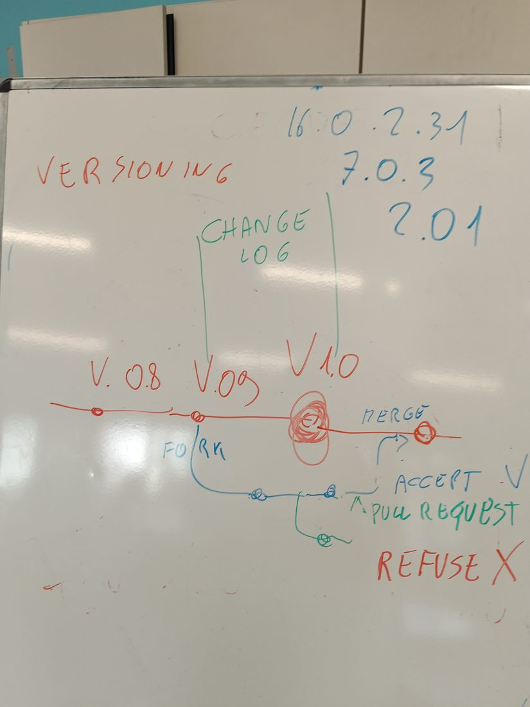

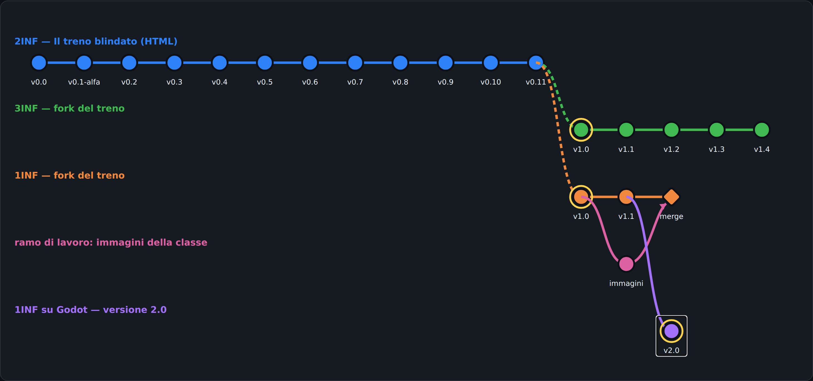

### 13.4 للنسخ في الدفتر
1. الكلمات الثماني في الرسم مع ترجمتها بلغتك: versione (إصدار)، ramo (فرع)، fork (نسخة)، Pull Request (طلب دمج)، merge (دمج)، major، minor، changelog (سجلّ التغييرات).
2. رسم بيدك بـ 3 ألوان: الفرع الرئيسي، نسخة (fork)، وفرع عمل يعود بالدمج (merge)؛ تحت كل نقطة رقم الإصدار.

### 13.5 التمارين والواجبات
1. **Versioni e Git: la storia del nostro Treno blindato** (الإصدارات و Git: قصة قطارنا المدرّع)
   1.1 ماذا تفعل: افتح الرسم، اضغط على نقاط فرع 1INF واقرأ «Cosa è cambiato e perché» (ماذا تغيّر ولماذا)؛ العب الإصدار `v0.0` والإصدار `v2.0` واكتب شيئين تغيّرا؛ قم باختبار «Versioni e Git».
   1.2 الرسم: https://nicolaregge-pulse.github.io/corso-informatica/giochi/grafo/
   1.3 الرابط: https://classroom.google.com/c/ODc3MDA4ODA3MzM2/a/ODkwMTY4Mjc5MDcz/details
   1.4 ماذا تسلّم: الواجب الواحد مع الاختبار.

---

## 14 الثلاثاء 13/10/2026 — أول طلب دمج (Pull Request) لي

<p class="it">(Martedì 13/10/2026 — La mia prima Pull Request)</p>

### 14.1 متى
1. الثلاثاء 13/10/2026، المختبر.

### 14.2 ماذا فعلنا
1. طلبات دمج للعبة القطار، الإصدارات `v2.x`: كل واحد يختار سطرًا من بيانات اللعبة ويقترح قيمة جديدة.

### 14.3 الشرح
1. الأستاذ صنع نسخة من القطار لصف 1INF: النسخة اسمها **fork**؛ القطار الأصلي يبقى في أمان.
2. طلب الدمج يقول ثلاثة أشياء: **أيّ سطر** نغيّر، **القيمة الجديدة**، و**لماذا**.

### 14.4 التمارين والواجبات
1. **La mia prima Pull Request** (أول طلب دمج لي)
   1.1 ماذا تفعل: العب 3 دقائق بالقطار؛ اقرأ جدول البيانات واختر سطرًا **واحدًا**؛ فكّر في القيمة الجديدة وفي السبب؛ اكتب طلب الدمج (بلغتك أيضًا) وأرسله.
   1.2 الرابط: https://classroom.google.com/c/ODc3MDA4ODA3MzM2/a/MjU0NjgxNTcyNTJa/details
   1.3 ماذا تسلّم: طلب الدمج (السطر، القيمة الجديدة، السبب) أو المستند الذي فيه طلب الدمج.

---

## 15 الأربعاء 14/10/2026 — الخُلد وشخصيتي

<p class="it">(Mercoledì 14/10/2026 — La talpa e il mio personaggio)</p>

### 15.1 متى
1. الأربعاء 14/10/2026، المختبر.

### 15.2 ماذا فعلنا
1. لعبة الخُلد، تطبيق للصف كله، مع جدول الترتيب؛ الشخصية الخاصة بكل واحد (صورة ووصف)؛ طلب الدمج (Pull Request) والدمج (merge) مشروحان بكلماتنا.

### 15.3 الشرح
1. **تطبيق للصف كله:** الجميع يعمل على برنامج واحد؛ كل واحد يُحضر شخصيته. القاعدة: **نُضيف، ولا نحذف** عمل الآخرين.
2. **طلب الدمج والدمج:** طلب الدمج هو الطلب «هذه شخصيتي، ضعها في اللعبة»؛ الأستاذ يراجعه ويضمّه: هذا هو **الدمج (merge)**.
3. **الإصدارات، قائمة الطلبات، سجلّ التغييرات:** كل تعديل يُولِّد إصدارًا جديدًا (`v1.1`، `v1.2`…)؛ **قائمة الطلبات (backlog)** هي صفّ الطلبات المنتظرة؛ **سجلّ التغييرات (changelog)** هو مذكّرات ما تغيّر ومن طلبه.
4. **قصّ صورة ونسخها:** على الحاسوب `Windows + Maiusc + S` ثم ارسم مربعًا حول الرأس؛ نسخ صورة: الزر الأيمن ← «Copia immagine» (نسخ الصورة)؛ اللصق: `Ctrl + V`.
5. **احفظ باسم واضح**، بدون فراغات وبدون علامات على الحروف، في مجلد `Immagini` (الصور). مثلًا:

```
1INF_cognome-nome_foto.png
```

6. **الرفع إلى نموذج (Modulo):** «Aggiungi file» (أضف ملفًا) ← «Sfoglia» (تصفّح) ← اختر الملف ← «Apri» (افتح) ← «Invia» (أرسل).
7. **صورتك أنت فقط:** أبدًا صور الزملاء أو أشخاص آخرين.

### 15.4 التمارين والواجبات
1. **La mia talpa** (الخُلد الخاص بي)
   1.1 ماذا تفعل: قُصّ صورتك (الرأس فقط)، احفظها بالاسم الصحيح واكتب جملة عن الشكل الذي تريده لشخصيتك؛ الشخصية الكرتونية يصنعها الأستاذ.
   1.2 الرابط: https://classroom.google.com/c/ODc3MDA4ODA3MzM2/a/MTYyNzY2MjI2Njk2/details
   1.3 ماذا تسلّم: الصورة والجملة.
2. **La mia talpa: il percorso** (الخُلد الخاص بي: المسار)
   2.1 ماذا تفعل: بطاقات الدرس مع المراجعة والتقييم.
   2.2 الصفحة: https://nicolaregge-pulse.github.io/corso-informatica/verifica/?b=1inf-talpa
   2.3 الرابط: https://classroom.google.com/c/ODc3MDA4ODA3MzM2/a/MjU0NzAxOTU4NjFa/details
3. **Com'è andata oggi?** (كيف كان اليوم؟)
   3.1 ماذا تفعل: قل في أسطر قليلة كيف كان الدرس.
   3.2 الرابط: https://classroom.google.com/c/ODc3MDA4ODA3MzM2/a/MjU0NzAxNDM2MjBa/details

---

## 16 الخميس 15/10/2026 — التقييم: الإصدارات وسجلّ التغييرات

<p class="it">(Giovedì 15/10/2026 — Verifica: versioni e changelog)</p>

### 16.1 متى
1. الخميس 15/10/2026، ساعة واحدة.

### 16.2 ماذا فعلنا
1. تقييم «Versioni e changelog» (الإصدارات، سجلّ التغييرات، طلب الدمج، الدمج)، على الإنترنت.

### 16.3 الشرح
1. **الإصدار:** حفظ للبرنامج مع **رقم** وسطر يقول **ماذا يتغيّر**. إذا كسر تعديلٌ كل شيء، نعود إلى إصدار سابق.
2. **Major و minor:** إذا تغيّر الرقم بعد النقطة (`v1.4` ← `v1.5`) فهي خطوة **صغيرة**، minor؛ إذا تغيّر الرقم الأول (`v1.9` ← `v2.0`) فهو تغيير **كبير**، major. بعد major نبدأ من الصفر (`v2.0`، `v2.1`…).
3. **سجلّ التغييرات (Changelog):** دفتر كل التعديلات، إصدارًا بعد إصدار.

### 16.4 التمارين والواجبات
1. **Versioni del software e changelog** (إعلان على Classroom: إصدارات البرامج وسجلّ التغييرات)
   1.1 ماذا تفعل: اقرأ البطاقات الثلاث، قم بالمراجعة وبالتقييم على الصفحة.
   1.2 الصفحة: https://nicolaregge-pulse.github.io/corso-informatica/verifica/?b=1inf-versioni
   1.3 ماذا تسلّم: التقييم على الصفحة.

---

## 17 الجمعة 16/10/2026 — رَكِّب الحاسوب: التجميع في المختبر

<p class="it">(Venerdì 16/10/2026 — Monta il PC: assemblaggio in laboratorio)</p>

### 17.1 متى
1. الجمعة 16/10/2026، المختبر.

### 17.2 ماذا فعلنا
1. تركيب الحاسوب ونظام التشغيل: مسابقة التجميع، التحدي السريع عن القطع، واختبار المراجعة.

### 17.3 الشرح
1. **السلامة أولًا:** أطفئ الحاسوب وانزع سلك الكهرباء؛ **المس المعدن** في الصندوق لتُفرغ كهرباء الجسم؛ لا تضغط بالقوة (إذا لم تدخل القطعة، فهي في الاتجاه الخطأ)؛ ضع البراغي في وعاء.
2. **ترتيب التركيب:** مزوّد الطاقة؛ اللوحة الأم؛ المعالج (CPU) والمبدّد الحراري؛ الذاكرة RAM (حتى تسمع «كليك»)؛ القرص SSD أو القرص الصلب؛ الأسلاك (الكهرباء، زر التشغيل، بيانات القرص). ثم نغلق، ونوصل الكهرباء والشاشة ولوحة المفاتيح والفأرة ونشغّل.
3. **القطع:** المعالج (CPU) هو الدماغ؛ الذاكرة RAM هي ذاكرة العمل السريعة؛ القرص يحفظ الملفات حتى والحاسوب مطفأ؛ مزوّد الطاقة يعطي الكهرباء؛ المبدّد والمروحة يبرّدان المعالج؛ اللوحة الأم هي القاعدة؛ قارئ DVD والقرص الصلب يوضعان على الحامل ويوصلان بـ**سلك SATA**.
4. **نظام التشغيل** (Windows، Linux) هو البرنامج الذي يجعل كل شيء يعمل. يُثبَّت من **ذاكرة USB قابلة للإقلاع**، باختيار البدء منها عند التشغيل.
5. **مستخدمان:** **المسؤول (amministratore)** يستطيع تغيير كل شيء (تثبيت، حذف، إنشاء مستخدمين)؛ **المستخدم العادي** يستعمل الحاسوب لكنه لا يلمس الأشياء المهمة.
6. **أدوات Windows:** Gestione dispositivi (إدارة الأجهزة: القطع المعروفة)، Gestione disco (إدارة القرص: مساحة القرص)، Gestione attività (إدارة المهام، `Ctrl + Maiusc + Esc`: البرامج المفتوحة)، Account utente (حسابات المستخدمين).

### 17.4 التمارين والواجبات
1. **Cacciaviti per il laboratorio — come li compro** (مفكّات البراغي للمختبر: كيف أشتريها؛ أُعطي في 06/10، استعدادًا للمختبر)
   1.1 ماذا تفعل: التعليمات موجودة في الواجب.
   1.2 الرابط: https://classroom.google.com/c/ODc3MDA4ODA3MzM2/a/MTYyNzUxOTY5NTU4/details
2. **Lab — Monta il PC (gara di assemblaggio)** (المختبر: ركّب الحاسوب، مسابقة التجميع)
   2.1 ماذا تفعل: فكّ الحاسوب وأعد تركيبه بالترتيب الصحيح، مع احترام قواعد السلامة.
   2.2 الرابط: https://classroom.google.com/c/ODc3MDA4ODA3MzM2/a/MTYyNzcyNDI3NjA2/details
3. **Sfida lampo — conosci i pezzi del PC?** (تحدٍّ سريع: هل تعرف قطع الحاسوب؟)
   3.1 ماذا تفعل: تعرّف على قطع الحاسوب.
   3.2 الرابط: https://classroom.google.com/c/ODc3MDA4ODA3MzM2/a/MjU0NzkxMDkxMzRa/details
4. **Ripassa e fai il Test — i pezzi del PC** (راجع وقم بالاختبار: قطع الحاسوب)
   4.1 ماذا تفعل: اقرأ البطاقات الثلاث، قم بالمراجعة والاختبار على الصفحة.
   4.2 الصفحة: https://nicolaregge-pulse.github.io/corso-informatica/verifica/?b=1inf-assemblaggio
   4.3 الرابط: https://classroom.google.com/c/ODc3MDA4ODA3MzM2/a/MTYyNzcyODM0Njky/details

---

## 18 الثلاثاء 20/10/2026 — كم يزن الملف، وما سرعة الشبكة

<p class="it">(Martedì 20/10/2026 — Quanto pesa un file, quanto va veloce la rete)</p>

### 18.1 متى
1. الثلاثاء 20/10/2026، ساعة واحدة، التكنولوجيا.

### 18.2 ماذا فعلنا
1. البت والبايت، KB و MB و GB و TB؛ السرعة بـ Mbps؛ حرف b الصغير (بت) وحرف B الكبير (بايت)؛ وقت التنزيل، البث المباشر (streaming)، Wi-Fi أو السلك.

### 18.3 الشرح
1. **البت:** الحاسوب يفهم فقط: كهرباء نعم (1) أو كهرباء لا (0). في السلك البتات كهرباء: 5 فولت = 1، 0 فولت = 0.
2. **البايت:** 8 بتات معًا = بايت واحد = حرف واحد (حرف A هو `01000001`). البت يُكتب بـ**b الصغير**، والبايت بـ**B الكبير**.
3. **الوحدات** (كل درجة أكبر بحوالي 1000 مرة؛ الحاسوب يستعمل 1024، ولحساباتنا يكفي 1000):

| الاسم | يُكتب | كم هو |
|---|---|---|
| kilobyte | KB | 1000 byte |
| megabyte | MB | 1000 KB |
| gigabyte | GB | 1000 MB |
| terabyte | TB | 1000 GB |

4. **كم يزن (تقريبًا):** رسالة 1 KB؛ صورة الهاتف 3 MB؛ أغنية 4 MB؛ فيديو دقيقة واحدة 100 MB؛ فيلم 2 GB؛ ذاكرة الهاتف 128 GB.
5. **الحساب:** أولًا تضع كل شيء في الوحدة نفسها، ثم تقسم. `64 GB = 64000 MB`؛ `64000 : 3` = حوالي **21000 صورة**.
6. **سرعة الشبكة** تُقاس بـ **Mbps** (ميغابت في الثانية): ADSL حوالي 10، 4G حوالي 30، 5G حوالي 300، الألياف 1000 Mbps.
7. **b الصغير و B الكبير:** للانتقال من Mbps إلى MB في الثانية **اقسم على 8**. `100 Mbps : 8` = **12,5 MB في الثانية**.
8. **وقت التنزيل:** فيلم 2 GB = 2000 MB، خط 100 Mbps = `12,5 MB/s`؛ `2000 : 12,5` = **160 ثانية**.
9. **البث المباشر (Streaming)** = المشاهدة أثناء التنزيل، بدون حفظ. نحتاج تقريبًا: موسيقى 0,3 Mbps؛ مكالمة فيديو 2؛ فيديو HD 5؛ فيديو 4K 25؛ لعبة على الإنترنت 10، مع ping أقل من 50 ms.
10. **Wi-Fi أو السلك:** السلك سريع وثابت (ping منخفض)؛ Wi-Fi مريح لكنه يضعف مع المسافة والجدران. نطاق 2,4 GHz: يصل أبعد لكنه أبطأ؛ 5 GHz: أسرع لكنه يمرّ أسوأ عبر الجدران.
11. **أسلاك الشبكة:** النحاس Cat 5e مع قابس RJ45 (1000 Mbps)، Cat 6 (حتى 10000 Mbps)، الألياف الضوئية (ضوء في خيط من الزجاج، كيلومترات). سلك النحاس يصل إلى 100 متر على الأكثر.
12. **فحص البيانات (CRC):** المُرسِل يضيف رقم فحص، والمستقبِل يعيد الحساب؛ إذا لم يتطابق، فقد خرب بت ما ويُطلب الطرد (الحزمة) من جديد.

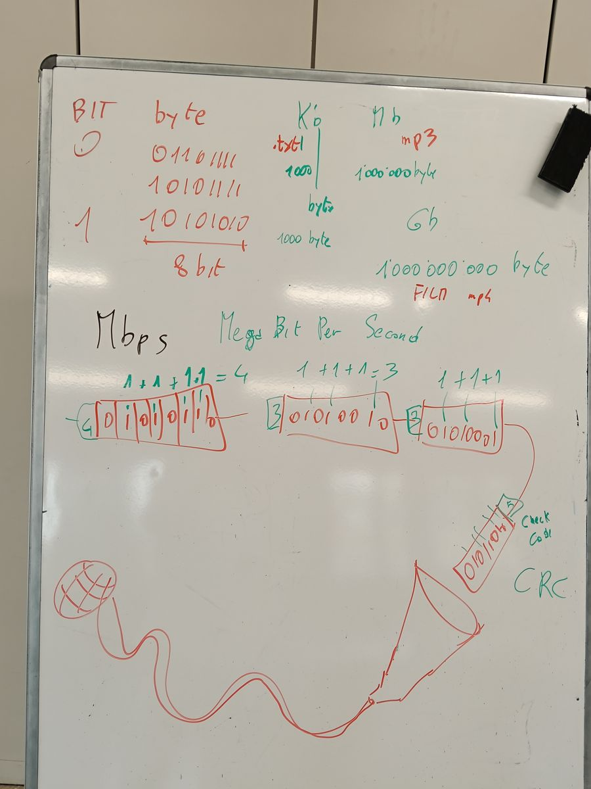

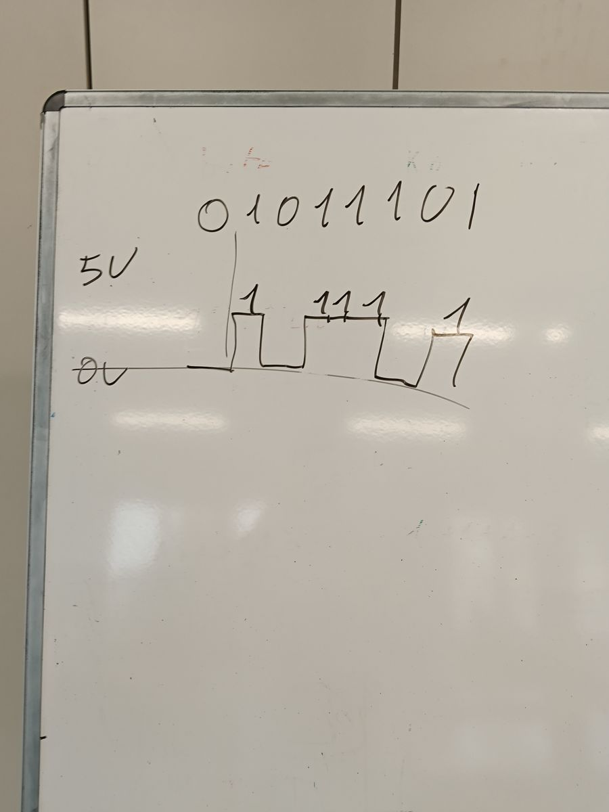

### 18.4 التمارين والواجبات
1. **Quanto pesa un file? Quanto va veloce la rete?** (كم يزن الملف؟ ما سرعة الشبكة؟)
   1.1 ماذا تفعل: ادرس أول 5 صفحات من الشرائح؛ اقرأ بطاقات الصفحة وقم بالمراجعة.
   1.2 الصفحة: https://nicolaregge-pulse.github.io/corso-informatica/verifica/?b=1inf-byte-velocita
   1.3 الرابط: https://classroom.google.com/c/ODc3MDA4ODA3MzM2/a/MTYyNzgwNTAxNjYz/details
2. **QUIZ: bit, byte e velocità della rete** (اختبار: البت والبايت وسرعة الشبكة)
   2.1 ماذا تفعل: اختبار على Google Moduli (14 سؤالًا عن أول 5 صفحات من الشرائح)؛ أجب عن كل الأسئلة واضغط «Invia» (أرسل).
   2.2 الرابط: https://classroom.google.com/c/ODc3MDA4ODA3MzM2/a/MTYyNzgwNTMwNDM0/details
   2.3 ماذا تسلّم: الاختبار مُرسَلًا.

---

## 19 الأربعاء 21/10/2026 — مختبر اللاعب: كم واحدًا يتّسع؟

<p class="it">(Mercoledì 21/10/2026 — Il laboratorio del gamer: quante ce ne stanno?)</p>

### 19.1 متى
1. الأربعاء 21/10/2026، 3 ساعات، المختبر.

### 19.2 ماذا فعلنا
1. كم يزن الملف وكم ملفًا يتّسع، وقت التنزيل، البث المباشر والتحميل المؤقّت (buffering)؛ المسار الموجَّه «Quante ce ne stanno?» (كم واحدًا يتّسع؟)، ألعاب البايت، اختبار على Moduli، أسئلة شفهية. توقّفنا قبل الـ ping.

### 19.3 الشرح
1. **الصورة مصنوعة من بايتات:** `3 MB = 3.000.000 byte`؛ كل بايت صفّ من 8 بتات.
2. **كم صورة في الهاتف:** `64 GB = 64.000 MB`؛ `64.000 : 3` = حوالي 21.000 صورة. و 32 صورة؟ `32 × 3 = 96 MB`.
3. **Mb/s و MB/s:** في الشبكة البتات تسافر واحدًا بعد الآخر؛ `8 Mb/s = 1 MB/s`؛ `100 Mb/s ≈ 12 MB/s`، أي حوالي 4 صور في الثانية.
4. **التنزيل أو البث المباشر:** مع التنزيل تنتظر حتى يصل الملف كله وتحفظه؛ مع البث المباشر تشاهده وهو يصل. إذا كانت الشبكة أبطأ من الفيديو، يتوقّف الفيديو ليُحمِّل: هذا هو **التحميل المؤقّت (buffering)**.
5. **وقت تنزيل فيلم:** الوزن بـ MB مقسومًا على السرعة بـ MB في الثانية.

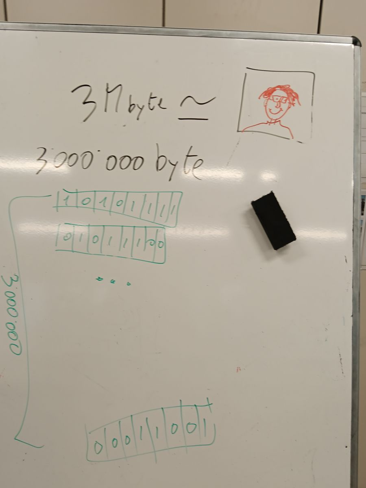

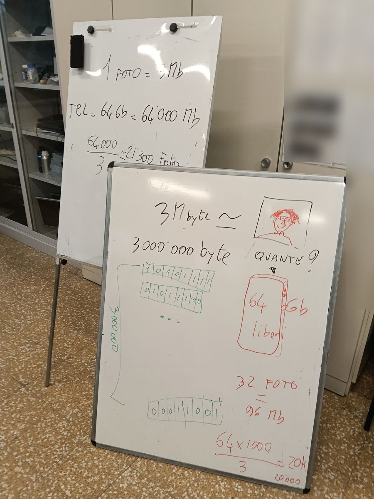

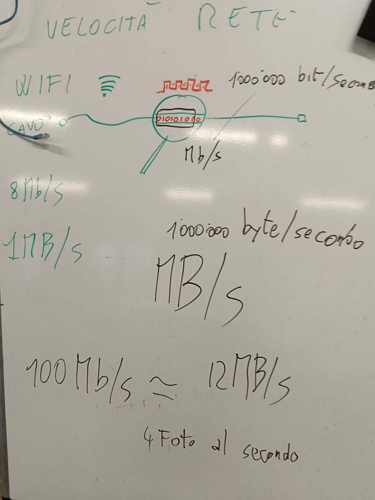

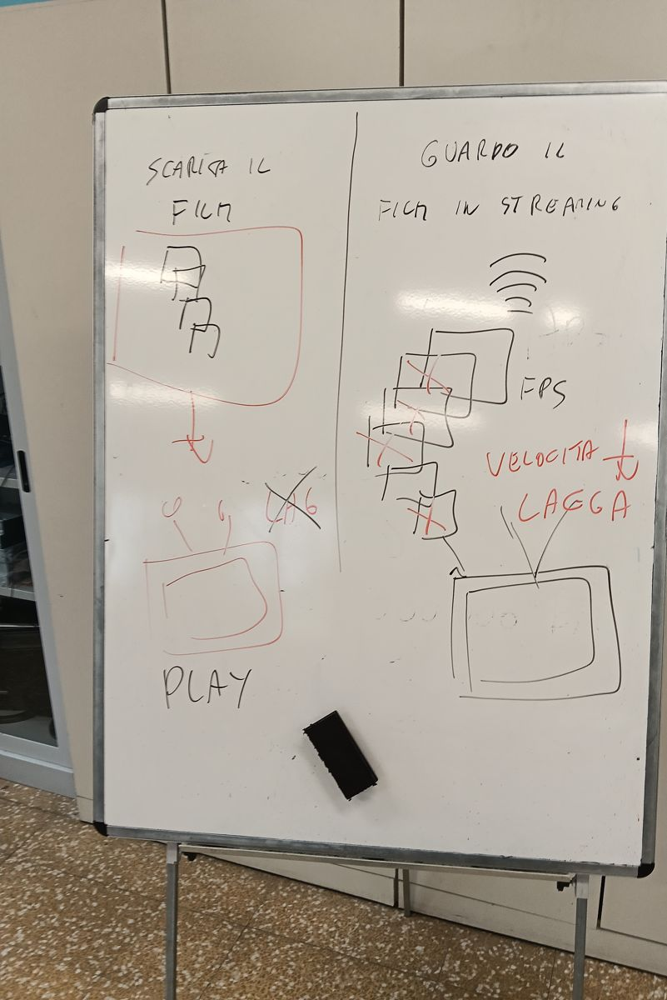

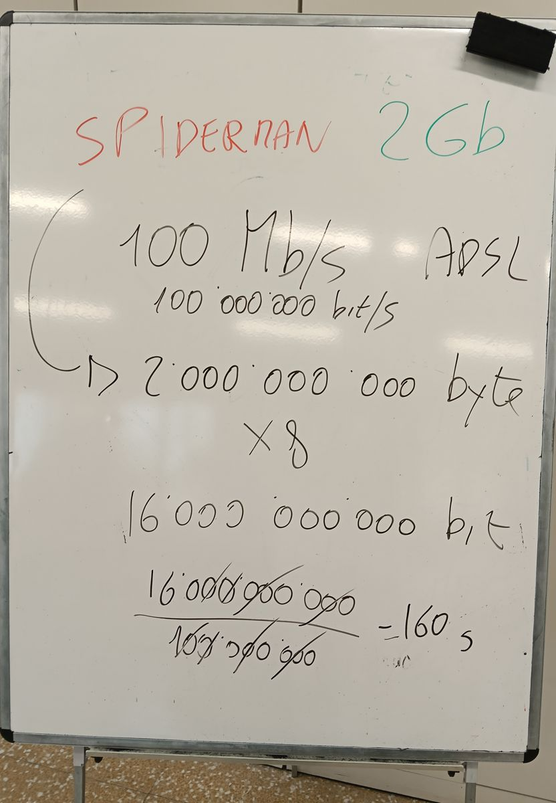

### 19.4 التمارين والواجبات
1. **OGGI: il laboratorio del gamer** (اليوم: مختبر اللاعب)
   1.1 ماذا تفعل: ادرس في ملف PDF للشرائح الصفحات المذكورة؛ قم بالمسار «Quante ce ne stanno?» وبألعاب البايت.
   1.2 الصفحات: https://nicolaregge-pulse.github.io/corso-informatica/1inf-quante/ و https://nicolaregge-pulse.github.io/corso-informatica/1inf-byte-giochi/
   1.3 الرابط: https://classroom.google.com/c/ODc3MDA4ODA3MzM2/a/MjU0OTE1MzcwNjRa/details
2. **QUIZ: velocità della rete, download, streaming e cavi (slide 1-11)** (اختبار: سرعة الشبكة، التنزيل، البث المباشر والأسلاك)
   2.1 ماذا تفعل: اختبار على Google Moduli؛ أجب عن كل الأسئلة واضغط «Invia» (أرسل).
   2.2 الرابط: https://classroom.google.com/c/ODc3MDA4ODA3MzM2/a/MTYyNzg1MTk0ODI0/details
   2.3 ماذا تسلّم: الاختبار مُرسَلًا.

---

## 20 الخميس 22/10/2026 — السلامة 1: الخطر، الضرر، المخاطرة

<p class="it">(Giovedì 22/10/2026 — Sicurezza 1: pericolo, danno, rischio)</p>

### 20.1 متى
1. الخميس 22/10/2026، ساعة واحدة، السلامة في العمل (الساعة الأولى من دورة الإقليم).

### 20.2 ماذا فعلنا
1. الخطر والضرر والمخاطرة مع أمثلة من الحياة اليومية؛ اختبار على Moduli.

### 20.3 الشرح
1. **السلامة** تفيد في شيء واحد فقط: **ألّا تؤذي نفسك**، في المدرسة، في البيت، في الشارع وفي العمل.
2. **الخطر (PERICOLO):** شيء **يمكن** أن يؤذي (السكين، الزيت المغلي، المقبس بأسلاك مكشوفة، الأرض المبلّلة، الشارع). السؤال السحري: «ما الذي هنا يمكن أن يؤذيني؟».
3. **الأخطار في كل مكان:** في الصف (أسلاك على الأرض، حقائب في الممرّ، كرسي يتأرجح، شاشة قريبة جدًا)؛ في المطبخ (الموقد، قِدر يغلي، المكواة)؛ في الشارع (الدراجة النارية، دراجة بدون أضواء في المساء، الهاتف في اليد وأنت تعبر)؛ في الرياضة (كرة على الأرض، أرض مبلّلة)؛ في الأعمال الصغيرة (السلّم، المثقاب، كرسي بعجلات يُستعمل كسلّم).
4. **الضرر (DANNO):** الأذى الذي **يحدث فعلًا** (جرح، حرق، التواء الكاحل، كسر، صعقة كهربائية، ألم الظهر، تعب العينين). يمكن أن ينكسر شيء أيضًا.
5. **المخاطرة (RISCHIO):** تجيب عن سؤالين: **هل يحدث بسهولة؟** و**كم يؤذي؟** الخطر هو الشيء؛ المخاطرة تعتمد على **كيف** تستعمله.
6. **مخاطرة منخفضة ومرتفعة:** دراجة نارية مع خوذة مربوطة، ببطء، في النهار (منخفضة) أو بدون خوذة، بسرعة، في الليل، والهاتف في اليد (مرتفعة)؛ هاتف يُشحن على الطاولة بالشاحن الأصلي (منخفضة) أو تحت الوسادة طوال الليل مع سلك مقشور (مرتفعة).
7. **الثلاثة معًا:** المقلاة. الخطر: الزيت المغلي. الضرر: حرق. المخاطرة: مرتفعة إذا كان المقبض بارزًا ويمرّ طفل، ومنخفضة إذا كان المقبض مُدارًا إلى الداخل.
8. **«نجوتُ بأعجوبة» (حادث كاد أن يقع):** لم يصبك شيء، لكن الخطر كان موجودًا: قُله فورًا، حتى لا يتأذّى الشخص التالي.

### 20.4 التمارين والواجبات
1. **OGGI: Sicurezza 1 — pericolo, rischio e infortunio** (اليوم: السلامة 1، الخطر والمخاطرة والإصابة)
   1.1 ماذا تفعل: اقرأ البطاقات الثماني، قم بالمراجعة، ثم بالاختبار على Moduli.
   1.2 الصفحة: https://nicolaregge-pulse.github.io/corso-informatica/verifica/?b=1inf-sicurezza-1ora
   1.3 الرابط: https://classroom.google.com/c/ODc3MDA4ODA3MzM2/a/MjU0OTc1MTgyNTJa/details
   1.4 ماذا تسلّم: المراجعة على الصفحة والاختبار على Moduli مُرسَلًا.

---

## 21 الجمعة 23/10/2026 — الشبكة واللاعب: ping و jitter و FPS والشاشة

<p class="it">(Venerdì 23/10/2026 — Rete e gamer: ping, jitter, FPS e monitor)</p>

### 21.1 متى
1. الجمعة 23/10/2026، 4 ساعات، التكنولوجيا (ساعة واحدة) والمختبر (3 ساعات).

### 21.2 ماذا فعلنا
1. على السبورة: ping و jitter، TCP و UDP، FPS و Hz، شاشات TN و VA و OLED، البكسل ودقّة الشاشة.
2. التطبيق «Le misure del mio PC» (قياسات حاسوبي) مع تجارب الـ ping والتنزيل والشاشة؛ المستند الشخصي «Rete e gamer» (الشبكة واللاعب)؛ اختبار على Moduli.

### 21.3 الشرح
1. **الـ ping** هو وقت ذهاب وإياب رسالة من حاسوبك إلى خادم اللعبة، بالمللي ثانية (`1000 ms` = ثانية واحدة). يعتمد خاصة على **المسافة** من الخادم، وليس على الـ Mbps.

| Ping | كيف يكون اللعب |
|---|---|
| أقل من 30 ms | ممتاز |
| 30-60 ms | جيد |
| 60-100 ms | تشعر به قليلًا |
| أكثر من 150 ms | تأخير (lag): الضربات تصل متأخرة |

2. **الـ jitter** هو مقدار **تغيّر** الـ ping: `40, 41, 39, 40 ms` = jitter منخفض، لعب منتظم؛ `20, 120, 30, 110 ms` = jitter مرتفع، الشخصية تقفز. الأفضل ping بـ 50 ms ثابت دائمًا من ping يقفز بين 20 و 120.
3. **TCP و UDP** (**البروتوكولات**، أي قواعد لإرسال **الحِزَم**):
   3.1 **TCP**: إذا ضاعت حزمة تُرسَل من جديد؛ يصل كل شيء، بالترتيب. للملفات (FTP)، صفحات الإنترنت، البريد الإلكتروني، التنزيلات. مثل رسالة مسجّلة مع إشعار استلام.
   3.2 **UDP**: الحزمة الضائعة لا تُرسَل من جديد؛ أسرع، وتأخير أقل. للبث المباشر، مكالمات الفيديو، الألعاب على الإنترنت. مثل منشور إعلاني في صندوق البريد.
4. **التأخير والتقطّع:** التأخير (lag) = اللعبة تستجيب متأخرة (ping مرتفع)؛ تقطّع الشبكة = jitter مرتفع؛ حِزَم ضائعة = Wi-Fi ضعيف أو شبكة ممتلئة؛ تقطّع حتى بدون إنترنت = الذنب ذنب بطاقة الفيديو (FPS منخفض).
5. **FPS** (frame per second، صور في الثانية)، تصنعها **بطاقة الفيديو**: 15 متقطّع؛ 30 مقبول؛ 60 سلس؛ 144 وأكثر سلس جدًا. مع 60 FPS تبقى كل صورة `1000 : 60 ≈ 17 ms`.
6. **الـ Hz في الشاشة:** كم مرة في الثانية ترسم الشاشة الصورة من جديد. FPS و Hz يجب أن يتّفقا: 30 FPS على شاشة 120 Hz = كل صورة تُعرض 4 مرات (الشاشة مُهدَرة)؛ 200 FPS على 60 Hz = ترى 60 فقط (البطاقة مُهدَرة)؛ 144 FPS على 144 Hz = كل شيء متّفق.
7. **البكسل ودقّة الشاشة:** HD `1280 × 720` (0,9 مليون بكسل)؛ Full HD `1920 × 1080` (حوالي مليونين)؛ 2K `2560 × 1440` (3,7 مليون)؛ 4K `3840 × 2160` (8,3 مليون، 4 أضعاف Full HD).
8. **أنواع الشاشات:** **TN** سريعة جدًا ورخيصة، ألوان باهتة، زاوية رؤية ضيّقة (حوالي 90°)؛ **IPS** ألوان جميلة، ترى جيدًا من الجانب؛ **VA** أسود عميق لكنها تترك أثرًا خلف الصورة (**ghosting**)؛ **OLED** أسود كامل وسريعة جدًا، لكنها غالية جدًا. **زمن الاستجابة** (1-5 ms): كلّما كان أقلّ، كانت الآثار أقلّ.
9. **بطاقة الفيديو:** **مدمجة** في المعالج (للمدرسة، للفيديو) أو **منفصلة**، بذاكرتها الخاصة **VRAM** (مثلًا 8 GB)، للألعاب.
10. **كم تزن الصور والأفلام:** كل بكسل = 3 بايت (أحمر، أخضر، أزرق). صورة Full HD = `2.073.600 × 3` ≈ **6 MB**؛ بصيغة JPG من 0,5 إلى 1 MB. فيلم ساعتين بدون ضغط ≈ 1000 GB؛ بصيغة MP4 حوالي 2 GB.
11. **سلك الفيديو وعرض النطاق** (البكسل × 24 بت × Hz): Full HD على 60 Hz ≈ `3 Gbit/s`؛ 4K على 144 Hz ≈ `28,7 Gbit/s`. HDMI 1.4 حوالي `10 Gbit/s`؛ HDMI 2.0 = 18؛ DisplayPort 1.4 = 32؛ HDMI 2.1 = 48.
12. **جرّب أنت (مع الحلول):**
   12.1 ping بـ `35, 36, 34, 35 ms`: jitter منخفض.
   12.2 60 FPS على شاشة 240 Hz: كل صورة تُعرض 4 مرات.
   12.3 `1280 × 720 = 921.600` بكسل.
   12.4 تحديث اللعبة بـ TCP؛ الصوت في الدردشة بـ UDP.
   12.5 تقطّع حتى بدون إنترنت: الذنب ذنب بطاقة الفيديو.
   12.6 شاشة 2K على 60 Hz ≈ `5,3 Gbit/s`: يكفي HDMI 1.4.

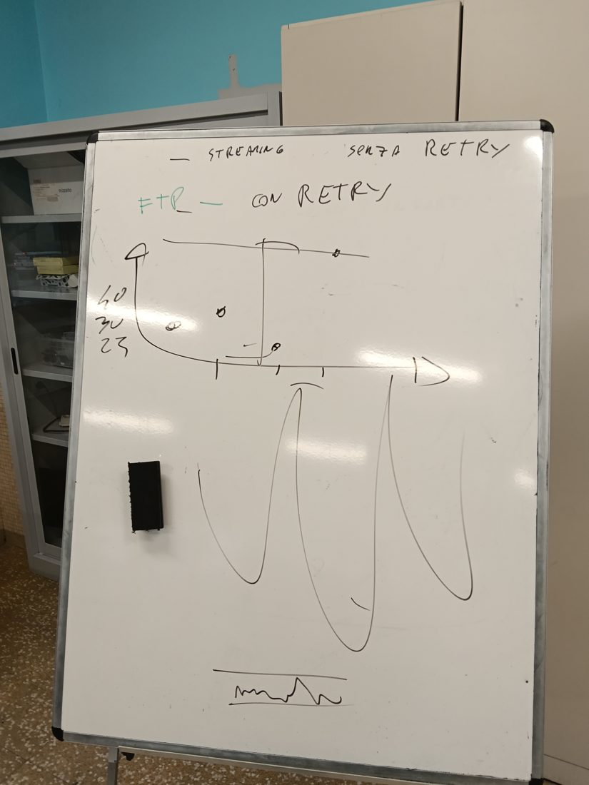

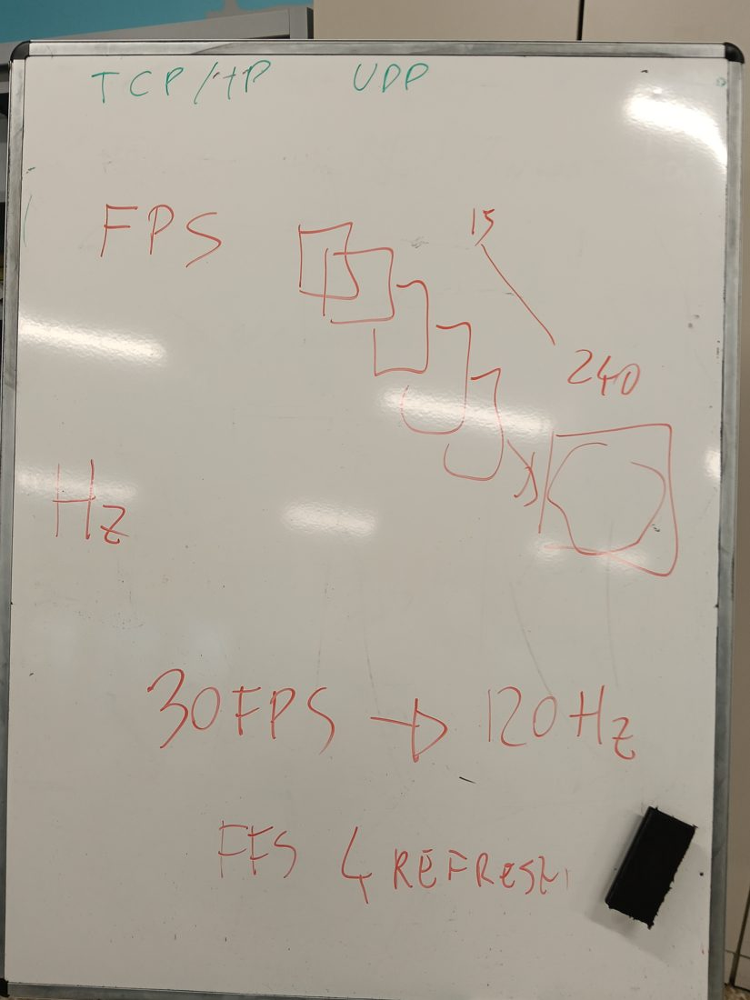

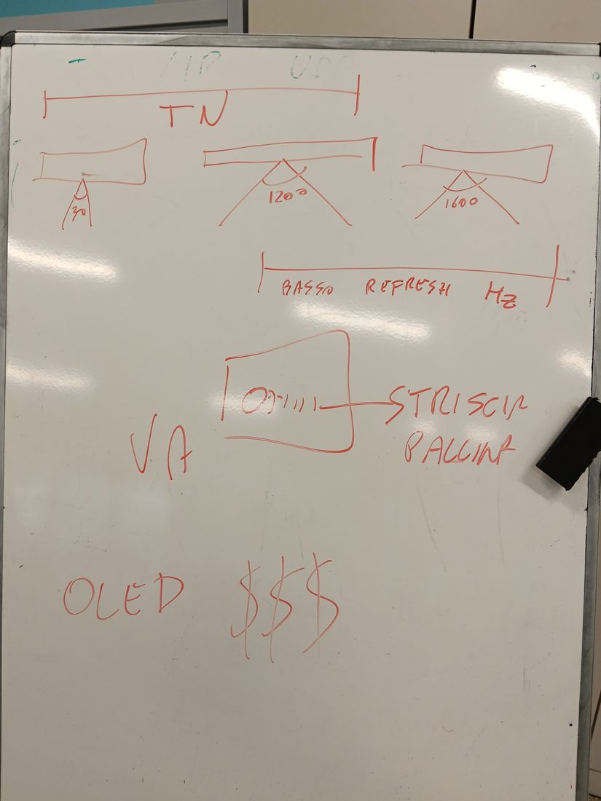

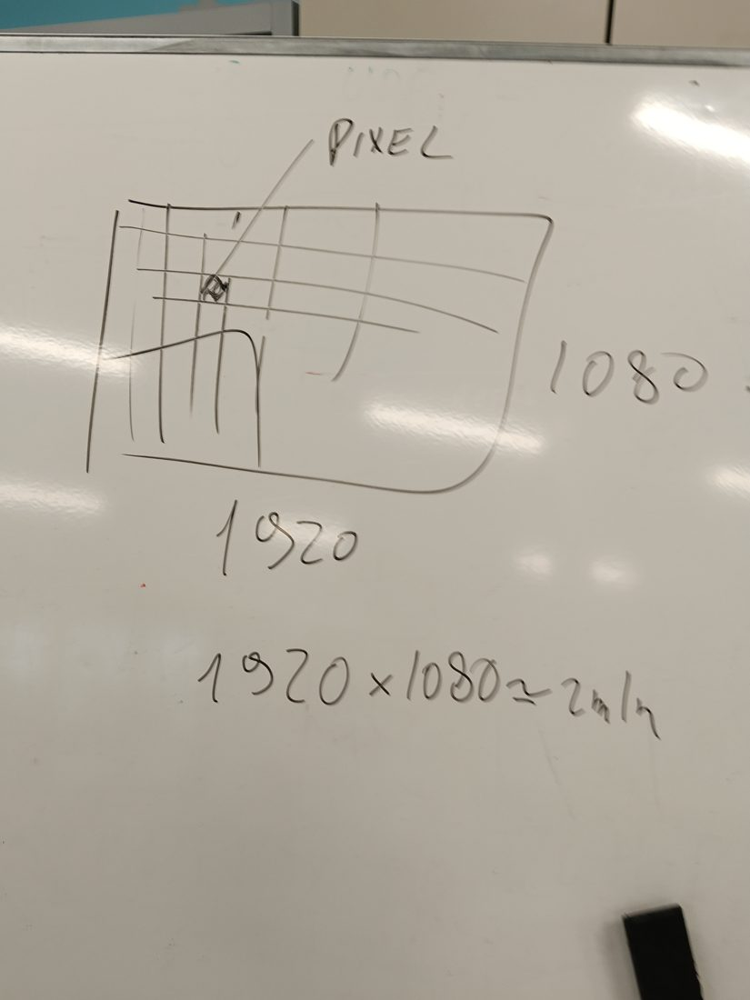

### 21.4 التمارين والواجبات
1. **Dimensioni e unità di misura dell'informatica** (الأحجام ووحدات القياس في المعلوماتية)
   1.1 ماذا تفعل: داخل الواجب اضغط «+ Aggiungi o crea» (أضف أو أنشئ) ← «Documenti» (مستندات) واكتب مستندك «Rete e gamer» في 13 فصلًا (1500 كلمة على الأقل، بكلماتك، و 3 لقطات شاشة لك على الأقل): من أنا كلاعب؛ الـ ping في لعبتي؛ الـ jitter؛ TCP و UDP في يومي؛ تلك المرة التي تقطّع فيها كل شيء؛ FPS و Hz في شاشتي؛ دقّة شاشتي؛ الشاشة التي سأختارها؛ بطاقة الفيديو؛ كم يزن؛ سلك الفيديو؛ تجهيزاتي الكاملة؛ ماذا تعلّمت. القياسات تؤخذ بالتطبيق «Le misure del mio PC».
   1.2 التطبيق: https://nicolaregge-pulse.github.io/corso-informatica/1inf-misure/
   1.3 الرابط: https://classroom.google.com/c/ODc3MDA4ODA3MzM2/a/MjU0OTkyMzg1MjVa/details
   1.4 ماذا تسلّم: المستند، بزرّ «Consegna» (سلِّم). النسخ واللصق لا يُقبل.
2. **QUIZ dimensioni** (اختبار الأحجام)
   2.1 ماذا تفعل: الاختبار على Moduli عن الشبكة واللاعب (ping، jitter، TCP و UDP، البكسل، Hz، الأسلاك)؛ أجب وحدك واضغط «Invia» (أرسل).
   2.2 الرابط: https://classroom.google.com/c/ODc3MDA4ODA3MzM2/a/MjU1MDEwNzQ4MTda/details
   2.3 ماذا تسلّم: الاختبار مُرسَلًا.

---

## 22 الثلاثاء 27/10/2026 — مراجعة، بطاقات الفيديو، المخارج والأسلاك

<p class="it">(Martedì 27/10/2026 — Ripasso, schede video, uscite e cavi)</p>

### 22.1 متى
1. الثلاثاء 27/10/2026، المختبر.

### 22.2 ماذا فعلنا
1. مراجعة البت والبايت و Mbps و ping و jitter و FPS و Hz مع اختبار؛ بطاقة الفيديو المدمجة والمنفصلة، الـ VRAM، مخارج الفيديو VGA و DVI و HDMI و DisplayPort و USB-C والمحوّلات، مع اختبار ثانٍ.

### 22.3 الشرح
1. **مراجعة:** البت والبايت، KB و MB و GB و TB، b الصغير و B الكبير، ping، jitter، FPS، Hz (الفصلان 18 و 21).
2. **الـ GPU** هو دماغ الصور، داخل بطاقة الفيديو. **المدمجة**: داخل المعالج، لا تُرى، قوّتها منخفضة. **المنفصلة**: بطاقة مستقلّة في **منفذ PCIe**، مع مروحة أو 2 أو 3، للألعاب ومونتاج الفيديو والـ 3D (من 150 إلى أكثر من 1000 يورو).
3. **الـ VRAM** هي ذاكرة البطاقة المنفصلة: 4 GB ألعاب خفيفة بـ Full HD؛ 8 GB تقريبًا كل الألعاب بـ Full HD؛ 12-16 GB لـ 2K و 4K؛ 24 GB لـ 4K في الحد الأقصى، الـ 3D، الذكاء الاصطناعي. البطاقة المدمجة تستعير قطعة من الـ RAM.
4. **الكهرباء:** البطاقة المنفصلة تستهلك من 75 إلى 450 واط، لها سلك مباشر من مزوّد الطاقة وتحتاج مزوّد طاقة أقوى (600-850 واط).
5. **مخارج الفيديو، بالنظر:**

| المخرج | الشكل | اللون | الإبر |
|---|---|---|---|
| VGA | شبه منحرف مع برغيين | أزرق | 15 ثقبًا صغيرًا في 3 صفوف |
| DVI | مستطيل طويل مع برغيين | أبيض | حتى 24 ثقبًا صغيرًا وصليب صغير |
| HDMI | شبه منحرف مسطّح، بدون براغٍ | أسود | 19 نقطة تماس |
| DisplayPort | مستطيل بزاوية مقطوعة | أسود | 20 نقطة تماس |
| USB-C | بيضاوي صغير، يدخل في الاتجاهين | أسود أو رمادي | 24 نقطة تماس |

6. إذا كان في الحاسوب بطاقة **منفصلة**، توصل الشاشة بمخارجها، **في الأسفل** وفي صفّ، وليس بالمخارج التي في الأعلى قرب منافذ USB.
7. **مقارنة الأسلاك:** VGA قديم و**تناظري**، صورة فقط، Full HD على 60 Hz؛ DVI رقمي، عادة بدون صوت؛ HDMI 1.4 يعطي 4K على 30 Hz؛ HDMI 2.0 يعطي 4K على 60 Hz؛ HDMI 2.1 يعطي 4K على 120 Hz؛ DisplayPort 1.4 يعطي 4K على 120 Hz وأكثر؛ USB-C عادة 4K على 60 Hz. HDMI و DisplayPort ينقلان الصوت أيضًا. **تناظري** = موجة تخرب قليلًا؛ **رقمي** = 0 و 1، يصل نظيفًا.
8. **المحوّلات:** HDMI ← VGA (يضيع الصوت)؛ DVI ← HDMI؛ DisplayPort ← HDMI؛ USB-C ← HDMI (فقط إذا كان الجهاز يرسل الفيديو من USB-C).
9. **السلك الصحيح:** جهاز الألعاب (console) دائمًا HDMI؛ شاشة المدرسة: المقبس المتشابه والأحدث؛ شاشة الألعاب 144 Hz: DisplayPort أو HDMI 2.1.

### 22.4 التمارين والواجبات
1. **OGGI: ripasso, poi la scheda video e i cavi, con un quiz alla fine di ogni parte.** (اليوم: مراجعة، ثم بطاقة الفيديو والأسلاك، مع اختبار في نهاية كل جزء)
   1.1 ماذا تفعل: اقرأ بطاقات المراجعة وقم بالاختبار في آخرها؛ ثم اقرأ البطاقات الجديدة (بطاقة الفيديو والأسلاك)، قم بالتجربة على الطاولة (ما المخارج التي تراها خلف الحاسوب وخلف الشاشة) وبالاختبار الثاني.
   1.2 المراجعة: https://nicolaregge-pulse.github.io/corso-informatica/verifica/?b=1inf-ripasso-2710
   1.3 الشرح الجديد: https://nicolaregge-pulse.github.io/corso-informatica/verifica/?b=1inf-video-cavi
   1.4 الرابط: https://classroom.google.com/c/ODc3MDA4ODA3MzM2/a/MjU1MDg4Mzg1MDZa/details
   1.5 ماذا تسلّم: الاختباران.

---

## 23 الأربعاء 28/10/2026 — Lazarus: برنامجي الأول «Ciao» (مرحبًا)

<p class="it">(Mercoledì 28/10/2026 — Lazarus: il mio primo programma «Ciao»)</p>

### 23.1 متى
1. الأربعاء 28/10/2026، 3 ساعات، المختبر.

### 23.2 ماذا فعلنا
1. البرنامج الأول في Lazarus: مشروع جديد في مجلد خاص به (`Documenti\Lazarus\Ciao`)، لوحة المكوّنات، TEdit و TButton، الأمر ShowMessage «Ciao»، ملفات المشروع حسب الامتداد؛ تسليم المستند على Classroom.

### 23.3 الشرح
1. **Lazarus** برنامج **لصنع برامج أخرى** فيها نوافذ وأزرار. يعمل مثل قطع البناء الصغيرة: تأخذ قطعة جاهزة (زرًّا، خانة)، تضعها في النافذة وتكتب ماذا يجب أن تفعل. اللغة هي **Pascal**.
2. **بداية نظيفة:** كل المشاريع توضع في **`Documenti → Lazarus`**؛ **مشروع واحد = مجلد واحد فقط**.
   2.1 القائمة `File → Chiudi tutto` (أغلق الكل)؛ القائمة `Progetto → Chiudi progetto` (أغلق المشروع).
   2.2 القائمة `Progetto → Nuovo progetto… → Applicazione → OK`: تظهر النافذة الفارغة Form1.
   2.3 فورًا: القائمة `Progetto → Salva progetto con nome…` ← `Documenti` ← `Lazarus` ← مجلد جديد `Ciao` ← ادخل إلى المجلد ← اسم الملف `Ciao.lpi` ← `Salva` ← الوحدة اسمها `unit1.pas` ← `Salva`.
3. **نوافذ Lazarus:** في الأعلى **القائمة** و**لوحة المكوّنات**؛ على اليسار **مفتّش الكائنات** (خصائص القطعة المختارة وأحداثها)؛ في الوسط **Form1** (نافذة برنامجك)؛ خلفها **محرّر الكود** (`unit1.pas`)؛ في الأسفل **الرسائل** (الأخطاء). الزر `F12` ينقلك من النافذة إلى الكود وبالعكس.
4. **لوحة المكوّنات**، تبويب Standard. اسأل نفسك: ماذا يجب أن يفعل من يستعمل البرنامج؟
   4.1 **يكتب** ← **TEdit**، الخانة التي عليها «abc»؛ الخاصية **Text** هي ما هو مكتوب فيها؛
   4.2 **يضغط** ← **TButton**، الزر «OK»؛ الخاصية **Caption** هي الكتابة على الزر؛
   4.3 **يقرأ** ← **TLabel**، الحرف «A»؛ الخاصية **Caption** هي النص.
5. **التمرين:** خانة TEdit (امسح Text) وزرّ TButton فيه Caption `Saluta` (سلِّم). انقر مرتين على الزر: يُفتح `procedure TForm1.Button1Click`. بين `begin` و `end;` تُكتب سطر التحية (انظر المربّع في الأسفل).
6. **قطعة بعد قطعة:** `ShowMessage( … )` يفتح نافذة صغيرة فيها الرسالة وزر OK؛ `Edit1.Text` هو نص الخانة؛ `'Ciao '` كتابة ثابتة بين علامتي اقتباس (المسافة تمنع «CiaoMario»)؛ `+` يلصق كتابتين؛ `;` تُغلق الأمر.
7. **احفظ وشغّل:** `Ctrl + S` يحفظ؛ `F9` (أو السهم الأخضر) يشغّل البرنامج. أخطاء شائعة: تنقص `;`، علامة `=` بدل `:=`، تنقص علامة اقتباس، السطر خارج `begin … end`.
8. **ملفات المشروع:** **الامتداد** (الحروف بعد النقطة) يقول ما نوع الملف.
   8.1 `.lpi` معلومات المشروع (يُفتح من جديد بالنقر مرتين)؛ `.lpr` البرنامج الرئيسي؛ `.lfm` شكل النافذة؛ `.pas` الكود الخاص بك. هذه هي **الملفات الأربعة التي نحتفظ بها**، ونسلّمها ونضعها على GitHub.
   8.2 `.lps` (الجلسة)، `.res` و `.ico` (الموارد والأيقونة)، `.exe` (البرنامج الجاهز، يُصنع بـ F9)، المجلد `lib` (ملفات عمل **المترجِم (compilatore)**، `.o` `.ppu` `.compiled` `.or`) والمجلد `backup`: Lazarus يصنعها من جديد وحده.

```
ShowMessage('Ciao ' + Edit1.Text);
```

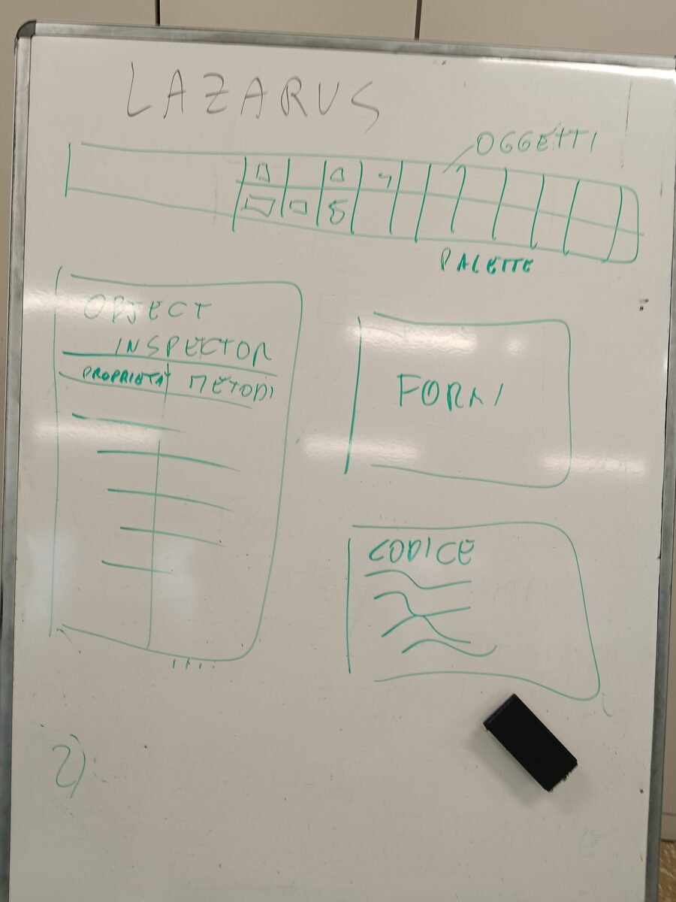

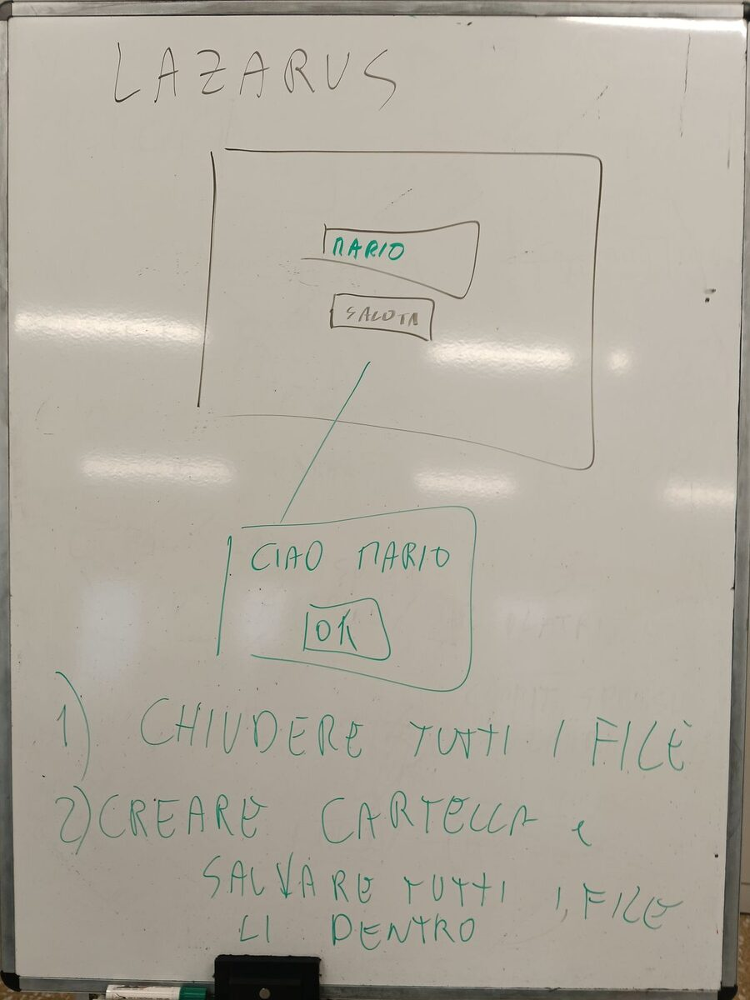

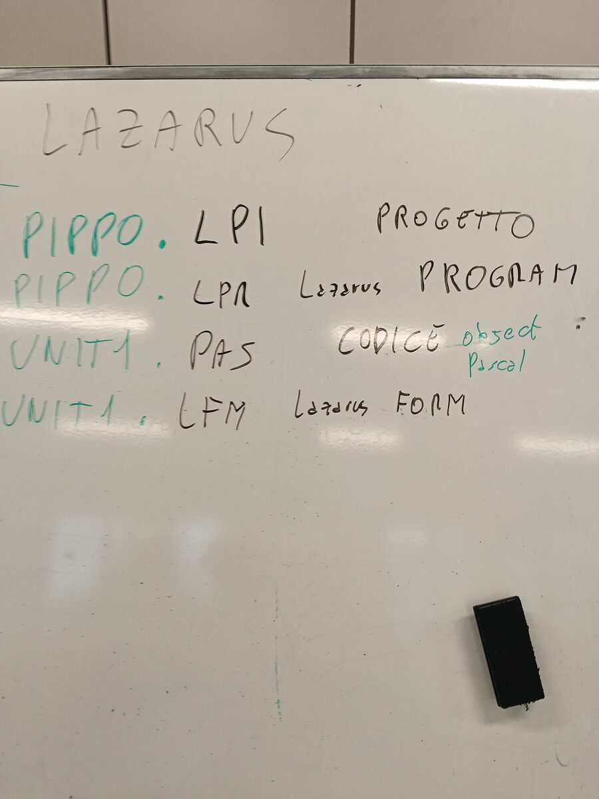

### 23.4 للنسخ في الدفتر
تُنسخ الأسطر كما هي، بالإيطالية:

```
Documenti\Lazarus\Ciao\   un progetto = una cartella sola
scrivo MARIO -> clic su [Saluta] -> OnClick -> Button1Click
   -> ShowMessage('Ciao ' + Edit1.Text) -> | Ciao MARIO  [OK] |
I 4 file da tenere: .lpi  .lpr  .pas  .lfm
```

المعنى بالعربية:

1. `Documenti\Lazarus\Ciao\` مشروع واحد = مجلد واحد فقط.
2. أكتب MARIO ← أنقر على [Saluta] ← OnClick ← Button1Click ← `ShowMessage('Ciao ' + Edit1.Text)` ← تظهر نافذة «Ciao MARIO» مع زر OK.
3. الملفات الأربعة التي نحتفظ بها: `.lpi` `.lpr` `.pas` `.lfm`

### 23.5 التمارين والواجبات
1. **Il mio primo programma: Ciao in Lazarus** (برنامجي الأول: Ciao في Lazarus)
   1.1 ماذا تفعل: اتبع بطاقات الدرس واحدة بعد الأخرى واصنع البرنامج «Ciao»: اكتب اسمك، اضغط الزر، تظهر Ciao واسمك. اجعله لك: التحية بلغتك، عنوان النافذة، اللون.
   1.2 الصفحة: https://nicolaregge-pulse.github.io/corso-informatica/verifica/?b=1inf-lazarus-ciao
   1.3 الرابط: https://classroom.google.com/c/ODc3MDA4ODA3MzM2/a/ODk2MjY0NzUxNjQw/details
   1.4 ماذا تسلّم: في المستند المرفق بالواجب: 1) كود الإجراء `Button1Click`؛ 2) لقطة شاشة للبرنامج وهو يعمل؛ 3) جملة بكلماتك عمّا يفعله السطر `ShowMessage`. ثم «Consegna» (سلِّم).

---

## 24 الخميس 29/10/2026 — السلامة 2 و 3: الوقاية، الحماية والوقاية في الشركة

<p class="it">(Giovedì 29/10/2026 — Sicurezza 2 e 3: prevenzione, protezione e prevenzione aziendale)</p>

### 24.1 متى
1. الخميس 29/10/2026، ساعة واحدة، السلامة في العمل (الساعة الثانية من دورة الإقليم؛ من أنهى قام أيضًا بالساعة الثالثة).

### 24.2 ماذا فعلنا
1. الوقاية والحماية مع بطاقات ومراجعة واختبار على Moduli؛ ولمن أنهى: تنظيم الوقاية في الشركة، مع بطاقات واختبار.

### 24.3 الشرح: السلامة 2، الوقاية والحماية
1. **مراجعة:** الخطر = يمكن أن يؤذي؛ الضرر = الأذى الذي يحدث فعلًا؛ المخاطرة = كم هو سهل الحدوث وكم هو خطير.
2. **طريقتان لتخفيض المخاطرة:**
   2.1 **الوقاية (PREVENZIONE)**: الضرر يحدث **أقلّ** (أو لا يحدث أبدًا)؛ تعمل **قبل**؛
   2.2 **الحماية (PROTEZIONE)**: إذا حدث الضرر، يؤذي **أقلّ**؛ تدافع عنك **أثناء** الحادث.
   2.3 مثال، الدراجة النارية: السير ببطء وقاية؛ الخوذة حماية.
3. **الوقاية** في البيت (مقبض المقلاة إلى الداخل، الهاتف يُشحن على الطاولة، الأرض تُجفَّف فورًا)، في الصف (الأسلاك على طول الجدار، الحقائب تحت الطاولة، الكرسي بأرجله الأربع على الأرض، المقبس المكسور يُقال فورًا للأستاذ)، في الشارع (أضواء الدراجة، التمهّل على الأرض المبلّلة، الهاتف في الجيب) وفي الرياضة (الإحماء، صالة رياضة جافّة، الكرة في مكانها).
4. **الحماية** لا تُزيل الخطر، بل تجعل الضرر أقلّ خطورة: الخوذة، قفازات الفرن، واقي الساق، واقي الركبة، نظارات المثقاب، أحذية السلامة. في العمل تُسمّى **DPI** (معدّات الحماية الشخصية).
5. **حماية للجميع** (قاطع الأمان في البيت، المشترك الكهربائي بمفتاح، الدرابزين) تعمل حتى إذا نسي أحد؛ **حماية لي** (الخوذة، القفازات، النظارات) تعمل فقط إذا لبستها.
6. **القاعدة الذهبية:** أولًا أحاول **إزالة** الخطر (الوقاية)؛ إذا لم أستطع، **أحمي نفسي**. السلك على الأرض يُنقل إلى جانب الجدار؛ مع الزيت المغلي يُدار المقبض وتُستعمل القفازات.
7. **الشاشة والكرسي:** الخطر صغير لكنه كل يوم (تعب العينين، ألم الظهر). استراحة قصيرة كل ساعة مع النظر بعيدًا، الشاشة على بُعد ذراع، الظهر مسنود، القدمان على الأرض.

### 24.4 الشرح: السلامة 3، الوقاية في الشركة
1. **السلامة فريق:** مثل كرة القدم، لكل واحد دوره؛ وأنت أيضًا، عاملًا أو طالبًا في التدريب.
2. **صاحب العمل (DATORE DI LAVORO)** هو رئيس الشركة: يقرّر، يدفع ثمن أشياء السلامة ويكون مسؤولًا إذا حدث شيء سيّئ.
3. **المشرف (PREPOSTO)** هو رئيس القسم: يكون في مكان العمل ويراقب أن تُستعمل الحماية؛ إذا رأى خطرًا يوقف العمل. في المختبر الأستاذ يقوم قليلًا بدور المشرف.
4. **الـ RSPP** هو خبير السلامة: يدرس المخاطر ويقترح الحلول. **الطبيب المختص (MEDICO COMPETENTE)** يقوم بالفحوص ويقول إن كان الشخص يستطيع القيام بذلك العمل (مجانًا، في وقت العمل).
5. **الـ RLS** عامل **ينتخبه زملاؤه**: هو صوتهم، ينقل إلى الرئيس مشاكل السلامة. في المدرسة هو مثل ممثّل الصف.
6. **الـ DVR** (Documento di Valutazione dei Rischi، أي وثيقة تقييم المخاطر) هو دفتر المخاطر: ما المخاطر في كل عمل وماذا نفعل لتخفيضها. يُحدَّث عندما يتغيّر شيء.
7. **حالات الطوارئ:** المكلّفون بإطفاء الحريق والإسعافات الأولية (الذي يتّصل بـ **112**). إذا رنّ الإنذار: اللافتة الخضراء للمخرج، نقطة التجمّع؛ لا مصعد، لا تركض، لا ترجع إلى الخلف.
8. **الإعلام** (يقولون لك المخاطر)، **التكوين** (دورة لكي تفهم)، **التدريب العملي** (تجرّب فعلًا بيديك): مجانًا وفي وقت العمل، حتى في التدريب.

### 24.5 للنسخ في الدفتر
تُنسخ الأسطر كما هي، بالإيطالية:

```
PREVENZIONE = il danno succede meno spesso.
PROTEZIONE = se il danno succede, fa meno male.
REGOLA D'ORO: prima togli il pericolo, poi proteggiti.
RLS = il lavoratore eletto dai colleghi: è la loro voce.
DVR = il documento con tutti i rischi e che cosa si fa per abbassarli.
ALLARME = niente ascensore, non correre, vai al punto di raccolta.
```

المعنى بالعربية:

1. الوقاية = الضرر يحدث أقلّ.
2. الحماية = إذا حدث الضرر، يؤذي أقلّ.
3. القاعدة الذهبية: أولًا أزِل الخطر، ثم احمِ نفسك.
4. RLS = العامل الذي ينتخبه زملاؤه: هو صوتهم.
5. DVR = الوثيقة التي فيها كل المخاطر وماذا نفعل لتخفيضها.
6. الإنذار = لا مصعد، لا تركض، اذهب إلى نقطة التجمّع.

### 24.6 التمارين والواجبات
1. **OGGI 29/10: Sicurezza 2, prevenzione e protezione** (اليوم 29/10: السلامة 2، الوقاية والحماية)
   1.1 ماذا تفعل: فقط من لم يقم بها، تعويض الساعة الأولى (8 أسئلة)؛ ثم البطاقات ومراجعة السلامة 2؛ الاختبار على Moduli (20 حالة، 5 نقاط لكل واحدة، الحد الأقصى 100)؛ الأسطر في الدفتر. من أنهى: البطاقات والمراجعة واختبار السلامة 3.
   1.2 السلامة 2: https://nicolaregge-pulse.github.io/corso-informatica/verifica/?b=1inf-sicurezza-2ora
   1.3 اختبار السلامة 2: https://docs.google.com/forms/d/e/1FAIpQLSfNVtYELVo5gTJbKZTcUMYCiWeHF_uy42Rbls1sFBPgQG9mBQ/viewform
   1.4 السلامة 3: https://nicolaregge-pulse.github.io/corso-informatica/verifica/?b=1inf-sicurezza-3ora
   1.5 اختبار السلامة 3: https://docs.google.com/forms/d/e/1FAIpQLSd6-FoHcINBi9ieRm4Bzv58jjb1o89T0DhM4xqB9kiUGemdTQ/viewform
   1.6 الرابط: https://classroom.google.com/c/ODc3MDA4ODA3MzM2/a/MTYyNzk4NDE5MTQ0/details
   1.7 ماذا تسلّم: المراجعة على الصفحة والاختبارات على Moduli مُرسَلة.
2. **Recuperi quiz** (تعويض الاختبارات)
   2.1 ماذا تفعل: من فاته اختبار يعوّضه باتّباع تعليمات الواجب.
   2.2 الرابط: https://classroom.google.com/c/ODc3MDA4ODA3MzM2/a/MjU1MTI3NzI1NjNa/details

---

## 25 الجمعة 30/10/2026، الساعة 8-9 — Unicode وجدول ASCII؛ النصوص والأعداد الصحيحة

<p class="it">(Venerdì 30/10/2026, ora 8-9 — Unicode e codice ASCII; stringhe e interi)</p>

### 25.1 متى
1. الجمعة 30/10/2026، الساعة 8-9، المعلوماتية.

### 25.2 ماذا فعلنا
1. جدول ASCII، والـ 256 حرفًا في بايت واحد، وUnicode لكل اللغات، والأرقام الست عشرية، وUTF-8؛ ثم الجزء 2: النصوص والأعداد الصحيحة (String و Integer).

### 25.3 الشرح: Unicode
1. الحاسوب يعرف فقط 0 و 1.
2. **جدول ASCII:** لكل حرف رقم. **A** = 65 = `01000001`؛ **B** = 66 = `01000010`. أول ASCII كان يستعمل 7 بتات، أي 128 حرفًا: فقط الحروف اللاتينية والأرقام والعلامات.
3. **فقط 256 حرفًا:** مع 8 بتات توجد 256 تركيبة، من `00000000` إلى `11111111`. هذا لا يكفي لكل لغات العالم: في 128 أو 256 مكانًا لا تتسع الحروف العربية ولا الحروف الصينية ولا الرموز التعبيرية (emoji). كل بلد كان يصنع جدوله الخاص، فكانت النصوص تخرب (رموز غريبة مثل `é` أو `???`).
4. **Unicode** هو جدول **واحد** لـ**كل** اللغات: أكثر من 150.000 حرف، لكل حرف رقمه، وهو نفسه في كل الحواسيب والهواتف. أول 128 مكانًا هي ASCII: حرف A يبقى 65.
5. **رقم Unicode** يُكتب بـ `U+` و 4 أرقام ست عشرية: **A** = `U+0041`؛ العربي **ب** = `U+0628`؛ الصيني **中** = `U+4E2D`.
6. **الأرقام الست عشرية** عددها 16: `0 1 2 3 4 5 6 7 8 9` ثم `A = 10, B = 11, C = 12, D = 13, E = 14, F = 15`.
7. **UTF-8:** في الملف يُحفظ الرقم هكذا: الحرف اللاتيني بايت واحد، الحرف العربي 2 بايت، الحرف الصيني 3 بايت، الرمز التعبيري (emoji) 4 بايت.
8. **اشرحه في 30 ثانية** لزميلك: «لماذا أرى على هاتفي العربية والصينية بشكل صحيح؟»

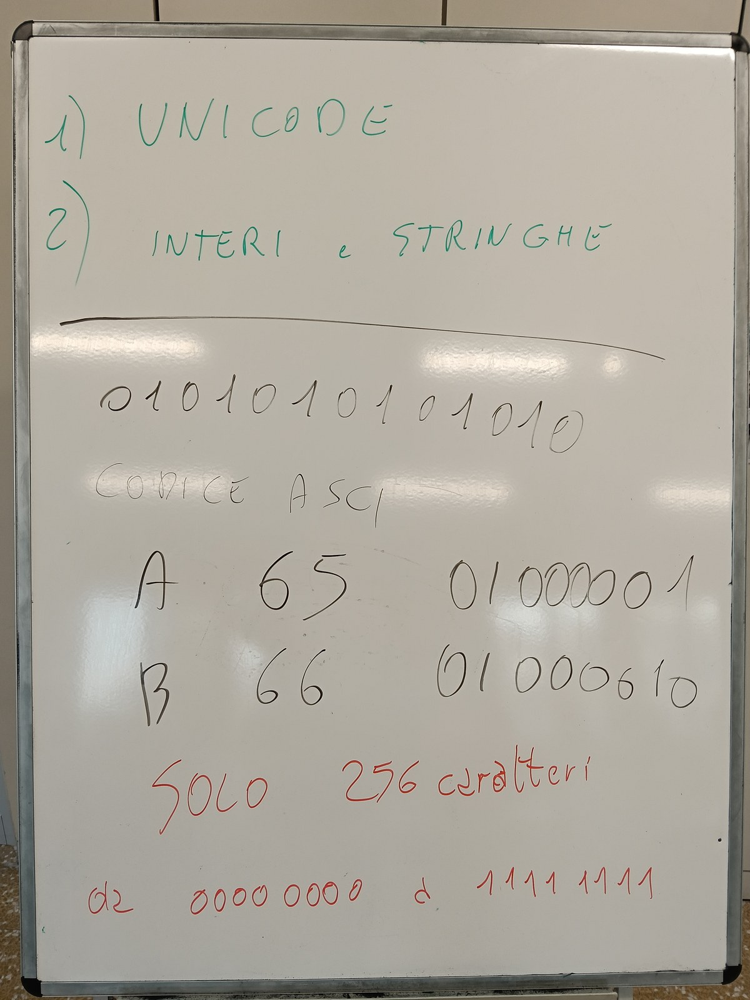

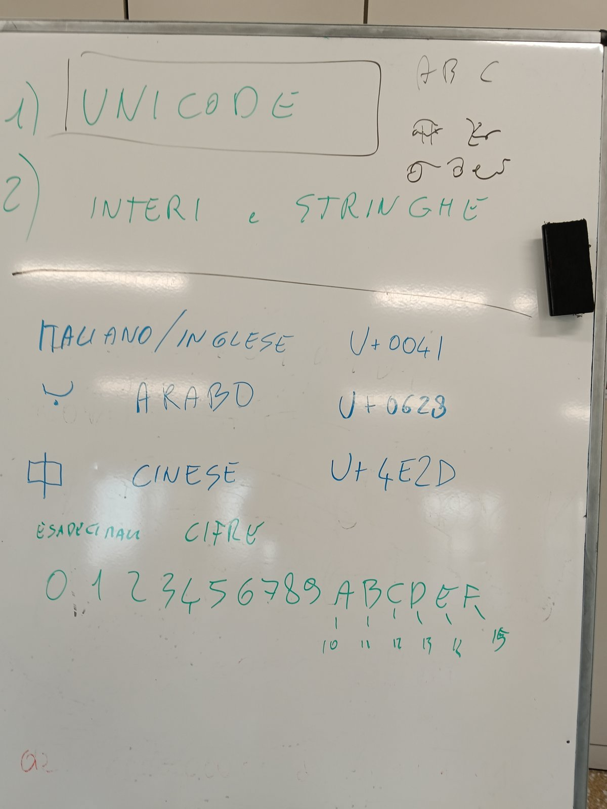

### 25.4 الشرح: النصوص والأعداد الصحيحة (String و Integer)
1. **المتغيّر** صندوق له اسم؛ في داخله قيمة. `:=` معناها «ضع في الداخل». لكل صندوق **نوع**.
2. **String** = **نص**، دائمًا بين **علامتي اقتباس مفردتين** (الفاصلة العليا): `'Ciao'`، `'Milano'`، `'007'` (مع العلامتين هو نص حتى لو فيه أرقام). علامة `+` بين نصين **تلصقهما**: `'Ciao ' + 'Mario'` = `'Ciao Mario'`.
3. **Integer** = **عدد صحيح**، بدون علامتي اقتباس وبدون فاصلة، ويمكن أن يكون سالبًا: `0`، `7`، `2026`، `-5`. مع Integer نقوم بالحساب؛ `3.5` ليس Integer.
4. **الفخ:** `'5' + '3'` = `'53'` (String، يلصق)؛ `5 + 3` = `8` (Integer، يجمع). على السبورة: `'12' + '15'` = `'1215'` و `12 + 15` = `27`.
5. **في Lazarus الخانات فيها String:** `Edit1.Text` و `Label1.Caption` و `Button1.Caption` كلها String. السطر `Label1.Caption := 7;` يعطي خطأ (`Incompatible types`)؛ السطر `Label1.Caption := '7';` صحيح.
6. **المترجمان الاثنان:** `StrToInt('7')` يعطي العدد 7؛ `IntToStr(7)` يعطي النص `'7'`. رحلة العدد: الخانة ← `StrToInt` ← الحساب ← `IntToStr` ← `Caption`. إذا كانت في الخانة كلمة *ciao*، لا يعرف `StrToInt` كيف يترجمها، فيتوقف البرنامج بخطأ.

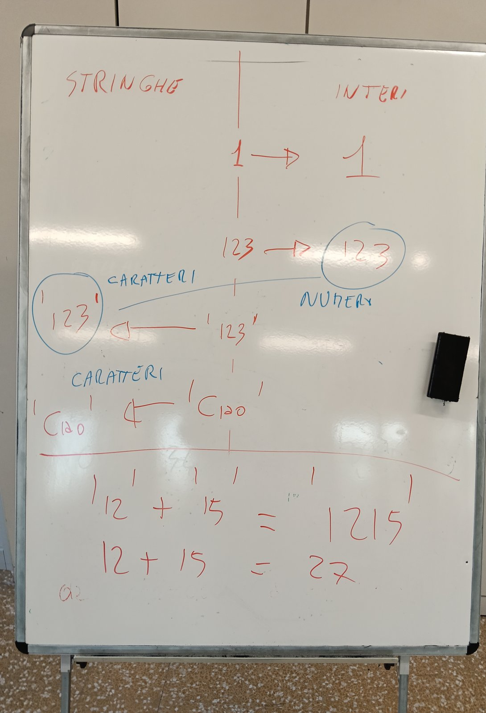

### 25.5 للنسخ في الدفتر
تُنسخ الأسطر كما هي على السبورة، بالإيطالية:

```
ASCII = 128 caratteri, solo lettere latine. A = 65.
UNICODE = una tabella per TUTTE le lingue.
UTF-8 = latino 1 byte, arabo 2, cinese 3, emoji 4.
String = testo, tra apici: 'Mario'
Integer = numero intero, senza apici: 15
StrToInt = da testo a numero. IntToStr = da numero a testo.
```

المعنى بالعربية:

1. ASCII = 128 حرفًا، فقط الحروف اللاتينية. A = 65.
2. UNICODE = جدول واحد لكل اللغات.
3. UTF-8 = اللاتيني بايت واحد، العربي 2، الصيني 3، الرمز التعبيري 4.
4. String = نص، بين علامتي اقتباس: `'Mario'`
5. Integer = عدد صحيح، بدون علامتي اقتباس: `15`
6. `StrToInt` = من نص إلى عدد. `IntToStr` = من عدد إلى نص.

### 25.6 التمارين والواجبات
1. **OGGI 30/10: il computer scrive in tutte le lingue** (اليوم 30/10: الحاسوب يكتب بكل اللغات)
   1.1 ماذا تفعل: افتح الدرس، اقرأ البطاقات واكتب اسمك في الخانة (بالعربية أيضًا أو بالصينية): سترى رقم Unicode لكل حرف. انسخ في الدفتر أسطر البطاقة 7. قم بالاختبار على Moduli (15 سؤالًا). ثم الجزء 2: اقرأ البطاقات الست عن String و Integer، قم بالمراجعة وبالاختبار على Moduli (22 سؤالًا). انسخ في الدفتر أسطر الجزء 2.
   1.2 صفحة Unicode: https://nicolaregge-pulse.github.io/corso-informatica/1inf-unicode/
   1.3 اختبار Unicode: https://docs.google.com/forms/d/e/1FAIpQLSegqxhNi56-IiLTOvWmIYDvC3rFf8KJm3AOg-HneFKDinwIxg/viewform
   1.4 String و Integer: https://nicolaregge-pulse.github.io/corso-informatica/verifica/?b=1inf-lab3010-tipi
   1.5 اختبار String و Integer: https://docs.google.com/forms/d/e/1FAIpQLScEmtd4AdC2KLC60oQ2nxhUpiOLmzQ8PSmuUmwNTSFAl8XhBg/viewform
   1.6 الرابط: https://classroom.google.com/c/ODc3MDA4ODA3MzM2/a/ODk2NjMzMTU2NzUz/details
   1.7 ماذا تسلّم: المراجعة على الصفحة والاختباران على Moduli مُرسَلان.

---

## 26 الجمعة 30/10/2026، الساعات 11-14 — المختبر: النصوص والأعداد الصحيحة في Lazarus

<p class="it">(Venerdì 30/10/2026, ore 11-14 — Laboratorio: stringhe e interi in Lazarus)</p>

### 26.1 متى
1. الجمعة 30/10/2026، الساعات 11-14، المختبر (3 ساعات، برنامج واحد في كل ساعة).

### 26.2 ماذا نفعل
1. ثلاثة برامج في Lazarus، برنامج في كل ساعة، لنستعمل String و Integer: خلطة الأرقام، اللقب، عدّاد النقاط. لكل ساعة مسار مُيسَّر من 3 خطوات لمن يجد صعوبة.
2. **مساعدة في Lazarus:** إذا وجدت صعوبة في إنشاء مشروع Lazarus، ارفع يدك واطلب المساعدة من الأستاذ: يأتي هو إلى مكانك. للأسئلة الأخرى استعمل خانة المساعد.

### 26.3 الشرح
1. الشرح هو نفسه في الفصل 25.4: المتغيّر، String، Integer، فخ علامة `+`، و `StrToInt` و `IntToStr`.
2. **أسطر `var`** (الصناديق) تُكتب **قبل** `begin`.
3. **`'nome'` مع علامتي الاقتباس** هي الكلمة nome؛ **`nome` بدون علامتي الاقتباس** هي الصندوق nome.
4. **لكي تحسب مع Caption:** تترجمها إلى Integer بـ `StrToInt`، تقوم بالحساب، ثم تترجمها من جديد بـ `IntToStr`.

### 26.4 الساعة 1 (11-12): خلطة الأرقام
1. مشروع جديد، يُحفظ في `Documenti` في المجلد الجديد `pasticcio` (`pasticcio.lpi`، `unit1.pas`).
2. Label واحدة فيها Caption `?` وزرّان: **Testo** (نص) و **Numeri** (أرقام).
3. زر Testo: `Label1.Caption := '5' + '3';` ← يظهر **53**: نصّان (String) يلتصقان.
4. زر Numeri: صندوقان من نوع Integer، `a := 5; b := 3;`. السطر `Label1.Caption := a + b;` يعطي الخطأ **Incompatible types** (يحدث للجميع)؛ نصحّحه بـ `IntToStr(a + b)` ← يظهر **8**.
5. اجعله لك: رقماك أنت (مثلًا عمرك ورقم قميصك).

```
procedure TForm1.Button2Click(Sender: TObject);
var
  a, b: Integer;
begin
  a := 5;
  b := 3;
  Label1.Caption := IntToStr(a + b);
end;
```

### 26.5 الساعة 2 (12-13): صانع الألقاب
1. مشروع جديد `soprannome`: خانتا TEdit (فيهما TextHint «Il tuo nome» أي اسمك، و«Un animale» أي حيوان)، زرّ «Crea il soprannome» (اصنع اللقب)، و Label كبيرة.
2. الكود يضع نص الخانتين في صندوقين من نوع String ويلصقهما بـ `+`: يظهر مثلًا «Mario detto Leone!» (ماريو الملقّب بالأسد!).
3. فخ علامتي الاقتباس: مع `'nome'` تظهر الكلمة «nome»، وليس اسمك.
4. اجعله لك: غيّر « detto » بكلمات من عندك، وغيّر لون الكتابة.

```
procedure TForm1.Button1Click(Sender: TObject);
var
  nome: String;
  animale: String;
begin
  nome := Edit1.Text;
  animale := Edit2.Text;
  Label1.Caption := nome + ' detto ' + animale + '!';
end;
```

### 26.6 الساعة 3 (13-14): عدّاد النقاط
1. مشروع جديد `segnapunti`: Label كبيرة فيها Caption `0`، والأزرار **+1**، و **Aggiungi** (أضِف، مع خانة TEdit للنقاط) و **Azzera** (صفّر).
2. زر +1: ترجم، احسب، ترجم (`StrToInt`، `+ 1`، `IntToStr`). زر Aggiungi: الخانة أيضًا فيها String، فنحتاج `StrToInt(Edit1.Text)`. زر Azzera: `Label1.Caption := '0';`.
3. فخ الـ 53: `Label1.Caption + Edit1.Text` مع 5 و 3 يعطي 53، وليس 8.
4. اجعله لك: كتابة فيها اسمك فوق الرقم، ألوانك، وزر +2.

```
procedure TForm1.Button2Click(Sender: TObject);
var
  punti: Integer;
  aggiunta: Integer;
begin
  punti := StrToInt(Label1.Caption);
  aggiunta := StrToInt(Edit1.Text);
  punti := punti + aggiunta;
  Label1.Caption := IntToStr(punti);
end;
```

### 26.7 للنسخ في الدفتر
تُنسخ الأسطر كما هي، بالإيطالية:

```
VARIABILE = una scatola con un nome, dentro c'e' un valore
STRING  = testo, sempre tra apici:   'Ciao'   '5'
INTEGER = numero intero, senza apici:  5   12   -3
'5' + '3' = '53'  (attacca)      5 + 3 = 8  (somma)
Label1.Caption := IntToStr(a + b);  giusto: 8
var nome: String;          preparo la scatola per il testo
nome := Edit1.Text;        metto nella scatola il testo della casella
'nome' con gli apici = la PAROLA nome
nome  senza apici    = la SCATOLA nome
punti := StrToInt(Label1.Caption);   testo -> numero   '5' -> 5
Label1.Caption := IntToStr(punti);   numero -> testo   6 -> '6'
```

المعنى بالعربية:

1. المتغيّر = صندوق له اسم، وفي داخله قيمة.
2. String = نص، دائمًا بين علامتي اقتباس: `'Ciao'` `'5'`
3. Integer = عدد صحيح، بدون علامتي اقتباس: `5` `12` `-3`
4. `'5' + '3' = '53'` (يلصق)، و `5 + 3 = 8` (يجمع).
5. `Label1.Caption := IntToStr(a + b);` صحيح: 8
6. `var nome: String;` أُحضّر الصندوق للنص.
7. `nome := Edit1.Text;` أضع في الصندوق نص الخانة.
8. `'nome'` مع علامتي الاقتباس = الكلمة nome؛ `nome` بدونهما = الصندوق nome.
9. `punti := StrToInt(Label1.Caption);` نص ← عدد: `'5'` ← `5`
10. `Label1.Caption := IntToStr(punti);` عدد ← نص: `6` ← `'6'`

### 26.8 التمارين والواجبات
1. **OGGI 30/10: Laboratorio 11-14: stringhe e interi in Lazarus (3 programmi)** (اليوم 30/10: مختبر 11-14، النصوص والأعداد الصحيحة في Lazarus، 3 برامج)
   1.1 ماذا تفعل: في كل ساعة افتح المسار، قم بالخطوات واحدة بعد الأخرى، ثم سلّم.
   1.2 الساعة 1: https://nicolaregge-pulse.github.io/corso-informatica/anteprima/1inf-lab-30-10/modulo-1.html
   1.3 الساعة 2: https://nicolaregge-pulse.github.io/corso-informatica/anteprima/1inf-lab-30-10/modulo-2.html
   1.4 الساعة 3: https://nicolaregge-pulse.github.io/corso-informatica/anteprima/1inf-lab-30-10/modulo-3.html
   1.5 التسليم: https://nicolaregge-pulse.github.io/corso-informatica/anteprima/1inf-lab-30-10/consegna.html (مع `?ora=1`، `?ora=2`، `?ora=3`)
   1.6 ماذا تسلّم: في كل ساعة الملف `unit1.pas` ولقطة شاشة للبرنامج وهو يعمل، بزرّ صفحة التسليم. الخطة البديلة، إذا لم يعمل الزر: أرفق بالواجب على Classroom ملفّي الساعة (مثلًا `ora1_unit1.pas` و `ora1_screenshot.png`) واضغط «Consegna» (سلِّم).

---

## 27 ملخّص كل الواجبات

<p class="it">(Riepilogo di tutti i compiti)</p>

يذكر الجدول الواجبات الـ 47 التي أُعطيت على Classroom لصف 1INF حتى 30/10/2026، بترتيب التاريخ. يقول عمود «الفصل» أين تجد الشرح والتعليمات. عناوين الواجبات بالإيطالية، كما تراها على Classroom.

| رقم | التاريخ | الواجب (العنوان كما في Classroom) | ماذا تسلّم | الفصل |
|---|---|---|---|---|
| 1 | 17/09 | <span dir="ltr" lang="it">Io e la mia famiglia: documento di presentazione (origini, provenienza, storia)</span> | مستند Google على Classroom | 03 |
| 2 | 18/09 | <span dir="ltr" lang="it">Ricerca: cos'è GitHub e cos'è un repository</span> | مستند فيه البحث؛ وحساب GitHub | 04 |
| 3 | 21/09 | <span dir="ltr" lang="it">Parti del PC</span> | العمل على قطع الحاسوب، على Classroom | 05 |
| 4 | 21/09 | <span dir="ltr" lang="it">CTRL + ALT + CANC</span> | ما يطلبه الواجب | 05 |
| 5 | 21/09 | <span dir="ltr" lang="it">VERSIONING</span> | قراءة ورقة الإصدارات | 05 |
| 6 | 21/09 | <span dir="ltr" lang="it">QUIZ (Regole + Versioning)</span> | اختبار مكتمل | 05 |
| 7 | 23/09 | <span dir="ltr" lang="it">Esercizio Hardware</span> | العمل على قطع الحاسوب، على Classroom | 07 |
| 8 | 23/09 | <span dir="ltr" lang="it">Quiz (componenti del PC)</span> | اختبار مكتمل | 07 |
| 9 | 24/09 | <span dir="ltr" lang="it">Configurare un PC</span> | مستند فيه المعايير الخمسة والصور | 08 |
| 10 | 24/09 | <span dir="ltr" lang="it">Crea il PC dei tuoi sogni</span> | قائمة القطع المتوافقة مع المجموع | 08 |
| 11 | 30/09 | <span dir="ltr" lang="it">Configura un PC</span> | مستند فيه 8 قطع والأسعار والمجموع | 09 |
| 12 | 30/09 | <span dir="ltr" lang="it">USARE CATTURA SCHERMO</span> | مستند فيه لقطة شاشة والنص المنسوخ وتفكير شخصي | 09 |
| 13 | 30/09 | <span dir="ltr" lang="it">L'inizio di quest'anno scolastico</span> | كما يقول الواجب | 09 |
| 14 | 01/10 | <span dir="ltr" lang="it">Bit e Byte TEORIA</span> | قراءة الملزمة | 10 |
| 15 | 01/10 | <span dir="ltr" lang="it">Compito — Da binario a decimale</span> | 16 تمرينًا محلولًا | 10 |
| 16 | 02/10 | <span dir="ltr" lang="it">Compito — Da decimale a binario</span> | تمارين التحويل | 11 |
| 17 | 02/10 | <span dir="ltr" lang="it">Compito — Dalla divisione per 2 al binario</span> | قسمة متتالية على 2 | 11 |
| 18 | 02/10 | <span dir="ltr" lang="it">Compito 1 — Divisioni per 2</span> | نتيجة صفحة التمارين | 11 |
| 19 | 02/10 | <span dir="ltr" lang="it">Compito 2 — Divisioni per 2 con il timer</span> | نتيجة صفحة التمارين | 11 |
| 20 | 02/10 | <span dir="ltr" lang="it">Compito 3 — Divisioni per 2 con il timer</span> | نتيجة صفحة التمارين | 11 |
| 21 | 06/10 | <span dir="ltr" lang="it">Cacciaviti per il laboratorio — come li compro</span> | كما يقول الواجب | 17 |
| 22 | 08/10 | <span dir="ltr" lang="it">PR-1 — Il mio cattivo</span> | مستند فيه الطلب وصورة الرسم | 12 |
| 23 | 08/10 | <span dir="ltr" lang="it">PR-2 — Il mio paesaggio</span> | مستند فيه الطلب | 12 |
| 24 | 08/10 | <span dir="ltr" lang="it">PR-3 — Un difetto</span> | مستند فيه الخطأ | 12 |
| 25 | 08/10 | <span dir="ltr" lang="it">PR-4 — Revisione e cosa ho imparato</span> | مستند فيه المراجعة | 12 |
| 26 | 09/10 | <span dir="ltr" lang="it">Versioni e Git: la storia del nostro Treno blindato</span> | واجب واحد مع الاختبار | 13 |
| 27 | 13/10 | <span dir="ltr" lang="it">La mia prima Pull Request</span> | طلب الدمج: السطر، القيمة الجديدة، السبب | 14 |
| 28 | 14/10 | <span dir="ltr" lang="it">La mia talpa</span> | الصورة المقصوصة والجملة عن الشخصية | 15 |
| 29 | 14/10 | <span dir="ltr" lang="it">La mia talpa: il percorso</span> | المراجعة والتقييم على الصفحة | 15 |
| 30 | 14/10 | <span dir="ltr" lang="it">Com'è andata oggi?</span> | بضعة أسطر عن الدرس | 15 |
| 31 | 15/10 | <span dir="ltr" lang="it">Versioni del software e changelog (annuncio)</span> | التقييم على الصفحة | 16 |
| 32 | 16/10 | <span dir="ltr" lang="it">Lab — Monta il PC (gara di assemblaggio)</span> | الحاسوب بعد إعادة تركيبه | 17 |
| 33 | 16/10 | <span dir="ltr" lang="it">Sfida lampo — conosci i pezzi del PC?</span> | التحدي مكتمل | 17 |
| 34 | 16/10 | <span dir="ltr" lang="it">Ripassa e fai il Test — i pezzi del PC</span> | المراجعة والاختبار على الصفحة | 17 |
| 35 | 20/10 | <span dir="ltr" lang="it">Quanto pesa un file? Quanto va veloce la rete?</span> | المراجعة على الصفحة | 18 |
| 36 | 20/10 | <span dir="ltr" lang="it">QUIZ: bit, byte e velocità della rete</span> | اختبار Moduli مُرسَل | 18 |
| 37 | 21/10 | <span dir="ltr" lang="it">OGGI: il laboratorio del gamer</span> | مسار «كم واحدًا يتسع؟» وألعاب البايت | 19 |
| 38 | 21/10 | <span dir="ltr" lang="it">QUIZ: velocità della rete, download, streaming e cavi</span> | اختبار Moduli مُرسَل | 19 |
| 39 | 22/10 | <span dir="ltr" lang="it">OGGI: Sicurezza 1 — pericolo, rischio e infortunio</span> | المراجعة على الصفحة واختبار Moduli | 20 |
| 40 | 23/10 | <span dir="ltr" lang="it">Dimensioni e unità di misura dell'informatica</span> | مستند «الشبكة واللاعب»، 13 فصلًا، 1500 كلمة على الأقل | 21 |
| 41 | 23/10 | <span dir="ltr" lang="it">QUIZ dimensioni</span> | اختبار Moduli مُرسَل | 21 |
| 42 | 27/10 | <span dir="ltr" lang="it">OGGI: ripasso, poi la scheda video e i cavi</span> | الاختباران | 22 |
| 43 | 28/10 | <span dir="ltr" lang="it">Il mio primo programma: Ciao in Lazarus</span> | مستند فيه الكود ولقطة شاشة وجملة | 23 |
| 44 | 29/10 | <span dir="ltr" lang="it">OGGI 29/10: Sicurezza 2, prevenzione e protezione (e Sicurezza 3)</span> | المراجعة على الصفحة واختبار Moduli | 24 |
| 45 | 29/10 | <span dir="ltr" lang="it">Recuperi quiz</span> | الاختبارات الناقصة | 24 |
| 46 | 30/10 | <span dir="ltr" lang="it">OGGI 30/10: il computer scrive in tutte le lingue</span> | المراجعة واختباران على Moduli | 25 |
| 47 | 30/10 | <span dir="ltr" lang="it">OGGI 30/10: Laboratorio 11-14: stringhe e interi in Lazarus</span> | في كل ساعة unit1.pas ولقطة الشاشة | 26 |

---

## 28 قاموس الكلمات

<p class="it">(Glossario)</p>

| الكلمة | ماذا تعني |
|---|---|
| account | هويّتك على حاسوب أو موقع، تحميها كلمة السر |
| ASCII | الجدول الذي يعطي رقمًا لكل حرف لاتيني (A = 65)؛ 128 حرفًا |
| bit | رقم واحد، 0 أو 1؛ حرف b الصغير |
| byte | 8 بتات؛ حرف واحد؛ حرف B الكبير |
| changelog | سجلّ التغييرات، إصدارًا بعد إصدار |
| compilatore | المترجِم: البرنامج الذي يحوّل كود Pascal إلى برنامج يعمل (.exe) |
| CPU | المعالج، دماغ الحاسوب |
| danno | الضرر: الأذى الذي يحدث فعلًا |
| DPI | معدّات الحماية الشخصية: الخوذة، القفازات، النظارات |
| DVR | وثيقة تقييم المخاطر، دفتر مخاطر الشركة |
| estensione | الامتداد: الحروف بعد النقطة في اسم الملف (.pas، .lpi، .exe) |
| FPS | الصور في الثانية التي تحضّرها بطاقة الفيديو |
| fork | نسخة من مشروع، تكبر وحدها |
| GPU | دماغ الصور، داخل بطاقة الفيديو |
| Hz | كم مرة في الثانية ترسم الشاشة الصورة من جديد |
| Integer | عدد صحيح، بدون علامتي اقتباس |
| jitter | مقدار تغيّر الـ ping |
| major e minor | تغيير كبير (v2.0) وتغيير صغير (v1.1) في الإصدار |
| Mbps | ميغابت في الثانية: سرعة الشبكة |
| merge | الدمج: ضمّ فرع أو طلب إلى المشروع الرئيسي |
| pericolo | الخطر: شيء يمكن أن يؤذي |
| ping | وقت ذهاب وإياب رسالة، بالمللي ثانية |
| pixel | مربّع صغير ملوّن في الشاشة |
| prevenzione | الوقاية: تجعل الضرر يحدث أقلّ |
| protezione | الحماية: إذا حدث الضرر، يؤذي أقلّ |
| Pull Request | طلب الدمج: طلب وضع تعديل في المشروع |
| RAM | ذاكرة العمل، سريعة، تفرغ عندما يُطفأ الحاسوب |
| repository | المستودع: مجلد المشروع مع تاريخ التعديلات |
| rischio | المخاطرة: كم هو سهل أن يحدث الضرر وكم هو خطير |
| RLS | العامل الذي ينتخبه زملاؤه من أجل السلامة |
| socket | المقبس: قاعدة المعالج على اللوحة الأم |
| String | نص، بين علامتي اقتباس |
| TCP e UDP | قاعدتان لإرسال البيانات: مع إعادة الإرسال وبدونها |
| Unicode | جدول فيه رقم لكل حرف من كل اللغات |
| VRAM | ذاكرة بطاقة الفيديو |

---

## 29 سجلّ التغييرات

<p class="it">(Changelog)</p>

1. **الإصدار 1.1 (30/10/2026)**: أول إصدار بالعربية، مترجم من الملزمة الإيطالية v1.1: الفصل 00 والفصول من 10 إلى 26 (من 01/10 إلى 30/10/2026).
2. **الإصدار 1.2 (30/10/2026)**: الترجمة الكاملة: أُضيفت الفصول من 01 إلى 09، وجدول كل الواجبات (الفصل 27)، وقاموس الكلمات (الفصل 28) وسجلّ التغييرات (الفصل 29).
