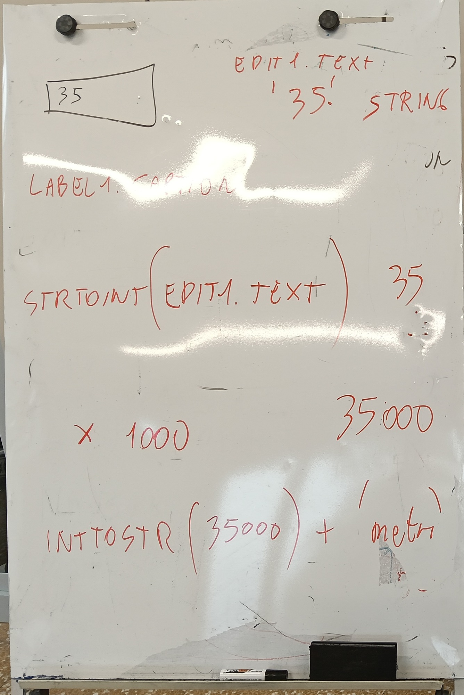
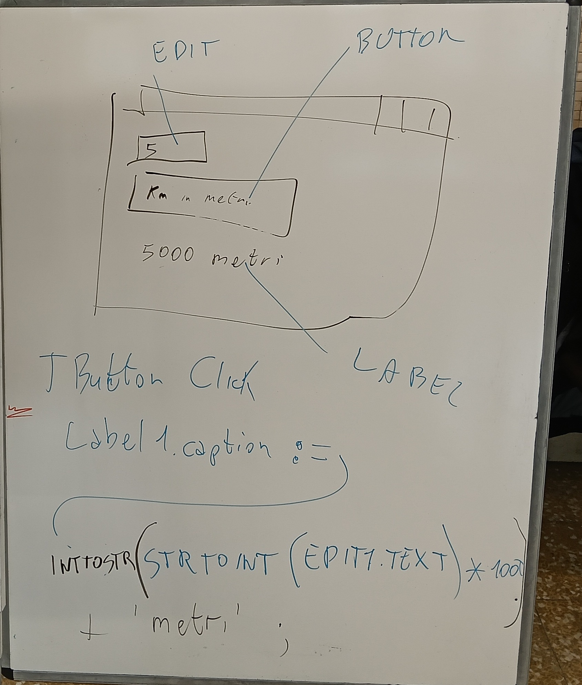

# من نص إلى رقم والعكس

*محوّل الكيلومترات إلى أمتار في Lazarus: StrToInt و IntToStr*

مذكّرة · الصف 1INF · المختبر · 04/11/2026 · الإصدار 1.0

اليوم رأيتَ على السبورة كيف يتحوّل الرقم المكتوب في خانة إلى رقم يمكن إجراء حساب به، ثم يعود إلى كتابة. هنا كل شيء خطوة بخطوة، مع طريقة تنفيذه في Lazarus. إذا أخطأتَ فلا مشكلة: يحدث هذا لجميع المبرمجين، حتى المحترفين.

## 01 سبورة اليوم





**على اليسار (صورة السبورة):** رحلة المعلومة. من `Edit1.Text` (`'35'`، نص) إلى `StrToInt` (35)، ثم `× 1000` (35000)، ثم `IntToStr` (35000 كنص) وأخيرًا `+ 'metri'`.

**على اليمين (صورة السبورة):** النافذة مع EDIT (الخانة وفيها 5)، وBUTTON (الزر «Km in metri»)، وLABEL (الكتابة «5000 metri»). وتحتها السطر الذي يكتب النتيجة عندما تضغط الزر.

> **ملاحظة:** على السبورة كُتبت `'metri'` بدون مسافة. في الكود توضع مسافة داخل علامتي الاقتباس (`' metri'`): انظر القسم 04.

*رسم تخطيطي (ليس لقطة شاشة): رسمتك للنافذة بعد الانتهاء.* (الرسم في ملف PDF)

## 02 النص والرقم ليسا الشيء نفسه

تخيّل صندوقين. على الأول ملصق **35**، لكن في داخله حرفان فقط، «3» و«5»، كما في أي كتابة: اسمه `string` (سلسلة، أي **نص**). على الثاني الرقم 35، وفي داخله الكمية خمسة وثلاثون فعلًا، ويمكن العدّ بها: اسمه `integer` (عدد صحيح، أي **رقم بلا فاصلة**).

*رسم تخطيطي: الصندوقان، النص والرقم.* (الرسم في ملف PDF)

> **نص مقابل رقم:** `'35' + '35'` يعطي `'3535'` (نصّان ملصوقان). `35 + 35` يعطي `70` (رقمان مجموعان).

الخانة `Edit1` تعطيك **دائمًا نصًا**، حتى لو كتبتَ 5. لإجراء الحساب يجب أن تترجم. مترجمان:

| الكلمة | ماذا تفعل | مثال |
|---|---|---|
| `StrToInt` | من نص إلى رقم (String To Integer) | `'5'` → `5` |
| `IntToStr` | من رقم إلى نص (Integer To String) | `5000` → `'5000'` |

## 03 رحلة المعلومة

اكتب **35** في الخانة واضغط الزر. خطوة في كل سطر:

1. `Edit1.Text` يعطي النص `'35'` (string).
2. `StrToInt` يحوّله إلى الرقم `35` (integer).
3. `* 1000` يُجري الحساب: `35000` (integer).
4. `IntToStr` يعيده نصًا: `'35000'` (string).
5. `+ ' metri'` يلصق الكلمة: `'35000 metri'` (string).
6. `Label1.Caption :=` يضع النص على الشاشة.

*رسم تخطيطي: البرتقالي = نص (string)، الأزرق = رقم (integer).* (الرسم في ملف PDF)

## 04 الزر المختصر: Button1Click

هذا كود الزر الأول، كما كتبه الأستاذ:

```pascal
procedure TForm1.Button1Click(Sender: TObject);
begin
 Label1.Caption:=  IntToStr( StrToInt ( Edit1.Text  ) * 1000 ) + ' metri' ;
end;
```

يُقرأ **من الداخل إلى الخارج**، مثل الدمى الروسية: نبدأ بأعمق قطعة ثم نخرج.

*رسم تخطيطي: الصناديق داخل بعضها، مع رقم القراءة والقيمة الناتجة (مثال بالرقم 5).* (الرسم في ملف PDF)

1. `Edit1.Text`: النص المكتوب في الخانة (`'5'`).
2. `StrToInt( ... )`: يحوّله إلى رقم (`5`).
3. `... * 1000`: يضرب (`5000`).
4. `IntToStr( ... )`: يعود نصًا (`'5000'`).
5. `... + ' metri'`: يلصق الكلمة (`'5000 metri'`).
6. `Label1.Caption :=`: يكتب النتيجة في الكتابة Label1.

> **انتبه إلى المسافة:** داخل `' metri'` توجد مسافة قبل «metri». بدونها تظهر `5000metri`.

كل شيء في سطر واحد مريح لكن قراءته صعبة. الزر الثاني يؤدي العمل نفسه **على خطوات**، مع أسماء.

## 05 الزر بالخطوات: Button2Click

```pascal
procedure TForm1.Button2Click(Sender: TObject);
Var TestoOriginale, TestoMetri, TestoFinale: string;
    nMetri,nKm: integer;
begin
 TestoOriginale := Edit1.Text;
 nKm := StrToInt(TestoOriginale);
 nMetri := nKm * 1000;
 TestoMetri := IntToStr(nMetri);
 TestoFinale := TestoOriginale + ' Kilometri sono ' + TestoMetri + ' metri';
 Label1.Caption :=  TestoFinale;
end;
```

### المتغيّرات: صناديق لها أسماء

`Var` تعني «هنا أعلن عن صناديقي» (المتغيّرات). نكتب الاسم أولًا، ثم النقطتين، ثم النوع. الصناديق **5**: ثلاثة للنص (`string`) واثنان للأرقام (`integer`).

| الاسم | النوع | ماذا أضع فيه |
|---|---|---|
| `TestoOriginale` | `string` | ما أكتبه في الخانة (`'5'`) |
| `nKm` | `integer` | الكيلومترات كرقم (`5`) |
| `nMetri` | `integer` | الأمتار كرقم (`5000`) |
| `TestoMetri` | `string` | الأمتار كنص (`'5000'`) |
| `TestoFinale` | `string` | الجملة الكاملة التي ستُعرض |

> **يُقرأ هكذا:** `TestoOriginale, TestoMetri, TestoFinale: string;` = «هذه الأسماء الثلاثة نصوص». `nMetri,nKm: integer;` = «هذان الاسمان رقمان». حيلة: أسماء الأرقام تبدأ بـ **n** وأسماء النصوص تبدأ بـ **Testo**.

### سطرًا بسطر، بالقيمة 5

اكتب **5** في الخانة واضغط الزر الثاني. الإطار الأحمر هو الصندوق الذي يتغيّر؛ وعلامة الاستفهام صندوق ما زال فارغًا.

1. `TestoOriginale := Edit1.Text;` ينسخ نص الخانة: `'5'`.

2. `nKm := StrToInt(TestoOriginale);` يترجمه إلى رقم: `5`.

3. `nMetri := nKm * 1000;` يحسب: `5000`.

4. `TestoMetri := IntToStr(nMetri);` يعيده نصًا: `'5000'`.

5. `TestoFinale := TestoOriginale + ' Kilometri sono ' + TestoMetri + ' metri';` يلصق النصوص: `'5 Kilometri sono 5000 metri'`.

6. `Label1.Caption :=  TestoFinale;` تضع الجملة على الشاشة: **5 Kilometri sono 5000 metri**.

| بعد السطر | TestoOriginale | nKm | nMetri | TestoMetri | TestoFinale |
|---|---|---|---|---|---|
| 1 | '5' | - | - | - | - |
| 2 | '5' | 5 | - | - | - |
| 3 | '5' | 5 | 5000 | - | - |
| 4 | '5' | 5 | 5000 | '5000' | - |
| 5 | '5' | 5 | 5000 | '5000' | '5 Kilometri sono 5000 metri' |

العلامة `-` تعني أن الصندوق ما زال فارغًا. الأسطر هي نفسها في الرسوم أعلاه.

## 06 كيف تنفّذه في Lazarus خطوة بخطوة

إجراء واحد في كل سطر. الرسوم تخطيطية (ليست لقطات شاشة): على شاشتك تبدو القطع مشابهة وفي المكان نفسه.

1. **افتح Lazarus**: انقر نقرتين على الأيقونة الخضراء «Lazarus» على سطح المكتب (أو في مجلد البرنامج).

2. **مشروع جديد**: في القائمة العلوية انقر **Progetto** ثم **Nuovo progetto…**؛ في النافذة اختر **Applicazione** وانقر **OK**.

3. **ضع القطع على النافذة (Form)**: في لوحة **Standard** (الشريط بالأيقونات فوق النافذة) انقر القطعة ثم انقر على النافذة. افعل هذا مع: **TEdit** (الخانة) و**TLabel** (الكتابة) و**TButton مرتين** (الزرّان). لقراءة اسم القطعة ثبّت الفأرة فوق الأيقونة.

4. **غيّر النصوص في Ispettore oggetti** (اللوحة على اليسار): انقر قطعة على النافذة ثم غيّر السطر **Caption** (أو **Text** للخانة). افعل هذا واحدًا واحدًا:

1. Button1، السطر Caption: اكتب `Km in metri (compatto)`
2. Button2، السطر Caption: اكتب `Km in metri (a passi)`
3. Edit1، السطر Text: امسح كل شيء (اتركه فارغًا)
4. Label1، السطر Caption: اكتب `risultato` (أو اتركه فارغًا)

5. **كود الزر الأول**: على النافذة انقر نقرتين على **Button1**. يفتح الكود: كتب Lazarus بنفسه `procedure` و`begin` و`end;`. أنت تكتب **السطر الأوسط فقط**، بين `begin` و`end;`. كود الأستاذ كما هو:

```pascal
procedure TForm1.Button1Click(Sender: TObject);
begin
 Label1.Caption:=  IntToStr( StrToInt ( Edit1.Text  ) * 1000 ) + ' metri' ;
end;
```

6. **كود الزر الثاني**: ارجع إلى النافذة (اضغط **F12**) وانقر نقرتين على **Button2**. ينشئ Lazarus الإجراء `Button2Click`. إعلان **Var** يوضع **بين سطر `procedure` و`begin`**؛ ثم اكتب الأسطر بين `begin` و`end;`. كود الأستاذ كما هو:

```pascal
procedure TForm1.Button2Click(Sender: TObject);
Var TestoOriginale, TestoMetri, TestoFinale: string;
    nMetri,nKm: integer;
begin
 TestoOriginale := Edit1.Text;
 nKm := StrToInt(TestoOriginale);
 nMetri := nKm * 1000;
 TestoMetri := IntToStr(nMetri);
 TestoFinale := TestoOriginale + ' Kilometri sono ' + TestoMetri + ' metri';
 Label1.Caption :=  TestoFinale;
end;
```

7. **شغّل البرنامج**: اضغط **F9** (أو المثلث الأخضر تحت القوائم).

> **إذا أعطى F9 خطأ:** في بعض الأجهزة يقول Lazarus إن «debugger» (البرنامج الذي يراقب برنامجك أثناء التشغيل) لا يعمل. كودك **ليس خاطئًا**. الحل: افتح قائمة **Esegui** وانقر البند **Run without Debugging** (مكتوب بالإنجليزية)، أو اضغط معًا **Maiusc + Ctrl + F9**. يعمل البرنامج رغم ذلك.

8. **جرّب**: اكتب **5** في الخانة، اضغط الزر الأول (تظهر `5000 metri`) ثم الثاني (تظهر `5 Kilometri sono 5000 metri`).

9. **احفظ**: في قائمة **File** انقر **Salva tutto**. اختر مجلدًا جديدًا داخل **Documenti** (مثلًا `convertitore`) وانقر **Salva**؛ يسأل Lazarus مرتين (ملف `unit1.pas` والمشروع).

10. **التسليم**: سلّم الملف `unit1.pas` (موجود في المجلد الذي أنشأته) ولقطة شاشة للنافذة مع النتيجة، كما أوضح الأستاذ في Classroom.

> **أحسنت!** لقد صنعتَ برنامجًا حقيقيًا. أره لزميلك واشرح له بكلماتك ماذا يحدث عند الضغط على الزر.

## 07 عندما يحدث خطأ

إذا كتبتَ في الخانة `5a` أو تركتها فارغة، لا يعرف `StrToInt` أي رقم هذا ويعطي البرنامج خطأ: `"5a" is an invalid integer` (أي: «5a ليس عددًا صحيحًا صالحًا»). هذا ليس خطأك: الحاسوب لا يستطيع ضرب حرف.

*رسم تخطيطي: في الأعلى `StrToInt` يتوقف، وفي الأسفل `StrToIntDef` لا يتوقف.* (الرسم في ملف PDF)

الحل: `StrToIntDef(testo, 0)` تعني «حاوِل تكوين الرقم؛ وإن لم تنجح فاستعمل 0». **للتجربة كإضافة** (يبقى كود الأستاذ كما هو أعلاه):

```pascal
 Label1.Caption:=  IntToStr( StrToIntDef ( Edit1.Text, 0 ) * 1000 ) + ' metri' ;

 nKm := StrToIntDef(TestoOriginale, 0);
```

مع `5a` لا يتوقف البرنامج بعد الآن ويكتب `0 metri`.

## 08 اجعله لك

1. غيّر العبارة: بدل `' Kilometri sono '` اكتب جملة من عندك، مثلًا `' km fanno '`.
2. غيّر القياس: من ساعات إلى دقائق بالضرب في 60.
3. اختر قياسًا آخر: يورو إلى سنت (×100)، متر إلى سنتيمتر (×100).
4. غيّر أسماء الأزرار والكتابة، ودع زميلك يجرّب برنامجك.

```pascal
 Label1.Caption := IntToStr( StrToInt ( Edit1.Text ) * 60 ) + ' minuti' ;
```

> **انسخ في دفترك:** 1) Edit1.Text دائمًا نص (string). 2) StrToInt: من نص إلى رقم. 3) IntToStr: من رقم إلى نص. 4) Var: تعلن الصناديق (المتغيّرات) بالاسم والنوع.

## 09 خمسة أسئلة للمراجعة

1. هل `Edit1.Text` نص أم رقم؟ -> هو دائمًا نص (`string`)، حتى لو كُتب 5.
2. ماذا يفعل `StrToInt`؟ -> يحوّل النص إلى رقم: `'5'` تصبح `5`.
3. لماذا نستعمل `IntToStr` قبل الكتابة في Label؟ -> لأن `Caption` يريد نصًا: الرقم `5000` يجب أن يصير `'5000'`.
4. بعد `nMetri := nKm * 1000;` وقيمة `nKm` تساوي 5، كم قيمة `nMetri` وما نوعه؟ -> قيمته `5000` ونوعه `integer` (رقم).
5. ماذا يحدث مع `5a` وماذا يتغيّر مع `StrToIntDef`؟ -> مع `StrToInt` يظهر الخطأ `"5a" is an invalid integer`؛ ومع `StrToIntDef(testo, 0)` يستعمل البرنامج 0 ولا يتوقف.

التحقق: جُرّب منطق هذه الحسابات بمترجم Free Pascal (fpc) بالقيمتين 5 و35. لم تُجرَّب نافذة Lazarus نفسها.
