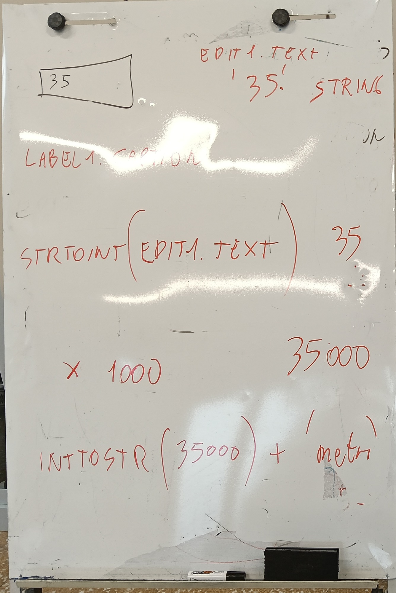
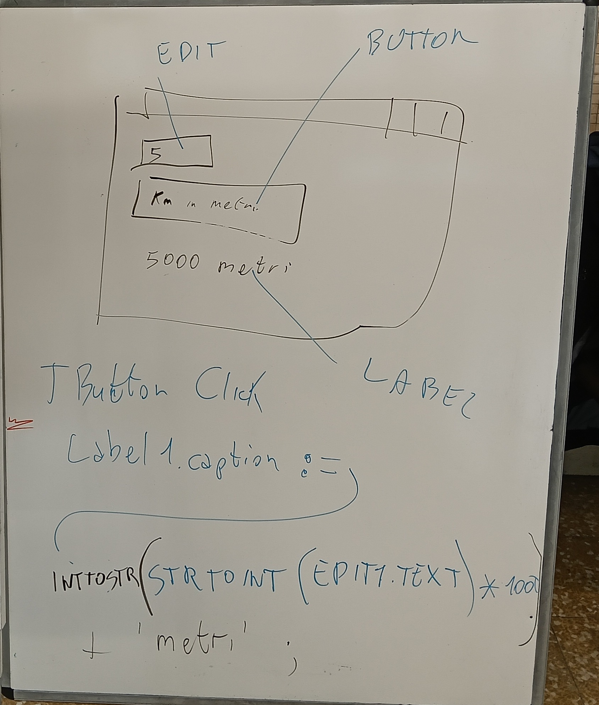

# Da testo a numero e ritorno

*Il convertitore km → metri in Lazarus: StrToInt e IntToStr*

Dispensa · Classe 1INF · Laboratorio · 04/11/2026 · Versione 1.0

Oggi alla lavagna hai visto come un numero scritto in una casella diventa un numero con cui si può fare un calcolo, e poi torna a essere una scritta. Qui trovi tutto passo passo, anche come rifarlo in Lazarus. Se sbagli non fa niente: succede a tutti i programmatori, anche ai professionisti.

## 01 La lavagna di oggi





**A sinistra (foto della lavagna):** il viaggio del dato. Da `Edit1.Text` (`'35'`, una stringa) a `StrToInt` (35), poi `× 1000` (35000), poi `IntToStr` (35000 come testo) e infine `+ 'metri'`.

**A destra (foto della lavagna):** la finestra con EDIT (la casella con 5), BUTTON (il bottone «Km in metri») e LABEL (la scritta «5000 metri»). Sotto, la riga che scrive il risultato quando clicchi il bottone.

> **Nota:** sulla lavagna `'metri'` è scritto senza spazio. Nel codice ci va uno spazio dentro gli apici (`' metri'`): vedi la sezione 04.

*Schema disegnato (non è uno screenshot): il tuo disegno della finestra finita.* (schema nel PDF)

## 02 Testo e numero non sono la stessa cosa

Immagina due scatole. Sulla prima c'è l'etichetta **35**, ma dentro ci sono due caratteri, il «3» e il «5», come in una scritta: si chiama `string` (stringa, cioè **testo**). Sulla seconda c'è il numero 35 e dentro c'è proprio la quantità trentacinque, con cui si può contare: si chiama `integer` (intero, cioè **numero senza virgola**).

*Schema disegnato: le due scatole, testo e numero.* (schema nel PDF)

> **Testo contro numero:** `'35' + '35'` fa `'3535'` (due testi incollati). `35 + 35` fa `70` (due numeri sommati).

La casella `Edit1` ti dà **sempre un testo**, anche se scrivi 5. Per fare i conti devi tradurre. Due traduttori:

| Parola | Che cosa fa | Esempio |
|---|---|---|
| `StrToInt` | da testo a numero (String To Integer) | `'5'` → `5` |
| `IntToStr` | da numero a testo (Integer To String) | `5000` → `'5000'` |

## 03 Il viaggio del dato

Scrivi **35** nella casella e premi il bottone. Un passo per riga:

1. `Edit1.Text` dà il testo `'35'` (string).
2. `StrToInt` lo trasforma nel numero `35` (integer).
3. `* 1000` fa il calcolo: `35000` (integer).
4. `IntToStr` lo rende di nuovo testo: `'35000'` (string).
5. `+ ' metri'` attacca la parola: `'35000 metri'` (string).
6. `Label1.Caption :=` mette il testo sullo schermo.

*Schema disegnato: arancione = testo (string), azzurro = numero (integer).* (schema nel PDF)

## 04 Il bottone compatto: Button1Click

Questo è il codice del primo bottone, scritto dal prof:

```pascal
procedure TForm1.Button1Click(Sender: TObject);
begin
 Label1.Caption:=  IntToStr( StrToInt ( Edit1.Text  ) * 1000 ) + ' metri' ;
end;
```

Si legge **da dentro verso fuori**, come le bambole russe: si parte dal pezzo più interno e si esce.

*Schema disegnato: le scatole una dentro l'altra, con il numero della lettura e il valore che esce (esempio con 5).* (schema nel PDF)

1. `Edit1.Text`: il testo scritto nella casella (`'5'`).
2. `StrToInt( ... )`: lo trasforma in numero (`5`).
3. `... * 1000`: moltiplica (`5000`).
4. `IntToStr( ... )`: torna testo (`'5000'`).
5. `... + ' metri'`: attacca la parola (`'5000 metri'`).
6. `Label1.Caption :=`: scrive il risultato nella scritta Label1.

> **Attenzione allo spazio:** dentro `' metri'` c'è uno spazio prima di «metri». Senza lo spazio verrebbe `5000metri`.

Tutto in una riga è comodo ma difficile da leggere. Il secondo bottone fa lo stesso lavoro **a passi**, con dei nomi.

## 05 Il bottone a passi: Button2Click

```pascal
procedure TForm1.Button2Click(Sender: TObject);
Var TestoOriginale, TestoMetri, TestoFinale: string;
    nMetri,nKm: integer;
begin
 TestoOriginale := Edit1.Text;
 nKm := StrToInt(TestoOriginale);
 nMetri := nKm * 1000;
 TestoMetri := IntToStr(nMetri);
 TestoFinale := TestoOriginale + ' Kilometri sono ' + TestoMetri + ' metri';
 Label1.Caption :=  TestoFinale;
end;
```

### Le variabili: scatole con un nome

`Var` vuol dire «qui dichiaro le mie scatole» (le variabili). Prima si scrive il nome, poi i due punti, poi il tipo. Le scatole sono **5**: tre di testo (`string`) e due di numero (`integer`).

| Nome | Tipo | Che cosa ci metto |
|---|---|---|
| `TestoOriginale` | `string` | quello che scrivo nella casella (`'5'`) |
| `nKm` | `integer` | i chilometri come numero (`5`) |
| `nMetri` | `integer` | i metri come numero (`5000`) |
| `TestoMetri` | `string` | i metri come testo (`'5000'`) |
| `TestoFinale` | `string` | la frase intera da mostrare |

> **Si legge così:** `TestoOriginale, TestoMetri, TestoFinale: string;` = «questi tre nomi sono testi». `nMetri,nKm: integer;` = «questi due nomi sono numeri». Un trucco: i nomi dei numeri cominciano con **n**, quelli dei testi con **Testo**.

### Riga per riga, con il valore 5

Scrivi **5** nella casella e premi il secondo bottone. Il riquadro rosso è la scatola che cambia; il punto interrogativo è una scatola ancora vuota.

1. `TestoOriginale := Edit1.Text;` Copia il testo della casella: `'5'`.

2. `nKm := StrToInt(TestoOriginale);` Lo traduce in numero: `5`.

3. `nMetri := nKm * 1000;` Calcola: `5000`.

4. `TestoMetri := IntToStr(nMetri);` Lo rende testo: `'5000'`.

5. `TestoFinale := TestoOriginale + ' Kilometri sono ' + TestoMetri + ' metri';` Incolla i testi: `'5 Kilometri sono 5000 metri'`.

6. `Label1.Caption :=  TestoFinale;` mette la frase sullo schermo: **5 Kilometri sono 5000 metri**.

| Dopo la riga | TestoOriginale | nKm | nMetri | TestoMetri | TestoFinale |
|---|---|---|---|---|---|
| 1 | '5' | - | - | - | - |
| 2 | '5' | 5 | - | - | - |
| 3 | '5' | 5 | 5000 | - | - |
| 4 | '5' | 5 | 5000 | '5000' | - |
| 5 | '5' | 5 | 5000 | '5000' | '5 Kilometri sono 5000 metri' |

Il segno `-` vuol dire che la scatola è ancora vuota. Le righe sono quelle del disegno qui sopra.

## 06 Come si fa in Lazarus, passo passo

Un'azione per riga. I disegni sono schemi (non screenshot): sul tuo schermo i pezzi sono simili e nello stesso posto.

1. **Apri Lazarus**: fai doppio clic sull'icona verde «Lazarus» sul desktop (o nella cartella del programma).

2. **Nuovo progetto**: nel menu in alto clicca **Progetto**, poi **Nuovo progetto…**; nella finestra scegli **Applicazione** e clicca **OK**.

3. **Metti i pezzi sulla Form**: nella palette **Standard** (la barra con le icone sopra la Form) clicca il pezzo, poi clicca sulla Form. Fai così per: **TEdit** (la casella), **TLabel** (la scritta) e **due volte TButton** (i bottoni). Per leggere il nome di un pezzo, ferma il mouse sopra l'icona.

4. **Cambia i testi nell'Ispettore oggetti** (il pannello a sinistra): clicca un pezzo sulla Form, poi cambia la riga **Caption** (o **Text** per la casella). Fai così, uno alla volta:

1. Button1, riga Caption: scrivi `Km in metri (compatto)`
2. Button2, riga Caption: scrivi `Km in metri (a passi)`
3. Edit1, riga Text: cancella tutto (lasciala vuota)
4. Label1, riga Caption: scrivi `risultato` (oppure lasciala vuota)

5. **Codice del primo bottone**: sulla Form fai doppio clic su **Button1**. Si apre il codice: Lazarus ha già scritto `procedure`, `begin` ed `end;`. Tu scrivi **solo la riga di mezzo**, tra `begin` ed `end;`. Il codice del prof, identico:

```pascal
procedure TForm1.Button1Click(Sender: TObject);
begin
 Label1.Caption:=  IntToStr( StrToInt ( Edit1.Text  ) * 1000 ) + ' metri' ;
end;
```

6. **Codice del secondo bottone**: torna alla Form (premi **F12**), fai doppio clic su **Button2**. Lazarus crea `Button2Click`. La dichiarazione **Var** va **tra la riga `procedure` e `begin`**; poi scrivi le righe tra `begin` ed `end;`. Il codice del prof, identico:

```pascal
procedure TForm1.Button2Click(Sender: TObject);
Var TestoOriginale, TestoMetri, TestoFinale: string;
    nMetri,nKm: integer;
begin
 TestoOriginale := Edit1.Text;
 nKm := StrToInt(TestoOriginale);
 nMetri := nKm * 1000;
 TestoMetri := IntToStr(nMetri);
 TestoFinale := TestoOriginale + ' Kilometri sono ' + TestoMetri + ' metri';
 Label1.Caption :=  TestoFinale;
end;
```

7. **Avvia il programma**: premi **F9** (oppure il triangolo verde sotto i menu).

> **Se F9 dà errore:** su alcuni computer Lazarus dice che il «debugger» (il programma che controlla il tuo programma mentre gira) non parte. Il tuo codice **non è sbagliato**. Rimedio: apri il menu **Esegui** e clicca la voce **Run without Debugging** (è scritta in inglese), oppure premi insieme **Maiusc + Ctrl + F9**. Il programma parte lo stesso.

8. **Prova**: scrivi **5** nella casella, premi il primo bottone (compare `5000 metri`), poi il secondo (compare `5 Kilometri sono 5000 metri`).

9. **Salva**: nel menu **File** clicca **Salva tutto**. Scegli una cartella nuova dentro **Documenti** (per esempio `convertitore`) e clicca **Salva**; Lazarus lo chiede due volte (il file `unit1.pas` e il progetto).

10. **Consegna**: consegna il file `unit1.pas` (è nella cartella che hai creato) e uno screenshot della finestra con il risultato, come ti ha indicato il prof su Classroom.

> **Fatto!** Hai costruito un programma vero. Fallo vedere a un compagno e raccontagli, con parole tue, che cosa succede quando premi il bottone.

## 07 Quando va storto

Se nella casella scrivi `5a`, oppure la lasci vuota, `StrToInt` non sa che numero è e il programma dà errore: `"5a" is an invalid integer` (in italiano: «5a non è un numero intero valido»). Non è colpa tua: il computer non può moltiplicare una lettera.

*Schema disegnato: sopra `StrToInt` si blocca, sotto `StrToIntDef` non si blocca.* (schema nel PDF)

Rimedio: `StrToIntDef(testo, 0)` vuol dire «prova a fare il numero; se non ci riesci usa 0». Da **provare come aggiunta** (il codice del prof resta quello di sopra):

```pascal
 Label1.Caption:=  IntToStr( StrToIntDef ( Edit1.Text, 0 ) * 1000 ) + ' metri' ;

 nKm := StrToIntDef(TestoOriginale, 0);
```

Con `5a` il programma non si blocca più e scrive `0 metri`.

## 08 Fallo tuo

1. Cambia la scritta: al posto di `' Kilometri sono '` scrivi una frase tua, per esempio `' km fanno '`.
2. Cambia misura: ore in minuti, moltiplicando per 60.
3. Scegli un'altra misura: euro in centesimi (per 100), metri in centimetri (per 100).
4. Cambia i nomi dei bottoni e della scritta, e fai provare il tuo programma a un compagno.

```pascal
 Label1.Caption := IntToStr( StrToInt ( Edit1.Text ) * 60 ) + ' minuti' ;
```

> **Ricopia sul quaderno:** 1) Edit1.Text è sempre un testo (string). 2) StrToInt: da testo a numero. 3) IntToStr: da numero a testo. 4) Var: dichiara le scatole (variabili) con nome e tipo.

## 09 Cinque domande di ripasso

1. `Edit1.Text` è un testo o un numero? -> È sempre un testo (`string`), anche se c'è scritto 5.
2. Che cosa fa `StrToInt`? -> Trasforma un testo in un numero: `'5'` diventa `5`.
3. Perché prima di scrivere nella Label si usa `IntToStr`? -> Perché `Caption` vuole un testo: il numero `5000` va trasformato in `'5000'`.
4. Dopo `nMetri := nKm * 1000;` con `nKm` uguale a 5, quanto vale `nMetri` e di che tipo è? -> Vale `5000` ed è un `integer` (numero).
5. Che cosa succede con `5a` e che cosa cambia con `StrToIntDef`? -> Con `StrToInt` c'è l'errore `"5a" is an invalid integer`; con `StrToIntDef(testo, 0)` il programma usa 0 e non si blocca.

Verifica: la logica di questi calcoli è stata provata con il compilatore Free Pascal (fpc) con i valori 5 e 35. Il form Lazarus non è stato provato.
