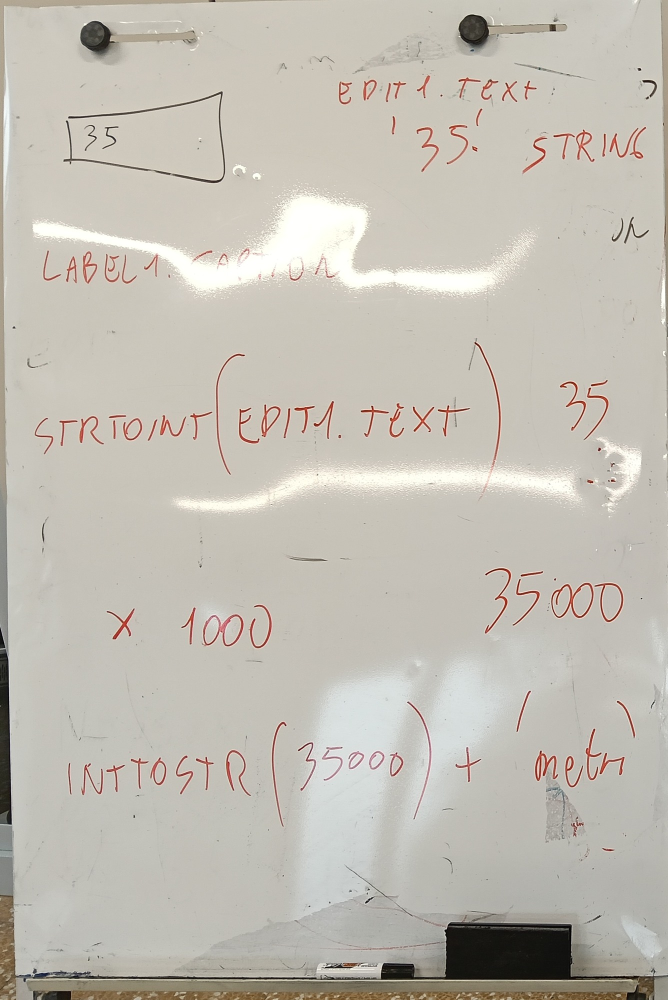
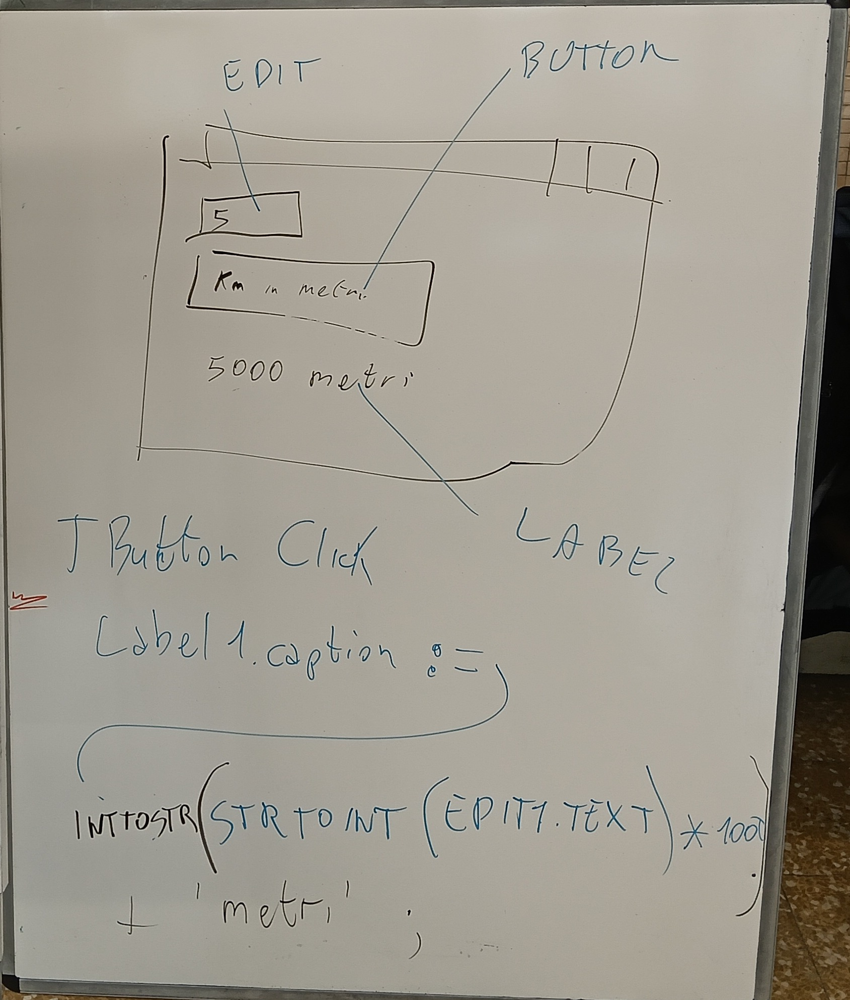

# 从文本到数字,再变回来

*Lazarus 里把公里换算成米:StrToInt 和 IntToStr*

讲义 · 1INF 班 · 实验室 · 2026年11月4日 · 版本 1.0

今天你在黑板上看到:写在框里的数字怎么变成可以计算的数字,算完又变回文字。这里一步一步写清楚,还教你在 Lazarus 里自己做一遍。做错了没关系:所有程序员都会出错,专业的也一样。

## 01 今天的黑板





**左边(黑板照片):**数据的旅程。从 `Edit1.Text`(`'35'`,字符串)到 `StrToInt`(35),再 `× 1000`(35000),再 `IntToStr`(文本形式的 35000),最后 `+ 'metri'`。

**右边(黑板照片):**窗口里有 EDIT(写着 5 的框)、BUTTON(按钮「Km in metri」)和 LABEL(文字「5000 metri」)。下面是点按钮时写出结果的那一行。

> **注意:**黑板上 `'metri'` 前面没有空格。代码里引号里面要加一个空格(`' metri'`):见第 04 节。

*示意图(不是截图):你画的完成后的窗口。* (示意图见 PDF)

## 02 文本和数字不是一回事

想象两个盒子。第一个贴着标签 **35**,但里面只是两个字符「3」和「5」,就像一句话:叫 `string`(字符串,也就是**文本**)。第二个是数字 35,里面真的是三十五这个数量,可以用来计算:叫 `integer`(整数,也就是**没有小数点的数字**)。

*示意图:两个盒子,文本和数字。* (示意图见 PDF)

> **文本和数字:**`'35' + '35'` 得到 `'3535'`(两段文字接在一起)。`35 + 35` 得到 `70`(两个数字相加)。

输入框 `Edit1` **永远给你文本**,哪怕你写的是 5。要计算就得转换。两个翻译官:

| 名称 | 作用 | 例子 |
|---|---|---|
| `StrToInt` | 文本变数字(String To Integer) | `'5'` → `5` |
| `IntToStr` | 数字变文本(Integer To String) | `5000` → `'5000'` |

## 03 数据的旅程

在框里写 **35**,点按钮。每行一步:

1. `Edit1.Text` 给出文本 `'35'`(string)。
2. `StrToInt` 把它变成数字 `35`(integer)。
3. `* 1000` 做乘法:`35000`(integer)。
4. `IntToStr` 把它变回文本:`'35000'`(string)。
5. `+ ' metri'` 接上单词:`'35000 metri'`(string)。
6. `Label1.Caption :=` 把文本显示到屏幕上。

*示意图:橙色 = 文本(string),蓝色 = 数字(integer)。* (示意图见 PDF)

## 04 简短版按钮:Button1Click

这是老师写的第一个按钮的代码:

```pascal
procedure TForm1.Button1Click(Sender: TObject);
begin
 Label1.Caption:=  IntToStr( StrToInt ( Edit1.Text  ) * 1000 ) + ' metri' ;
end;
```

要**从里往外**读,像套娃:先看最里面的一层,再一层层往外。

*示意图:一层套一层,标出阅读顺序和每层得到的值(以 5 为例)。* (示意图见 PDF)

1. `Edit1.Text`:框里写的文本(`'5'`)。
2. `StrToInt( ... )`:把它变成数字(`5`)。
3. `... * 1000`:相乘(`5000`)。
4. `IntToStr( ... )`:变回文本(`'5000'`)。
5. `... + ' metri'`:接上单词(`'5000 metri'`)。
6. `Label1.Caption :=`:把结果写进 Label1。

> **注意空格:**`' metri'` 里,「metri」前面有一个空格。没有空格就会显示 `5000metri`。

全部写在一行很方便,但不好读。第二个按钮做同样的事,不过**分成几步**,还给每样东西起了名字。

## 05 分步版按钮:Button2Click

```pascal
procedure TForm1.Button2Click(Sender: TObject);
Var TestoOriginale, TestoMetri, TestoFinale: string;
    nMetri,nKm: integer;
begin
 TestoOriginale := Edit1.Text;
 nKm := StrToInt(TestoOriginale);
 nMetri := nKm * 1000;
 TestoMetri := IntToStr(nMetri);
 TestoFinale := TestoOriginale + ' Kilometri sono ' + TestoMetri + ' metri';
 Label1.Caption :=  TestoFinale;
end;
```

### 变量:有名字的盒子

`Var` 的意思是「这里声明我的盒子」(变量)。先写名字,再写冒号,最后写类型。一共 **5** 个盒子:三个装文本(`string`),两个装数字(`integer`)。

| 名字 | 类型 | 放什么 |
|---|---|---|
| `TestoOriginale` | `string` | 我在框里写的(`'5'`) |
| `nKm` | `integer` | 公里数,数字形式(`5`) |
| `nMetri` | `integer` | 米数,数字形式(`5000`) |
| `TestoMetri` | `string` | 米数,文本形式(`'5000'`) |
| `TestoFinale` | `string` | 要显示的整句话 |

> **这样读:**`TestoOriginale, TestoMetri, TestoFinale: string;` = 「这三个名字是文本」。`nMetri,nKm: integer;` = 「这两个名字是数字」。小窍门:数字的名字以 **n** 开头,文本的名字以 **Testo** 开头。

### 一行一行看,以 5 为例

在框里写 **5**,点第二个按钮。红框是正在变化的盒子;问号表示盒子还是空的。

1. `TestoOriginale := Edit1.Text;` 复制框里的文本:`'5'`。

2. `nKm := StrToInt(TestoOriginale);` 翻译成数字:`5`。

3. `nMetri := nKm * 1000;` 计算:`5000`。

4. `TestoMetri := IntToStr(nMetri);` 变回文本:`'5000'`。

5. `TestoFinale := TestoOriginale + ' Kilometri sono ' + TestoMetri + ' metri';` 把文本拼起来:`'5 Kilometri sono 5000 metri'`。

6. `Label1.Caption :=  TestoFinale;` 把整句话显示到屏幕上:**5 Kilometri sono 5000 metri**。

| 执行完这一行 | TestoOriginale | nKm | nMetri | TestoMetri | TestoFinale |
|---|---|---|---|---|---|
| 1 | '5' | - | - | - | - |
| 2 | '5' | 5 | - | - | - |
| 3 | '5' | 5 | 5000 | - | - |
| 4 | '5' | 5 | 5000 | '5000' | - |
| 5 | '5' | 5 | 5000 | '5000' | '5 Kilometri sono 5000 metri' |

符号 `-` 表示盒子还是空的。行号对应上面的图。

## 06 在 Lazarus 里一步一步做

每行只做一个动作。图是示意图(不是截图):你屏幕上的东西看起来相似,位置也一样。

1. **打开 Lazarus**:双击桌面上的绿色图标「Lazarus」(或程序文件夹里的图标)。

2. **新建项目**:点上方菜单 **Progetto**,再点 **Nuovo progetto…**;在窗口里选 **Applicazione**,点 **OK**。

3. **把组件放到窗体上**:在 **Standard** 面板(窗体上方那排图标)里先点组件,再点窗体。依次放:**TEdit**(输入框)、**TLabel**(文字)和**两个 TButton**(按钮)。想知道组件名字,把鼠标停在图标上。

4. **在 Ispettore oggetti(左边的面板)里改文字**:先点窗体上的组件,再改 **Caption** 那一行(输入框改 **Text**)。一个一个改:

1. Button1,Caption 一行:写 `Km in metri (compatto)`
2. Button2,Caption 一行:写 `Km in metri (a passi)`
3. Edit1,Text 一行:全部删掉(留空)
4. Label1,Caption 一行:写 `risultato`(或者留空)

5. **第一个按钮的代码**:在窗体上双击 **Button1**。代码窗口打开:Lazarus 已经自己写好了 `procedure`、`begin` 和 `end;`。你**只写中间那一行**,放在 `begin` 和 `end;` 之间。老师的代码,一字不改:

```pascal
procedure TForm1.Button1Click(Sender: TObject);
begin
 Label1.Caption:=  IntToStr( StrToInt ( Edit1.Text  ) * 1000 ) + ' metri' ;
end;
```

6. **第二个按钮的代码**:回到窗体(按 **F12**),双击 **Button2**。Lazarus 会生成 `Button2Click`。**Var** 声明写在 **`procedure` 那一行和 `begin` 之间**;其余各行写在 `begin` 和 `end;` 之间。老师的代码,一字不改:

```pascal
procedure TForm1.Button2Click(Sender: TObject);
Var TestoOriginale, TestoMetri, TestoFinale: string;
    nMetri,nKm: integer;
begin
 TestoOriginale := Edit1.Text;
 nKm := StrToInt(TestoOriginale);
 nMetri := nKm * 1000;
 TestoMetri := IntToStr(nMetri);
 TestoFinale := TestoOriginale + ' Kilometri sono ' + TestoMetri + ' metri';
 Label1.Caption :=  TestoFinale;
end;
```

7. **运行程序**:按 **F9**(或者菜单下面的绿色三角形)。

> **如果按 F9 报错:**有些电脑上 Lazarus 会说「debugger」(程序运行时负责检查程序的小工具)启动不了。你的代码**没有错**。办法:打开 **Esegui** 菜单,点 **Run without Debugging** 这一项(是英文),或者同时按 **Maiusc + Ctrl + F9**。程序照样会运行。

8. **试一试**:在框里写 **5**,点第一个按钮(出现 `5000 metri`),再点第二个按钮(出现 `5 Kilometri sono 5000 metri`)。

9. **保存**:在 **File** 菜单点 **Salva tutto**。在 **Documenti** 里选一个新文件夹(比如 `convertitore`),点 **Salva**;Lazarus 会问两次(文件 `unit1.pas` 和项目)。

10. **提交**:提交文件 `unit1.pas`(在你建的文件夹里)和一张显示结果的窗口截图,按老师在 Classroom 上说的方式交。

> **完成了!**你做出了一个真正的程序。给同学看看,用自己的话讲讲按下按钮时发生了什么。

## 07 出错的时候

如果在框里写 `5a`,或者什么都不写,`StrToInt` 不知道这是哪个数字,程序就会报错:`"5a" is an invalid integer`(意思是「5a 不是有效的整数」)。不是你的错:电脑没办法拿一个字母去乘。

*示意图:上面 `StrToInt` 会出错,下面 `StrToIntDef` 不会出错。* (示意图见 PDF)

办法:`StrToIntDef(文本, 0)` 的意思是「试着变成数字;不行就用 0」。**当作附加内容来试试**(老师的代码还是上面那个):

```pascal
 Label1.Caption:=  IntToStr( StrToIntDef ( Edit1.Text, 0 ) * 1000 ) + ' metri' ;

 nKm := StrToIntDef(TestoOriginale, 0);
```

写 `5a` 时程序不再出错,而是显示 `0 metri`。

## 08 做成你自己的

1. 改文字:把 `' Kilometri sono '` 换成你自己的话,比如 `' km fanno '`。
2. 换一种单位:小时换成分钟,乘以 60。
3. 再选一种单位:欧元换成分(乘以 100),米换成厘米(乘以 100)。
4. 改按钮和文字的名字,然后让同学试试你的程序。

```pascal
 Label1.Caption := IntToStr( StrToInt ( Edit1.Text ) * 60 ) + ' minuti' ;
```

> **抄到笔记本上:**1) Edit1.Text 永远是文本(string)。2) StrToInt:文本变数字。3) IntToStr:数字变文本。4) Var:声明盒子(变量),有名字和类型。

## 09 五个复习问题

1. `Edit1.Text` 是文本还是数字? -> 永远是文本(`string`),哪怕写的是 5。
2. `StrToInt` 做什么? -> 把文本变成数字:`'5'` 变成 `5`。
3. 往 Label 里写之前,为什么要用 `IntToStr`? -> 因为 `Caption` 要的是文本:数字 `5000` 要变成 `'5000'`。
4. 执行 `nMetri := nKm * 1000;` 后,如果 `nKm` 是 5,`nMetri` 是多少,什么类型? -> 是 `5000`,类型是 `integer`(数字)。
5. 写 `5a` 会怎样?用 `StrToIntDef` 有什么不同? -> 用 `StrToInt` 会报错 `"5a" is an invalid integer`;用 `StrToIntDef(文本, 0)` 程序改用 0,不会出错。

验证:这些计算的逻辑已用 Free Pascal 编译器(fpc)以 5 和 35 测试过。Lazarus 窗体本身没有测试。
