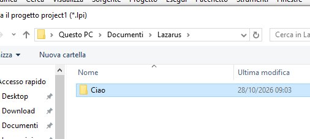
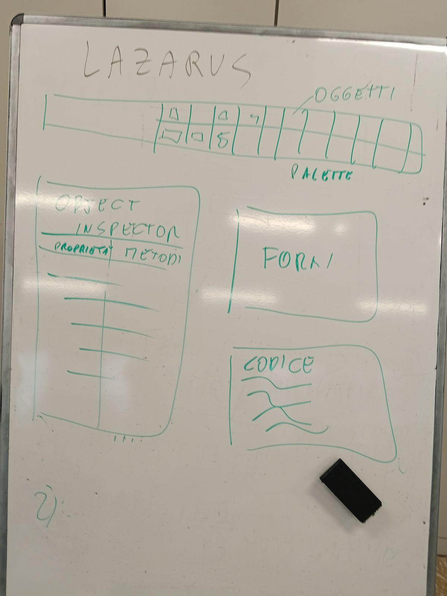
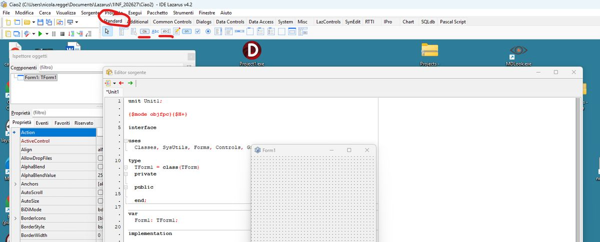
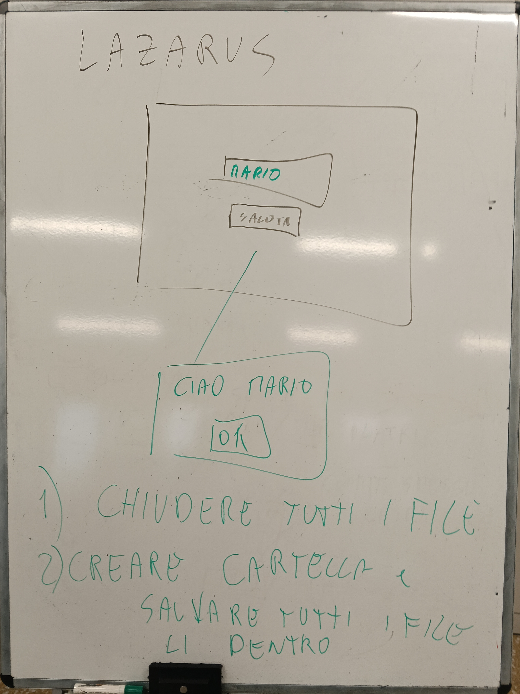
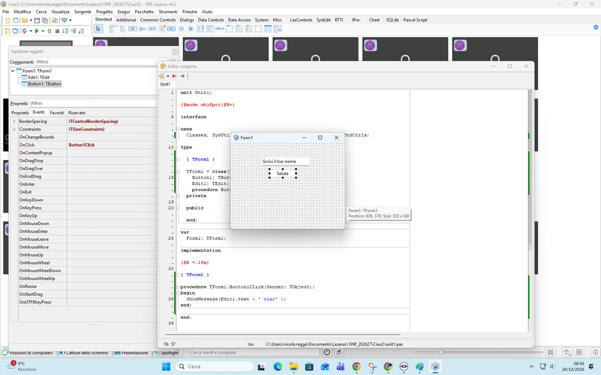
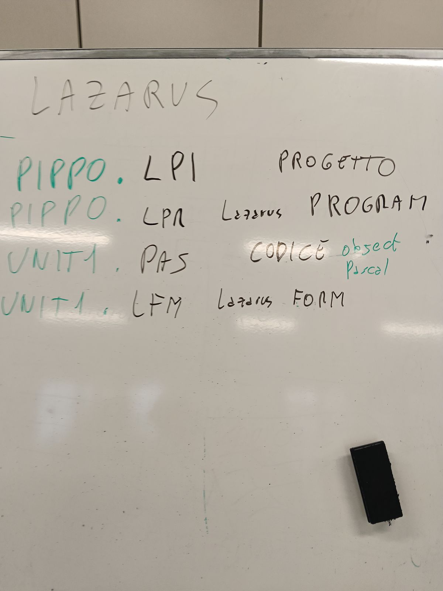

# Libro di testo — Informatica Classe 1

**Versione 1.3** — 30/10/2026
*Il libro di testo della Classe 1: raccoglie in un unico posto gli appunti, la
teoria e le esercitazioni svolte in classe. Cresce a ogni lezione. Due formati:
il PDF (`libro-classe1-vX.Y.pdf`) per leggere e stampare; questo MD è la fonte
versionata, da dare ai ragazzi per la loro AI (NotebookLM/Gemini), così l'AI
spiega e traduce nella loro lingua. La forma segue le regole di formattazione del
corso; la lingua è l'italiano (l'AI fa da ponte per arabo e cinese).*

---

## 0. Come lavoriamo (leggere per prime)
1. Ogni lezione: **carta e penna sul banco** per appunti e schemi a mano.
2. Si lavora **un passo alla volta**, con un risultato concreto da vedere subito.
3. Consegne e materiali stanno su **Google Classroom**; i documenti si scrivono
   con **Google Documenti**.
4. **L'AI aiuta a capire, non a saltare il pensiero**: la prova che hai capito è
   **saperlo spiegare a voce** con parole tue.
5. Chi scrive meglio nella propria lingua può scrivere in **arabo/cinese** e poi
   tradurre in italiano con Google Traduttore.

## 1. Che cos'è l'informatica
1. L'informatica è la scienza che studia come **trattare le informazioni** con
   strumenti automatici: il computer riceve dati (input), li elabora e restituisce
   risultati (output).
2. Il computer da solo non "capisce": esegue **istruzioni** precise che gli diamo.
3. Impareremo a usare bene gli strumenti (computer, Google, Git) e, più avanti, a
   creare noi qualcosa (siti, giochi).

## 2. Il computer e le sue parti
1. **CPU (processore):** il "cervello", esegue tutti i calcoli.
2. **RAM (memoria):** memoria di lavoro, veloce ma **temporanea** (si svuota allo
   spegnimento).
3. **Hard Disk / SSD:** dove si salvano i file in modo **permanente** (restano
   anche da spento).
4. **Scheda madre:** la base che collega e fa comunicare tutti i pezzi.
5. **Scheda video (GPU):** disegna la grafica (immagini, video, giochi).
6. **Alimentatore:** porta la corrente a tutti i pezzi.
7. **Case:** la scatola che contiene e protegge tutto.

### 2.1 Come si assembla (dove va ogni pezzo)
1. La **scheda madre** si fissa alla parete di fondo del **case**.
2. La **CPU** va nello zoccolo (socket) al centro-alto della scheda madre; sopra
   il dissipatore con la ventola.
3. La **RAM** entra negli slot lunghi accanto alla CPU (fino al "clic").
4. La **scheda video** va nello slot PCIe, in basso sulla scheda madre.
5. L'**Hard Disk/SSD** nel vano del case, collegato con un cavo alla scheda madre.
6. L'**alimentatore** in basso nel case; dà corrente a tutti.

### 2.2 Scegliere i pezzi (compatibilità e budget)
1. Con il sito `it.pcpartpicker.com/list/` (modalità **Builder**) si sceglie un
   pezzo per ogni categoria.
2. Il sito **controlla la compatibilità** (avvisa in rosso se due pezzi non vanno
   insieme) e **somma il prezzo totale**.
3. Obiettivo: montare un PC che funzioni **entro un budget** (es. 700 €).

### 2.3 Standard e compatibilità (form factor, PCIe, socket, RAM)
1. **Standard** = misure e forme comuni, decise da tutti, perché i pezzi
   **combacino**. I quattro principali:
2. **Form factor (grandezza della scheda madre e del case):** `ATX` (305×244 mm),
   `microATX` (244×244), `Mini-ITX` (170×170); `AT` è il vecchio standard. Più
   grande = più slot.
3. **Slot PCIe (schede aggiuntive):** `x1, x4, x8, x16` (lunghezze crescenti); nel
   `x16` va la **scheda video**. Versioni `3.0/4.0/5.0` (velocità); `M.2` per gli
   SSD NVMe.
4. **Socket (dove si appoggia la CPU):** Intel = `LGA` (pin nel socket, es.
   `LGA1700`); AMD = `PGA` (pin sulla CPU, es. `AM4`) o `LGA` (`AM5`). CPU e
   scheda madre si comprano **in coppia**.
5. **Processori per marca:** Intel Core `i3/i5/i7/i9`; AMD Ryzen `3/5/7/9`.
6. **RAM (memorie):** `DDR3/DDR4/DDR5`, con la **tacca in posizione diversa** (non
   si scambiano); `DIMM` (desktop) vs `SO-DIMM` (portatili).
7. **Cosa deve combaciare:** case↔scheda madre (form factor), scheda madre↔CPU
   (socket), scheda madre↔RAM (generazione), scheda video↔slot `PCIe x16`.

> [GIALLO] È il "perché" dei controlli che fa PCPartPicker quando si monta il PC.
> Materiale: scheda `standard-hardware` (teoria trilingue con i disegni in scala).

### 2.4 Lo storage: i 5 livelli (dove si salvano i file)


1. **Livello 1 — Tecnologia:** l'**HDD** (meccanico) ha un piatto che gira e una
   testina che si muove; l'**SSD** (elettrico) usa **celle NAND Flash**, senza
   parti in movimento (più veloce e resistente).
2. **Livello 2 — Tipo e velocità:** HDD meccanico ~160 MB/s; **SSD SATA** (2,5")
   ~560 MB/s; **SSD NVMe** molto più veloce (Gen3 ~3.500, Gen4 ~7.500, Gen5
   ~12.000+ MB/s).
3. **Livello 3 — Logica di controllo (il "linguaggio"):** **AHCI** (vecchio):
   seriale, una sola coda, va bene per l'HDD; **NVMe** (moderno): in parallelo,
   fino a 65.535 code, perfetto per i chip dell'SSD.
4. **Livello 4 — Connettore fisico:** **SATA** (con cavo, robusto) oppure **M.2**
   (a incastro diretto sulla scheda madre, piccolo). Attenzione: **M.2 è solo una
   FORMA** del connettore (può essere SATA o NVMe).
5. **Livello 5 — Interfaccia (la "strada" sulla scheda madre):** il **bus SATA**
   è lento e passa da un controller; il **bus PCIe** è velocissimo ed è collegato
   direttamente alla **CPU** (le "corsie" x4).

> [GIALLO] Da ricordare, le tre cose diverse: **M.2** = la forma del connettore ·
> **NVMe/AHCI** = il linguaggio · **PCIe/SATA** = la strada. Il disco più veloce
> oggi è un **SSD NVMe su M.2 collegato via PCIe**.

#### 2.4.1 In parole semplici — la storia dello storage

1. Una volta c'erano solo gli **HDD**: dischi che **girano**, con una **testina**
   che legge e scrive, un po' come la puntina di un giradischi. Funzionano, ma
   sono **lenti** e delicati, perché hanno **parti in movimento**.
2. Poi sono arrivati gli **SSD**: **niente parti in movimento**, salvano tutto in
   **chip di memoria** (NAND Flash), come una chiavetta USB molto evoluta. Sono
   più **veloci**, silenziosi e resistenti agli urti.
3. Ma non tutti gli SSD sono uguali. Un **SSD SATA** usa la **vecchia strada**
   dell'hard disk: è veloce, ma ha un limite (~560 MB/s). Un **SSD NVMe** usa una
   **strada nuova e larghissima**, il **PCIe** (la stessa della scheda video e
   della CPU), e va **molto** più veloce.
4. Tre parole da **non confondere**:
   1. la **FORMA** — `M.2`, il "bastoncino" che si incastra sulla scheda madre;
   2. il **LINGUAGGIO** — `NVMe` o `AHCI`, cioè come il computer "parla" col disco;
   3. la **STRADA** — `PCIe` (autostrada) o `SATA` (strada normale), per dove
      passano i dati.
5. **In pratica:** per far "volare" un computer, la prima cosa da fare è mettere
   un **SSD** (meglio se **NVMe**): è il salto di velocità che si sente di più,
   più ancora che cambiare processore.

> [GIALLO] Immagine mentale: pensa a una **consegna di pacchi**. La **forma** è il
> tipo di furgone, il **linguaggio** è la lingua con cui parli al corriere, la
> **strada** è l'autostrada o la stradina di campagna. Per andare veloce servono
> tutte e tre giuste: furgone adatto (M.2), lingua moderna (NVMe), autostrada (PCIe).

## 3. Utenze e aree di lavoro
1. **Account e password:** ognuno ha il proprio account della scuola; la password
   va tenuta al sicuro e robusta (lunga, con lettere, numeri e simboli).
2. **Le aree:** cartella personale in rete + spazio su **Google Drive**; i file si
   organizzano in **cartelle e sottocartelle** (area logica).
3. **Chiudere bene il computer:** quando hai finito, blocca o disconnetti con
   `Ctrl + Alt + Canc`; non lasciare il PC aperto e incustodito.

## 4. Google Suite e Classroom
1. **Google Documenti:** il programma per scrivere i testi (si salva da solo).
2. **Consegnare un compito su Classroom:** aprire il corso → "Lavori del corso" →
   il compito → "Aggiungi o crea" → "Documenti Google" → scrivere → "Consegna".
3. **Il voto:** l'allievo vede il voto **solo dopo** che il docente clicca
   "Restituisci".

## 5. GitHub e i repository
1. **GitHub** è un sito dove i programmatori **salvano e condividono** il codice
   dei loro progetti e collaborano.
2. **Repository (repo):** la "cartella-progetto" digitale che contiene tutti i
   file **e la storia di ogni modifica** fatta nel tempo.
3. A cosa serve la storia delle modifiche: si può **tornare a una versione
   precedente** se qualcosa va storto, e si capisce chi ha cambiato cosa e quando.
4. **Git** è il sistema che tiene traccia delle modifiche; **GitHub** è il sito
   che ospita i progetti online.

### 5.1 La storia del nostro gioco: versioni, rami, fork e merge (09/10/2026)
1. **Versione (commit):** ogni salvataggio pubblicato del gioco. Nel grafo è un pallino: v0.3, v1.1, v2.0.
2. **Ramo (branch):** una linea del grafo; il gioco cresce lungo il ramo, da sinistra a destra.
3. **Fork (copia):** la 1INF ha copiato il «Treno blindato» della 2INF (versione v0.11) e lo fa crescere per conto suo (v1.0, v1.1).
4. **Pull Request (proposta di modifica):** il Documento consegnato su Classroom («il mio cattivo si chiama Hidra…»): il prof lo legge, lo accetta e lo mette nel gioco.
5. **Merge (unione):** un ramo di lavoro rientra nel ramo principale. Il prof ha provato le «immagini della classe» su un ramo a parte, per non rompere il gioco; quando funzionavano le ha unite al ramo della 1INF.
6. **I numeri delle versioni:**
   6.1 v0.x = le prove, prima della versione stabile;
   6.2 1.0 = la prima versione «vera» del ramo;
   6.3 1.1, 1.2 = versioni **minor**: piccole aggiunte (un cattivo, un cielo);
   6.4 2.0 = versione **major**: cambia una cosa grossa. Il nostro gioco è stato rifatto con **Godot** (motore per videogiochi): per questo è la v2.0 e non la v1.2.
7. **Ponte da Lazarus:** Lazarus **reagisce** (aspetta un clic), Godot **pulsa** (`_process` gira da solo circa 60 volte al secondo).
8. Lezione completa (in italiano, arabo e cinese) e grafo: `classe-1/lezione-versioni-treno/` e la pagina `docs/lezione-versioni/`.

### 5.2 La lavagna del 09/10/2026: numeri delle versioni, fork, Pull Request


1. **I numeri delle versioni** (in blu): 16.0.2.31 · 7.0.3 · 2.01. Il primo numero è la **major** (cambio grosso), il secondo la **minor** (aggiunte), il terzo la **patch** (piccole correzioni di errori), il quarto, se c'è, la **build** (numero di compilazione). Esempio: 16.0.2.31 = major 16, minor 0, patch 2, build 31.
2. **Il ramo principale** (in rosso): v0.8 → v0.9 → v1.0. Il cerchio grande è la v1.0, la prima versione stabile che si pubblica (**release**).
3. **Il changelog** (riquadro verde tra v0.9 e v1.0): la lista di tutto quello che è cambiato da una versione all'altra.
4. **Il fork** (in blu): dalla v0.9 qualcuno copia il progetto e lavora per conto suo.
5. **La Pull Request**: dal fork si propone la modifica al progetto principale; se va bene → **accept ✓** e **merge**, la modifica entra nel ramo rosso e nasce una versione nuova.
6. **Refuse ✗**: una proposta che non va bene non entra nel progetto, ma resta nella storia e si può correggere e riproporre.

## 6. Sicurezza e regole di laboratorio
1. **Password robuste** e mai condivise; attenzione a e-mail sospette (phishing).
2. **Regole "quando hai finito"**: niente giochi, niente YouTube, niente cose che
   fanno rumore; resti al tuo posto; blocca/esci col `Ctrl + Alt + Canc`.
3. **Se hai finito**: ripassa, fai lo schema a mano sul quaderno, aiuta un
   compagno, prova a spiegare a voce cosa hai capito.

### 6.1 Sicurezza 1: pericolo, danno, rischio (22/10)
1. **Pericolo:** una cosa che **può** fare male (il coltello, l'olio bollente, la presa rotta, il pavimento bagnato, il cavo per terra). Domanda magica: «Che cosa qui mi può fare male?».
2. **Danno:** il male che **succede davvero** (un taglio, una bruciatura, una caviglia storta, gli occhi stanchi dopo ore di schermo).
3. **Rischio:** quanto è **facile** che il danno succeda e quanto è **grave**. Lo stesso pericolo ha un rischio diverso a seconda di come lo usi: motorino con il casco allacciato (basso) o senza casco, veloce, con il telefono in mano (alto); telefono in carica sul tavolo (basso) o sotto il cuscino tutta la notte (alto).
4. **«Per un pelo» (quasi incidente):** non ti sei fatto niente, ma il pericolo c'era: lo dici subito, così il prossimo non si fa male.
5. La prossima volta: **prevenzione** (il danno succede meno spesso) e **protezione** (il danno è meno grave). Documento completo: `classe-1/sicurezza-1ora/1inf-sicurezza-1ora.md`.

## 7. Esercitazioni svolte
1. **Io e la mia famiglia** — presentazione di sé e della famiglia con Google
   Documenti, consegna su Classroom (anche scrivendo nella propria lingua +
   traduzione).
2. **Ricerca: cos'è GitHub e cos'è un repository** — piccola ricerca in rete,
   scritta in un documento e consegnata su Classroom.
3. **I componenti del PC** — per ogni componente spiegare a cosa serve con parole
   proprie + due domande personali.
4. **Costruisci il tuo PC** — montare un PC compatibile a budget con PCPartPicker
   (Builder) e scrivere la lista con il prezzo totale.
5. **Documento sulla configurazione del PC** — spiegare con parole proprie gli
   standard (form factor, PCIe, socket, processori per marca, memorie) e inserire
   immagini dal web descrivendo la tipologia; consegna su Classroom.

### 7.1 Quanto pesa un file e quanto va veloce la rete (20 e 21/10)

1. **Bit e byte:** il bit vale 0 oppure 1; 8 bit fanno 1 byte, cioè una lettera. Il bit si scrive con la **b** piccola, il byte con la **B** grande.
2. **Le unità:** ogni gradino è circa 1000 volte più grande: KB, MB, GB, TB. Una foto pesa circa 3 MB, un film circa 2 GB.
3. **Il conto:** prima si porta tutto nella stessa unità, poi si divide. Esempio: 64 GB = 64000 MB; 64000 : 3 = circa 21000 foto.
4. **La velocità della rete** si misura in **Mbps** (megabit al secondo): 100 Mbps = 12,5 MB al secondo.
5. **Il controllo dei dati (CRC):** chi spedisce aggiunge un numero di controllo, chi riceve rifà il conto; se non torna, un bit si è rovinato e il pacchetto si chiede di nuovo.
6. **Nel cavo i bit sono corrente:** 5 volt = 1, 0 volt = 0.


7. **Il laboratorio del gamer (21/10):** il **ping** è il tempo di andata e ritorno verso il server (sotto 30 ms ottimo); il **jitter** è quanto il ping cambia; il **lag** è il ritardo che si sente giocando. Gli **FPS** sono le immagini al secondo prodotte dalla scheda video; gli **Hz** sono quante volte al secondo il monitor ridisegna l'immagine. I cavi video: VGA (vecchio, analogico), HDMI (porta anche l'audio), DisplayPort (monitor da gaming). Documento completo: `classe-1/gamer/1inf-gamer.md`.

## 8. Lazarus: il mio primo programma (28/10)

*Programmazione · Informatica, laboratorio · 28/10/2026 · la prima finestra con una casella (TEdit) e un bottone (TButton): scrivi il nome, premi e compare «Ciao» con il tuo nome; i file del progetto; consegna su Classroom. Dispensa completa in tre lingue (italiano, arabo, cinese): `classe-1/lazarus-ciao/20261028_Classe-1_v1.0_Lazarus-Primo-Programma_IT.md` (e `_AR`, `_ZH`).*

### 8.1 Che cos'è Lazarus

**Lazarus** è un programma che serve a **creare altri programmi**, con le finestre e i bottoni, come quelli che usi ogni giorno. Funziona come i **mattoncini**: prendi un pezzo già pronto (un bottone, una casella), lo metti nella finestra e poi scrivi **che cosa deve fare**. Il linguaggio si chiama **Pascal**.

Oggi facciamo il primo programma di tutti i programmatori: il **«Ciao»**. Scrivi il tuo nome in una casella, premi un bottone e il programma ti saluta: **Ciao Ahmed**.

Per aprire Lazarus: doppio clic sull'icona di Lazarus (il prof vi mostra dove si trova). Poi vai al capitolo 02: lì prepari il progetto nuovo e la tua cartella.

### 8.2 Partenza pulita: nuovo progetto e cartella nuova

Prima di mettere i pezzi nella finestra prepariamo il posto giusto. **Un progetto = una cartella sola**: tutti i file del tuo programma stanno insieme, nella tua cartella. Così nessun file si perde e nessun file si mescola con quelli di un altro.

Fai un passo alla volta. Dopo ogni passo guarda lo schermo.

**1.** In alto a sinistra in Lazarus clicca il menu «File».

**2.** Nel menu clicca «Chiudi tutto». Così si chiudono i file rimasti aperti.

**3.** Se Lazarus chiede di salvare un progetto vecchio, clicca «No».

**4.** In alto clicca il menu «Progetto».

**5.** Nel menu clicca «Chiudi progetto». Se la voce è grigia, non si può cliccare: va bene così, vai al passo 6.

**6.** Ora fai il progetto nuovo. In alto clicca il menu «Progetto».

**7.** Nel menu clicca «Nuovo progetto…». Si apre una finestra con un elenco.

**8.** Nell'elenco a sinistra clicca «Applicazione».

**9.** In basso nella finestra clicca «OK». Al centro compare la finestra vuota **Form1**.

**10.** SUBITO si salva. In alto clicca il menu «Progetto».

**11.** Nel menu clicca «Salva progetto con nome…». Si apre la finestra per salvare.

**12.** In alto nella finestra clicca il bottone «Nuova cartella». (Non lo vedi? Clic con il tasto destro su un punto vuoto della finestra → «Nuovo» → «Cartella».)

**13.** Scrivi il nome della cartella e premi `Invio`:

```
ciao
```

**14.** Fai **doppio clic** sulla cartella `ciao` per entrarci. In alto ora c'è scritto `ciao`.

**15.** In basso, nella casella «Nome file», scrivi il nome del progetto:

```
ciao.lpi
```

**16.** In basso a destra clicca «Salva».

**17.** Lazarus apre una seconda finestra: chiede il nome della **unit** (il file del codice). Nella casella «Nome file» lascia o scrivi:

```
unit1.pas
```

**18.** In basso a destra clicca «Salva».

**19.** Controlla: guarda in alto, nella barra del titolo di Lazarus. C'è scritto `ciao`. FATTO: il tuo progetto ha la sua cartella!

### 8.3 Le finestre di Lazarus

Quando apri un progetto nuovo vedi più finestre. Ognuna ha un lavoro:

| Dove | Si chiama | A che cosa serve |
|---|---|---|
| in alto | **menu** e **palette dei componenti** | i comandi («File», «Progetto», «Esegui»…) e, sotto, i pezzi da mettere nella finestra, divisi in linguette |
| a sinistra | **Ispettore oggetti** | le **proprietà** del pezzo selezionato (il testo, il nome, il colore) e i suoi **eventi** (che cosa succede quando lo clicchi) |
| al centro | **Form1**, con i puntini | la **finestra del tuo programma**: qui metti i pezzi |
| dietro la Form | **Editor del codice** (unit1.pas) | qui scrivi **che cosa fa** il programma |
| in basso | **Messaggi** | Lazarus ti dice se è andato tutto bene o dove c'è un errore |

Per passare dalla Form al codice e ritorno: tasto `F12`.

**Da ricopiare sul quaderno**

```
+--------------------------------------------------+
| MENU:  File  Progetto  Esegui ...                |
| PALETTE: [Standard]  [OK] [abc] [A] ...          |
+------------+-------------------------------------+
| ISPETTORE  |                                     |
| OGGETTI    |   FORM1  (la mia finestra)          |
|            |    +-----------------+              |
| Proprieta  |    | Edit1           |  <- TEdit    |
|  Caption   |    +-----------------+              |
|  Text      |       [ Saluta ]       <- TButton   |
| Eventi     |                                     |
|  OnClick   |   (F12 = vado al codice)            |
+------------+-------------------------------------+
| MESSAGGI: errori e avvisi                        |
+--------------------------------------------------+
```


### 8.4 La palette: come scegliere il pezzo giusto

La **palette dei componenti** è la fila di icone in alto, sotto il menu. I pezzi di oggi sono nella linguetta «Standard». Per scegliere, chiediti: **che cosa deve fare chi usa il programma?**

| Deve… | Pezzo (componente) | Icona nella palette | Proprietà che conta |
|---|---|---|---|
| **scrivere** qualcosa | **TEdit** (casella di testo) | una casella bianca con «abc» o «ab\|» | `Text` = quello che c'è scritto dentro |
| **premere** per far succedere una cosa | **TButton** (bottone) | un bottone con «OK» | `Caption` = la scritta sul bottone |
| **leggere** un testo (solo guardare) | **TLabel** (etichetta) | una «A» | `Caption` = il testo che si vede |

Per metterlo nella finestra: **un clic** sull'icona nella palette, poi **un clic** sulla Form1, nel punto dove lo vuoi. Lazarus gli dà un nome da solo: `Edit1`, `Button1`. Il **nome** (`Name`) è quello che userai nel codice.

### 8.5 Esercitazione: il mio «Ciao»

Un passo alla volta. Dopo ogni passo guarda lo schermo: deve essere uguale.

**1.** Nella palette, linguetta «Standard», clicca **TEdit**, poi clicca nella Form1, in alto a sinistra. Compare una casella con scritto `Edit1`.

**2.** Con la casella selezionata, nell'Ispettore oggetti trova la proprietà `Text` e cancella la scritta «Edit1»: la casella resta vuota.

**3.** Nella palette clicca **TButton**, poi clicca nella Form1 sotto la casella. Compare `Button1`.

**4.** Con il bottone selezionato, nell'Ispettore oggetti cambia `Caption` in `Saluta`. FATTO: la finestra è pronta!

**5.** Fai **doppio clic sul bottone**. Si apre il codice, con il cursore qui:

```
procedure TForm1.Button1Click(Sender: TObject);
begin
  // qui scrivi la tua riga
end;
```

**6.** Tra `begin` e `end;` scrivi questa riga:

```
ShowMessage('Ciao ' + Edit1.Text);
```

Che cosa vuol dire, pezzo per pezzo:

| Pezzo | Vuol dire |
|---|---|
| `ShowMessage( … )` | apre una **finestrella** con un messaggio e il bottone **OK**. Quello che c'è tra le parentesi è il messaggio |
| `Edit1.Text` | il testo scritto dentro la casella Edit1 (il nome) |
| `'Ciao '` | una scritta fissa. Va tra apici. Lo **spazio** dopo Ciao serve per non avere «CiaoAhmed» |
| `+` | attacca due scritte una dopo l'altra |
| `;` | fine dell'istruzione (come il punto alla fine di una frase) |

Tutto insieme: **«apri una finestrella con scritto Ciao e il nome che c'è nella casella»**. Come alla lavagna: scrivi MARIO, premi Saluta, compare **Ciao MARIO** con il bottone OK. È la funzione che risponde al **clic** del bottone: si chiama `Button1Click`.

**Da ricopiare sul quaderno**

```
scrivo MARIO -> clic su [Saluta] -> OnClick -> Button1Click
   -> ShowMessage('Ciao ' + Edit1.Text) -> | Ciao MARIO  [OK] |
```


### 8.6 Salva e fai partire

La cartella `ciao` l'hai già fatta nel capitolo 02. Adesso basta poco.

1. Premi `Ctrl` + `S`: Lazarus salva tutto nella tua cartella.
2. Premi `F9` (oppure la freccia verde ▶ in alto). Lazarus prepara il programma e lo fa partire: si apre la TUA finestra.
3. Clicca nella casella e scrivi il tuo nome.
4. Clicca il bottone **Saluta**. Si apre una finestrella con **Ciao** e il tuo nome.
5. Clicca **OK**. Ce l'hai fatta: hai scritto il tuo primo programma!

> [GIALLO] **Errore? È normale, succede a tutti i programmatori.** Guarda la finestra «Messaggi» in basso: dice la riga. I più comuni: manca il `;`; hai scritto `=` invece di `:=`; manca un apice `'`; la riga è fuori da begin … end.

### 8.7 I file del progetto, uno per uno

Dopo `F9` apri la cartella `ciao` con Esplora file. Lazarus ha creato tanti file. L'**estensione** sono le lettere dopo il punto nel nome del file: dice **che tipo di file è**. Non vedi le estensioni? In Esplora file, in alto: «Visualizza» → «Mostra» → «Estensioni nomi file».

**Gruppo 1. Il progetto**

| File | Che cos'è | Che cosa c'è dentro | Si può cancellare? |
|---|---|---|---|
| `ciao.lpi` | informazioni del progetto (**L**azarus **P**roject **I**nformation)<br>*Come: la scheda del progetto, con l'elenco dei pezzi e le istruzioni per montarli* | un testo in formato **XML** (testo con le etichette tra < e >): quali file fanno parte del progetto e le **opzioni** del progetto e del compilatore, quelle che si cambiano dal menu «Progetto» → «Opzioni progetto…». Con doppio clic su questo file riapri il progetto | **NO** |
| `ciao.lpr` | programma principale (**L**azarus **PR**ogram)<br>*Come: il fischio di inizio della partita: fa partire tutto* | le poche righe in Pascal che fanno partire tutto e aprono Form1. Non si tocca | **NO** |
| `ciao.lps` | sessione (**L**azarus **P**roject **S**ession)<br>*Come: un segnalibro: la memoria di dove eri rimasto* | quali file erano aperti nell'editor, in che ordine erano le linguette, dov'era il cursore. **Non contiene il programma**: se la cancelli, il tuo lavoro c'è ancora tutto | sì: Lazarus la rifà |
| `ciao.res` | risorse (**RES**ource)<br>*Come: lo zaino con le cose da portare dentro l'exe: icona e versione* | l'icona e la versione del programma, pronte da mettere dentro l'exe | sì: Lazarus la rifà |
| `ciao.ico` | icona (**ICO**n)<br>*Come: la foto profilo del programma* | il disegnino del programma, quello che vedi sulla barra di Windows | sì: Lazarus la rifà |

**Gruppo 2. La finestra e il codice**

| File | Che cos'è | Che cosa c'è dentro | Si può cancellare? |
|---|---|---|---|
| `unit1.lfm` | la form (**L**azarus **F**or**M**)<br>*Come: la piantina di una stanza: dove stanno i mobili* | **com'è fatta la finestra**: quali pezzi ci sono, dove stanno, quanto sono grandi, Caption e Text | **NO** |
| `unit1.pas` | la unit (un file di codice in **Pas**cal)<br>*Come: la ricetta: le istruzioni che hai scritto tu* | il **TUO codice**: la procedura `Button1Click` con la riga del Ciao. Una unit può avere anche l'estensione `.pp` | **NO** |

**Gruppo 3. Il programma finito**

| File | Che cos'è | Che cosa c'è dentro | Si può cancellare? |
|---|---|---|---|
| `ciao.exe` | eseguibile (**EXE**cutable), nella cartella del progetto<br>*Come: la torta già cotta: si mangia anche senza la ricetta* | il **programma finito**, creato con F9. Si apre anche senza Lazarus | sì: si rifà con F9 |

**Gruppo 4. File di lavoro del compilatore** (il **compilatore** è il programma che trasforma il Pascal in un programma che il computer sa eseguire)

| File | Che cos'è | Che cosa c'è dentro | Si può cancellare? |
|---|---|---|---|
| `lib\x86_64-win64\` | cartella<br>*Come: il tavolo della cucina dove si preparano i pezzi* | i pezzi intermedi che servono per fare l'exe (qui sotto) | sì: Lazarus la rifà |
| `.o` | file oggetto (**O**bject)<br>*Come: un ingrediente già cotto, uno solo* | il codice macchina di **una sola** unit, per esempio `unit1.o` | sì |
| `.ppu` | unit compilata di Free Pascal (**P**ascal **P**recompiled **U**nit)<br>*Come: un pezzo già montato, con l'etichetta che dice che cosa sa fare* | le informazioni sulla unit già tradotta, per esempio `unit1.ppu` | sì |
| `.compiled` | promemoria della compilazione<br>*Come: lo scontrino: ricorda com'è andata l'ultima volta* | come è stato compilato il progetto l'ultima volta: così Lazarus sa se deve rifare tutto | sì |
| `.or` | risorse compilate<br>*Come: lo zaino del .res già chiuso, pronto da caricare* | il file `.res` già pronto da attaccare all'exe | sì |
| `backup\` | cartella delle copie di sicurezza<br>*Come: la fotocopia del compito prima di correggerlo* | quando salvi un file che esisteva già, Lazarus mette qui la versione di prima. Le copie dei file del progetto hanno **lo stesso nome** dell'originale (`unit1.pas`, `unit1.lfm`, `ciao.lpi`…); un file che non fa parte del progetto prende in più `.bak` (per esempio `prova.pas.bak`). La cartella compare dal secondo salvataggio | sì |

Con le impostazioni normali di Lazarus 4, fuori dalla cartella `backup` non trovi copie con `~` o `.bak`. Se le vedi, qualcuno ha cambiato le impostazioni delle copie (menu «Strumenti» → «Opzioni…», pagina «Backup»).

Regola da ricordare: i **4 file da tenere**, da consegnare e da mettere su GitHub sono `.lpi` `.lpr` `.pas` `.lfm`. Tutto il resto Lazarus lo rifà da solo.

**Da ricopiare sul quaderno**

```
ciao\                       <- UNA cartella = UN progetto
 |- ciao.lpi    progetto (+ opzioni)      TENERE
 |- ciao.lpr    programma principale      TENERE
 |- unit1.pas   il mio codice             TENERE
 |- unit1.lfm   com'e' fatta la finestra  TENERE
 |- ciao.lps    sessione                  si rifa'
 |- ciao.res    risorse (icona)           si rifa'
 |- ciao.ico    icona                     si rifa'
 |- ciao.exe    programma finito (F9)     si rifa'
 |- lib\x86_64-win64\
 |     .o .ppu .compiled .or (compilatore) si rifa'
 |- backup\     copie di sicurezza        si butta
```


### 8.8 Fallo tuo

Il programma funziona? Adesso rendilo **tuo**. Scegli almeno una cosa:

1. Il saluto nella **tua lingua**: al posto di `'Ciao '` scrivi `'Hello '`, `'مرحبا '`, `'你好 '`, `'Hola '`…
2. Il **titolo** della finestra: clicca su un punto vuoto della Form1, nell'Ispettore oggetti cambia `Caption` (per esempio «Il saluto di Ahmed»).
3. Il **colore**: sempre sulla Form1, proprietà `Color`, scegli un colore dalla tendina.
4. Per i più veloci: aggiungi una TLabel e una seconda riga, `Label1.Caption := 'Ciao ' + Edit1.Text;`: il saluto resta scritto anche nella finestra.

Poi **spiegalo in 30 secondi** al compagno: «Ho messo una TEdit e un TButton; quando clicco, la funzione Button1Click apre una finestrella con Ciao e il nome».

### 8.9 Consegna

Su Classroom c'è il compito **«Il mio primo programma: Ciao in Lazarus»**. Dentro c'è un **Documento Google** già pronto, solo tuo. Aprilo e fai 3 cose:

1. **Il codice.** In Lazarus seleziona con il mouse la tua procedura, da `procedure TForm1.Button1Click` fino a `end;`, premi `Ctrl` + `C`; nel Documento clicca sotto «1. Il mio codice» e premi `Ctrl` + `V`.
2. **Lo screenshot.** Fai partire il programma (`F9`), scrivi il tuo nome e premi Saluta. Poi premi `Win` + `Shift` + `S` e trascina un rettangolo intorno alla tua finestra. Nel Documento clicca sotto «2. Il mio programma che funziona» e premi `Ctrl` + `V`.
3. **Con parole tue.** Sotto «3» scrivi in una o due frasi che cosa fa la riga `ShowMessage('Ciao ' + Edit1.Text);`. Puoi scrivere anche nella tua lingua.

Poi in Classroom premi «Consegna» (il bottone blu in alto a destra nel compito).


## 9. Le lezioni una per una
*In ordine di data: che cosa abbiamo fatto, in breve nelle tre lingue (italiano, arabo, cinese), la teoria e l'esercitazione di ogni lezione. Ogni lezione ha anche il suo libro parziale nella cartella lezioni.*

<!-- LEZIONI:INIZIO -->
### L01 15/09/2026 — Ulisse, la curiosità e l'informatica

*Libro parziale: lezioni/2026-09-15_ulisse-informatica.md*

#### Che cosa abbiamo fatto

1. **Quando:** 15/09/2026, 1 ora, Tecnologia.
2. **Argomenti:** Prima lezione: accoglienza, il viaggio di Ulisse come esempio di curiosità, che cos'è l'informatica.

#### In breve · باختصار · 简要

<div class="scheda breve"><p lang="it">L&#x27;informatica tratta le informazioni con il computer: dati in entrata, elaborazione, risultati in uscita.</p><p lang="ar" dir="rtl">المعلوماتية تعالج المعلومات بالحاسوب: بيانات تدخل، معالجة، ونتائج تخرج.</p><p lang="zh">信息学用电脑处理信息：输入数据，处理，输出结果。</p></div>

#### La teoria e l'esercitazione

##### Teoria
1. **L'informatica come viaggio:** come Ulisse parte per **curiosità** di conoscere, così noi useremo la curiosità come motore per imparare.
2. **Cosa studieremo quest'anno:** il computer e le sue parti, internet, saper usare bene gli strumenti digitali e l'intelligenza artificiale, un po' di programmazione.
3. **Il metodo del corso:** passi piccoli, un risultato concreto a ogni tappa; provare **senza paura di sbagliare** (l'errore è normale); **mostrare** quello che si fa.
4. **Carta e penna sul banco sempre:** appunti e schemi a mano aiutano a capire e a ricordare.

##### Il compito
1. Lezione introduttiva: ascoltare, prendere **appunti a mano**, e dire con parole proprie cosa ci si aspetta dal corso.
2. Nessuna consegna individuale.

##### Criteri di valutazione
1. **Partecipazione**: ascolto e attenzione.
2. **Appunti**: presa di appunti a mano sul quaderno.

### L02 16/09/2026 — Regolamento di laboratorio, utente e password

*Libro parziale: lezioni/2026-09-16_regolamento-user-password.md*

#### Che cosa abbiamo fatto

1. **Quando:** 16/09/2026, 3 ore, Laboratorio.
2. **Argomenti:** Regolamento di laboratorio e regolamento sugli strumenti digitali e l'IA; laboratorio 1: utenze e aree di lavoro, login di Windows, account Google e Drive, prova della password.

#### In breve · باختصار · 简要

<div class="scheda breve"><p lang="it">Il laboratorio ha regole precise. Ognuno ha il suo utente e una password segreta, da non dare a nessuno.</p><p lang="ar" dir="rtl">للمختبر قواعد واضحة. لكل طالب اسم مستخدم وكلمة سر لا يعطيها لأحد.</p><p lang="zh">机房有明确的规则。每个人都有自己的用户名和密码，密码不能告诉别人。</p></div>

#### La teoria e l'esercitazione

##### Teoria
1. **Le regole del laboratorio:** come si usano i computer della scuola, rispetto delle postazioni, non installare programmi, non lasciare il proprio account aperto.
2. **Uso corretto di internet e dei servizi digitali** e attenzione alla **privacy** (propria e degli altri).
3. **Regola d'uso dell'Intelligenza Artificiale:** l'IA aiuta a **capire**, non a fare il lavoro **al posto tuo**. Chi capisce e sa spiegare, vince.
4. **Quando hai finito:** niente giochi/YouTube, si resta al posto, si fa qualcosa di utile e si aspetta l'indicazione del docente.

##### Il compito
1. Leggere il **regolamento** e firmarne la **presa visione/accettazione** (modulo).
2. Capire perché ogni regola esiste (non è un capriccio: serve a lavorare bene tutti).

##### Criteri di valutazione
1. **Presa visione**: modulo letto e firmato.
2. **Comprensione**: sa spiegare almeno due regole con parole proprie.

##### Teoria
1. **Account (utente) e password:** l'account è la tua identità sul computer; la password la protegge. Servono per entrare e ritrovare le tue cose.
2. **Login e logout a Windows** e **blocco schermo** con `Ctrl + Alt + Canc` (bloccare quando ci si alza).
3. **Account Google della scuola** e **Google Drive** (lo spazio dove salvare i file online).
4. **Una password sicura:** lunga, non banale (non 1234), non condivisa; e si **tiene al sicuro** (non attaccata al monitor).

##### Il compito
1. Accedere al computer e all'**account Google**; **provare** la password.
2. Compilare a penna la scheda **"Le mie utenze e password"** e tenerla al sicuro.
3. Provare a **bloccare e sbloccare** lo schermo con `Ctrl + Alt + Canc`.

##### Criteri di valutazione
1. **Accesso**: sa accedere e uscire, e bloccare lo schermo.
2. **Password**: ne gestisce una in modo sicuro.

### L03 17/09/2026 — Prova account e «Io e la mia famiglia»

*Libro parziale: lezioni/2026-09-17_account-famiglia.md*

#### Che cosa abbiamo fatto

1. **Quando:** 17/09/2026, 2 ore, Tecnologia e Sicurezza.
2. **Argomenti:** Prova dell'account; laboratorio 2: cartelle ad albero, giro della Google Suite, iscrizione a Classroom; primo documento «Io e la mia famiglia» con Google Documenti e Google Traduttore, consegnato su Classroom.

#### In breve · باختصار · 简要

<div class="scheda breve"><p lang="it">Primo documento con Google Documenti, aiutandosi con Google Traduttore, e prima consegna su Classroom.</p><p lang="ar" dir="rtl">أول مستند في مستندات Google بمساعدة مترجم Google، وأول تسليم في Classroom.</p><p lang="zh">用 Google 文档写第一份文件，用 Google 翻译帮忙，第一次在 Classroom 上交作业。</p></div>

#### La teoria e l'esercitazione

##### Teoria
1. **Ripasso:** accedere ai propri account (Windows, Google) e **verificare** che tutto funzioni.
2. **Se non si riesce ad accedere:** cosa fare (password sbagliata o dimenticata, maiuscole accese, chiedere aiuto).
3. **Google Classroom:** il luogo dove il docente mette i compiti e dove si **consegna** il proprio lavoro; come **iscriversi** al corso.

##### Il compito
1. **Provare l'accesso** ai propri account e verificare l'**ingresso a Google Classroom**.
2. Segnare quali account funzionano e quali no.

##### Criteri di valutazione
1. **Accesso riuscito**: entra nei propri account.
2. **Classroom**: iscritto al corso.

##### Teoria
1. **Google Documenti:** un programma per scrivere testi che funziona nel browser e si salva da solo.
2. **Presentarsi per iscritto:** scrivere di sé e della propria famiglia (chi sono, da dove vengo, la mia storia).
3. **Google Traduttore** (`translate.google.com`): chi non scrive ancora bene in italiano scrive nella propria lingua e traduce.
4. **Privacy:** un lavoro personale si condivide solo con il docente o la classe, non si pubblica su internet.

##### Il compito
1. Creare un documento in **Google Documenti** che presenta te stesso/a e la tua famiglia.
2. Se serve, scrivere prima nella propria lingua e **tradurre** in italiano.
3. **Fallo tuo:** aggiungere una foto o un colore che ti rappresenta.
4. **Consegnare** su Google Classroom.

##### Criteri di valutazione
1. **Contenuto**: si presenta con alcune frasi.
2. **Lingua**: testo comprensibile in italiano.
3. **Personalizzazione**: un dettaglio proprio.
4. **Consegna**: su Classroom.

### L04 18/09/2026 — GitHub e i repository

*Libro parziale: lezioni/2026-09-18_github-repository.md*

#### Che cosa abbiamo fatto

1. **Quando:** 18/09/2026, 3 ore, Laboratorio.
2. **Argomenti:** Ricerca «che cos'è GitHub e che cos'è un repository» in Google Documenti; creazione dell'account GitHub.

#### In breve · باختصار · 简要

<div class="scheda breve"><p lang="it">GitHub conserva i progetti e la loro storia. Un repository è la cartella del progetto, con tutte le versioni.</p><p lang="ar" dir="rtl">يحفظ GitHub المشاريع وتاريخها. المستودع (repository) هو مجلد المشروع مع كل نسخه.</p><p lang="zh">GitHub 保存项目和它们的历史。仓库（repository）就是项目的文件夹，里面有所有版本。</p></div>

#### La teoria e l'esercitazione

##### Teoria
1. **GitHub:** un sito dove si **conservano e condividono** progetti (documenti, codice, siti).
2. **Repository (repo):** una "cartella di progetto" online, con dentro i file e la loro **storia** (chi ha cambiato cosa e quando).
3. **A cosa serve:** salvare il lavoro al sicuro, vederne le **versioni**, poter **collaborare** in più persone.
4. Con GitHub un domani potremo **pubblicare** i nostri lavori (siti, giochi) su internet.

##### Il compito
1. Fare una **piccola ricerca**: "cos'è GitHub e cos'è un repository", guardando il sito e cercando in rete.
2. Scrivere in **Google Documenti** e **consegnare** su Classroom.
3. (Passo successivo) **Creare l'account GitHub** con l'email della scuola.

##### Criteri di valutazione
1. **Comprensione**: spiega cos'è GitHub e cos'è un repository.
2. **Consegna**: documento consegnato su Classroom.

### L05 21/09/2026 — Ripasso hardware, regole e il versioning

*Libro parziale: lezioni/2026-09-21_hardware-regole-versioning.md*

#### Che cosa abbiamo fatto

1. **Quando:** 21/09/2026, 3 ore, Laboratorio.
2. **Argomenti:** Ripasso dei pezzi del PC; regole e modalità di lavoro; che cos'è il versioning (le versioni di un lavoro); quiz «Regole + Versioning».

#### In breve · باختصار · 简要

<div class="scheda breve"><p lang="it">Ogni lavoro cresce per versioni: 1.0, 1.1, 2.0. Così si vede che cosa è cambiato e si può tornare indietro.</p><p lang="ar" dir="rtl">كل عمل يكبر بنسخ: 1.0 ثم 1.1 ثم 2.0. هكذا نرى ما تغيّر ونستطيع الرجوع.</p><p lang="zh">每个作品按版本成长：1.0、1.1、2.0。这样能看到改了什么，也能回到以前。</p></div>

#### La teoria e l'esercitazione

##### Teoria
1. **Ripasso delle parti del PC:** CPU (il cervello), RAM (il tavolo di lavoro), SSD (il magazzino), scheda madre (la base), scheda video (le immagini), alimentatore (la corrente), case (la scatola), dissipatore (il raffreddamento).
2. **A cosa serve ciascuno** e come i pezzi lavorano insieme.
3. Fare uno **schema a mano** delle parti aiuta a fissarle.

##### Il compito
1. **Ripasso a voce** e **schema a mano** sul quaderno delle parti del PC e della loro funzione.
2. Nessuna consegna online (attività in classe).

##### Criteri di valutazione
1. **Conoscenza**: sa nominare le parti e spiegarne la funzione.
2. **Schema**: schema a mano sul quaderno.

##### Teoria
1. **Come si lavora in laboratorio:** un obiettivo alla volta, si segue l'indicazione, si prende appunti.
2. **Come si consegna:** i compiti si trovano e si consegnano su **Google Classroom**.
3. **Comportamento in classe:** si alza la **mano ben alta** e si aspetta il cenno del docente; attenzione durante il lavoro.
4. **Quando hai finito o non hai nulla da fare:** niente giochi/YouTube, si resta al posto, si fa qualcosa di utile.

##### Il compito
1. Comprendere e **applicare** le regole e le modalità di lavoro.
2. Nessuna consegna online (attività in classe).

##### Criteri di valutazione
1. **Rispetto delle modalità**: segue le regole di lavoro e di consegna.

##### Teoria
1. **Versioning:** dare un **numero** alle versioni di un lavoro (v1.0, v1.1, v2.0) per sapere qual è l'**ultima** e tenere la **storia**.
2. **Major e minor:** se cambia **molto** sale il **primo** numero (2.0); se è una **piccola** correzione sale il **secondo** (1.1).
3. **Ripartenza:** a una nuova versione principale si riparte da .0 (es. 2.0).
4. **Perché serve:** non perdere il lavoro, poter **tornare indietro**, sapere **cosa è cambiato**. È l'idea alla base di Git.

##### Il compito
1. Attività sul versioning: leggere la **scheda delle versioni** e svolgere il **quiz**.
2. Saper dire, dato un cambiamento, se è **major** o **minor**.

##### Criteri di valutazione
1. **Comprensione**: distingue major e minor e spiega a cosa serve il versioning.
2. **Quiz**: quiz completato.

### L06 22/09/2026 — Controllo degli account

*Libro parziale: lezioni/2026-09-22_controllo-account.md*

#### Che cosa abbiamo fatto

1. **Quando:** 22/09/2026, 1 ora, Tecnologia.
2. **Argomenti:** Controllo che ognuno entri nei suoi account (Windows, Google, Classroom, GitHub).

#### In breve · باختصار · 简要

<div class="scheda breve"><p lang="it">Controlliamo che ognuno entri da solo in tutti i suoi account.</p><p lang="ar" dir="rtl">نتأكد أن كل طالب يدخل وحده إلى كل حساباته.</p><p lang="zh">检查每个人都能自己登录所有账号。</p></div>

#### La teoria e l'esercitazione

##### Teoria
1. **Mettere in ordine gli account:** email della scuola, Google, GitHub; controllare di **poter accedere** a tutto.
2. **Sicurezza:** non condividere le password; riconoscere **email sospette** (phishing) e non cliccare link strani.
3. Tenere una **scheda** con le proprie utenze, al sicuro.

##### Il compito
1. **Controllare** i propri account e segnare quali funzionano e quali no.
2. Sistemare eventuali problemi di accesso con l'aiuto del docente.

##### Criteri di valutazione
1. **Account in ordine**: accede a scuola/Google/GitHub.
2. **Sicurezza**: sa riconoscere una password debole e un'email sospetta.

### L07 23/09/2026 — L'hardware del PC

*Libro parziale: lezioni/2026-09-23_hardware.md*

#### Che cosa abbiamo fatto

1. **Quando:** 23/09/2026, 3 ore, Laboratorio.
2. **Argomenti:** I componenti del PC: scheda madre, processore, RAM, memoria di massa, alimentatore, scheda video.

#### In breve · باختصار · 简要

<div class="scheda breve"><p lang="it">Il PC è fatto di pezzi: scheda madre, processore (CPU), RAM, disco, alimentatore, scheda video.</p><p lang="ar" dir="rtl">يتكوّن الحاسوب من قطع: اللوحة الأم، المعالج، الذاكرة RAM، القرص، مزوّد الطاقة، بطاقة الرسوم.</p><p lang="zh">电脑由零件组成：主板、处理器（CPU）、内存（RAM）、硬盘、电源、显卡。</p></div>

#### La teoria e l'esercitazione

##### Teoria
1. **Approfondimento hardware:** i componenti e le loro **caratteristiche** (velocità, capacità).
2. **Compatibilità:** i pezzi devono "andare d'accordo" (es. CPU e scheda madre stesso socket).
3. **Standard:** form factor (ATX/microATX/Mini-ITX), **socket** della CPU, memorie **RAM DDR3/DDR4/DDR5**.
4. Prepararsi a **configurare** un PC scegliendo pezzi compatibili.

##### Il compito
1. Attività pratica: **riconoscere** i componenti e le loro caratteristiche.
2. Nessuna consegna online (attività in classe, preparazione alla configurazione).

##### Criteri di valutazione
1. **Riconoscimento**: identifica i componenti e le compatibilità principali.

### L08 24/09/2026 — Configurazione di un PC: standard hardware

*Libro parziale: lezioni/2026-09-24_configurazione-pc.md*

#### Che cosa abbiamo fatto

1. **Quando:** 24/09/2026, 3 ore, Tecnologia e Sicurezza.
2. **Argomenti:** Standard hardware: form factor (ATX, microATX, Mini-ITX), slot PCIe, socket Intel e AMD, RAM DDR3/4/5; documento con teoria e immagini consegnato su Classroom; correzione dei compiti.

#### In breve · باختصار · 简要

<div class="scheda breve"><p lang="it">I pezzi del PC devono essere compatibili: la stessa misura (form factor), lo stesso socket, lo stesso tipo di RAM.</p><p lang="ar" dir="rtl">يجب أن تكون قطع الحاسوب متوافقة: نفس المقاس، نفس المقبس (socket)، نفس نوع الذاكرة RAM.</p><p lang="zh">电脑零件必须兼容：同样的尺寸（form factor）、同样的插座（socket）、同样类型的内存。</p></div>

#### La teoria e l'esercitazione

##### Teoria
1. **Form factor:** grandezza della scheda madre — ATX (grande), microATX (media), Mini-ITX (piccola).
2. **Slot PCIe:** attacchi (x1, x4, x8, x16); il **x16** serve per la **scheda video**.
3. **Socket CPU:** **Intel = LGA** (es. LGA1700), **AMD = AM** (es. AM5); CPU e scheda madre stesso socket.
4. **Processori per marca:** Intel Core **i3/i5/i7/i9**, AMD Ryzen **3/5/7/9**.
5. **Memorie RAM:** **DDR3/DDR4/DDR5**, non intercambiabili (tacca diversa).

##### Il compito
1. Creare un documento in **Google Documenti** che spiega **con parole proprie** i 5 argomenti.
2. Inserire **immagini prese dal web** (almeno una per argomento).
3. **Consegnare** su Google Classroom.

##### Criteri di valutazione
1. **Completezza teoria**: spiegati tutti e 5 gli argomenti.
2. **Parole proprie**: spiegazione personale (prova del nove a voce).
3. **Immagini**: almeno una per argomento.
4. **Consegna**: su Classroom.

##### Teoria
1. **Rivedere insieme gli errori tipici** della configurazione: componenti dimenticati (spesso l'alimentatore), doppioni di RAM/SSD, totale non calcolato.
2. **Come si corregge un lavoro:** si guarda cosa manca, si aggiunge, si ricontrolla il totale.
3. **Migliorare è normale:** un lavoro si consegna, si riceve un riscontro e si migliora — come fanno i professionisti.

##### Il compito
1. Correggere e **completare** il proprio documento di configurazione con le indicazioni ricevute.
2. Ricontrollare compatibilità, presenza di tutti i componenti e totale.

##### Criteri di valutazione
1. **Correzione**: sistema gli errori segnalati.
2. **Completezza**: il lavoro finale ha tutti i componenti e il totale.

*Classe 1 — Informatica. Scheda docente + appunti per i ragazzi sugli standard
hardware: form factor (AT/ATX/microATX/Mini-ITX), slot PCIe (x1/x4/x8/x16),
socket della CPU (Intel LGA vs AMD PGA/AM5), tipi di RAM (DDR3/DDR4/DDR5, DIMM
vs SO-DIMM). I PDF (`20260924_Classe-1-PerTutti_v1.0_Standard-Configurazione-PC_IT/AR/ZH.pdf`)
contengono i disegni con le forme in proporzione reale, nelle 3 lingue; questo
`.md` è la fonte versionata e serve anche all'AI dei ragazzi per spiegare/tradurre.*

> Nota: i disegni (Fig. 1–4) sono nei file `standard-hardware-it/ar/zh.html` → PDF. Qui
> sono descritti a parole così che l'AI possa spiegarli in un'altra lingua.

---

##### Idea guida

Dentro un computer i pezzi devono **combaciare**: una scheda madre entra solo in
certi case, una CPU entra solo in un certo socket, una RAM entra solo nel suo
slot. Per farli combaciare, nel mondo ci si è messi d'accordo su **misure e forme
comuni**: sono gli **standard**. Ne vediamo quattro: form factor, slot PCIe,
socket, tipi di RAM.

> [BLU] Carta e penna: prima di guardare lo schermo, ognuno disegna a mano un
> rettangolo "scheda madre" e ci segna dove va la CPU (socket), dove le RAM (slot
> lunghi e stretti) e dove la scheda video (slot PCIe x16). Poi confronta con
> quello vero.

##### 1. Form factor — la taglia della scheda madre

**Form factor** = la misura standard della scheda madre. Decide anche quale
**case** ("cassone") serve: una scheda grande non entra in un case piccolo.

1. **ATX** — 305 × 244 mm. Il più diffuso: PC desktop e da gioco (schede "ATX"
   ASUS, MSI, Gigabyte, ASRock). Ha più slot (fino a 4 RAM, più PCIe).
2. **microATX (mATX)** — 244 × 244 mm. PC compatti ed economici, uffici.
3. **Mini-ITX** — 170 × 170 mm. Mini-PC, PC da salotto (HTPC): pochi slot.
4. **E-ATX** — 305 × 330 mm. Workstation e fascia alta, moltissimi slot.
5. **AT / Baby-AT** — storico (anni '80–'90, IBM): non più in commercio, solo
   cultura generale.

> [GIALLO] Da ricordare: ATX è lo standard "normale"; le altre sono variazioni.
> Più piccola = meno spazio = meno slot.

##### 2. Slot PCIe — dove si infilano le schede aggiuntive

**PCIe** (PCI Express) è lo slot per le **schede di espansione**, prima fra tutte
la **scheda video** (GPU). Il numero dice quante "corsie" (linee di dati) ha: più
corsie = più veloce. Una scheda corta entra anche in uno slot più lungo.
Lunghezze reali:

1. **PCIe x16** — 89 mm, 16 corsie: **scheda video** (NVIDIA GeForce, AMD Radeon).
2. **PCIe x8** — 56 mm, 8 corsie: RAID, schede di rete veloci, seconda GPU.
3. **PCIe x4** — 39 mm, 4 corsie: adattatori per SSD **NVMe**, controller.
4. **PCIe x1** — 25 mm, 1 corsia: schede di rete, audio, USB, acquisizione video.

> [BLU] Versioni PCIe: oltre alla lunghezza c'è la generazione 3.0 → 4.0 → 5.0.
> Ad ogni salto la banda raddoppia, ma la forma dello slot resta uguale
> (compatibili). **M.2** è invece un piccolo slot dedicato agli SSD NVMe: usa le
> corsie PCIe ma ha una forma tutta sua.

##### 3. Socket — dove si appoggia la CPU

Il **socket** è lo "zoccolo" sulla scheda madre dove si mette la **CPU**. Ogni
socket ha un nome e accetta solo certe CPU. Due famiglie, con una differenza
fisica:

1. **Intel — LGA** (Land Grid Array): i **pin sono nel socket**; la CPU ha
   contatti piatti.
2. **AMD — PGA** (Pin Grid Array): i **pin sono sulla CPU**. (Attenzione: **AM5**
   di AMD è invece **LGA**, come Intel.)

Nomi (socket → CPU che accetta):

1. **Intel LGA1700** — Intel Core 12ª · 13ª · 14ª gen (i3/i5/i7/i9).
2. **Intel LGA1851** — Intel Core Ultra (serie 2).
3. **AMD AM4** (PGA) — Ryzen serie 1000 → 5000.
4. **AMD AM5** (LGA) — Ryzen serie 7000 e 9000.
5. **Intel LGA4677 / AMD SP5** — server e workstation (Xeon, EPYC).

> [ROSSO] Attenzione: il numero nel nome (1700, 1851, AM4…) è legato ai
> **contatti**, non è "quanto è potente". CPU e scheda madre si comprano **sempre
> in coppia**, controllando che il socket sia lo stesso. Il triangolino "pin 1"
> in un angolo indica il verso giusto di inserimento.

##### 4. Tipi di RAM — DDR3, DDR4, DDR5

La **RAM** è la memoria di lavoro: le "bacchette" (moduli) negli slot lunghi
vicino alla CPU. Ogni generazione ha la **tacca (chiave) in una posizione
diversa**: così è impossibile metterla nello slot sbagliato. La scheda madre
supporta **una** sola generazione.

1. **DDR3** — 240 pin, 1,5 V. Es. DDR3-1600 (PC3-12800). PC vecchi.
2. **DDR4** — 288 pin, 1,2 V. Es. DDR4-3200 (PC4-25600). Standard recente.
3. **DDR5** — 288 pin, 1,1 V. Es. DDR5-5600 / 6000. Attuale (Corsair Vengeance,
   Kingston Fury, Crucial).
4. **SO-DIMM** — più corta: è la RAM dei **portatili** (stessa sigla + "SO-DIMM").

> [GIALLO] DDR4 e DDR5 hanno tutte e due 288 pin, ma la tacca è in un punto
> diverso e la scheda madre ne supporta una sola: non sono intercambiabili. La
> RAM da desktop (DIMM, lunga) è diversa da quella del portatile (SO-DIMM, corta).

##### 5. Riepilogo — cosa deve combaciare con cosa

1. **Case ⟷ scheda madre**: stesso form factor (ATX, microATX, Mini-ITX).
2. **Scheda madre ⟷ CPU**: stesso socket (LGA1700, AM5…).
3. **Scheda madre ⟷ RAM**: stessa generazione (DDR4 con DDR4, DDR5 con DDR5).
4. **Scheda video ⟷ scheda madre**: slot PCIe x16.

> [BLU] La prova del nove (saperlo spiegare): ogni ragazzo racconta a voce, con
> parole sue, "Perché non posso mettere una CPU AMD su una scheda Intel? Perché
> una DDR5 non entra in uno slot DDR4?". Se lo sa spiegare, ha capito davvero.

> [GIALLO] Collegamento al compito: questi standard sono i controlli che fa
> PCPartPicker quando montiamo il PC (attività "Costruisci il PC"): avvisa se
> socket, RAM o form factor non combaciano. Ora sappiamo perché lo fa.

##### Schema alla lavagna (fatto in classe)

Lo stesso contenuto è stato disegnato a mano alla lavagna durante la lezione del
24/09/2026 (metodo "carta e penna"): SLOT schede (PCIe con la tacca), SLOT RAM
(piedini + tacca), SOCKET CPU (il processore che si ribalta + i pin sotto),
GRANDEZZA MB/CASE → AT, ATX, mini-ATX. Foto: `immagini/20260924_Classe-1-PerTutti_Lavagna-Configurazione-PC.jpg`.


### L09 30/09/2026 — Configura un PC e cattura lo schermo

*Libro parziale: lezioni/2026-09-30_configura-pc-cattura.md*

#### Che cosa abbiamo fatto

1. **Quando:** 30/09/2026, 3 ore, Laboratorio.
2. **Argomenti:** Configurazione di un PC con PCPartPicker; cattura dello schermo, copia e incolla, trascrizione con l'AI.

#### In breve · باختصار · 简要

<div class="scheda breve"><p lang="it">Scegliamo i pezzi di un PC con PCPartPicker e impariamo a catturare lo schermo per consegnare il lavoro.</p><p lang="ar" dir="rtl">نختار قطع حاسوب بموقع PCPartPicker ونتعلّم التقاط صورة الشاشة لتسليم العمل.</p><p lang="zh">用 PCPartPicker 选择电脑零件，学习截屏来交作业。</p></div>

#### La teoria e l'esercitazione

##### Teoria
1. Un computer è fatto di **8 componenti principali**: CPU (cervello), dissipatore (raffredda), scheda madre (base), RAM (tavolo di lavoro), SSD (magazzino), scheda video (immagini), case (scatola), **alimentatore** (corrente — senza, il PC non si accende).
2. I pezzi devono essere **compatibili**; il configuratore lo controlla da solo.
3. **Restare nel budget** e avere un **totale** realistico.

##### Il compito
1. Con **it.pcpartpicker.com** (Builder) scegliere un componente per ogni categoria, compatibili ed entro budget.
2. In **Google Documenti** scrivere la **lista**, il **prezzo totale** e **2-3 righe sul perché**.
3. **Consegnare** su Classroom.

##### Criteri di valutazione
1. **Completezza**: tutti gli 8 componenti.
2. **Prezzi e totale**: presenti e calcolati.
3. **Scelte sensate**: coerenti, senza doppioni.
4. **Cura e personalizzazione**: ordinata, con motivazione.
5. **Originalità (anti-plagio)**: autentico.

##### Teoria
1. **Screenshot (cattura schermo):** una "foto" dello schermo. Solo una parte: `Windows + Maiusc + S`; tutto lo schermo: `Windows + Stamp`.
2. **Copia-incolla:** `Ctrl + C` per copiare, `Ctrl + V` per incollare.
3. **Trascrivere con Gemini** (`gemini.google.com`): si incolla un'immagine con del testo e si chiede "Trascrivi il testo di questa immagine".
4. **Google Lens:** su Chrome legge il testo dentro un'immagine (clic destro → Cerca immagine con Google → Testo).

##### Il compito
1. Fare uno **screenshot** di una pagina **con del testo**.
2. **Incollarlo in Gemini** e farsi **trascrivere** il testo.
3. **Copiare** il testo in un documento di **Google Documenti** e **consegnare** su Classroom.
4. **Riflessione finale OBBLIGATORIA:** cosa non sono riuscito a fare e perché, cosa non ho capito.

##### Criteri di valutazione
1. **Screenshot**: presente e corretto.
2. **Trascrizione**: fatta con Gemini.
3. **Copia-incolla**: testo nel documento.
4. **Consegna**: su Classroom.
5. **Riflessione**: presenti le due parti (la più importante).

### L10 01/10/2026 — Bit, byte e numeri binari

*Libro parziale: lezioni/2026-10-01_bit-byte-binario.md*

#### Che cosa abbiamo fatto

1. **Quando:** 01/10/2026, 2 ore, Tecnologia.
2. **Argomenti:** Sistema decimale e binario, il bit, il byte (8 bit), conversione da binario a decimale con il metodo delle caselle (128…1), multipli KB, MB, GB; esercitazione di 16 esercizi consegnata su Classroom.

#### In breve · باختصار · 简要

<div class="scheda breve"><p lang="it">Il computer usa solo 0 e 1 (bit). 8 bit fanno un byte. Per passare da binario a decimale si sommano i valori delle caselle con 1.</p><p lang="ar" dir="rtl">الحاسوب يستعمل 0 و1 فقط (بِت). ٨ بِت = بايت واحد. للتحويل من الثنائي إلى العشري نجمع قيم الخانات التي فيها 1.</p><p lang="zh">电脑只用 0 和 1（比特）。8 个比特是一个字节。二进制转十进制：把有 1 的格子的数值加起来。</p></div>

#### La teoria e l'esercitazione

Classe 1 · spiegazione base · italiano · solo binario→decimale

**In questa lezione facciamo UNA direzione: dal BINARIO al DECIMALE** (da 0 e 1 al numero di tutti i giorni).

##### 1. I numeri di tutti i giorni

Noi contiamo con **dieci cifre**: 0 1 2 3 4 5 6 7 8 9. Con queste dieci cifre scriviamo
**qualsiasi** numero. Questo si chiama **sistema decimale** («deci» vuol dire dieci).

##### 2. Dentro il computer: acceso o spento

Il computer è fatto di **tantissimi piccoli interruttori**. Un interruttore può stare solo
in **due modi**: acceso o spento. Il computer usa questi due stati: **acceso = 1**, **spento = 0**.

##### 3. Il bit

Un **bit** è la cosa più piccola: **una sola cifra, 0 oppure 1**. La parola "bit"
viene dall'inglese **Binary Digit** = **cifra binaria**. Tutto, dentro il computer, è fatto di bit.

##### 4. Contare con solo 0 e 1 (il binario)

Con due cifre si conta così: 0, 1… poi le cifre finiscono, quindi si scrive **10, 11, 100, 101,
110, 111…** È come il **contachilometri** dell'auto: quando una rotella arriva in fondo, gira quella accanto.

##### 5. Il byte

Mettiamo insieme **8 bit**: questo si chiama **byte**. Un byte ha **8 caselle**, ognuna
con uno 0 o un 1. Una **lettera** scritta nel computer occupa **1 byte**.

##### 6. Da binario a decimale (il metodo delle caselle)

Ogni casella ha un **valore**. Da destra verso sinistra: **1, 2, 4, 8, 16, 32, 64, 128**
(ogni volta il doppio). Per trovare il numero: guarda dove c'è un **1** e **somma** i valori.

**Esempio (come alla lavagna):**

|  |  |  |  |  |  |  |  |
| --- | --- | --- | --- | --- | --- | --- | --- |
| 128 | 64 | 32 | 16 | 8 | 4 | 2 | 1 |
| 0 | 1 | 0 | 0 | 1 | 1 | 1 | 0 |

Ci sono gli **1** sotto 64, 8, 4, 2 → **64 + 8 + 4 + 2 = 78**. Quindi `01001110 = 78`.

La lavagna della nostra lezione: BIT, Byte = 8 bit e la conversione 01001110 = 64+8+4+2 = 78.

**Trucco con le dita:** ogni dito è un bit (alzato = 1, abbassato = 0). Con
**una mano** conti fino a **31**, con **due mani** fino a **1023**!

##### 7. Quanto «pesa» (i multipli)

1 byte = 8 bit. Poi: **1 KB = 1024 byte**, **1 MB = 1024 KB**, **1 GB = 1024 MB**.
Una foto pesa qualche **MB**; un film qualche **GB**.

##### Tanti esempi: byte → decimale

Dato il byte, somma i valori dove c'è un 1: trovi il numero. Gli 1 sono evidenziati.

`00000011`

|  |  |  |  |  |  |  |  |
| --- | --- | --- | --- | --- | --- | --- | --- |
| 128 | 64 | 32 | 16 | 8 | 4 | 2 | 1 |
| 0 | 0 | 0 | 0 | 0 | 0 | 1 | 1 |

= 2 + 1 = **3**

`00000101`

|  |  |  |  |  |  |  |  |
| --- | --- | --- | --- | --- | --- | --- | --- |
| 128 | 64 | 32 | 16 | 8 | 4 | 2 | 1 |
| 0 | 0 | 0 | 0 | 0 | 1 | 0 | 1 |

= 4 + 1 = **5**

`00001010`

|  |  |  |  |  |  |  |  |
| --- | --- | --- | --- | --- | --- | --- | --- |
| 128 | 64 | 32 | 16 | 8 | 4 | 2 | 1 |
| 0 | 0 | 0 | 0 | 1 | 0 | 1 | 0 |

= 8 + 2 = **10**

`00001101`

|  |  |  |  |  |  |  |  |
| --- | --- | --- | --- | --- | --- | --- | --- |
| 128 | 64 | 32 | 16 | 8 | 4 | 2 | 1 |
| 0 | 0 | 0 | 0 | 1 | 1 | 0 | 1 |

= 8 + 4 + 1 = **13**

`00010011`

|  |  |  |  |  |  |  |  |
| --- | --- | --- | --- | --- | --- | --- | --- |
| 128 | 64 | 32 | 16 | 8 | 4 | 2 | 1 |
| 0 | 0 | 0 | 1 | 0 | 0 | 1 | 1 |

= 16 + 2 + 1 = **19**

`00011011`

|  |  |  |  |  |  |  |  |
| --- | --- | --- | --- | --- | --- | --- | --- |
| 128 | 64 | 32 | 16 | 8 | 4 | 2 | 1 |
| 0 | 0 | 0 | 1 | 1 | 0 | 1 | 1 |

= 16 + 8 + 2 + 1 = **27**

`00101010`

|  |  |  |  |  |  |  |  |
| --- | --- | --- | --- | --- | --- | --- | --- |
| 128 | 64 | 32 | 16 | 8 | 4 | 2 | 1 |
| 0 | 0 | 1 | 0 | 1 | 0 | 1 | 0 |

= 32 + 8 + 2 = **42**

`00110010`

|  |  |  |  |  |  |  |  |
| --- | --- | --- | --- | --- | --- | --- | --- |
| 128 | 64 | 32 | 16 | 8 | 4 | 2 | 1 |
| 0 | 0 | 1 | 1 | 0 | 0 | 1 | 0 |

= 32 + 16 + 2 = **50**

`01000000`

|  |  |  |  |  |  |  |  |
| --- | --- | --- | --- | --- | --- | --- | --- |
| 128 | 64 | 32 | 16 | 8 | 4 | 2 | 1 |
| 0 | 1 | 0 | 0 | 0 | 0 | 0 | 0 |

= 64 = **64**

`01001110`

|  |  |  |  |  |  |  |  |
| --- | --- | --- | --- | --- | --- | --- | --- |
| 128 | 64 | 32 | 16 | 8 | 4 | 2 | 1 |
| 0 | 1 | 0 | 0 | 1 | 1 | 1 | 0 |

= 64 + 8 + 4 + 2 = **78**

`01010101`

|  |  |  |  |  |  |  |  |
| --- | --- | --- | --- | --- | --- | --- | --- |
| 128 | 64 | 32 | 16 | 8 | 4 | 2 | 1 |
| 0 | 1 | 0 | 1 | 0 | 1 | 0 | 1 |

= 64 + 16 + 4 + 1 = **85**

`01100100`

|  |  |  |  |  |  |  |  |
| --- | --- | --- | --- | --- | --- | --- | --- |
| 128 | 64 | 32 | 16 | 8 | 4 | 2 | 1 |
| 0 | 1 | 1 | 0 | 0 | 1 | 0 | 0 |

= 64 + 32 + 4 = **100**

`01111000`

|  |  |  |  |  |  |  |  |
| --- | --- | --- | --- | --- | --- | --- | --- |
| 128 | 64 | 32 | 16 | 8 | 4 | 2 | 1 |
| 0 | 1 | 1 | 1 | 1 | 0 | 0 | 0 |

= 64 + 32 + 16 + 8 = **120**

`01111111`

|  |  |  |  |  |  |  |  |
| --- | --- | --- | --- | --- | --- | --- | --- |
| 128 | 64 | 32 | 16 | 8 | 4 | 2 | 1 |
| 0 | 1 | 1 | 1 | 1 | 1 | 1 | 1 |

= 64 + 32 + 16 + 8 + 4 + 2 + 1 = **127**

`10000010`

|  |  |  |  |  |  |  |  |
| --- | --- | --- | --- | --- | --- | --- | --- |
| 128 | 64 | 32 | 16 | 8 | 4 | 2 | 1 |
| 1 | 0 | 0 | 0 | 0 | 0 | 1 | 0 |

= 128 + 2 = **130**

`10010110`

|  |  |  |  |  |  |  |  |
| --- | --- | --- | --- | --- | --- | --- | --- |
| 128 | 64 | 32 | 16 | 8 | 4 | 2 | 1 |
| 1 | 0 | 0 | 1 | 0 | 1 | 1 | 0 |

= 128 + 16 + 4 + 2 = **150**

`10101010`

|  |  |  |  |  |  |  |  |
| --- | --- | --- | --- | --- | --- | --- | --- |
| 128 | 64 | 32 | 16 | 8 | 4 | 2 | 1 |
| 1 | 0 | 1 | 0 | 1 | 0 | 1 | 0 |

= 128 + 32 + 8 + 2 = **170**

`11001000`

|  |  |  |  |  |  |  |  |
| --- | --- | --- | --- | --- | --- | --- | --- |
| 128 | 64 | 32 | 16 | 8 | 4 | 2 | 1 |
| 1 | 1 | 0 | 0 | 1 | 0 | 0 | 0 |

= 128 + 64 + 8 = **200**

`11010010`

|  |  |  |  |  |  |  |  |
| --- | --- | --- | --- | --- | --- | --- | --- |
| 128 | 64 | 32 | 16 | 8 | 4 | 2 | 1 |
| 1 | 1 | 0 | 1 | 0 | 0 | 1 | 0 |

= 128 + 64 + 16 + 2 = **210**

`11100001`

|  |  |  |  |  |  |  |  |
| --- | --- | --- | --- | --- | --- | --- | --- |
| 128 | 64 | 32 | 16 | 8 | 4 | 2 | 1 |
| 1 | 1 | 1 | 0 | 0 | 0 | 0 | 1 |

= 128 + 64 + 32 + 1 = **225**

`11110000`

|  |  |  |  |  |  |  |  |
| --- | --- | --- | --- | --- | --- | --- | --- |
| 128 | 64 | 32 | 16 | 8 | 4 | 2 | 1 |
| 1 | 1 | 1 | 1 | 0 | 0 | 0 | 0 |

= 128 + 64 + 32 + 16 = **240**

`11111010`

|  |  |  |  |  |  |  |  |
| --- | --- | --- | --- | --- | --- | --- | --- |
| 128 | 64 | 32 | 16 | 8 | 4 | 2 | 1 |
| 1 | 1 | 1 | 1 | 1 | 0 | 1 | 0 |

= 128 + 64 + 32 + 16 + 8 + 2 = **250**

`11111111`

|  |  |  |  |  |  |  |  |
| --- | --- | --- | --- | --- | --- | --- | --- |
| 128 | 64 | 32 | 16 | 8 | 4 | 2 | 1 |
| 1 | 1 | 1 | 1 | 1 | 1 | 1 | 1 |

= 128 + 64 + 32 + 16 + 8 + 4 + 2 + 1 = **255**

`01100011`

|  |  |  |  |  |  |  |  |
| --- | --- | --- | --- | --- | --- | --- | --- |
| 128 | 64 | 32 | 16 | 8 | 4 | 2 | 1 |
| 0 | 1 | 1 | 0 | 0 | 0 | 1 | 1 |

= 64 + 32 + 2 + 1 = **99**

### L11 02/10/2026 — Divisioni per 2: da decimale a binario

*Libro parziale: lezioni/2026-10-02_divisioni-decimale-binario.md*

#### Che cosa abbiamo fatto

1. **Quando:** 02/10/2026, 3 ore, Laboratorio e Sicurezza.
2. **Argomenti:** La divisione per 2 con il resto e la conversione da decimale a binario con il metodo della lavagna; compiti con il timer.

#### In breve · باختصار · 简要

<div class="scheda breve"><p lang="it">Da decimale a binario: si divide per 2 tante volte e si leggono i resti dal basso verso l&#x27;alto.</p><p lang="ar" dir="rtl">من العشري إلى الثنائي: نقسم على 2 مرات كثيرة ونقرأ البواقي من الأسفل إلى الأعلى.</p><p lang="zh">十进制转二进制：一直除以 2，然后从下往上读余数。</p></div>

#### La teoria e l'esercitazione

v1.4

#### La divisione per 2 con il resto

Classe 1 · scheda di aiuto · sul foglio · italiano

##### 1. Dividere per 2 = fare 2 parti uguali

Hai delle caramelle e le dividi tra **2 amici**: ognuno ne prende lo stesso numero. Quella che **avanza** (in rosso) è il **RESTO**.

6 caramelle → 3 a testa, non avanza niente.

6 : 2 = 3 resto 0

7 caramelle → 3 a testa, ne avanza 1.

7 : 2 = 3 resto 1

##### 2. La regola (una riga sola)

**Numero PARI** (finisce con 0, 2, 4, 6, 8) → fai la **metà**, resto **0**.
**Numero DISPARI** (finisce con 1, 3, 5, 7, 9) → **togli 1** (è il resto), poi fai la **metà**.

Esempio: **37** è dispari → tolgo 1 → 36 → metà = **18**. Quindi **37 : 2 = 18 resto 1**.

##### 3. La tabella delle metà (guardala quando serve)

| numero | : 2 | resto |
| --- | --- | --- |
| **1** | 0 | 1 |
| **2** | 1 | 0 |
| **3** | 1 | 1 |
| **4** | 2 | 0 |
| **5** | 2 | 1 |
| **6** | 3 | 0 |
| **7** | 3 | 1 |
| **8** | 4 | 0 |
| **9** | 4 | 1 |
| **10** | 5 | 0 |

| numero | : 2 | resto |
| --- | --- | --- |
| **11** | 5 | 1 |
| **12** | 6 | 0 |
| **13** | 6 | 1 |
| **14** | 7 | 0 |
| **15** | 7 | 1 |
| **16** | 8 | 0 |
| **17** | 8 | 1 |
| **18** | 9 | 0 |
| **19** | 9 | 1 |
| **20** | 10 | 0 |

| numero | : 2 | resto |
| --- | --- | --- |
| **21** | 10 | 1 |
| **22** | 11 | 0 |
| **23** | 11 | 1 |
| **24** | 12 | 0 |
| **25** | 12 | 1 |
| **26** | 13 | 0 |
| **27** | 13 | 1 |
| **28** | 14 | 0 |
| **29** | 14 | 1 |
| **30** | 15 | 0 |

| numero | : 2 | resto |
| --- | --- | --- |
| **31** | 15 | 1 |
| **32** | 16 | 0 |
| **33** | 16 | 1 |
| **34** | 17 | 0 |
| **35** | 17 | 1 |
| **36** | 18 | 0 |
| **37** | 18 | 1 |
| **38** | 19 | 0 |
| **39** | 19 | 1 |
| **40** | 20 | 0 |

##### 4. Esercizi

##### Livello 1 — dividi le caramelle in coppie (colora quella che avanza)

1.4 : 2 = \_\_\_\_ resto \_\_\_\_

2.5 : 2 = \_\_\_\_ resto \_\_\_\_

3.8 : 2 = \_\_\_\_ resto \_\_\_\_

4.9 : 2 = \_\_\_\_ resto \_\_\_\_

##### Livello 2 — pari o dispari? poi dividi

5.10 : 2 = \_\_\_\_ resto \_\_\_\_

6.11 : 2 = \_\_\_\_ resto \_\_\_\_

7.14 : 2 = \_\_\_\_ resto \_\_\_\_

8.15 : 2 = \_\_\_\_ resto \_\_\_\_

9.20 : 2 = \_\_\_\_ resto \_\_\_\_

10.21 : 2 = \_\_\_\_ resto \_\_\_\_

##### Livello 3 — divisioni a catena

La prima riga è già fatta: 37 : 2 = 18 resto 1. Il **18** passa nella riga sotto e lo dividi. Fai così ogni volta: il risultato va nella riga sotto. Ti fermi quando il risultato è **0**.

1.37 : 2 = 18 resto 1(già fatto)

2.18 : 2 = \_\_\_\_ resto \_\_\_\_← il risultato della riga sopra

3.\_\_\_\_ : 2 = \_\_\_\_ resto \_\_\_\_← il risultato della riga sopra

4.\_\_\_\_ : 2 = \_\_\_\_ resto \_\_\_\_← il risultato della riga sopra

5.\_\_\_\_ : 2 = \_\_\_\_ resto \_\_\_\_← il risultato della riga sopra

6.\_\_\_\_ : 2 = \_\_\_\_ resto \_\_\_\_← il risultato della riga sopra

FATTO! Ora sai fare la divisione per 2 con il resto.

v1.2

#### Da decimale a binario

Classe 1 · spiegazione · italiano · 02/10/2026

**Ieri** abbiamo fatto la strada da 0 e 1 al numero (binario → decimale).
**Oggi facciamo la strada al contrario:** dal numero di tutti i giorni a 0 e 1 (decimale → binario).

##### 1. Ripasso in 30 secondi

1. Un **bit** è una sola cifra: **0** oppure **1**.
2. Un **byte** sono **8 bit**: 8 caselle.
3. Le caselle valgono, da destra: **1, 2, 4, 8, 16, 32, 64, 128** (ogni volta il doppio).

##### 2. Il metodo delle divisioni per 2 (come alla lavagna)

1. Scrivi il **numero** in alto a sinistra e tira una **linea** verticale.
2. **Dividi per 2**: il **risultato** va sotto, a sinistra; il **resto** (0 oppure 1) va a destra della linea.
3. **Continua** a dividere il nuovo numero, finché arrivi a **1**. L'ultimo 1 passa a destra così com'è.
4. **Leggi i resti dal basso verso l'alto**: quello è il numero in binario.

**Trucco:** il resto è facilissimo. **Numero pari → resto 0**, **numero dispari → resto 1**.
Non serve nemmeno fare la divisione col resto: basta guardare se il numero è pari o dispari.

##### 3. L'esempio della lavagna: 37

÷ 2resto37118091402011

37 diviso 2 fa 18, resto **1**. 18 diviso 2 fa 9, resto **0**. 9 diviso 2 fa 4, resto **1**.
4 diviso 2 fa 2, resto **0**. 2 diviso 2 fa 1, resto **0**. Il 1 finale passa a destra: **1**.

Leggo i resti **dal basso verso l'alto**: `100101`.

**La prova con le caselle:** dove c'è un 1 sommo il valore: **32 + 4 + 1 = 37**. Giusto!

**byte (8 cifre):**

128064032116080412011

##### 4. Il byte: gli zeri davanti

Un byte ha sempre **8 caselle**. Se il numero binario ha meno cifre, si aggiungono degli
**zeri a SINISTRA** (davanti). Gli zeri davanti **non cambiano il valore**, come `007` che vale 7.

`100101` ha 6 cifre → aggiungo 2 zeri davanti → `00100101` (gli zeri aggiunti sono in rosso).

![]()

La lavagna della nostra lezione: 37 diviso per 2 più volte, i resti letti dal basso verso l'alto (100101), la prova 32 + 4 + 1 = 37 e il byte 00100101.

![]()

La prova della classe alla lavagna: 17 diviso 2 più volte; i resti letti dal basso danno 10001. Nel byte diventa 00010001.

##### 5. Errori da evitare

1. **Leggere i resti dall'alto in basso.** Per 37 verrebbe `101001` = 41: sbagliato. Si legge **dal basso**.
2. **Dimenticare l'ultimo 1** (quello in fondo alla tabella).
3. **Mettere gli zeri a destra** invece che a sinistra: `10010100` = 148, un altro numero.

**Carta e penna:** rifai a mano la tabella del 37 sul tuo foglio, senza guardare. Se ti torna 100101, hai capito il metodo.

##### 6. Il riassunto in 4 parole

**Dividi** per 2 · scrivi il **resto** · leggi **dal basso** · metti gli **zeri davanti** fino a 8.

##### 7. Altri esempi svolti

Guarda come si fa con altri numeri. Copre la parte destra con la mano e prova da solo!

÷ 2resto603111

6

binario:

`110`

byte (8 cifre):

128064032016080412110

prova con le caselle: 4 + 2 = 6

÷ 2resto131603111

13

binario:

`1101`

byte (8 cifre):

128064032016081412011

prova con le caselle: 8 + 4 + 1 = 13

÷ 2resto251120603111

25

binario:

`11001`

byte (8 cifre):

128064032016181402011

prova con le caselle: 16 + 8 + 1 = 25

÷ 2resto500251120603111

50

binario:

`110010`

byte (8 cifre):

128064032116180402110

prova con le caselle: 32 + 16 + 2 = 50

÷ 2resto1000500251120603111

100

binario:

`1100100`

byte (8 cifre):

128064132116080412010

prova con le caselle: 64 + 32 + 4 = 100

÷ 2resto20001000500251120603111

200

binario:

`11001000`

byte (8 cifre):

128164132016081402010

prova con le caselle: 128 + 64 + 8 = 200

**Sfida per chi va veloce:** scrivi in binario la **tua età** e il **giorno** in cui sei nato.
Poi prova 255: viene `11111111`, tutto pieno. È il numero più grande che sta in un byte!

Corso Informatica — Classe 1 · Da decimale a binario · v1.2

### L12 08/10/2026 — Il treno blindato: le prime Pull Request

*Libro parziale: lezioni/2026-10-08_treno-pull-request.md*

#### Che cosa abbiamo fatto

1. **Quando:** 08/10/2026, 3 ore, Laboratorio.
2. **Argomenti:** Progetto del treno blindato: richieste al gioco con le Pull Request PR-1 (il mio cattivo), PR-2 (il mio paesaggio), PR-3 (un difetto), PR-4 (revisione).

#### In breve · باختصار · 简要

<div class="scheda breve"><p lang="it">Una Pull Request è una richiesta di modifica: proponi un&#x27;idea per il gioco e chi lo cura decide se farla entrare.</p><p lang="ar" dir="rtl">طلب السحب (Pull Request) هو طلب تعديل: تقترح فكرة للعبة ومن يدير اللعبة يقرّر إدخالها.</p><p lang="zh">Pull Request 是修改请求：你给游戏提一个想法，负责人决定要不要加进去。</p></div>

#### La teoria e l'esercitazione

##### 00 A che cosa serve

*لماذا هذا الدليل · 这份指南有什么用*

1. Oggi il tuo personaggio entra nel gioco della classe. Ti serve la tua foto (solo la testa) e una frase su come vuoi il personaggio: il personaggio cartoonesco lo crea il prof.
   اليوم تدخل شخصيتك لعبة الصف. تحتاج صورتك (الرأس فقط) وجملة عن الشخصية التي تريدها: الأستاذ يصنع الشخصية الكرتونية.
   今天你的角色要进入全班的游戏。你需要你的照片（只要头）和一句话说明你想要什么样的角色：卡通角色由老师来做。

2. Usa solo una foto tua. Mai foto dei compagni o di altre persone.
   استعمل صورتك أنت فقط. لا تستعمل أبدًا صور زملائك أو أشخاص آخرين.
   只用你自己的照片。绝不用同学或别人的照片。

##### 01a Ritagliare la foto: dal telefono

*قصّ الصورة: من الهاتف · 裁剪照片：用手机*

1. Apri l'app delle foto: «Galleria» sui telefoni Android, «Foto» sull'iPhone.
   افتح تطبيق الصور: «Galleria» (المعرض) في هواتف أندرويد، «Foto» (الصور) في آيفون.
   打开相册应用：安卓手机是「Galleria」（图库），苹果手机是「Foto」（照片）。

2. Tocca la tua foto per aprirla.
   المس صورتك لفتحها.
   点你的照片，打开它。

3. In basso tocca la matita «Modifica».
   في الأسفل المس القلم «Modifica» (تعديل).
   在下面点铅笔图标「Modifica」（编辑）。

4. Tocca l'icona del ritaglio: un quadrato con le frecce agli angoli.
   المس أيقونة القص: مربع بأسهم في الزوايا.
   点裁剪图标：一个四角有箭头的方框。

5. Scegli la forma quadrata: «1:1» oppure «Quadrato».
   اختر الشكل المربع: «1:1» أو «Quadrato» (مربع).
   选正方形：「1:1」或「Quadrato」（正方形）。

6. Trascina gli angoli finché nel quadrato resta solo la tua testa.
   اسحب الزوايا حتى يبقى رأسك فقط داخل المربع.
   拖动四个角，直到方框里只剩下你的头。

7. In alto tocca «Salva copia» (o «Salva»). Fatto: la foto ritagliata è in Galleria.
   في الأعلى المس «Salva copia» (حفظ نسخة) أو «Salva» (حفظ). تمّ: الصورة المقصوصة في المعرض.
   在上面点「Salva copia」（另存一份）或「Salva」（保存）。好了：裁好的照片在相册里。

##### 01b Ritagliare la foto: dal PC della scuola

*قصّ الصورة: من حاسوب المدرسة · 裁剪照片：用学校的电脑*

1. Apri la tua foto sullo schermo: per esempio la foto del tuo profilo social, nel browser.
   افتح صورتك على الشاشة: مثلًا صورة حسابك في وسائل التواصل، داخل المتصفح.
   在屏幕上打开你的照片：比如在浏览器里打开你社交账号的头像。

2. Premi insieme tre tasti: Windows, Maiusc e S.
   اضغط معًا ثلاثة مفاتيح: Windows و Shift (Maiusc) و S.
   同时按三个键：Windows、Shift（Maiusc）和 S。

   ```
   Windows + Maiusc + S
   ```

3. Lo schermo diventa più scuro. Tieni premuto il tasto sinistro del mouse e disegna un quadrato intorno alla tua testa.
   تصبح الشاشة أغمق. اضغط زر الفأرة الأيسر باستمرار وارسم مربعًا حول رأسك.
   屏幕变暗。按住鼠标左键，在你的头周围画一个方框。

4. Lascia il mouse. In basso a destra compare un riquadro «Strumento di cattura»: cliccalo. La foto ritagliata si apre.
   اترك الفأرة. في الأسفل على اليمين يظهر مربع «Strumento di cattura» (أداة القص): انقر عليه. تُفتح الصورة المقصوصة.
   松开鼠标。右下角出现「Strumento di cattura」（截图工具）的小窗口：点它。裁好的照片就打开了。

##### 02 Salvare con il nome giusto

*الحفظ بالاسم الصحيح · 用正确的名字保存*

1. Il nome giusto è: classe, cognome e nome, che cosa è. Senza spazi e senza accenti. Per la foto:
   الاسم الصحيح هو: الصف، اسم العائلة والاسم، ما هي. بدون فراغات وبدون علامات. للصورة:
   正确的名字是：班级、姓和名、是什么。不要空格，不要重音符号。照片这样写：

   ```
   1INF_cognome-nome_foto.png
   ```

2. Al posto di «cognome-nome» scrivi i tuoi, per esempio 1INF_rossi-mario_foto.png.
   مكان «cognome-nome» اكتب اسمك، مثلًا 1INF_rossi-mario_foto.png.
   把「cognome-nome」换成你的姓和名，比如 1INF_rossi-mario_foto.png。

3. Sul PC: nella finestra «Strumento di cattura», in alto a destra clicca il dischetto «Salva».
   على الحاسوب: في نافذة «Strumento di cattura»، في الأعلى على اليمين انقر على القرص «Salva» (حفظ).
   在电脑上：在「Strumento di cattura」窗口里，点右上角的软盘图标「Salva」（保存）。

4. A sinistra clicca la cartella «Immagini».
   على اليسار انقر على مجلد «Immagini» (الصور).
   在左边点文件夹「Immagini」（图片）。

5. In basso clicca nella casella «Nome file», cancella e scrivi il nome giusto.
   في الأسفل انقر في خانة «Nome file» (اسم الملف)، امسح واكتب الاسم الصحيح.
   在下面点「Nome file」（文件名）框，删掉原来的，写正确的名字。

6. Clicca il bottone «Salva».
   انقر على زر «Salva» (حفظ).
   点「Salva」（保存）按钮。

7. Sul telefono il nome lo sceglie il telefono: va bene così.
   في الهاتف، الهاتف يختار الاسم: لا مشكلة.
   在手机上，名字由手机自己起：这样也可以。

##### 03 In alternativa: caricare la foto sul Modulo della consegna

*بديل: رفع الصورة إلى نموذج التسليم · 备选：把照片上传到交作业的表单*

1. Apri il compito su Classroom e clicca il Modulo «Consegna». Oppure apri questo indirizzo (scrivilo esattamente così):
   افتح الواجب في Classroom وانقر على النموذج «Consegna» (التسليم). أو افتح هذا العنوان (اكتبه تمامًا هكذا):
   在 Classroom 打开作业，点表单「Consegna」（提交）。或者打开这个网址（照原样输入）：

   ```
   https://docs.google.com/forms/d/e/1FAIpQLSdmNWUBtzzCzKNXQSH9X0A7q85F8AKLPCM2k_JBt-N8QYHkLA/viewform
   ```

2. Se te lo chiede, entra con l'account della scuola.
   إذا طُلب منك، ادخل بحساب المدرسة.
   如果要求登录，用学校的账号登录。

3. Prima casella «Cosa consegni?»: scrivi foto.
   الخانة الأولى «Cosa consegni?» (ماذا تسلّم؟): اكتب foto.
   第一个框「Cosa consegni?」（你交什么？）：写 foto。

   ```
   foto
   ```

4. Seconda casella: scrivi il mio personaggio.
   الخانة الثانية: اكتب il mio personaggio.
   第二个框：写 il mio personaggio。

   ```
   il mio personaggio
   ```

5. Clicca il bottone «Aggiungi file» (ha una freccia in su).
   انقر على زر «Aggiungi file» (إضافة ملف)، عليه سهم إلى الأعلى.
   点「Aggiungi file」（添加文件）按钮，上面有一个向上的箭头。

6. Nella finestra che si apre clicca il bottone blu «Sfoglia».
   في النافذة التي تُفتح انقر على الزر الأزرق «Sfoglia» (تصفّح).
   在打开的窗口里点蓝色按钮「Sfoglia」（浏览）。

7. Scegli il tuo file (1INF_cognome-nome_foto.png) e clicca «Apri».
   اختر ملفك (1INF_cognome-nome_foto.png) وانقر «Apri» (فتح).
   选你的文件（1INF_cognome-nome_foto.png），点「Apri」（打开）。

8. Se compare, clicca «Carica».
   إذا ظهر، انقر «Carica» (رفع).
   如果出现，点「Carica」（上传）。

9. In basso clicca il bottone viola «Invia». Compare «Ricevuto»: fatto!
   في الأسفل انقر على الزر البنفسجي «Invia» (إرسال). يظهر «Ricevuto» (تم الاستلام): تمّ!
   在下面点紫色按钮「Invia」（发送）。出现「Ricevuto」（收到了）：完成！

### L13 09/10/2026 — Versioni e Git: la storia del nostro gioco

*Libro parziale: lezioni/2026-10-09_versioni-git-treno.md*

#### Che cosa abbiamo fatto

1. **Quando:** 09/10/2026, 3 ore, Laboratorio.
2. **Argomenti:** La storia del gioco del treno: numeri delle versioni, rami, fork, merge e changelog; quiz «Versioni e Git» e compito unico.

#### In breve · باختصار · 简要

<div class="scheda breve"><p lang="it">Il numero di versione dice quanto è cambiato il gioco. Un ramo è una strada di lavoro; il merge unisce i rami.</p><p lang="ar" dir="rtl">رقم النسخة يقول كم تغيّرت اللعبة. الفرع طريق عمل، والدمج (merge) يجمع الفروع.</p><p lang="zh">版本号说明游戏改了多少。分支是一条工作路线，合并（merge）把分支合在一起。</p></div>

#### La teoria e l'esercitazione

Testo per la tua AI: chiedile di spiegarti ogni parte nella tua lingua.

##### 01 Che cosa facciamo oggi

1. Carta e penna sul banco: oggi si disegna il grafo a mano.
   1.1 العربية: ضع الورقة والقلم على الطاولة: اليوم نرسم الرسم البياني باليد.
   1.2 中文：桌上放好纸和笔：今天我们用手画版本图。
2. VINCI SUBITO (5 minuti). Apri il grafo, clicca il primo pallino BLU (v0.0) e premi il bottone verde «Apri questa versione»: gioca 30 secondi. Poi torna al grafo, clicca il pallino VIOLA (v2.0) e gioca ancora. Sul foglio scrivi 2 cose che sono cambiate.
   2.1 العربية: اربح فوراً: افتح الرسم البياني، اضغط أول دائرة زرقاء (v0.0) ثم الزر الأخضر، والعب 30 ثانية. ثم اضغط الدائرة البنفسجية (v2.0) والعب. اكتب على الورقة شيئين تغيّرا.
   2.2 中文：马上赢：打开版本图，点第一个蓝色圆点（v0.0），按绿色按钮，玩30秒。再点紫色圆点（v2.0）再玩。在纸上写两样改变了的东西。
3. Leggi le 8 parole del grafo (tabella qui sotto) e copiale sul foglio con la traduzione nella tua lingua.
   3.1 العربية: اقرأ الكلمات الثماني (الجدول أدناه) وانسخها على الورقة مع الترجمة بلغتك.
   3.2 中文：读下面表格里的8个词，把它们和你的语言的翻译一起抄在纸上。
4. Clicca i pallini del TUO ramo (arancione per la 1INF, blu per la 2INF): leggi «Cosa è cambiato e perché». Trova la versione dove c'è una cosa fatta dalla tua classe.
   4.1 العربية: اضغط دوائر فرعك (برتقالي لـ 1INF، أزرق لـ 2INF) واقرأ ماذا تغيّر ولماذا. ابحث عن النسخة التي فيها شيء صنعه صفك.
   4.2 中文：点你们分支的圆点（1INF 是橙色，2INF 是蓝色），读「改变了什么，为什么」。找到有你们班做的东西的版本。
5. SCHEMA A MANO: disegna sul foglio un grafo con 3 colori: il ramo principale, un fork e un ramo di lavoro che rientra con un merge. Sotto ogni pallino scrivi il numero di versione.
   5.1 العربية: ارسم باليد رسماً بثلاثة ألوان: الفرع الرئيسي، نسخة fork، وفرع عمل يعود بـ merge. اكتب رقم النسخة تحت كل دائرة.
   5.2 中文：手画图：用三种颜色画：主分支、一个 fork、一个用 merge 合并回来的工作分支。在每个圆点下写版本号。
6. PROVA DEL NOVE: spiega a voce al compagno, con parole tue, cos'è un merge e perché la versione Godot si chiama 2.0 e non 1.2.
   6.1 العربية: اشرح لزميلك بكلماتك: ما هو merge، ولماذا نسخة Godot اسمها 2.0 وليس 1.2.
   6.2 中文：用你自己的话给同学讲：什么是 merge，为什么 Godot 版本叫 2.0 而不是 1.2。

Indirizzo del grafo (scrivilo esattamente così):

```
https://nicolaregge-pulse.github.io/corso-informatica/giochi/grafo/
```


##### 02 Le 8 parole del grafo

| Italiano | العربية | 中文 | Nel nostro gioco |
|---|---|---|---|
| versione (commit) | نسخة (حفظ commit) | 版本（提交 commit） | Ogni pallino del grafo: v0.3, v1.1, v2.0… |
| ramo (branch) | فرع (branch) | 分支（branch） | Una linea del grafo: il gioco cresce lungo il ramo. |
| fork (copia) | نسخة مستقلة (fork) | 复刻（fork，复制） | La 1INF copia il gioco della 2INF e lo fa crescere per conto suo. |
| Pull Request (proposta di modifica) | اقتراح تعديل (Pull Request) | 修改建议（Pull Request） | Il vostro Documento su Classroom: «il mio cattivo si chiama…». |
| merge (unione) | دمج (merge) | 合并（merge） | Il ramo «immagini» rientra nel ramo della 1INF. |
| versione minor (1.1, 1.2…) | إصدار صغير (1.1، 1.2…) | 小版本（1.1、1.2……） | Piccole aggiunte: un cattivo nuovo, un cielo nuovo. |
| versione major (2.0) | إصدار كبير (2.0) | 大版本（2.0） | Cambia una cosa grossa: il motore diventa Godot. |
| release (versione pubblicata) | إصدار منشور (release) | 发布（release） | La versione che tutti possono giocare con un link. |

##### 03 Perché

1. **Perché i numeri cambiano così.** v0.x = le prove, prima della versione stabile (la 2INF ha fatto 12 prove: v0.0 → v0.11). 1.0 = la prima versione «vera» di un ramo (il fork della 1INF e della 3INF). 1.1, 1.2 = versioni MINOR: piccole aggiunte (un cattivo, un cielo). 2.0 = versione MAJOR: cambia una cosa grossa (il motore Godot), il primo numero sale e il secondo riparte da 0.
   1.1 العربية: v0.x = تجارب. 1.0 = أول نسخة حقيقية. 1.1، 1.2 = إضافات صغيرة (minor). 2.0 = تغيير كبير (major): الرقم الأول يزيد والثاني يعود إلى 0.
   1.2 中文：v0.x = 试验。1.0 = 第一个真正的版本。1.1、1.2 = 小的增加（minor）。2.0 = 大的改变（major）：第一个数字加一，第二个数字回到 0。
2. **Perché si fanno i rami.** Per provare una cosa nuova SENZA rompere il gioco che funziona. Il prof ha fatto la funzione «immagini della classe» su un ramo a parte; quando funzionava l'ha unita (merge) al ramo della 1INF. Nelle aziende si lavora sempre così: ognuno sul suo ramo, poi Pull Request, controllo e merge.
   2.1 العربية: لنجرّب شيئاً جديداً دون أن نكسر اللعبة التي تعمل. في الشركات يعمل كل واحد على فرعه، ثم Pull Request، ثم مراجعة، ثم merge.
   2.2 中文：为了试新东西而不弄坏能玩的游戏。在公司里大家都这样工作：每人在自己的分支上，然后 Pull Request、检查、合并（merge）。
3. **Perché Godot (v2.0).** Godot è un motore vero per videogiochi, gratis e portabile (non si installa), usato anche nel lavoro. I vostri cattivi ci sono ancora: stanno nei file di dati (cattivi.json), uguali a prima. Ponte da Lazarus: Lazarus REAGISCE (aspetta un clic), Godot PULSA (_process gira da solo circa 60 volte al secondo).
   3.1 العربية: Godot محرك حقيقي للألعاب، مجاني ولا يحتاج تثبيت. أشراركم ما زالوا موجودين في ملف البيانات cattivi.json. Lazarus ينتظر النقرة، Godot ينبض 60 مرة في الثانية.
   3.2 中文：Godot 是真正的游戏引擎，免费、不用安装。你们的坏人还在数据文件 cattivi.json 里。Lazarus 等待点击，Godot 每秒跳动约60次。

##### 04 La storia, ramo per ramo

1. **2INF — Il treno blindato (HTML), il ramo principale** — العربية: ١٢ نسخة من v0.0 إلى v0.11: من الفكرة الأولى إلى اللعبة الكاملة. · 中文：从 v0.0 到 v0.11 共12个版本：从第一个想法到完整的游戏。
   1.1 **v0.0 — Prima idea: il finestrino laterale.** Il treno visto dal finestrino di lato: paesaggio che scorre, cattivi che sbucano da dietro alberi e case, vetro da 5 colpi. Poi la classe ha disegnato alla lavagna la vista dalla cabina.
   1.2 **v0.1-alfa — Demo del prof sul progetto della lavagna.** Vista dalla cabina lungo i binari (progetto della classe), cattivi da finestre, alberi e barili, facce della classe e copertina disegnata con l'IA, tachimetro, installabile come app. Da qui la classe corregge il tiro.
   1.3 **v0.2 — I personaggi della squadra PERSONAGGI.** Quattro personaggi disegnati con l'IA (tre agenti e il Boss dei cattivi), bottone «I personaggi», le loro facce nel gioco. Prima modifica arrivata dalla classe.
   1.4 **v0.3 — Più lento: richiesta della squadra TEST QUALITÀ.** Prima richiesta di modifica consegnata su Classroom dalla Triade: «il gioco va troppo veloce». Velocità del treno da 1 a 0,7.
   1.5 **v0.4 — Audit degli investitori: personaggi nascosti che escono.** Il cattivo è un personaggio intero nascosto dietro gli oggetti che esce di lato, più grande; treno al minimo (0,5); tolte 2 foto senza faccia.
   1.6 **v0.5 — Le regole della squadra MOTORE FISICA (Pull Request #104).** Prima Pull Request vera (#104) del capo MOTORE FISICA: cattivi sparano dopo 3 secondi, 100 punti per cattivo, velocità 0,5. Corretto 0,5 → 0.5 (in JSON i decimali vogliono il punto).
   1.7 **v0.6 — Il bosco bruciato della squadra SCENARI.** Richiesta SCENARI: cielo rosso cupo, alberi bruciati e rottami fumanti vicino ai binari. Richiesta PERSONAGGI: il cattivo dice «Hahahahaha, perdente!» quando spara.
   1.8 **v0.7 — Omini interi che escono dal nascondiglio.** Indicazione del prof: omini interi (testa, busto, braccia, gambe, arma) al posto dei cerchietti; si alzano da dietro il nascondiglio ed escono di lato con un «!»; quando li colpisci cadono.
   1.9 **v0.8 — Mimetica, facce senza cerchio e il fucile d'assalto.** Indicazioni del prof: facce senza cerchio (solo la faccia), barretta del tempo sopra la testa, omini in mimetica, l'Agente Speciale con il fucile d'assalto.
   1.10 **v0.9 — Teste in proporzione.** Indicazione del prof: la testa degli omini lontani era troppo grossa (misura minima fissa); ora è sempre in proporzione al corpo.
   1.11 **v0.10 — I migliori punteggi.** Indicazione del prof: classifica dei primi 10 con soprannome a fine partita, mostrata nella schermata iniziale; record della classe da record-classe.json.
   1.12 **v0.11 — I punteggi si salvano sempre.** Difetto segnalato dal prof: il punteggio ora si salva da solo a fine partita, il soprannome si conferma anche con Invio; il gioco chiede sempre alla rete la versione nuova.
2. **3INF — fork (copia) del gioco della 2INF** — العربية: صف 3INF نسخ لعبة 2INF (fork) وأضاف أشراراً ومناظر جديدة. · 中文：3INF 班复制（fork）了 2INF 的游戏，并加入了新的坏人和风景。
   2.1 **v1.0 — Il fork della 3INF: traversine di legno e nuvole.** La 3INF fa la sua copia (fork) del gioco della 2INF (v0.11). Traversine di legno con venature e nodi, nuvole nel cielo.
   2.2 **v1.1 — Black Panter (PR #1 e #2, SCENARI).** Pull Request #1 (PC 18) e #2 (PC 17) dalla consegna su Classroom: il cattivo Black Panter con la mimetica nera e argento, esce da una porta, dice «Yahuu!».
   2.3 **v1.2 — Montagna, tempo che peggiora, Travor.** PR #4 Dani e #5 Ale (SCENARI): si parte dalla montagna, cielo sereno, il tempo peggiora a ogni livello. PR #6 Tomas (PERSONAGGI): il cattivo Travor, mimetica grigia.
   2.4 **v1.3 — Cespugli, greggi, armi diverse, nuovi cattivi.** PR #8 Mirko: cespugli e armi diverse; #13 Dani e #14 Ale: greggi in montagna; #10 Ariel D. e #11 Tomas: Travor e il protagonista Nash; #12 Eric: Franciscos.
   2.5 **v1.4 — Treno più veloce, Nash, Dylan, cielo che cambia subito.** PR #17 Noah: velocità 2; #15 Ariel D.: Nash; #19 Emmanuel: Dylan; #18 Eric: Franciscos azzurro e bianco; #20 Dani e #21 Ale: difetto del cielo sistemato.
3. **1INF — fork (copia) del gioco della 2INF** — العربية: صفكم 1INF نسخ اللعبة وأضاف أشراركم وألوان السماء. · 中文：你们 1INF 班复制了游戏，加入了你们的坏人和天空的颜色。
   3.1 **v1.0 — Il fork della 1INF.** Copia (fork) del gioco della 2INF alla versione v0.11. Da qui partono le Pull Request della 1INF.
   3.2 **v1.1 — I primi cattivi e i cieli della 1INF.** Pull Request accettate: cattivi Hidra (Giexther A.), EI (Yinlin L.), Mister Bar Berry (Matteo A.); cielo arancione in montagna (Giexther A.), cielo di guerra nel bosco (Yinlin L.), cielo viola in città (Wesley J.).
4. **Ramo di lavoro del prof: «immagini della classe» → merge nella 1INF** — العربية: الأستاذ جرّب ميزة جديدة في فرع منفصل، ثم دمجها (merge) في فرع 1INF. · 中文：老师在一个单独的分支上试了新功能，然后把它合并（merge）到 1INF 的分支。
   4.1 **immagini — Nuova funzione su un ramo separato.** Il prof prova una cosa nuova su un RAMO a parte, così il gioco che funziona non si rompe: cartelle per le immagini (cattivi, paesaggi, difetti, revisioni), galleria con i nomi, foto prese da sole dalle consegne di Classroom. Quando funziona: MERGE (unione) nel ramo della 1INF.
5. **1INF su Godot — versione 2.0 (major)** — العربية: نفس اللعبة لكن بمحرك Godot: تغيير كبير، لذلك الرقم يصبح 2.0. · 中文：同一个游戏，但是用 Godot 引擎做的：大变化，所以版本号变成 2.0。
   5.1 **v2.0 — Il treno su Godot.** Stesso gioco della 1INF v1.1 (cattivi Hidra, EI, Mister Bar Berry e i cieli della 1INF), ma rifatto con il motore Godot 4.7 ed esportato per il browser. È cambiato il motore, cioè una cosa grossa: per questo il numero passa da 1.x a 2.0 (versione major).

### L14 13/10/2026 — La mia prima Pull Request

*Libro parziale: lezioni/2026-10-13_prima-pull-request.md*

#### Che cosa abbiamo fatto

1. **Quando:** 13/10/2026, Laboratorio.
2. **Argomenti:** Pull Request al gioco del treno (versioni v2.x): le richieste che entrano nel gioco.

#### In breve · باختصار · 简要

<div class="scheda breve"><p lang="it">Ognuno manda la sua prima Pull Request: la richiesta accettata entra nella nuova versione del gioco.</p><p lang="ar" dir="rtl">يرسل كل طالب أول طلب سحب له: الطلب المقبول يدخل في النسخة الجديدة من اللعبة.</p><p lang="zh">每个人提交第一个 Pull Request：被接受的请求会进入游戏的新版本。</p></div>

#### La teoria e l'esercitazione

أول Pull Request لي

我的第一个 Pull Request

1INF · 13/10/2026

Come sta andando la lezione · كيف يسير الدرس · 课堂进展

I votiالعلامات · 分数Il backlogقائمة الاقتراحات · 建议列表Il monitor della lezioneمراقبة الدرس · 课堂监控Cosa è cambiato oggi nel giocoما الجديد في اللعبة · 游戏里的新变化La classificaالترتيب · 排行榜Valutazione dei singoli (solo prof)تقييم كل طالب (للأستاذ) · 个人评价（老师）

Hai scritto la Pull Request nel Documento? Mandami il Documento:

1. Premi il bottone verde.

   اضغط الزر الأخضر.

   按绿色按钮。

   Manda il tuo Documento
2. Prima casella: scrivi **file**.

   الخانة الأولى: اكتب file.

   第一个格子：写 file。
3. Seconda casella: scrivi **file**.

   الخانة الثانية: اكتب file.

   第二个格子：写 file。
4. Premi «Aggiungi file» e scegli il tuo Documento.

   اضغط «Aggiungi file» (إضافة ملف) واختر مستندك.

   按「Aggiungi file」（添加文件），选择你的文档。
5. Premi «Invia».

   اضغط «Invia» (إرسال).

   按「Invia」（发送）。

##### Domanda in più · solo per Yinlin L. (PC 24)

**Yinlin，这是 Nicola 老师只问你的一个问题。不是作业，不打分。**

早上你进学校的时候，在院子里推着自行车走。你为什么这样做？为什么不一直骑到自行车停车的地方？

1. 按绿色按钮。
2. 回答 · Rispondi
3. 第一个格子写：`domanda`
4. 第二个格子写你的回答。可以用中文写。
5. 按紫色按钮「Invia」（发送）。

Per Yinlin: al mattino entri a scuola spingendo la bici nel cortile. Perché? Perché non arrivi pedalando fino al parcheggio delle bici? Domanda del prof, non è un compito e non ha voto.

##### Passo 1 · Gioca

1. Premi il bottone verde.

   اضغط الزر الأخضر.

   按绿色按钮。
2. Gioca il treno
3. Gioca 3 minuti.

   العب 3 دقائق.

   玩3分钟。
4. Chiudi la scheda del gioco.

   أغلق صفحة اللعبة.

   关掉游戏的标签页。

##### Passo 2 · Il fork

1. Il prof ha copiato il vostro treno.

   الأستاذ نسخ قطاركم.

   老师复制了你们的火车游戏。
2. La copia si chiama **fork**.

   النسخة تسمى **fork**.

   副本叫做 **fork**。
3. Il treno vero resta al sicuro.

   القطار الأصلي يبقى بأمان.

   原来的火车是安全的。

Treno v2.1.3→fork 1INF

##### Passo 3 · Scegli una riga

1. Leggi la tabella.

   اقرأ الجدول.

   读这个表格。
2. Scegli **una** riga da cambiare.

   اختر سطراً **واحداً** لتغييره.

   选**一**行来改。

| Riga · السطر · 行 | Adesso · الآن · 现在 |
| --- | --- |
| Colpi che il vetro regge عدد الضربات التي يتحملها الزجاج  玻璃能挨几下 | 5 |
| Velocità del treno سرعة القطار  火车的速度 | 0.5 |
| Secondi prima che il cattivo spari الثواني قبل أن يطلق الشرير النار  坏人开枪前的秒数 | 3 |
| Cattivi in ogni livello عدد الأشرار في كل مستوى  每一关的坏人数量 | 10 |
| Punti per ogni cattivo النقاط لكل شرير  每个坏人的分数 | 100 |
| Frase del cattivo جملة الشرير  坏人说的话 | Hahahahaha, perdente! |
| Frase quando vinci جملة عندما تفوز  你赢的时候的话 | Grande! Hai portato il treno in salvo. |

##### Passo 4 · Pensa la tua Pull Request

1. Pensa il valore nuovo.

   فكّر في القيمة الجديدة.

   想一个新的值。
2. Pensa perché.

   فكّر لماذا.

   想一想为什么。

Esempio · مثال · 例子

|  |  |
| --- | --- |
| Riga السطر  行 | Colpi che il vetro regge |
| Valore nuovo القيمة الجديدة  新的值 | 8 |
| Perché لماذا  为什么 | Così il gioco dura di più. هكذا تدوم اللعبة أكثر.  这样游戏更久。 |

Una Pull Request è una proposta. Il prof dice SÌ o NO. · Pull Request هو اقتراح. الأستاذ يقول نعم أو لا. · Pull Request 就是一个建议。老师说是或不。

##### Passo 5 · Manda

1. Premi il bottone verde.

   اضغط الزر الأخضر.

   按绿色按钮。
2. Scrivi la tua Pull Request
3. Nella prima casella scrivi:

   في الخانة الأولى اكتب بالحروف اللاتينية:

   在第一个格子里用拉丁字母写：
4. `pull request`
5. Nella seconda casella scrivi: la riga, il valore nuovo, perché.

   في الخانة الثانية اكتب: السطر، القيمة الجديدة، لماذا.

   在第二个格子里写：哪一行、新的值、为什么。
6. Puoi scrivere nella tua lingua.

   يمكنك الكتابة بلغتك.

   你可以用你的语言写。
7. Premi il bottone viola «Invia».

   اضغط الزر البنفسجي «Invia» (إرسال).

   按紫色按钮「Invia」（发送）。

Fatto! La tua idea arriva al prof.

تم! فكرتك تصل إلى الأستاذ.

完成！你的想法会送到老师那里。

Hai un'altra idea? Torna al Passo 5. · عندك فكرة أخرى؟ ارجع إلى الخطوة 5. · 还有别的想法？回到第5步。

### L15 14/10/2026 — La talpa e il mio personaggio

*Libro parziale: lezioni/2026-10-14_talpa.md*

#### Che cosa abbiamo fatto

1. **Quando:** 14/10/2026, Laboratorio.
2. **Argomenti:** Il gioco della talpa e la classifica; il proprio personaggio (foto e descrizione); Pull Request e merge spiegati con parole proprie.

#### In breve · باختصار · 简要

<div class="scheda breve"><p lang="it">Creiamo il nostro personaggio e lo mandiamo nel gioco della talpa con una richiesta.</p><p lang="ar" dir="rtl">نصنع شخصيتنا ونرسلها إلى لعبة الخُلد بطلب.</p><p lang="zh">我们创造自己的角色，并通过请求把它加入打地鼠游戏。</p></div>

#### La teoria e l'esercitazione

#### Le schede della lezione

##### 1. Un'app di tutta la classe

<div class="scheda">Tutta la classe lavora su <b>un solo programma</b>: il gioco della talpa. Ognuno porta un pezzo: il suo personaggio. Regola: <b>si aggiunge, non si cancella</b> il lavoro degli altri.<div dir="rtl" style="color:#5d6878;font-family:Amiri,serif;font-size:1.05em">كل الصف يعمل على <b>برنامج واحد</b>: لعبة الخُلد. كل واحد يجلب قطعة: شخصيته. القاعدة: <b>نضيف ولا نمسح</b> عمل الآخرين.</div><div style="color:#5d6878">全班一起做<b>同一个程序</b>：打地鼠游戏。每个人带来一部分：自己的角色。规则：<b>只添加，不删除</b>别人的成果。</div></div>

##### 2. Pull Request e Merge

<div class="scheda">La <b>Pull Request</b> è una <b>richiesta</b>: «ecco il mio personaggio, mettilo nel gioco». Il prof la controlla e la unisce al gioco: questo si chiama <b>merge</b> (unione).<div dir="rtl" style="color:#5d6878;font-family:Amiri,serif;font-size:1.05em"><b>Pull Request</b> هو <b>طلب</b>: «هذه شخصيتي، ضعها في اللعبة». الأستاذ يتحقق ويدمجها في اللعبة: اسمه <b>merge</b> (دمج).</div><div style="color:#5d6878"><b>Pull Request</b> 是一个<b>请求</b>：「这是我的角色，把它放进游戏」。老师检查后把它合并进游戏：这叫 <b>merge</b>（合并）。</div></div>

##### 3. Versioni, backlog, changelog

<div class="scheda">Ogni modifica fa nascere una <b>versione nuova</b>: v1.1, v1.2… Il <b>backlog</b> è la fila delle richieste. Il <b>changelog</b> è il diario: che cosa è cambiato in ogni versione e chi l'ha chiesto.<div dir="rtl" style="color:#5d6878;font-family:Amiri,serif;font-size:1.05em">كل تعديل يصنع <b>نسخة جديدة</b>: v1.1، v1.2… <b>backlog</b> هو قائمة الطلبات. <b>changelog</b> هو المذكرة: ما الذي تغيّر في كل نسخة ومن طلبه.</div><div style="color:#5d6878">每个修改产生一个<b>新版本</b>：v1.1、v1.2……<b>backlog</b> 是请求的队列。<b>changelog</b> 是日记：每个版本改了什么、是谁要求的。</div></div>

##### 4. Ritagliare e copiare una foto

<div class="scheda"><b>Ritagliare</b> = tenere solo la parte che serve (la testa). Sul PC: <b>Windows + Maiusc + S</b> e disegni un quadrato. <b>Copiare</b> un'immagine: tasto destro → «Copia immagine». <b>Incollare</b>: <b>Ctrl + V</b>.<div dir="rtl" style="color:#5d6878;font-family:Amiri,serif;font-size:1.05em"><b>القص</b> = نحتفظ بالجزء المهم فقط (الرأس). في الحاسوب: <b>Windows + Shift + S</b> وترسم مربعًا. <b>نسخ</b> صورة: الزر الأيمن ← «Copia immagine». <b>اللصق</b>: <b>Ctrl + V</b>.</div><div style="color:#5d6878"><b>裁剪</b>＝只留下需要的部分（头）。在电脑上：<b>Windows + Shift + S</b>，然后画一个方框。<b>复制</b>图片：右键 →「Copia immagine」。<b>粘贴</b>：<b>Ctrl + V</b>。</div></div>

##### 5. Salvare e caricare

<div class="scheda"><b>Salvare con nome</b>: scegli la cartella (Immagini) e un nome chiaro, senza spazi: 1INF_cognome-nome_foto.png. <b>Caricare</b> sul Modulo: «Aggiungi file» → «Sfoglia» → scegli il file → «Apri» → «Invia».<div dir="rtl" style="color:#5d6878;font-family:Amiri,serif;font-size:1.05em"><b>الحفظ باسم</b>: اختر المجلد (الصور) واسمًا واضحًا بدون فراغات: 1INF_cognome-nome_foto.png. <b>الرفع</b> إلى النموذج: «Aggiungi file» ← «Sfoglia» ← اختر الملف ← «Apri» ← «Invia».</div><div style="color:#5d6878"><b>另存为</b>：选文件夹（图片）和一个清楚、没有空格的名字：1INF_cognome-nome_foto.png。<b>上传</b>到表单：「Aggiungi file」→「Sfoglia」→ 选文件 →「Apri」→「Invia」。</div></div>


### L16 15/10/2026 — Verifica: versioni e changelog

*Libro parziale: lezioni/2026-10-15_verifica-versioni.md*

#### Che cosa abbiamo fatto

1. **Quando:** 15/10/2026, 1 ora.
2. **Argomenti:** Verifica «Versioni e changelog» (versioni, changelog, Pull Request, merge), consegnata online.

#### In breve · باختصار · 简要

<div class="scheda breve"><p lang="it">Ripasso e verifica: versioni, changelog (l&#x27;elenco delle novità), Pull Request e merge.</p><p lang="ar" dir="rtl">مراجعة واختبار: النسخ، سجل التغييرات (changelog)، طلب السحب والدمج.</p><p lang="zh">复习和测验：版本、更新日志（changelog）、Pull Request 和合并。</p></div>

#### La teoria e l'esercitazione

#### Le schede della lezione

##### 1. Che cos'è una versione

<div class="scheda">Una <b>versione</b> è un salvataggio del programma con un <b>numero</b> e una riga che dice <b>cosa cambia</b>. Così si sa sempre quale versione si sta usando, e se una modifica rompe tutto si può tornare a una versione di prima.</div>

##### 2. Major e minor

<div class="scheda">Se cambia il numero <b>dopo il punto</b> (v0.30 → v0.31, oppure v1.4 → v1.5) è un passo <b>piccolo</b>: <b>minor</b>. Se cambia il <b>primo numero</b> (v1.9 → v2.0) è un cambio <b>grande</b>: <b>major</b>, per esempio un motore nuovo. Dopo un major si riparte dallo zero (v2.0, v2.1…).</div>

##### 3. Il changelog

<div class="scheda">Il <b>changelog</b> è il <b>registro di tutte le modifiche</b>, versione per versione: per ognuna c'è il numero e cosa è cambiato. Serve a ricordare la storia del programma e a far capire agli altri cosa è stato fatto.</div>


### L17 16/10/2026 — Monta il PC: assemblaggio in laboratorio

*Libro parziale: lezioni/2026-10-16_assemblaggio-pc.md*

#### Che cosa abbiamo fatto

1. **Quando:** 16/10/2026, Laboratorio.
2. **Argomenti:** Montaggio del PC e sistema operativo: la gara di assemblaggio, la sfida lampo sui pezzi e il test di ripasso.

#### In breve · باختصار · 简要

<div class="scheda breve"><p lang="it">Si monta il PC in ordine: processore, RAM, scheda madre nel case, alimentatore, disco, poi il sistema operativo.</p><p lang="ar" dir="rtl">نركّب الحاسوب بالترتيب: المعالج، الذاكرة، اللوحة الأم في الصندوق، مزوّد الطاقة، القرص، ثم نظام التشغيل.</p><p lang="zh">按顺序装电脑：处理器、内存、主板装进机箱、电源、硬盘，然后装操作系统。</p></div>

#### La teoria e l'esercitazione

Bozza da rivedere col docente (FASE 1: teoria). Linguaggio semplice, legato al fare.

---

##### 1. Che cosa facciamo oggi

1. Apriamo un PC, togliamo i pezzi e li rimettiamo: capiamo **dove va ogni cosa**.
2. Mettiamo il **sistema operativo** (Windows 10) da una chiavetta: facciamo «nascere» il PC.
3. Creiamo **due utenti** e guardiamo gli **strumenti** per gestire il computer.

##### 2. Sicurezza prima di tutto (hardware)

1. Spegni e **togli il cavo della corrente** prima di aprire.
2. **Tocca il metallo** del case: così scarichi l'elettricità del tuo corpo, che potrebbe rovinare i pezzi.
3. Non forzare: se un pezzo non entra, è nel **verso sbagliato**.
4. Le **viti** stanno tutte in una ciotola, così non si perdono.

##### 3. I pezzi e l'ordine di montaggio

Già sappiamo a cosa serve ogni componente (l'abbiamo visto col preventivo). Oggi conta **l'ordine**:

1. **Alimentatore** (dà la corrente a tutto).
2. **Scheda madre** (la base dove si attacca tutto).
3. **CPU** e il suo **dissipatore** (il cervello e la sua ventola).
4. **RAM** (la memoria di lavoro): si inserisce fino al «clic».
5. **Disco** SSD o hard disk (dove restano i dati).
6. **Cavi**: corrente ai pezzi, pulsante di accensione, dati del disco.

Alla fine: si chiude, si attacca corrente, monitor, tastiera e mouse, e si accende.

##### 4. Il sistema operativo: far «nascere» il PC

1. Un PC appena montato è «vuoto»: non sa fare niente senza un **sistema operativo**.
2. Il **sistema operativo** (Windows, ma anche Linux) è il programma che fa funzionare tutto: schermo, file, programmi.
3. La **chiavetta avviabile** contiene Windows pronto da installare.
4. All'accensione diciamo al PC di **partire dalla chiavetta** (menu di avvio), poi seguiamo i passi sullo schermo.
5. Alla fine il PC parte da solo con Windows: è «nato».

##### 5. Due utenti: amministratore e utente normale

1. Un **utente** è un profilo con il suo nome e le sue cose.
2. L'**amministratore** può cambiare tutto (installare, cancellare, creare altri utenti): è «il capo».
3. L'**utente normale** usa il PC ma non può toccare le cose importanti: così non combina guai.
4. Creiamo **due utenti**: uno amministratore e uno normale, con un nome scelto da loro.

##### 6. Gli strumenti per gestire il computer

Guardiamo a cosa servono (senza cambiare niente di pericoloso):

1. **Gestione dispositivi**: l'elenco dei pezzi che Windows riconosce (se un pezzo ha un problema, qui si vede).
2. **Gestione disco**: lo spazio del disco e come è diviso.
3. **Gestione attività** (Ctrl+Shift+Esc): i programmi aperti e quanto «lavorano».
4. **Account utente**: dove si creano e si gestiscono gli utenti.

##### 7. Saperlo spiegare (la prova del nove)

Con parole tue, sai dire:

1. Perché si tocca il metallo del case prima di montare?
2. A cosa serve il sistema operativo?
3. Che differenza c'è tra amministratore e utente normale?
</content>

#### Le schede della lezione

##### 1. Il cervello e la memoria

<div class="scheda">La <b>CPU</b> (processore) è il <b>cervello</b>: fa i calcoli. La <b>RAM</b> è la <b>memoria veloce di lavoro</b>: si infila negli slot lunghi della scheda madre. L'<b>hard disk</b> (o SSD) <b>conserva i tuoi file</b> (foto, giochi): non si cancella quando spegni.</div>

##### 2. Corrente e raffreddamento

<div class="scheda">L'<b>alimentatore</b> dà la <b>corrente</b> a tutti i pezzi. La CPU si scalda, quindi sopra ha il <b>dissipatore</b> + la <b>ventola</b> che la <b>raffreddano</b> buttando fuori l'aria calda.</div>

##### 3. Dove si monta e come si collega

<div class="scheda">La <b>scheda madre</b> è la base dove si <b>montano tutti i pezzi</b>. Il <b>lettore DVD</b> e l'<b>hard disk</b> stanno sulla <b>slitta</b> e si collegano alla scheda madre col <b>cavo SATA</b>.</div>


### L18 20/10/2026 — Quanto pesa un file, quanto va veloce la rete

*Libro parziale: lezioni/2026-10-20_byte-velocita.md*

#### Che cosa abbiamo fatto

1. **Quando:** 20/10/2026, 1 ora, Tecnologia.
2. **Argomenti:** Bit e byte, KB, MB, GB, TB; la velocità in Mbps, b piccola (bit) e B grande (byte); tempo di download, streaming, Wi-Fi o cavo.

#### In breve · باختصار · 简要

<div class="scheda breve"><p lang="it">La rete si misura in Mbps (megabit al secondo). 1 byte = 8 bit, quindi 100 Mbps = 12,5 MB al secondo.</p><p lang="ar" dir="rtl">تُقاس الشبكة بـ Mbps (ميغابِت في الثانية). ١ بايت = ٨ بِت، إذن 100 Mbps = 12.5 ميغابايت في الثانية.</p><p lang="zh">网速用 Mbps（每秒兆比特）表示。1 字节 = 8 比特，所以 100 Mbps = 每秒 12.5 MB。</p></div>

#### La teoria e l'esercitazione

#### Le schede della lezione

##### 1. Il bit: 0 oppure 1 · ١. البِت: صفر أو واحد · 1. 比特：0 或 1

<div class="scheda">Il computer capisce solo <b>due cose</b>: corrente <b>sì</b> o corrente <b>no</b>, come una lampadina accesa o spenta. Le scriviamo <b>1</b> e <b>0</b>.<br>Un solo 0 o 1 si chiama <b>bit</b>. È il pezzo più piccolo di informazione. Lo avete già visto con il <b>binario</b>: 1010 sono 4 bit.<span lang="ar" dir="rtl" style="display:block;font-weight:400;color:var(--mu);font-size:.95em;margin-top:4px">الحاسوب يفهم شيئين فقط: 1 أو 0، مثل مصباح مضاء أو مطفأ. الرقم الواحد اسمه «بِت».</span><span lang="zh" style="display:block;font-weight:400;color:var(--mu);font-size:.95em;margin-top:2px">电脑只懂两种状态：1 或 0，就像灯开或关。一个 0 或 1 叫做“比特”（bit）。</span></div>

##### 2. Il byte: 8 bit insieme · ٢. البايت: ٨ بِت معًا · 2. 字节：8 个比特

<div class="scheda">Un bit da solo dice poco. <b>8 bit insieme</b> fanno un <b>byte</b>. Con un byte il computer scrive <b>una lettera</b>: la A è 01000001.<br>Quindi: <b>1 byte = 8 bit = una lettera</b>.<br>Il bit si scrive con la <b>b piccola</b>, il byte con la <b>B grande</b>. Ricordatelo: serve dopo, per la velocità.<span lang="ar" dir="rtl" style="display:block;font-weight:400;color:var(--mu);font-size:.95em;margin-top:4px">٨ بِت = ١ بايت = حرف واحد. البِت يُكتب b صغيرة، والبايت B كبيرة.</span><span lang="zh" style="display:block;font-weight:400;color:var(--mu);font-size:.95em;margin-top:2px">8 个比特 = 1 个字节 = 一个字母。比特写小写 b，字节写大写 B。</span></div>

##### 3. Le unità: KB, MB, GB, TB · ٣. الوحدات: KB، MB، GB، TB · 3. 单位：KB、MB、GB、TB

<div class="scheda">I file sono fatti di tantissimi byte. Per non scrivere numeri lunghi usiamo i <b>multipli</b>, ogni gradino è <b>circa 1000 volte</b> più grande:<table style="border-collapse:collapse;width:100%;font-size:15px;margin:8px 0"><tr><th style="border:1px solid var(--ln,#ccc);padding:5px 7px;text-align:left">Nome</th><th style="border:1px solid var(--ln,#ccc);padding:5px 7px;text-align:left">Si scrive</th><th style="border:1px solid var(--ln,#ccc);padding:5px 7px;text-align:left">Quanto è</th></tr><tr><td style="border:1px solid var(--ln,#ccc);padding:5px 7px;text-align:left">kilobyte</td><td style="border:1px solid var(--ln,#ccc);padding:5px 7px;text-align:left">KB</td><td style="border:1px solid var(--ln,#ccc);padding:5px 7px;text-align:left">1000 byte</td></tr><tr><td style="border:1px solid var(--ln,#ccc);padding:5px 7px;text-align:left">megabyte</td><td style="border:1px solid var(--ln,#ccc);padding:5px 7px;text-align:left">MB</td><td style="border:1px solid var(--ln,#ccc);padding:5px 7px;text-align:left">1000 KB</td></tr><tr><td style="border:1px solid var(--ln,#ccc);padding:5px 7px;text-align:left">gigabyte</td><td style="border:1px solid var(--ln,#ccc);padding:5px 7px;text-align:left">GB</td><td style="border:1px solid var(--ln,#ccc);padding:5px 7px;text-align:left">1000 MB</td></tr><tr><td style="border:1px solid var(--ln,#ccc);padding:5px 7px;text-align:left">terabyte</td><td style="border:1px solid var(--ln,#ccc);padding:5px 7px;text-align:left">TB</td><td style="border:1px solid var(--ln,#ccc);padding:5px 7px;text-align:left">1000 GB</td></tr></table>Come i metri: 1000 metri = 1 chilometro. (Il computer, per essere precisi, usa 1024 invece di 1000: per i nostri conti va bene 1000.)<span lang="ar" dir="rtl" style="display:block;font-weight:400;color:var(--mu);font-size:.95em;margin-top:4px">كل درجة أكبر بنحو ١٠٠٠ مرة: ١٠٠٠ بايت = KB، ١٠٠٠ KB = MB، ١٠٠٠ MB = GB.</span><span lang="zh" style="display:block;font-weight:400;color:var(--mu);font-size:.95em;margin-top:2px">每一级大约大 1000 倍：1000 字节 = 1 KB，1000 KB = 1 MB，1000 MB = 1 GB。</span></div>

##### 4. Quanto pesa? · ٤. كم يزن؟ · 4. 有多大？

<div class="scheda">Numeri tondi da ricordare:<table style="border-collapse:collapse;width:100%;font-size:15px;margin:8px 0"><tr><th style="border:1px solid var(--ln,#ccc);padding:5px 7px;text-align:left">Che cosa</th><th style="border:1px solid var(--ln,#ccc);padding:5px 7px;text-align:left">Quanto pesa (circa)</th></tr><tr><td style="border:1px solid var(--ln,#ccc);padding:5px 7px;text-align:left">un messaggio di testo</td><td style="border:1px solid var(--ln,#ccc);padding:5px 7px;text-align:left">1 KB</td></tr><tr><td style="border:1px solid var(--ln,#ccc);padding:5px 7px;text-align:left">una foto del telefono</td><td style="border:1px solid var(--ln,#ccc);padding:5px 7px;text-align:left">3 MB</td></tr><tr><td style="border:1px solid var(--ln,#ccc);padding:5px 7px;text-align:left">una canzone</td><td style="border:1px solid var(--ln,#ccc);padding:5px 7px;text-align:left">4 MB</td></tr><tr><td style="border:1px solid var(--ln,#ccc);padding:5px 7px;text-align:left">un video di 1 minuto</td><td style="border:1px solid var(--ln,#ccc);padding:5px 7px;text-align:left">100 MB</td></tr><tr><td style="border:1px solid var(--ln,#ccc);padding:5px 7px;text-align:left">un film</td><td style="border:1px solid var(--ln,#ccc);padding:5px 7px;text-align:left">2 GB</td></tr><tr><td style="border:1px solid var(--ln,#ccc);padding:5px 7px;text-align:left">la memoria di un telefono</td><td style="border:1px solid var(--ln,#ccc);padding:5px 7px;text-align:left">128 GB</td></tr><tr><td style="border:1px solid var(--ln,#ccc);padding:5px 7px;text-align:left">il disco del PC che avete montato</td><td style="border:1px solid var(--ln,#ccc);padding:5px 7px;text-align:left">500 GB o 1 TB</td></tr></table>La <b>RAM</b> si misura nello stesso modo: 8 GB, 16 GB.<span lang="ar" dir="rtl" style="display:block;font-weight:400;color:var(--mu);font-size:.95em;margin-top:4px">صورة ≈ ٣ MB، أغنية ≈ ٤ MB، فيلم ≈ ٢ GB، ذاكرة الهاتف ≈ ١٢٨ GB.</span><span lang="zh" style="display:block;font-weight:400;color:var(--mu);font-size:.95em;margin-top:2px">一张照片约 3 MB，一首歌约 4 MB，一部电影约 2 GB，手机存储约 128 GB。</span></div>

##### 5. Il conto: quante foto ci stanno? · ٥. الحساب: كم صورة تتسع؟ · 5. 计算：能放多少张照片？

<div class="scheda">Il telefono ha <b>64 GB</b> liberi. Quante foto da 3 MB ci stanno?<br>1) Porto tutto in MB: 64 GB = 64 × 1000 = <b>64000 MB</b>.<br>2) Divido per il peso di una foto: 64000 : 3 = circa <b>21000 foto</b>.<br>Regola: <b>prima porto tutto nella stessa unità, poi divido</b>.<span lang="ar" dir="rtl" style="display:block;font-weight:400;color:var(--mu);font-size:.95em;margin-top:4px">أولًا نحوّل كل شيء إلى نفس الوحدة، ثم نقسم: ٦٤ GB = ٦٤٠٠٠ MB، ٦٤٠٠٠ ÷ ٣ ≈ ٢١٠٠٠ صورة.</span><span lang="zh" style="display:block;font-weight:400;color:var(--mu);font-size:.95em;margin-top:2px">先换成同一个单位，再做除法：64 GB = 64000 MB，64000 ÷ 3 ≈ 21000 张照片。</span></div>

##### 6. La velocità della rete: bit al secondo · ٦. سرعة الشبكة: بِت في الثانية · 6. 网速：每秒多少比特

<div class="scheda">La velocità di Internet si misura in <b>bit al secondo</b>. Si usa il <b>Mbps</b> = megabit al secondo (milioni di bit ogni secondo).<table style="border-collapse:collapse;width:100%;font-size:15px;margin:8px 0"><tr><th style="border:1px solid var(--ln,#ccc);padding:5px 7px;text-align:left">Connessione</th><th style="border:1px solid var(--ln,#ccc);padding:5px 7px;text-align:left">Velocità (circa)</th></tr><tr><td style="border:1px solid var(--ln,#ccc);padding:5px 7px;text-align:left">ADSL vecchia</td><td style="border:1px solid var(--ln,#ccc);padding:5px 7px;text-align:left">10 Mbps</td></tr><tr><td style="border:1px solid var(--ln,#ccc);padding:5px 7px;text-align:left">4G del telefono</td><td style="border:1px solid var(--ln,#ccc);padding:5px 7px;text-align:left">30 Mbps</td></tr><tr><td style="border:1px solid var(--ln,#ccc);padding:5px 7px;text-align:left">5G</td><td style="border:1px solid var(--ln,#ccc);padding:5px 7px;text-align:left">300 Mbps</td></tr><tr><td style="border:1px solid var(--ln,#ccc);padding:5px 7px;text-align:left">fibra</td><td style="border:1px solid var(--ln,#ccc);padding:5px 7px;text-align:left">1000 Mbps = 1 Gbps</td></tr></table>Più Mbps = scarichi più in fretta, i video non si bloccano, il gioco online non va a scatti.<span lang="ar" dir="rtl" style="display:block;font-weight:400;color:var(--mu);font-size:.95em;margin-top:4px">سرعة الإنترنت تُقاس بالبِت في الثانية: Mbps = ميغابِت في الثانية. الألياف ≈ ١٠٠٠ Mbps.</span><span lang="zh" style="display:block;font-weight:400;color:var(--mu);font-size:.95em;margin-top:2px">网速用“每秒比特”来量：Mbps = 每秒兆比特。光纤约 1000 Mbps。</span></div>

##### 7. Attenzione: b piccola e B grande · ٧. انتبه: b صغيرة و B كبيرة · 7. 注意：小写 b 和大写 B

<div class="scheda">La rete si misura in <b>Mb</b> (megabit, b piccola). I file si misurano in <b>MB</b> (megabyte, B grande).<br>Siccome 1 byte = 8 bit, per passare dalla velocità della rete ai MB al secondo <b>divido per 8</b>:<br>100 Mbps : 8 = <b>12,5 MB al secondo</b>.<br>Per questo, con una linea da 100 «mega», il download non va a 100 MB al secondo ma a circa 12.<span lang="ar" dir="rtl" style="display:block;font-weight:400;color:var(--mu);font-size:.95em;margin-top:4px">الشبكة بالميغابِت (b صغيرة) والملفات بالميغابايت (B كبيرة). نقسم على ٨: ١٠٠ Mbps ÷ ٨ = ١٢٫٥ MB في الثانية.</span><span lang="zh" style="display:block;font-weight:400;color:var(--mu);font-size:.95em;margin-top:2px">网速用兆比特（小写 b），文件用兆字节（大写 B）。除以 8：100 Mbps ÷ 8 = 每秒 12.5 MB。</span></div>

##### 8. Quanto ci metto a scaricare? · ٨. كم أحتاج من الوقت للتنزيل؟ · 8. 下载需要多长时间？

<div class="scheda">Voglio scaricare un film da <b>2 GB</b> con una linea da <b>100 Mbps</b>.<br>1) Il film in MB: 2 GB = <b>2000 MB</b>.<br>2) La velocità in MB al secondo: 100 : 8 = <b>12,5 MB/s</b>.<br>3) Divido: 2000 : 12,5 = <b>160 secondi</b>, meno di 3 minuti.<br>Con il 4G a 30 Mbps: 30 : 8 ≈ 4 MB/s → 2000 : 4 = 500 secondi, più di 8 minuti.<span lang="ar" dir="rtl" style="display:block;font-weight:400;color:var(--mu);font-size:.95em;margin-top:4px">فيلم ٢ GB = ٢٠٠٠ MB. سرعة ١٠٠ Mbps ÷ ٨ = ١٢٫٥ MB/ث. ٢٠٠٠ ÷ ١٢٫٥ = ١٦٠ ثانية.</span><span lang="zh" style="display:block;font-weight:400;color:var(--mu);font-size:.95em;margin-top:2px">电影 2 GB = 2000 MB。100 Mbps ÷ 8 = 每秒 12.5 MB。2000 ÷ 12.5 = 160 秒。</span></div>

##### 9. Lo streaming: quanta velocità serve? · ٩. البثّ المباشر: كم سرعة نحتاج؟ · 9. 在线播放：需要多快的网速？

<div class="scheda"><b>Streaming</b> vuol dire guardare o ascoltare <b>mentre scarica</b>, senza salvare il file (YouTube, Netflix, Spotify, le dirette). Servono almeno:<table style="border-collapse:collapse;width:100%;font-size:15px;margin:8px 0"><tr><th style="border:1px solid var(--ln,#ccc);padding:5px 7px;text-align:left">Che cosa</th><th style="border:1px solid var(--ln,#ccc);padding:5px 7px;text-align:left">Velocità minima (circa)</th></tr><tr><td style="border:1px solid var(--ln,#ccc);padding:5px 7px;text-align:left">musica</td><td style="border:1px solid var(--ln,#ccc);padding:5px 7px;text-align:left">0,3 Mbps</td></tr><tr><td style="border:1px solid var(--ln,#ccc);padding:5px 7px;text-align:left">videochiamata</td><td style="border:1px solid var(--ln,#ccc);padding:5px 7px;text-align:left">2 Mbps</td></tr><tr><td style="border:1px solid var(--ln,#ccc);padding:5px 7px;text-align:left">video HD</td><td style="border:1px solid var(--ln,#ccc);padding:5px 7px;text-align:left">5 Mbps</td></tr><tr><td style="border:1px solid var(--ln,#ccc);padding:5px 7px;text-align:left">video 4K</td><td style="border:1px solid var(--ln,#ccc);padding:5px 7px;text-align:left">25 Mbps</td></tr><tr><td style="border:1px solid var(--ln,#ccc);padding:5px 7px;text-align:left">gioco online</td><td style="border:1px solid var(--ln,#ccc);padding:5px 7px;text-align:left">10 Mbps, ma conta il <b>ping</b>: il tempo di risposta, sotto 50 ms</td></tr></table>Se in casa 3 persone guardano video HD insieme: 3 × 5 = 15 Mbps.<span lang="ar" dir="rtl" style="display:block;font-weight:400;color:var(--mu);font-size:.95em;margin-top:4px">البثّ = نشاهد أثناء التنزيل. فيديو HD ≈ ٥ Mbps، فيديو 4K ≈ ٢٥ Mbps.</span><span lang="zh" style="display:block;font-weight:400;color:var(--mu);font-size:.95em;margin-top:2px">在线播放 = 边下载边看。高清视频约 5 Mbps，4K 视频约 25 Mbps。</span></div>

##### 10. Wi-Fi o cavo? · ١٠. واي فاي أم كابل؟ · 10. 无线还是网线？

<div class="scheda"><table style="border-collapse:collapse;width:100%;font-size:15px;margin:8px 0"><tr><th style="border:1px solid var(--ln,#ccc);padding:5px 7px;text-align:left"></th><th style="border:1px solid var(--ln,#ccc);padding:5px 7px;text-align:left">Cavo</th><th style="border:1px solid var(--ln,#ccc);padding:5px 7px;text-align:left">Wi-Fi</th></tr><tr><td style="border:1px solid var(--ln,#ccc);padding:5px 7px;text-align:left">Velocità</td><td style="border:1px solid var(--ln,#ccc);padding:5px 7px;text-align:left">alta e sempre uguale</td><td style="border:1px solid var(--ln,#ccc);padding:5px 7px;text-align:left">cala con la distanza e i muri</td></tr><tr><td style="border:1px solid var(--ln,#ccc);padding:5px 7px;text-align:left">Stabilità</td><td style="border:1px solid var(--ln,#ccc);padding:5px 7px;text-align:left">ottima, ping basso</td><td style="border:1px solid var(--ln,#ccc);padding:5px 7px;text-align:left">dipende: microonde, tanti dispositivi</td></tr><tr><td style="border:1px solid var(--ln,#ccc);padding:5px 7px;text-align:left">Comodità</td><td style="border:1px solid var(--ln,#ccc);padding:5px 7px;text-align:left">devi stare vicino alla presa</td><td style="border:1px solid var(--ln,#ccc);padding:5px 7px;text-align:left">ti muovi dove vuoi</td></tr><tr><td style="border:1px solid var(--ln,#ccc);padding:5px 7px;text-align:left">Meglio per</td><td style="border:1px solid var(--ln,#ccc);padding:5px 7px;text-align:left">PC fisso, console, lavoro</td><td style="border:1px solid var(--ln,#ccc);padding:5px 7px;text-align:left">telefono, tablet, portatile</td></tr></table><b>Tipi di Wi-Fi</b> (il numero più alto è il più nuovo):<table style="border-collapse:collapse;width:100%;font-size:15px;margin:8px 0"><tr><th style="border:1px solid var(--ln,#ccc);padding:5px 7px;text-align:left">Nome</th><th style="border:1px solid var(--ln,#ccc);padding:5px 7px;text-align:left">Anno</th><th style="border:1px solid var(--ln,#ccc);padding:5px 7px;text-align:left">Velocità massima (circa)</th></tr><tr><td style="border:1px solid var(--ln,#ccc);padding:5px 7px;text-align:left">Wi-Fi 4</td><td style="border:1px solid var(--ln,#ccc);padding:5px 7px;text-align:left">2009</td><td style="border:1px solid var(--ln,#ccc);padding:5px 7px;text-align:left">600 Mbps</td></tr><tr><td style="border:1px solid var(--ln,#ccc);padding:5px 7px;text-align:left">Wi-Fi 5</td><td style="border:1px solid var(--ln,#ccc);padding:5px 7px;text-align:left">2014</td><td style="border:1px solid var(--ln,#ccc);padding:5px 7px;text-align:left">3500 Mbps</td></tr><tr><td style="border:1px solid var(--ln,#ccc);padding:5px 7px;text-align:left">Wi-Fi 6 / 6E</td><td style="border:1px solid var(--ln,#ccc);padding:5px 7px;text-align:left">2019-2020</td><td style="border:1px solid var(--ln,#ccc);padding:5px 7px;text-align:left">9600 Mbps</td></tr><tr><td style="border:1px solid var(--ln,#ccc);padding:5px 7px;text-align:left">Wi-Fi 7</td><td style="border:1px solid var(--ln,#ccc);padding:5px 7px;text-align:left">2024</td><td style="border:1px solid var(--ln,#ccc);padding:5px 7px;text-align:left">oltre 40000 Mbps</td></tr></table>Due «strade» (bande): <b>2,4 GHz</b> arriva più lontano ma è più lenta; <b>5 GHz</b> è più veloce ma passa peggio i muri. Le velocità massime sono teoriche: a casa sono molto meno.<span lang="ar" dir="rtl" style="display:block;font-weight:400;color:var(--mu);font-size:.95em;margin-top:4px">الكابل أسرع وأكثر ثباتًا، والواي فاي أكثر راحة. الواي فاي ٤ و٥ و٦ و٧: الرقم الأكبر هو الأحدث. ٢٫٤ GHz يصل أبعد، ٥ GHz أسرع.</span><span lang="zh" style="display:block;font-weight:400;color:var(--mu);font-size:.95em;margin-top:2px">网线更快更稳定，无线更方便。Wi-Fi 4、5、6、7：数字越大越新。2.4 GHz 传得更远，5 GHz 更快。</span></div>

##### 11. I tipi di cavo · ١١. أنواع الكابلات · 11. 网线的种类

<div class="scheda"><table style="border-collapse:collapse;width:100%;font-size:15px;margin:8px 0"><tr><th style="border:1px solid var(--ln,#ccc);padding:5px 7px;text-align:left">Cavo</th><th style="border:1px solid var(--ln,#ccc);padding:5px 7px;text-align:left">Com'è</th><th style="border:1px solid var(--ln,#ccc);padding:5px 7px;text-align:left">Velocità (circa)</th><th style="border:1px solid var(--ln,#ccc);padding:5px 7px;text-align:left">Dove si usa</th></tr><tr><td style="border:1px solid var(--ln,#ccc);padding:5px 7px;text-align:left">rame <b>Cat 5e</b></td><td style="border:1px solid var(--ln,#ccc);padding:5px 7px;text-align:left">cavo di rete con la spina <b>RJ45</b></td><td style="border:1px solid var(--ln,#ccc);padding:5px 7px;text-align:left">1000 Mbps</td><td style="border:1px solid var(--ln,#ccc);padding:5px 7px;text-align:left">casa, scuola</td></tr><tr><td style="border:1px solid var(--ln,#ccc);padding:5px 7px;text-align:left">rame <b>Cat 6 / 6A</b></td><td style="border:1px solid var(--ln,#ccc);padding:5px 7px;text-align:left">come il 5e, più schermato</td><td style="border:1px solid var(--ln,#ccc);padding:5px 7px;text-align:left">fino a 10000 Mbps</td><td style="border:1px solid var(--ln,#ccc);padding:5px 7px;text-align:left">uffici, laboratori</td></tr><tr><td style="border:1px solid var(--ln,#ccc);padding:5px 7px;text-align:left"><b>fibra ottica</b></td><td style="border:1px solid var(--ln,#ccc);padding:5px 7px;text-align:left">un filo di vetro: passa la <b>luce</b></td><td style="border:1px solid var(--ln,#ccc);padding:5px 7px;text-align:left">migliaia di Mbps, anche chilometri</td><td style="border:1px solid var(--ln,#ccc);padding:5px 7px;text-align:left">dalla centrale a casa, tra palazzi</td></tr><tr><td style="border:1px solid var(--ln,#ccc);padding:5px 7px;text-align:left">coassiale</td><td style="border:1px solid var(--ln,#ccc);padding:5px 7px;text-align:left">il cavo dell'antenna TV</td><td style="border:1px solid var(--ln,#ccc);padding:5px 7px;text-align:left">basse</td><td style="border:1px solid var(--ln,#ccc);padding:5px 7px;text-align:left">TV, vecchie reti</td></tr></table>Il cavo di rete di rame arriva al massimo a <b>100 metri</b>; la fibra va molto più lontano e non sente i disturbi elettrici.<br>Nel laboratorio, il cavo che va dal PC alla presa nel muro è un <b>Cat 5e o Cat 6 con RJ45</b>.<span lang="ar" dir="rtl" style="display:block;font-weight:400;color:var(--mu);font-size:.95em;margin-top:4px">كابل النحاس (Cat 5e / Cat 6) بقابس RJ45 حتى ١٠٠ متر. الألياف البصرية تنقل الضوء وتصل إلى مسافات بعيدة جدًا.</span><span lang="zh" style="display:block;font-weight:400;color:var(--mu);font-size:.95em;margin-top:2px">铜网线（Cat 5e / Cat 6）用 RJ45 插头，最长 100 米。光纤传输光，可以传很远。</span></div>


### L19 21/10/2026 — Il laboratorio del gamer: quante ce ne stanno?

*Libro parziale: lezioni/2026-10-21_gamer-quante.md*

#### Che cosa abbiamo fatto

1. **Quando:** 21/10/2026, 3 ore, Laboratorio.
2. **Argomenti:** Quanto pesa un file e quante ne stanno, tempo di download, streaming e buffering; percorso «Quante ce ne stanno?», giochi dei byte, quiz su Moduli, domande orali.

#### In breve · باختصار · 简要

<div class="scheda breve"><p lang="it">Calcoliamo quante foto e film stanno in una memoria e quanto tempo serve a scaricarli.</p><p lang="ar" dir="rtl">نحسب كم صورة وفيلمًا تتسع لها الذاكرة وكم من الوقت يلزم لتنزيلها.</p><p lang="zh">计算一个存储器能放多少照片和电影，以及下载需要多长时间。</p></div>

#### La teoria e l'esercitazione

#### Le schede della lezione

##### 1. Ripasso: Mbps e MB · مراجعة · 复习

<div class="scheda">La rete si misura in <b>Mbps</b> (megabit al secondo). 1 byte = 8 bit, quindi 100 Mbps = 12,5 MB al secondo. Per i giochi però la velocità non basta: conta anche <b>quanto in fretta</b> arriva la risposta.</div>

##### 2. Il ping · البينغ · 延迟(ping)

<div class="scheda">Il <b>ping</b> è il tempo che un messaggio impiega ad andare dal tuo PC al server del gioco e tornare indietro. Si misura in <b>millisecondi (ms)</b>: 1000 ms = 1 secondo.<table style="border-collapse:collapse;width:100%;font-size:15px;margin:8px 0"><tr><th style="border:1px solid var(--ln,#ccc);padding:5px 7px;text-align:left">Ping</th><th style="border:1px solid var(--ln,#ccc);padding:5px 7px;text-align:left">Come si gioca</th></tr><tr><td style="border:1px solid var(--ln,#ccc);padding:5px 7px;text-align:left">sotto 30 ms</td><td style="border:1px solid var(--ln,#ccc);padding:5px 7px;text-align:left">ottimo</td></tr><tr><td style="border:1px solid var(--ln,#ccc);padding:5px 7px;text-align:left">30-60 ms</td><td style="border:1px solid var(--ln,#ccc);padding:5px 7px;text-align:left">buono</td></tr><tr><td style="border:1px solid var(--ln,#ccc);padding:5px 7px;text-align:left">60-100 ms</td><td style="border:1px solid var(--ln,#ccc);padding:5px 7px;text-align:left">si sente un po'</td></tr><tr><td style="border:1px solid var(--ln,#ccc);padding:5px 7px;text-align:left">oltre 150 ms</td><td style="border:1px solid var(--ln,#ccc);padding:5px 7px;text-align:left">lag: i colpi arrivano in ritardo</td></tr></table>Il ping dipende soprattutto dalla <b>distanza</b> dal server, non dai Mbps. <a href="../1inf-gamer/" target="_blank" rel="noopener"><b>Apri il Laboratorio del gamer</b></a>: prova il gioco dei bersagli con ping 20 e con ping 200.</div>

##### 3. Il jitter · التذبذب · 抖动

<div class="scheda">Il <b>jitter</b> è quanto il ping <b>cambia</b> da un momento all'altro. Ping sempre 40 ms: jitter 0, il gioco è regolare. Ping che salta da 20 a 120 ms: jitter alto, il personaggio «salta» e a volte teletrasporta. Nel laboratorio prova jitter 0 e jitter 150 con lo stesso ping.</div>

##### 4. Lag, scatti e pacchetti persi · التأخير والتقطع · 卡顿和丢包

<div class="scheda"><table style="border-collapse:collapse;width:100%;font-size:15px;margin:8px 0"><tr><th style="border:1px solid var(--ln,#ccc);padding:5px 7px;text-align:left">Parola</th><th style="border:1px solid var(--ln,#ccc);padding:5px 7px;text-align:left">Che cosa vuol dire</th><th style="border:1px solid var(--ln,#ccc);padding:5px 7px;text-align:left">Da dove viene</th></tr><tr><td style="border:1px solid var(--ln,#ccc);padding:5px 7px;text-align:left"><b>lag</b></td><td style="border:1px solid var(--ln,#ccc);padding:5px 7px;text-align:left">il gioco risponde in ritardo</td><td style="border:1px solid var(--ln,#ccc);padding:5px 7px;text-align:left">ping alto</td></tr><tr><td style="border:1px solid var(--ln,#ccc);padding:5px 7px;text-align:left"><b>scatti</b> di rete</td><td style="border:1px solid var(--ln,#ccc);padding:5px 7px;text-align:left">movimenti a salti</td><td style="border:1px solid var(--ln,#ccc);padding:5px 7px;text-align:left">jitter alto</td></tr><tr><td style="border:1px solid var(--ln,#ccc);padding:5px 7px;text-align:left"><b>pacchetti persi</b> (packet loss)</td><td style="border:1px solid var(--ln,#ccc);padding:5px 7px;text-align:left">pezzi di informazione che non arrivano</td><td style="border:1px solid var(--ln,#ccc);padding:5px 7px;text-align:left">Wi-Fi debole, rete piena</td></tr><tr><td style="border:1px solid var(--ln,#ccc);padding:5px 7px;text-align:left"><b>scatti</b> del PC (FPS bassi)</td><td style="border:1px solid var(--ln,#ccc);padding:5px 7px;text-align:left">l'immagine va a scatti anche offline</td><td style="border:1px solid var(--ln,#ccc);padding:5px 7px;text-align:left">scheda video troppo lenta</td></tr></table>Il cavo di rete dà ping e jitter più bassi del Wi-Fi: per questo i gamer usano il cavo.</div>

##### 5. Gli FPS · الإطارات في الثانية · 帧率(FPS)

<div class="scheda">Un video o un gioco è fatto di tante <b>immagini ferme</b> mostrate una dopo l'altra. <b>FPS</b> = frame per second, immagini al secondo.<table style="border-collapse:collapse;width:100%;font-size:15px;margin:8px 0"><tr><th style="border:1px solid var(--ln,#ccc);padding:5px 7px;text-align:left">FPS</th><th style="border:1px solid var(--ln,#ccc);padding:5px 7px;text-align:left">Come appare</th></tr><tr><td style="border:1px solid var(--ln,#ccc);padding:5px 7px;text-align:left">15</td><td style="border:1px solid var(--ln,#ccc);padding:5px 7px;text-align:left">a scatti</td></tr><tr><td style="border:1px solid var(--ln,#ccc);padding:5px 7px;text-align:left">30</td><td style="border:1px solid var(--ln,#ccc);padding:5px 7px;text-align:left">accettabile, film e console vecchie</td></tr><tr><td style="border:1px solid var(--ln,#ccc);padding:5px 7px;text-align:left">60</td><td style="border:1px solid var(--ln,#ccc);padding:5px 7px;text-align:left">fluido</td></tr><tr><td style="border:1px solid var(--ln,#ccc);padding:5px 7px;text-align:left">144 e più</td><td style="border:1px solid var(--ln,#ccc);padding:5px 7px;text-align:left">molto fluido, giochi veloci</td></tr></table>Gli FPS li produce la <b>scheda video</b>. Nel laboratorio, parte 2: guarda il quadrato a 5, 15, 30, 60 FPS.</div>

##### 6. Gli Hz del monitor · الهرتز · 刷新率(Hz)

<div class="scheda">Gli <b>Hz</b> (hertz) dicono quante volte al secondo il <b>monitor</b> ridisegna l'immagine. Un monitor da 60 Hz mostra al massimo 60 immagini al secondo: se la scheda video ne fa 200, ne vedi comunque 60.<br>Regola: <b>FPS della scheda video e Hz del monitor devono andare d'accordo</b>. Monitor da gaming: 144 o 240 Hz. Il laboratorio ti dice gli Hz dello schermo che stai usando.</div>

##### 7. I tipi di monitor · أنواع الشاشات · 显示器类型

<div class="scheda"><table style="border-collapse:collapse;width:100%;font-size:15px;margin:8px 0"><tr><th style="border:1px solid var(--ln,#ccc);padding:5px 7px;text-align:left">Tipo</th><th style="border:1px solid var(--ln,#ccc);padding:5px 7px;text-align:left">Pregio</th><th style="border:1px solid var(--ln,#ccc);padding:5px 7px;text-align:left">Difetto</th></tr><tr><td style="border:1px solid var(--ln,#ccc);padding:5px 7px;text-align:left"><b>TN</b></td><td style="border:1px solid var(--ln,#ccc);padding:5px 7px;text-align:left">velocissimo, economico</td><td style="border:1px solid var(--ln,#ccc);padding:5px 7px;text-align:left">colori spenti, angolo di visione stretto</td></tr><tr><td style="border:1px solid var(--ln,#ccc);padding:5px 7px;text-align:left"><b>IPS</b></td><td style="border:1px solid var(--ln,#ccc);padding:5px 7px;text-align:left">colori belli, si vede bene di lato</td><td style="border:1px solid var(--ln,#ccc);padding:5px 7px;text-align:left">un po' più lento</td></tr><tr><td style="border:1px solid var(--ln,#ccc);padding:5px 7px;text-align:left"><b>VA</b></td><td style="border:1px solid var(--ln,#ccc);padding:5px 7px;text-align:left">neri profondi, buon contrasto</td><td style="border:1px solid var(--ln,#ccc);padding:5px 7px;text-align:left">a volte scie nelle scene veloci</td></tr><tr><td style="border:1px solid var(--ln,#ccc);padding:5px 7px;text-align:left"><b>OLED</b></td><td style="border:1px solid var(--ln,#ccc);padding:5px 7px;text-align:left">neri perfetti, velocissimo</td><td style="border:1px solid var(--ln,#ccc);padding:5px 7px;text-align:left">costoso</td></tr></table>Il <b>tempo di risposta</b> (1-5 ms) dice quanto in fretta un pixel cambia colore: più basso, meno scie.</div>

##### 8. La scheda video · بطاقة الرسوميات · 显卡

<div class="scheda">La <b>scheda video</b> (GPU) disegna le immagini del gioco.<br><b>Integrata</b>: dentro il processore, consuma poco, va bene per scuola e video.<br><b>Dedicata</b>: una scheda a parte con la sua memoria (<b>VRAM</b>, per esempio 8 GB), serve per i giochi pesanti.<br>Più la risoluzione è alta (4K) e più gli FPS che vuoi, più la scheda video deve essere potente.</div>

##### 9. Quanto pesano immagini e film · حجم الصور والأفلام · 图片和电影有多大

<div class="scheda">Un'immagine è fatta di <b>pixel</b>; ogni pixel ha un colore di <b>3 byte</b> (rosso, verde, blu). Una foto Full HD: 1920 × 1080 pixel × 3 byte ≈ <b>6 MB</b> senza compressione. Il formato <b>JPG</b> la comprime a circa 0,5-1 MB.<br>Un <b>film</b> è un'immagine ripetuta 24-30 volte al secondo: 2 ore senza compressione sarebbero più di 1000 GB! Grazie alla compressione (MP4) diventa circa 2 GB. Per questo lo streaming funziona anche con pochi Mbps.</div>

##### 10. Il cavo video e la banda · كابل الفيديو · 视频线

<div class="scheda">Il PC si collega al monitor con un cavo video: <b>VGA</b> (vecchio, analogico, connettore blu a 15 piedini, immagine meno nitida), <b>DVI</b> (digitale, bianco), <b>HDMI</b> (digitale, porta anche l'audio, il più diffuso), <b>DisplayPort</b> (digitale, per i monitor da gaming). Dalla scheda video al monitor passano tantissimi dati. Il conto: <b>pixel × 3 byte di colore × Hz</b>. Full HD a 60 Hz: 1920 × 1080 × 24 bit × 60 ≈ <b>3 Gbit al secondo</b>.<table style="border-collapse:collapse;width:100%;font-size:15px;margin:8px 0"><tr><th style="border:1px solid var(--ln,#ccc);padding:5px 7px;text-align:left">Cavo</th><th style="border:1px solid var(--ln,#ccc);padding:5px 7px;text-align:left">Banda massima (circa)</th></tr><tr><td style="border:1px solid var(--ln,#ccc);padding:5px 7px;text-align:left">HDMI 1.4</td><td style="border:1px solid var(--ln,#ccc);padding:5px 7px;text-align:left">10 Gbit/s</td></tr><tr><td style="border:1px solid var(--ln,#ccc);padding:5px 7px;text-align:left">HDMI 2.0</td><td style="border:1px solid var(--ln,#ccc);padding:5px 7px;text-align:left">18 Gbit/s</td></tr><tr><td style="border:1px solid var(--ln,#ccc);padding:5px 7px;text-align:left">DisplayPort 1.4</td><td style="border:1px solid var(--ln,#ccc);padding:5px 7px;text-align:left">32 Gbit/s</td></tr><tr><td style="border:1px solid var(--ln,#ccc);padding:5px 7px;text-align:left">HDMI 2.1</td><td style="border:1px solid var(--ln,#ccc);padding:5px 7px;text-align:left">48 Gbit/s</td></tr></table>Per un monitor 4K a 144 Hz serve un cavo nuovo. <a href="../1inf-gamer/" target="_blank" rel="noopener"><b>Apri il Laboratorio del gamer</b></a>, parte 3: calcola la banda del tuo monitor ideale.</div>

##### 11. Il mio setup da gamer · إعدادي · 我的游戏设备

<div class="scheda">Ultima prova: scegli il tuo <b>gioco preferito</b> e il setup giusto per giocarlo: cavo o Wi-Fi, quanti Hz, che monitor, che scheda video, che cavo video. Lo scrivi nella verifica con le tue parole e i tuoi numeri.</div>


### L20 22/10/2026 — Sicurezza 1: pericolo, danno, rischio

*Libro parziale: lezioni/2026-10-22_sicurezza-1.md*

#### Che cosa abbiamo fatto

1. **Quando:** 22/10/2026, 1 ora, Sicurezza.
2. **Argomenti:** Rischio e danno, pericolo, prevenzione e protezione, con casi della vita di tutti i giorni; quiz su Moduli.

#### In breve · باختصار · 简要

<div class="scheda breve"><p lang="it">Il pericolo è ciò che può fare male; il rischio è quanto è probabile che succeda; il danno è il male che succede davvero.</p><p lang="ar" dir="rtl">الخطر هو ما قد يؤذي؛ والمخاطرة هي احتمال حدوثه؛ والضرر هو الأذى الذي يحدث فعلاً.</p><p lang="zh">危险是可能伤人的东西；风险是发生的可能性；伤害是真正发生的损害。</p></div>

#### La teoria e l'esercitazione

#### Le schede della lezione

##### 1. Oggi: tre parole · ١. اليوم: ثلاث كلمات · 1. 今天：三个词

<div class="scheda">Oggi comincia il corso sulla <b>sicurezza</b>. Serve a una cosa sola: <b>non farsi male</b>, a scuola, a casa, per strada e al lavoro.<br>Oggi impari tre parole:<br><b>PERICOLO</b>: una cosa che <b>può</b> fare male.<br><b>DANNO</b>: il male che <b>succede davvero</b>.<br><b>RISCHIO</b>: <b>quanto è facile</b> che il danno succeda, e <b>quanto è grave</b>.<span lang="ar" dir="rtl" style="display:block;font-weight:400;color:var(--mu);font-size:.95em;margin-top:4px">اليوم نتعلم ثلاث كلمات: الخطر = شيء يمكن أن يؤذي. الضرر = الأذى الذي يحدث فعلاً. المخاطرة = مدى سهولة حدوث الضرر ومدى خطورته.</span><span lang="zh" style="display:block;font-weight:400;color:var(--mu);font-size:.95em;margin-top:2px">今天学三个词：危险源 = 可能伤人的东西。伤害 = 真的发生的伤。风险 = 伤害发生的可能性有多大、有多严重。</span></div>

##### 2. Il pericolo · ٢. الخطر · 2. 危险源

<div class="scheda">Il <b>pericolo</b> è una cosa (o una situazione) che <b>può</b> fare male. Non ti ha ancora fatto niente: <b>potrebbe</b>.<br>Esempi: il <b>coltello</b>, l'<b>olio bollente</b> nella padella, la <b>presa</b> con i fili che si vedono, il <b>pavimento bagnato</b>, la <b>strada</b> piena di macchine.<br>Domanda magica: <b>«Che cosa qui mi può fare male?»</b> La risposta è il pericolo.<span lang="ar" dir="rtl" style="display:block;font-weight:400;color:var(--mu);font-size:.95em;margin-top:4px">الخطر = شيء يمكن أن يؤذي، لكنه لم يؤذك بعد. أمثلة: السكين، الزيت المغلي، المقبس بأسلاك ظاهرة، الأرض المبللة، الشارع.</span><span lang="zh" style="display:block;font-weight:400;color:var(--mu);font-size:.95em;margin-top:2px">危险源 = 可能伤人的东西，但还没有伤到你。例如：刀、热油、露出电线的插座、湿的地板、马路。</span></div>

##### 3. I pericoli sono dappertutto · ٣. الأخطار في كل مكان · 3. 危险源到处都有

<div class="scheda"><b>In aula di informatica:</b> cavi per terra, zaini nel passaggio, una presa rotta, la sedia che dondola, lo schermo troppo vicino.<br><b>A casa, in cucina:</b> il fornello acceso, la pentola che bolle, il coltello, il ferro da stiro.<br><b>In strada:</b> il motorino, la bici di sera senza luci, il telefono in mano mentre attraversi.<br><b>Nello sport e in palestra:</b> il pallone lasciato a terra, il pavimento bagnato, gli attrezzi.<br><b>Nei lavoretti:</b> la scala, il trapano, la sedia con le ruote usata come scala.<span lang="ar" dir="rtl" style="display:block;font-weight:400;color:var(--mu);font-size:.95em;margin-top:4px">في قاعة الحاسوب: أسلاك على الأرض، حقائب في الممر، مقبس مكسور. في المطبخ: الموقد، القدر الذي يغلي، السكين. في الشارع: الدراجة النارية، الدراجة بلا أضواء. في الرياضة: كرة على الأرض، أرض مبللة. في الأعمال الصغيرة: السلّم، المثقاب.</span><span lang="zh" style="display:block;font-weight:400;color:var(--mu);font-size:.95em;margin-top:2px">电脑教室：地上的电线、过道里的书包、坏插座。厨房：炉子、开水锅、刀。马路：摩托车、晚上没灯的自行车。运动：地上的球、湿地板。打零工：梯子、电钻。</span></div>

##### 4. Il danno · ٤. الضرر · 4. 伤害

<div class="scheda">Il <b>danno</b> è il male che <b>succede davvero</b>.<br>Esempi: un <b>taglio</b> al dito, una <b>bruciatura</b> alla mano, una <b>caviglia storta</b>, una <b>frattura</b> (un osso rotto), la <b>scossa</b> elettrica, il <b>mal di schiena</b>, gli <b>occhi stanchi</b> e il mal di testa dopo ore di schermo.<br>Il danno può essere piccolo (un graffio) o grande (un osso rotto). Si può rompere anche una cosa: il telefono, il PC.<span lang="ar" dir="rtl" style="display:block;font-weight:400;color:var(--mu);font-size:.95em;margin-top:4px">الضرر = الأذى الذي يحدث فعلاً: جرح، حرق، التواء الكاحل، كسر، صدمة كهربائية، ألم الظهر، تعب العينين. يمكن أن يكون صغيراً أو كبيراً.</span><span lang="zh" style="display:block;font-weight:400;color:var(--mu);font-size:.95em;margin-top:2px">伤害 = 真的发生的伤：割伤、烫伤、扭伤脚踝、骨折、触电、腰疼、眼睛累。伤害可以小，也可以大。</span></div>

##### 5. Il rischio · ٥. المخاطرة · 5. 风险

<div class="scheda">Il <b>rischio</b> risponde a due domande:<br>1) <b>Succede facilmente?</b> (spesso o quasi mai)<br>2) <b>Quanto male fa?</b> (poco o tanto)<br>Lo stesso pericolo può avere un rischio diverso. Il <b>coltello</b>: se tagli sul tagliere con le dita lontane, il rischio è <b>basso</b>. Se tagli il pane tenendolo in mano, verso la mano, il rischio è <b>alto</b>.<br>Il pericolo è la cosa. Il rischio dipende da <b>come</b> la usi.<span lang="ar" dir="rtl" style="display:block;font-weight:400;color:var(--mu);font-size:.95em;margin-top:4px">المخاطرة تجيب عن سؤالين: هل يحدث الضرر بسهولة؟ وكم يؤذي؟ نفس السكين: على لوح التقطيع والأصابع بعيدة = مخاطرة منخفضة؛ نحو اليد = مخاطرة عالية.</span><span lang="zh" style="display:block;font-weight:400;color:var(--mu);font-size:.95em;margin-top:2px">风险回答两个问题：伤害容易发生吗？伤得有多重？同一把刀：在砧板上、手指离得远 = 低风险；朝着手切 = 高风险。</span></div>

##### 6. Rischio alto, rischio basso · ٦. مخاطرة عالية، مخاطرة منخفضة · 6. 高风险、低风险

<div class="scheda">Guardiamo il <b>motorino</b>:<br><b>Rischio basso:</b> casco allacciato, piano, strada che conosci, di giorno.<br><b>Rischio alto:</b> senza casco, veloce, di notte, con il telefono in mano.<br>Guardiamo il <b>telefono in carica</b>:<br><b>Rischio basso:</b> caricatore originale, sul tavolo, di giorno.<br><b>Rischio alto:</b> caricatore con il filo spellato, sotto il cuscino, tutta la notte: si scalda tanto e può prendere fuoco.<br>Il rischio è più alto quando il danno è <b>più facile</b> e <b>più grave</b>.<span lang="ar" dir="rtl" style="display:block;font-weight:400;color:var(--mu);font-size:.95em;margin-top:4px">الدراجة النارية: خوذة مربوطة وسرعة بطيئة = مخاطرة منخفضة؛ بلا خوذة وبسرعة ومع الهاتف في اليد = مخاطرة عالية. الهاتف في الشحن تحت الوسادة طوال الليل = مخاطرة عالية: يسخن وقد يحترق.</span><span lang="zh" style="display:block;font-weight:400;color:var(--mu);font-size:.95em;margin-top:2px">摩托车：系好头盔、慢慢开 = 低风险；不戴头盔、开得快、手拿手机 = 高风险。手机整夜在枕头下充电 = 高风险：会很烫，可能着火。</span></div>

##### 7. Tutte e tre insieme · ٧. الثلاثة معاً · 7. 三个词一起看

<div class="scheda"><b>La padella in cucina.</b><br>Pericolo: l'<b>olio bollente</b>.<br>Danno: una <b>bruciatura</b> alla mano o al braccio.<br>Rischio: <b>alto</b> se il manico sporge fuori dal fornello e passa un bambino; <b>basso</b> se il manico è girato verso dentro e stai attento.<br><b>La sedia in aula.</b><br>Pericolo: la sedia che <b>dondola</b> su due gambe.<br>Danno: cadi all'indietro e <b>batti la testa</b>.<br>Rischio: <b>alto</b> se ti dondoli spesso; <b>basso</b> se stai seduto con quattro gambe a terra.<span lang="ar" dir="rtl" style="display:block;font-weight:400;color:var(--mu);font-size:.95em;margin-top:4px">المقلاة: الخطر = الزيت المغلي؛ الضرر = حرق؛ المخاطرة عالية إذا كان المقبض خارج الموقد. الكرسي: الخطر = التأرجح؛ الضرر = السقوط وضرب الرأس.</span><span lang="zh" style="display:block;font-weight:400;color:var(--mu);font-size:.95em;margin-top:2px">平底锅：危险源 = 热油；伤害 = 烫伤；锅柄朝外时风险高。椅子：危险源 = 摇椅子；伤害 = 向后摔倒、撞到头。</span></div>

##### 8. «Per un pelo!» · ٨. «نجوت بأعجوبة!» · 8. “差一点！”

<div class="scheda">Scivoli sul pavimento bagnato ma ti tieni al banco: <b>non ti fai niente</b>. Questo è un <b>quasi incidente</b>: il danno non c'è stato, ma il pericolo c'era davvero.<br>Che cosa fai? <b>Lo dici subito</b> (al prof, in palestra all'allenatore, al lavoro al capo), così la prossima persona non cade.<br>Chi fa sicurezza dice: <b>prima di un incidente vero ci sono tanti «per un pelo»</b>. Se li ascolti, eviti il danno.<span lang="ar" dir="rtl" style="display:block;font-weight:400;color:var(--mu);font-size:.95em;margin-top:4px">تنزلق على الأرض المبللة لكنك تمسك بالطاولة ولا تتأذى: هذا «حادث وشيك». أخبر فوراً المعلم أو المدرب أو المسؤول، حتى لا يسقط الشخص التالي.</span><span lang="zh" style="display:block;font-weight:400;color:var(--mu);font-size:.95em;margin-top:2px">在湿地板上滑了一下，但扶住了桌子，没受伤：这是“险些发生的事故”。马上告诉老师、教练或老板，这样下一个人就不会摔倒。</span></div>


### L21 23/10/2026 — Rete e gamer: ping, jitter, FPS e monitor

*Libro parziale: lezioni/2026-10-23_rete-gamer.md*

#### Che cosa abbiamo fatto

1. **Quando:** 23/10/2026, 4 ore, Tecnologia e Laboratorio.
2. **Argomenti:** Ping, jitter, TCP e UDP, FPS e Hz, pannelli TN, VA e OLED, pixel e risoluzione; app «Le misure del mio PC» con le prove di ping, download e schermo; Documento personale; quiz su Moduli.

#### In breve · باختصار · 简要

<div class="scheda breve"><p lang="it">Nei giochi conta il ping (il tempo di risposta) più della velocità. Gli FPS sono le immagini al secondo, gli Hz quante volte il monitor si aggiorna.</p><p lang="ar" dir="rtl">في الألعاب يهمّ زمن الاستجابة (ping) أكثر من السرعة. FPS هي عدد الصور في الثانية، وHz عدد مرات تحديث الشاشة.</p><p lang="zh">玩游戏时 ping（响应时间）比网速更重要。FPS 是每秒画面数，Hz 是显示器每秒刷新的次数。</p></div>

#### La teoria e l'esercitazione

Ping, jitter, TCP e UDP, FPS e Hz, pixel, monitor, scheda video, cavi video

Classe 1 · lezione del 23/10/2026 · Versione 1.0

Questa dispensa raccoglie la lezione: le slide, le foto della lavagna e tanti esempi con i conti fatti. In fondo trovi gli esercizi «Prova tu» con le soluzioni.

##### 01 Il ping

Il **ping** è il tempo che un messaggio impiega ad andare dal tuo PC al server del gioco e a tornare indietro. Si misura in **millisecondi (ms)**: 1000 ms = 1 secondo.

| Ping | Come si gioca |
|---|---|
| sotto 30 ms | ottimo |
| 30-60 ms | buono |
| 60-100 ms | si sente un po' |
| oltre 150 ms | lag: i colpi arrivano in ritardo |

Il ping dipende soprattutto dalla **distanza** dal server, non dai Mbps.

> **Esempio.** Giochi su un server a Milano: ping 15 ms. Lo stesso gioco su un server in America: ping 120 ms. La tua linea è la stessa (100 Mbps): cambia solo la strada che fa il messaggio. Con 120 ms premi «spara» e il server lo riceve 60 ms dopo (metà del viaggio): intanto l'avversario si è già spostato.


*La lavagna della lezione: In alto: streaming senza ritrasmissione e FTP con ritrasmissione (capitolo 03). Al centro: il grafico del ping, con tempi di 23, 30 e 40 ms e un picco molto più alto. In basso: le onde del jitter.*

##### 02 Il jitter

Il **jitter** è quanto il ping **cambia** da un momento all'altro.

> **Esempio.** Ping misurati: 40, 41, 39, 40 ms. Cambiano di 1-2 ms: jitter **basso**, il gioco è regolare.  
> Ping misurati: 20, 120, 30, 110 ms. Cambiano di circa 100 ms: jitter **alto**, il personaggio salta e a volte si teletrasporta.

Sulla lavagna: le onde grandi sono una connessione a scatti (jitter alto); la riga quasi piatta in fondo è una connessione stabile (jitter basso).

> **Nota.** Meglio un ping di 50 ms sempre uguale che un ping che salta tra 20 e 120 ms.

##### 03 Con o senza ritrasmissione: TCP e UDP

In rete i dati viaggiano a **pacchetti**, cioè piccoli pezzi. A volte un pacchetto si perde per strada. Per spedire ci sono due regole, che si chiamano **protocolli**:

| Protocollo | Se un pacchetto si perde | Pregio | Si usa per |
|---|---|---|---|
| TCP | viene rimandato (con ritrasmissione, in inglese «retry») | arriva tutto, in ordine | file (FTP), pagine web, email, download |
| UDP | non viene rimandato (senza ritrasmissione) | più veloce, meno ritardo | streaming, videochiamate, giochi online |

> **Esempio.** Scarichi un file con FTP: se manca anche un solo pacchetto il file è rotto, quindi TCP lo rimanda. In una partita online un pacchetto perso diventa solo un piccolo scatto: aspettarlo bloccherebbe il gioco, quindi si usa UDP.

> **Nota.** Per ricordarlo: TCP è una raccomandata con ricevuta di ritorno; UDP è un volantino nella cassetta della posta: arriva prima, ma se si perde nessuno lo rimanda. TCP/IP è il nome di tutta la famiglia di regole di Internet.

##### 04 Lag, scatti e pacchetti persi

| Parola | Che cosa vuol dire | Da dove viene |
|---|---|---|
| lag | il gioco risponde in ritardo | ping alto |
| scatti di rete | movimenti a salti | jitter alto |
| pacchetti persi | pezzi di informazione che non arrivano | Wi-Fi debole, rete piena |
| scatti del PC | l'immagine va a scatti anche senza Internet | scheda video troppo lenta (FPS bassi) |

> **Esempio.** Il gioco va a scatti anche quando giochi senza Internet: la colpa non è della rete ma della scheda video. Se invece va a scatti solo online, controlla ping e jitter e prova il cavo al posto del Wi-Fi.

> **Nota.** Il cavo di rete dà ping e jitter più bassi del Wi-Fi: per questo i gamer usano il cavo.

##### 05 Gli FPS

Un video o un gioco è fatto di tante **immagini ferme** mostrate una dopo l'altra, come un cartone animato. **FPS** vuol dire «frame per second», cioè immagini al secondo. Gli FPS li prepara la **scheda video**.

| FPS | Come appare |
|---|---|
| 15 | a scatti |
| 30 | accettabile: film e console vecchie |
| 60 | fluido |
| 144 e più | molto fluido, per i giochi veloci |

> **Esempio.** A 60 FPS ogni immagine resta sullo schermo 1000 : 60 ≈ 17 ms. A 30 FPS resta 1000 : 30 ≈ 33 ms, il doppio: si vede meno fluido. A 144 FPS resta circa 7 ms.

##### 06 Gli Hz del monitor

Gli **Hz** (hertz) dicono quante volte al secondo il **monitor** ridisegna lo schermo. In inglese si dice «refresh rate», frequenza di aggiornamento.

> **Nota.** Regola: gli FPS della scheda video e gli Hz del monitor devono andare d'accordo.

> **Esempio.** Scheda video a 30 FPS, monitor a 120 Hz: il monitor ridisegna 120 volte al secondo ma ha solo 30 immagini nuove. Ogni immagine viene mostrata 4 volte (120 : 30 = 4): il monitor veloce è sprecato.  
> Scheda video a 200 FPS, monitor a 60 Hz: vedi comunque solo 60 immagini al secondo: la scheda video è sprecata.  
> Scheda video a 144 FPS, monitor a 144 Hz: tutto d'accordo, massima fluidità.


*La lavagna della lezione: In alto: TCP/IP e UDP. Al centro: le immagini in fila (da 15 a 240 al secondo). In basso: 30 FPS su un monitor a 120 Hz, ogni immagine ripetuta 4 volte.*

##### 07 Pixel e risoluzione

Lo schermo è una griglia di quadratini colorati: ogni quadratino è un **pixel**. La **risoluzione** dice quanti pixel ci sono in larghezza e in altezza.

| Nome | Larghezza × altezza | Pixel in tutto (circa) |
|---|---|---|
| HD | 1280 × 720 | 0,9 milioni |
| Full HD | 1920 × 1080 | 2 milioni |
| 2K (QHD) | 2560 × 1440 | 3,7 milioni |
| 4K | 3840 × 2160 | 8,3 milioni |

> **Esempio.** 1920 × 1080 = 2.073.600, cioè circa 2 milioni di pixel.  
> Il 4K ha il doppio dei pixel in larghezza e il doppio in altezza: 2 × 2 = 4 volte il Full HD. Per questo serve una scheda video più potente.


*La lavagna della lezione: La griglia dei pixel e il conto 1920 × 1080 ≈ 2 milioni.*

##### 08 I tipi di monitor

Lo schermo può essere fatto in modi diversi: si chiamano **pannelli**. L'**angolo di visione** dice da quanto di lato vedi ancora bene i colori.

| Pannello | Angolo (lavagna) | Pregio | Difetto |
|---|---|---|---|
| TN | circa 90° | velocissimo (tanti Hz), economico | colori spenti, angolo stretto |
| IPS | 120° | colori belli, si vede bene di lato | un po' più lento |
| VA | 160° | neri profondi, buon contrasto | scia dietro le cose che si muovono |
| OLED | molto ampio | neri perfetti, velocissimo | costa tanto |

Sul VA la pallina che si muove lascia una scia, soprattutto nelle scene scure: si chiama **ghosting**, «immagine fantasma». Il **tempo di risposta** (1-5 ms) dice quanto in fretta un pixel cambia colore: più è basso, meno scie.

> **Esempio.** Chi gioca a sparatutto veloci e ha pochi soldi: TN o IPS veloce. Chi guarda film al buio: VA o OLED. Chi vuole il massimo e può spendere: OLED.

> **Nota.** Oggi i pannelli IPS e VA arrivano quasi a 178° e ci sono anche IPS a 144-240 Hz: i numeri della lavagna servono a capire la differenza tra i pannelli.


*La lavagna della lezione: Gli angoli di visione (90°, 120°, 160°), la scia del VA, l'OLED che costa tanto.*

##### 09 La scheda video

La **scheda video** (in inglese GPU) disegna le immagini del gioco. **Integrata**: è dentro il processore, consuma poco, va bene per la scuola e i video. **Dedicata**: è una scheda a parte con la sua memoria (**VRAM**, per esempio 8 GB) e serve per i giochi pesanti.

> **Esempio.** Per scuola, video e Classroom basta la scheda integrata. Per un gioco 3D in Full HD a 144 FPS serve una scheda dedicata con almeno 8 GB di VRAM.

##### 10 Quanto pesano immagini e film

Ogni pixel ha un colore fatto di **3 byte**: rosso, verde, blu.

> **Esempio.** Una foto Full HD: 2.073.600 pixel × 3 byte = 6.220.800 byte, circa **6 MB**. Il formato JPG la comprime (la rende più piccola) a circa 0,5-1 MB.  
> Un film di 2 ore mostra 24 immagini al secondo: 6 MB × 24 = 144 MB ogni secondo; 2 ore sono 7200 secondi; 144 × 7200 = 1.036.800 MB, circa **1000 GB**. Con la compressione MP4 diventa circa 2 GB: 500 volte più piccolo. Per questo lo streaming funziona anche con pochi Mbps.

##### 11 Il cavo video e la banda

Il PC si collega al monitor con un **cavo video**: **VGA** (vecchio, connettore blu a 15 piedini, immagine meno nitida), **DVI** (digitale, bianco), **HDMI** (digitale, porta anche l'audio, il più diffuso), **DisplayPort** (digitale, per i monitor da gaming). La **banda** è quanti dati passano nel cavo ogni secondo: pixel × 24 bit di colore × Hz.

| Cavo | Banda massima (circa) |
|---|---|
| HDMI 1.4 | 10 Gbit/s |
| HDMI 2.0 | 18 Gbit/s |
| DisplayPort 1.4 | 32 Gbit/s |
| HDMI 2.1 | 48 Gbit/s |

> **Esempio.** Full HD a 60 Hz: 1920 × 1080 × 24 × 60 = 2.985.984.000 bit al secondo, circa **3 Gbit/s**: va bene anche HDMI 1.4.  
> 4K a 144 Hz: 3840 × 2160 × 24 × 144 = circa **28,7 Gbit/s**: HDMI 2.0 (18) non basta, serve DisplayPort 1.4 (32) o HDMI 2.1 (48).

##### 12 Esempio completo: il mio setup da gamer

Ecco un setup scelto per un gioco veloce, con i conti. Poi tocca a te, con il tuo gioco preferito.

| Che cosa | Scelta | Perché |
|---|---|---|
| gioco | uno sparatutto online | serve rapidità |
| rete | cavo, ping sotto 30 ms | ping e jitter bassi |
| monitor | IPS, Full HD, 144 Hz | veloce e con bei colori |
| scheda video | dedicata, 8 GB di VRAM | fa 144 FPS in Full HD |
| cavo video | DisplayPort 1.4 | 1920 × 1080 × 24 × 144 ≈ 7,2 Gbit/s: basta anche HDMI 2.0 |

##### 13 Prova tu

1. Ping misurati: 35, 36, 34, 35 ms. Il jitter è alto o basso?
2. Scheda video a 60 FPS, monitor a 240 Hz: quante volte viene mostrata ogni immagine?
3. Quanti pixel ha uno schermo 1280 × 720?
4. Scarichi un aggiornamento del gioco: TCP o UDP? E per la voce nella chat della squadra?
5. Il gioco va a scatti anche senza Internet: colpa della rete o della scheda video?
6. Un monitor 2K (2560 × 1440) a 60 Hz: basta un cavo HDMI 1.4?

###### Soluzioni

1. Basso: cambia solo di 1-2 ms.
2. 4 volte: 240 : 60 = 4.
3. 1280 × 720 = 921.600 pixel.
4. L'aggiornamento con TCP: il file deve arrivare intero. La voce con UDP: meglio un piccolo salto che un ritardo.
5. Della scheda video (FPS bassi).
6. 2560 × 1440 × 24 × 60 ≈ 5,3 Gbit/s: sì, HDMI 1.4 arriva a 10.

##### 14 Parole nuove

| Parola | Che cosa vuol dire |
|---|---|
| ping | tempo di andata e ritorno di un messaggio, in ms |
| jitter | quanto cambia il ping |
| lag | ritardo nel gioco |
| pacchetto | piccolo pezzo di dati che viaggia in rete |
| protocollo | regola per spedire i dati (TCP, UDP) |
| FPS | immagini al secondo preparate dalla scheda video |
| Hz | volte al secondo che il monitor ridisegna lo schermo |
| pixel | quadratino colorato dello schermo |
| risoluzione | pixel in larghezza × pixel in altezza |
| pannello | il tipo di schermo: TN, IPS, VA, OLED |
| VRAM | la memoria della scheda video |
| banda | quanti dati passano ogni secondo |

### L22 27/10/2026 — Ripasso e schede video, uscite e cavi

*Libro parziale: lezioni/2026-10-27_ripasso-video-cavi.md*

#### Che cosa abbiamo fatto

1. **Quando:** 27/10/2026, Laboratorio.
2. **Argomenti:** Ripasso di bit, byte, Mbps, ping, jitter, FPS e Hz con il quiz su Moduli; GPU integrata e dedicata, VRAM, uscite video VGA, DVI, HDMI, DisplayPort, USB-C e adattatori.

#### In breve · باختصار · 简要

<div class="scheda breve"><p lang="it">La scheda video crea le immagini; il cavo (HDMI, DisplayPort, VGA) le porta al monitor.</p><p lang="ar" dir="rtl">بطاقة الرسوم تصنع الصور، والكابل (HDMI أو DisplayPort أو VGA) ينقلها إلى الشاشة.</p><p lang="zh">显卡生成画面；线缆（HDMI、DisplayPort、VGA）把画面送到显示器。</p></div>

#### La teoria e l'esercitazione

#### Le schede della lezione

##### 1. Il bit: 0 oppure 1 · ١. البِت: صفر أو واحد · 1. 比特：0 或 1

<div class="scheda">Il computer capisce solo <b>due cose</b>: corrente <b>sì</b> o corrente <b>no</b>, come una lampadina accesa o spenta. Le scriviamo <b>1</b> e <b>0</b>.<br>Un solo 0 o 1 si chiama <b>bit</b>. È il pezzo più piccolo di informazione. Lo avete già visto con il <b>binario</b>: 1010 sono 4 bit.<span lang="ar" dir="rtl" style="display:block;font-weight:400;color:var(--mu);font-size:.95em;margin-top:4px">الحاسوب يفهم شيئين فقط: 1 أو 0، مثل مصباح مضاء أو مطفأ. الرقم الواحد اسمه «بِت».</span><span lang="zh" style="display:block;font-weight:400;color:var(--mu);font-size:.95em;margin-top:2px">电脑只懂两种状态：1 或 0，就像灯开或关。一个 0 或 1 叫做“比特”（bit）。</span></div>

##### 2. Il byte: 8 bit insieme · ٢. البايت: ٨ بِت معًا · 2. 字节：8 个比特

<div class="scheda">Un bit da solo dice poco. <b>8 bit insieme</b> fanno un <b>byte</b>. Con un byte il computer scrive <b>una lettera</b>: la A è 01000001.<br>Quindi: <b>1 byte = 8 bit = una lettera</b>.<br>Il bit si scrive con la <b>b piccola</b>, il byte con la <b>B grande</b>. Ricordatelo: serve dopo, per la velocità.<span lang="ar" dir="rtl" style="display:block;font-weight:400;color:var(--mu);font-size:.95em;margin-top:4px">٨ بِت = ١ بايت = حرف واحد. البِت يُكتب b صغيرة، والبايت B كبيرة.</span><span lang="zh" style="display:block;font-weight:400;color:var(--mu);font-size:.95em;margin-top:2px">8 个比特 = 1 个字节 = 一个字母。比特写小写 b，字节写大写 B。</span></div>

##### 3. Le unità: KB, MB, GB, TB · ٣. الوحدات: KB، MB، GB، TB · 3. 单位：KB、MB、GB、TB

<div class="scheda">I file sono fatti di tantissimi byte. Per non scrivere numeri lunghi usiamo i <b>multipli</b>, ogni gradino è <b>circa 1000 volte</b> più grande:<table style="border-collapse:collapse;width:100%;font-size:15px;margin:8px 0"><tr><th style="border:1px solid var(--ln,#ccc);padding:5px 7px;text-align:left">Nome</th><th style="border:1px solid var(--ln,#ccc);padding:5px 7px;text-align:left">Si scrive</th><th style="border:1px solid var(--ln,#ccc);padding:5px 7px;text-align:left">Quanto è</th></tr><tr><td style="border:1px solid var(--ln,#ccc);padding:5px 7px;text-align:left">kilobyte</td><td style="border:1px solid var(--ln,#ccc);padding:5px 7px;text-align:left">KB</td><td style="border:1px solid var(--ln,#ccc);padding:5px 7px;text-align:left">1000 byte</td></tr><tr><td style="border:1px solid var(--ln,#ccc);padding:5px 7px;text-align:left">megabyte</td><td style="border:1px solid var(--ln,#ccc);padding:5px 7px;text-align:left">MB</td><td style="border:1px solid var(--ln,#ccc);padding:5px 7px;text-align:left">1000 KB</td></tr><tr><td style="border:1px solid var(--ln,#ccc);padding:5px 7px;text-align:left">gigabyte</td><td style="border:1px solid var(--ln,#ccc);padding:5px 7px;text-align:left">GB</td><td style="border:1px solid var(--ln,#ccc);padding:5px 7px;text-align:left">1000 MB</td></tr><tr><td style="border:1px solid var(--ln,#ccc);padding:5px 7px;text-align:left">terabyte</td><td style="border:1px solid var(--ln,#ccc);padding:5px 7px;text-align:left">TB</td><td style="border:1px solid var(--ln,#ccc);padding:5px 7px;text-align:left">1000 GB</td></tr></table>Come i metri: 1000 metri = 1 chilometro. (Il computer, per essere precisi, usa 1024 invece di 1000: per i nostri conti va bene 1000.)<span lang="ar" dir="rtl" style="display:block;font-weight:400;color:var(--mu);font-size:.95em;margin-top:4px">كل درجة أكبر بنحو ١٠٠٠ مرة: ١٠٠٠ بايت = KB، ١٠٠٠ KB = MB، ١٠٠٠ MB = GB.</span><span lang="zh" style="display:block;font-weight:400;color:var(--mu);font-size:.95em;margin-top:2px">每一级大约大 1000 倍：1000 字节 = 1 KB，1000 KB = 1 MB，1000 MB = 1 GB。</span></div>

##### 4. Attenzione: b piccola e B grande · ٧. انتبه: b صغيرة و B كبيرة · 7. 注意：小写 b 和大写 B

<div class="scheda">La rete si misura in <b>Mb</b> (megabit, b piccola). I file si misurano in <b>MB</b> (megabyte, B grande).<br>Siccome 1 byte = 8 bit, per passare dalla velocità della rete ai MB al secondo <b>divido per 8</b>:<br>100 Mbps : 8 = <b>12,5 MB al secondo</b>.<br>Per questo, con una linea da 100 «mega», il download non va a 100 MB al secondo ma a circa 12.<span lang="ar" dir="rtl" style="display:block;font-weight:400;color:var(--mu);font-size:.95em;margin-top:4px">الشبكة بالميغابِت (b صغيرة) والملفات بالميغابايت (B كبيرة). نقسم على ٨: ١٠٠ Mbps ÷ ٨ = ١٢٫٥ MB في الثانية.</span><span lang="zh" style="display:block;font-weight:400;color:var(--mu);font-size:.95em;margin-top:2px">网速用兆比特（小写 b），文件用兆字节（大写 B）。除以 8：100 Mbps ÷ 8 = 每秒 12.5 MB。</span></div>

##### 5. Il ping · البينغ · 延迟(ping)

<div class="scheda">Il <b>ping</b> è il tempo che un messaggio impiega ad andare dal tuo PC al server del gioco e tornare indietro. Si misura in <b>millisecondi (ms)</b>: 1000 ms = 1 secondo.<table style="border-collapse:collapse;width:100%;font-size:15px;margin:8px 0"><tr><th style="border:1px solid var(--ln,#ccc);padding:5px 7px;text-align:left">Ping</th><th style="border:1px solid var(--ln,#ccc);padding:5px 7px;text-align:left">Come si gioca</th></tr><tr><td style="border:1px solid var(--ln,#ccc);padding:5px 7px;text-align:left">sotto 30 ms</td><td style="border:1px solid var(--ln,#ccc);padding:5px 7px;text-align:left">ottimo</td></tr><tr><td style="border:1px solid var(--ln,#ccc);padding:5px 7px;text-align:left">30-60 ms</td><td style="border:1px solid var(--ln,#ccc);padding:5px 7px;text-align:left">buono</td></tr><tr><td style="border:1px solid var(--ln,#ccc);padding:5px 7px;text-align:left">60-100 ms</td><td style="border:1px solid var(--ln,#ccc);padding:5px 7px;text-align:left">si sente un po'</td></tr><tr><td style="border:1px solid var(--ln,#ccc);padding:5px 7px;text-align:left">oltre 150 ms</td><td style="border:1px solid var(--ln,#ccc);padding:5px 7px;text-align:left">lag: i colpi arrivano in ritardo</td></tr></table>Il ping dipende soprattutto dalla <b>distanza</b> dal server, non dai Mbps. <a href="../1inf-gamer/" target="_blank" rel="noopener"><b>Apri il Laboratorio del gamer</b></a>: prova il gioco dei bersagli con ping 20 e con ping 200.</div>

##### 6. Il jitter · التذبذب · 抖动

<div class="scheda">Il <b>jitter</b> è quanto il ping <b>cambia</b> da un momento all'altro. Ping sempre 40 ms: jitter 0, il gioco è regolare. Ping che salta da 20 a 120 ms: jitter alto, il personaggio «salta» e a volte teletrasporta. Nel laboratorio prova jitter 0 e jitter 150 con lo stesso ping.</div>

##### 7. Gli FPS · الإطارات في الثانية · 帧率(FPS)

<div class="scheda">Un video o un gioco è fatto di tante <b>immagini ferme</b> mostrate una dopo l'altra. <b>FPS</b> = frame per second, immagini al secondo.<table style="border-collapse:collapse;width:100%;font-size:15px;margin:8px 0"><tr><th style="border:1px solid var(--ln,#ccc);padding:5px 7px;text-align:left">FPS</th><th style="border:1px solid var(--ln,#ccc);padding:5px 7px;text-align:left">Come appare</th></tr><tr><td style="border:1px solid var(--ln,#ccc);padding:5px 7px;text-align:left">15</td><td style="border:1px solid var(--ln,#ccc);padding:5px 7px;text-align:left">a scatti</td></tr><tr><td style="border:1px solid var(--ln,#ccc);padding:5px 7px;text-align:left">30</td><td style="border:1px solid var(--ln,#ccc);padding:5px 7px;text-align:left">accettabile, film e console vecchie</td></tr><tr><td style="border:1px solid var(--ln,#ccc);padding:5px 7px;text-align:left">60</td><td style="border:1px solid var(--ln,#ccc);padding:5px 7px;text-align:left">fluido</td></tr><tr><td style="border:1px solid var(--ln,#ccc);padding:5px 7px;text-align:left">144 e più</td><td style="border:1px solid var(--ln,#ccc);padding:5px 7px;text-align:left">molto fluido, giochi veloci</td></tr></table>Gli FPS li produce la <b>scheda video</b>. Nel laboratorio, parte 2: guarda il quadrato a 5, 15, 30, 60 FPS.</div>

##### 8. Gli Hz del monitor · الهرتز · 刷新率(Hz)

<div class="scheda">Gli <b>Hz</b> (hertz) dicono quante volte al secondo il <b>monitor</b> ridisegna l'immagine. Un monitor da 60 Hz mostra al massimo 60 immagini al secondo: se la scheda video ne fa 200, ne vedi comunque 60.<br>Regola: <b>FPS della scheda video e Hz del monitor devono andare d'accordo</b>. Monitor da gaming: 144 o 240 Hz. Il laboratorio ti dice gli Hz dello schermo che stai usando.<div style="margin-top:18px;padding:14px;border:2px solid #1a7f37;border-radius:12px"><p><b>FINE DEL RIPASSO · نهاية المراجعة · 复习结束</b></p><p><a href="https://docs.google.com/forms/d/e/1FAIpQLSfGk_SZIFZ5pJ6bxXXmSQkSHMlKuKH54Jlpebvdn2WtvmAD8g/viewform" target="_blank" rel="noopener" style="display:inline-block;background:#1a7f37;color:#fff;padding:12px 18px;border-radius:10px;font-weight:700;text-decoration:none;font-size:18px">QUIZ di ripasso · اختبار المراجعة · 复习测验</a></p><p>Poi la teoria nuova · ثم الدرس الجديد · 然后新课: <a href="./?b=1inf-video-cavi">la scheda video e i cavi video</a></p></div></div>


#### Le schede della lezione

##### 1. La GPU: il cervello delle immagini · ١. معالج الرسوميات: عقل الصور · 1. GPU：图像的大脑

<div class="scheda">Il 21/10 avete visto che gli <b>FPS</b> (immagini al secondo) li prepara la <b>scheda video</b>. Oggi la guardiamo da vicino.<br>Dentro la scheda video c'è la <b>GPU</b>: è il <b>cervello delle immagini</b>. Il processore (CPU) pensa a tutto il resto; la GPU disegna lo schermo, migliaia di pixel insieme.<br>Ci sono due tipi:<table style="border-collapse:collapse;width:100%;font-size:15px;margin:8px 0"><tr><th style="border:1px solid var(--ln,#ccc);padding:5px 7px;text-align:left"></th><th style="border:1px solid var(--ln,#ccc);padding:5px 7px;text-align:left">Integrata</th><th style="border:1px solid var(--ln,#ccc);padding:5px 7px;text-align:left">Dedicata</th></tr><tr><td style="border:1px solid var(--ln,#ccc);padding:5px 7px;text-align:left">Dove sta</td><td style="border:1px solid var(--ln,#ccc);padding:5px 7px;text-align:left">dentro il processore</td><td style="border:1px solid var(--ln,#ccc);padding:5px 7px;text-align:left">una scheda a parte, infilata nello <b>slot PCIe</b> della scheda madre</td></tr><tr><td style="border:1px solid var(--ln,#ccc);padding:5px 7px;text-align:left">Com'è</td><td style="border:1px solid var(--ln,#ccc);padding:5px 7px;text-align:left">non si vede</td><td style="border:1px solid var(--ln,#ccc);padding:5px 7px;text-align:left">grande, con <b>1, 2 o 3 ventole</b></td></tr><tr><td style="border:1px solid var(--ln,#ccc);padding:5px 7px;text-align:left">Potenza</td><td style="border:1px solid var(--ln,#ccc);padding:5px 7px;text-align:left">bassa: scuola, video, Internet</td><td style="border:1px solid var(--ln,#ccc);padding:5px 7px;text-align:left">alta: giochi, montaggio video, 3D</td></tr><tr><td style="border:1px solid var(--ln,#ccc);padding:5px 7px;text-align:left">Prezzo</td><td style="border:1px solid var(--ln,#ccc);padding:5px 7px;text-align:left">compresa nel processore</td><td style="border:1px solid var(--ln,#ccc);padding:5px 7px;text-align:left">da 150 a oltre 1000 euro</td></tr></table>I PC del laboratorio di solito hanno la scheda video <b>integrata</b>.<span lang="ar" dir="rtl" style="display:block;font-weight:400;color:var(--mu);font-size:.95em;margin-top:4px">GPU هو عقل الصور. المدمجة داخل المعالج، والمنفصلة بطاقة مستقلة في منفذ PCIe ولها مراوح.</span><span lang="zh" style="display:block;font-weight:400;color:var(--mu);font-size:.95em;margin-top:2px">GPU 是图像的大脑。集成显卡在处理器里面；独立显卡是单独的一块卡，插在 PCIe 插槽上，有风扇。</span></div>

##### 2. La VRAM e la corrente · ٢. ذاكرة الفيديو والكهرباء · 2. 显存和电源

<div class="scheda">La scheda dedicata ha una <b>sua memoria</b>: la <b>VRAM</b> (video RAM). Lì tiene le immagini, i colori e i disegni del gioco. Si misura in <b>GB</b>, come la RAM:<table style="border-collapse:collapse;width:100%;font-size:15px;margin:8px 0"><tr><th style="border:1px solid var(--ln,#ccc);padding:5px 7px;text-align:left">VRAM</th><th style="border:1px solid var(--ln,#ccc);padding:5px 7px;text-align:left">Va bene per</th></tr><tr><td style="border:1px solid var(--ln,#ccc);padding:5px 7px;text-align:left">4 GB</td><td style="border:1px solid var(--ln,#ccc);padding:5px 7px;text-align:left">giochi leggeri in Full HD</td></tr><tr><td style="border:1px solid var(--ln,#ccc);padding:5px 7px;text-align:left">8 GB</td><td style="border:1px solid var(--ln,#ccc);padding:5px 7px;text-align:left">quasi tutti i giochi in Full HD</td></tr><tr><td style="border:1px solid var(--ln,#ccc);padding:5px 7px;text-align:left">12-16 GB</td><td style="border:1px solid var(--ln,#ccc);padding:5px 7px;text-align:left">giochi in 2K e 4K, montaggio video 4K</td></tr><tr><td style="border:1px solid var(--ln,#ccc);padding:5px 7px;text-align:left">24 GB</td><td style="border:1px solid var(--ln,#ccc);padding:5px 7px;text-align:left">4K al massimo, grafica 3D, intelligenza artificiale</td></tr></table>La scheda integrata non ha VRAM sua: <b>prende in prestito un pezzo della RAM</b> del PC.<br>La scheda dedicata <b>consuma tanta corrente</b>: da 75 a 450 watt (una lampadina LED ne consuma 10). Per questo ha un cavo che arriva <b>direttamente dall'alimentatore</b>, e serve un alimentatore più forte (600-850 watt). Scalda tanto: per questo ha le ventole.<span lang="ar" dir="rtl" style="display:block;font-weight:400;color:var(--mu);font-size:.95em;margin-top:4px">VRAM هي ذاكرة بطاقة الرسوميات وتُقاس بـ GB (مثلًا ٨ GB). البطاقة المنفصلة تستهلك كهرباء كثيرة (٧٥-٤٥٠ واط) وتحتاج كابلًا من مزوّد الطاقة.</span><span lang="zh" style="display:block;font-weight:400;color:var(--mu);font-size:.95em;margin-top:2px">VRAM 是显卡自己的内存，用 GB 来量（比如 8 GB）。独立显卡很耗电（75-450 瓦），需要电源直接接线。</span></div>

##### 3. Le uscite video: riconoscerle a vista · ٣. منافذ الفيديو: كيف نعرفها بالنظر · 3. 视频接口：一眼认出来

<div class="scheda">Dietro al PC ci sono tante <b>prese</b> (uscite). Quelle per il monitor si riconoscono da <b>forma</b>, <b>colore</b> e <b>piedini</b> (i pin, i contatti di metallo):<table style="border-collapse:collapse;width:100%;font-size:15px;margin:8px 0"><tr><th style="border:1px solid var(--ln,#ccc);padding:5px 7px;text-align:left">Uscita</th><th style="border:1px solid var(--ln,#ccc);padding:5px 7px;text-align:left">Forma</th><th style="border:1px solid var(--ln,#ccc);padding:5px 7px;text-align:left">Colore</th><th style="border:1px solid var(--ln,#ccc);padding:5px 7px;text-align:left">Piedini</th></tr><tr><td style="border:1px solid var(--ln,#ccc);padding:5px 7px;text-align:left"><b>VGA</b></td><td style="border:1px solid var(--ln,#ccc);padding:5px 7px;text-align:left">trapezio con 2 viti</td><td style="border:1px solid var(--ln,#ccc);padding:5px 7px;text-align:left">blu</td><td style="border:1px solid var(--ln,#ccc);padding:5px 7px;text-align:left">15 buchini in 3 file</td></tr><tr><td style="border:1px solid var(--ln,#ccc);padding:5px 7px;text-align:left"><b>DVI</b></td><td style="border:1px solid var(--ln,#ccc);padding:5px 7px;text-align:left">rettangolo lungo con 2 viti</td><td style="border:1px solid var(--ln,#ccc);padding:5px 7px;text-align:left">bianco</td><td style="border:1px solid var(--ln,#ccc);padding:5px 7px;text-align:left">fino a 24 buchini + una crocetta</td></tr><tr><td style="border:1px solid var(--ln,#ccc);padding:5px 7px;text-align:left"><b>HDMI</b></td><td style="border:1px solid var(--ln,#ccc);padding:5px 7px;text-align:left">trapezio piatto, senza viti</td><td style="border:1px solid var(--ln,#ccc);padding:5px 7px;text-align:left">nero</td><td style="border:1px solid var(--ln,#ccc);padding:5px 7px;text-align:left">19 contatti dentro</td></tr><tr><td style="border:1px solid var(--ln,#ccc);padding:5px 7px;text-align:left"><b>DisplayPort</b></td><td style="border:1px solid var(--ln,#ccc);padding:5px 7px;text-align:left">rettangolo con <b>un angolo tagliato</b></td><td style="border:1px solid var(--ln,#ccc);padding:5px 7px;text-align:left">nero</td><td style="border:1px solid var(--ln,#ccc);padding:5px 7px;text-align:left">20 contatti dentro</td></tr><tr><td style="border:1px solid var(--ln,#ccc);padding:5px 7px;text-align:left"><b>USB-C</b></td><td style="border:1px solid var(--ln,#ccc);padding:5px 7px;text-align:left">piccolo ovale, entra nei due versi</td><td style="border:1px solid var(--ln,#ccc);padding:5px 7px;text-align:left">nero o grigio</td><td style="border:1px solid var(--ln,#ccc);padding:5px 7px;text-align:left">24 contatti dentro</td></tr></table>Attenzione: se il PC ha una scheda <b>dedicata</b>, le sue uscite sono <b>più in basso</b>, in fila orizzontale. Il monitor va attaccato <b>lì</b>, non alle uscite in alto vicino alle USB (quelle sono della scheda integrata).<span lang="ar" dir="rtl" style="display:block;font-weight:400;color:var(--mu);font-size:.95em;margin-top:4px">نعرف المنافذ من الشكل واللون وعدد الدبابيس: VGA أزرق ١٥ ثقبًا، DVI أبيض كبير، HDMI مسطّح، DisplayPort له زاوية مقطوعة، USB-C صغير بيضاوي.</span><span lang="zh" style="display:block;font-weight:400;color:var(--mu);font-size:.95em;margin-top:2px">看形状、颜色和针脚就能认出：VGA 蓝色 15 孔，DVI 白色很大，HDMI 扁平，DisplayPort 有一个切角，USB-C 小小的椭圆形。</span></div>

##### 4. I cavi video a confronto · ٤. مقارنة كابلات الفيديو · 4. 视频线比较

<div class="scheda">Ogni uscita ha il suo cavo. Ecco la tabella da ricordare (numeri tondi):<table style="border-collapse:collapse;width:100%;font-size:15px;margin:8px 0"><tr><th style="border:1px solid var(--ln,#ccc);padding:5px 7px;text-align:left">Cavo</th><th style="border:1px solid var(--ln,#ccc);padding:5px 7px;text-align:left">Com'è</th><th style="border:1px solid var(--ln,#ccc);padding:5px 7px;text-align:left">Audio</th><th style="border:1px solid var(--ln,#ccc);padding:5px 7px;text-align:left">Massimo (circa)</th><th style="border:1px solid var(--ln,#ccc);padding:5px 7px;text-align:left">Dove si trova</th></tr><tr><td style="border:1px solid var(--ln,#ccc);padding:5px 7px;text-align:left"><b>VGA</b></td><td style="border:1px solid var(--ln,#ccc);padding:5px 7px;text-align:left">vecchio, <b>analogico</b>, blu</td><td style="border:1px solid var(--ln,#ccc);padding:5px 7px;text-align:left">no, solo immagine</td><td style="border:1px solid var(--ln,#ccc);padding:5px 7px;text-align:left">Full HD a 60 Hz, meno nitido</td><td style="border:1px solid var(--ln,#ccc);padding:5px 7px;text-align:left">PC e proiettori vecchi</td></tr><tr><td style="border:1px solid var(--ln,#ccc);padding:5px 7px;text-align:left"><b>DVI</b></td><td style="border:1px solid var(--ln,#ccc);padding:5px 7px;text-align:left">digitale, bianco, grande</td><td style="border:1px solid var(--ln,#ccc);padding:5px 7px;text-align:left">di solito no</td><td style="border:1px solid var(--ln,#ccc);padding:5px 7px;text-align:left">2560 × 1600 a 60 Hz</td><td style="border:1px solid var(--ln,#ccc);padding:5px 7px;text-align:left">PC e monitor di 10-15 anni fa</td></tr><tr><td style="border:1px solid var(--ln,#ccc);padding:5px 7px;text-align:left"><b>HDMI 1.4</b></td><td style="border:1px solid var(--ln,#ccc);padding:5px 7px;text-align:left">digitale, il più comune</td><td style="border:1px solid var(--ln,#ccc);padding:5px 7px;text-align:left">sì</td><td style="border:1px solid var(--ln,#ccc);padding:5px 7px;text-align:left">4K a 30 Hz</td><td style="border:1px solid var(--ln,#ccc);padding:5px 7px;text-align:left">TV, PC, proiettori</td></tr><tr><td style="border:1px solid var(--ln,#ccc);padding:5px 7px;text-align:left"><b>HDMI 2.0</b></td><td style="border:1px solid var(--ln,#ccc);padding:5px 7px;text-align:left">uguale fuori</td><td style="border:1px solid var(--ln,#ccc);padding:5px 7px;text-align:left">sì</td><td style="border:1px solid var(--ln,#ccc);padding:5px 7px;text-align:left">4K a 60 Hz</td><td style="border:1px solid var(--ln,#ccc);padding:5px 7px;text-align:left">TV, console, PC</td></tr><tr><td style="border:1px solid var(--ln,#ccc);padding:5px 7px;text-align:left"><b>HDMI 2.1</b></td><td style="border:1px solid var(--ln,#ccc);padding:5px 7px;text-align:left">uguale fuori</td><td style="border:1px solid var(--ln,#ccc);padding:5px 7px;text-align:left">sì</td><td style="border:1px solid var(--ln,#ccc);padding:5px 7px;text-align:left">4K a 120 Hz, 8K a 60 Hz</td><td style="border:1px solid var(--ln,#ccc);padding:5px 7px;text-align:left">console nuove, TV nuove</td></tr><tr><td style="border:1px solid var(--ln,#ccc);padding:5px 7px;text-align:left"><b>DisplayPort 1.4</b></td><td style="border:1px solid var(--ln,#ccc);padding:5px 7px;text-align:left">digitale, angolo tagliato</td><td style="border:1px solid var(--ln,#ccc);padding:5px 7px;text-align:left">sì</td><td style="border:1px solid var(--ln,#ccc);padding:5px 7px;text-align:left">4K a 120 Hz e oltre</td><td style="border:1px solid var(--ln,#ccc);padding:5px 7px;text-align:left">PC e monitor da gioco</td></tr><tr><td style="border:1px solid var(--ln,#ccc);padding:5px 7px;text-align:left"><b>USB-C</b></td><td style="border:1px solid var(--ln,#ccc);padding:5px 7px;text-align:left">piccolo, entra nei due versi</td><td style="border:1px solid var(--ln,#ccc);padding:5px 7px;text-align:left">sì</td><td style="border:1px solid var(--ln,#ccc);padding:5px 7px;text-align:left">di solito 4K a 60 Hz</td><td style="border:1px solid var(--ln,#ccc);padding:5px 7px;text-align:left">telefoni, portatili, tablet</td></tr></table><b>Analogico</b> = il segnale è un'onda, si rovina un po'. <b>Digitale</b> = il segnale è fatto di 0 e 1, arriva pulito.<br>I cavi HDMI fuori sono tutti uguali: la versione (2.0, 2.1) è scritta sulla confezione o sul cavo.<span lang="ar" dir="rtl" style="display:block;font-weight:400;color:var(--mu);font-size:.95em;margin-top:4px">VGA قديم وتناظري، بدون صوت. HDMI الأكثر انتشارًا، صورة وصوت. DisplayPort لشاشات الألعاب. USB-C للهواتف والحواسيب المحمولة. HDMI 2.0: 4K بـ ٦٠ Hz. HDMI 2.1 و DisplayPort 1.4: 4K بـ ١٢٠ Hz.</span><span lang="zh" style="display:block;font-weight:400;color:var(--mu);font-size:.95em;margin-top:2px">VGA 是旧的模拟线，没有声音。HDMI 最常见，有图像和声音。DisplayPort 用于游戏显示器。USB-C 用于手机和笔记本。HDMI 2.0：4K 60 Hz。HDMI 2.1 和 DisplayPort 1.4：4K 120 Hz。</span></div>

##### 5. Gli adattatori e il cavo giusto · ٥. المحوّلات والكابل المناسب · 5. 转接头和合适的线

<div class="scheda">Se il PC e il monitor hanno prese diverse si usa un <b>adattatore</b> (un pezzo che cambia la forma della spina):<table style="border-collapse:collapse;width:100%;font-size:15px;margin:8px 0"><tr><th style="border:1px solid var(--ln,#ccc);padding:5px 7px;text-align:left">Adattatore</th><th style="border:1px solid var(--ln,#ccc);padding:5px 7px;text-align:left">Funziona?</th><th style="border:1px solid var(--ln,#ccc);padding:5px 7px;text-align:left">Attenzione</th></tr><tr><td style="border:1px solid var(--ln,#ccc);padding:5px 7px;text-align:left">HDMI → VGA</td><td style="border:1px solid var(--ln,#ccc);padding:5px 7px;text-align:left">sì</td><td style="border:1px solid var(--ln,#ccc);padding:5px 7px;text-align:left">trasforma il digitale in analogico; l'<b>audio si perde</b></td></tr><tr><td style="border:1px solid var(--ln,#ccc);padding:5px 7px;text-align:left">DVI → HDMI</td><td style="border:1px solid var(--ln,#ccc);padding:5px 7px;text-align:left">sì, facile</td><td style="border:1px solid var(--ln,#ccc);padding:5px 7px;text-align:left">di solito senza audio</td></tr><tr><td style="border:1px solid var(--ln,#ccc);padding:5px 7px;text-align:left">DisplayPort → HDMI</td><td style="border:1px solid var(--ln,#ccc);padding:5px 7px;text-align:left">sì, facile</td><td style="border:1px solid var(--ln,#ccc);padding:5px 7px;text-align:left">va bene per i PC con solo DisplayPort</td></tr><tr><td style="border:1px solid var(--ln,#ccc);padding:5px 7px;text-align:left">USB-C → HDMI</td><td style="border:1px solid var(--ln,#ccc);padding:5px 7px;text-align:left">sì</td><td style="border:1px solid var(--ln,#ccc);padding:5px 7px;text-align:left">solo se il telefono o il portatile manda il video dalla USB-C</td></tr></table><b>Il cavo giusto:</b><br>Per una <b>console</b> (PlayStation, Xbox, Switch): sempre <b>HDMI</b>, perché porta immagine e audio alla TV.<br>Per il <b>monitor della scuola</b>: guardi le prese dietro al PC e dietro al monitor e scegli quella <b>uguale e più nuova</b> (meglio HDMI o DisplayPort che VGA).<br>Per un <b>monitor da gioco a 144 Hz</b>: DisplayPort, o HDMI 2.1.<span lang="ar" dir="rtl" style="display:block;font-weight:400;color:var(--mu);font-size:.95em;margin-top:4px">المحوّل يغيّر شكل القابس: HDMI إلى VGA (يضيع الصوت). للكونسول نستعمل دائمًا HDMI. لشاشة المدرسة نختار المنفذ المتشابه والأحدث.</span><span lang="zh" style="display:block;font-weight:400;color:var(--mu);font-size:.95em;margin-top:2px">转接头改变插头的形状：HDMI 转 VGA（没有声音）。游戏机永远用 HDMI。学校的显示器：选两边都有的、最新的接口。</span></div>

##### 6. Prova al banco: che uscite vedi? · ٦. تجربة على الطاولة: ما المنافذ التي تراها؟ · 6. 动手看看：你看到哪些接口？

<div class="scheda">Adesso tocca a te, al tuo posto, senza smontare niente e senza staccare cavi.<br>1) Guarda <b>dietro al PC</b> del laboratorio. Cerca le prese della tabella della scheda 3. Conta: quante VGA? quante HDMI? quante DisplayPort? quante DVI?<br>2) Guarda <b>dietro al monitor</b>. Che prese ha?<br>3) Segui il cavo che va dal PC al monitor: <b>che cavo è</b>? Di che colore è la spina?<br>4) Il PC ha una scheda <b>dedicata</b> (uscite in basso, in fila) o solo <b>integrata</b> (uscite in alto, vicino alle USB)?<br>Scrivi quello che vedi nella casella «Prepara la tua storia» qui sotto: servirà nella verifica.<span lang="ar" dir="rtl" style="display:block;font-weight:400;color:var(--mu);font-size:.95em;margin-top:4px">انظر خلف الحاسوب وخلف الشاشة، بدون فصل أي كابل. عُدّ المنافذ: VGA، HDMI، DisplayPort، DVI. أي كابل يصل الحاسوب بالشاشة؟ اكتب ما تراه.</span><span lang="zh" style="display:block;font-weight:400;color:var(--mu);font-size:.95em;margin-top:2px">看看电脑和显示器的背面，不要拔线。数一数：VGA、HDMI、DisplayPort、DVI 各有几个？电脑和显示器用的是哪种线？把你看到的写下来。</span></div>

##### 7. Spiegalo in 30 secondi · ٧. اشرحه في ٣٠ ثانية · 7. 30 秒讲清楚

<div class="scheda">Girati verso il compagno e digli queste frasi con parole tue. Se le sai dire, hai capito davvero:<br>1) «La <b>GPU</b> è il cervello che disegna le immagini; la VRAM è la sua memoria.»<br>2) «La scheda <b>integrata</b> sta nel processore; quella <b>dedicata</b> è una scheda a parte, con le ventole, per i giochi.»<br>3) «<b>VGA</b> è vecchio e porta solo l'immagine; <b>HDMI</b> porta immagine e audio; <b>DisplayPort</b> è per i monitor da gioco.»<br>4) «Se le prese sono diverse, uso un <b>adattatore</b>.»<br>Poi scambiatevi: adesso spiega lui a te.<span lang="ar" dir="rtl" style="display:block;font-weight:400;color:var(--mu);font-size:.95em;margin-top:4px">قل لزميلك: GPU عقل الصور. المدمجة في المعالج والمنفصلة بطاقة بمراوح. VGA قديم، HDMI صورة وصوت، DisplayPort لشاشات الألعاب.</span><span lang="zh" style="display:block;font-weight:400;color:var(--mu);font-size:.95em;margin-top:2px">对同学说：GPU 是图像的大脑。集成显卡在处理器里，独立显卡是带风扇的卡。VGA 很旧，HDMI 有图像和声音，DisplayPort 用于游戏显示器。</span><!--QUIZNUOVO--><div style="margin-top:18px;padding:14px;border:2px solid #1a7f37;border-radius:12px"><p><b>FINE · النهاية · 结束</b></p><p><a href="https://docs.google.com/forms/d/e/1FAIpQLSf0b-qU-RPEeoKmoufXEb02NTJKqKB-3F6u52nMeKcBdJQHzw/viewform" target="_blank" rel="noopener" style="display:inline-block;background:#1a7f37;color:#fff;padding:12px 18px;border-radius:10px;font-weight:700;text-decoration:none;font-size:18px">QUIZ sulla lezione nuova · اختبار الدرس الجديد · 新课测验</a></p></div><!--/QUIZNUOVO--></div>


### L23 28/10/2026 — Lazarus: il mio primo programma «Ciao»

*Libro parziale: lezioni/2026-10-28_lazarus-ciao.md*

#### Che cosa abbiamo fatto

1. **Quando:** 28/10/2026, 3 ore, Laboratorio.
2. **Argomenti:** Progetto nuovo in una cartella (Documenti\Lazarus), la palette, TEdit e TButton, ShowMessage «Ciao», i file del progetto per estensione; consegna del Documento su Classroom.

#### In breve · باختصار · 简要

<div class="scheda breve"><p lang="it">Con Lazarus costruiamo una finestra con una casella (TEdit) e un bottone (TButton): al clic compare «Ciao» e il nome.</p><p lang="ar" dir="rtl">مع Lazarus نبني نافذة فيها خانة نص (TEdit) وزر (TButton): عند النقر تظهر «Ciao» مع الاسم.</p><p lang="zh">用 Lazarus 做一个窗口，有文本框（TEdit）和按钮（TButton）：点击后出现“Ciao”和名字。</p></div>

#### La teoria e l'esercitazione

#### Le schede della lezione

##### 1. Che cos'è Lazarus · ١. ما هو Lazarus · 1. Lazarus 是什么

<div class="scheda"><div style="background:#fff4c2;border:2px solid #d4a017;border-radius:10px;padding:10px 12px;margin:0 0 12px"><p style="margin:0 0 6px"><b>Questa pagina cambia durante la lezione: ogni tanto premi F5 per vedere la versione nuova.</b></p><p lang="ar" dir="rtl" style="color:#5b6573"><b>هذه الصفحة تتغيّر أثناء الدرس: اضغط F5 من وقت لآخر لترى النسخة الجديدة.</b></p><p lang="zh" style="color:#5b6573"><b>这个页面在上课时会变化：时不时按 F5，看最新的版本。</b></p></div><div style="background:#fdf2e6;border:2px solid #b45309;border-radius:10px;padding:10px 12px;margin:0 0 12px"><p style="margin:0 0 8px"><a href="../1inf-oggi/" target="_blank" rel="noopener" style="display:block;text-align:center;background:#b45309;color:#fff;font-weight:bold;font-size:18px;padding:14px 12px;border-radius:10px;text-decoration:none">Il mio cruscotto: voto, che cosa ho fatto e che cosa manca</a></p><p style="margin:0 0 6px">Guardalo ogni tanto: ti dice a che punto sei e che cosa ti manca per consegnare.</p><p lang="ar" dir="rtl" style="color:#5b6573">انظر إليه من وقت لآخر: يقول لك أين وصلت وماذا ينقصك لكي تسلّم.</p><p lang="zh" style="color:#5b6573">时不时看一看：它告诉你做到哪里了，还差什么才能提交。</p></div><p><b>Lazarus</b> è un programma che serve a <b>creare altri programmi</b>, con le finestre e i bottoni, come quelli che usi ogni giorno. Funziona come i <b>mattoncini</b>: prendi un pezzo già pronto (un bottone, una casella), lo metti nella finestra e poi scrivi <b>che cosa deve fare</b>. Il linguaggio si chiama <b>Pascal</b>.</p><p>Oggi facciamo il primo programma di tutti i programmatori: il <b>«Ciao»</b>. Scrivi il tuo nome in una casella, premi un bottone e il programma ti saluta: <b>Ciao Ahmed</b>.</p><p>Per aprire Lazarus: doppio clic sull'icona di Lazarus (il prof vi mostra dove si trova). Poi vai alla scheda 2: lì prepari il progetto nuovo e la tua cartella.</p><p lang="ar" dir="rtl" style="color:#5b6573">Lazarus برنامج نصنع به برامج أخرى بنوافذ وأزرار. نأخذ قطعة جاهزة (زر، خانة) ونضعها في النافذة، ثم نكتب ماذا تفعل. اللغة اسمها Pascal. اليوم نصنع برنامج «Ciao» (مرحبًا): تكتب اسمك، تضغط الزر، فيقول لك البرنامج مرحبًا.</p><p lang="zh" style="color:#5b6573">Lazarus 是用来做其他程序的软件，可以做有窗口和按钮的程序。像搭积木一样：拿一个现成的零件（按钮、输入框），放进窗口，再写它要做什么。语言叫 Pascal。今天做第一个程序「Ciao」（你好）：写名字，按按钮，程序就跟你打招呼。</p></div>

##### 2. Partenza pulita: nuovo progetto e cartella nuova · ٢. بداية نظيفة: مشروع جديد ومجلد جديد · 2. 干净的开始：新项目和新文件夹

<div class="scheda"><p><a href="../1inf-howto-progetto/" target="_blank" rel="noopener" style="display:block;text-align:center;background:#0b6e99;color:#fff;font-weight:bold;font-size:18px;padding:14px 12px;border-radius:10px;text-decoration:none">Come si crea un progetto nuovo (vale per tutti i progetti) · كيف أنشئ مشروعًا جديدًا · 怎么新建项目</a></p><p>Prima di mettere i pezzi nella finestra prepariamo il posto giusto. Nel tuo PC c'è la cartella <b>Documenti → Lazarus</b>: lì dentro stanno <b>TUTTI</b> i tuoi progetti Lazarus dell'anno. Ogni progetto ha la <b>sua cartella</b>: <b>un progetto = una cartella sola</b>. Così nessun file si perde e nessun file si mescola con quelli di un altro progetto. Oggi il progetto si chiama <code style="background:#eef2f7;border:1px solid #d5dbe3;border-radius:6px;padding:1px 6px">Ciao</code>.</p><p><b>Da ricopiare sul quaderno</b></p><pre style="background:#0d1117;color:#e6edf3;padding:12px;border-radius:10px;font-size:17px;overflow-x:auto">Documenti\   Lazarus\          &lt;- TUTTI i miei progetti     Ciao\           &lt;- UN progetto = UNA cartella     (prossimo)\</pre><p>Fai un passo alla volta. Dopo ogni passo guarda lo schermo.</p><p><b>1.</b> In alto a sinistra in Lazarus clicca il menu <b>File</b>.</p><p><b>2.</b> Nel menu clicca <b>Chiudi tutto</b>. Così si chiudono i file rimasti aperti.</p><p><b>3.</b> Se Lazarus chiede di salvare un progetto vecchio, clicca <b>No</b>.</p><p><b>4.</b> In alto clicca il menu <b>Progetto</b>.</p><p><b>5.</b> Nel menu clicca <b>Chiudi progetto</b>. Se la voce è grigia, non si può cliccare: va bene così, vai al passo 6.</p><p><b>6.</b> Ora fai il progetto nuovo. In alto clicca il menu <b>Progetto</b>.</p><p><b>7.</b> Nel menu clicca <b>Nuovo progetto…</b>. Si apre una finestra con un elenco.</p><p><b>8.</b> Nell'elenco a sinistra clicca <b>Applicazione</b>.</p><p><b>9.</b> In basso nella finestra clicca <b>OK</b>. Al centro compare la finestra vuota <b>Form1</b>.</p><p><b>10.</b> SUBITO si salva. In alto clicca il menu <b>Progetto</b>.</p><p><b>11.</b> Nel menu clicca <b>Salva progetto con nome…</b>. Si apre la finestra per salvare.</p><p><b>12.</b> Nel pannello a sinistra della finestra clicca <b>Documenti</b>.</p><p><b>13.</b> Fai <b>doppio clic</b> sulla cartella <b>Lazarus</b>. In alto, nella barra del percorso, ora c'è scritto <b>Questo PC › Documenti › Lazarus</b>.</p><p><b>14.</b> In alto nella finestra clicca il bottone <b>Nuova cartella</b>.</p><p><b>15.</b> Scrivi il nome del progetto, con la C maiuscola e senza spazi, e premi <code style="background:#eef2f7;border:1px solid #d5dbe3;border-radius:6px;padding:1px 6px">Invio</code>:</p><pre style="background:#0d1117;color:#e6edf3;padding:12px;border-radius:10px;font-size:17px;overflow-x:auto">Ciao</pre><p><b>16.</b> Fai <b>doppio clic</b> sulla cartella <code style="background:#eef2f7;border:1px solid #d5dbe3;border-radius:6px;padding:1px 6px">Ciao</code> per entrarci. In alto ora c'è scritto <b>Documenti › Lazarus › Ciao</b>.</p><p><b>17.</b> In basso, nella casella <b>Nome file</b>, scrivi il nome del progetto (lo stesso della cartella):</p><pre style="background:#0d1117;color:#e6edf3;padding:12px;border-radius:10px;font-size:17px;overflow-x:auto">Ciao.lpi</pre><p><b>18.</b> In basso a destra clicca <b>Salva</b>.</p><p><b>19.</b> Lazarus apre una seconda finestra: chiede il nome della <b>unit</b> (il file del codice). Nella casella <b>Nome file</b> lascia o scrivi:</p><pre style="background:#0d1117;color:#e6edf3;padding:12px;border-radius:10px;font-size:17px;overflow-x:auto">unit1.pas</pre><p><b>20.</b> In basso a destra clicca <b>Salva</b>.</p><p><b>21.</b> Controlla: guarda in alto, nella barra del titolo di Lazarus. C'è scritto <code style="background:#eef2f7;border:1px solid #d5dbe3;border-radius:6px;padding:1px 6px">Ciao</code> e, tra parentesi, il percorso che finisce con <code style="background:#eef2f7;border:1px solid #d5dbe3;border-radius:6px;padding:1px 6px">Documents\Lazarus\Ciao</code> (Windows scrive <b>Documents</b>, in inglese: è la stessa cartella Documenti). FATTO: il tuo progetto ha la sua cartella!</p><p></p><p style="margin-top:-4px;font-style:italic">Lo schermo del prof: la finestra per salvare il progetto. In alto il percorso Questo PC › Documenti › Lazarus; sotto, il bottone «Nuova cartella»; nell'elenco, la cartella Ciao appena creata.</p><p lang="ar" dir="rtl" style="color:#5b6573">شاشة الأستاذ: نافذة حفظ المشروع. في الأعلى المسار Documenti › Lazarus، وتحته زر «Nuova cartella» (مجلد جديد)، وفي القائمة المجلد Ciao.</p><p lang="zh" style="color:#5b6573">老师的屏幕：保存项目的窗口。上面是路径 Documenti › Lazarus，下面是「Nuova cartella」（新建文件夹）按钮，列表里是刚建好的文件夹 Ciao。</p><p lang="ar" dir="rtl" style="color:#5b6573">قبل أن نبدأ نجهّز المكان الصحيح. في حاسوبك يوجد المجلد «Documenti» ثم «Lazarus»: فيه كل مشاريعك. لكل مشروع مجلده: مشروع واحد = مجلد واحد، فلا يضيع أي ملف. ١) قائمة «File» ثم «Chiudi tutto» (إغلاق الكل)؛ إذا سأل عن حفظ مشروع قديم اضغط «No». ٢) قائمة «Progetto» ثم «Chiudi progetto» إذا كان الأمر متاحًا. ٣) قائمة «Progetto» ثم «Nuovo progetto» ثم «Applicazione» ثم OK. ٤) فورًا: قائمة «Progetto» ثم «Salva progetto con nome». ٥) على اليسار اضغط «Documenti»، ثم انقر مرتين على المجلد Lazarus. ٦) اضغط زر «Nuova cartella» (مجلد جديد) واكتب Ciao واضغط Invio، ثم انقر مرتين للدخول. ٧) احفظ المشروع باسم Ciao.lpi، ثم الوحدة باسم unit1.pas واضغط «Salva». ٨) تحقّق: في أعلى نافذة Lazarus يظهر الاسم Ciao والمسار Documents\Lazarus\Ciao.</p><p lang="zh" style="color:#5b6573">开始之前先准备好地方。你的电脑里有文件夹「Documenti」→「Lazarus」：你所有的项目都放在这里。每个项目有自己的文件夹：一个项目 = 一个文件夹，这样文件不会丢。1）菜单 File →「Chiudi tutto」（全部关闭）；如果问要不要保存旧项目，点「No」。2）菜单 Progetto →「Chiudi progetto」（如果能点）。3）菜单 Progetto →「Nuovo progetto」→「Applicazione」→ OK。4）马上保存：菜单 Progetto →「Salva progetto con nome」。5）在左边点「Documenti」，再双击文件夹 Lazarus。6）点「Nuova cartella」（新建文件夹），写 Ciao，按 Invio，再双击进去。7）项目存为 Ciao.lpi，然后单元存为 unit1.pas，点「Salva」。8）检查：Lazarus 最上面的标题栏里有 Ciao 和路径 Documents\Lazarus\Ciao。</p></div>

##### 3. Le finestre di Lazarus · ٣. نوافذ Lazarus · 3. Lazarus 的窗口

<div class="scheda"><p>Quando apri un progetto nuovo vedi più finestre. Ognuna ha un lavoro:</p><div style="overflow-x:auto;max-width:100%"><table style="border-collapse:collapse;width:100%;margin:8px 0"><tr><th style="border:1px solid #d5dbe3;padding:6px;background:#eef2f7;text-align:left">Dove</th><th style="border:1px solid #d5dbe3;padding:6px;background:#eef2f7;text-align:left">Si chiama</th><th style="border:1px solid #d5dbe3;padding:6px;background:#eef2f7;text-align:left">A che cosa serve</th></tr><tr><td style="border:1px solid #d5dbe3;padding:6px;vertical-align:top">in alto</td><td style="border:1px solid #d5dbe3;padding:6px;vertical-align:top"><b>menu</b> e <b>palette dei componenti</b></td><td style="border:1px solid #d5dbe3;padding:6px;vertical-align:top">i comandi (File, Progetto, Esegui…) e, sotto, i pezzi da mettere nella finestra, divisi in linguette</td></tr><tr><td style="border:1px solid #d5dbe3;padding:6px;vertical-align:top">a sinistra</td><td style="border:1px solid #d5dbe3;padding:6px;vertical-align:top"><b>Ispettore oggetti</b></td><td style="border:1px solid #d5dbe3;padding:6px;vertical-align:top">le <b>proprietà</b> del pezzo selezionato (il testo, il nome, il colore) e i suoi <b>eventi</b> (che cosa succede quando lo clicchi)</td></tr><tr><td style="border:1px solid #d5dbe3;padding:6px;vertical-align:top">al centro</td><td style="border:1px solid #d5dbe3;padding:6px;vertical-align:top"><b>Form1</b>, con i puntini</td><td style="border:1px solid #d5dbe3;padding:6px;vertical-align:top">la <b>finestra del tuo programma</b>: qui metti i pezzi</td></tr><tr><td style="border:1px solid #d5dbe3;padding:6px;vertical-align:top">dietro la Form</td><td style="border:1px solid #d5dbe3;padding:6px;vertical-align:top"><b>Editor del codice</b> (unit1.pas)</td><td style="border:1px solid #d5dbe3;padding:6px;vertical-align:top">qui scrivi <b>che cosa fa</b> il programma</td></tr><tr><td style="border:1px solid #d5dbe3;padding:6px;vertical-align:top">in basso</td><td style="border:1px solid #d5dbe3;padding:6px;vertical-align:top"><b>Messaggi</b></td><td style="border:1px solid #d5dbe3;padding:6px;vertical-align:top">Lazarus ti dice se è andato tutto bene o dove c'è un errore</td></tr></table></div><p>Per passare dalla Form al codice e ritorno: tasto <code style="background:#eef2f7;border:1px solid #d5dbe3;border-radius:6px;padding:1px 6px">F12</code>.</p><p><b>Da ricopiare sul quaderno</b></p><pre style="background:#0d1117;color:#e6edf3;padding:12px;border-radius:10px;font-size:17px;overflow-x:auto">+--------------------------------------------------+ | MENU:  File  Progetto  Esegui ...                | | PALETTE: [Standard]  [OK] [abc] [A] ...          | +------------+-------------------------------------+ | ISPETTORE  |                                     | | OGGETTI    |   FORM1  (la mia finestra)          | |            |    +-----------------+              | | Proprieta  |    | Edit1           |  &lt;- TEdit    | |  Caption   |    +-----------------+              | |  Text      |       [ Saluta ]       &lt;- TButton   | | Eventi     |                                     | |  OnClick   |   (F12 = vado al codice)            | +------------+-------------------------------------+ | MESSAGGI: errori e avvisi                        | +--------------------------------------------------+</pre><p></p><p style="margin-top:-4px;font-style:italic">Alla lavagna: in alto la palette con gli oggetti; a sinistra l'Object Inspector (Ispettore oggetti) con le proprietà e, nella linguetta Eventi, i metodi che rispondono ai clic; al centro la Form; dietro, il codice.</p><p lang="ar" dir="rtl" style="color:#5b6573">في الأعلى: القوائم ولوحة المكوّنات. على اليسار: «مفتش الكائنات» (الخصائص والأحداث). في الوسط: Form1 وهي نافذة برنامجك. خلفها: محرر الكود. في الأسفل: الرسائل والأخطاء. للتنقل بين النافذة والكود: F12.</p><p lang="zh" style="color:#5b6573">上面：菜单和组件面板。左边：对象检查器（属性和事件）。中间：Form1，就是你的程序窗口。后面：代码编辑器。下面：消息（错误会写在这里）。窗口和代码之间切换：按 F12。</p></div>

##### 4. La palette: come scegliere il pezzo giusto · ٤. لوحة المكوّنات: كيف نختار القطعة · 4. 组件面板：怎么选零件

<div class="scheda"><p>La <b>palette dei componenti</b> è la fila di icone in alto, sotto il menu. I pezzi di oggi sono nella linguetta <b>Standard</b>. Per scegliere, chiediti: <b>che cosa deve fare chi usa il programma?</b></p><div style="overflow-x:auto;max-width:100%"><table style="border-collapse:collapse;width:100%;margin:8px 0"><tr><th style="border:1px solid #d5dbe3;padding:6px;background:#eef2f7;text-align:left">Deve…</th><th style="border:1px solid #d5dbe3;padding:6px;background:#eef2f7;text-align:left">Pezzo (componente)</th><th style="border:1px solid #d5dbe3;padding:6px;background:#eef2f7;text-align:left">Icona nella palette</th><th style="border:1px solid #d5dbe3;padding:6px;background:#eef2f7;text-align:left">Proprietà che conta</th></tr><tr><td style="border:1px solid #d5dbe3;padding:6px;vertical-align:top"><b>scrivere</b> qualcosa</td><td style="border:1px solid #d5dbe3;padding:6px;vertical-align:top"><b>TEdit</b> (casella di testo)</td><td style="border:1px solid #d5dbe3;padding:6px;vertical-align:top">una casella bianca con «abc» o «ab|»</td><td style="border:1px solid #d5dbe3;padding:6px;vertical-align:top"><code style="background:#eef2f7;border:1px solid #d5dbe3;border-radius:6px;padding:1px 6px">Text</code> = quello che c'è scritto dentro</td></tr><tr><td style="border:1px solid #d5dbe3;padding:6px;vertical-align:top"><b>premere</b> per far succedere una cosa</td><td style="border:1px solid #d5dbe3;padding:6px;vertical-align:top"><b>TButton</b> (bottone)</td><td style="border:1px solid #d5dbe3;padding:6px;vertical-align:top">un bottone con «OK»</td><td style="border:1px solid #d5dbe3;padding:6px;vertical-align:top"><code style="background:#eef2f7;border:1px solid #d5dbe3;border-radius:6px;padding:1px 6px">Caption</code> = la scritta sul bottone</td></tr><tr><td style="border:1px solid #d5dbe3;padding:6px;vertical-align:top"><b>leggere</b> un testo (solo guardare)</td><td style="border:1px solid #d5dbe3;padding:6px;vertical-align:top"><b>TLabel</b> (etichetta)</td><td style="border:1px solid #d5dbe3;padding:6px;vertical-align:top">una «A»</td><td style="border:1px solid #d5dbe3;padding:6px;vertical-align:top"><code style="background:#eef2f7;border:1px solid #d5dbe3;border-radius:6px;padding:1px 6px">Caption</code> = il testo che si vede</td></tr></table></div><p>Per metterlo nella finestra: <b>un clic</b> sull'icona nella palette, poi <b>un clic</b> sulla Form1, nel punto dove lo vuoi. Lazarus gli dà un nome da solo: <code style="background:#eef2f7;border:1px solid #d5dbe3;border-radius:6px;padding:1px 6px">Edit1</code>, <code style="background:#eef2f7;border:1px solid #d5dbe3;border-radius:6px;padding:1px 6px">Button1</code>. Il <b>nome</b> (<code style="background:#eef2f7;border:1px solid #d5dbe3;border-radius:6px;padding:1px 6px">Name</code>) è quello che userai nel codice.</p><p></p><p style="margin-top:-4px;font-style:italic">Lo schermo del prof: in rosso la linguetta Standard; sottolineati TButton (il bottone con Ok) e TEdit (la casella con abc).</p><p lang="ar" dir="rtl" style="color:#5b6573">شاشة الأستاذ: باللون الأحمر اللسان Standard؛ وتحتهما خط: TButton (الزر المكتوب عليه Ok) وTEdit (الخانة المكتوب فيها abc).</p><p lang="zh" style="color:#5b6573">老师的屏幕：红圈是 Standard 标签；画线的是 TButton（写着 Ok 的按钮）和 TEdit（写着 abc 的输入框）。</p><p lang="ar" dir="rtl" style="color:#5b6573">لوحة المكوّنات هي صف الأيقونات في الأعلى، اللسان «Standard». اسأل نفسك: ماذا يفعل المستخدم؟ يكتب ← TEdit (خانة نص، الخاصية Text). يضغط ← TButton (زر، الخاصية Caption). يقرأ فقط ← TLabel. نقرة على الأيقونة ثم نقرة على Form1.</p><p lang="zh" style="color:#5b6573">组件面板是上面一排图标，在 Standard 标签里。问自己：用户要做什么？要写字 → TEdit（输入框，属性 Text）。要按 → TButton（按钮，属性 Caption）。只看文字 → TLabel。点一下图标，再点一下 Form1。</p></div>

##### 5. Esercitazione: il mio «Ciao» · ٥. التمرين: برنامج «Ciao» · 5. 练习：我的「Ciao」

<div class="scheda"><p>Un passo alla volta. Dopo ogni passo guarda lo schermo: deve essere uguale.</p><p><b>1.</b> Nella palette, linguetta <b>Standard</b>, clicca <b>TEdit</b>, poi clicca nella Form1, in alto a sinistra. Compare una casella con scritto <code style="background:#eef2f7;border:1px solid #d5dbe3;border-radius:6px;padding:1px 6px">Edit1</code>.</p><p><b>2.</b> Con la casella selezionata, nell'Ispettore oggetti trova la proprietà <code style="background:#eef2f7;border:1px solid #d5dbe3;border-radius:6px;padding:1px 6px">Text</code> e cancella la scritta «Edit1»: la casella resta vuota.</p><p><b>3.</b> Nella palette clicca <b>TButton</b>, poi clicca nella Form1 sotto la casella. Compare <code style="background:#eef2f7;border:1px solid #d5dbe3;border-radius:6px;padding:1px 6px">Button1</code>.</p><p><b>4.</b> Con il bottone selezionato, nell'Ispettore oggetti cambia <code style="background:#eef2f7;border:1px solid #d5dbe3;border-radius:6px;padding:1px 6px">Caption</code> in <code style="background:#eef2f7;border:1px solid #d5dbe3;border-radius:6px;padding:1px 6px">Saluta</code>. FATTO: la finestra è pronta!</p><p><b>5.</b> Fai <b>doppio clic sul bottone</b>. Si apre il codice, con il cursore qui:</p><pre style="background:#0d1117;color:#e6edf3;padding:12px;border-radius:10px;font-size:17px;overflow-x:auto">procedure TForm1.Button1Click(Sender: TObject); begin   <span style="color:#7ee787">// qui scrivi la tua riga</span> end;</pre><p><b>6.</b> Tra <code style="background:#eef2f7;border:1px solid #d5dbe3;border-radius:6px;padding:1px 6px">begin</code> e <code style="background:#eef2f7;border:1px solid #d5dbe3;border-radius:6px;padding:1px 6px">end;</code> scrivi questa riga:</p><pre style="background:#0d1117;color:#e6edf3;padding:12px;border-radius:10px;font-size:17px;overflow-x:auto">ShowMessage('Ciao ' + Edit1.Text);</pre><p>Che cosa vuol dire, pezzo per pezzo:</p><div style="overflow-x:auto;max-width:100%"><table style="border-collapse:collapse;width:100%;margin:8px 0"><tr><th style="border:1px solid #d5dbe3;padding:6px;background:#eef2f7;text-align:left">Pezzo</th><th style="border:1px solid #d5dbe3;padding:6px;background:#eef2f7;text-align:left">Vuol dire</th></tr><tr><td style="border:1px solid #d5dbe3;padding:6px;vertical-align:top"><code style="background:#eef2f7;border:1px solid #d5dbe3;border-radius:6px;padding:1px 6px">ShowMessage( … )</code></td><td style="border:1px solid #d5dbe3;padding:6px;vertical-align:top">apre una <b>finestrella</b> con un messaggio e il bottone <b>OK</b>. Quello che c'è tra le parentesi è il messaggio</td></tr><tr><td style="border:1px solid #d5dbe3;padding:6px;vertical-align:top"><code style="background:#eef2f7;border:1px solid #d5dbe3;border-radius:6px;padding:1px 6px">Edit1.Text</code></td><td style="border:1px solid #d5dbe3;padding:6px;vertical-align:top">il testo scritto dentro la casella Edit1 (il nome)</td></tr><tr><td style="border:1px solid #d5dbe3;padding:6px;vertical-align:top"><code style="background:#eef2f7;border:1px solid #d5dbe3;border-radius:6px;padding:1px 6px">'Ciao '</code></td><td style="border:1px solid #d5dbe3;padding:6px;vertical-align:top">una scritta fissa. Va tra apici. Lo <b>spazio</b> dopo Ciao serve per non avere «CiaoAhmed»</td></tr><tr><td style="border:1px solid #d5dbe3;padding:6px;vertical-align:top"><code style="background:#eef2f7;border:1px solid #d5dbe3;border-radius:6px;padding:1px 6px">+</code></td><td style="border:1px solid #d5dbe3;padding:6px;vertical-align:top">attacca due scritte una dopo l'altra</td></tr><tr><td style="border:1px solid #d5dbe3;padding:6px;vertical-align:top"><code style="background:#eef2f7;border:1px solid #d5dbe3;border-radius:6px;padding:1px 6px">;</code></td><td style="border:1px solid #d5dbe3;padding:6px;vertical-align:top">fine dell'istruzione (come il punto alla fine di una frase)</td></tr></table></div><p>Tutto insieme: <b>«apri una finestrella con scritto Ciao e il nome che c'è nella casella»</b>. Come alla lavagna: scrivi MARIO, premi Saluta, compare <b>Ciao MARIO</b> con il bottone OK. È la funzione che risponde al <b>clic</b> del bottone: si chiama <code style="background:#eef2f7;border:1px solid #d5dbe3;border-radius:6px;padding:1px 6px">Button1Click</code>.</p><p><b>Da ricopiare sul quaderno</b></p><pre style="background:#0d1117;color:#e6edf3;padding:12px;border-radius:10px;font-size:17px;overflow-x:auto">scrivo MARIO -&gt; clic su [Saluta] -&gt; OnClick -&gt; Button1Click    -&gt; ShowMessage('Ciao ' + Edit1.Text) -&gt; | Ciao MARIO  [OK] |</pre><p></p><p></p><p style="margin-top:-4px;font-style:italic">Lo schermo del prof. A sinistra, linguetta Eventi: OnClick è collegato a Button1Click (si collega da solo con il doppio clic sul bottone). Nella casella il prof ha scritto «Scrivi il tuo nome» nella proprietà Text. Nel codice il prof ha messo il nome prima: ShowMessage(Edit1.Text + ' ciao'); va bene lo stesso: cambia solo l'ordine delle scritte unite con il +.</p><p lang="ar" dir="rtl" style="color:#5b6573">شاشة الأستاذ: في لسان «Eventi» الحدث OnClick مربوط بـ Button1Click (يُربط وحده بالنقر مرتين على الزر). الأستاذ وضع الاسم أولًا: ShowMessage(Edit1.Text + ' ciao'); وهذا صحيح أيضًا، يتغيّر فقط ترتيب الكلمات.</p><p lang="zh" style="color:#5b6573">老师的屏幕：在 Eventi 标签里，OnClick 连着 Button1Click（双击按钮就会自动连上）。老师把名字放在前面：ShowMessage(Edit1.Text + ' ciao'); 这样也对，只是用 + 连起来的文字顺序不同。</p><p lang="ar" dir="rtl" style="color:#5b6573">١) ضع TEdit في النافذة وامسح نص «Edit1» من الخاصية Text. ٢) ضع TButton واجعل Caption = Saluta. ٣) انقر مرتين على الزر، يُفتح الكود. ٤) بين begin و end اكتب: ShowMessage('Ciao ' + Edit1.Text); المعنى: تفتح نافذة صغيرة فيها «Ciao» + الاسم وزر OK.</p><p lang="zh" style="color:#5b6573">1）放一个 TEdit，在 Text 属性里删掉「Edit1」。2）放一个 TButton，Caption 改成 Saluta。3）双击按钮，打开代码。4）在 begin 和 end 中间写：ShowMessage('Ciao ' + Edit1.Text); 意思：打开一个小窗口，写着「Ciao」加上名字，还有 OK 按钮。</p></div>

##### 6. Salva e fai partire · ٦. احفظ وشغّل · 6. 保存并运行

<div class="scheda"><p>La cartella <code style="background:#eef2f7;border:1px solid #d5dbe3;border-radius:6px;padding:1px 6px">Ciao</code> l'hai già fatta nella scheda 2. Adesso basta poco.</p><p><b>1.</b> Premi <code style="background:#eef2f7;border:1px solid #d5dbe3;border-radius:6px;padding:1px 6px">Ctrl</code> + <code style="background:#eef2f7;border:1px solid #d5dbe3;border-radius:6px;padding:1px 6px">S</code>: Lazarus salva tutto nella tua cartella.</p><p><b>2.</b> Premi <code style="background:#eef2f7;border:1px solid #d5dbe3;border-radius:6px;padding:1px 6px">F9</code> (oppure la freccia verde ▶ in alto). Lazarus prepara il programma e lo fa partire: si apre la TUA finestra.</p><p><b>3.</b> Clicca nella casella e scrivi il tuo nome.</p><p><b>4.</b> Clicca il bottone <b>Saluta</b>. Si apre una finestrella con <b>Ciao</b> e il tuo nome.</p><p><b>5.</b> Clicca <b>OK</b>. Ce l'hai fatta: hai scritto il tuo primo programma!</p><p><b>Errore? È normale, succede a tutti i programmatori.</b> Guarda la finestra Messaggi in basso: dice la riga. I più comuni: manca il <code style="background:#eef2f7;border:1px solid #d5dbe3;border-radius:6px;padding:1px 6px">;</code>; hai scritto <code style="background:#eef2f7;border:1px solid #d5dbe3;border-radius:6px;padding:1px 6px">=</code> invece di <code style="background:#eef2f7;border:1px solid #d5dbe3;border-radius:6px;padding:1px 6px">:=</code>; manca un apice <code style="background:#eef2f7;border:1px solid #d5dbe3;border-radius:6px;padding:1px 6px">'</code>; la riga è fuori da begin … end.</p><p lang="ar" dir="rtl" style="color:#5b6573">١) اضغط Ctrl+S للحفظ. ٢) اضغط F9 للتشغيل: تفتح نافذتك. ٣) اكتب اسمك. ٤) اضغط الزر «Saluta». ٥) اضغط OK. خطأ؟ هذا طبيعي: انظر إلى «Messaggi» في الأسفل، فهي تذكر رقم السطر (ينقص ; أو ينقص ' ).</p><p lang="zh" style="color:#5b6573">1）按 Ctrl+S 保存。2）按 F9 运行：你的窗口就打开了。3）写你的名字。4）点「Saluta」按钮。5）点 OK。出错了？很正常：看下面的 Messaggi，它会告诉你是哪一行（少了 ; 或者少了 ' ）。</p></div>

##### 7. I file del progetto, uno per uno · ٧. ملفات المشروع · 7. 项目的文件

<div class="scheda"><p>Dopo <code style="background:#eef2f7;border:1px solid #d5dbe3;border-radius:6px;padding:1px 6px">F9</code> apri la cartella <code style="background:#eef2f7;border:1px solid #d5dbe3;border-radius:6px;padding:1px 6px">Ciao</code> con Esplora file. Lazarus ha creato tanti file. L'<b>estensione</b> sono le lettere dopo il punto nel nome del file: dice <b>che tipo di file è</b>. Non vedi le estensioni? In Esplora file, in alto: <b>Visualizza</b> → <b>Mostra</b> → <b>Estensioni nomi file</b>.</p><p><b>Gruppo 1. Il progetto</b></p><div style="overflow-x:auto;max-width:100%"><table style="border-collapse:collapse;width:100%;margin:8px 0"><tr><th style="border:1px solid #d5dbe3;padding:6px;background:#eef2f7;text-align:left">File</th><th style="border:1px solid #d5dbe3;padding:6px;background:#eef2f7;text-align:left">Che cos'è</th><th style="border:1px solid #d5dbe3;padding:6px;background:#eef2f7;text-align:left">Che cosa c'è dentro</th><th style="border:1px solid #d5dbe3;padding:6px;background:#eef2f7;text-align:left">Si può cancellare?</th></tr><tr><td style="border:1px solid #d5dbe3;padding:6px;vertical-align:top"><code style="background:#eef2f7;border:1px solid #d5dbe3;border-radius:6px;padding:1px 6px">Ciao.lpi</code></td><td style="border:1px solid #d5dbe3;padding:6px;vertical-align:top">informazioni del progetto (<b>L</b>azarus <b>P</b>roject <b>I</b>nformation)<br><i>Come: la scheda del progetto, con l'elenco dei pezzi e le istruzioni per montarli</i></td><td style="border:1px solid #d5dbe3;padding:6px;vertical-align:top">un testo in formato <b>XML</b> (testo con le etichette tra &lt; e &gt;): quali file fanno parte del progetto e le <b>opzioni</b> del progetto e del compilatore, quelle che si cambiano dal menu <b>Progetto</b> → <b>Opzioni progetto…</b>. Con doppio clic su questo file riapri il progetto</td><td style="border:1px solid #d5dbe3;padding:6px;vertical-align:top"><b>NO</b></td></tr><tr><td style="border:1px solid #d5dbe3;padding:6px;vertical-align:top"><code style="background:#eef2f7;border:1px solid #d5dbe3;border-radius:6px;padding:1px 6px">Ciao.lpr</code></td><td style="border:1px solid #d5dbe3;padding:6px;vertical-align:top">programma principale (<b>L</b>azarus <b>PR</b>ogram)<br><i>Come: il fischio di inizio della partita: fa partire tutto</i></td><td style="border:1px solid #d5dbe3;padding:6px;vertical-align:top">le poche righe in Pascal che fanno partire tutto e aprono Form1. Non si tocca</td><td style="border:1px solid #d5dbe3;padding:6px;vertical-align:top"><b>NO</b></td></tr><tr><td style="border:1px solid #d5dbe3;padding:6px;vertical-align:top"><code style="background:#eef2f7;border:1px solid #d5dbe3;border-radius:6px;padding:1px 6px">Ciao.lps</code></td><td style="border:1px solid #d5dbe3;padding:6px;vertical-align:top">sessione (<b>L</b>azarus <b>P</b>roject <b>S</b>ession)<br><i>Come: un <b>segnalibro</b>: la memoria di dove eri rimasto</i></td><td style="border:1px solid #d5dbe3;padding:6px;vertical-align:top">quali file erano aperti nell'editor, in che ordine erano le linguette, dov'era il cursore. <b>Non contiene il programma</b>: se la cancelli, il tuo lavoro c'è ancora tutto</td><td style="border:1px solid #d5dbe3;padding:6px;vertical-align:top">sì: Lazarus la rifà</td></tr><tr><td style="border:1px solid #d5dbe3;padding:6px;vertical-align:top"><code style="background:#eef2f7;border:1px solid #d5dbe3;border-radius:6px;padding:1px 6px">Ciao.res</code></td><td style="border:1px solid #d5dbe3;padding:6px;vertical-align:top">risorse (<b>RES</b>ource)<br><i>Come: lo zaino con le cose da portare dentro l'exe: icona e versione</i></td><td style="border:1px solid #d5dbe3;padding:6px;vertical-align:top">l'icona e la versione del programma, pronte da mettere dentro l'exe</td><td style="border:1px solid #d5dbe3;padding:6px;vertical-align:top">sì: Lazarus la rifà</td></tr><tr><td style="border:1px solid #d5dbe3;padding:6px;vertical-align:top"><code style="background:#eef2f7;border:1px solid #d5dbe3;border-radius:6px;padding:1px 6px">Ciao.ico</code></td><td style="border:1px solid #d5dbe3;padding:6px;vertical-align:top">icona (<b>ICO</b>n)<br><i>Come: la foto profilo del programma</i></td><td style="border:1px solid #d5dbe3;padding:6px;vertical-align:top">il disegnino del programma, quello che vedi sulla barra di Windows</td><td style="border:1px solid #d5dbe3;padding:6px;vertical-align:top">sì: Lazarus la rifà</td></tr></table></div><p><b>Gruppo 2. La finestra e il codice</b></p><div style="overflow-x:auto;max-width:100%"><table style="border-collapse:collapse;width:100%;margin:8px 0"><tr><th style="border:1px solid #d5dbe3;padding:6px;background:#eef2f7;text-align:left">File</th><th style="border:1px solid #d5dbe3;padding:6px;background:#eef2f7;text-align:left">Che cos'è</th><th style="border:1px solid #d5dbe3;padding:6px;background:#eef2f7;text-align:left">Che cosa c'è dentro</th><th style="border:1px solid #d5dbe3;padding:6px;background:#eef2f7;text-align:left">Si può cancellare?</th></tr><tr><td style="border:1px solid #d5dbe3;padding:6px;vertical-align:top"><code style="background:#eef2f7;border:1px solid #d5dbe3;border-radius:6px;padding:1px 6px">unit1.lfm</code></td><td style="border:1px solid #d5dbe3;padding:6px;vertical-align:top">la form (<b>L</b>azarus <b>F</b>or<b>M</b>)<br><i>Come: la piantina di una stanza: dove stanno i mobili</i></td><td style="border:1px solid #d5dbe3;padding:6px;vertical-align:top"><b>com'è fatta la finestra</b>: quali pezzi ci sono, dove stanno, quanto sono grandi, Caption e Text</td><td style="border:1px solid #d5dbe3;padding:6px;vertical-align:top"><b>NO</b></td></tr><tr><td style="border:1px solid #d5dbe3;padding:6px;vertical-align:top"><code style="background:#eef2f7;border:1px solid #d5dbe3;border-radius:6px;padding:1px 6px">unit1.pas</code></td><td style="border:1px solid #d5dbe3;padding:6px;vertical-align:top">la unit (un file di codice in <b>Pas</b>cal)<br><i>Come: la ricetta: le istruzioni che hai scritto tu</i></td><td style="border:1px solid #d5dbe3;padding:6px;vertical-align:top">il <b>TUO codice</b>: la procedura <code style="background:#eef2f7;border:1px solid #d5dbe3;border-radius:6px;padding:1px 6px">Button1Click</code> con la riga del Ciao. Una unit può avere anche l'estensione <code style="background:#eef2f7;border:1px solid #d5dbe3;border-radius:6px;padding:1px 6px">.pp</code></td><td style="border:1px solid #d5dbe3;padding:6px;vertical-align:top"><b>NO</b></td></tr></table></div><p><b>Gruppo 3. Il programma finito</b></p><div style="overflow-x:auto;max-width:100%"><table style="border-collapse:collapse;width:100%;margin:8px 0"><tr><th style="border:1px solid #d5dbe3;padding:6px;background:#eef2f7;text-align:left">File</th><th style="border:1px solid #d5dbe3;padding:6px;background:#eef2f7;text-align:left">Che cos'è</th><th style="border:1px solid #d5dbe3;padding:6px;background:#eef2f7;text-align:left">Che cosa c'è dentro</th><th style="border:1px solid #d5dbe3;padding:6px;background:#eef2f7;text-align:left">Si può cancellare?</th></tr><tr><td style="border:1px solid #d5dbe3;padding:6px;vertical-align:top"><code style="background:#eef2f7;border:1px solid #d5dbe3;border-radius:6px;padding:1px 6px">Ciao.exe</code></td><td style="border:1px solid #d5dbe3;padding:6px;vertical-align:top">eseguibile (<b>EXE</b>cutable), nella cartella del progetto<br><i>Come: la torta già cotta: si mangia anche senza la ricetta</i></td><td style="border:1px solid #d5dbe3;padding:6px;vertical-align:top">il <b>programma finito</b>, creato con F9. Si apre anche senza Lazarus</td><td style="border:1px solid #d5dbe3;padding:6px;vertical-align:top">sì: si rifà con F9</td></tr></table></div><p><b>Gruppo 4. File di lavoro del compilatore</b> (il <b>compilatore</b> è il programma che trasforma il Pascal in un programma che il computer sa eseguire)</p><div style="overflow-x:auto;max-width:100%"><table style="border-collapse:collapse;width:100%;margin:8px 0"><tr><th style="border:1px solid #d5dbe3;padding:6px;background:#eef2f7;text-align:left">File</th><th style="border:1px solid #d5dbe3;padding:6px;background:#eef2f7;text-align:left">Che cos'è</th><th style="border:1px solid #d5dbe3;padding:6px;background:#eef2f7;text-align:left">Che cosa c'è dentro</th><th style="border:1px solid #d5dbe3;padding:6px;background:#eef2f7;text-align:left">Si può cancellare?</th></tr><tr><td style="border:1px solid #d5dbe3;padding:6px;vertical-align:top"><code style="background:#eef2f7;border:1px solid #d5dbe3;border-radius:6px;padding:1px 6px">lib\x86_64-win64\</code></td><td style="border:1px solid #d5dbe3;padding:6px;vertical-align:top">cartella<br><i>Come: il tavolo della cucina dove si preparano i pezzi</i></td><td style="border:1px solid #d5dbe3;padding:6px;vertical-align:top">i pezzi intermedi che servono per fare l'exe (qui sotto)</td><td style="border:1px solid #d5dbe3;padding:6px;vertical-align:top">sì: Lazarus la rifà</td></tr><tr><td style="border:1px solid #d5dbe3;padding:6px;vertical-align:top"><code style="background:#eef2f7;border:1px solid #d5dbe3;border-radius:6px;padding:1px 6px">.o</code></td><td style="border:1px solid #d5dbe3;padding:6px;vertical-align:top">file oggetto (<b>O</b>bject)<br><i>Come: un ingrediente già cotto, uno solo</i></td><td style="border:1px solid #d5dbe3;padding:6px;vertical-align:top">il codice macchina di <b>una sola</b> unit, per esempio <code style="background:#eef2f7;border:1px solid #d5dbe3;border-radius:6px;padding:1px 6px">unit1.o</code></td><td style="border:1px solid #d5dbe3;padding:6px;vertical-align:top">sì</td></tr><tr><td style="border:1px solid #d5dbe3;padding:6px;vertical-align:top"><code style="background:#eef2f7;border:1px solid #d5dbe3;border-radius:6px;padding:1px 6px">.ppu</code></td><td style="border:1px solid #d5dbe3;padding:6px;vertical-align:top">unit compilata di Free Pascal (<b>P</b>ascal <b>P</b>recompiled <b>U</b>nit)<br><i>Come: un pezzo già montato, con l'etichetta che dice che cosa sa fare</i></td><td style="border:1px solid #d5dbe3;padding:6px;vertical-align:top">le informazioni sulla unit già tradotta, per esempio <code style="background:#eef2f7;border:1px solid #d5dbe3;border-radius:6px;padding:1px 6px">unit1.ppu</code></td><td style="border:1px solid #d5dbe3;padding:6px;vertical-align:top">sì</td></tr><tr><td style="border:1px solid #d5dbe3;padding:6px;vertical-align:top"><code style="background:#eef2f7;border:1px solid #d5dbe3;border-radius:6px;padding:1px 6px">.compiled</code></td><td style="border:1px solid #d5dbe3;padding:6px;vertical-align:top">promemoria della compilazione<br><i>Come: lo scontrino: ricorda com'è andata l'ultima volta</i></td><td style="border:1px solid #d5dbe3;padding:6px;vertical-align:top">come è stato compilato il progetto l'ultima volta: così Lazarus sa se deve rifare tutto</td><td style="border:1px solid #d5dbe3;padding:6px;vertical-align:top">sì</td></tr><tr><td style="border:1px solid #d5dbe3;padding:6px;vertical-align:top"><code style="background:#eef2f7;border:1px solid #d5dbe3;border-radius:6px;padding:1px 6px">.or</code></td><td style="border:1px solid #d5dbe3;padding:6px;vertical-align:top">risorse compilate<br><i>Come: lo zaino del .res già chiuso, pronto da caricare</i></td><td style="border:1px solid #d5dbe3;padding:6px;vertical-align:top">il file <code style="background:#eef2f7;border:1px solid #d5dbe3;border-radius:6px;padding:1px 6px">.res</code> già pronto da attaccare all'exe</td><td style="border:1px solid #d5dbe3;padding:6px;vertical-align:top">sì</td></tr><tr><td style="border:1px solid #d5dbe3;padding:6px;vertical-align:top"><code style="background:#eef2f7;border:1px solid #d5dbe3;border-radius:6px;padding:1px 6px">backup\</code></td><td style="border:1px solid #d5dbe3;padding:6px;vertical-align:top">cartella delle copie di sicurezza<br><i>Come: la fotocopia del compito prima di correggerlo</i></td><td style="border:1px solid #d5dbe3;padding:6px;vertical-align:top">quando salvi un file che esisteva già, Lazarus mette qui la versione di prima. Le copie dei file del progetto hanno <b>lo stesso nome</b> dell'originale (<code style="background:#eef2f7;border:1px solid #d5dbe3;border-radius:6px;padding:1px 6px">unit1.pas</code>, <code style="background:#eef2f7;border:1px solid #d5dbe3;border-radius:6px;padding:1px 6px">unit1.lfm</code>, <code style="background:#eef2f7;border:1px solid #d5dbe3;border-radius:6px;padding:1px 6px">Ciao.lpi</code>…); un file che non fa parte del progetto prende in più <code style="background:#eef2f7;border:1px solid #d5dbe3;border-radius:6px;padding:1px 6px">.bak</code> (per esempio <code style="background:#eef2f7;border:1px solid #d5dbe3;border-radius:6px;padding:1px 6px">prova.pas.bak</code>). La cartella compare dal secondo salvataggio</td><td style="border:1px solid #d5dbe3;padding:6px;vertical-align:top">sì</td></tr></table></div><p>Con le impostazioni normali di Lazarus 4, fuori dalla cartella <code style="background:#eef2f7;border:1px solid #d5dbe3;border-radius:6px;padding:1px 6px">backup</code> non trovi copie con <code style="background:#eef2f7;border:1px solid #d5dbe3;border-radius:6px;padding:1px 6px">~</code> o <code style="background:#eef2f7;border:1px solid #d5dbe3;border-radius:6px;padding:1px 6px">.bak</code>. Se le vedi, qualcuno ha cambiato le impostazioni delle copie (menu <b>Strumenti</b> → <b>Opzioni…</b>, pagina <b>Backup</b>).</p><p>Regola da ricordare: i <b>4 file da tenere</b>, da consegnare e da mettere su GitHub sono <code style="background:#eef2f7;border:1px solid #d5dbe3;border-radius:6px;padding:1px 6px">.lpi</code> <code style="background:#eef2f7;border:1px solid #d5dbe3;border-radius:6px;padding:1px 6px">.lpr</code> <code style="background:#eef2f7;border:1px solid #d5dbe3;border-radius:6px;padding:1px 6px">.pas</code> <code style="background:#eef2f7;border:1px solid #d5dbe3;border-radius:6px;padding:1px 6px">.lfm</code>. Tutto il resto Lazarus lo rifà da solo.</p><p><b>Da ricopiare sul quaderno</b></p><pre style="background:#0d1117;color:#e6edf3;padding:12px;border-radius:10px;font-size:17px;overflow-x:auto">Ciao\                       &lt;- UNA cartella = UN progetto  |- Ciao.lpi    progetto (+ opzioni)      TENERE  |- Ciao.lpr    programma principale      TENERE  |- unit1.pas   il mio codice             TENERE  |- unit1.lfm   com'e' fatta la finestra  TENERE  |- Ciao.lps    sessione                  si rifa'  |- Ciao.res    risorse (icona)           si rifa'  |- Ciao.ico    icona                     si rifa'  |- Ciao.exe    programma finito (F9)     si rifa'  |- lib\x86_64-win64\  |     .o .ppu .compiled .or (compilatore) si rifa'  |- backup\     copie di sicurezza        si butta</pre><p></p><p style="margin-top:-4px;font-style:italic">Alla lavagna: il nome del progetto (qui PIPPO) è quello che scegli tu; la unit si chiama UNIT1 se non la rinomini. Il codice è scritto in Object Pascal.</p><p lang="ar" dir="rtl" style="color:#5b6573">الامتداد هو الحروف بعد النقطة في اسم الملف، ويقول نوع الملف (لإظهاره في مستكشف الملفات: Visualizza ثم Mostra ثم Estensioni nomi file). المجموعة ١، المشروع: .lpi (معلومات المشروع وخياراته بصيغة XML، مثل بطاقة المشروع؛ ننقر عليه مرتين لنكمل العمل)، .lpr (البرنامج الرئيسي)، .lps (الجلسة: مثل علامة الكتاب، تتذكر أين توقفت: الملفات المفتوحة في المحرر وترتيبها ومكان المؤشر؛ لا تحتوي البرنامج، يمكن حذفها وLazarus يصنعها من جديد)، .res (الموارد)، .ico (الأيقونة). المجموعة ٢، النافذة والكود: .lfm (شكل النافذة، مثل مخطط الغرفة)، .pas (كودك، مثل الوصفة؛ وقد يكون امتداده أيضًا .pp). المجموعة ٣، البرنامج الجاهز: .exe (مثل الكعكة الجاهزة، تعمل بدون Lazarus). المجموعة ٤، ملفات عمل المترجم: المجلد lib\x86_64-win64 فيه .o (كود الآلة لوحدة واحدة) و.ppu (وحدة مترجمة) و.compiled (تذكير بطريقة الترجمة) و.or (موارد مترجمة)؛ والمجلد backup فيه نسخ احتياطية بنفس الاسم. القاعدة: نحتفظ بأربعة ملفات ونسلّمها ونضعها على GitHub: .lpi .lpr .pas .lfm، والباقي يصنعه Lazarus وحده.</p><p lang="zh" style="color:#5b6573">扩展名是文件名里点后面的字母，表示文件的类型（在文件资源管理器里显示：Visualizza → Mostra → Estensioni nomi file）。第 1 组，项目：.lpi（项目信息和选项，XML 格式，像项目卡片；双击它继续工作）、.lpr（主程序）、.lps（会话：像书签，记住你停在哪里：编辑器里打开了哪些文件、顺序、光标位置；里面没有程序，可以删掉，Lazarus 会再做一个）、.res（资源）、.ico（图标）。第 2 组，窗口和代码：.lfm（窗口的样子，像房间的平面图）、.pas（你的代码，像菜谱；单元也可以是 .pp）。第 3 组，做好的程序：.exe（像做好的蛋糕，没有 Lazarus 也能打开）。第 4 组，编译器的工作文件：lib\x86_64-win64 文件夹里有 .o（一个单元的机器码）、.ppu（编译好的单元）、.compiled（怎么编译的记录）、.or（编译好的资源）；backup 文件夹里是同名的备份。规则：要保留、提交、放到 GitHub 上的是 4 个文件：.lpi .lpr .pas .lfm，其他的 Lazarus 会自己再做。</p></div>

##### 8. Fallo tuo · ٨. اجعله خاصًا بك · 8. 做成你自己的

<div class="scheda"><p>Il programma funziona? Adesso rendilo <b>tuo</b>. Scegli almeno una cosa:</p><p><b>1.</b> Il saluto nella <b>tua lingua</b>: al posto di <code style="background:#eef2f7;border:1px solid #d5dbe3;border-radius:6px;padding:1px 6px">'Ciao '</code> scrivi <code style="background:#eef2f7;border:1px solid #d5dbe3;border-radius:6px;padding:1px 6px">'Hello '</code>, <code style="background:#eef2f7;border:1px solid #d5dbe3;border-radius:6px;padding:1px 6px">'مرحبا '</code>, <code style="background:#eef2f7;border:1px solid #d5dbe3;border-radius:6px;padding:1px 6px">'你好 '</code>, <code style="background:#eef2f7;border:1px solid #d5dbe3;border-radius:6px;padding:1px 6px">'Hola '</code>…</p><p><b>2.</b> Il <b>titolo</b> della finestra: clicca su un punto vuoto della Form1, nell'Ispettore oggetti cambia <code style="background:#eef2f7;border:1px solid #d5dbe3;border-radius:6px;padding:1px 6px">Caption</code> (per esempio «Il saluto di Ahmed»).</p><p><b>3.</b> Il <b>colore</b>: sempre sulla Form1, proprietà <code style="background:#eef2f7;border:1px solid #d5dbe3;border-radius:6px;padding:1px 6px">Color</code>, scegli un colore dalla tendina.</p><p><b>4.</b> Per i più veloci: aggiungi una TLabel e una seconda riga, <code style="background:#eef2f7;border:1px solid #d5dbe3;border-radius:6px;padding:1px 6px">Label1.Caption := 'Ciao ' + Edit1.Text;</code>: il saluto resta scritto anche nella finestra.</p><p>Poi <b>spiegalo in 30 secondi</b> al compagno: «Ho messo una TEdit e un TButton; quando clicco, la funzione Button1Click apre una finestrella con Ciao e il nome».</p><p lang="ar" dir="rtl" style="color:#5b6573">غيّر التحية إلى لغتك (مرحبا، 你好، Hello)، غيّر عنوان النافذة (Caption في Form1) ولونها (Color). ثم اشرح لزميلك في 30 ثانية ماذا يفعل برنامجك.</p><p lang="zh" style="color:#5b6573">把问候改成你的语言（你好、مرحبا、Hello），改窗口的标题（Form1 的 Caption）和颜色（Color）。然后用 30 秒跟同学讲你的程序做什么。</p></div>

##### 9. Consegna · ٩. التسليم · 9. 提交

<div class="scheda"><p>Su Classroom c'è il compito <b>«Il mio primo programma: Ciao in Lazarus»</b>. Dentro c'è un <b>Documento Google</b> già pronto, solo tuo. Aprilo e fai 3 cose:</p><p><b>1. Il codice.</b> In Lazarus seleziona con il mouse la tua procedura, da <code style="background:#eef2f7;border:1px solid #d5dbe3;border-radius:6px;padding:1px 6px">procedure TForm1.Button1Click</code> fino a <code style="background:#eef2f7;border:1px solid #d5dbe3;border-radius:6px;padding:1px 6px">end;</code>, premi <code style="background:#eef2f7;border:1px solid #d5dbe3;border-radius:6px;padding:1px 6px">Ctrl</code> + <code style="background:#eef2f7;border:1px solid #d5dbe3;border-radius:6px;padding:1px 6px">C</code>; nel Documento clicca sotto «1. Il mio codice» e premi <code style="background:#eef2f7;border:1px solid #d5dbe3;border-radius:6px;padding:1px 6px">Ctrl</code> + <code style="background:#eef2f7;border:1px solid #d5dbe3;border-radius:6px;padding:1px 6px">V</code>.</p><p><b>2. Lo screenshot.</b> Fai partire il programma (<code style="background:#eef2f7;border:1px solid #d5dbe3;border-radius:6px;padding:1px 6px">F9</code>), scrivi il tuo nome e premi Saluta. Poi premi <code style="background:#eef2f7;border:1px solid #d5dbe3;border-radius:6px;padding:1px 6px">Win</code> + <code style="background:#eef2f7;border:1px solid #d5dbe3;border-radius:6px;padding:1px 6px">Shift</code> + <code style="background:#eef2f7;border:1px solid #d5dbe3;border-radius:6px;padding:1px 6px">S</code> e trascina un rettangolo intorno alla tua finestra. Nel Documento clicca sotto «2. Il mio programma che funziona» e premi <code style="background:#eef2f7;border:1px solid #d5dbe3;border-radius:6px;padding:1px 6px">Ctrl</code> + <code style="background:#eef2f7;border:1px solid #d5dbe3;border-radius:6px;padding:1px 6px">V</code>.</p><p><b>3. Con parole tue.</b> Sotto «3» scrivi in una o due frasi che cosa fa la riga <code style="background:#eef2f7;border:1px solid #d5dbe3;border-radius:6px;padding:1px 6px">ShowMessage('Ciao ' + Edit1.Text);</code>. Puoi scrivere anche nella tua lingua.</p><p>Poi in Classroom premi <b>Consegna</b> (il bottone blu in alto a destra nel compito).</p><p lang="ar" dir="rtl" style="color:#5b6573">في Classroom الواجب «Il mio primo programma». داخله مستند Google خاص بك. ١) انسخ الكود من procedure إلى end; (Ctrl+C) والصقه (Ctrl+V). ٢) شغّل البرنامج، اكتب اسمك، اضغط Saluta، ثم Win+Shift+S وحدد نافذتك، والصق في المستند. ٣) اكتب بكلماتك ماذا يفعل السطر. ثم اضغط «Consegna» (الزر الأزرق).</p><p lang="zh" style="color:#5b6573">Classroom 里有作业「Il mio primo programma」，里面有一份你自己的 Google 文档。1）复制代码，从 procedure 到 end;（Ctrl+C），粘贴（Ctrl+V）。2）运行程序，写名字，按 Saluta，然后按 Win+Shift+S 框住你的窗口，粘贴到文档里。3）用你自己的话写这一行做什么。然后按「Consegna」（蓝色按钮）提交。</p></div>


### L24 29/10/2026 — Sicurezza 2 e 3: prevenzione, protezione e prevenzione aziendale

*Libro parziale: lezioni/2026-10-29_sicurezza-2-3.md*

#### Che cosa abbiamo fatto

1. **Quando:** 29/10/2026, 1 ora, Sicurezza.
2. **Argomenti:** Sicurezza sul lavoro (Regione), 2ª ora: prevenzione e protezione, con schede, ripasso e quiz su Moduli; su richiesta del docente anche la 3ª ora: l'organizzazione della prevenzione in azienda, con schede e quiz su Moduli.

#### In breve · باختصار · 简要

<div class="scheda breve"><p lang="it">La prevenzione evita che il danno succeda; la protezione riduce il danno se succede. In azienda ognuno ha un compito per la sicurezza.</p><p lang="ar" dir="rtl">الوقاية تمنع حدوث الضرر؛ والحماية تقلّل الضرر إذا حدث. في الشركة لكل شخص دور في السلامة.</p><p lang="zh">预防是不让伤害发生；防护是在发生时减少伤害。在公司里每个人都有安全方面的任务。</p></div>

#### La teoria e l'esercitazione

#### Le schede della lezione

##### 1. Ripasso in un minuto · ١. مراجعة في دقيقة · 1. 一分钟复习

<div class="scheda">Ripasso della volta scorsa:<br><b>PERICOLO</b> = una cosa che <b>può</b> fare male.<br><b>DANNO</b> = il male che <b>succede davvero</b>.<br><b>RISCHIO</b> = <b>quanto è facile</b> che il danno succeda e <b>quanto è grave</b>.<br>Oggi impari come si <b>abbassa</b> il rischio.<span lang="ar" dir="rtl" style="display:block;font-weight:400;color:var(--mu);font-size:.95em;margin-top:4px">مراجعة: الخطر = شيء يمكن أن يؤذي. الضرر = الأذى الذي يحدث فعلاً. المخاطرة = مدى سهولة حدوث الضرر ومدى خطورته. اليوم نتعلم كيف نخفّض المخاطرة.</span><span lang="zh" style="display:block;font-weight:400;color:var(--mu);font-size:.95em;margin-top:2px">复习：危险源 = 可能伤人的东西。伤害 = 真的发生的伤。风险 = 伤害发生的可能性有多大、有多严重。今天学习怎样降低风险。</span></div>

##### 2. Due modi: prevenzione e protezione · ٢. طريقتان: الوقاية والحماية · 2. 两种方法：预防和防护

<div class="scheda">Ci sono <b>due modi</b> per abbassare il rischio.<br><b>PREVENZIONE</b>: il danno succede <b>meno spesso</b> (o mai). Agisci <b>prima</b>.<br><b>PROTEZIONE</b>: se il danno succede, fa <b>meno male</b>. Ti difende <b>durante</b>.<br>Esempio, il motorino: andare <b>piano</b> è prevenzione (cadi meno spesso); il <b>casco</b> è protezione (se cadi, ti fai meno male).<span lang="ar" dir="rtl" style="display:block;font-weight:400;color:var(--mu);font-size:.95em;margin-top:4px">هناك طريقتان لتخفيض المخاطرة. الوقاية: الضرر يحدث أقل (أو لا يحدث أبداً)، نعمل قبل. الحماية: إذا حدث الضرر يكون أقل أذى. مثال الدراجة النارية: القيادة ببطء = وقاية؛ الخوذة = حماية.</span><span lang="zh" style="display:block;font-weight:400;color:var(--mu);font-size:.95em;margin-top:2px">降低风险有两种方法。预防：让伤害少发生（或不发生），在事前行动。防护：如果伤害发生了，伤得轻一些。例如摩托车：开慢一点 = 预防；头盔 = 防护。</span></div>

##### 3. La prevenzione a casa e in aula · ٣. الوقاية في البيت وفي القاعة · 3. 家里和教室里的预防

<div class="scheda"><b>A casa:</b> il manico della padella girato <b>verso dentro</b>; il telefono in carica <b>sul tavolo</b>, non sotto il cuscino; il pavimento bagnato asciugato <b>subito</b>.<br><b>In aula:</b> i cavi <b>lungo il muro</b>, gli zaini <b>sotto il banco</b>, la sedia con <b>quattro gambe a terra</b>, una presa rotta <b>detta subito</b> al prof.<br>Sono tutte <b>prevenzione</b>: il pericolo non arriva a farti male.<span lang="ar" dir="rtl" style="display:block;font-weight:400;color:var(--mu);font-size:.95em;margin-top:4px">في البيت: مقبض المقلاة نحو الداخل؛ الهاتف يُشحن على الطاولة لا تحت الوسادة؛ نجفف الأرض المبللة فوراً. في القاعة: الأسلاك بجانب الحائط، الحقائب تحت الطاولة، الكرسي على أرجله الأربع، نخبر المعلم فوراً عن المقبس المكسور. كل هذا وقاية.</span><span lang="zh" style="display:block;font-weight:400;color:var(--mu);font-size:.95em;margin-top:2px">在家：锅柄朝里；手机放在桌上充电，不放在枕头下；湿地板马上擦干。在教室：电线沿着墙，书包放在桌子下面，椅子四条腿着地，插座坏了马上告诉老师。这些都是预防。</span></div>

##### 4. La prevenzione in strada e nello sport · ٤. الوقاية في الشارع وفي الرياضة · 4. 马路上和运动中的预防

<div class="scheda"><b>In strada:</b> le <b>luci</b> della bici accese di sera, <b>rallentare</b> sul bagnato, il telefono <b>in tasca</b> mentre guidi o attraversi.<br><b>Nello sport:</b> il <b>riscaldamento</b> prima della partita, il pavimento della palestra <b>asciutto</b>, il pallone <b>rimesso a posto</b>.<br>Anche queste sono <b>prevenzione</b>: il danno succede meno spesso.<span lang="ar" dir="rtl" style="display:block;font-weight:400;color:var(--mu);font-size:.95em;margin-top:4px">في الشارع: أضواء الدراجة مضاءة في المساء، نبطئ على الأرض المبللة، الهاتف في الجيب أثناء القيادة أو عبور الطريق. في الرياضة: الإحماء قبل المباراة، أرض الصالة جافة، نعيد الكرة إلى مكانها. هذه أيضاً وقاية.</span><span lang="zh" style="display:block;font-weight:400;color:var(--mu);font-size:.95em;margin-top:2px">在马路上：晚上开自行车灯，路湿时减速，骑车或过马路时手机放口袋里。运动时：比赛前热身，体育馆地板保持干燥，球放回原处。这些也是预防。</span></div>

##### 5. La protezione · ٥. الحماية · 5. 防护

<div class="scheda">La <b>protezione</b> non toglie il pericolo: fa sì che il danno sia <b>meno grave</b>.<br>Esempi: il <b>casco</b> del motorino e della bici, i <b>guanti da forno</b>, i <b>parastinchi</b> nel calcio, le <b>ginocchiere</b>, gli <b>occhiali</b> quando usi il trapano, le <b>scarpe antinfortunistiche</b> al lavoro.<br>Al lavoro queste cose si chiamano <b>DPI</b>: dispositivi di protezione individuale.<span lang="ar" dir="rtl" style="display:block;font-weight:400;color:var(--mu);font-size:.95em;margin-top:4px">الحماية لا تزيل الخطر: تجعل الضرر أقل خطورة. أمثلة: خوذة الدراجة النارية والدراجة، قفازات الفرن، واقي الساق في كرة القدم، واقي الركبة، النظارات عند استعمال المثقاب، أحذية السلامة في العمل. في العمل تُسمّى معدات الحماية الشخصية (DPI).</span><span lang="zh" style="display:block;font-weight:400;color:var(--mu);font-size:.95em;margin-top:2px">防护不能去掉危险源：它让伤害不那么严重。例如：摩托车和自行车的头盔、烤箱手套、踢足球的护腿板、护膝、用电钻时戴的护目镜、工作时穿的安全鞋。在工作中这些叫个人防护装备（DPI）。</span></div>

##### 6. Protezione per tutti, protezione per me · ٦. حماية للجميع، حماية لي · 6. 保护所有人，保护我自己

<div class="scheda">Alcune protezioni proteggono <b>tutti</b>: il <b>salvavita</b> di casa (stacca la corrente se c'è un guasto), la <b>ciabatta con l'interruttore</b>, la <b>ringhiera</b> delle scale.<br>Altre proteggono <b>solo chi le indossa</b>: il casco, i guanti, gli occhiali.<br>Quelle per tutti funzionano anche se qualcuno si dimentica; quelle per me funzionano <b>solo se le metto</b>.<span lang="ar" dir="rtl" style="display:block;font-weight:400;color:var(--mu);font-size:.95em;margin-top:4px">بعض وسائل الحماية تحمي الجميع: قاطع الكهرباء الآلي في البيت (يقطع الكهرباء عند العطل)، المشترك الكهربائي بزر، درابزين الدرج. وبعضها يحمي فقط من يلبسها: الخوذة، القفازات، النظارات. الحماية للجميع تعمل حتى لو نسي أحد؛ الحماية الشخصية تعمل فقط إذا لبستها.</span><span lang="zh" style="display:block;font-weight:400;color:var(--mu);font-size:.95em;margin-top:2px">有些防护保护所有人：家里的漏电保护开关（出故障时自动断电）、带开关的插线板、楼梯扶手。有些只保护戴着它的人：头盔、手套、护目镜。保护所有人的防护即使有人忘了也有效；个人防护只有戴上才有效。</span></div>

##### 7. Prima la prevenzione, poi la protezione · ٧. أولاً الوقاية، ثم الحماية · 7. 先预防，再防护

<div class="scheda">La regola d'oro: <b>prima</b> provo a <b>togliere</b> il pericolo (prevenzione). Se <b>non posso</b> toglierlo, <b>mi proteggo</b> (protezione).<br>Esempio: il cavo per terra in aula. Prima lo <b>sposto lungo il muro</b>: il pericolo sparisce.<br>Esempio: l'olio bollente. Non posso cucinare senza: allora giro il manico verso dentro e uso i <b>guanti da forno</b>.<span lang="ar" dir="rtl" style="display:block;font-weight:400;color:var(--mu);font-size:.95em;margin-top:4px">القاعدة الذهبية: أولاً أحاول إزالة الخطر (وقاية). إذا لم أستطع إزالته، أحمي نفسي (حماية). مثال: السلك على أرض القاعة: أولاً أنقله بجانب الحائط فيختفي الخطر. مثال: الزيت المغلي: لا أستطيع الطبخ بدونه، فأدير المقبض نحو الداخل وأستعمل قفازات الفرن.</span><span lang="zh" style="display:block;font-weight:400;color:var(--mu);font-size:.95em;margin-top:2px">黄金法则：先想办法去掉危险源（预防）。如果去不掉，就保护自己（防护）。例如：教室地上的电线，先把它移到墙边，危险就没了。例如：热油，做饭离不开它，那就把锅柄朝里，并戴烤箱手套。</span></div>

##### 8. Lo schermo e la sedia · ٨. الشاشة والكرسي · 8. 屏幕和椅子

<div class="scheda">Al computer il pericolo è <b>piccolo ma tutti i giorni</b>: occhi stanchi, mal di schiena, mal di collo.<br>Prevenzione facile: una <b>pausa</b> breve ogni ora (guarda lontano), lo schermo alla <b>distanza di un braccio</b>, la <b>schiena appoggiata</b>, i piedi a terra, la sedia con <b>quattro gambe a terra</b>.<br>Lo puoi fare <b>adesso</b>, qui in aula.<span lang="ar" dir="rtl" style="display:block;font-weight:400;color:var(--mu);font-size:.95em;margin-top:4px">أمام الحاسوب الخطر صغير لكنه كل يوم: تعب العينين، ألم الظهر، ألم الرقبة. وقاية سهلة: استراحة قصيرة كل ساعة (انظر بعيداً)، الشاشة على بعد ذراع، الظهر مسنود، القدمان على الأرض، الكرسي على أرجله الأربع. تستطيع أن تفعل هذا الآن هنا في القاعة.</span><span lang="zh" style="display:block;font-weight:400;color:var(--mu);font-size:.95em;margin-top:2px">在电脑前，危险很小但每天都有：眼睛累、腰疼、脖子疼。简单的预防：每小时短暂休息一下（看远处），屏幕离你一臂远，后背靠着椅背，双脚着地，椅子四条腿着地。你现在就可以在教室里做到。</span><!--QUIZNUOVO--><div style="margin-top:18px;padding:14px;border:2px solid #1a7f37;border-radius:12px"><p><b>FINE DELLE SCHEDE · نهاية البطاقات · 卡片结束</b></p><p>Fai il ripasso qui sotto, poi il quiz su Moduli (20 casi, 5 punti l'uno, massimo 100). · راجِع ثم أجب عن الاختبار. · 先复习，再做测验。</p><p><a href="https://docs.google.com/forms/d/e/1FAIpQLSfNVtYELVo5gTJbKZTcUMYCiWeHF_uy42Rbls1sFBPgQG9mBQ/viewform" target="_blank" rel="noopener" style="display:inline-block;background:#1a7f37;color:#fff;padding:12px 18px;border-radius:10px;font-weight:700;text-decoration:none;font-size:18px">QUIZ su Moduli · اختبار · 测验</a></p><p><b>Sul quaderno ricopia:</b> PREVENZIONE = il danno succede meno spesso. PROTEZIONE = se il danno succede, fa meno male. Regola d'oro: prima togli il pericolo, poi proteggiti. · انسخ في الدفتر. · 抄在本子上。</p></div><!--/QUIZNUOVO--></div>


#### Le schede della lezione

##### 1. Ripasso in un minuto · مراجعة في دقيقة · 1. 一分钟复习

<div class="scheda">Ripasso della volta scorsa:<br><b>PREVENZIONE</b> = il danno succede <b>meno spesso</b>.<br><b>PROTEZIONE</b> = se il danno succede, fa <b>meno male</b>.<br>Regola d'oro: <b>prima</b> togli il pericolo, <b>poi</b> proteggiti.<br>Oggi impari <b>chi</b> si occupa della sicurezza al lavoro.<span lang="ar" dir="rtl" style="display:block;font-weight:400;color:var(--mu);font-size:.95em;margin-top:4px">مراجعة: الوقاية = الضرر يحدث أقل. الحماية = إذا حدث الضرر يؤذي أقل. القاعدة الذهبية: أزل الخطر أولاً، ثم احمِ نفسك. اليوم تتعلم من يهتم بالسلامة في العمل.</span><span lang="zh" style="display:block;font-weight:400;color:var(--mu);font-size:.95em;margin-top:2px">复习：预防 = 伤害发生得更少。防护 = 伤害发生时伤得更轻。黄金法则：先去掉危险，再保护自己。今天学习：在工作中谁负责安全。</span></div>

##### 2. La sicurezza è una squadra · السلامة فريق · 2. 安全是一个团队

<div class="scheda">In una squadra di calcio ognuno ha il suo <b>ruolo</b>: l'allenatore, il capitano, il medico, i giocatori.<br>Al lavoro è uguale: la sicurezza la fa una <b>squadra</b>, e ognuno ha il suo compito.<br>Anche <b>tu</b>, lavoratore o studente in <b>stage</b>, fai parte della squadra.<span lang="ar" dir="rtl" style="display:block;font-weight:400;color:var(--mu);font-size:.95em;margin-top:4px">في فريق كرة القدم لكل واحد دوره: المدرب، القائد، الطبيب، اللاعبون. في العمل الأمر نفسه: السلامة يصنعها فريق، ولكل واحد مهمته. وأنت أيضاً، عاملاً أو طالباً في التدريب، جزء من الفريق.</span><span lang="zh" style="display:block;font-weight:400;color:var(--mu);font-size:.95em;margin-top:2px">足球队里每个人都有自己的角色：教练、队长、队医、球员。工作中也一样：安全由一个团队来做，每个人都有自己的任务。你也是团队的一员，不管你是工人还是实习学生。</span></div>

##### 3. Il datore di lavoro e il preposto · صاحب العمل والمشرف · 3. 雇主和班组长

<div class="scheda">Il <b>DATORE DI LAVORO</b> è il capo dell'azienda: <b>decide</b>, paga le cose per la sicurezza e <b>risponde</b> se qualcosa va male.<br>Il <b>PREPOSTO</b> è il capo-reparto: sta <b>sul campo</b> con i lavoratori e <b>controlla</b> che usino le protezioni. Se vede un pericolo, ferma il lavoro.<br>In laboratorio, a scuola, il prof fa un po' da preposto.<span lang="ar" dir="rtl" style="display:block;font-weight:400;color:var(--mu);font-size:.95em;margin-top:4px">صاحب العمل هو رئيس الشركة: يقرّر، ويدفع ثمن أشياء السلامة، ويتحمّل المسؤولية إذا حدث خطأ. المشرف (preposto) هو رئيس القسم: يكون في الميدان مع العمال ويراقب أنهم يستعملون وسائل الحماية. إذا رأى خطراً يوقف العمل. في مختبر المدرسة، المعلم يقوم قليلاً بدور المشرف.</span><span lang="zh" style="display:block;font-weight:400;color:var(--mu);font-size:.95em;margin-top:2px">雇主（datore di lavoro）是公司的老板：他做决定，为安全花钱，出了问题要负责。班组长（preposto）是部门负责人：他在现场和工人在一起，检查大家是否使用防护。看到危险时，他会停止工作。在学校实验室里，老师有点像班组长。</span></div>

##### 4. Gli esperti: RSPP e medico · الخبراء: RSPP والطبيب · 4. 专家：RSPP 和医生

<div class="scheda">L'<b>RSPP</b> è l'<b>esperto</b> della sicurezza: studia i rischi di ogni lavoro e <b>propone</b> le soluzioni al capo.<br>Il <b>MEDICO COMPETENTE</b> è il medico dell'azienda: fa le <b>visite</b> ai lavoratori e dice se uno può fare quel lavoro.<br>La visita è <b>gratis</b> e si fa in orario di lavoro.<span lang="ar" dir="rtl" style="display:block;font-weight:400;color:var(--mu);font-size:.95em;margin-top:4px">الـ RSPP هو خبير السلامة: يدرس مخاطر كل عمل ويقترح الحلول على صاحب العمل. الطبيب المختص هو طبيب الشركة: يفحص العمال ويقول إن كان الشخص يستطيع القيام بذلك العمل. الفحص مجاني ويتم في وقت العمل.</span><span lang="zh" style="display:block;font-weight:400;color:var(--mu);font-size:.95em;margin-top:2px">RSPP 是安全专家：他研究每项工作的风险，并向老板提出解决办法。职业医生（medico competente）是公司的医生：他给工人做体检，并判断一个人能不能做这项工作。体检免费，在工作时间内进行。</span></div>

##### 5. L'RLS: la voce dei lavoratori · الـ RLS: صوت العمال · 5. RLS：工人的声音

<div class="scheda">L'<b>RLS</b> è un <b>lavoratore</b> come gli altri, <b>eletto dai colleghi</b>.<br>È la loro <b>voce</b>: porta al capo i problemi di sicurezza, controlla e fa domande.<br>Se vedi un pericolo e hai paura di dirlo al capo, puoi dirlo all'<b>RLS</b>.<br>A scuola è come il <b>rappresentante di classe</b>.<span lang="ar" dir="rtl" style="display:block;font-weight:400;color:var(--mu);font-size:.95em;margin-top:4px">الـ RLS عامل مثل الآخرين، ينتخبه زملاؤه. هو صوتهم: ينقل إلى صاحب العمل مشاكل السلامة، يراقب ويسأل. إذا رأيت خطراً وخفت أن تقوله للرئيس، تستطيع أن تقوله للـ RLS. في المدرسة هو مثل ممثّل الصف.</span><span lang="zh" style="display:block;font-weight:400;color:var(--mu);font-size:.95em;margin-top:2px">RLS 是一名普通工人，由同事选出来。他是工人们的声音：把安全问题告诉老板，检查并提问。如果你看到危险，又不敢告诉老板，可以告诉 RLS。在学校里，他就像班级代表。</span></div>

##### 6. Il DVR: il quaderno dei rischi · الـ DVR: دفتر المخاطر · 6. DVR：风险本子

<div class="scheda">Il <b>DVR</b> (Documento di Valutazione dei Rischi) è il <b>quaderno dei rischi</b> dell'azienda.<br>Dentro c'è scritto <b>quali rischi</b> ci sono in ogni lavoro e <b>che cosa si fa</b> per abbassarli.<br>Lo fa il datore di lavoro, con l'RSPP e il medico. Si <b>aggiorna</b> quando cambia qualcosa: una macchina nuova, un reparto nuovo, dopo un infortunio.<span lang="ar" dir="rtl" style="display:block;font-weight:400;color:var(--mu);font-size:.95em;margin-top:4px">الـ DVR (وثيقة تقييم المخاطر) هو دفتر المخاطر في الشركة. مكتوب فيه ما هي المخاطر في كل عمل وماذا نفعل لتخفيضها. يكتبه صاحب العمل مع الـ RSPP والطبيب. يُحدَّث عندما يتغير شيء: آلة جديدة، قسم جديد، بعد إصابة.</span><span lang="zh" style="display:block;font-weight:400;color:var(--mu);font-size:.95em;margin-top:2px">DVR（风险评估文件）是公司的“风险本子”。里面写着每项工作有哪些风险，以及做什么来降低风险。由雇主和 RSPP、医生一起完成。有变化时要更新：新机器、新部门、发生工伤以后。</span></div>

##### 7. Le emergenze · حالات الطوارئ · 7. 紧急情况

<div class="scheda">In ogni azienda (e a scuola) ci sono gli <b>addetti alle emergenze</b>: quelli dell'<b>antincendio</b> (usano l'estintore) e quelli del <b>primo soccorso</b> (aiutano chi si fa male e chiamano il <b>112</b>).<br>Se suona l'allarme: segui il cartello <b>verde</b> dell'uscita e vai al <b>punto di raccolta</b>.<br><b>Niente ascensore, non correre, non tornare indietro</b> a prendere le cose.<span lang="ar" dir="rtl" style="display:block;font-weight:400;color:var(--mu);font-size:.95em;margin-top:4px">في كل شركة (وفي المدرسة) يوجد مسؤولو الطوارئ: مسؤولو مكافحة الحريق (يستعملون طفاية الحريق) ومسؤولو الإسعافات الأولية (يساعدون المصاب ويتصلون بالرقم 112). إذا رنّ الإنذار: اتبع اللافتة الخضراء للمخرج واذهب إلى نقطة التجمع. لا مصعد، لا ركض، لا تعد إلى الخلف لتأخذ أغراضك.</span><span lang="zh" style="display:block;font-weight:400;color:var(--mu);font-size:.95em;margin-top:2px">每个公司（和学校）都有应急人员：消防员（会用灭火器）和急救员（帮助受伤的人，并拨打 112）。警报响了：跟着绿色的出口标志走，到集合点去。不坐电梯，不跑，不回去拿东西。</span></div>

##### 8. Informazione, formazione, addestramento · الإعلام، التكوين، التدريب العملي · 8. 告知、培训、实操训练

<div class="scheda"><b>INFORMAZIONE</b>: ti dicono quali rischi ci sono e chi sono le persone della sicurezza.<br><b>FORMAZIONE</b>: un corso per capire, come questo.<br><b>ADDESTRAMENTO</b>: provi davvero, con le mani, l'attrezzo o il DPI, con qualcuno che ti guarda.<br>Sono <b>gratis</b>, in orario di lavoro, anche per lo studente in <b>stage</b>.<span lang="ar" dir="rtl" style="display:block;font-weight:400;color:var(--mu);font-size:.95em;margin-top:4px">الإعلام: يقولون لك ما هي المخاطر ومن هم أشخاص السلامة. التكوين: دورة لتفهم، مثل هذه. التدريب العملي: تجرّب فعلاً بيديك الأداة أو وسيلة الحماية، وشخص يراقبك. كلها مجانية، في وقت العمل، وأيضاً للطالب في التدريب.</span><span lang="zh" style="display:block;font-weight:400;color:var(--mu);font-size:.95em;margin-top:2px">告知：告诉你有哪些风险，谁是负责安全的人。培训：一门帮你理解的课，就像这门课。实操训练：在别人看着的情况下，你亲手试用工具或防护装备。这些都免费，在工作时间内进行，实习学生也一样。</span><!--QUIZNUOVO--><div style="margin-top:18px;padding:14px;border:2px solid #1a7f37;border-radius:12px"><p><b>FINE DELLE SCHEDE · نهاية البطاقات · 卡片结束</b></p><p>Fai il ripasso qui sotto, poi il quiz su Moduli (20 casi, 5 punti l'uno, massimo 100). · راجِع ثم أجب عن الاختبار. · 先复习，再做测验。</p><p><a href="https://docs.google.com/forms/d/e/1FAIpQLSd6-FoHcINBi9ieRm4Bzv58jjb1o89T0DhM4xqB9kiUGemdTQ/viewform" target="_blank" rel="noopener" style="display:inline-block;background:#1a7f37;color:#fff;padding:12px 18px;border-radius:10px;font-weight:700;text-decoration:none;font-size:18px">QUIZ su Moduli · اختبار · 测验</a></p><p><b>Sul quaderno ricopia:</b> RLS = il lavoratore eletto dai colleghi: è la loro voce. DVR = il documento con tutti i rischi e che cosa si fa per abbassarli. REGOLA D'ORO: allarme = niente ascensore, non correre, vai al punto di raccolta.</p><p lang="ar" dir="rtl">انسخ في الدفتر: RLS = العامل الذي ينتخبه زملاؤه، هو صوتهم. DVR = الوثيقة التي فيها كل المخاطر وما نفعله لتخفيضها. القاعدة الذهبية: إنذار = لا مصعد، لا ركض، اذهب إلى نقطة التجمع.</p><p lang="zh">抄在本子上：RLS = 同事选出的工人，是大家的声音。DVR = 写着所有风险以及如何降低风险的文件。黄金法则：警报 = 不坐电梯，不跑，去集合点。</p></div><!--/QUIZNUOVO--></div>


### L25 30/10/2026 — Unicode e codice ASCII

*Libro parziale: lezioni/2026-10-30_unicode-ascii.md*

#### Che cosa abbiamo fatto

1. **Quando:** 30/10/2026, ora 8-9, Informatica.
2. **Argomenti:** Il codice ASCII (A 65 01000001, B 66 01000010), solo 256 caratteri con 8 bit; Unicode, una tabella per tutte le lingue; interi e stringhe.

#### In breve · باختصار · 简要

<div class="scheda breve"><p lang="it">Ogni lettera ha un numero: A = 65 = 01000001. Con 8 bit ci stanno solo 256 caratteri: per tutte le lingue del mondo è nato Unicode.</p><p lang="ar" dir="rtl">لكل حرف رقم: A = 65 = 01000001. مع 8 بت لا يتسع إلا 256 رمزاً: لكل لغات العالم وُلد Unicode.</p><p lang="zh">每个字母都有一个数字：A = 65 = 01000001。8 个比特只能放 256 个字符：为了世界上所有的语言，有了 Unicode。</p></div>

#### La teoria e l'esercitazione

##### La lavagna del 30/10


1. Oggi: 1) **Unicode** · 2) **Interi e stringhe**.
2. Il computer conosce solo 0 e 1: 0101010101010.
3. **Codice ASCII:** ogni lettera ha un numero. **A** = 65 = 01000001; **B** = 66 = 01000010.
4. In rosso: **solo 256 caratteri**, da 00000000 a 11111111.

<div class="scheda"><p lang="it">Perché 256? Con 8 bit ci sono 256 combinazioni: da 00000000 a 11111111. Il primissimo ASCII usava 7 bit, cioè 128 caratteri; la versione a 8 bit ne ha 256. Per tutte le lingue del mondo 256 non bastano: per questo è nato <b>Unicode</b>.</p><p lang="ar" dir="rtl">لماذا 256؟ مع 8 بت توجد 256 تركيبة: من 00000000 إلى 11111111. أول ASCII كان يستعمل 7 بت، أي 128 رمزاً؛ ونسخة 8 بت فيها 256. لكل لغات العالم 256 لا تكفي: لهذا وُلد Unicode.</p><p lang="zh">为什么是 256？8 个比特有 256 种组合：从 00000000 到 11111111。最早的 ASCII 用 7 个比特，也就是 128 个字符；8 比特的版本有 256 个。世界上所有的语言，256 个远远不够：所以有了 Unicode。</p></div>

##### La lavagna 2: Unicode e le cifre esadecimali


1. Italiano/inglese: **A** = U+0041.
2. Arabo: **ب** = U+0628.
3. Cinese: **中** = U+4E2D.
4. **Cifre esadecimali:** 0 1 2 3 4 5 6 7 8 9 A B C D E F, con A = 10, B = 11, C = 12, D = 13, E = 14, F = 15.
5. In alto a destra: ABC e lettere di altri alfabeti.

<div class="scheda"><p lang="it">In Unicode ogni carattere ha un numero, scritto con U+ e 4 cifre esadecimali. Le cifre esadecimali sono 16: dopo il 9 vengono le lettere da A (10) a F (15).</p><p lang="ar" dir="rtl">في Unicode لكل رمز رقم، يُكتب بـ U+ و4 أرقام سداسية عشرية. الأرقام السداسية العشرية 16: بعد 9 تأتي الحروف من A (10) إلى F (15). الإنكليزية/الإيطالية: A = U+0041 · العربية: ب = U+0628 · الصينية: 中 = U+4E2D.</p><p lang="zh">在 Unicode 里每个字符都有一个数字，用 U+ 和 4 位十六进制数字来写。十六进制数字有 16 个：9 后面是字母 A（10）到 F（15）。意大利文/英文：A = U+0041 · 阿拉伯文：ب = U+0628 · 中文：中 = U+4E2D。</p></div>

##### La lavagna 3: stringhe e interi


Due colonne: a sinistra **STRINGHE**, a destra **INTERI**.

1. 1 → 1.
2. 123 → 123: cerchiato, **NUMERI**.
3. '123' ← '123': cerchiato, **CARATTERI**.
4. 'Ciao' ← 'Ciao': **CARATTERI**.
5. '12' + '15' = '1215'.
6. 12 + 15 = 27.

<div class="scheda"><p lang="it">Con gli apici è una <b>stringa</b> (caratteri): il + attacca i testi uno dopo l'altro, quindi '12' + '15' = '1215'. Senza apici è un <b>intero</b> (numero): il + fa la somma, quindi 12 + 15 = 27.</p><p lang="ar" dir="rtl">مع علامات الاقتباس هو نص (String، رموز): علامة + تلصق النصوص واحداً بعد الآخر، إذن '12' + '15' = '1215'. بدون علامات الاقتباس هو عدد صحيح (Integer): علامة + تجمع، إذن 12 + 15 = 27.</p><p lang="zh">有引号的是字符串（String，字符）：+ 把文字一个接一个连起来，所以 '12' + '15' = '1215'。没有引号的是整数（Integer，数字）：+ 做加法，所以 12 + 15 = 27。</p></div>
<!-- LEZIONI:FINE -->

## 10. Glossario (essenziale)
1. **CPU:** processore, il "cervello" del PC.
2. **RAM:** memoria di lavoro veloce e temporanea.
3. **SSD/Hard Disk:** memoria permanente dove si salvano i file.
4. **Repository:** cartella-progetto con i file e la storia delle modifiche.
5. **Commit:** un salvataggio (una "fotografia") delle modifiche fatte.
6. **Compatibilità:** quando due pezzi funzionano bene insieme.
7. **Lazarus:** il programma con cui si creano altri programmi con finestre e bottoni; il linguaggio è il Pascal.
8. **Compilatore:** il programma che trasforma il codice Pascal in un programma che il computer sa eseguire (il file .exe).
9. **Estensione:** le lettere dopo il punto nel nome di un file (.pas, .lpi, .exe): dicono che tipo di file è.
(Il glossario completo multilingue è nel documento `glossario-l2`.)

## 11. Changelog
13. **v1.3 (30/10/2026)**: lezione L25: le lavagne 2 (Unicode e cifre esadecimali) e 3 (stringhe e interi) del 30/10, con foto e trascrizione
12. **v1.2 (30/10/2026)**: aggiunta la lezione L25 del 30/10 «Unicode e codice ASCII» con la foto della lavagna e la trascrizione.
11. **v1.1 (29/10/2026)**: lezione del 29/10/2026 (audit della giornata)
10. **v1.0 (29/10/2026)**: aggiunto il capitolo 9 «Le lezioni una per una»: le 23 lezioni dal 15/09 al 28/10, ognuna con «In breve» in italiano, arabo e cinese, la teoria e l'esercitazione (binario, Pull Request del treno, talpa, assemblaggio, rete e gamer, schede video e cavi, Lazarus); ogni lezione ha anche il suo libro parziale nella cartella lezioni.
9. **v0.9 (28/10/2026)**: aggiunto il capitolo 8 "Lazarus: il mio primo programma" (Lazarus e le sue finestre, la palette, l'esercitazione «Ciao» con ShowMessage, salva e fai partire, i file del progetto spiegati uno per uno, fallo tuo, consegna su Classroom; tre foto della lavagna del 28/10 e gli schemi da ricopiare sul quaderno); glossario e changelog diventano i capitoli 9 e 10; nel glossario Lazarus, compilatore, estensione.
8. **v0.8 (22/10/2026)**: aggiunta 6.1 "Sicurezza 1: pericolo, danno, rischio" (prima lezione del corso sulla sicurezza, con casi della vita di tutti i giorni).
7. **v0.7 (21/10/2026)**: aggiunta 7.1 "Quanto pesa un file e quanto va veloce la rete" (bit, byte, unità, Mbps, CRC, segnale 0V/5V, laboratorio del gamer) con le due foto della lavagna del 20/10.
6. **v0.6 (09/10/2026)**: aggiunta 5.2 "La lavagna del 09/10" (numeri major.minor.patch.build, ramo principale, changelog, fork, Pull Request accettata e rifiutata) con la foto.
5. **v0.5 (09/10/2026)**: aggiunta 5.1 "La storia del nostro gioco: versioni, rami, fork e merge" (grafo del Treno blindato, versioni minor e major, Godot v2.0).
4. **v0.4 (24/09/2026)**: aggiunta 2.4.1 "In parole semplici — la storia dello storage" (paginetta descrittiva con analogia).
3. **v0.3 (24/09/2026)**: aggiunta 2.4 "Lo storage: i 5 livelli" (HDD/SSD, SATA/NVMe, AHCI/NVMe, connettori SATA/M.2, interfaccia PCIe) con infografica.
2. **v0.2 (24/09/2026)**: aggiunta 2.3 "Standard e compatibilità" (form factor,
   PCIe, socket, processori per marca, RAM) e l'esercitazione "Documento sulla
   configurazione del PC".
1. **v0.1 (21/09/2026)**: prima versione. Come lavoriamo; cos'è l'informatica; il
   computer e le sue parti (+ assemblaggio + scelta pezzi); utenze e aree; Google
   Suite e Classroom; GitHub e repository; sicurezza e regole di laboratorio;
   elenco esercitazioni svolte; glossario essenziale.
