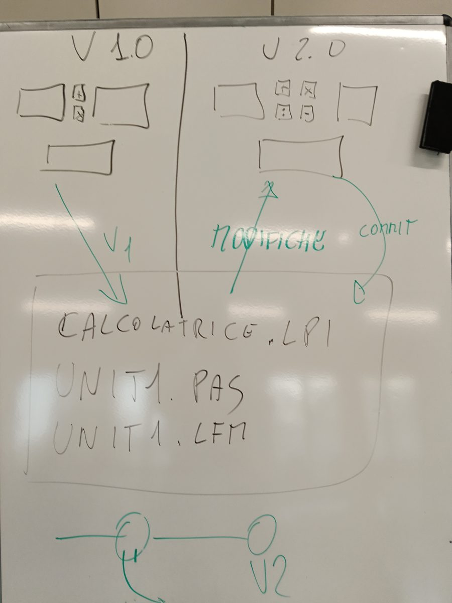

# 00 La calcolatrice da zero, con Git

**Versione 1.1** — 29/10/2026 — Classe 2INF

La pagina della lezione: https://nicolaregge-pulse.github.io/corso-informatica/2inf-calcolatrice/

## 01 Che cosa facciamo oggi



1. **V 1.0** (a sinistra): due caselle, i bottoni **+** e **x**, la casella del risultato. Poi il primo commit (v1).
2. **V 2.0** (a destra): si aggiungono i bottoni **:** e **−**. Le modifiche diventano il secondo commit (v2).
3. Nel riquadro al centro i file del progetto che vanno su GitHub: **calcolatrice.lpi**, **unit1.pas**, **unit1.lfm**.
4. In basso il grafo dei commit: v1, poi v2. Ogni versione resta nella storia.


1. Rifacciamo la calcolatrice da zero, un passo piccolo alla volta.
2. La finestra ha tre caselle (TEdit) e due bottoni: **+** (più) e **x** (per).
3. Nella prima e nella seconda casella scrivi i numeri; il risultato compare nella terza.
4. Alla fine il progetto va su GitHub, nel tuo repository **lazarus**, nella cartella **calcolatrice**, con un commit.
5. Ogni passo della pagina si chiude con il bottone **Fatto** e una piccola prova: così sai sempre a che punto sei.

## 02 Parte 1 · La finestra (la prima vittoria)

1. Menu **Progetto**, **Nuovo progetto…**, **Applicazione**, **OK**: compare la finestra vuota **Form1**.
2. Scheda **Standard**: l'icona **abc** è la casella (TEdit). Clic sull'icona, poi clic nella finestra. Tre volte.
3. L'icona **OK** è il bottone (TButton). Due volte.
4. Tasto **F9**: si apre la tua finestra. È un programma vero.

## 03 Parte 2 · Salva subito

1. Menu **Progetto**, **Salva progetto con nome…**.
2. A sinistra **Documenti**, doppio clic su **Lazarus**.
3. **Nuova cartella**, nome `calcolatrice`, Invio, doppio clic per entrarci.
4. Nome file `calcolatrice.lpi`, **Salva**; poi **Salva** per `unit1.pas`.
5. Tutti i progetti stanno in **Documenti › Lazarus**: un progetto = una cartella.

## 04 Parte 3 · La calcolatrice

1. **Caption** dei bottoni: `+` e `x`. La Caption è il testo che si vede, come in Lazarus da sempre.
2. **Fallo tuo:** la Caption della finestra è il titolo che scegli tu; nella riga **Color** scegli il colore.
3. Prima capire: quello che c'è in una casella è **testo**. Con il testo non si fanno i conti.

| Parola | Che cosa fa |
|---|---|
| StrToInt | trasforma il testo in un numero intero |
| IntToStr | trasforma il numero di nuovo in testo |
| Edit1.Text | il testo della prima casella |

Il codice del bottone **+** (doppio clic sul bottone, si scrive la riga tra begin e end):

```
Edit3.Text := IntToStr(StrToInt(Edit1.Text) + StrToInt(Edit2.Text));
```

Il codice del bottone **x**: la stessa riga, con l'asterisco `*` al posto del più.

```
Edit3.Text := IntToStr(StrToInt(Edit1.Text) * StrToInt(Edit2.Text));
```

4. Si legge così: «nella casella 3 scrivi il testo del numero della casella 1 più il numero della casella 2».
5. Prova con F9: 3 + 4 = 7, 3 x 4 = 12. Poi **Ctrl+Maiusc+S** salva tutti i file.

> **Nota:** un messaggio rosso in basso in Lazarus è normale, succede a tutti i programmatori. Di solito manca una parentesi o il punto e virgola.

## 05 Parte 4 · Su GitHub

1. In Esplora file, nella cartella calcolatrice: **Visualizza**, **Mostra**, **Estensioni nomi file**. Adesso si vedono i nomi interi.
2. I file della lavagna sono obbligatori: **calcolatrice.lpi**, **unit1.pas**, **unit1.lfm**; **calcolatrice.lpr** va bene lo stesso (consigliato).
3. Si tolgono la cartella **lib**, la cartella **backup** e il file **calcolatrice.exe**: Lazarus li rifà da solo (vedi «I file di un progetto Lazarus»).
4. Su github.com, nel repository **lazarus**: **Add file**, **Upload files**, si trascina la cartella **calcolatrice**.
5. In fondo il messaggio del commit, scritto da te: `calcolatrice da zero`. Poi **Commit changes**.
6. C'era già la cartella calcolatrice del 27/10? GitHub mette i file nuovi al posto dei vecchi: è una **versione nuova** (un nuovo commit), e la vecchia resta nella storia. È proprio a questo che serve Git.

| Che cosa | Dove | Come |
|---|---|---|
| Salvare | sul tuo PC | in Lazarus Ctrl+Maiusc+S |
| Commit | su GitHub (internet) | Upload files e Commit changes |

## 06 Il Documento su Classroom (consegna)

1. **La mia calcolatrice funziona:** screenshot della finestra con un conto fatto.
2. **La cartella «calcolatrice» nel mio repository GitHub:** screenshot con i file .lpi .pas .lfm (e .lpr, se c'è).
3. **Il mio commit:** screenshot della pagina del commit con il messaggio.
4. **In due frasi:** quali file vanno su GitHub e perché il file .exe no.

Lo screenshot: tasti **Windows + Maiusc + S**, si trascina un rettangolo, poi **Ctrl+V** nel Documento.

## 07 Le tre versioni del percorso

1. **Completa:** 28 passi piccoli, ognuno con «Fatto» e una prova breve.
2. **Facile:** 3 passi, solo il bottone + (per chi è in difficoltà, pronta dall'inizio).
3. **Facilissima:** 3 passi, solo il progetto su GitHub, senza codice. Si accende dal prof se nessuno arriva al commit.
4. Per chi finisce: la **V 2.0** della lavagna (bottoni : e −, con `div` per la divisione intera) e il secondo commit (v2).

## 08 Parole nuove

| Parola | Che cosa vuol dire |
|---|---|
| Commit | il salvataggio su GitHub, con una frase che dice che cosa hai fatto |
| Upload | caricare i file dal PC a GitHub |
| Estensione | le lettere dopo il punto nel nome del file (.lpi, .pas, .exe) |
| StrToInt | da testo a numero intero |
| IntToStr | da numero intero a testo |

## 09 Registro delle versioni

1. **1.0** (29/10/2026): prima versione, lezione della 2ª e 3ª ora.
2. **1.1** (29/10/2026): aggiunta la foto della lavagna di oggi (V 1.0, V 2.0, i file, i commit v1 e v2); i file obbligatori sono i 3 della lavagna (.lpi .pas .lfm), il .lpr è consigliato; l'extra diventa la V 2.0.
