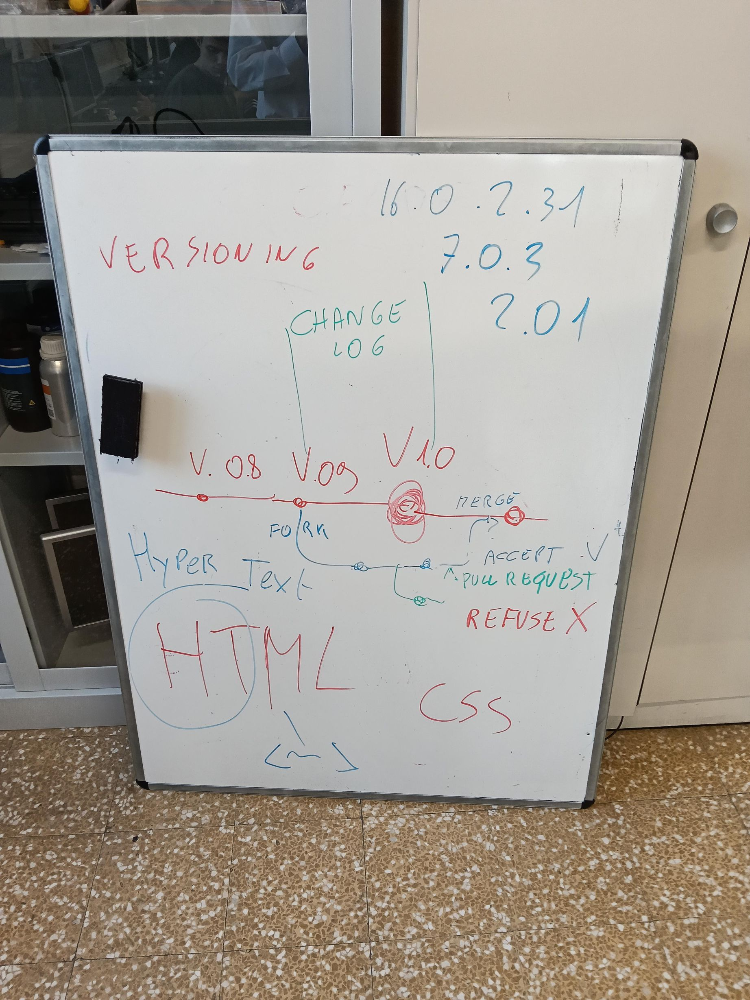

# Dispensa unica 2INF — lezioni ed esercizi fino al 30/10/2026

**Versione 1.0** — 30/10/2026

*Classe 2INF · Informatica, Laboratorio e Sicurezza · a.s. 2026/2027. Una sola dispensa, uguale per tutti: le lezioni dal 21/09 al 30/10/2026 in ordine di data, con la teoria in breve, le foto della lavagna, le righe da ricopiare sul quaderno e il testo completo dei compiti dati su Classroom. Il PDF serve per leggere e stampare; questo file MD si dà alla propria AI (Gemini, NotebookLM), che lo spiega con parole semplici.*

---

## 00 Come si usa questa dispensa

1. Ogni capitolo è **un giorno di lezione**, in ordine di data. Dentro trovi sempre le stesse parti:
   1.1 **Quando**: data, ore e materia;
   1.2 **Che cosa abbiamo fatto**;
   1.3 **La teoria**, in breve ma completa, con le foto della lavagna quando ci sono;
   1.4 **Da ricopiare sul quaderno**, quando c'era qualcosa da ricopiare;
   1.5 **Esercizi e compiti**: il titolo come su Classroom, il testo del compito, il link e che cosa si consegna.
2. In fondo ci sono la **tabella di tutti i compiti** (capitolo 24) e il **glossario** (capitolo 25).
3. Hai perso una lezione? Leggi il suo capitolo, poi apri il compito su Classroom e fallo: i compiti restano aperti come recupero, salvo diversa indicazione del prof.
4. Non capisci una parola? Dai questo file alla tua AI e chiedile: «Spiegami il capitolo 16 con un esempio». L'AI aiuta a **capire**, non a fare il lavoro al posto tuo: la prova che hai capito è saperlo spiegare a voce, con parole tue.
5. I link a Classroom si aprono solo con l'account della scuola. I link che cominciano con `nicolaregge-pulse.github.io` sono le pagine delle lezioni e si aprono da qualsiasi browser. I quiz su Google Moduli si aprono con l'account della scuola.
6. Nei testi dei compiti gli orari di consegna («entro le 10:45») valevano per quel giorno: oggi servono solo a capire come era organizzata la lezione.

> [GIALLO] Il metodo del corso in tre parole: **vinci subito** (un primo risultato in pochi minuti), **fallo tuo** (scegli qualcosa di tuo: nome, colore, frase), **mostralo** (fallo vedere al compagno). Sbagliare è normale: succede a tutti i programmatori, anche ai professionisti.

---

## 01 Lunedì 21/09/2026 — Benvenuti e GitHub

### 01.1 Quando
1. Lunedì 21/09/2026, 3 ore, Laboratorio.

### 01.2 Che cosa abbiamo fatto
1. Presentazione dell'anno: argomenti, regole, modo di lavorare.
2. GitHub: che cos'è, a che cosa serve, l'account.

### 01.3 La teoria
1. **Come lavoriamo:** un passo alla volta, con un risultato concreto da vedere subito. Consegne e materiali stanno su **Google Classroom**; i progetti stanno su **GitHub**, ognuno nel suo repository.
2. **Lazarus** è l'ambiente in cui scriviamo i programmi in **Object Pascal**: si disegna la finestra (il **form**) con i componenti e si scrive il codice degli eventi (per esempio il clic su un bottone).
3. **GitHub** è un sito dove si conservano i progetti online, con tutta la loro storia. Serve per non perdere il lavoro, tornare indietro e lavorare in squadra.
4. **La regola dell'AI:** l'intelligenza artificiale aiuta a capire, non a saltare il pensiero.

### 01.4 Esercizi e compiti
1. Nessun compito su Classroom: presentazione del corso e creazione o controllo dell'account GitHub con l'email della scuola.

---

## 02 Martedì 22/09/2026 — Controllo di account e utenze

### 02.1 Quando
1. Martedì 22/09/2026, 1 ora, Sicurezza (prima ora di sicurezza sul registro, fuori dal corso della Regione).

### 02.2 Che cosa abbiamo fatto
1. Controllo che ognuno entri da solo nei suoi account e nelle sue aree di lavoro: Windows, Google della scuola, Classroom, GitHub.

### 02.3 La teoria
1. **Account e password:** l'account è la tua identità su un computer o su un sito; la password la protegge. La password non si dà a nessuno e non si scrive su un foglio attaccato al monitor.
2. **Una password sicura** è lunga, non banale (mai 1234 o il proprio nome) e diversa per i servizi importanti.
3. **Quando ti alzi dal posto** blocchi lo schermo con `Ctrl + Alt + Canc` oppure `Windows + L`.
4. **Phishing:** un'email o un messaggio falso che prova a rubarti la password. Regola d'oro: non si clicca il link dentro un'email per scrivere la password; si va da soli sul sito ufficiale, scrivendo l'indirizzo a mano.

### 02.4 Esercizi e compiti
1. Nessun compito su Classroom: controllo degli account in classe.

---

## 03 Venerdì 25/09/2026 — Primo lavoro su GitHub

### 03.1 Quando
1. Venerdì 25/09/2026, 2 ore, Informatica.

### 03.2 Che cosa abbiamo fatto
1. Creazione dell'account e primo lavoro su GitHub: repository, file, commit e versioni.
2. Alla lavagna lo schema «GitHub: azienda, servizio, PaaS, Freemium, versioning».

### 03.3 La teoria


1. **GitHub è un'azienda e un servizio.** Dietro c'è una società vera (GitHub, nata nel 2008, dal 2018 di Microsoft). È un sito dove metti i progetti online per tenerli al sicuro, mostrarli e lavorarci in gruppo. Si usa dal browser.
2. **Git e GitHub non sono la stessa cosa.** **Git** è lo strumento (gratis) che tiene la storia di un progetto: è il motore. **GitHub** è il servizio online dove quei progetti vivono in rete: è il garage.
3. **Repository** (in breve repo): la cartella del progetto con dentro i file e tutta la loro storia. Ogni salvataggio della storia si chiama **commit**: una fotografia del progetto con un messaggio.
4. **Branch** (ramo): una strada di lavoro parallela, per provare senza rovinare il ramo principale (**main**). **Merge**: unire un ramo al main.
5. **PaaS** = Platform as a Service, piattaforma come servizio: una piattaforma online già pronta, che usi senza costruirti i server. La famiglia dei servizi «…aaS»:
   5.1 **IaaS** (Infrastructure as a Service): ti danno solo i server nudi; esempio Amazon AWS. Come affittare il locale vuoto;
   5.2 **PaaS** (Platform as a Service): ti danno la piattaforma pronta; esempio GitHub. Come affittare la cucina attrezzata;
   5.3 **SaaS** (Software as a Service): ti danno il programma pronto nel browser; esempio Gmail, Google Documenti. Come farsi portare la pizza pronta.
6. **Freemium** = free + premium: le funzioni di base sono gratis, quelle in più si pagano. GitHub è un'azienda e guadagna così; a uno studente basta la parte gratis.
7. **Il versioning:** quando un progetto arriva a un punto buono gli si dà un numero di versione a tre cifre, **major.minor.patch**:
   7.1 il **primo** numero (major) sale quando cambia tutto, in modo grosso;
   7.2 il **secondo** (minor) sale quando aggiungi una funzione nuova e il resto funziona ancora;
   7.3 il **terzo** (patch) sale quando correggi solo un bug.
   7.4 Esempio: v1.0.0 prima versione giocabile, v1.1.0 con i suoni, v1.1.1 con un bug corretto, v2.0.0 rifatto da capo.
8. **Regola d'oro:** una versione già pubblicata non si riusa mai. Se cambi anche una sola cosa, prima aumenti il numero e poi pubblichi.
9. **Come si legge un grafo delle versioni:** ogni pallino è un commit; la linea orizzontale è il main; le linee che si staccano sono branch; quando due linee si riuniscono è un merge; le bandierine sono le **release**, cioè le versioni pubblicate.

### 03.4 Esercizi e compiti
1. **GitHub**
   1.1 Testo del compito (il foglio «Compito: Git e Versioning»): obiettivo, dimostrare che hai capito che cos'è Git e come funzionano le versioni, con parole tue. Conta la comprensione, non le frasi perfette.
   1.2 Apri un documento nuovo: nel browser vai su `docs.new` e dai un titolo, per esempio «Git e Versioning» con il tuo nome. Rispondi alle tre parti.
   1.3 Parte 1, Git con parole tue: che cos'è Git e a che problema serve (2-3 frasi); spiega con una frase ciascuno repository, commit, branch, merge; qual è la differenza tra Git e GitHub.
   1.4 Parte 2, versioning: un gioco è alla versione v1.2.0. Scrivi quale sarà la nuova versione e perché se correggi un piccolo bug; se aggiungi un nuovo livello e le cose vecchie funzionano ancora; se riscrivi tutto da capo con un motore nuovo, incompatibile con il vecchio. Poi guarda il grafo del foglio e rispondi: quanti branch vedi oltre al main, quanti merge, a che cosa serviva il ramo rosso.
   1.5 Parte 3, la tua esperienza: racconta che cosa hai fatto oggi con GitHub, che cosa è stato facile e che cosa difficile; fai un esempio tuo (una tesina, delle foto, un progetto) in cui sarebbe utile avere la storia delle versioni.
   1.6 Quando hai finito, consegna il documento su Classroom. Puoi usare la dispensa per ripassare, ma le risposte devono essere con parole tue: conta soprattutto saperlo spiegare a voce.
   1.7 Link: https://classroom.google.com/c/MTYyNjU2MTA1NTg0/a/MjU0MDY4ODU4MDBa/details
   1.8 Che cosa si consegna: il Documento con le tre parti.

---

## 04 Lunedì 28/09/2026 — I tipi di file

### 04.1 Quando
1. Lunedì 28/09/2026, 3 ore, Laboratorio.

### 04.2 Che cosa abbiamo fatto
1. Che cos'è un file, l'estensione, file di testo e file binari, il dizionario dei formati, i file a tag, la compressione; compito sui tipi di file.

### 04.3 La teoria
1. **Un file** è un contenitore di informazioni salvato nel computer: un testo, una foto, una canzone, un programma. Ha un **nome** e, dopo il punto, un'**estensione** (`canzone.mp3`, `foto.jpg`).
2. **L'estensione** è come il cognome del file: dice di che tipo è e con quale programma si apre. Cambiare l'estensione non cambia il contenuto: `foto.jpg` rinominata `foto.txt` non diventa testo, si apre solo con il programma sbagliato.
3. **Il percorso** (path) è l'indirizzo del file nel computer, la lista delle cartelle per arrivarci: `C:\Documenti\Scuola\appunti.txt`. Su Windows le cartelle si separano con la barra rovescia `\`, un'eredità del vecchio sistema DOS.
4. **Due grandi mondi:**
   4.1 **file di testo**: dentro ci sono solo lettere e simboli, si aprono con il Blocco note e si leggono. Esempi: txt, md, html, css, js, xml, csv, json;
   4.2 **file binari**: dentro ci sono codici che il Blocco note non sa mostrare (escono simboli strani); servono programmi specifici. Esempi: doc, xls, pdf, dwg, png, jpg, zip, exe, mp3, mp4, wav.
   4.3 La prova del nove: apri il file con il Blocco note. Se leggi parole è testo, se vedi simboli strani è binario.
5. **Il dizionario dei formati:**
   5.1 **TXT** testo semplice, senza grassetti; **MD** (Markdown) testo con simboli leggeri che diventano formattazione (`#` titolo, `**` grassetto);
   5.2 **HTML** la pagina web, la apre il browser; **XML** dati con etichette; **CSV** tabella scritta come testo, colonne separate da virgole; **JSON** dati per i programmi, a scatole dentro scatole;
   5.3 **PDF** documento impaginato che si vede uguale ovunque; **DOCX** e **XLSX** documento di testo e foglio di calcolo, da modificare;
   5.4 **JPG** foto molto compresse; **PNG** disegni e loghi senza perdita, anche con sfondo trasparente;
   5.5 **MP3** audio compresso; **WAV** audio senza compressione, pesante; **MP4** video con audio;
   5.6 **ZIP** archivio: tanti file compressi in uno solo, come una valigia;
   5.7 **CSS** lo stile delle pagine web, **JS** (JavaScript) il loro comportamento;
   5.8 **DWG** disegno tecnico CAD; **EXE** programma eseguibile: con il doppio clic parte. Un .exe che non conosci è rischioso.
6. **I file a tag:** un **tag** è un'etichetta tra parentesi angolari che marca un pezzo di testo; di solito a coppie, uno apre `<p>` e uno chiude `</p>`. HTML usa i tag per fare pagine, XML per organizzare dati. Il Markdown fa lo stesso lavoro con simboli leggeri (`#`, `**`, `1.`).
7. **La compressione:** scrivere la stessa informazione occupando meno spazio.
   7.1 **senza perdita** (lossless): si torna identici all'originale, come piegare bene un vestito nella valigia. Esempi: ZIP, PNG;
   7.2 **con perdita** (lossy): si butta un po' di dettaglio che quasi non si nota e si pesa molto meno, come riassumere un tema. Esempi: JPG, MP3, MP4.
   7.3 Esempio: la stessa foto pesa 8 MB in PNG e 0,8 MB in JPG, e a occhio è quasi uguale.
8. **Il Markdown e l'AI:** il file MD è testo puro con una struttura chiara, perfetto da dare alla propria AI per farsi spiegare o tradurre una lezione.

### 04.4 Da ricopiare sul quaderno

```
FILE DI TESTO = si legge con il Blocco note (txt, md, html, css, csv, json)
FILE BINARIO = simboli strani, serve un programma (pdf, jpg, png, zip, exe, mp3, mp4)
ESTENSIONE = il "cognome" del file: dice il tipo e il programma
COMPRESSIONE senza perdita: zip, png    con perdita: jpg, mp3, mp4
```

### 04.5 Esercizi e compiti
1. **Tipi di file**
   1.1 Testo del compito (il foglio «Compito: I tipi di file»): obiettivo, dimostrare che hai capito che cosa sono i tipi di file (formati, tag, compressione) con parole tue. Puoi usare la dispensa per ripassare, ma le risposte devono essere tue.
   1.2 Apri un documento nuovo: nel browser vai su `docs.new` e dai un titolo, per esempio «I tipi di file» con il tuo nome. Rispondi alle 5 parti.
   1.3 Parte 1, le basi: che cos'è un file e a che cosa serve l'estensione (2-3 frasi); perché rinominare `foto.jpg` in `foto.txt` non la trasforma in testo.
   1.4 Parte 2, tre formati diversi: scegli tre formati di famiglie diverse (per esempio uno di testo, uno immagine o video, uno archivio) e per ognuno scrivi a che cosa serve e con quale programma si apre.
   1.5 Parte 3, un file a tag: scrivi un piccolo esempio di 3-4 righe di un file a tag a tua scelta (HTML, XML o MD) e spiega che cosa fanno i tag che hai usato. Esempio di partenza da modificare: `<h1>Il mio titolo</h1>` e `<p>Un paragrafo con una parola in <b>grassetto</b>.</p>`.
   1.6 Parte 4, compressione: spiega la differenza tra compressione senza perdita e con perdita, con un esempio per ciascuna (quale formato e in quale situazione la useresti).
   1.7 Parte 5, testo o binario e il percorso: come fai a capire se un file è di testo o binario (un esempio di ciascuno); scrivi il percorso di un file d'esempio sul computer, per esempio `C:\Documenti\nomefile.txt`.
   1.8 Quando hai finito, consegna il documento su Classroom. Conta soprattutto saperlo spiegare a voce.
   1.9 Link: https://classroom.google.com/c/MTYyNjU2MTA1NTg0/a/MTYyNzI5OTMwMDAz/details
   1.10 Che cosa si consegna: il Documento con le 5 parti.

---

## 05 Martedì 29/09/2026 — Lazarus: il convertitore mph e km/h

### 05.1 Quando
1. Martedì 29/09/2026, 2 ore, Informatica.

### 05.2 Che cosa abbiamo fatto
1. Un programma Lazarus che converte una velocità tra km/h e mph (miglia orarie): TEdit, RadioGroup, StrToFloat e FormatFloat.
2. Alla lavagna le tre parti di un programma: UI (che cosa si vede), UX (come si usa), LOGICA (il calcolo).

### 05.3 La teoria


1. **Che cosa costruiamo:** un'app con due caselle (km/h e mph), due pallini per scegliere la direzione e un bottone **Converti**; il risultato esce con una cifra decimale.
2. **UI, l'interfaccia (che cosa si vede):**
   2.1 **Edit1** con l'etichetta Km/h e **Edit2** con l'etichetta mph;
   2.2 **RadioGroup1**, i pallini: nell'Ispettore oggetti, proprietà **Items**, bottone `…`, una voce per riga (`Da Km/h` e `Da mph`), poi `ItemIndex = 0` (il primo pallino è il numero 0);
   2.3 **Button1** con `Caption = Converti`.
3. **UX, come si usa (con il mouse e anche solo con la tastiera):**
   3.1 **TabStop** (True o False): se è True il controllo si raggiunge con il tasto Tab;
   3.2 **TabOrder**: l'ordine con cui Tab passa da un controllo all'altro (0, 1, 2…). Ordine logico: Edit1, RadioGroup, Edit2, Button;
   3.3 **Button1.Default = True**: premendo Invio parte la conversione.
4. **LOGICA, il calcolo:** 1 mph è circa 1,6 km/h (il valore preciso è 1,60934). Da km/h a mph si **divide** per 1,6; da mph a km/h si **moltiplica** per 1,6.
5. **StrToFloat** trasforma il testo della casella in un numero con la virgola; **FormatFloat('0.0', …)** trasforma il numero in testo con una cifra decimale. Nel codice il decimale si scrive con il punto: `1.6`.

```
procedure TForm1.Button1Click(Sender: TObject);
var
  a: Real;
begin
  if RadioGroup1.ItemIndex = 0 then      // Da Km/h a mph
  begin
    a := StrToFloat(Edit1.Text);
    Edit2.Text := FormatFloat('0.0', a / 1.6);
  end
  else                                    // Da mph a Km/h
  begin
    a := StrToFloat(Edit2.Text);
    Edit1.Text := FormatFloat('0.0', a * 1.6);
  end;
end;
```

6. **Come usare l'AI:** dai la scheda a Gemini e chiedi per esempio «Spiegami con parole semplici che cosa fa StrToFloat» oppure «Fammi 3 domande per controllare se ho capito il convertitore». Poi rifallo tu e spiegalo a voce a un compagno.

### 05.4 Esercizi e compiti
1. Nessun compito su Classroom con questa data: il convertitore si costruisce in classe; il compito arriva il 01/10 (capitolo 06).

---

## 06 Giovedì 01/10/2026 — Convertitore di temperature e Sicurezza 1

### 06.1 Quando
1. Giovedì 01/10/2026, 4 ore, Laboratorio e Sicurezza (Sicurezza: corso della Regione, 1ª ora).

### 06.2 Che cosa abbiamo fatto
1. Lazarus «Convertitore di temperature» (Celsius e Fahrenheit): if/then, begin/end, la stessa struttura del convertitore km/h e mph con una formula nuova.
2. Sicurezza sul lavoro, 1ª ora della formazione generale: rischio, danno, prevenzione e protezione (slide e videolezione della formazione), quiz su Google Moduli e test a risposta aperta.

### 06.3 La teoria
1. **Stesso metodo, formula nuova:** il convertitore di temperature ha la stessa struttura di quello delle velocità. È fatto apposta: serve a vedere se sai applicare lo stesso metodo a un problema nuovo.
2. **Le formule:** da Celsius a Fahrenheit **F = C × 9/5 + 32**; da Fahrenheit a Celsius **C = (F − 32) × 5/9**.
3. **I controlli:** 100 °C = 212.0 °F; 32 °F = 0.0 °C; 37 °C = 98.6 °F.
4. **if … then … else:** se il primo pallino è scelto (`ItemIndex = 0`) si usa la prima formula, altrimenti la seconda. Dopo `then` e dopo `else` si mette `begin … end`.
5. **Sicurezza, le parole di base (1ª ora):**
   5.1 il **pericolo** è una cosa che può fare male: un filo scoperto, un pavimento bagnato;
   5.2 il **danno** è il male che succede davvero: una ferita, una malattia;
   5.3 il **rischio** è quanto è facile che il danno succeda e quanto è grave: rischio = probabilità × danno;
   5.4 la **prevenzione** agisce prima: fa in modo che il danno succeda meno spesso (formazione, ordine, regole);
   5.5 la **protezione** riduce il danno se succede: protezioni sulle macchine e **DPI** (Dispositivi di Protezione Individuale: guanti, occhiali, scarpe).

### 06.4 Esercizi e compiti
1. **LAZARUS: applicazione conversione temperatura**
   1.1 Testo del compito (la scheda «Convertitore di temperature»): costruisci un'app in Lazarus uguale nella struttura a quella km/h e mph vista a lezione, ma che converte le temperature (°C e °F). Cambia solo la formula: il metodo è lo stesso. Non è un errore: è fatto apposta.
   1.2 Componenti: Edit1 (°C) e Edit2 (°F); RadioGroup1 con `Da C a F` e `Da F a C` (ItemIndex = 0); Button1 con `Caption = Converti`.
   1.3 Logica: leggi il numero con StrToFloat; se ItemIndex = 0, F = C × 9/5 + 32, altrimenti C = (F − 32) × 5/9; scrivi il risultato con una cifra decimale con `FormatFloat('0.0', …)`. Controlli: 100 °C dà 212.0 °F, 32 °F dà 0.0 °C, 37 °C dà 98.6 °F.
   1.4 Uso con il mouse e con la tastiera: deve funzionare su Windows, usabile con il mouse e solo con la tastiera; sistema TabStop e TabOrder (Edit1, RadioGroup, Edit2, Button); `Button1.Default = True`, così Invio lancia la conversione.
   1.5 Usa Gemini con la scheda MD: apri la scheda del convertitore in Gemini, chiedigli 3 domande di verifica sull'app e rispondi; allega uno screenshot della chat (o scrivi che cosa ti ha chiesto e che cosa hai risposto).
   1.6 Consegna: 2 screenshot (l'app che funziona e il codice del bottone); rispondi a che cosa fa StrToFloat, che cosa fa `FormatFloat('0.0', …)`, a che cosa serve TabOrder; consegna su Classroom.
   1.7 Valutazione (100 punti): componenti giusti 15; StrToFloat corretto 15; due formule giuste con il RadioGroup 25; risultato con un decimale 15; uso con la tastiera 10; sa spiegare a voce 10; uso del file MD con Gemini 10. Conta la comprensione: se il metodo è giusto e sai spiegarlo, va bene anche con piccoli errori.
   1.8 Link: https://classroom.google.com/c/MTYyNjU2MTA1NTg0/a/MjU0Mjg1MzUyOTNa/details
   1.9 Che cosa si consegna: i 2 screenshot, le 3 risposte e la prova con Gemini.
2. **Sicurezza, 1ª ora** (non è un compito di Classroom)
   2.1 Che cosa fare: studiare la 1ª ora (rischio e danno) sulle slide e la videolezione ufficiali; quiz di 20 domande su Google Moduli con correzione automatica; test a risposta aperta.
   2.2 Chi non l'ha fatto lo recupera dalla pagina dei propri quiz (capitolo 21).

---

## 07 Lunedì 05/10/2026 — Il programma su GitHub e «Indovina il numero»

### 07.1 Quando
1. Lunedì 05/10/2026, Informatica.

### 07.2 Che cosa abbiamo fatto
1. Il primo programma Lazarus caricato su GitHub, nel repository «lazarus».
2. Le decisioni: if, then, else e gli if uno dentro l'altro (if annidati); il gioco «Indovina il numero».

### 07.3 La teoria
1. **if / then / else** si legge come in italiano: **se** la condizione è vera **allora** fai questo, **altrimenti** fai quest'altro.
2. **I confronti:** `=` uguale, `<>` diverso, `<` minore, `>` maggiore, `<=` minore o uguale, `>=` maggiore o uguale. **mod** è il resto della divisione: se `numero mod 2 = 0` il numero è pari.
3. **La regola dei rientri** (si fa sempre così):
   3.1 **if** ed **else** sullo stesso rientro, così si vede quale else appartiene a quale if;
   3.2 **begin** ed **end** sullo stesso rientro: ogni begin ha il suo end, come una parentesi che si apre e si chiude;
   3.3 tutto quello che sta dentro va un gradino più a destra (2 spazi);
   3.4 dopo then e dopo else si mette sempre `begin … end`, anche per una riga sola.
4. **L'errore che fanno tutti:** il `;` prima di else. L'end che sta subito prima di else va **senza** punto e virgola; il `;` si mette solo all'end finale dell'if.
5. **Trucco:** appena scrivi begin, scrivi subito sotto il suo end allo stesso rientro, poi riempi in mezzo.
6. **If annidati:** con un solo if hai 2 strade; se dentro l'else metti un altro if, le strade diventano 3. Esempio: positivo, negativo o zero.

```
numero := StrToInt(Edit1.Text);
if numero > 0 then
  begin
    Label1.Caption := 'POSITIVO';
  end
else
  begin
    if numero < 0 then
      begin
        Label1.Caption := 'NEGATIVO';
      end
    else
      begin
        Label1.Caption := 'ZERO';
      end;
  end;
```

7. **Il gioco «Indovina il numero»:** all'avvio il computer pensa un numero segreto da 1 a 100; tu scrivi un numero e premi **Prova**; il programma risponde «Troppo BASSO», «Troppo ALTO» oppure «Indovinato» con il numero di tentativi; **Nuova partita** pensa un altro numero.
   7.1 Due variabili durano per tutta la partita (`segreto` e `tentativi`): si dichiarano in alto, sotto `Form1: TForm1;`.
   7.2 Il numero segreto: `Randomize;` (mescola i numeri a caso) e `segreto := Random(100) + 1;` nell'evento **FormCreate** (doppio clic su un punto vuoto della Form).
   7.3 Nel bottone Prova l'if annidato: prima «è uguale?», nell'else «è più piccolo?».

```
procedure TForm1.ButtonProvaClick(Sender: TObject);
var
  numero: Integer;
begin
  numero := StrToInt(EditNumero.Text);
  tentativi := tentativi + 1;
  if numero = segreto then
    begin
      LabelRisposta.Caption := 'Indovinato! Tentativi: ' + IntToStr(tentativi);
    end
  else
    begin
      if numero < segreto then
        begin
          LabelRisposta.Caption := 'Troppo BASSO: prova un numero più grande';
        end
      else
        begin
          LabelRisposta.Caption := 'Troppo ALTO: prova un numero più piccolo';
        end;
    end;
  EditNumero.Clear;
end;
```

8. **Sfide per chi ha finito:** «Ci sei quasi!» se la differenza è al massimo 5 (`Abs(numero - segreto) <= 5`); massimo 7 tentativi; «Solo numeri da 1 a 100!» (`(numero < 1) or (numero > 100)`); tre livelli Facile, Medio, Difficile.
9. **Il programma su GitHub:** il progetto va nel repository **lazarus**; il file con il codice è `unit1.pas`; nel **README.md** si scrive che cosa si è fatto.

### 07.4 Da ricopiare sul quaderno
1. Il codice «positivo, negativo o zero» del punto 6, con una graffa da ogni begin al suo end.
2. Lo schema a frecce del bottone Prova: due domande («è uguale?», «è più piccolo?») e tre risposte.

### 07.5 Esercizi e compiti
1. **LAZARUS IF THEN**
   1.1 Il compito sugli if scritto dal prof su Classroom quel giorno; il suo testo non è conservato nell'archivio del corso. Il lavoro sugli if si fa con la teoria di questo capitolo e con i due compiti qui sotto.
   1.2 Link: https://classroom.google.com/c/MTYyNjU2MTA1NTg0/a/MTYyNzQ5NDQ1NzY3/details
2. **Lazarus — Il mio primo programma pubblicato su GitHub**
   2.1 Testo del compito: obiettivo di oggi, il tuo primo programma Lazarus pubblicato su GitHub.
   2.2 Che cosa fare: apri la pagina del corso https://nicolaregge-pulse.github.io/corso-informatica/2inf-if/ ; leggi un passo alla volta e quando l'hai fatto premi il bottone verde «FATTO»; nomi e codice si copiano con i bottoni gialli «COPIA».
   2.3 Fallo tuo: cambia la frase del programma con una tua.
   2.4 Come si consegna: il tuo programma deve essere su GitHub (repository lazarus, file unit1.pas); nel README.md scrivi che cosa hai fatto e che cosa non hai capito; qui premi solo il bottone blu «Consegna»: il codice lo prende il professore da GitHub.
   2.5 Hai finito? Sulla stessa pagina continua con il compito 2: Indovina il numero.
   2.6 Link: https://classroom.google.com/c/MTYyNjU2MTA1NTg0/a/MTYyNzQ5NjAwMjY2/details
   2.7 Che cosa si consegna: il programma su GitHub e il README.
3. **Lazarus — Indovina il numero con gli if annidati**
   3.1 Che cosa fare oggi: apri la pagina del corso https://nicolaregge-pulse.github.io/corso-informatica/2inf-if/ ; usa il riquadro blu «IL GIOCO PASSO PASSO»; leggi un passo alla volta e quando l'hai fatto premi il bottone verde «FATTO»; nomi e codice si copiano con i bottoni gialli «COPIA».
   3.2 Fallo tuo (obbligatorio per il voto): cambia il titolo della finestra, le frasi del gioco (anche spiritose) e i colori.
   3.3 Come si consegna: apri il Documento del compito (c'è già il tuo nome) e metti 3 screenshot (Troppo BASSO, Troppo ALTO, Indovinato); il codice del bottone Prova; perché serve un if dentro un altro if; che cosa non sei riuscito a fare o non hai capito. Premi il bottone blu «Consegna». Poi il professore ti fa qualche domanda sul tuo gioco.
   3.4 Regola dei rientri: if ed else allineati, begin ed end allineati, il resto più a destra.
   3.5 Valutazione (in decimi): il gioco funziona, i tre casi negli screenshot 3; if annidato corretto 2; rientri in ordine 2; il gioco è tuo (titolo, frasi, colori) 1; spiegazione con parole tue 1,5; riflessione 0,5; più 1 punto bonus per ogni sfida fatta bene, fino a 10.
   3.6 Link: https://classroom.google.com/c/MTYyNjU2MTA1NTg0/a/MTYyNzQ5NDgwODIy/details
   3.7 Che cosa si consegna: il Documento con 3 screenshot, codice, spiegazione e riflessione.

---

## 08 Mercoledì 07/10/2026 — Quiz 1: cosa scrive il programma?

### 08.1 Quando
1. Mercoledì 07/10/2026, Informatica.

### 08.2 Che cosa abbiamo fatto
1. Quiz di teoria sulle condizioni (if, then, else): leggere il codice come il computer e dire che cosa scrive; interrogazione.

### 08.3 La teoria
1. **Leggere il codice come il computer:** si parte dai valori delle variabili, si controlla la condizione dell'if (vera o falsa) e si segue **una sola** strada, quella giusta. I conti si fanno sul foglio.
2. Il ripasso è quello del capitolo 07: confronti, mod, if annidati, regola dei rientri, il `;` prima di else.

### 08.4 Esercizi e compiti
1. **Quiz 1 — Cosa scrive il programma?**
   1.1 Apri il quiz (ognuno ha i suoi numeri): https://nicolaregge-pulse.github.io/corso-informatica/quiz/?b=2inf-if&n=1
   1.2 Scrivi nome e cognome, leggi il codice come il computer, scegli la risposta. I conti sul foglio.
   1.3 Premi «Controlla»: verde = giusto, rosso = riprova.
   1.4 Premi «Copia», apri il Documento del compito, incolla con Ctrl+V, scrivi la domanda più difficile, premi «Consegna».
   1.5 Ripasso: https://nicolaregge-pulse.github.io/corso-informatica/2inf-if/
   1.6 Link: https://classroom.google.com/c/MTYyNjU2MTA1NTg0/a/ODg5NTM2MTc1Njkw/details
   1.7 Che cosa si consegna: il risultato del quiz e la domanda più difficile, nel Documento.

---

## 09 Giovedì 08/10/2026 — Il treno blindato: squadre e ruoli

### 09.1 Quando
1. Giovedì 08/10/2026, Laboratorio.

### 09.2 Che cosa abbiamo fatto
1. La classe diventa un'azienda che costruisce un videogioco, «Il treno blindato»: squadre con ruoli (CEO, Scenari, Personaggi, Motore fisica, Test qualità).
2. Le richieste di modifica, consegnate su Classroom, sono **Pull Request**: entrano nel gioco e ne fanno crescere le versioni (dalla v0.0 alla v0.11 in un giorno).

### 09.3 La teoria


1. **Il gioco:** sei dentro un vagone; il treno attraversa boschi, paesi, città, montagne e mare. I cattivi saltano fuori da dietro alberi, case e barili: li tocchi prima che sparino. Il vetro antiproiettile regge 5 colpi.
2. **Tre cose da curare in un gioco:** 1) la **dinamica** (come si muove); 2) la **UI** (che cosa si vede: vetro, punti, tachimetro); 3) la **UX** (come ci si sente a giocare).
3. **L'organigramma dell'azienda:**
   3.1 **CEO**: decide le priorità, approva i lavori con il prof, presenta il gioco;
   3.2 **Scenari**: gli ambienti e il percorso;
   3.3 **Personaggi**: i cattivi e il protagonista;
   3.4 **Motore fisica**: velocità del treno, tempi dei cattivi, colpi del vetro, punti;
   3.5 **Test qualità**: provano il gioco su PC e telefono, trovano i difetti, controllano le richieste delle altre squadre;
   3.6 **tutti**: il proprio cattivo.
4. **I ruoli come in un'azienda vera:** il prof è il **product owner** (decide che cosa entra e fa il merge); in ogni squadra c'è un **project manager**, a turno; tutti sono **sviluppatori**; un compagno di un'altra squadra fa la **revisione**.
5. **Il backlog:** l'elenco scritto di chi fa che cosa e dei lavori da fare, in ordine.
6. **Come funziona Gemini:** ha letto moltissimi testi e ha imparato quali parole stanno insieme; quando gli scrivi sceglie la parola che più probabilmente viene dopo. Per questo più la tua frase è precisa, più la risposta è utile. È un assistente: controlla sempre quello che risponde.


7. **Il tuo cattivo** è un piccolo file di dati (JSON) con il nome (al massimo 24 caratteri), il colore in codice esadecimale (come `#8a8f98`), gli occhi (1, 2 o 3), il cappello (0 niente, 1 cappello, 2 bandana), la bocca, la velocità (1, 2, 3) e la frase che grida (al massimo 40 caratteri). Regola: il cattivo lo inventi tu, niente nomi veri, niente parolacce.

### 09.4 Da ricopiare sul quaderno
1. Il disegno del gioco della lavagna, con la parte della tua squadra segnata con un colore.
2. Le tre parole: 1) dinamica 2) UI 3) UX.

### 09.5 Esercizi e compiti
1. **Il treno blindato — il lavoro della mia squadra**
   1.1 Testo del compito: oggi la 2INF è un'azienda che costruisce un videogioco. Ognuno lavora nella sua squadra: CEO, Scenari, Personaggi, Motore fisica, Test qualità.
   1.2 Che cosa fare adesso (la pagina si aggiorna mentre lavorate): https://nicolaregge-pulse.github.io/corso-informatica/2inf-treno/squadre/
   1.3 Come creare il tuo cattivo e fare la Pull Request: https://nicolaregge-pulse.github.io/corso-informatica/2inf-treno/
   1.4 Il gioco: https://nicolaregge-pulse.github.io/corso-informatica/giochi/treno-blindato/
   1.5 Alla fine compila il Documento del compito e premi «Consegna». La valutazione della squadra dipende da quante modifiche propone: le richieste si chiamano Pull Request, come in Git.
   1.6 Link: https://classroom.google.com/c/MTYyNjU2MTA1NTg0/a/MjU0NTUyMjk5NTZa/details
   1.7 Che cosa si consegna: il Documento con le Pull Request (e il disegno o la foto allegati, se ci sono).
2. **Il treno blindato — la mia idea e il mio difetto (versione 0.7)**
   2.1 Testo del compito: obbligatorio per tutti, 1 idea + 1 difetto.
   2.2 Gioca la versione 0.7 (2-3 partite): https://nicolaregge-pulse.github.io/corso-informatica/giochi/treno-blindato/
   2.3 Nel Documento del compito scrivi LA TUA IDEA: che cosa cambiare, dove, perché (esempio: nella città i cattivi escono dalle finestre, perché fa più paura); e UN DIFETTO: che cosa succede, quando, come si sistema (esempio: il fumetto del cattivo copre il vetro rotto, quando spara, più piccolo o più in alto).
   2.4 Premi «Consegna». Ogni idea buona entra nella prossima versione del gioco con il nome della tua squadra.
   2.5 Link: https://classroom.google.com/c/MTYyNjU2MTA1NTg0/a/ODg5OTAxMTczMDIw/details
   2.6 Che cosa si consegna: il Documento con 1 idea e 1 difetto.

---

## 10 Venerdì 09/10/2026 — Sicurezza 2: prevenzione e protezione

### 10.1 Quando
1. Venerdì 09/10/2026, 1 ora, Sicurezza (corso della Regione, 2ª ora).

### 10.2 Che cosa abbiamo fatto
1. Studio della lezione ufficiale della 2ª ora; i soggetti della sicurezza in azienda; quiz e domande aperte.
2. Sulla stessa data Classroom ha anche il compito di teoria sulle versioni del treno (le 10 parole del versioning, riprese nel capitolo 11).

### 10.3 La teoria
1. **La sicurezza è una squadra:** in un'azienda non se ne occupa una persona sola.
2. **Il datore di lavoro:** chi comanda l'azienda; per la sicurezza è il **primo responsabile**: valuta i rischi, scrive il documento dei rischi, dà i mezzi di protezione, organizza la formazione.
3. **Il dirigente** organizza il lavoro e fa rispettare le regole al posto del datore di lavoro; **il preposto** è il capo-reparto che controlla sul campo e corregge subito chi sbaglia («metti i guanti», «non togliere quella protezione»).
4. **Il RSPP** (Responsabile del Servizio di Prevenzione e Protezione): l'esperto che studia i rischi e consiglia come difendersi. Non comanda: è un consulente.
5. **Il medico competente:** il medico del lavoro, fa le visite mediche ai lavoratori (per chi sta tante ore al computer controlla vista e schiena).
6. **Il RLS** (Rappresentante dei Lavoratori per la Sicurezza): un lavoratore **eletto dai colleghi**, la loro voce con il datore di lavoro.
7. **Il lavoratore** (anche lo studente in stage e l'apprendista): rispetta le regole, usa i DPI, segnala i pericoli che vede.
8. **I tuoi diritti:** formazione, informazione sui pericoli, **DPI gratis**, visita medica quando serve.
9. **I tuoi doveri:** rispettare le regole, usare bene DPI e macchine, **non togliere e non rompere le protezioni**, segnalare subito pericoli e guasti.
10. **Chi controlla da fuori:** ASL o ATS (Agenzia di Tutela della Salute) e Ispettorato del lavoro controllano le aziende; l'**INAIL** (Istituto Nazionale Assicurazione Infortuni sul Lavoro) assicura i lavoratori.

> [ROSSO] Togliere una protezione per fare prima è l'errore più grave: sembra che faccia risparmiare tempo, ma è proprio lì che succedono gli infortuni più brutti.

### 10.4 Esercizi e compiti
1. **Sicurezza — 2ª ora (Regione): Prevenzione e protezione — quiz e domande**
   1.1 Testo del compito: sicurezza sul lavoro (D.Lgs. 81/08), 2ª ora, prevenzione e protezione.
   1.2 Apri il quiz: ognuno ha le sue 10 domande; in alto c'è il riassunto della lezione. https://nicolaregge-pulse.github.io/corso-informatica/quiz/?b=2inf-sicurezza-2&n=2
   1.3 Scrivi nome e cognome e premi «Inizia». Alla fine premi «Copia».
   1.4 Apri il Documento del compito. Parte 1: incolla il risultato (Ctrl+V).
   1.5 Parte 2: rispondi alle 5 domande con parole tue e con esempi della tua vita: pericolo, esposizione, rischio, infortunio e incidente, il tuo posto in laboratorio.
   1.6 Premi «Consegna» (bottone blu, in alto a destra).
   1.7 Attenzione: risposte copiate dal PDF, da un compagno o fatte con l'IA si riconoscono e valgono zero. Scrivi come parli: anche con qualche errore va benissimo. Il prof ti chiederà di spiegarle a voce.
   1.8 La lezione ufficiale, se ti serve rileggerla: https://sites.google.com/piamarta.it/formazionesicurezzamilano/2-ora/prevenzione-e-protezione
   1.9 Link: https://classroom.google.com/c/MTYyNjU2MTA1NTg0/a/ODkwMTUwMDA2OTIz/details
   1.10 Che cosa si consegna: il Documento con il risultato del quiz e le 5 risposte.
2. **Versioni e Git: la storia del nostro Treno blindato**
   2.1 Testo del compito: oggi versioni e Git, partendo dal vostro Treno blindato di ieri (e dal fork della 3INF).
   2.2 Apri la dispensa e leggi le 10 parole: https://nicolaregge-pulse.github.io/corso-informatica/2inf-versioning/
   2.3 Apri i link della dispensa: il grafo delle versioni, le versioni del treno, il changelog, la storia dei commit.
   2.4 Apri il Documento del compito: per ogni parola scrivi una frase con parole tue. Ogni frase = un quadratino verde nella pagina dell'avanzamento della classe: https://nicolaregge-pulse.github.io/corso-informatica/2inf-versioning/avanzamento/
   2.5 Carta e penna: scrivi le 10 parole e disegna il grafo a mano.
   2.6 Link: https://classroom.google.com/c/MTYyNjU2MTA1NTg0/a/MjU0NTc4NjE1ODBa/details
   2.7 Che cosa si consegna: il Documento con una frase per ognuna delle 10 parole (la teoria è nel capitolo 11).

---

## 11 Lunedì 12/10/2026 — Versioning e Agile

### 11.1 Quando
1. Lunedì 12/10/2026, 3 ore, Laboratorio.

### 11.2 Che cosa abbiamo fatto
1. Versioning e teoria Agile (il Manifesto e le 10 regole); il proprio Documento come ramo dell'albero delle versioni.
2. Le Pull Request sul gioco della classe dal Modulo «Consegna»; il backlog con i pesi di Fibonacci; 20 versioni del gioco (dalla v0.12 alla v0.31) con changelog e grafo; il feedback sulla teoria.

### 11.3 La teoria



1. **Le 10 parole del versioning, con il nostro gioco:**
   1.1 **Versione**: una fotografia del progetto in un momento preciso, con un numero. Il treno è passato dalla v0.0 (prima idea, finestrino laterale) alla v0.11 (i punteggi si salvano sempre): 12 versioni in un giorno;
   1.2 **Git e GitHub**: Git ricorda tutta la storia del progetto (chi ha cambiato che cosa, quando e perché); GitHub è il sito dove il repository sta online. Il nostro repository si chiama corso-informatica;
   1.3 **Commit**: un salvataggio nella storia di Git, con un messaggio che spiega il cambiamento; il numero strano accanto (per esempio 7724900) è il codice del commit;
   1.4 **Branch** (ramo): una linea di lavoro separata, per provare una cosa nuova senza rompere il gioco che funziona. Il gioco della 2INF sta nel ramo treno-2inf;
   1.5 **Fork** (copia): la copia di un progetto intero che cresce per conto suo. La 3INF ha fatto il fork del treno alla v0.11 e lo ha portato alla v1.4; anche la 1INF;
   1.6 **Push**: mandare i propri commit dal PC al repository online. Per questo il gioco sul sito cambiava da solo;
   1.7 **Pull**: il contrario, prendere da GitHub l'ultima versione e portarla sul proprio PC;
   1.8 **Pull Request** (proposta di modifica): «ho fatto una modifica, la vuoi nel progetto?». Qualcuno la controlla e, se va bene, fa il **merge** (la unisce); se no la rifiuta;
   1.9 **Changelog** (registro dei cambiamenti): la lista, versione per versione, di che cosa è cambiato e perché;
   1.10 **Numeri delle versioni** (major.minor): v0.x = prove; 1.0 = prima versione stabile; 1.1, 1.2 = piccole aggiunte (minor); 2.0 = cambio grosso (major). Il gioco rifatto con Godot è la v2.0, non la v1.5.
2. **La Pull Request ben scritta** ha quattro parti: **Titolo**, **Cosa cambia**, **Dove**, **Perché**.
3. **Il backlog e i pesi:** tutte le richieste vanno nel backlog, la coda dei lavori. Il **peso** dice quanto lavoro serve sul codice e usa i numeri di **Fibonacci** (ogni numero è la somma dei due prima): 1 un colore, 2 un numero nelle regole, 3 un personaggio, 5 un ambiente, 8 una regola nuova. Si fanno prima le richieste più leggere; a parità di peso, chi è arrivato prima.
4. **Agile:** un modo di lavorare delle aziende di software, a piccoli passi: un programma che funziona conta più di tanti documenti; rispondere ai cambiamenti conta più che seguire un piano fisso; le persone e il parlarsi contano più degli strumenti. Sbagliare presto e correggere presto.
5. **Il nostro sistema, pezzo per pezzo:** su Classroom un solo compito con un link fisso; la Pull Request si manda dal Modulo «Consegna»; uno script di Google porta le consegne nel repository del corso su GitHub; Claude (l'AI che lavora con il prof) le pesa nel backlog, scrive il codice della modifica, la prova e pubblica la versione nuova; GitHub Pages mette il gioco e le pagine sul sito; il prof decide sì o no e dà il voto.

### 11.4 Da ricopiare sul quaderno
1. Le 10 parole del punto 1, ognuna con una frase tua.
2. Il grafo a mano: il ramo principale con tre versioni, un fork che si stacca e un ramo che rientra con un merge.

### 11.5 Esercizi e compiti
1. **Versioning: il tuo Documento nell'albero delle versioni**
   1.1 Testo del compito: tutto in una sola pagina (il link resta sempre lo stesso, si aggiorna da solo): https://nicolaregge-pulse.github.io/corso-informatica/compito/2inf-20261012-documento/
   1.2 Apri il link.
   1.3 Fase 1: leggiamo insieme la teoria.
   1.4 Fase 2: in fondo ci sono due bottoni verdi, 1) Feedback e 2) PR1.
   1.5 Link: https://classroom.google.com/c/MTYyNjU2MTA1NTg0/a/MTYyNzYyNTkxNjQx/details
   1.6 Che cosa si consegna: il Feedback sulla teoria e la prima Pull Request (PR1) con Titolo, Cosa cambia, Dove, Perché.

---

## 12 Martedì 13/10/2026 — Verifica sul versioning

### 12.1 Quando
1. Martedì 13/10/2026, Laboratorio.

### 12.2 Che cosa abbiamo fatto
1. Ripasso e verifica sul versioning; analisi delle 20 versioni del treno (dalla v0.12 alla v0.31): che cosa funziona e che cosa si può migliorare.

### 12.3 La teoria
1. **Le versioni:** se cambia il numero dopo il punto (v0.30, v0.31) è un passo piccolo, minor; se cambia il primo numero (v1.4, v2.0) è un cambio grande, major, per esempio un motore nuovo come Godot. Il changelog è il registro di tutte le modifiche.
2. **Git e GitHub:** Git tiene tutte le versioni; ogni salvataggio è un commit; il repository è la cartella con tutta la storia; GitHub tiene i repository su Internet. Un ramo è una strada parallela; un fork è una copia del progetto; il merge unisce un ramo dentro un altro.
3. **Chi fa che cosa:** tu hai l'idea e la scrivi bene; il prof decide che cosa entra e dà il voto; Claude scrive il codice e lo prova; GitHub tiene tutte le versioni, così se una modifica rompe il gioco si torna indietro.
4. **Esempi di versioni del treno e della loro analisi:**
   4.1 v0.17, i cattivi non nascono più troppo vicino: un difetto vero, trovato giocando, è il lavoro di chi fa il collaudo;
   4.2 v0.18, «BANG!» e il cattivo cade: tre richieste sulla stessa cosa. Prima di mandarne una conviene guardare il backlog e unirsi a quella che c'è già;
   4.3 v0.20, i cattivi si vedono sempre: il difetto era nato da una versione precedente, quindi ogni modifica va provata giocando prima di pubblicarla;
   4.4 v0.23, il bottone Pausa (anche con il tasto P o Esc): indispensabile in classe;
   4.5 v0.26, pioggia e nebbia: quattro richieste sulla stessa idea diventano una versione sola, lavoro di squadra vero.
5. **Domande per l'analisi:** quale versione ha migliorato di più il gioco e perché; quale miglioramento faresti per primo (scrivilo come Pull Request); quale difetto trovi giocando.

### 12.4 Esercizi e compiti
1. Nessun compito nuovo su Classroom: la verifica si fa sulla pagina del compito del 12/10 (capitolo 11). La verifica rapida su Moduli arriva il 15/10 (capitolo 13).

---

## 13 Giovedì 15/10/2026 — Verifica rapida e il ciclo FOR

### 13.1 Quando
1. Giovedì 15/10/2026, Informatica.

### 13.2 Che cosa abbiamo fatto
1. Verifica rapida sul versioning su Google Moduli (6 crocette e 4 risposte aperte).
2. Il ciclo FOR in Lazarus, prima parte: teoria e l'app «da … a …».

### 13.3 La teoria
1. **Un ciclo** fa ripetere al computer la stessa cosa tante volte, senza riscriverla. Finora il programma reagiva a un clic e faceva una cosa sola; con il for, dentro lo stesso clic, ripete.
2. **La lavagna:** `for x := 1 to 10 do begin … end;` si legge «**per** x che va **da 1 a 10**, **fai** quello che c'è tra begin ed end».
   2.1 **x** è il **contatore**: una variabile intera (`integer`) che a ogni giro aumenta di 1; va dichiarata prima con `var x: integer;`;
   2.2 `:=` dà il valore di partenza, **to** dice dove arriva, **do** vuol dire «fai».
3. **Quanti giri:** fine − inizio + 1. Da 7 a 12 sono 6 giri; da 5 a 12 sono 8 giri.
4. **writeln e il Memo:** writeln scrive in una finestra di solo testo; in un programma con il form si usa un **Memo** (TMemo, una casella con tante righe): `Memo1.Lines.Add('CIAO');` vuol dire «al Memo1, alle sue righe, aggiungi».
5. **IntToStr** trasforma un numero intero in testo (Int = intero, Str = stringa, cioè testo); **StrToInt** fa il contrario, trasforma il testo di una casella in numero. Il `+` tra due testi li attacca: `IntToStr(giro) + ' - CIAO'`.
6. **Il programma «da … a …»:** in alto «da» [5] «a» [12], al centro un Memo grande (proprietà **ScrollBars = ssBoth**: compaiono le barre di scorrimento), in basso il bottone «Conta!».

```
procedure TForm1.Button1Click(Sender: TObject);
var giro, inizio, fine: integer;
begin
  inizio := StrToInt(Edit1.Text);
  fine := StrToInt(Edit2.Text);
  Memo1.Clear;
  for giro := inizio to fine do
  begin
    Memo1.Lines.Add(IntToStr(giro));
  end;
end;
```

7. **Gli errori di tutti:**
   7.1 «Identifier not found» sul contatore: manca `var giro: integer;` sopra il begin;
   7.2 il punto e virgola dopo do (`for giro := 1 to 10 do;`): ripete 10 volte niente, e la riga sotto la fa una volta sola;
   7.3 begin senza `end;`: Lazarus non compila;
   7.4 il numero nel Memo senza IntToStr: errore, il Memo vuole testo;
   7.5 casella vuota: StrToInt di niente dà errore;
   7.6 i rientri: begin ed end sullo stesso rientro, quello che sta dentro 2 spazi più a destra. In Lazarus selezioni le righe e premi `Ctrl+Shift+I` (a destra) o `Ctrl+Shift+U` (a sinistra).
8. **Fallo tuo:** una frase accanto al numero (`IntToStr(giro) + ' - forza!'`) e il titolo della finestra. **Sfida:** la tabellina del 7, `IntToStr(giro) + ' x 7 = ' + IntToStr(giro * 7)`.

### 13.4 Da ricopiare sul quaderno

```
for giro := 5 to 12 do      per giro da 5 a 12, fai
begin ... end;              quello che si ripete
giri = fine - inizio + 1
StrToInt = da testo a numero    IntToStr = da numero a testo
```

### 13.5 Esercizi e compiti
1. **Verifica rapida: versioni, Pull Request, Agile**
   1.1 Clicca il link: https://docs.google.com/forms/d/e/1FAIpQLSdulz6Q_YypGI52tS2yIJj8WornJJafIbY7-DvxMow2gHy-Yg/viewform
   1.2 Hai 15 minuti. Una domanda per pagina.
   1.3 Alla fine premi «Invia». Fatto.
   1.4 Link: https://classroom.google.com/c/MTYyNjU2MTA1NTg0/a/MjU0NzM1NzMwMDha/details
   1.5 Che cosa si consegna: la verifica su Moduli inviata.
2. **Lazarus: il ciclo FOR, la tua app «da … a …»**
   2.1 Testo del compito: oggi il computer ripete per te, il ciclo FOR.
   2.2 Clicca il link: si apre la pagina del percorso. https://nicolaregge-pulse.github.io/corso-informatica/verifica/?b=2inf-for
   2.3 Scrivi il tuo nome e cognome e premi «Continua».
   2.4 Leggi le schede della teoria, una alla volta: sono le lavagne del prof.
   2.5 Apri Lazarus e segui la scheda «LA PRATICA», un passo alla volta: costruisci la tua app «da … a …».
   2.6 In allegato c'è il PDF con gli stessi passi, da tenere aperto accanto a Lazarus.
   2.7 Ti blocchi? In fondo alla pagina c'è la casella «Chiedi aiuto all'assistente del Prof Regge»: scrivi la domanda e premi «Manda».
   2.8 La verifica di questo percorso la apre il prof più avanti.
   2.9 Link: https://classroom.google.com/c/MTYyNjU2MTA1NTg0/a/MjU0NzQ0NjQ4NDda/details
   2.10 Che cosa si consegna: l'app «da … a …» che funziona.

---

## 14 Venerdì 16/10/2026 — Sicurezza 3: organizzazione della prevenzione

### 14.1 Quando
1. Venerdì 16/10/2026, 1 ora, Sicurezza (corso della Regione, 3ª ora).

### 14.2 Che cosa abbiamo fatto
1. Organizzazione della prevenzione aziendale: video e slide ufficiali; ripasso del modulo 2 (i soggetti e i doveri).

### 14.3 La teoria
1. **La squadra della prevenzione:** il **datore di lavoro** decide e risponde; il **Servizio di Prevenzione e Protezione** (SPP), guidato dal **RSPP**, studia i rischi e propone le soluzioni; il **medico competente** controlla la salute; il **RLS** parla a nome dei lavoratori; i **preposti** controllano sul campo.
2. **Il DVR** (Documento di Valutazione dei Rischi): il documento dove l'azienda scrive tutti i rischi di ogni lavoro e che cosa fa per ridurli. Lo firma il datore di lavoro con l'RSPP e il medico competente, sentito l'RLS; il datore di lavoro **non può delegarlo** a nessuno. Si aggiorna quando cambia qualcosa (una macchina nuova, un reparto nuovo, dopo un infortunio). Almeno una volta l'anno c'è la **riunione periodica** della sicurezza.
3. **Le emergenze:** gli **addetti antincendio** usano gli estintori e guidano l'evacuazione; gli **addetti al primo soccorso** aiutano chi si fa male e chiamano il **112**. Il **piano di emergenza** indica vie di fuga, uscite di emergenza con il cartello verde e **punto di raccolta** fuori dall'edificio. Durante l'evacuazione: niente ascensore, niente corsa, non si torna indietro a prendere le cose.
4. **Formazione, informazione, addestramento:** l'**informazione** ti dice quali rischi ci sono e chi sono le persone della sicurezza; la **formazione** è un corso per capire (come questo: 4 ore generali più le ore specifiche); l'**addestramento** è provare davvero, con le mani, l'attrezzo o il DPI, con qualcuno che ti guarda. Si fanno durante l'orario di lavoro, non costano niente al lavoratore e valgono anche per lo studente in stage.

### 14.4 Esercizi e compiti
1. Il compito di Classroom della 3ª ora porta la data del 21/10 (capitolo 17): la 3ª ora si studia sul sito ufficiale https://sites.google.com/piamarta.it/formazionesicurezzamilano/3-ora e si ripassa sulla pagina https://nicolaregge-pulse.github.io/corso-informatica/verifica/?b=2inf-sicurezza-3ora

---

## 15 Lunedì 19/10/2026 — Il ciclo FOR: il programma Contatore

### 15.1 Quando
1. Lunedì 19/10/2026, 3 ore, Laboratorio.

### 15.2 Che cosa abbiamo fatto
1. Ciclo FOR in Lazarus, seconda parte: il programma «Contatore» con due TEdit (da… a…), un TButton e un TMemo; `sleep(1000)` per vedere il ciclo che conta; verifica.

### 15.3 La teoria
1. **Lo scopo:** la propria app «da … a …» funziona e la si sa spiegare riga per riga: dichiaro tre variabili intere; prendo i due numeri dalle caselle; pulisco il Memo; per giro da inizio a fine aggiungo al Memo il numero del giro come testo.
2. **Memo1.Clear** svuota il Memo prima di ricominciare, così a ogni clic non si accumulano le righe vecchie.
3. **sleep(1000)** ferma il programma per 1000 millisecondi, cioè un secondo: messo dentro il ciclo, fa vedere i numeri che compaiono uno alla volta.

```
for giro := inizio to fine do
begin
  Memo1.Lines.Add(IntToStr(giro));
  sleep(1000);
end;
```

4. **I passi in Lazarus:** Progetto, Nuovo progetto, Applicazione, Ok; un TLabel «da» e un TEdit (Text vuoto); un TLabel «a» e un TEdit; un TMemo grande con ScrollBars = ssBoth; un TButton «Conta!»; doppio clic sul bottone; il codice con i rientri; F9; prova con 5 e 12 e poi con 1 e 100.
5. **La regola dei rientri** vale anche qui: in un'azienda il codice tutto attaccato a sinistra non passa, perché nessuno riesce a leggerlo.
6. **Sfide:** una terza casella per la tabellina (`IntToStr(giro) + ' x 7 = ' + IntToStr(giro * 7)` con il 7 preso dalla casella); un bottone «Pulisci» che fa solo `Memo1.Clear;`.

### 15.4 Esercizi e compiti
1. **Contatore**
   1.1 Testo del compito (il percorso della seconda parte del ciclo FOR): oggi finiamo l'app «da … a …», deve funzionare e la devi saper spiegare.
   1.2 Clicca il link: https://nicolaregge-pulse.github.io/corso-informatica/verifica/?b=2inf-for2
   1.3 Scrivi nome e cognome e premi «Continua».
   1.4 Leggi le schede 1-5: il ripasso corto del ciclo FOR e il programma intero.
   1.5 Schede 6-8: la pratica in Lazarus, un passo alla volta. Rispondi alle domandine sotto le schede: così il monitor sa a che punto sei.
   1.6 Quando l'app funziona, copia il codice del bottone (Ctrl+C) e clicca «2. Verifica»: crocette e risposte con parole tue. Nella domanda «incolla qui» incolli il tuo codice.
   1.7 Ti blocchi? In fondo alla pagina c'è la casella «Chiedi aiuto all'assistente del Prof Regge».
   1.8 Link: https://classroom.google.com/c/MTYyNjU2MTA1NTg0/a/MjU0ODU3OTk0NTha/details
   1.9 Che cosa si consegna: l'app che funziona e la verifica con il codice incollato.
2. **VERIFICA: il ciclo FOR**
   2.1 Apri il quiz su Google Moduli dal compito di Classroom.
   2.2 Scrivi nome e cognome.
   2.3 Leggi il codice come farebbe il computer e scegli la risposta. Puoi provare il codice in Lazarus.
   2.4 Alla fine premi «Invia». Fatto.
   2.5 Link: https://classroom.google.com/c/MTYyNjU2MTA1NTg0/a/MjU0ODY2ODQzMTFa/details
   2.6 Che cosa si consegna: il quiz su Moduli inviato.

---

## 16 Martedì 20/10/2026 — Il ciclo WHILE: lancia il dado finché…

### 16.1 Quando
1. Martedì 20/10/2026, 2 ore, Laboratorio.

### 16.2 Che cosa abbiamo fatto
1. Il ciclo WHILE in Lazarus («ripeti finché»): teoria, ripasso, il gioco del dado (lancia finché esce il numero magico e conta i tiri), il ciclo infinito e come fermarlo; verifica con il codice spiegato.

### 16.3 La teoria
1. **Dal FOR al WHILE:** con il for sai prima quanti giri fai (`for x := 1 to 10` fa sempre 10 giri). Ma se lanci un dado finché esce il 6, quante volte lo lanci? Non lo sa nessuno. Il **while** ripete **finché** la condizione è vera e si ferma quando diventa falsa. Nella vita: finché ho fame mangio, finché il semaforo è rosso aspetto.
2. **Come si scrive:** `while condizione do begin … end;`. La condizione si controlla **prima** di ogni giro: se è falsa già all'inizio, il while non fa nessun giro. Le condizioni sono quelle dell'if.
3. **Il contatore lo fai aumentare tu:** nel for aumenta da solo, nel while scrivi `x := x + 1`.

```
x := 1;
while x <= 5 do
begin
  Memo1.Lines.Add(IntToStr(x));
  x := x + 1;
end;
```

4. **Il ciclo infinito:** se dentro il while niente cambia la condizione, il ciclo non finisce mai e il programma si blocca. Si ferma con il menu **Esegui, Ferma** (oppure `Ctrl+F2`). Regola: dentro il while deve sempre esserci qualcosa che prima o poi rende falsa la condizione.
5. **Il dado:** `Randomize;` mescola i numeri (si scrive una volta all'inizio); `Random(6)` dà un numero da 0 a 5, con `+ 1` diventa da 1 a 6. Per una moneta `Random(2)` dà 0 o 1.
6. **Il programma:** prendo il numero magico dalla casella; tiri parte da 0; dado parte da 0 (diverso da qualsiasi numero magico, così il primo giro si fa sempre); **finché** il dado è diverso dal numero magico tiro, conto il tiro e lo scrivo; alla fine scrivo dopo quanti tiri è uscito.

```
procedure TForm1.Button1Click(Sender: TObject);
var dado, magico, tiri: integer;
begin
  Randomize;
  magico := StrToInt(Edit1.Text);
  Memo1.Clear;
  tiri := 0;
  dado := 0;
  while dado <> magico do
  begin
    dado := Random(6) + 1;
    tiri := tiri + 1;
    Memo1.Lines.Add('Tiro ' + IntToStr(tiri) + ': ' + IntToStr(dado));
  end;
  Memo1.Lines.Add('Uscito il ' + IntToStr(magico) + ' dopo ' + IntToStr(tiri) + ' tiri!');
end;
```

7. **Errori tipici:** manca Randomize (escono sempre gli stessi tiri); manca `tiri := tiri + 1` (dice sempre 0 tiri); `while dado = magico` invece di `<>` (non fa nessun giro); numero magico 9 (ciclo infinito: il dado non fa mai 9).
8. **Sfida:** due dadi, finché escono due 6 insieme: `while (d1 <> 6) or (d2 <> 6) do`.

### 16.4 Da ricopiare sul quaderno

```
FOR   = so prima quante volte (for giro := 1 to 7 do)
WHILE = ripeto FINCHE' la condizione e' vera (while dado <> magico do)
nel WHILE il contatore lo aumento io: tiri := tiri + 1
ciclo infinito: Esegui -> Ferma (Ctrl+F2)
Random(6) + 1 = numero da 1 a 6
```

### 16.5 Esercizi e compiti
1. **Lazarus: il ciclo WHILE, lancia il dado finché…**
   1.1 Testo del compito: oggi il ciclo WHILE, «ripeti finché…». Costruisci il gioco del dado: il programma lancia il dado finché esce il tuo numero magico e conta i tiri.
   1.2 Le slide della lezione (PDF): https://nicolaregge-pulse.github.io/corso-informatica/2inf-while/Slide-Ciclo-While.pdf
   1.3 Clicca il link della lezione: https://nicolaregge-pulse.github.io/corso-informatica/verifica/?b=2inf-while
   1.4 Scrivi nome e cognome e premi «Continua».
   1.5 «0. Teoria»: leggi le schede. «1. Ripasso»: rispondi alle domandine sotto le schede, così il monitor sa a che punto sei.
   1.6 Schede 6-8: la pratica in Lazarus, un passo alla volta.
   1.7 Quando il gioco funziona, copia il codice del bottone (Ctrl+C) e clicca «2. Verifica». Nella domanda «incolla qui» incolli il tuo codice.
   1.8 Ti blocchi? In fondo alla pagina c'è la casella «Chiedi aiuto all'assistente del Prof Regge».
   1.9 Link: https://classroom.google.com/c/MTYyNjU2MTA1NTg0/a/MjU0ODg3MTA0OTla/details
   1.10 Che cosa si consegna: il gioco del dado che funziona e la verifica con il codice.

---

## 17 Mercoledì 21/10/2026 — Sicurezza 4: diritti, doveri, sanzioni e vigilanza

### 17.1 Quando
1. Mercoledì 21/10/2026, 1 ora, Sicurezza (corso della Regione, 4ª ora).

### 17.2 Che cosa abbiamo fatto
1. La 4ª ora della formazione generale: diritti, doveri, sanzioni e organi di vigilanza; quiz di 20 casi pratici su Moduli.
2. Recupero dei quiz delle ore 1-3: tutti devono avere le 4 ore.

### 17.3 La teoria
1. **I diritti del lavoratore** (anche dello studente in stage): formazione, informazione, addestramento, **DPI gratis**, visita medica quando serve, poter eleggere l'RLS e rivolgersi a lui.
2. **I doveri del lavoratore:** usare correttamente i DPI e le attrezzature; seguire le regole e le istruzioni; non togliere né modificare le protezioni; non fare di testa propria lavori che non gli competono; **segnalare subito** pericoli e guasti al preposto o al datore di lavoro; partecipare alla formazione e alle visite.
3. **Le sanzioni:** chi non rispetta le regole della sicurezza riceve una sanzione: una multa o, nei casi gravi, una pena. Valgono per tutti, ognuno per i suoi obblighi: datore di lavoro, dirigenti, preposti e anche lavoratori.
4. **Gli organi di vigilanza** controllano dall'esterno che le regole siano rispettate: l'**ATS** (Agenzia di Tutela della Salute, in altre regioni ASL) e l'**Ispettorato del lavoro**; per gli incendi i **Vigili del fuoco**. L'**INAIL** assicura i lavoratori contro gli infortuni.
5. **Il ripasso delle 4 ore** è nel capitolo 21.

### 17.4 Esercizi e compiti
1. **OGGI: Sicurezza 3ª ora — l'organizzazione della prevenzione**
   1.1 Testo del compito: oggi fate solo queste 3 cose, in questo ordine.
   1.2 Studia la 3ª ora sul sito ufficiale (bottone giallo «Organizzazione della prevenzione aziendale»): https://sites.google.com/piamarta.it/formazionesicurezzamilano/3-ora
   1.3 Leggi le 4 schede e fai il ripasso sulla pagina della lezione (scrivi nome e cognome): https://nicolaregge-pulse.github.io/corso-informatica/verifica/?b=2inf-sicurezza-3ora
   1.4 Fai il quiz (20 casi pratici) e premi «Invia»: https://docs.google.com/forms/d/e/1FAIpQLSeANOFnWHWRF-uYH1H6l-eOocMUavGbAwDKC5yIUbYVoCiaUw/viewform
   1.5 Link: https://classroom.google.com/c/MTYyNjU2MTA1NTg0/a/ODkzNDY4NjY5ODY0/details
   1.6 Che cosa si consegna: il ripasso sulla pagina e il quiz su Moduli inviato (teoria nel capitolo 14).
2. **OGGI: Sicurezza 4ª ora — diritti, doveri, sanzioni e vigilanza**
   2.1 Testo del compito: la 3ª ora l'avete già fatta, oggi si fa la 4ª ora. Fate solo queste 2 cose, in questo ordine.
   2.2 Studia la 4ª ora sul sito ufficiale (slide e video): https://sites.google.com/piamarta.it/formazionesicurezzamilano/4-ora
   2.3 Fai il quiz (20 casi pratici) e premi «Invia»: https://docs.google.com/forms/d/e/1FAIpQLSevwdJOCe8J00jdKb33gMVypzv8AQoSB9Kup6dfHgHpqJ7azA/viewform
   2.4 Il bottone «TEST» del sito ufficiale non va fatto: vale il nostro quiz.
   2.5 Link: https://classroom.google.com/c/MTYyNjU2MTA1NTg0/a/MjU0OTI5NDg0Nzda/details
   2.6 Che cosa si consegna: il quiz su Moduli inviato.

---

## 18 Giovedì 22/10/2026 — Il salvadanaio: FOR e WHILE; GitHub in ordine

### 18.1 Quando
1. Giovedì 22/10/2026, 3 ore, Laboratorio.

### 18.2 Che cosa abbiamo fatto
1. Interrogazioni sul ciclo WHILE; FOR e WHILE nel programma «Il mio salvadanaio».
2. Dalle 10 GitHub: il repository «lazarus» con un progetto per cartella.

### 18.3 La teoria
1. **Il salvadanaio:** scegli che cosa vuoi comprare e quanto costa; ogni giorno metti da 1 a 5 euro, a caso. Tre bottoni: **Una settimana** (con il FOR), **Quanti giorni mi servono?** (con il WHILE), **Con la paghetta** (sfida).
2. **FOR o WHILE?** FOR = so prima quante volte (una settimana ha sempre 7 giorni: `for giorno := 1 to 7 do`). WHILE = non so quante volte, ripeto finché la condizione è vera (`while totale < prezzo do`: finché il totale è minore del prezzo metto altri soldi).
3. **La condizione di uscita:** ogni giro il totale cresce; quando arriva al prezzo (o lo supera) `totale < prezzo` diventa falso e il ciclo finisce.
4. **Il bottone del WHILE:**

```
procedure TForm1.Button2Click(Sender: TObject);
var giorni, euro, totale, prezzo: integer;
begin
  Randomize;
  prezzo := StrToInt(Edit2.Text);
  Memo1.Clear;
  totale := 0;
  giorni := 0;
  while totale < prezzo do
  begin
    euro := Random(5) + 1;
    totale := totale + euro;
    giorni := giorni + 1;
  end;
  Memo1.Lines.Add('Per ' + Edit1.Text + ' ti servono ' + IntToStr(giorni) + ' giorni');
end;
```

5. **div e mod**, le divisioni senza virgola: `23 div 7 = 3` (quante volte ci sta: 3 settimane intere); `23 mod 7 = 2` (quanto avanza: 2 giorni). Un giorno è sabato quando `giorni mod 7 = 0`: la paghetta del sabato aggiunge 10 euro.
6. **Errori tipici:** variabile non dichiarata; totale sempre 0 (manca `totale := 0;` o `totale := totale + euro;`); 0 giorni (manca `giorni := giorni + 1;`); programma bloccato (ciclo infinito); casella con lettere o con il simbolo €; il totale scritto 7 volte perché la riga è dentro il ciclo.
7. **GitHub in ordine:** un datore di lavoro che guarda il tuo GitHub deve trovare ogni progetto nella sua cartella, non file sparsi. Regola: **una cartella grande «lazarus» e dentro una cartella per ogni progetto**, uguale sul PC e su GitHub.
8. **Le parole di GitHub:** repository = la cartella grande del progetto su GitHub; cartella (folder) = una scatola dentro il repository; caricare (upload) = mandare i file dal PC a GitHub; commit = il salvataggio con una frase; README = la pagina di presentazione. Sul sito: Add file = aggiungi file, New Folder = nuova cartella, Delete = cancella, Move = sposta.
9. **github.dev:** nel repository premi il tasto `.` (punto) e si apre un editor nel browser, dove si spostano e si rinominano file e cartelle; alla fine il bottone «Commit & Push». GitHub non tiene le cartelle vuote: dentro ci va un piccolo README. Il file .exe non va su GitHub.

```
lazarus
├── primo-programma
├── salvadanaio
├── esercizio-3
├── esercizio-4
└── README.md
```

### 18.4 Da ricopiare sul quaderno

```
23 div 7 = 3   (quante volte ci sta)
23 mod 7 = 2   (quanto avanza)
GitHub: una cartella "lazarus", dentro una cartella per ogni progetto
```

### 18.5 Esercizi e compiti
1. **OGGI: Lazarus FOR e WHILE — Il mio salvadanaio**
   1.1 Testo del compito: lavori in Lazarus, scrivi il programma e fallo funzionare davvero.
   1.2 Apri la pagina della lezione: https://nicolaregge-pulse.github.io/corso-informatica/salvadanaio
   1.3 Pezzo 1: la finestra con 2 caselle, 2 bottoni e il Memo.
   1.4 Pezzo 2: bottone «Una settimana» con il FOR.
   1.5 Pezzo 3: bottone «Quanti giorni mi servono?» con il WHILE.
   1.6 Pezzo 4: sfida «Con la paghetta» e consegna: incolla il tuo codice nella pagina e premi il bottone.
   1.7 Se sei bloccato: in fondo alla pagina c'è l'assistente. Incolla il codice, l'errore o la foto dello schermo (Ctrl+V).
   1.8 Link: https://classroom.google.com/c/MTYyNjU2MTA1NTg0/a/MjU0OTU1MTQ1OTNa/details
   1.9 Che cosa si consegna: il codice incollato nella pagina.
2. **QUIZ: cicli FOR e WHILE, Lazarus e GitHub**
   2.1 Testo del compito: 25 domande su cicli FOR e WHILE, Lazarus e GitHub.
   2.2 Apri il quiz su Google Moduli dal compito di Classroom.
   2.3 Rispondi a tutte le domande da solo: niente AI, niente chat.
   2.4 Premi «Invia». Le domande parlano del nostro salvadanaio: se l'hai fatto tu, le sai.
   2.5 Link: https://classroom.google.com/c/MTYyNjU2MTA1NTg0/a/MjU0OTYwMTI1MjFa/details
   2.6 Che cosa si consegna: il quiz su Moduli inviato.
3. **OGGI: GitHub — il mio repository «lazarus» in ordine**
   3.1 Testo del compito: oggi fate solo questo, mettete in ordine il vostro repository «lazarus».
   3.2 Apri la lezione: https://nicolaregge-pulse.github.io/corso-informatica/github
   3.3 Fai i passi uno alla volta: ognuno finisce con un «FATTO!» verde.
   3.4 La tabella in alto nella pagina ti dice che cosa ti manca (si aggiorna ogni 5 minuti).
   3.5 Bloccato? Assistente in fondo alla pagina.
   3.6 Link: https://classroom.google.com/c/MTYyNjU2MTA1NTg0/a/MTYyNzg5MDEyNjk1/details
   3.7 Che cosa si consegna: il repository «lazarus» in ordine.

---

## 19 Lunedì 26/10/2026 — I file di un progetto Lazarus e il repository in ordine

### 19.1 Quando
1. Lunedì 26/10/2026, 3 ore (11-14), Laboratorio.

### 19.2 Che cosa abbiamo fatto
1. A che cosa serve il repository: uno per i progetti Lazarus, uno per i progetti HTML.
2. Il repository «lazarus» in ordine, una cartella per progetto, spostando i file con la matita di GitHub.
3. I file di un progetto Lazarus: a che cosa servono, file di testo e file binari, quali vanno su GitHub; report finale con le foto dello schermo, consegnato su Classroom.

### 19.3 La teoria
1. **La ricetta e la torta:** quando salvi un progetto, Lazarus mette nella cartella tanti file. Alcuni sono la **ricetta** (li hai fatti tu: il codice, la finestra); altri sono la **torta già cotta** (Lazarus li crea da solo quando premi Esegui). Su GitHub va solo la ricetta: con quella chiunque rifà la torta.
2. **Testo o binario:** clic destro sul file, «Apri con», «Blocco note». Se leggi parole è testo, se vedi simboli è binario. Chiudi senza salvare.
3. **I file, uno per uno:**
   3.1 **.lpi** (Lazarus Project Information): la scheda del progetto; con un doppio clic si apre il progetto. Testo, **sì** su GitHub;
   3.2 **.lpr** (Lazarus Program): il programma principale, il punto da cui parte tutto. Testo, **sì**;
   3.3 **.pas** (unit Pascal): il codice che scrivi tu, per esempio `unit1.pas`. Testo, **sì**;
   3.4 **.lfm** (Lazarus Form): com'è fatta la finestra (bottoni, caselle, posizioni, Caption). Testo, **sì**;
   3.5 **.ico**: l'icona del programma. Binario, sì se l'hai scelta tu;
   3.6 **.lps**: quali file avevi aperto e dove era il cursore, è solo tua. **No**;
   3.7 **.res**, **.o**, **.ppu**, **.compiled**: pezzi già compilati che Lazarus rifà. **No**;
   3.8 **.exe**: il programma pronto, Lazarus lo rifà quando premi Esegui. **No**;
   3.9 cartelle **backup** (copie vecchie) e **lib** (pezzi compilati). **No**.
4. **La regola facile:** su GitHub vanno solo `.lpi`, `.lpr`, `.pas`, `.lfm` (e l'icona .ico, se l'hai scelta). Il .exe no: pesa, cambia ogni volta che premi Esegui e non si può leggere.

```
lazarus/
├── README.md
├── primo-programma/
│   ├── project1.lpi
│   ├── project1.lpr
│   ├── unit1.pas
│   └── unit1.lfm
└── salvadanaio/
    ├── salvadanaio.lpi
    ├── salvadanaio.lpr
    ├── unit1.pas
    └── unit1.lfm
```

5. **Saperlo spiegare:** in quale file c'è il tuo codice; in quale c'è com'è fatta la finestra; come capisci se un file è di testo o binario; perché su GitHub non mettiamo il .exe.
6. **La foto dello schermo:** `Windows + Shift + S`, si disegna un rettangolo con il mouse, poi `Ctrl + V` nel Documento.

### 19.4 Da ricopiare sul quaderno

```
SU GITHUB SI':  .lpi  .lpr  .pas  .lfm   (la ricetta)
SU GITHUB NO:   .exe  .lps  .res  .o  .ppu  lib  backup   (la torta)
```

### 19.5 Esercizi e compiti
1. **OGGI: il mio GitHub in ordine (repository «lazarus»)**
   1.1 Testo del compito: oggi fate solo questo, mettete in ordine il vostro repository «lazarus».
   1.2 Apri la pagina: https://nicolaregge-pulse.github.io/corso-informatica/2inf-github-ordine/
   1.3 Scegli il tuo nome: la pagina ti dice che cosa va bene e che cosa manca.
   1.4 Fai il passo evidenziato, poi il successivo. La pagina si aggiorna da sola.
   1.5 Su GitHub solo i file .lpi .lpr .pas .lfm, una cartella per ogni progetto.
   1.6 Bloccato? Scrivi all'assistente in fondo alla pagina.
   1.7 Link: https://classroom.google.com/c/MTYyNjU2MTA1NTg0/a/MTYyNzk2NTA5NTQ2/details
   1.8 Che cosa si consegna: il repository «lazarus» in ordine (compito senza scadenza).
2. **ULTIMO LAVORO DI OGGI: il report del mio repository**
   2.1 Testo del compito: fai un Documento Google con 3 foto dello schermo e 3 frasi. Poi premi «Consegna».
   2.2 Crea il Documento: nel compito, a destra, nel riquadro «Il tuo lavoro», clicca «+ Aggiungi o crea», poi «Documenti». Si apre un Documento nuovo, già collegato al compito.
   2.3 Come si fa una foto dello schermo: premi insieme Windows + Shift + S (Shift è la freccia sopra Ctrl); lo schermo diventa grigio; tieni premuto il mouse e disegna un rettangolo su quello che vuoi fotografare; vai nel Documento, clicca dove vuoi la foto e premi Ctrl + V.
   2.4 Le 3 foto: foto 1, la pagina principale del tuo repository «lazarus» su GitHub (si vedono le cartelle); foto 2, dentro la cartella del salvadanaio (o di un altro tuo progetto), si vedono i file; foto 3, la pagina «Il mio GitHub in ordine» con il tuo nome scelto.
   2.5 Le 3 frasi sotto le foto: «Oggi nel mio repository ho sistemato…»; «Mi manca ancora…»; «Su GitHub metto i file .lpi .lpr .pas .lfm perché…».
   2.6 Consegna: in alto a destra nel compito premi il bottone «Consegna». Bloccato? Scrivi all'assistente in fondo alla pagina «Il mio GitHub in ordine».
   2.7 Link: https://classroom.google.com/c/MTYyNjU2MTA1NTg0/a/MTYyNzk2ODIwNDA3/details
   2.8 Che cosa si consegna: il Documento con 3 foto e 3 frasi.

---

## 20 Martedì 27/10/2026 — La calcolatrice in Lazarus e su GitHub

### 20.1 Quando
1. Martedì 27/10/2026, 2 ore, Informatica.

### 20.2 Che cosa abbiamo fatto
1. La calcolatrice in Lazarus (versione 1.0 dalla lavagna) e il suo posto su GitHub, nella cartella «calcolatrice» del repository «lazarus».

### 20.3 La teoria


1. **La finestra:** tre caselle Edit, N1 (primo numero), N2 (secondo numero) e TOTALE (il risultato); due bottoni, **+** e **×**. Quando premi un bottone il programma legge N1 e N2, fa il conto e scrive il risultato in TOTALE.
2. **Testo e numeri:** quello che scrivi in una casella è **testo**, anche se sono cifre: «12» è come una parola. Con il testo non si fanno i conti. Il giro è sempre lo stesso: testo, **StrToInt**, conto, **IntToStr**, testo.

```
procedure TForm1.ButtonPiuClick(Sender: TObject);
begin
  Edit3.Text := IntToStr(StrToInt(Edit1.Text) + StrToInt(Edit2.Text));
end;
```

3. **La versione 2:** meno e divisione intera. **div** dà solo la parte intera (7 div 2 = 3). Dividere per zero non si può: prima si controlla se N2 è 0 con if … then … else.

```
procedure TForm1.ButtonDivClick(Sender: TObject);
begin
  if StrToInt(Edit2.Text) = 0 then
    Edit3.Text := 'Non si divide per zero'
  else
    Edit3.Text := IntToStr(StrToInt(Edit1.Text) div StrToInt(Edit2.Text));
end;
```


4. **Il tuo PC e GitHub:** con Lazarus il programma sta sul tuo PC, nel disco (lavori **in locale**); GitHub è su Internet, una copia che resta al sicuro anche se il PC si rompe. I due posti non si aggiornano da soli: sei tu a portare i file dal PC a GitHub.
5. **Salvare e fare un commit:** **salvare** è sul tuo PC, spessissimo, con `Ctrl + S`; il **commit** è su GitHub, ogni volta che una cosa nuova funziona: carichi i 4 file e premi «Commit changes».
6. **La release:** una versione finita e funzionante, con un numero. Nel repository, a destra, «Releases», «Create a new release», «Choose a tag», scrivi `v1.0`, «Create new tag», titolo, «Publish release». La versione 2 è `v2.0`.

### 20.4 Da ricopiare sul quaderno

```
testo -> StrToInt -> conto -> IntToStr -> testo
SALVARE = sul PC, Ctrl+S, spessissimo
COMMIT  = su GitHub, quando una cosa nuova funziona
RELEASE = una versione finita con un numero: v1.0, v2.0
```

### 20.5 Esercizi e compiti
1. **OGGI: il mio repository «lazarus» uguale per tutti**
   1.1 Il testo di questo compito non è conservato nell'archivio del corso. Il lavoro della lezione: nel repository «lazarus», una cartella per ogni progetto, uguale per tutti; dentro la cartella «calcolatrice» i 4 file sorgenti (.lpi, .lpr, .pas, .lfm), senza .exe, lib e backup; un commit con un messaggio che dice che cosa hai cambiato.
   1.2 La pagina guidata: https://nicolaregge-pulse.github.io/corso-informatica/2inf-calcolatrice-github/
   1.3 Link: https://classroom.google.com/c/MTYyNjU2MTA1NTg0/a/ODk2MDIzNzIwMTk0/details
   1.4 Che cosa si consegna: la cartella «calcolatrice» nel repository, in ordine.

---

## 21 Mercoledì 28/10/2026 — Sicurezza: ripasso delle ore 1-4

### 21.1 Quando
1. Mercoledì 28/10/2026, 1 ora, Sicurezza.

### 21.2 Che cosa abbiamo fatto
1. Ripasso delle 4 ore della formazione generale e recupero dei quiz mancanti su Moduli. Si usano solo i quiz della pagina; il TEST del sito della Regione si fa più avanti.

### 21.3 La teoria
1. **1ª ora, rischio e danno:** il **pericolo** è una cosa che può fare male; il **danno** è il male che succede davvero; il **rischio** è quanto è facile che il danno succeda e quanto è grave (probabilità × danno).
2. **2ª ora, prevenzione e protezione:** la **prevenzione** agisce prima e fa succedere il danno meno spesso (formazione, ordine, regole); la **protezione** riduce il danno se succede (protezioni sulle macchine e DPI).
3. **3ª ora, organizzazione della prevenzione:** il datore di lavoro valuta i rischi e scrive il **DVR**; lo aiutano l'**RSPP**, il **medico competente** e il **preposto**, che controlla il lavoro ogni giorno; i lavoratori eleggono l'**RLS**.
4. **4ª ora, diritti, doveri, sanzioni e vigilanza:** il lavoratore ha diritto alla formazione, ai DPI e alla visita medica; ha il dovere di usare i DPI, seguire le regole, segnalare subito un pericolo; chi non rispetta le regole riceve una **sanzione**; gli **organi di vigilanza** (ATS e Ispettorato del lavoro) fanno i controlli.

### 21.4 Da ricopiare sul quaderno

```
PERICOLO = cosa che puo' fare male    DANNO = il male che succede
RISCHIO = probabilita' x danno
PREVENZIONE = prima (meno spesso)     PROTEZIONE = dopo (meno male)
DVR = il documento dei rischi, lo scrive il datore di lavoro
```

### 21.5 Esercizi e compiti
1. **SICUREZZA: ripasso delle 4 ore e i quiz che ti mancano**
   1.1 Apri la pagina: https://nicolaregge-pulse.github.io/corso-informatica/2inf-sicurezza-recupero/
   1.2 Fai il ripasso delle 4 ore.
   1.3 Scrivi cognome e nome e premi «Vedi i miei quiz».
   1.4 Fai i quiz che la pagina ti mostra, uno alla volta. Alla fine devi avere tutti e 4 i quiz fatti su Moduli.
   1.5 Premi «Segna come completato».
   1.6 Link: https://classroom.google.com/c/MTYyNjU2MTA1NTg0/a/ODk2Mjg0OTAxNTcz/details
   1.7 Che cosa si consegna: i quiz mancanti su Moduli e «Segna come completato».

---

## 22 Giovedì 29/10/2026 — La calcolatrice da zero, con Git

### 22.1 Quando
1. Giovedì 29/10/2026, 2 ore, Informatica (laboratorio fino alle 11).

### 22.2 Che cosa abbiamo fatto
1. La calcolatrice rifatta da zero a passi guidati (V 1.0 con + e x, dalla lavagna), salvata in `Documenti\Lazarus\calcolatrice` e caricata su GitHub con un commit; per chi finisce la V 2.0 (: e −) con il secondo commit e la release; Documento con gli screenshot su Classroom.

### 22.3 La teoria


1. **V 1.0** (a sinistra nella lavagna): due caselle, i bottoni **+** e **x**, la casella del risultato; poi il primo commit (v1). **V 2.0** (a destra): si aggiungono i bottoni **:** e **−**; le modifiche diventano il secondo commit (v2). Ogni versione resta nella storia.
2. **La finestra, la prima vittoria:** Progetto, Nuovo progetto…, Applicazione, OK; nella scheda Standard l'icona «abc» è la casella (TEdit), l'icona «OK» è il bottone (TButton); F9 fa partire la finestra.
3. **Salva subito:** Progetto, «Salva progetto con nome…»; Documenti, Lazarus, cartella nuova `calcolatrice`; nome `calcolatrice.lpi`, poi `unit1.pas`. Tutti i progetti stanno in Documenti, Lazarus: **un progetto = una cartella**.
4. **Il codice dei bottoni:** `Edit3.Text := IntToStr(StrToInt(Edit1.Text) + StrToInt(Edit2.Text));` e la stessa riga con `*` per il per. Si legge: «nella casella 3 scrivi il testo del numero della casella 1 più il numero della casella 2». Prova: 3 + 4 = 7, 3 x 4 = 12. `Ctrl + Maiusc + S` salva tutti i file.
5. **Su GitHub:** in Esplora file, Visualizza, Mostra, «Estensioni nomi file»; i file obbligatori sono `calcolatrice.lpi`, `unit1.pas`, `unit1.lfm` (e `calcolatrice.lpr`, consigliato); via lib, backup e .exe. Su github.com, nel repository lazarus: Add file, Upload files, si trascina la cartella; il messaggio del commit lo scrivi tu (`calcolatrice da zero`); Commit changes.
6. **Una versione nuova:** se la cartella calcolatrice c'era già, GitHub mette i file nuovi al posto dei vecchi; è un nuovo commit e la versione vecchia resta nella storia. È proprio a questo che serve Git.
7. **Le tre versioni del percorso:** completa (28 passi piccoli, ognuno con «Fatto» e una prova breve); facile (3 passi, solo il bottone +); facilissima (3 passi, solo il progetto su GitHub). Per chi finisce: la V 2.0 con `div` per la divisione intera e il secondo commit.

### 22.4 Da ricopiare sul quaderno

```
Documenti\Lazarus\calcolatrice    un progetto = una cartella
su GitHub: calcolatrice.lpi  calcolatrice.lpr  unit1.pas  unit1.lfm
commit v1 (+ e x)  ->  commit v2 (: e -)
```

### 22.5 Esercizi e compiti
1. **OGGI 29/10: la calcolatrice Lazarus su GitHub**
   1.1 Testo del compito: oggi fate solo queste cose, in questo ordine.
   1.2 Leggi la dispensa «I file di un progetto Lazarus»: https://nicolaregge-pulse.github.io/corso-informatica/2inf-file-lazarus/
   1.3 Fai la verifica «Il mio repository Lazarus in ordine»: https://nicolaregge-pulse.github.io/corso-informatica/verifica/?b=2inf-github
   1.4 La calcolatrice da zero, passo passo, e il commit su GitHub: https://nicolaregge-pulse.github.io/corso-informatica/2inf-calcolatrice/
   1.5 Hai finito la v1.0? La calcolatrice v1.2 (meno e diviso), il commit e la release v1.2: https://nicolaregge-pulse.github.io/corso-informatica/2inf-calcolatrice-v12/
   1.6 Completa il tuo Documento con gli screenshot e premi «Consegna». Il Documento è negli allegati del compito: è solo tuo. Dentro: la calcolatrice che funziona (screenshot con un conto fatto); la cartella «calcolatrice» nel repository GitHub con i file .lpi .pas .lfm; la pagina del commit con il messaggio; due frasi su quali file vanno su GitHub e perché il .exe no.
   1.7 A che punto sei (il monitor della lezione): https://nicolaregge-pulse.github.io/corso-informatica/2inf-oggi/
   1.8 Bloccato? In fondo a ogni pagina c'è l'assistente: scrivi lì la tua domanda.
   1.9 Link: https://classroom.google.com/c/MTYyNjU2MTA1NTg0/a/MjU1MTE2MzgyNDRa/details
   1.10 Che cosa si consegna: il Documento con gli screenshot e le due frasi.

---

## 23 Venerdì 30/10/2026 — Sicurezza 5: il rischio infortuni

### 23.1 Quando
1. Venerdì 30/10/2026, ore 9-10, 1 ora, Sicurezza (5ª ora: la prima della formazione specifica).

### 23.2 Che cosa abbiamo fatto
1. Otto schede e il ripasso sul rischio infortuni: infortunio, incidente, quasi infortunio, infortunio in itinere, cause, che cosa fare, INAIL; quiz di 20 casi su Moduli; chi finisce recupera le ore mancanti.

### 23.3 La teoria
1. **Un infortunio sul lavoro** è un evento improvviso e violento che succede mentre lavori e ti fa male: un taglio, una caduta, una scossa. La **malattia professionale** invece arriva piano piano, in mesi o anni (la schiena rovinata, l'udito perso per il rumore).
2. **Incidente, infortunio, quasi infortunio:**
   2.1 **incidente**: succede qualcosa che non doveva succedere (cade uno scatolone);
   2.2 **infortunio**: l'incidente fa male a una persona (lo scatolone cade su un piede);
   2.3 **quasi infortunio** (in inglese near miss, «mancato di poco»): poteva fare male, ma per fortuna no (lo scatolone cade a un metro da te). È un avviso gratis: va sempre segnalato, perché la volta dopo può andare peggio.
3. **Infortunio in itinere** («durante il viaggio»): succede sulla strada da casa al lavoro o dal lavoro a casa, sul percorso normale. È un infortunio sul lavoro e l'assicurazione lo copre. Anche la strada è sicurezza: casco, cintura, niente telefono alla guida.
4. **Come succedono:** cadute e scivolamenti (pavimento bagnato, scale, cavi per terra), urti, tagli, schiacciamenti, oggetti che cadono, incidenti stradali. Le parti più colpite sono le mani. In informatica: cavi per terra, scale per i cavi di rete, prese e ciabatte sovraccariche, scatoloni pesanti dei PC.
5. **Le cause, quasi sempre più di una insieme:** le **cose** (una macchina senza protezione, una scala rotta); l'**organizzazione** (troppa fretta, nessuno ha spiegato come si fa, turni troppo lunghi); le **persone** (distrazione, telefono, abitudine, DPI non usati, scherzi). L'abitudine è pericolosa: quando una cosa sembra facile si smette di stare attenti.
6. **Se succede:**
   6.1 metti al sicuro te e gli altri, senza rischiare (se c'è corrente non toccare il ferito);
   6.2 chiama l'addetto al primo soccorso o il **112**;
   6.3 non spostare il ferito, salvo pericolo grave;
   6.4 avvisa subito il preposto o il datore di lavoro, anche per una cosa piccola: senza avviso l'infortunio può non essere riconosciuto;
   6.5 vai dal medico: il certificato serve per l'assicurazione.
7. **L'INAIL** (Istituto Nazionale per l'Assicurazione contro gli Infortuni sul Lavoro) assicura i lavoratori. L'assicurazione è obbligatoria e la paga il datore di lavoro, non il lavoratore; copre anche gli studenti in laboratorio e in stage. Il datore di lavoro denuncia l'infortunio all'INAIL; tu lo avvisi subito e porti il certificato.

### 23.4 Da ricopiare sul quaderno

```
INFORTUNIO = in un attimo     MALATTIA PROFESSIONALE = piano piano
QUASI INFORTUNIO (near miss) = poteva farmi male: si segnala sempre
IN ITINERE = sulla strada casa-lavoro
INAIL = l'assicurazione, la paga il datore di lavoro
```

### 23.5 Esercizi e compiti
1. **OGGI 30/10: Sicurezza, 5ª ora: il rischio infortuni**
   1.1 Testo del compito: oggi 30/10 fate solo queste cose, in questo ordine.
   1.2 Leggi le 8 schede e fai il ripasso della 5ª ora di sicurezza, il rischio infortuni (scrivi nome e cognome): https://nicolaregge-pulse.github.io/corso-informatica/verifica/?b=2inf-sicurezza-5ora
   1.3 Il quiz su Moduli: 20 casi, 5 punti l'uno (massimo 100). Rispondi a tutte e premi «Invia»: https://docs.google.com/forms/d/e/1FAIpQLSeUvK_DEQTCavSQWX1lK1Dv5ZgL9-lNSWLRkTKPCb_vvYkhyg/viewform
   1.4 Chi ha finito: guarda nella pagina dei tuoi quiz se ti manca un'ora (1ª-4ª) e recuperala: https://nicolaregge-pulse.github.io/corso-informatica/2inf-sicurezza-recupero/
   1.5 I tuoi quiz di sicurezza (a che punto sei): https://nicolaregge-pulse.github.io/corso-informatica/2inf-sicurezza-quiz/
   1.6 Bloccato? Nella pagina della lezione, in fondo, c'è l'assistente: chiedi lì. La pagina viene aggiornata spesso durante la lezione: premi F5 per vedere la versione nuova.
   1.7 Link: https://classroom.google.com/c/MTYyNjU2MTA1NTg0/a/ODk2NjM0NDQ5NDU4/details
   1.8 Che cosa si consegna: il ripasso sulla pagina e il quiz su Moduli inviato.

---

## 24 Riepilogo di tutti i compiti

La tabella elenca i 28 compiti dati su Classroom alla 2INF fino al 30/10/2026, in ordine di data. Il capitolo dice dove trovare la teoria e le istruzioni.

| N. | Data | Compito | Che cosa si consegna | Capitolo |
|---|---|---|---|---|
| 1 | 25/09 | GitHub | Documento «Git e Versioning» con le 3 parti | 03 |
| 2 | 28/09 | Tipi di file | Documento «I tipi di file» con le 5 parti | 04 |
| 3 | 01/10 | LAZARUS: applicazione conversione temperatura | 2 screenshot, 3 risposte e la prova con Gemini | 06 |
| 4 | 05/10 | LAZARUS IF THEN | il lavoro sugli if della lezione | 07 |
| 5 | 05/10 | Lazarus — Il mio primo programma pubblicato su GitHub | il programma nel repository «lazarus» e il README | 07 |
| 6 | 05/10 | Lazarus — Indovina il numero con gli if annidati | Documento: 3 screenshot, codice, spiegazione, riflessione | 07 |
| 7 | 07/10 | Quiz 1 — Cosa scrive il programma? | il risultato del quiz nel Documento | 08 |
| 8 | 08/10 | Il treno blindato — il lavoro della mia squadra | Documento con le Pull Request | 09 |
| 9 | 08/10 | Il treno blindato — la mia idea e il mio difetto (versione 0.7) | Documento con 1 idea e 1 difetto | 09 |
| 10 | 09/10 | Sicurezza — 2ª ora (Regione): Prevenzione e protezione — quiz e domande | Documento: risultato del quiz e 5 risposte | 10 |
| 11 | 09/10 | Versioni e Git: la storia del nostro Treno blindato | Documento: una frase per ognuna delle 10 parole | 10 |
| 12 | 12/10 | Versioning: il tuo Documento nell'albero delle versioni | Feedback e PR1 dai bottoni della pagina | 11 |
| 13 | 15/10 | Verifica rapida: versioni, Pull Request, Agile | verifica su Moduli inviata | 13 |
| 14 | 15/10 | Lazarus: il ciclo FOR, la tua app «da … a …» | l'app «da … a …» in Lazarus | 13 |
| 15 | 19/10 | Contatore | l'app che funziona e la verifica con il codice | 15 |
| 16 | 19/10 | VERIFICA: il ciclo FOR | quiz su Moduli inviato | 15 |
| 17 | 20/10 | Lazarus: il ciclo WHILE, lancia il dado finché… | il gioco del dado e la verifica con il codice | 16 |
| 18 | 21/10 | OGGI: Sicurezza 3ª ora — l'organizzazione della prevenzione | ripasso sulla pagina e quiz su Moduli | 17 |
| 19 | 21/10 | OGGI: Sicurezza 4ª ora — diritti, doveri, sanzioni e vigilanza | quiz su Moduli inviato | 17 |
| 20 | 22/10 | OGGI: Lazarus FOR e WHILE — Il mio salvadanaio | il codice incollato nella pagina | 18 |
| 21 | 22/10 | QUIZ: cicli FOR e WHILE, Lazarus e GitHub | quiz su Moduli inviato | 18 |
| 22 | 22/10 | OGGI: GitHub — il mio repository «lazarus» in ordine | il repository «lazarus» in ordine | 18 |
| 23 | 26/10 | OGGI: il mio GitHub in ordine (repository «lazarus») | il repository «lazarus» in ordine | 19 |
| 24 | 26/10 | ULTIMO LAVORO DI OGGI: il report del mio repository | Documento con 3 foto e 3 frasi | 19 |
| 25 | 27/10 | OGGI: il mio repository «lazarus» uguale per tutti | la cartella «calcolatrice» nel repository | 20 |
| 26 | 28/10 | SICUREZZA: ripasso delle 4 ore e i quiz che ti mancano | i quiz mancanti su Moduli | 21 |
| 27 | 29/10 | OGGI 29/10: la calcolatrice Lazarus su GitHub | Documento con gli screenshot | 22 |
| 28 | 30/10 | OGGI 30/10: Sicurezza, 5ª ora: il rischio infortuni | ripasso sulla pagina e quiz su Moduli | 23 |

---

## 25 Glossario

| Parola | Che cosa vuol dire |
|---|---|
| Agile | modo di lavorare a piccoli passi, con versioni frequenti che funzionano |
| backlog | la coda ordinata dei lavori e delle richieste |
| begin … end | apre e chiude un blocco di istruzioni in Pascal |
| branch (ramo) | una strada di lavoro parallela, per provare senza rompere il main |
| Caption | il testo che si vede su un componente o sul titolo della finestra |
| changelog | il registro dei cambiamenti, versione per versione |
| commit | un salvataggio nella storia di Git, con un messaggio |
| compressione | scrivere la stessa informazione occupando meno spazio, con o senza perdita |
| contatore | la variabile intera che conta i giri di un ciclo |
| danno | il male che succede davvero |
| div / mod | divisione intera (quante volte ci sta) e resto (quanto avanza) |
| DPI | Dispositivi di Protezione Individuale: guanti, occhiali, scarpe |
| DVR | Documento di Valutazione dei Rischi, lo scrive il datore di lavoro |
| estensione | le lettere dopo il punto nel nome del file: dicono il tipo |
| file binario | un file che il Blocco note non sa leggere (pdf, jpg, exe) |
| file di testo | un file che si legge con il Blocco note (txt, md, html, pas) |
| for | ciclo che ripete un numero di volte deciso prima |
| fork | la copia di un progetto intero che cresce per conto suo |
| Freemium | base gratis, funzioni in più a pagamento |
| Git | lo strumento che tiene la storia di un progetto |
| GitHub | il sito che tiene i repository online |
| if / then / else | se / allora / altrimenti: il programma decide |
| INAIL | l'ente che assicura i lavoratori contro gli infortuni |
| infortunio | evento improvviso e violento che fa male mentre lavori |
| IntToStr | da numero intero a testo |
| major / minor | primo numero della versione (cambio grosso) e secondo (piccola aggiunta) |
| Memo (TMemo) | casella di testo con tante righe |
| merge | unire un ramo o una Pull Request dentro il progetto |
| PaaS | Platform as a Service: una piattaforma online già pronta |
| pericolo | una cosa che può fare male |
| preposto | il capo-reparto che controlla sul campo |
| prevenzione | agisce prima: il danno succede meno spesso |
| protezione | riduce il danno se succede |
| Pull Request | proposta di modifica: titolo, cosa cambia, dove, perché |
| quasi infortunio | poteva fare male ma non è successo: si segnala |
| Random | dà un numero a caso; Random(6) + 1 va da 1 a 6 |
| release | una versione finita e pubblicata, con un numero |
| repository | la cartella del progetto con tutta la sua storia |
| rischio | probabilità che il danno succeda per quanto è grave |
| RLS | il lavoratore eletto dai colleghi per la sicurezza |
| RSPP | l'esperto che studia i rischi dell'azienda |
| StrToFloat | da testo a numero con la virgola |
| StrToInt | da testo a numero intero |
| UI / UX | che cosa si vede / come si usa e come ci si sente |
| upload | caricare i file dal PC a GitHub |
| versione | una fotografia del progetto con un numero |
| while | ciclo che ripete finché la condizione è vera |

---

## 26 Changelog
1. **v1.0 (30/10/2026)**: prima versione. Le lezioni della 2INF dal 21/09 al 30/10/2026 (23 capitoli), con la teoria in breve, le foto della lavagna, le righe del quaderno, il testo completo dei compiti dati su Classroom e la tabella di riepilogo; glossario.
