# Mini guida: smontare, rimontare e installare Windows 10

**Versione 1.3** — 05/11/2026 · 2INF e 3INF · solo italiano

| Macro-argomento | Argomento | Materia | Data | Orario | Contenuto |
|---|---|---|---|---|---|
| Hardware e sistemi operativi | Smontare, rimontare e installare un PC | Laboratorio | giovedì 05/11/2026 | 2INF 8-11, 3INF 11-13 | sicurezza, smontaggio, rimontaggio, BIOS, Windows 10, utenti, impostazioni, rete |

## 00 Come si usa questa guida

1. Si lavora a coppie, un PC per coppia.
2. Ogni passo ha un numero, una sola cosa da fare e una figura.
3. Le figure per ora sono schemi disegnati. Ogni schema ha un codice (per esempio FOTO-02-03): verrà sostituito dalla foto del docente.
4. Sei bloccato? Scrivi la domanda all'assistente della pagina della lezione. Il Professore serve se il PC non funziona, se un pezzo si rompe o se qualcuno si fa male.

> [GIALLO] Parole da sapere. PC (Personal Computer). CPU (Central Processing Unit: il processore). RAM (Random Access Memory: la memoria di lavoro). SATA (Serial ATA: il cavo del disco). SSD (Solid State Drive: disco senza parti che girano). HDD (Hard Disk Drive: disco con un piatto che gira). USB (Universal Serial Bus: la porta della chiavetta).

## 01 Sicurezza

Prima di tutto la sicurezza: così non si fa male nessuno e non si rompe niente.

> [ROSSO] NON SI TOCCA: CPU e ventola (dissipatore). Si guardano e si riconoscono, ma non si toccano. Non si apre mai l'alimentatore.

> [GIALLO] Oggi si toglie solo la RAM. Il disco e il lettore DVD restano nel loro rack di alluminio: si staccano e si riattaccano solo i loro cavi.

> [GIALLO] I PC del laboratorio sono senza viti: non serve il cacciavite. Si apre con leve e ganci, si chiude finché fa clic.

> [GIALLO] Si lavora a coppie, un PC per coppia.

### 01.01 Spegni il PC

Clicca Start, poi Arresta il sistema. Aspetta che lo schermo e le ventole si fermino.

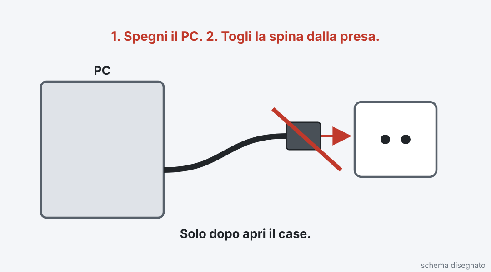

*FOTO-01-01 · schema: verrà sostituito dalla foto del docente*

### 01.02 Togli la spina

Togli la spina dalla presa della corrente. Solo dopo si apre il case.

*FOTO-01-02 · schema: verrà sostituito dalla foto del docente*

### 01.03 Scarica l'elettricità statica

Tocca con la mano il metallo del case. Se c'è il braccialetto antistatico, mettilo e attacca la pinza al metallo.

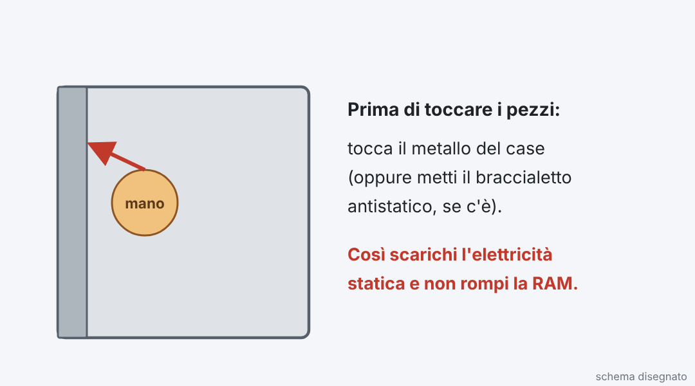

*FOTO-01-03 · schema: verrà sostituito dalla foto del docente*

### 01.04 Prepara il tavolo

Libera il tavolo vicino al PC: qui metterai la RAM quando la togli.

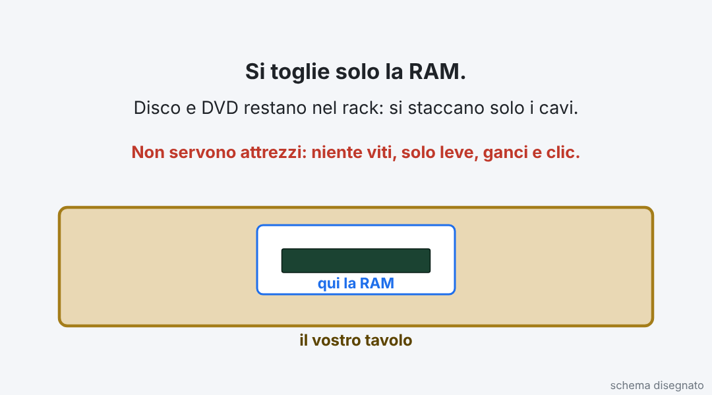

*FOTO-01-04 · schema: verrà sostituito dalla foto del docente*

## 02 Smontare il PC

Oggi si toglie solo la RAM. Del disco e del lettore DVD si staccano solo i cavi SATA: restano nel loro rack. Ordine: cavi del disco, cavi del DVD, RAM.

> [ROSSO] NON SI TOCCA: CPU e ventola (dissipatore). Disco e DVD non escono dal rack. Oggi non si staccano neanche il cavo 24 pin, il cavo CPU 4/8 pin (è vicino alla ventola) e la scheda video.

### 02.01 Apri la leva del pannello

Gira il PC. Dietro, tira la leva (o premi il gancio) del pannello laterale.

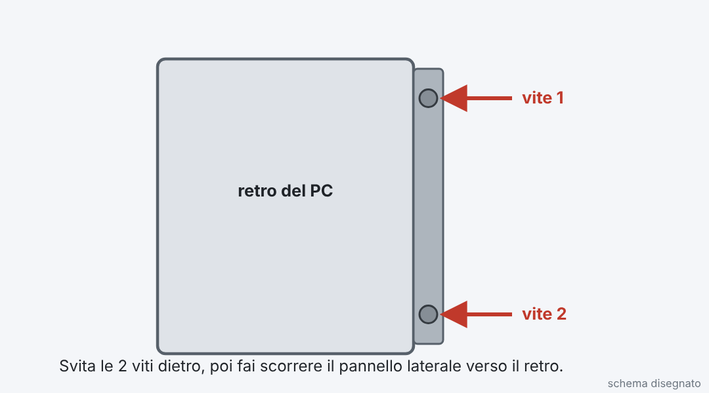

*FOTO-02-01 · schema: verrà sostituito dalla foto del docente*

### 02.02 Togli il pannello

Fai scorrere il pannello verso il retro e appoggialo sul tavolo.

*FOTO-02-02 · schema: verrà sostituito dalla foto del docente*

### 02.03 Guarda l'ordine

Leggi lo schema: prima i cavi del disco e del DVD, poi la RAM.

*FOTO-02-03 · schema: verrà sostituito dalla foto del docente*

### 02.04 Riconosci i componenti

Trova nel tuo PC le 8 parti dello schema, da A a H. Indica ogni parte con il dito, senza toccare CPU e ventola.

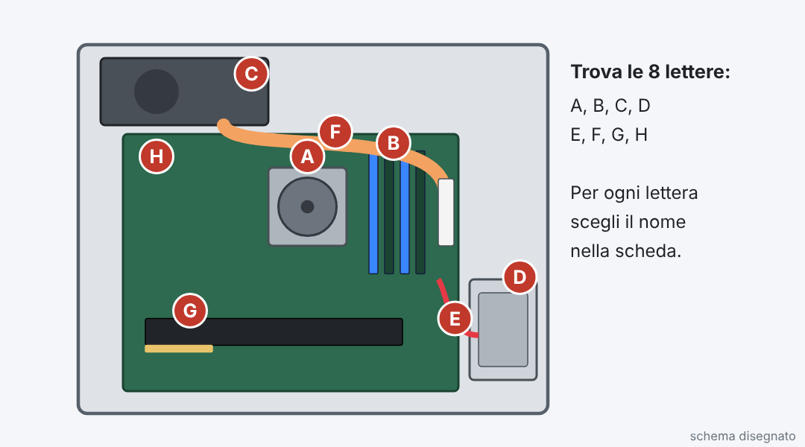

*FOTO-02-04 · schema: verrà sostituito dalla foto del docente*

### 02.05 Guarda il rack del disco e del DVD

Trova il rack di alluminio con il disco e il lettore DVD. Restano lì: si staccano solo i cavi.

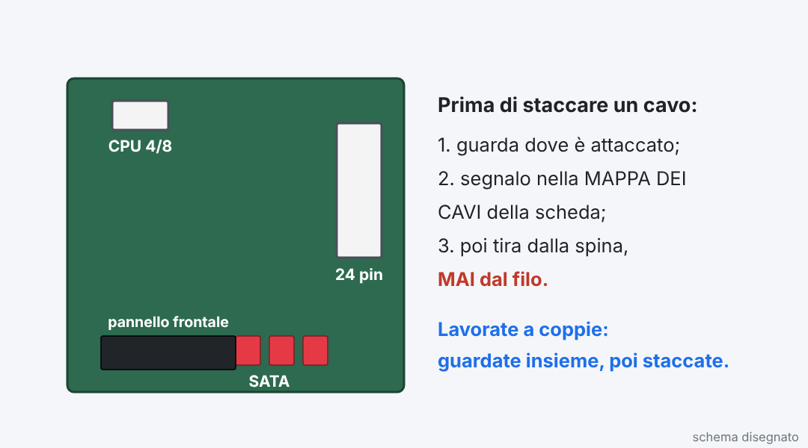

*FOTO-02-05 · schema: verrà sostituito dalla foto del docente*

### 02.06 Guarda dove sono i cavi

Prima di staccare un cavo, guardate insieme dove è attaccato.

*FOTO-02-06 · schema: verrà sostituito dalla foto del docente*

### 02.07 Stacca i cavi del disco

Stacca dal disco il cavo SATA dati (sottile) e il cavo SATA di alimentazione (largo). Tira dalla spina, mai dal filo.

*FOTO-02-07 · schema: verrà sostituito dalla foto del docente*

### 02.08 Stacca i cavi del DVD

Stacca dal lettore DVD il cavo SATA dati e il cavo SATA di alimentazione.

*FOTO-02-08 · schema: verrà sostituito dalla foto del docente*

### 02.09 Apri i ganci della RAM

Spingi in fuori i due ganci ai lati del banco di RAM. Il banco si alza da solo.

*FOTO-02-09 · schema: verrà sostituito dalla foto del docente*

### 02.10 Togli la RAM

Prendi il banco dai bordi e sfilalo. Non toccare i contatti dorati e non toccare la ventola lì vicino.

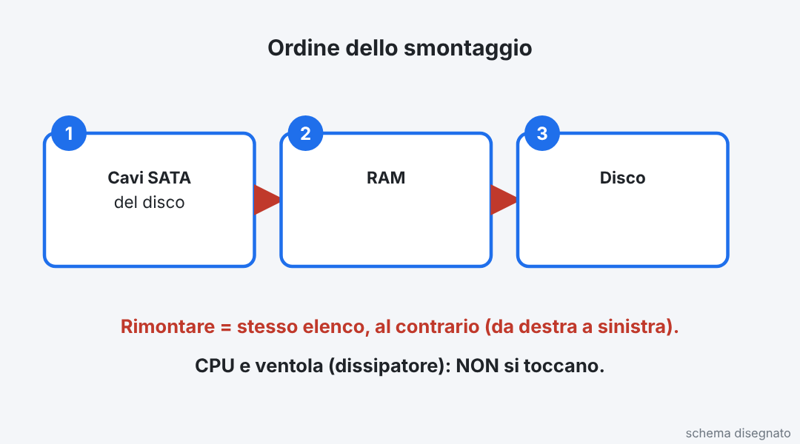

*FOTO-02-10 · schema: verrà sostituito dalla foto del docente*

### 02.11 Metti la RAM sul tavolo

Appoggia la RAM sul tavolo, dalla parte dei bordi. Leggi l'etichetta: per esempio 8GB DDR4.

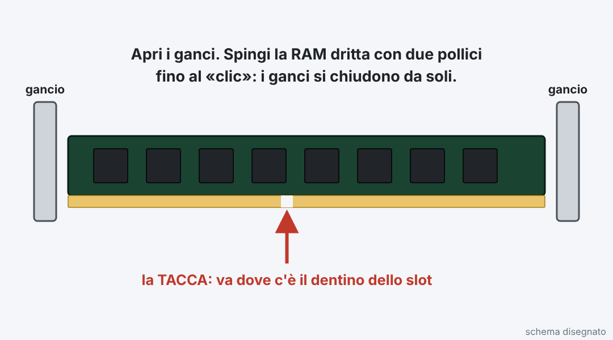

*FOTO-02-11 · schema: verrà sostituito dalla foto del docente*

## 03 Rimontare il PC

Si rimonta al contrario: RAM, cavi del DVD, cavi del disco. Ogni pezzo si spinge finché fa clic.

> [ROSSO] Un controllo è NO? Non accendere: sistema prima.

### 03.01 Guarda l'ordine inverso

Leggi lo schema: si rimonta nell'ordine contrario a quello dello smontaggio.

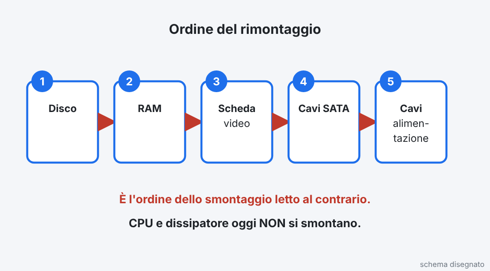

*FOTO-03-01 · schema: verrà sostituito dalla foto del docente*

### 03.02 Rimetti la RAM

Fai combaciare la tacca della RAM con il dentino dello slot. Spingi dritto con due pollici finché fa clic.

*FOTO-03-02 · schema: verrà sostituito dalla foto del docente*

### 03.03 Attacca i cavi del DVD

Attacca al lettore DVD il cavo SATA dati e il cavo SATA di alimentazione. Ogni spina entra in un solo verso: non forzare.

*FOTO-03-03 · schema: verrà sostituito dalla foto del docente*

### 03.04 Attacca i cavi del disco

Attacca al disco il cavo SATA dati e il cavo SATA di alimentazione, finché sono ben dentro.

*FOTO-03-04 · schema: verrà sostituito dalla foto del docente*

### 03.05 Fai i 5 controlli

Controllate insieme: RAM con i ganci chiusi, disco con 2 cavi, DVD con 2 cavi, 24 pin al suo posto, niente lasciato dentro il case.

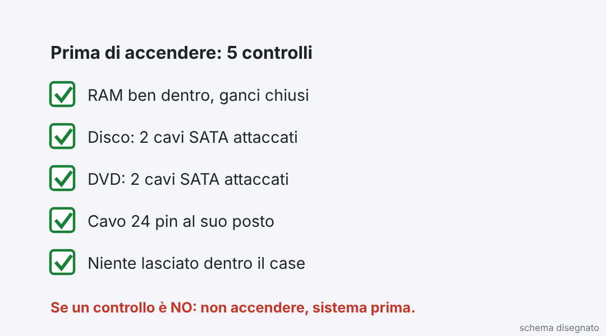

*FOTO-03-05 · schema: verrà sostituito dalla foto del docente*

### 03.06 Chiudi il case

Rimetti il pannello laterale e fallo scorrere finché fa clic.

*FOTO-03-06 · schema: verrà sostituito dalla foto del docente*

### 03.07 Collega i cavi esterni

Collega monitor, tastiera, mouse e cavo di rete. La spina della corrente va per ultima.

*FOTO-03-07 · schema: verrà sostituito dalla foto del docente*

## 04 Accensione e BIOS

I PC del laboratorio sono HP ProDesk 600 G3 MT. Il BIOS (Basic Input Output System: il programma che parte per primo; negli HP si chiama Computer Setup, è un UEFI) dice al PC da dove partire. Oggi si parte dalla chiavetta USB.

> [GIALLO] Tasti dei PC HP, da premere subito all'accensione: Esc = menu; F1 = System Information; F2 = diagnostica; F9 = Boot Menu (avvio da USB); F10 = BIOS Setup.

> [ROSSO] F11 (System Restore) non si usa. Nel BIOS si cambia solo quello che dice la guida.

### 04.01 Guarda il numero del tuo PC

Sul case c'è l'adesivo «AULA 11 COMPUTER» con un numero. È il numero del vostro PC.

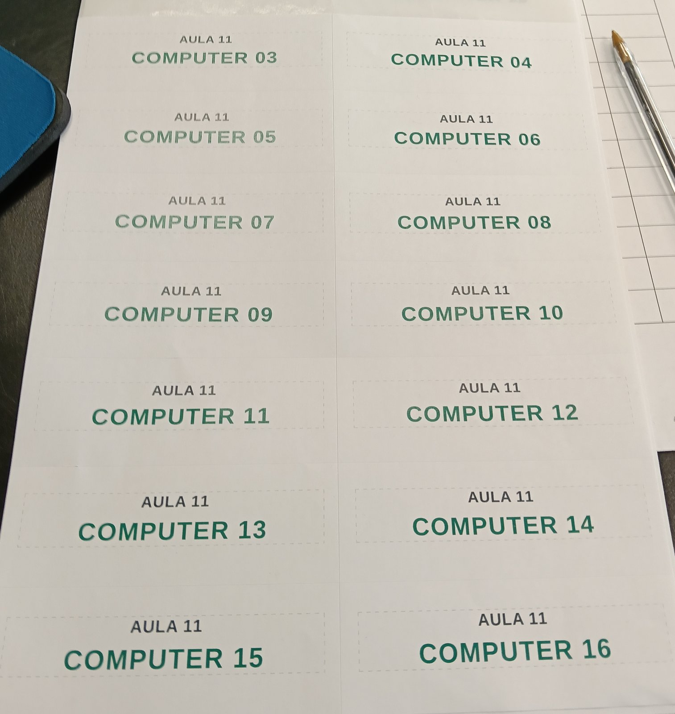

*FOTO-04-01 · foto del docente*

### 04.02 Leggi il modello del PC

Sull'etichetta HP del case leggi il modello: HP ProDesk 600 G3 MT.

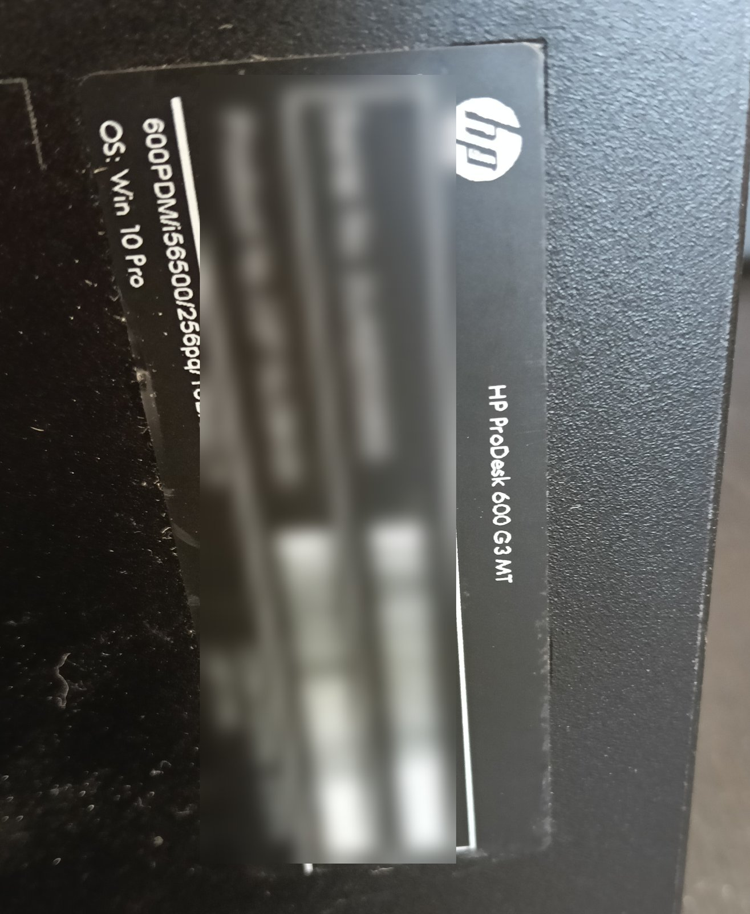

*FOTO-04-02 · foto del docente*

### 04.03 Metti la chiavetta

Metti la chiavetta di Windows 10 in una porta USB dietro il PC.

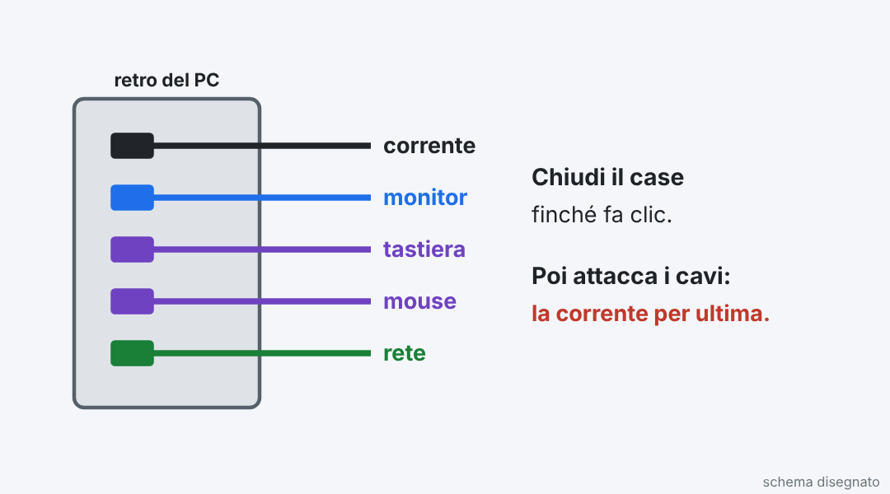

*FOTO-04-03 · schema: verrà sostituito dalla foto del docente*

### 04.04 Apri il menu HP con Esc

Premi il tasto di accensione. Subito, più volte, premi Esc. Si apre il menu con i tasti F1, F2, F9, F10.

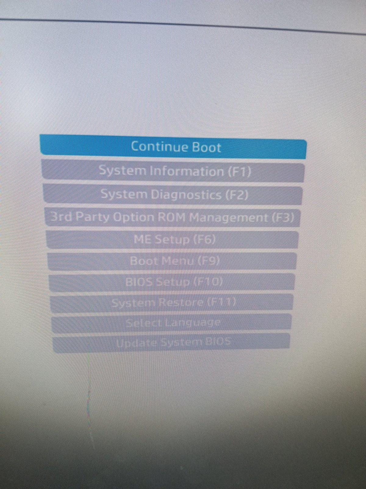

*FOTO-04-04 · foto del docente*

### 04.05 Apri System Information

Premi F1. Leggi Product Name, Processor (la CPU) e Memory Size (la RAM).

*FOTO-04-05 · foto del docente*

### 04.06 Controlla la RAM

Memory Size deve dire 4096 MB, cioè 4 GB. Se dopo il rimontaggio vedi meno memoria, la RAM non è inserita bene: spegni e rimettila.

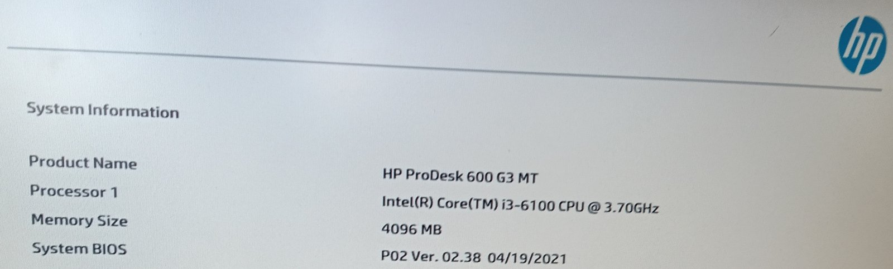

*FOTO-04-06 · foto del docente*

### 04.07 Guarda la diagnostica

Premi Esc per tornare al menu, poi F2. Qui ci sono Memory Test (prova la RAM) e Hard Drive Check (prova il disco). Oggi si guarda e si esce con Exit.

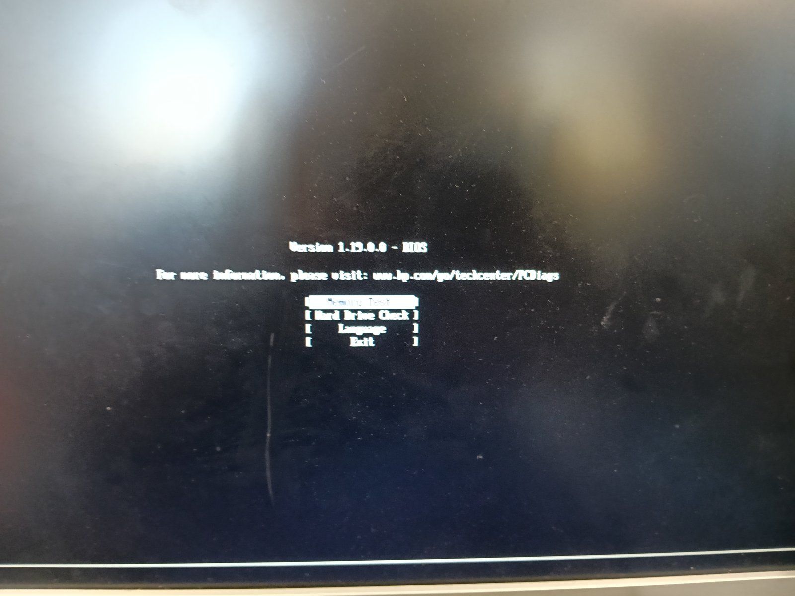

*FOTO-04-07 · foto del docente*

### 04.08 Entra nel BIOS

Riavvia, premi Esc e poi F10 (BIOS Setup). Si apre HP Computer Setup sulla scheda Main.

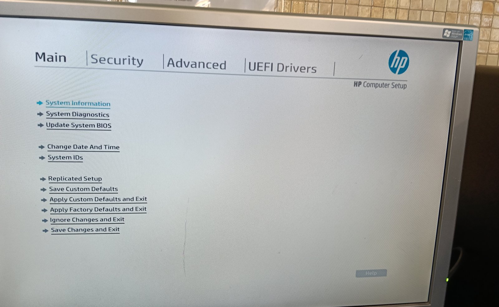

*FOTO-04-08 · foto del docente*

### 04.09 Apri la scheda Advanced

In alto clicca la scheda Advanced.

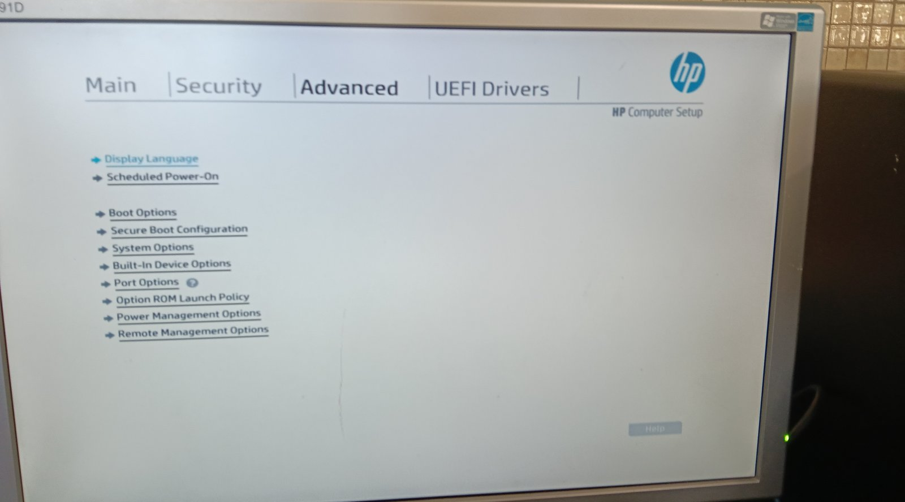

*FOTO-04-09 · foto del docente*

### 04.10 Controlla Boot Options

Clicca Boot Options. USB Storage Boot deve essere spuntato. In UEFI Boot Order c'è SATA0: Windows Boot Manager.

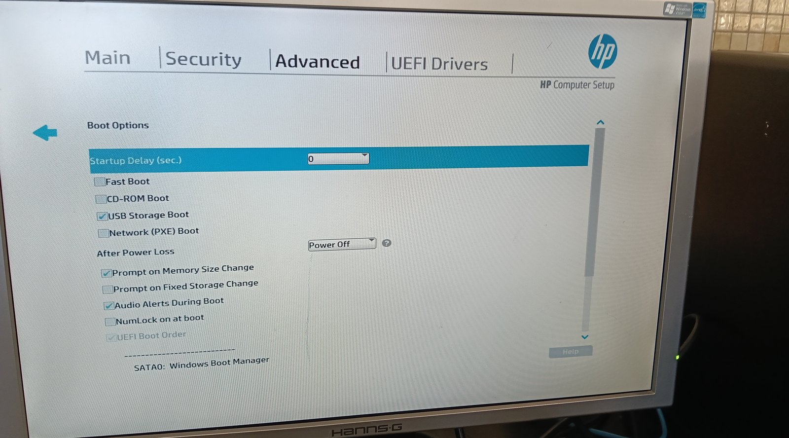

*FOTO-04-10 · foto del docente*

### 04.11 Salva ed esci

Torna nella scheda Main, clicca Save Changes and Exit e conferma con Yes.

*FOTO-04-11 · foto del docente*

### 04.12 Parti dalla chiavetta: F9

Riavvia, premi Esc e poi F9 (Boot Menu). Scegli la riga con USB e premi Invio.

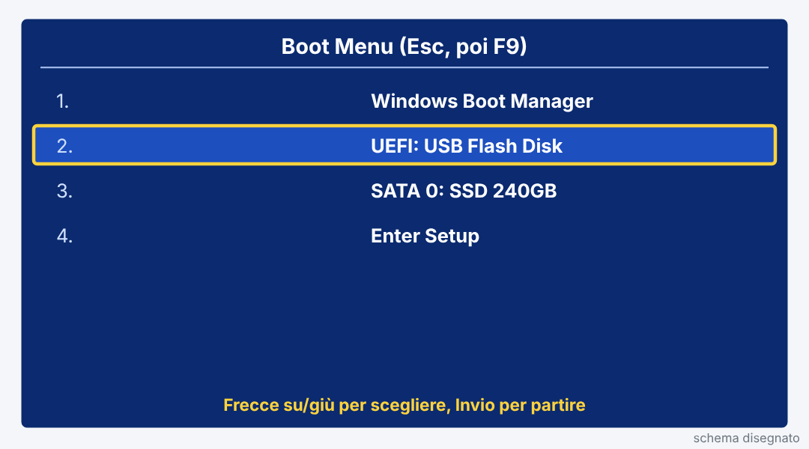

*FOTO-04-12 · schema: verrà sostituito dalla foto del docente*

## 05 Installare Windows 10 da chiavetta

Il PC del banco si può cancellare tutto: è fatto per imparare. Si crea un account locale: nome e password stanno solo su questo PC.

> [GIALLO] Windows 10 Pro a volte chiede «Configura per uso personale», poi «Account offline» e «Esperienza limitata»: sono la stessa strada senza Internet.

> [ROSSO] Si installano solo i PC del banco, mai le postazioni della classe.

### 05.01 Parti dalla chiavetta

Se compare «Premi un tasto per avviare da CD o DVD», premi un tasto qualsiasi.

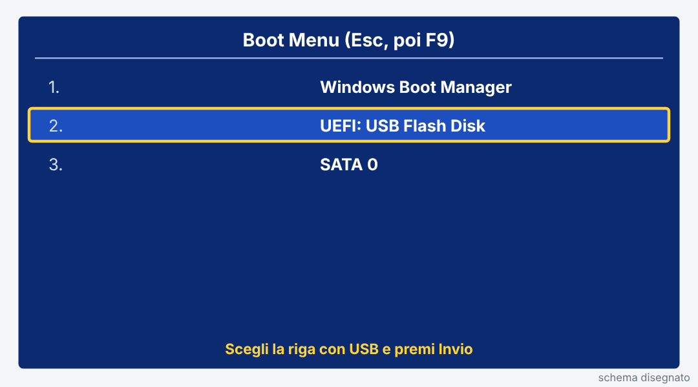

*FOTO-05-01 · schema: verrà sostituito dalla foto del docente*

### 05.02 Lascia la lingua italiana

Lascia Italiano nelle tre caselle e premi Avanti.

*FOTO-05-02 · schema: verrà sostituito dalla foto del docente*

### 05.03 Premi Installa

Premi il bottone grande Installa.

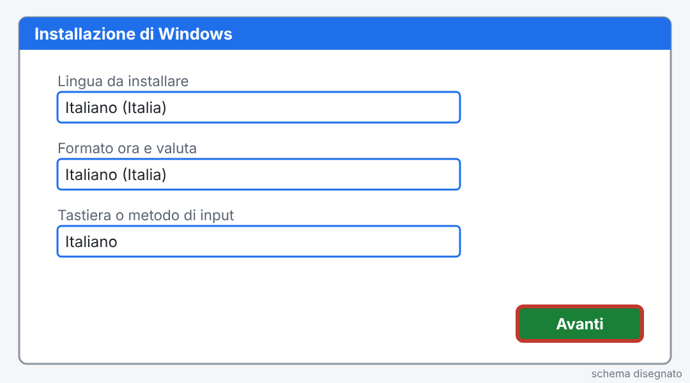

*FOTO-05-03 · schema: verrà sostituito dalla foto del docente*

### 05.04 Non ho un codice Product Key

In basso clicca la scritta Non ho un codice Product Key.

*FOTO-05-04 · schema: verrà sostituito dalla foto del docente*

### 05.05 Scegli l'edizione

Scegli Windows 10 Pro (o quella che dice il Professore) e premi Avanti.

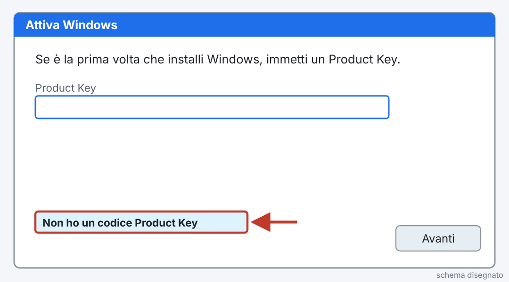

*FOTO-05-05 · schema: verrà sostituito dalla foto del docente*

### 05.06 Accetta la licenza

Spunta Accetto le condizioni di licenza e premi Avanti.

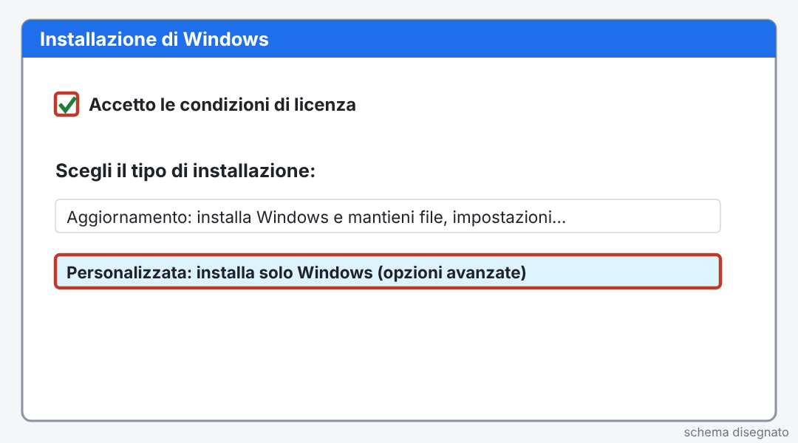

*FOTO-05-06 · schema: verrà sostituito dalla foto del docente*

### 05.07 Scegli Personalizzata

Clicca Personalizzata: installa solo Windows.

*FOTO-05-07 · schema: verrà sostituito dalla foto del docente*

### 05.08 Elimina le partizioni

Seleziona una partizione e premi Elimina. Rifallo finché resta solo «Spazio non allocato».

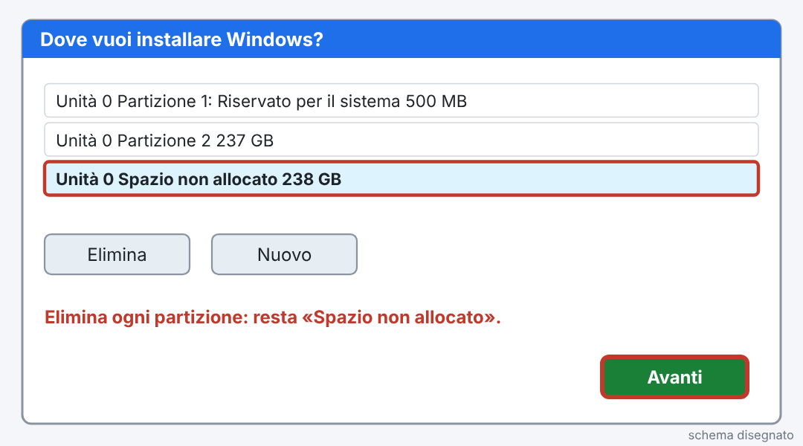

*FOTO-05-08 · schema: verrà sostituito dalla foto del docente*

### 05.09 Scegli lo spazio non allocato

Seleziona Unità 0 Spazio non allocato e premi Avanti.

*FOTO-05-09 · schema: verrà sostituito dalla foto del docente*

### 05.10 Aspetta la copia

Windows copia i file e riavvia da solo (15-25 minuti). Non toccare niente.

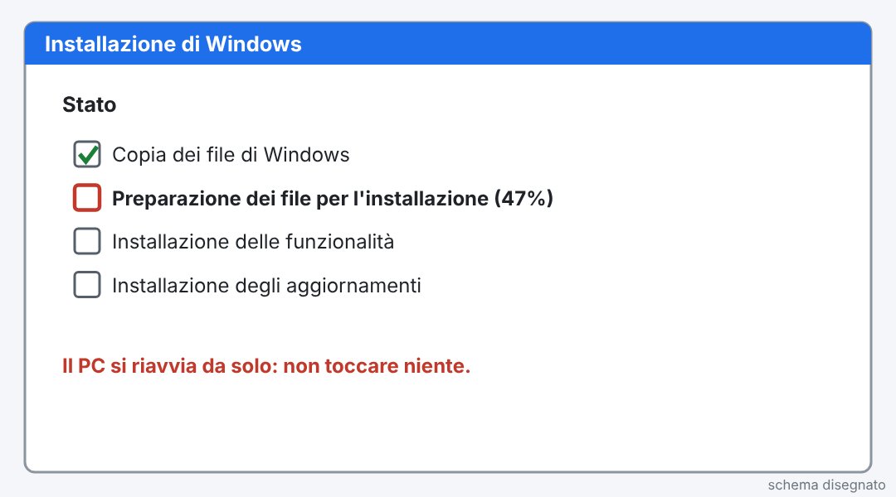

*FOTO-05-10 · schema: verrà sostituito dalla foto del docente*

### 05.11 Scegli Italia

Al primo avvio scegli Italia e premi Sì.

*FOTO-05-11 · schema: verrà sostituito dalla foto del docente*

### 05.12 Scegli la tastiera

Scegli la tastiera Italiano e premi Sì. Alla seconda tastiera premi Ignora.

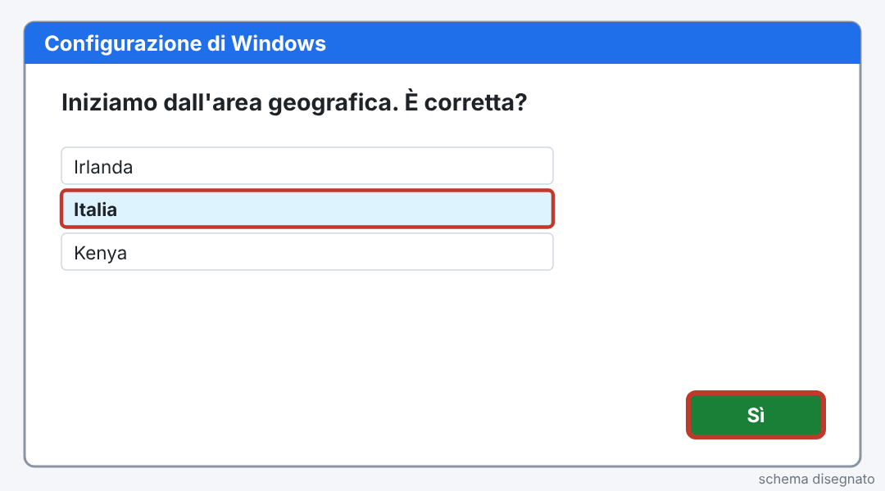

*FOTO-05-12 · schema: verrà sostituito dalla foto del docente*

### 05.13 Non ho Internet

In basso a sinistra clicca Non ho Internet.

*FOTO-05-13 · schema: verrà sostituito dalla foto del docente*

### 05.14 Configurazione limitata

Clicca Continua con configurazione limitata.

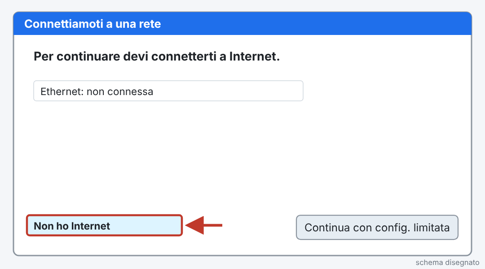

*FOTO-05-14 · schema: verrà sostituito dalla foto del docente*

### 05.15 Scrivi il nome del primo utente

Scrivi tecnico e premi Avanti. Questo primo utente è amministratore.

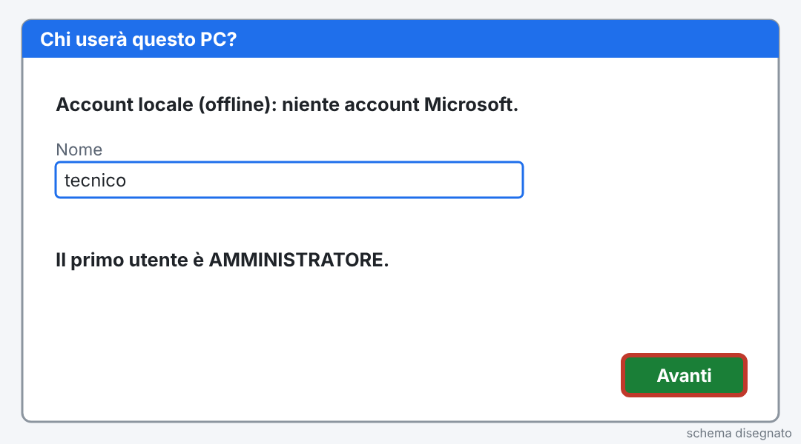

*FOTO-05-15 · schema: verrà sostituito dalla foto del docente*

### 05.16 Scrivi la password

Scrivi la password che dice il Professore, due volte. Poi scegli 3 domande di sicurezza.

*FOTO-05-16 · schema: verrà sostituito dalla foto del docente*

### 05.17 Privacy: tutto No

Metti No a tutte le voci e premi Accetta. Poi aspetta il desktop.

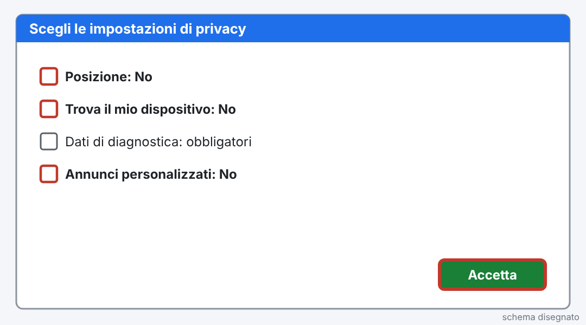

*FOTO-05-17 · schema: verrà sostituito dalla foto del docente*

## 06 Creare gli utenti admin e user1

Due utenti nuovi: admin (amministratore: può cambiare tutto) e user1 (utente standard: usa il PC ma non cambia le cose importanti). Si lavora di solito con l'utente standard: è più sicuro.

> [GIALLO] Nell'edizione Pro la voce a sinistra si può chiamare «Altri utenti»: è lo stesso posto.

### 06.01 Apri Impostazioni

Clicca Start, poi l'ingranaggio Impostazioni.

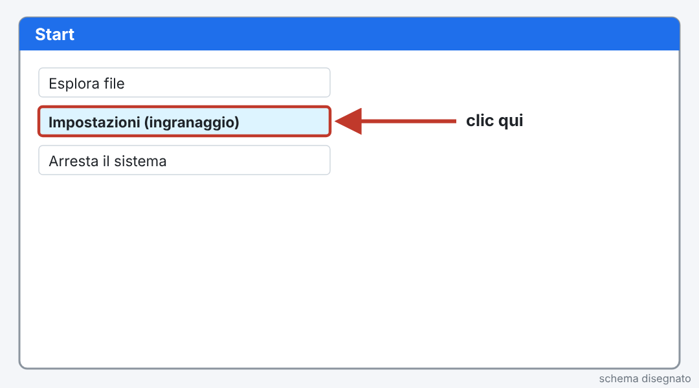

*FOTO-06-01 · schema: verrà sostituito dalla foto del docente*

### 06.02 Apri Account

Clicca Account.

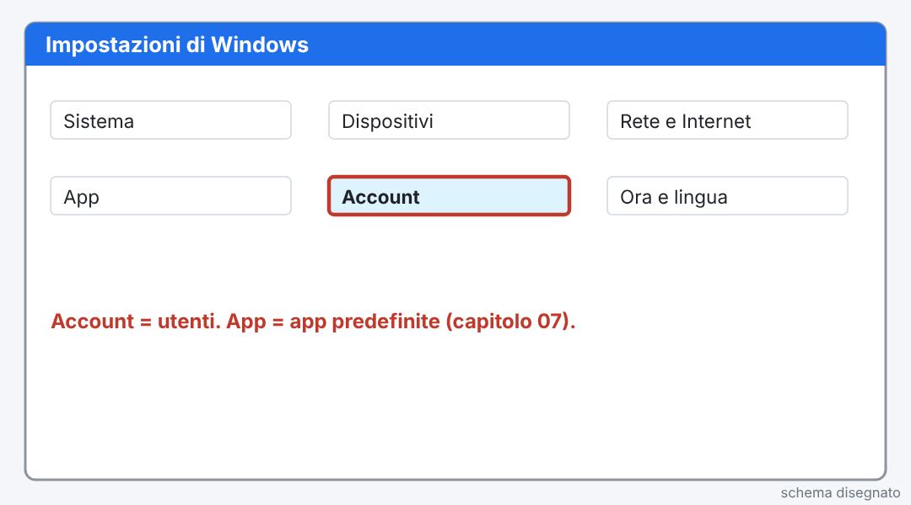

*FOTO-06-02 · schema: verrà sostituito dalla foto del docente*

### 06.03 Apri Famiglia e altri utenti

A sinistra clicca Famiglia e altri utenti.

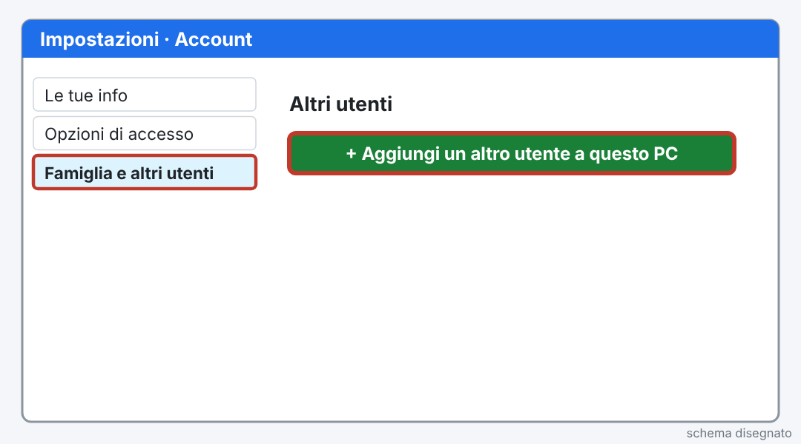

*FOTO-06-03 · schema: verrà sostituito dalla foto del docente*

### 06.04 Aggiungi un altro utente

Clicca Aggiungi un altro utente a questo PC.

*FOTO-06-04 · schema: verrà sostituito dalla foto del docente*

### 06.05 Non ho le informazioni di accesso

Clicca Non ho le informazioni di accesso di questa persona.

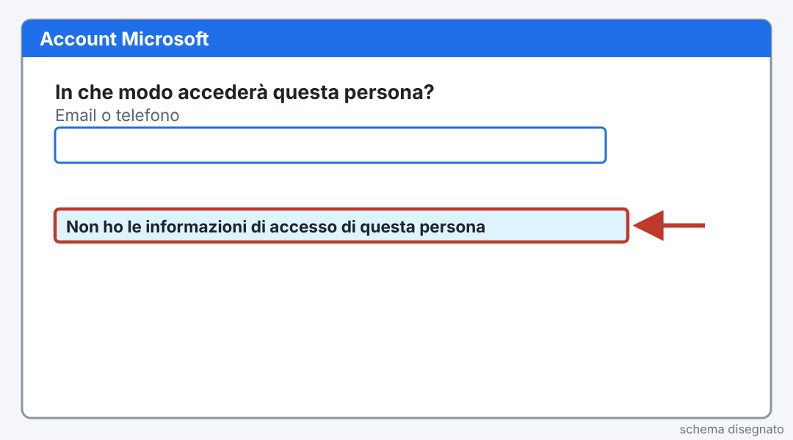

*FOTO-06-05 · schema: verrà sostituito dalla foto del docente*

### 06.06 Utente senza account Microsoft

Clicca Aggiungi un utente senza account Microsoft.

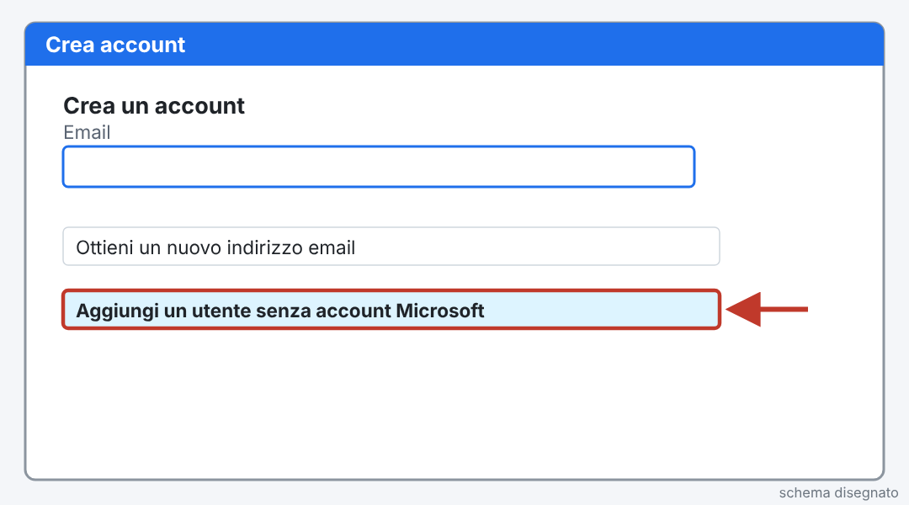

*FOTO-06-06 · schema: verrà sostituito dalla foto del docente*

### 06.07 Crea admin

Scrivi admin come nome. Scrivi la password del Professore due volte, poi le 3 domande. Premi Avanti.

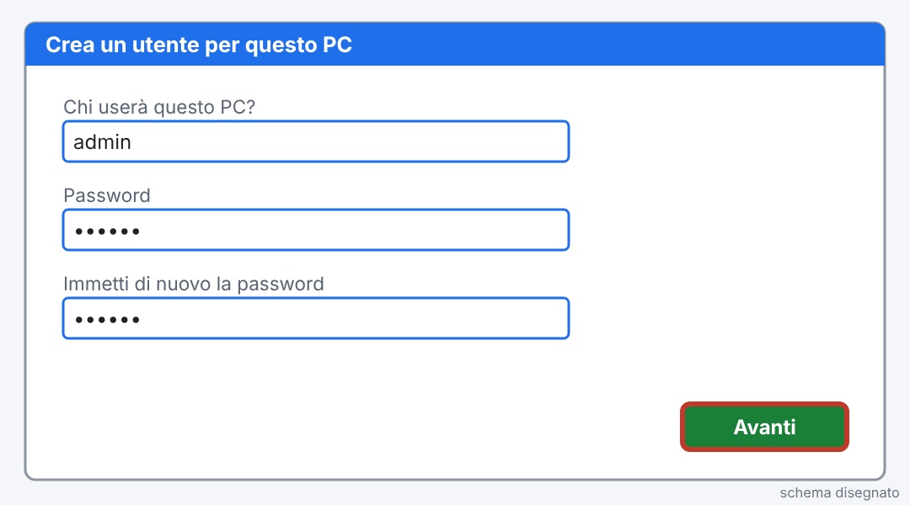

*FOTO-06-07 · schema: verrà sostituito dalla foto del docente*

### 06.08 Crea user1

Rifai i passi 4, 5 e 6. Scrivi user1 come nome, la password e le domande. Premi Avanti.

*FOTO-06-08 · schema: verrà sostituito dalla foto del docente*

### 06.09 Cambia il tipo di admin

Clicca admin, poi Cambia tipo di account.

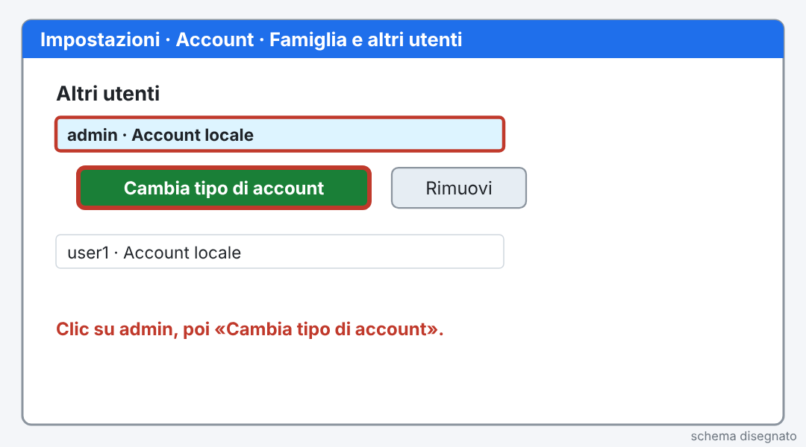

*FOTO-06-09 · schema: verrà sostituito dalla foto del docente*

### 06.10 Scegli Amministratore

Nella casella Tipo di account scegli Amministratore e premi OK.

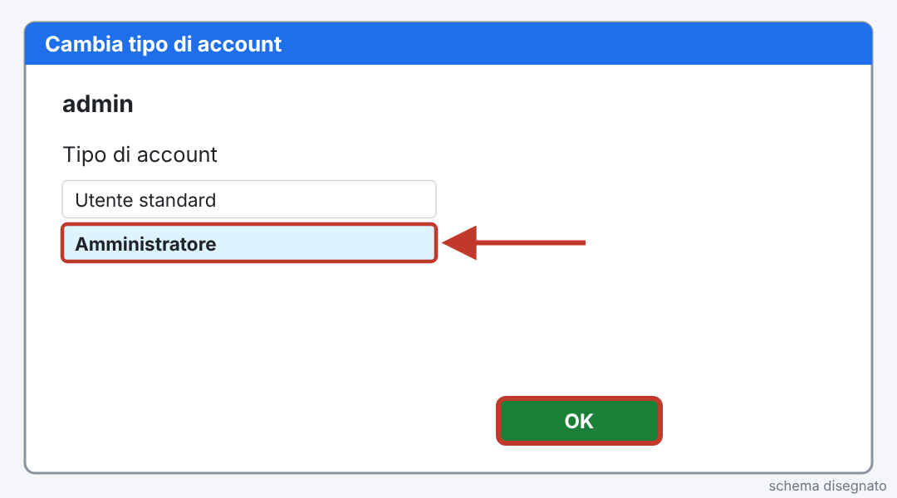

*FOTO-06-10 · schema: verrà sostituito dalla foto del docente*

### 06.11 Controlla i due utenti

Guarda l'elenco: sotto admin c'è scritto Amministratore. user1 resta Utente standard.

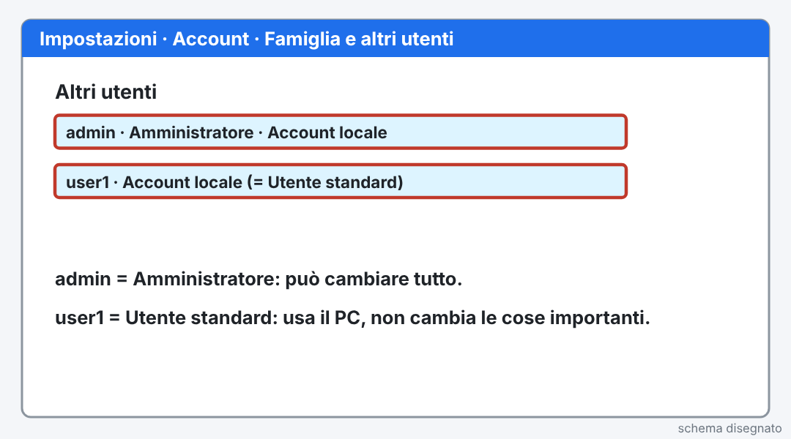

*FOTO-06-11 · schema: verrà sostituito dalla foto del docente*

## 07 Impostazioni di base

Un tecnico sceglie il browser e vede sempre il tipo di ogni file: .txt è testo, .jpg è una foto, .exe è un programma. Un file «foto.jpg.exe» è un programma travestito: attenzione!

### 07.01 Chrome c'è?

Clicca Start e scrivi Chrome. Se non compare, il Professore lo installa quando c'è Internet.

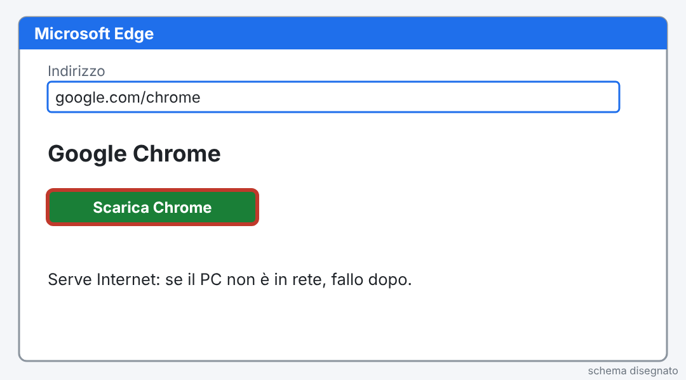

*FOTO-07-01 · schema: verrà sostituito dalla foto del docente*

### 07.02 Apri le app predefinite

Start, Impostazioni, App, poi a sinistra App predefinite.

*FOTO-07-02 · schema: verrà sostituito dalla foto del docente*

### 07.03 Scegli Chrome

Sotto Web browser clicca il browser che c'è e scegli Google Chrome. Se chiede conferma: Cambia comunque.

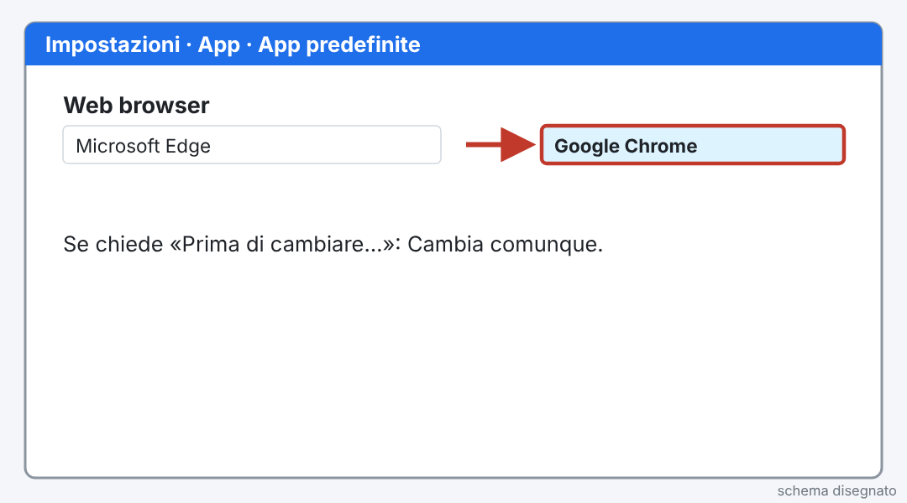

*FOTO-07-03 · schema: verrà sostituito dalla foto del docente*

### 07.04 Apri Esplora file

Premi insieme i tasti Windows ed E. In alto clicca la scheda Visualizza.

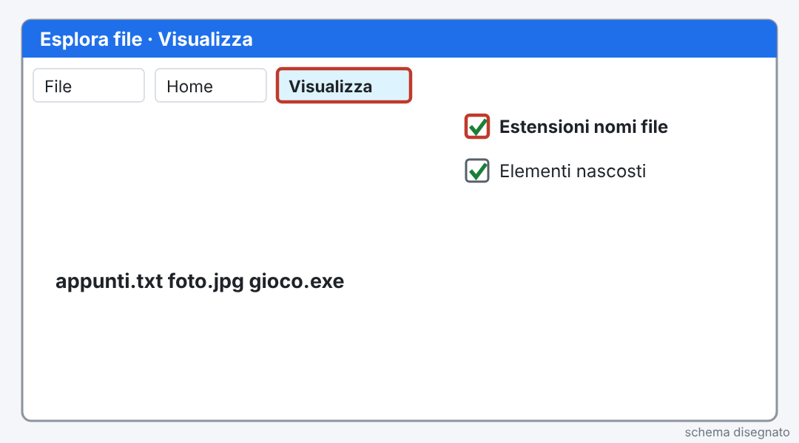

*FOTO-07-04 · schema: verrà sostituito dalla foto del docente*

### 07.05 Mostra le estensioni

Spunta la casella Estensioni nomi file.

*FOTO-07-05 · schema: verrà sostituito dalla foto del docente*

### 07.06 Prova con un file

In Documenti fai tasto destro, Nuovo, Documento di testo. Il nome finisce con .txt? Fatto!

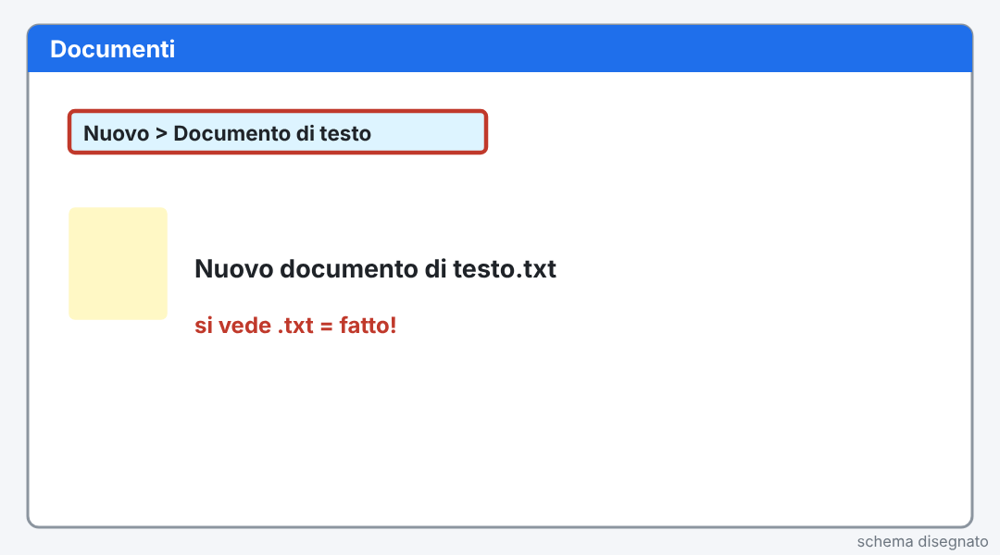

*FOTO-07-06 · schema: verrà sostituito dalla foto del docente*

## 08 IP fisso e prova con il PC accanto

Ogni PC in rete ha un indirizzo IP (Internet Protocol: il «numero civico» del PC). Nella stessa rete le prime 3 parti sono uguali, l'ultima è diversa. Il vostro IP dipende dal numero del banco: guardate la tabella.

| Banco | Indirizzo IP | Subnet mask | Gateway | DNS |
|---|---|---|---|---|
| 1 | `192.168.10.11` | `255.255.255.0` | `192.168.10.1` | `192.168.10.1` |
| 2 | `192.168.10.12` | `255.255.255.0` | `192.168.10.1` | `192.168.10.1` |
| 3 | `192.168.10.13` | `255.255.255.0` | `192.168.10.1` | `192.168.10.1` |
| 4 | `192.168.10.14` | `255.255.255.0` | `192.168.10.1` | `192.168.10.1` |
| 5 | `192.168.10.15` | `255.255.255.0` | `192.168.10.1` | `192.168.10.1` |
| 6 | `192.168.10.16` | `255.255.255.0` | `192.168.10.1` | `192.168.10.1` |
| 7 | `192.168.10.17` | `255.255.255.0` | `192.168.10.1` | `192.168.10.1` |
| 8 | `192.168.10.18` | `255.255.255.0` | `192.168.10.1` | `192.168.10.1` |
| 9 | `192.168.10.19` | `255.255.255.0` | `192.168.10.1` | `192.168.10.1` |

> [GIALLO] «Richiesta scaduta»? Controlla l'IP, il cavo e il firewall, poi riprova.

### 08.01 Trova il tuo IP

Cerca il numero del tuo banco nella tabella qui sopra. Leggi il tuo IP e quello del PC accanto.

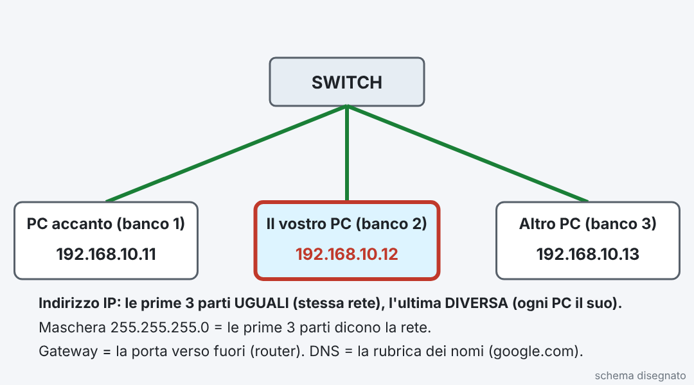

*FOTO-08-01 · schema: verrà sostituito dalla foto del docente*

### 08.02 Apri le connessioni di rete

Premi insieme Windows e R. Scrivi ncpa.cpl e premi Invio.

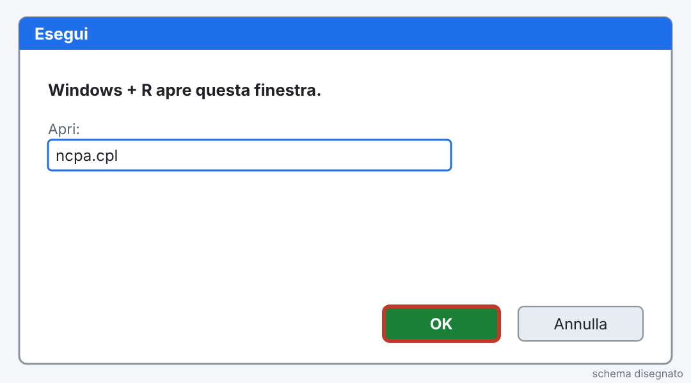

*FOTO-08-02 · schema: verrà sostituito dalla foto del docente*

### 08.03 Apri Ethernet

Tasto destro su Ethernet, poi Proprietà.

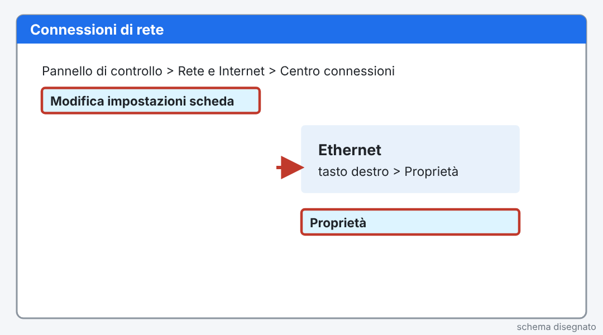

*FOTO-08-03 · schema: verrà sostituito dalla foto del docente*

### 08.04 Apri IPv4

Doppio clic su Protocollo Internet versione 4 (TCP/IPv4).

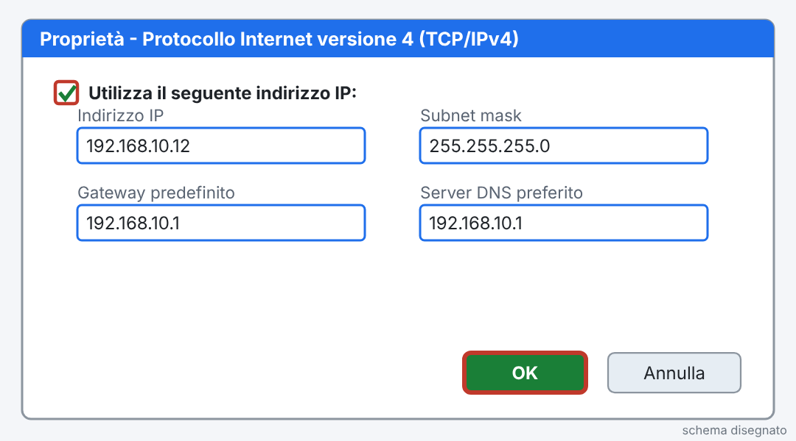

*FOTO-08-04 · schema: verrà sostituito dalla foto del docente*

### 08.05 Scrivi i 4 valori

Scegli Utilizza il seguente indirizzo IP. Scrivi indirizzo IP, subnet mask, gateway e DNS della tabella. Premi OK, poi OK.

*FOTO-08-05 · schema: verrà sostituito dalla foto del docente*

### 08.06 Lascia passare il ping

Start, scrivi Windows Defender Firewall con sicurezza avanzata. Regole connessioni in entrata: tasto destro su ogni riga «Richiesta echo - ICMPv4 in entrata», Abilita regola.

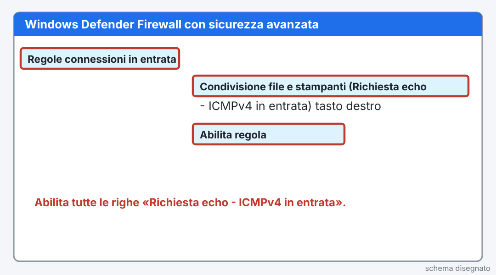

*FOTO-08-06 · schema: verrà sostituito dalla foto del docente*

### 08.07 Collega il cavo allo switch

Quando il Professore lo dice, collega il cavo di rete del PC allo switch.

*FOTO-08-07 · schema: verrà sostituito dalla foto del docente*

### 08.08 Controlla il tuo IP

Start, scrivi cmd, Invio. Scrivi ipconfig e premi Invio. Leggi Indirizzo IPv4: è il tuo?

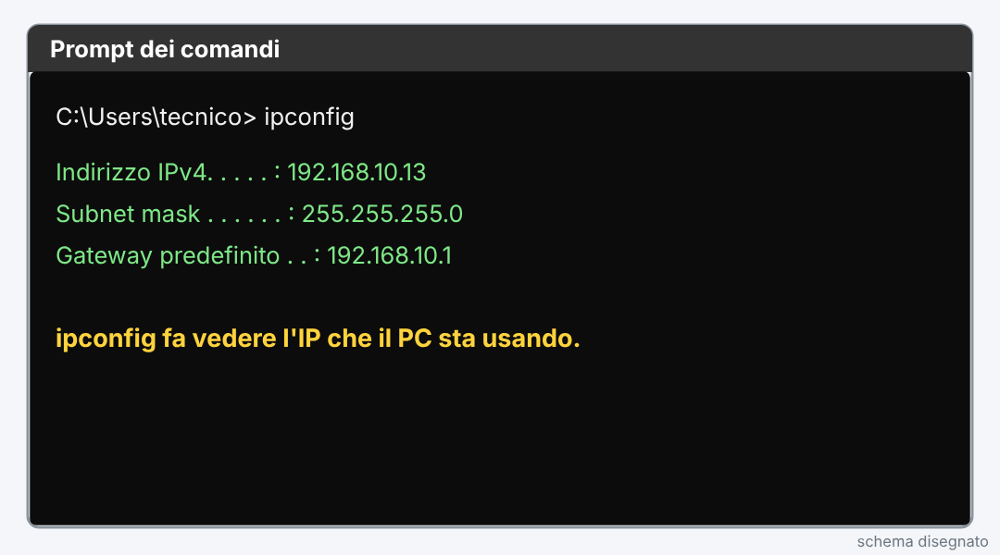

*FOTO-08-08 · schema: verrà sostituito dalla foto del docente*

### 08.09 Mostralo: ping al PC accanto

Scrivi ping, uno spazio e l'IP del PC accanto. Premi Invio. «Risposta da…» vuol dire che la rete funziona!

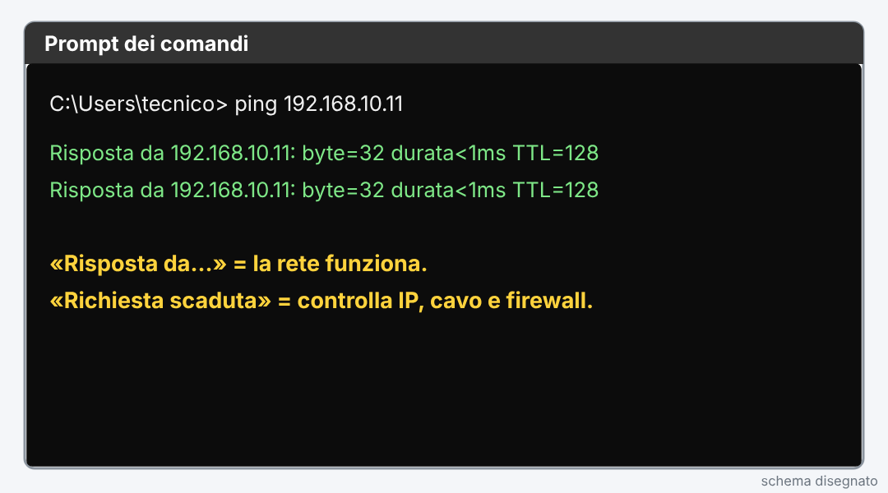

*FOTO-08-09 · schema: verrà sostituito dalla foto del docente*

## 09 Registro delle versioni

1. v1.0 (05/11/2026): prima versione: capitoli 01-08 per i ragazzi, 09 «Creazione guasti» solo docente; schemi al posto delle foto
2. v1.1 (05/11/2026): tolti i ruoli MANI e OCCHI (decisione del docente del 05/11/2026): si lavora a coppie, un PC per coppia; v1.0 dello stesso giorno: solo RAM e disco, CPU e ventola non si toccano
3. v1.2 (05/11/2026): PC senza viti (si apre con leva o gancio, si chiude finché fa clic); si toglie solo la RAM: disco e lettore DVD restano nel rack, si staccano e si riattaccano solo i loro cavi SATA (decisioni del docente del 05/11/2026)
4. v1.3 (05/11/2026): capitolo 04 per i PC HP ProDesk 600 G3 MT: tasti HP (Esc menu, F1 info, F2 diagnostica, F9 avvio da USB, F10 BIOS), passo «Controlla la RAM» (4096 MB = 4 GB), 10 foto del docente al posto degli schemi (FOTO-04-01, 04-02, 04-04 ... 04-11; numeri di serie sfocati, senza EXIF)
