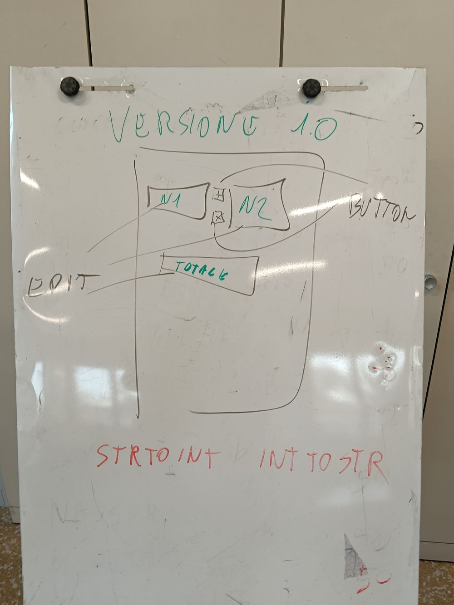
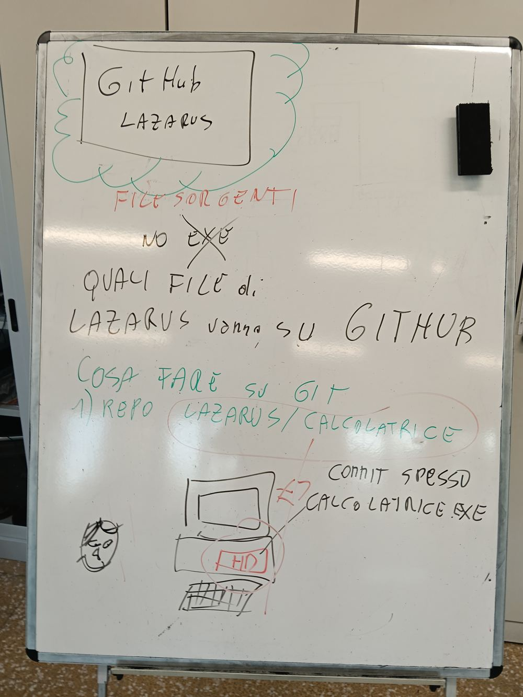

# Libro di testo — Informatica Classe 2

**Versione 1.0** — 29/10/2026
*Il libro di testo della 2INF: raccoglie in un unico posto la teoria e le esercitazioni svolte in classe, lezione per lezione. Cresce a ogni lezione. Il PDF (libro-classe2-vX.Y.pdf) serve per leggere e stampare; questo MD è la fonte versionata, da dare alla tua AI (NotebookLM, Gemini) perché ti spieghi ogni parte con parole semplici. Ogni lezione ha anche il suo libro parziale nella cartella lezioni.*

---

## 0 Come lavoriamo (leggere per prime)
1. Si lavora un passo alla volta, con un risultato concreto da vedere subito.
2. Consegne e materiali stanno su Google Classroom; i progetti stanno su GitHub, ognuno nel suo repository.
3. Ogni lezione ha la sua pagina con le schede di teoria, il ripasso e la verifica: leggi le schede prima di rispondere.
4. Se ti blocchi, chiedi all'assistente nella casella della pagina: risponde subito.
5. L'AI aiuta a capire, non a saltare il pensiero: la prova che hai capito è saperlo spiegare a voce con parole tue.
6. Prima del libro c'era la dispensa dei tipi di file (dispensa-corso-classe2, v0.1): il suo contenuto ora è la lezione del 28/09.

## 1 Le lezioni una per una
*In ordine di data: che cosa abbiamo fatto, la teoria e l'esercitazione di ogni lezione.*

<!-- LEZIONI:INIZIO -->
### L01 21/09/2026 — Benvenuti e GitHub

*Libro parziale: lezioni/2026-09-21_benvenuti-github.md*

#### Che cosa abbiamo fatto

1. **Quando:** 21/09/2026, 3 ore, Laboratorio.
2. **Argomenti:** Presentazione dell'anno; GitHub: che cos'è, a che cosa serve, l'account.

#### La teoria e l'esercitazione

Questa lezione è stata di organizzazione e di avvio: non ha una dispensa scritta. Gli argomenti sono quelli elencati sopra.

### L02 22/09/2026 — Controllo di account e utenze

*Libro parziale: lezioni/2026-09-22_controllo-account.md*

#### Che cosa abbiamo fatto

1. **Quando:** 22/09/2026, 1 ora, Sicurezza.
2. **Argomenti:** Controllo che ognuno entri nei suoi account e nelle sue aree di lavoro.

#### La teoria e l'esercitazione

Questa lezione è stata di organizzazione e di avvio: non ha una dispensa scritta. Gli argomenti sono quelli elencati sopra.

### L03 25/09/2026 — Primo lavoro su GitHub

*Libro parziale: lezioni/2026-09-25_primo-lavoro-github.md*

#### Che cosa abbiamo fatto

1. **Quando:** 25/09/2026, 2 ore, Informatica.
2. **Argomenti:** Creazione dell'account Git; primo lavoro su GitHub: repository, file, commit e versioni.

#### La teoria e l'esercitazione

Dispensa · Classe 2 · Informatica · v2.2

#### GitHub e il versioning

quello che abbiamo scritto insieme alla lavagna, spiegato per bene

Partiamo dallo schema della **nostra lavagna** e lo apriamo pezzo per pezzo: cos'è GitHub, che tipo di servizio è (PaaS, Freemium) e come funzionano le **versioni**. Con esempi e senza comandi da digitare. Classe 2 · Informatica.

##### 1. Partiamo dalla nostra lavagna

Ecco, ridisegnato in ordine, lo schema che abbiamo costruito insieme alla lavagna. Ogni riquadro è una tappa: nelle prossime pagine le apriamo una per una.

GitHub

è un'AZIENDA
è un SERVIZIO

tiene Repository di codice

PaaSPlatform as a Service
FREEMIUMfree ↑ premium

VERSIONING
le versioni: 1 . 2 . 3

v1.0v1.1v2.0
le versioni pubblicate crescono nel tempo

Lo schema della lezione: GitHub è azienda e servizio; tiene repository di codice; come servizio è una piattaforma (PaaS) col modello Freemium; e il progetto cresce per versioni (versioning).


La **lavagna della lezione** (3ª ora): lo schema originale scritto in classe, da cui parte questa dispensa.

##### 2. GitHub: un'azienda e un servizio

Alla lavagna abbiamo scritto due parole sopra "GitHub": **azienda** e **servizio**. Vediamo perché tutte e due sono vere.

###### È un'azienda

Dietro GitHub c'è una **società vera** — **GitHub, Inc.**, nata nel 2008 e dal 2018 di proprietà di **Microsoft**. Come ogni azienda deve mantenersi: ci arriviamo al punto "Freemium".

###### È un servizio (online)

GitHub è un **sito** dove metti i tuoi progetti **online**: per tenerli al sicuro, mostrarli e lavorarci in gruppo. Non è un programma che installi col CD: lo usi dal **browser**.

**Attenzione a non confondere:** **Git** è lo **strumento** (la tecnologia che tiene la storia di un progetto, gratis e di nessuno); **GitHub** è il **servizio online** (l'azienda) dove quei progetti vivono in rete. Git è il **motore**, GitHub è il **garage online**.

##### 3. Che cosa tiene: i repository di codice

Sulla lavagna, sotto "servizio", abbiamo scritto **"repository di codice"**: è ciò che GitHub custodisce.

Un **repository** (in breve "repo") è la **cartella-progetto** con dentro i file **e tutta la loro storia**. Ogni salvataggio della storia si chiama **commit** (una "fotografia" del progetto con un messaggio). Se lavori in gruppo, puoi aprire un **branch** (una strada di lavoro parallela) e poi riunirlo con un **merge**.

**Esempio.** Il tuo gioco "SpaceRun" è un repository su GitHub: dentro c'è il gioco **e** il diario di tutte le modifiche. Puoi tornare a com'era la settimana scorsa in qualsiasi momento.

##### 4. Che tipo di servizio è: PaaS

Alla lavagna: **PaaS = Platform as a Service**, cioè "piattaforma **come servizio**". Vuol dire che qualcuno ti mette a disposizione online una **piattaforma già pronta**, e tu la usi senza costruirti e mantenere i computer, i server e tutto il resto.

**Analogia della cucina.** Per aprire un ristorante puoi **costruirti la cucina da zero** (tanta fatica) oppure **affittare una cucina già attrezzata** e pensare solo a cucinare. GitHub è la cucina già pronta: tu porti il progetto, il resto lo mette lui.

###### La famiglia "…aaS"

PaaS non è da solo: fa parte di una famiglia di servizi online, tutti con la sigla che finisce in **"aaS"** (*as a Service*). Cambia quanto lavoro fai tu:

| Sigla | Nome | Cosa ti danno pronto | Esempio |
| --- | --- | --- | --- |
| **IaaS** | Infrastructure as a Service | Solo i "muri e la corrente": server nudi. | Amazon AWS, Google Cloud |
| **PaaS** | Platform as a Service | La cucina già attrezzata: piattaforma pronta. | GitHub, Netlify |
| **SaaS** | Software as a Service | Il piatto già servito: un programma pronto nel browser. | Gmail, Google Documenti |

**Come ricordarli — la pizzeria.** **IaaS** = affitti il locale vuoto. **PaaS** = affitti la cucina attrezzata. **SaaS** = ti fai consegnare la pizza pronta. Più scendi, meno fatica fai.

##### 5. Come si paga: il modello Freemium

Sulla lavagna: **Freemium = FREE ↑ PREMIUM**. È una parola nata unendo **free** (gratis) e **premium** (a pagamento). Significa: le funzioni **di base sono gratis** per tutti; se vuoi funzioni **in più**, paghi un abbonamento.

**Esempio che conosci.** Tanti giochi per telefono e app come Spotify funzionano così: gratis con qualche limite, a pagamento per togliere pubblicità o avere funzioni extra. **GitHub è uguale:** a te studente basta e avanza la parte gratis.

**Ecco perché "azienda" e "Freemium" stanno insieme:** GitHub è un'azienda, quindi deve guadagnare; lo fa lasciando gratis l'uso normale e facendo pagare le funzioni avanzate a chi ne ha bisogno (aziende, team grandi).

##### 6. Il versioning: le versioni 1.2.3

L'ultima parte della lavagna: **VERSIONING**, con il numero 1.2.3. Quando un progetto raggiunge un punto "buono", gli si dà un **numero di versione** fatto di tre cifre:

| Cifra | Nome | Aumenta quando… |
| --- | --- | --- |
| **1** | major | cambi **tutto**, in modo grosso (magari incompatibile col vecchio) |
| **2** | minor | aggiungi una **funzione nuova**, ma il resto funziona ancora |
| **3** | patch | correggi solo un **bug**, niente di nuovo |

**Esempio.** v1.0.0 prima versione giocabile → aggiungi i suoni: v1.1.0 → correggi un bug: v1.1.1 → rifai tutto da capo: v2.0.0.

###### Il grafo che abbiamo disegnato

Alla lavagna avevamo disegnato la linea delle versioni con un ramo che si stacca e rientra. Ecco cosa racconta: il progetto va avanti su main, ogni tanto si pubblica una versione (le bandierine), e un ramo di lavoro si può staccare e poi riunire.

v1.0v2.0

v1.1 (ramo)

Da v1.0 il progetto cresce; un ramo porta la v1.1 e si riunisce; poi un grande cambiamento porta alla v2.0.

**Regola d'oro:** una versione già pubblicata **non si riusa mai**. Se cambi anche una sola cosa, prima **aumenti** il numero e poi pubblichi.

##### 7. Casi d'uso: 15 grafi con spiegazione (fino a 5 livelli)

Vediamo Git/versioning "in azione". In ogni grafo il **pallino** è un commit/versione e la **linea** è il tempo (da sinistra a destra). I primi sono semplici; gli ultimi arrivano a **cinque livelli** di rami.

**Come si legge un grafo:** ogni **pallino** è un **commit** (una fotografia salvata). La **linea orizzontale** in alto è di solito main, il ramo principale. Le linee colorate che si staccano sono **branch** (rami di lavoro). Quando due linee si riuniscono è un **merge**. Le **bandierine gialle** sono le **release** (versioni pubblicate, es. v1.0).

##### 1. Sviluppo lineare (da soli, tutto dritto)

Il caso più semplice: un solo autore, nessun ramo. Ogni commit segue il precedente in fila. La storia è una linea dritta. Va benissimo per progetti piccoli.

avviopaginastiletestifixfine

##### 2. Una funzione su un branch, poi merge

Provi una funzione nuova su un ramo separato, così il main resta sempre funzionante. Quando è pronta, la **unisci** (merge) al main.

main

funzione "login"
merge

##### 3. Due funzioni in parallelo, merge in tempi diversi

Due rami partono insieme ma finiscono in momenti diversi: uno si fonde prima, l'altro dopo. Il main raccoglie i pezzi man mano che sono pronti.

main

grafica

suoni (finisce dopo)

##### 4. Hotfix urgente durante una funzione lunga

Stai lavorando a una funzione che richiede giorni, ma esce un **bug grave** in produzione. Apri un ramo **hotfix** corto, lo correggi e lo unisci subito; poi torni alla tua funzione.

main

hotfix (bug)

la mia funzione lunga (continua)

##### 5. Le release pubblicate (bandierine sul main)

Man mano che il progetto avanza, si **pubblicano** le versioni: v1.0 giocabile, poi correzioni e aggiunte fino a un cambiamento grosso v2.0. Ogni bandierina è una versione "congelata".

v1.0v1.1v1.2v1.3v2.0
+suoni+livellifixtutto nuovo

##### 6. Un ramo abbandonato (idea scartata)

Non tutte le idee funzionano. Qui un ramo viene provato ma **mai unito**: si decide che non va e lo si lascia lì. Il bello di Git: il main non ne risente per niente.

main

idea "grafica 3D" — abbandonata ✗

##### 7. Un ramo che nasce da un altro ramo

A volte una funzione è così grande che, mentre la sviluppi, ne stacchi un pezzo su un **sotto-ramo**. Prima rientra il sotto-ramo nel ramo, poi il ramo nel main. Rami dentro rami.

main

funzione "mappa"

sotto-ramo "zoom"

##### 8. Grande integrazione (progetto di gruppo)

Nel lavoro di squadra ognuno ha il suo ramo (grafica, movimenti, audio, menu). Alla fine confluiscono tutti nel main con le loro Pull Request: nasce la versione completa.

main
grafica
movimenti
audio
menu
v1.0

##### 9. Ramo di manutenzione a lungo termine

Esci con la v1.0 e il main va avanti verso la v2.0 (tutto nuovo). Ma chi usa ancora la v1 ha bisogno di correzioni: si tiene un **ramo di manutenzione** parallelo dove escono v1.1, v1.2 solo con i fix.

main
v2.0
v1.0

ramo manutenzione v1.x
v1.1v1.2

##### 10. Revert: annullare una modifica sbagliata

Un commit ha introdotto un problema. Invece di cancellare la storia (non si fa), si aggiunge un **nuovo commit** che **annulla** quello sbagliato: è il **revert**. La storia resta onesta e il progetto torna a posto.

main
commit sbagliato
revert (annulla)

##### 11. Conflitto di merge risolto

Due rami hanno cambiato **la stessa riga** in modo diverso. Quando si uniscono, Git non sa quale tenere: è un **conflitto**. Una persona decide cosa tenere e chiude il merge con un commit speciale di "risoluzione".

main
cambio A
cambio B (stessa riga)

merge risolto ⚡

##### 12. Squadra a 5 rami con due release

Un progetto vero di gruppo: sul **main** si pubblicano le versioni, mentre **quattro rami** diversi (grafica, movimenti, audio, menu) lavorano in parallelo e rientrano in momenti diversi. Cinque linee in tutto.

main

v1.0v2.0

grafica

movimenti

audio

menu

##### 13. Rami annidati: cinque livelli di profondità

Una funzione grande si divide in pezzi: dal main nasce un ramo, da quel ramo un **sotto-ramo**, e ancora più giù. Ogni livello rientra nel precedente. Qui si scende di **cinque livelli**.

main
livello 1
livello 2
livello 3
livello 4

##### 14. Due versioni major mantenute insieme

Dopo la v1.0 il main punta alla v2.0, ma la v1 resta in uso: un **ramo di manutenzione** sforna v1.1/v1.2 (solo fix), e più tardi anche la v2 avrà il suo ramo di manutenzione. Tante linee vive insieme.

main
v1.0v2.0

v1.1v1.2v1.3ramo manutenzione v1.x

v2.1ramo manutenzione v2.x

##### 15. Storia realistica: rami, hotfix, revert e conflitto

Il quadro completo: il main avanza con le release; una **feature** lunga con un **sotto-ramo**; un **hotfix** urgente; un **revert** per annullare un errore; e un **merge con conflitto** risolto. Cinque livelli di attività insieme.

main
errorerevert
v2.0

hotfix

feature
sotto-ramo

ramo parallelo (stessa riga) → merge con conflitto ⚡

**In sintesi:** con pochi elementi — commit, branch, merge, tag/release — si descrivono **tutte** le situazioni di un progetto reale, dalla più semplice (linea dritta) alle più complesse (integrazione di squadra, manutenzione parallela, conflitti). Saper **leggere** questi grafi è già metà del lavoro.

##### 8. Riepilogo (la lavagna in tre righe)

1. **GitHub** è un'**azienda** e un **servizio** online dove tieni i tuoi **repository di codice** (con Git sotto, come motore).
2. Come servizio è una **piattaforma pronta (PaaS)**, della famiglia **…aaS**, e si paga in **Freemium** (base gratis, extra a pagamento).
3. Il progetto cresce per **versioni** (1.2.3): major, minor, patch — e una versione pubblicata non si tocca più.

Per vedere tante situazioni diverse con i grafi, guarda la scheda "Versioning — 11 casi d'uso".

##### 9. Glossario

| Parola | Vuol dire |
| --- | --- |
| GitHub | il sito-servizio (azienda di Microsoft) che ospita i progetti online |
| Git | lo strumento (gratis) che tiene la storia di un progetto — il "motore" sotto GitHub |
| repository | la cartella-progetto con dentro i file e tutta la loro storia |
| commit | un salvataggio (una fotografia) del progetto con un messaggio |
| branch | una strada di lavoro parallela, per provare senza rovinare il main |
| merge | unire un ramo con quello principale (main) |
| PaaS | "piattaforma come servizio": una piattaforma online già pronta (es. GitHub) |
| IaaS / SaaS | gli altri servizi …aaS: infrastruttura (server nudi) / software pronto nel browser |
| Freemium | base gratis, funzioni avanzate a pagamento |
| versioning | dare un numero (v1.2.3) alle versioni: major . minor . patch |
| release | una versione pubblicata e "congelata"; non si riusa mai un numero già dato |

### L04 28/09/2026 — I tipi di file

*Libro parziale: lezioni/2026-09-28_tipi-di-file.md*

#### Che cosa abbiamo fatto

1. **Quando:** 28/09/2026, 3 ore, Laboratorio.
2. **Argomenti:** Che cos'è un file, l'estensione, file di testo e file binari, il dizionario dei formati, la compressione; compito sui tipi di file.

#### La teoria e l'esercitazione

Dispensa · Classe 2 · Informatica · v1.1

#### I tipi di file

a cosa servono, gli esempi, i file "a tag", video e compressione

Ogni file ha un **tipo** (lo dice l'estensione: .md, .mp4…). Capire i tipi serve a sapere **cosa contiene** un file, **con che programma** si apre e **perché** pesa tanto o poco. Con esempi da mondi diversi.

##### Di cosa parliamo

**1.** Cos'è un file e a cosa serve l'estensione
**2.** Le grandi famiglie di file (testo, immagini, audio, video, archivi…)
**3.** Dizionario dei formati (uno per uno, con esempio)
**4.** I file "a TAG": HTML, XML, MD — con esempi veri
**5.** La compressione: perché un file diventa più piccolo
**6.** Il Markdown (MD) e l'intelligenza artificiale
**7.** Glossario

##### 1. Cos'è un file e a cosa serve l'estensione

Un **file** è un contenitore di informazioni salvato nel computer: un testo, una foto, una canzone, un video, un programma. Ogni file ha un **nome** e, alla fine, un'**estensione**: le lettere dopo il punto (es. canzone.mp3, foto.jpg).

**L'estensione è come il "cognome" del file:** dice di che **tipo** è, così il computer sa **con quale programma** aprirlo. Cambiare l'estensione non cambia il contenuto: rinominare foto.jpg in foto.txt non la trasforma in testo, la fa solo aprire con il programma sbagliato.

**Esempio quotidiano.** È come le **etichette** sui barattoli in cucina: "zucchero", "sale". Il contenuto è dentro; l'etichetta ti dice cosa aspettarti e come usarlo.

###### Il percorso (path): dove si trova il file

Oltre al tipo, un file ha un **indirizzo** nel computer: il **percorso** (in inglese **path**), cioè la lista di cartelle per arrivarci, es. C:\Documenti\Scuola\appunti.txt. Su Windows le cartelle si separano con la barra rovescia \ — è un'eredità del vecchio sistema **DOS**, dove tutto si scriveva a mano (es. C:\DOS).

##### 2. Due grandi mondi: TESTO e BINARIO

La prima grande divisione (come alla lavagna) è tra file di **testo** e file **binari**.

1. **File di TESTO (TXT):** dentro ci sono solo **lettere e simboli**, quindi li puoi aprire col **Blocco note** e **leggerli**. Sono a "formato libero". Esempi: txt, md, html, css, js, xml, csv, json, .gd.
2. **File BINARI (BIN):** dentro ci sono **codici** che il Blocco note non sa mostrare (escono simboli strani): servono **programmi specifici**. Esempi: doc, xls, pdf, dwg, png, jpeg, zip, exe, mp3, mp4, wav.

**Prova del nove.** Per sapere se un file è testo o binario, aprilo col **Blocco note**: se lo **leggi** è testo; se vedi **simboli strani** è binario.

###### Le famiglie più in dettaglio

Dentro questi due mondi ci sono le **famiglie** per uso:

| Famiglia | A cosa serve | Esempi di estensione |
| --- | --- | --- |
| **Testo semplice** | solo lettere, nessuna formattazione | .txt .md |
| **Testo "a tag"** | testo con etichette che danno struttura | .html .xml |
| **Dati / tabelle** | elenchi e tabelle di dati | .csv .json |
| **Documenti impaginati** | testo formattato, pronto da leggere/stampare | .pdf .docx .xlsx |
| **Immagini** | foto e disegni | .jpg .png |
| **Audio / Video** | suoni e filmati | .mp3 .mp4 .wav |
| **Archivi** | tanti file compressi in uno solo | .zip |
| **Pagine web** | struttura, stile e comportamento dei siti | .html .css .js |
| **Disegno tecnico (CAD)** | disegni e progetti tecnici | .dwg |
| **Programmi (eseguibili)** | si avviano col doppio clic | .exe |
| **Codice / progetto** | istruzioni per un programma | .gd (Godot) .py |

##### 3. Dizionario dei formati (uno per uno)

Per ognuno: **a cosa serve**, un **esempio**, e **con che programma si apre** (a scuola: Blocco note, browser, Godot portabile, SumatraPDF).

###### TXT — testo semplice

Solo testo, senza grassetti né colori. Leggerissimo. Si apre col **Blocco note**. Esempio: una lista della spesa, degli appunti veloci.

###### MD (Markdown) — testo con formattazione "leggera"

Testo semplice ma con simboli che diventano formattazione: # = titolo, \*\*...\*\* = grassetto. È il formato con cui scriviamo le dispense (poi diventano PDF). Si legge su GitHub o col Blocco note.

###### HTML — la pagina web

Il linguaggio delle **pagine dei siti**. Usa i **tag** (vedi §4). Lo apre il **browser**, che trasforma i tag in una pagina bella da vedere.

###### XML — dati con etichette

Come HTML usa i tag, ma per **organizzare dati** (non per fare pagine). Tanti programmi si scambiano informazioni in XML.

###### CSV — tabella semplice

Una tabella scritta come testo: ogni riga è una riga della tabella, le colonne separate da **virgole** (comma). Lo aprono Excel/Fogli Google. Esempio: l'esportazione dei voti di un quiz.

###### JSON — dati per i programmi

Come CSV ma per dati più complessi (a "scatole dentro scatole"). È il modo con cui le app si scambiano dati su Internet.

###### PDF — il documento "congelato"

Un documento impaginato che si vede **uguale ovunque** e si stampa bene, ma non si modifica facilmente. Si apre con **SumatraPDF** o il browser. Le nostre dispense finali sono PDF.

###### DOCX / XLSX — Word ed Excel

Documento di testo (DOCX) e foglio di calcolo (XLSX). Servono per **scrivere e modificare**. Li aprono Word/Excel o Documenti/Fogli Google.

###### JPG / PNG — le immagini

**JPG**: foto, molto compresse (leggere, ma perdono un po' di qualità). **PNG**: disegni/loghi, senza perdita e con sfondo trasparente. Le apre qualsiasi visualizzatore o il browser.

###### MP3 / MP4 — audio e video

**MP3** = audio compresso. **MP4** = video (immagini in movimento + audio insieme). Li apre il lettore multimediale o il browser.

###### ZIP — l'archivio

Una **valigia**: mette tanti file dentro uno solo e li **comprime** per pesare meno e spedirli comodi. Si "estrae" per riavere i file dentro.

###### CSS / JS — stile e comportamento delle pagine

Vanno insieme all'HTML: **CSS** dà lo **stile** (colori, caratteri, posizioni), **JS** (JavaScript) dà il **comportamento** (bottoni che fanno cose). Sono testo, li apre il Blocco note; il browser li usa con l'HTML.

###### DWG — il disegno tecnico (CAD)

Il formato dei **disegni tecnici** fatti con programmi CAD (es. AutoCAD): piantine, progetti. È binario, serve il programma giusto per aprirlo.

###### EXE — il programma da avviare

Un **programma eseguibile**: col doppio clic **parte**. Godot portabile è un .exe. Attenzione: aprire un .exe che non conosci è rischioso (può contenere virus).

###### WAV — audio senza compressione

Audio di qualità piena ma **pesante** perché **non compresso** (a differenza dell'MP3). Si usa quando serve la massima qualità.

###### GD — lo script di Godot

Un file di **codice**: le istruzioni del nostro gioco in Godot. È testo, ma lo apre **Godot** (col doppio clic parte il gioco: per leggerlo come testo, tasto destro → Apri con → Blocco note).

##### 4. I file "a TAG": HTML, XML, MD

Alcuni file di testo usano i **tag** (etichette). Un **tag** è un'etichetta tra parentesi angolari che **marca** un pezzo di testo dicendo "questo è un titolo", "questo è grassetto". Di solito vanno a coppie: uno apre &lt;titolo> e uno chiude &lt;/titolo>.

**Analogia.** I tag sono come gli **evidenziatori e le note a margine** su un foglio: il testo è lo stesso, ma le marcature dicono a cosa serve ogni parte.

###### Esempio HTML (pagina web)

&lt;h1>La mia prima pagina&lt;/h1>
&lt;p>Ciao, questo è un &lt;b>paragrafo&lt;/b> in grassetto.&lt;/p>
&lt;a href="github.com">vai a GitHub&lt;/a>

&lt;h1> = titolo grande · &lt;p> = paragrafo · &lt;b> = grassetto · &lt;a> = link. Il browser legge questi tag e disegna la pagina.

###### Esempio XML (dati)

&lt;studente>
&lt;nome>Mario&lt;/nome>
&lt;classe>3 INF&lt;/classe>
&lt;voto>90&lt;/voto>
&lt;/studente>

Qui i tag non servono a fare una pagina, ma a **organizzare i dati**: si capisce quale pezzo è il nome, quale la classe, quale il voto.

###### Esempio MD (Markdown)

#### Titolo grande
##### Sottotitolo
Testo normale con una parola in \*\*grassetto\*\*.
- primo punto
- secondo punto

Il Markdown non usa parentesi angolari ma **simboli leggeri** (#, \*\*, -): più veloce da scrivere a mano, poi un programma lo trasforma in PDF o pagina.

**In comune:** tutti e tre sono **testo** (li apre anche il Blocco note), ma con **marcature** che danno **struttura**. Cambia solo il "dialetto": angolari per HTML/XML, simboli per MD.

##### 5. La compressione: perché un file diventa più piccolo

**Comprimere** vuol dire scrivere la stessa informazione occupando **meno spazio**. Serve a far pesare meno i file (per salvarli, inviarli, metterli online). Ci sono due modi:

1. **Senza perdita (lossless):** si comprime ma si può tornare **identici** all'originale. È come **piegare bene** un vestito nella valigia: occupa meno, ma è lo stesso vestito. Esempi: .zip, .png.
2. **Con perdita (lossy):** si butta via un po' di dettaglio che quasi non si nota, per pesare **molto** meno. È come **riassumere** un tema: perdi qualche parola ma il senso resta. Esempi: .jpg, .mp3, .mp4.

**Esempio concreto.** La stessa foto: in **PNG** senza perdita può pesare 8 MB; in **JPG** con perdita 0,8 MB — dieci volte meno, e a occhio quasi uguale. Per una foto sul telefono va benissimo il JPG; per un logo con linee nette meglio il PNG.

**Perché ci riguarda:** un video lungo non compresso peserebbe **giga e giga**; grazie all'MP4 (compressione con perdita) sta in pochi MB e si guarda in streaming. È lo stesso motivo per cui abbiamo **compresso l'immagine** nelle dispense: pesare meno senza perdere qualità utile.

##### 6. Il Markdown (MD) e l'intelligenza artificiale

C'è un motivo se vi diamo le dispense anche in **MD** (Markdown), oltre che in PDF: il Markdown è il formato **perfetto da dare a un'intelligenza artificiale** (come Gemini o ChatGPT) per farsi **spiegare** o **tradurre** un testo.

###### Perché l'AI legge bene un MD

1. **È testo puro:** l'AI legge **esattamente** il contenuto, senza la "sporcizia" nascosta di un PDF o di un DOCX (che dentro hanno codici di formattazione, e da binari sono illeggibili).
2. **La struttura è chiara:** i simboli del Markdown (# titolo, \*\* grassetto, - elenco) dicono all'AI **com'è organizzato** il testo, così capisce cosa è titolo, cosa è elenco, cosa è importante.
3. **È leggero:** si **copia e incolla** facilmente dentro una chat con l'AI.

**Analogia.** Dare all'AI un MD è come darle un foglio **pulito e ordinato** invece di uno pieno di scarabocchi e formattazioni strane: lo capisce molto meglio.

**Come lo usate voi:** prendete il file .md della dispensa, lo **date alla vostra AI** e le chiedete, ad esempio: "*spiegamelo in modo semplice*" oppure "*traducilo nella mia lingua*". Così ognuno ripassa la lezione **come e nella lingua che preferisce**.

**Regola d'uso dell'AI:** serve per **capire meglio**, non per saltare il ragionamento. La prova che hai capito è **saperlo spiegare a voce, con parole tue**.

##### 7. Glossario

| Parola | Vuol dire |
| --- | --- |
| file | un contenitore di informazioni salvato nel computer |
| percorso (path) | l'indirizzo del file nel computer (es. C:\cartella\file.txt) |
| file di testo | leggibile col Blocco note (txt, md, html, css, js, xml, csv…) |
| file binario | serve un programma specifico (doc, pdf, png, mp4, exe, zip…) |
| estensione | le lettere dopo il punto: dicono il tipo del file (.mp4, .md…) |
| tag | un'etichetta (es. &lt;titolo>) che marca un pezzo di testo |
| HTML | il linguaggio a tag delle pagine web |
| XML | testo a tag per organizzare dati |
| Markdown (MD) | testo con simboli leggeri per la formattazione |
| CSV | tabella scritta come testo, colonne separate da virgole |
| MP4 | formato video (immagini in movimento + audio, compressi) |
| compressione | scrivere la stessa informazione occupando meno spazio |
| lossless / lossy | senza perdita (identico) / con perdita (più leggero) |
| ZIP | archivio: tanti file compressi in uno solo |

### L05 29/09/2026 — Lazarus: convertitore mph e km/h

*Libro parziale: lezioni/2026-09-29_convertitore-mph-kmh.md*

#### Che cosa abbiamo fatto

1. **Quando:** 29/09/2026, 2 ore, Informatica.
2. **Argomenti:** Programma di conversione tra miglia orarie e chilometri orari in Lazarus: TEdit, RadioGroup, StrToFloat e FormatFloat.

#### La teoria e l'esercitazione

*Questo file è **per te**: puoi leggerlo e puoi **darlo a Gemini** (o a un'altra AI) per
farti spiegare le parti che non capisci, o farti tradurre nella tua lingua. Regola
d'oro: l'AI serve per **capire meglio**, non per saltare il pensiero. Alla fine devi
saper **spiegare a voce** cosa fa il tuo programma.*

---

##### 1. Cosa costruiamo
Un'app che converte una velocità tra **km/h** e **mph** (miglia all'ora). Scrivi un
numero, scegli la direzione con dei pallini, premi **Converti** e leggi il risultato
con **una cifra decimale**.

##### 2. UI — l'interfaccia (cosa si vede)
1. **Edit1** con etichetta **Km/h** e **Edit2** con etichetta **mph** (le due caselle).
2. **RadioGroup1** (pallini della direzione). Per inserire le due voci: nell'Object Inspector trova la
   proprietà **Items**, clicca il pulsante `…` a destra e nell'editor scrivi **una voce per riga**:
   `Da Km/h` e `Da mph`, poi OK. Infine metti `ItemIndex = 0`.
3. **Button1** con `Caption = Converti`.

##### 3. UX — come si usa (con mouse E con sola tastiera)
L'app gira su **Windows** e si deve poter usare in due modi: col **mouse** e anche
**solo con la tastiera**. Si regola con le proprietà dei controlli:
1. **TabStop** (True/False): se True il controllo si raggiunge con `Tab`; se False viene saltato.
2. **TabOrder**: l'ordine con cui `Tab` passa da un controllo all'altro (0, 1, 2…). Ordine logico: Edit1 → RadioGroup → Edit2 → Button.
3. **Button1.Default = True**: premendo `Invio` parte la conversione senza cliccare.

##### 4. LOGICA — il calcolo
1. **1 mph ≈ 1,6 km/h** (in classe usiamo 1,6; il valore preciso è 1,60934).
2. Da **Km/h** a mph: si **divide** per 1,6. Da **mph** a Km/h: si **moltiplica** per 1,6.

Il codice del bottone:

```pascal
procedure TForm1.Button1Click(Sender: TObject);
var
  a: Real;
begin
  if RadioGroup1.ItemIndex = 0 then      // Da Km/h a mph
  begin
    a := StrToFloat(Edit1.Text);         // Edit1 = Km/h
    Edit2.Text := FormatFloat('0.0', a / 1.6);
  end
  else                                    // Da mph a Km/h
  begin
    a := StrToFloat(Edit2.Text);         // Edit2 = mph
    Edit1.Text := FormatFloat('0.0', a * 1.6);
  end;
end;
```

1. `StrToFloat(...)` trasforma il **testo** della casella in un **numero** con la virgola.
2. `FormatFloat('0.0', ...)` trasforma il numero in **testo con 1 cifra decimale**.

##### 5. Come chiedere aiuto a Gemini (esempi di domande)
Copia questo file dentro Gemini e prova a chiedere, con parole tue:
1. «Spiegami con parole semplici cosa fa `StrToFloat` in questo codice.»
2. «Perché serve `FormatFloat('0.0', ...)`? Cosa cambia se scrivo `'0.00'`?»
3. «Cos'è `ItemIndex` del RadioGroup e perché il primo pallino è 0?»
4. «Traducimi questa scheda in [la tua lingua], così la capisco meglio.»
5. «Fammi 3 domande per controllare se ho capito il convertitore.»

> Ricorda: dopo che l'AI ti ha spiegato, **prova a rifarlo tu** e a spiegarlo a voce a un
> compagno. Se lo sai spiegare, l'hai capito davvero.

### L06 01/10/2026 — Convertitore di temperature e Sicurezza 1

*Libro parziale: lezioni/2026-10-01_convertitore-temperature-sicurezza.md*

#### Che cosa abbiamo fatto

1. **Quando:** 01/10/2026, 4 ore, Laboratorio e Sicurezza.
2. **Argomenti:** Lazarus «Convertitore di temperature» (Celsius e Fahrenheit): if/then, begin/end annidati, verso automatico, Reset, finestra di scelta; Sicurezza sul lavoro, modulo 1: rischio, danno, prevenzione e protezione, con quiz e test a risposta aperta.

#### La teoria e l'esercitazione

> ⚠ **ATTENZIONE — DIFFERENZA VOLUTA:** questo compito **NON** è sulle miglia/km della lezione, ma su **Celsius ↔ Fahrenheit**. È fatto **apposta** così, per verificare che sai applicare lo **stesso metodo** a una conversione nuova. **Non è un errore.**

**Cosa devi fare:** costruisci un'app in Lazarus **uguale nella struttura** a quella
Km/h↔mph vista a lezione, ma che converte le **temperature** (°C ↔ °F). Cambia solo la
formula: il metodo è lo stesso.

##### 1. Componenti (UI)
1. **Edit1** (°C) e **Edit2** (°F).
2. **RadioGroup1** con `Da C a F` e `Da F a C` (ItemIndex = 0).
3. **Button1** con `Caption = Converti`.

##### 2. Comportamento (LOGICA)
1. Leggi il numero con **StrToFloat**.
2. Se ItemIndex = 0: **F = C × 9/5 + 32**. Altrimenti: **C = (F − 32) × 5/9**.
3. Scrivi il risultato con **una cifra decimale** con **FormatFloat('0.0', …)**.

Controlli: 100 °C → 212.0 °F · 32 °F → 0.0 °C · 37 °C → 98.6 °F.

##### 3. Uso con mouse E con tastiera (UX)
1. Deve funzionare su **Windows**, usabile col **mouse** e **solo con tastiera**.
2. Sistema **TabStop** e **TabOrder** (ordine: Edit1 → RadioGroup → Edit2 → Button).
3. `Button1.Default = True` così `Invio` lancia la conversione.

##### 4b. Usa Gemini con la scheda MD
1. Apri la scheda **.md** del convertitore in **Gemini** (incolla o carica il file).
2. Chiedigli **3 domande di verifica** sull'app e **rispondi**.
3. Allega **uno screenshot** della chat (o scrivi cosa ti ha chiesto e cosa hai risposto).

##### 4. Consegna
1. 2 screenshot: app funzionante + codice del bottone.
2. Rispondi: cosa fa StrToFloat? cosa fa FormatFloat('0.0', …)? a cosa serve TabOrder?
3. Consegna su Classroom.

##### 5. Valutazione (100 punti)
| Voce | Punti |
|---|---|
| Componenti giusti (RadioGroup, 2 Edit, Button) | 15 |
| StrToFloat corretto | 15 |
| Due formule giuste con RadioGroup (ItemIndex) | 25 |
| Risultato con 1 decimale (FormatFloat) | 15 |
| Uso con tastiera: TabStop/TabOrder | 10 |
| Sa spiegare a voce | 10 |
| Uso del file MD con Gemini | 10 |

Conta la comprensione: se il metodo è giusto e sai spiegarlo, va bene anche con piccoli errori.

### L07 05/10/2026 — Il programma su GitHub e «Indovina il numero»

*Libro parziale: lezioni/2026-10-05_github-indovina-numero.md*

#### Che cosa abbiamo fatto

1. **Quando:** 05/10/2026, Informatica.
2. **Argomenti:** Il proprio programma caricato su GitHub; gioco «Indovina il numero» con gli if annidati.

#### La teoria e l'esercitazione


v1.0

#### Le decisioni: if / then / else  
e gli if uno dentro l'altro

Classe 2 · Informatica · Lazarus · 05/10/2026 · e alla fine il gioco **Indovina il numero**

**Cosa impari oggi:** a far **decidere** il programma (**if** = se, **then** = allora, **else** = altrimenti) e a mettere un if **dentro** un altro if (si dice **if annidati** : come una scatola dentro una scatola). Alla fine costruisci un **gioco vero** : il computer pensa un numero e tu lo devi indovinare.

##### 1\. Ripasso: if / then / else

Si legge come in italiano: **SE** la condizione è vera **ALLORA** fai questo, **ALTRIMENTI** fai quest'altro.

numero pari?

SÌ -> scrivi PARI

NO -> scrivi DISPARI
    
    
```
numero := StrToInt(Edit1.Text);
if numero mod 2 = 0 then
  begin
    Label1.Caption := 'PARI';
  end
else
  begin
    Label1.Caption := 'DISPARI';
  end;
```


`mod` = il **resto** della divisione: se diviso 2 il resto è 0, il numero è pari. I confronti: `=` uguale · `<>` diverso · `<` minore · `>` maggiore · `<=` · `>=`.

##### 2\. La regola dei rientri (si fa sempre così)

Regola| Perché  
---|---  
**if** ed **else** sullo **stesso rientro** (stessa colonna)| si vede subito quale else appartiene a quale if  
**begin** ed **end** sullo **stesso rientro** , con lo stesso numero e colore| ogni begin ha il suo end, come una parentesi che si apre e si chiude  
tutto quello che sta **dentro** va **un gradino più a destra** (2 spazi)| si vede a colpo d'occhio chi sta dentro a chi  
dopo **then** e dopo **else** mettiamo **sempre** begin ... end, anche per una riga sola| il codice resta sempre ordinato e puoi aggiungere righe senza errori  
  
**L'errore che fanno tutti (anche i professionisti):** il **;** prima di **else**. L'**end** che sta subito prima di **else** va **senza** punto e virgola. Il **;** si mette solo all'**end** finale dell'if.

**Trucco per non perdere le coppie:** appena scrivi **begin** , scrivi subito sotto il suo **end** allo stesso rientro. Poi riempi in mezzo.

##### 3\. Un if dentro un altro if (if annidati)

Con un solo if hai **2 strade**. Se dentro l'else metti un altro if, le strade diventano **3**. Esempio: positivo, negativo o zero?

numero > 0 ?

SÌ -> **POSITIVO**

NO ->

numero < 0 ?

SÌ -> **NEGATIVO**

NO -> **ZERO**
    
    
```
numero := StrToInt(Edit1.Text);
if numero > 0 then
  begin
    Label1.Caption := 'POSITIVO';
  end
else
  begin
    if numero < 0 then
      begin
        Label1.Caption := 'NEGATIVO';
      end
    else
      begin
        Label1.Caption := 'ZERO';
      end;
  end;
```


**Carta e penna:** ricopia questo codice sul quaderno e traccia una **graffa** da ogni begin al suo end (stesso numero). Poi disegna lo schema a frecce: due domande, tre risposte.

##### 4\. Riscaldamento (Form: Edit1, Button1, Label1)

Stessa Form per tutti e tre: una casella **Edit1** , un bottone **Button1** (Caption: **Controlla**), una scritta **Label1**. Doppio clic sul bottone e scrivi il codice tra begin ed end. Ricordati `var numero: Integer;` sopra il begin.

N.| Esercizio| Quante strade  
---|---|---  
R1| **Pari o dispari** : copia l'esempio del punto 1 e provalo con 4, 7, 0.| 2 (un if)  
R2| **Positivo, negativo o zero** : copia l'esempio del punto 3 e provalo con 5, -3, 0.| 3 (if annidati)  
R3| **Il voto** (fallo tu!): se il voto è minore di 6 scrivi **Insufficiente** ; altrimenti, se è minore di 8 scrivi **Sufficiente** ; altrimenti **Ottimo!**. Prova con 4, 6, 7, 9.| 3 (if annidati)  
R4| **Maggiorenne?** (fallo tu!): età minore di 14 -> **Bambino** ; minore di 18 -> **Ragazzo** ; altrimenti **Maggiorenne**.| 3 (if annidati)  
  
**Aiuto per R3:** è identico a R2: cambia solo le condizioni (`voto < 6`, `voto < 8`) e le scritte.

##### 5\. Il gioco: Indovina il numero

Indovina il numero

Ho pensato un numero da 1 a 100. Quale?  
  
50   Prova   Nuova partita  
  
**Troppo ALTO: prova un numero più piccolo**

Ecco come sarà il tuo gioco (titolo e colori li scegli tu)

Livello 1 — Cosa deve fare

All'avvio il computer pensa un numero **segreto** da 1 a 100. Tu scrivi un numero e premi **Prova**. Il programma risponde: **Troppo BASSO** , **Troppo ALTO** oppure **BRAVO! Indovinato** (con il numero di tentativi). Il bottone **Nuova partita** pensa un altro numero.

Livello 2 — Un aiuto

Ti servono 2 variabili che **durano per tutta la partita** (segreto e tentativi): vanno in alto, sotto `Form1: TForm1;`. Il numero segreto si crea con `Random(100) + 1`, all'avvio (evento **OnCreate** della Form: doppio clic su un punto vuoto della Form). Nel bottone Prova usa un **if annidato** : prima chiedi "è uguale?", nell'else chiedi "è più piccolo?".

Livello 3 — I pezzi sulla Form

Pezzo| Name| Proprietà  
---|---|---  
Form| Form1| Caption = Indovina il numero  
Label| Label1| Caption = Ho pensato un numero da 1 a 100. Quale?  
Edit| EditNumero| Text = (vuoto)  
Button| ButtonProva| Caption = Prova  
Button| ButtonNuova| Caption = Nuova partita  
Label| LabelRisposta| Caption = (vuoto) · Font: grande e colorato, a tuo gusto  
  
Livello 4 — Il codice completo

**A) In alto nel codice** , sotto `Form1: TForm1;`, aggiungi le due variabili:
    
    
```
var
  Form1: TForm1;
  segreto: Integer;     // il numero pensato dal computer
  tentativi: Integer;   // quante prove hai fatto
```


**B) Doppio clic su un punto vuoto della Form** -> nasce **FormCreate** :
    
    
```
procedure TForm1.FormCreate(Sender: TObject);
begin
  Randomize;                     // mescola i numeri a caso
  segreto := Random(100) + 1;    // un numero da 1 a 100
  tentativi := 0;
end;
```


**C) Doppio clic su Prova** -> il cuore del gioco, con l'**if annidato** :
    
    
```
procedure TForm1.ButtonProvaClick(Sender: TObject);
var
  numero: Integer;
begin
  numero := StrToInt(EditNumero.Text);
  tentativi := tentativi + 1;
  if numero = segreto then
    begin
      LabelRisposta.Caption := 'Indovinato! Tentativi: ' + IntToStr(tentativi);
    end
  else
    begin
      if numero < segreto then
        begin
          LabelRisposta.Caption := 'Troppo BASSO: prova un numero più grande';
        end
      else
        begin
          LabelRisposta.Caption := 'Troppo ALTO: prova un numero più piccolo';
        end;
    end;
  EditNumero.Clear;
end;
```


**D) Doppio clic su Nuova partita** :
    
    
```
procedure TForm1.ButtonNuovaClick(Sender: TObject);
begin
  segreto := Random(100) + 1;
  tentativi := 0;
  LabelRisposta.Caption := 'Ho pensato un nuovo numero da 1 a 100';
end;
```


**Se Lazarus dà errore su else:** guarda l'end subito prima: non deve avere il **;**. **Se dà errore appena premi Prova con la casella vuota:** è normale, StrToInt vuole un numero (vedi sfida 3).

**Fallo tuo:** cambia il titolo della finestra, i colori, le frasi (anche spiritose) e il nome del gioco. Poi fallo provare a un compagno: chi indovina con meno tentativi?

##### 6\. Sfide per chi ha finito (sempre con gli if)

  1. **Ci sei quasi!** Dentro "troppo alto" e "troppo basso" aggiungi un altro if: se la differenza è al massimo 5, scrivi **Ci sei quasi!** (aiuto: `if Abs(numero - segreto) <= 5 then`).
  2. **Massimo 7 tentativi:** se tentativi arriva a 7 e non hai indovinato, scrivi **Hai perso! Il numero era** ... (aiuto: `IntToStr(segreto)`).
  3. **Fuori campo:** se il numero è minore di 1 o maggiore di 100 scrivi **Solo numeri da 1 a 100!** e non contare il tentativo (aiuto: `if (numero < 1) or (numero > 100) then`).
  4. **Livelli:** aggiungi tre bottoni **Facile** (1-10), **Medio** (1-100), **Difficile** (1-1000).

Classe 2 · Dispensa if / then / else e if annidati · v1.0 · Non si consegna: si consegna il foglio del COMPITO.


v1.0

#### Compito — Indovina il numero

Classe 2 · Informatica · Lazarus · 05/10/2026 · si consegna su Classroom

**Cosa consegni:** il **Documento** già pronto nel compito su Classroom (c'è già il tuo nome), con **4 parti**.

##### Le 4 parti del Documento

  1. **Gli screenshot del gioco che funziona** : tre immagini, una con **Troppo BASSO** , una con **Troppo ALTO** , una con **BRAVO! Indovinato**. (Premi Win \+ Shift \+ S, seleziona la finestra del gioco, poi nel Documento Ctrl \+ V.)
  2. **Il codice del bottone Prova** : in Lazarus seleziona tutta la procedura **ButtonProvaClick** , da **procedure** fino al suo **end;** , copia e incolla. I rientri devono restare: if ed else allineati, begin ed end allineati.
  3. **Spiegalo con parole tue** : a) perché qui serve un if **dentro** un altro if? b) cosa succede se scrivi il **;** prima di else?
  4. **Riflessione** : cosa NON sono riuscito a fare e perché; cosa NON ho capito.

##### Come viene valutato (voto in decimi)

Cosa guardo| Punti  
---|---  
Il gioco funziona: i tre casi negli screenshot| **3**  
If annidato corretto (uguale / più piccolo / più grande)| **2**  
Rientri in ordine: if/else allineati, begin/end allineati, il resto indentato| **2**  
Il gioco è tuo: titolo, frasi, colori| **1**  
Spiegazione con parole tue| **1,5**  
Riflessione| **0,5**  
**Totale** (+1 bonus per ogni sfida della dispensa fatta bene, fino a 10)| **10**  
  
**Non hai finito?** Consegna lo stesso quello che hai fatto e scrivilo nella riflessione: conta anche il pezzo fatto. Il bug è normale, succede a tutti i programmatori.

**Carta e penna:** sul quaderno disegna lo schema a frecce del bottone Prova (2 domande, 3 risposte) prima di scrivere il codice.

Classe 2 · Compito Indovina il numero · v1.0

### L08 07/10/2026 — Quiz 1: cosa scrive il programma?

*Libro parziale: lezioni/2026-10-07_quiz-if.md*

#### Che cosa abbiamo fatto

1. **Quando:** 07/10/2026, Informatica.
2. **Argomenti:** Quiz di teoria sulle condizioni (if, then, else) e interrogazione.

#### La teoria e l'esercitazione

Questa lezione è stata di organizzazione e di avvio: non ha una dispensa scritta. Gli argomenti sono quelli elencati sopra.

### L09 08/10/2026 — Il treno blindato: squadre e ruoli

*Libro parziale: lezioni/2026-10-08_treno-blindato.md*

#### Che cosa abbiamo fatto

1. **Quando:** 08/10/2026, Laboratorio.
2. **Argomenti:** Progetto del treno blindato: squadre con ruoli (CEO, Motore, Personaggi, Scenari, Test qualità), prime Pull Request entrate nel gioco.

#### La teoria e l'esercitazione

Giovedì 08/10/2026 · lo costruiamo tutti insieme, come in un'azienda di software

**Il gioco:** sei dentro un vagone. Il treno attraversa boschi, paesi, città, montagne e mare. I cattivi saltano fuori da dietro alberi e case: li tocchi prima che sparino. Il vetro antiproiettile regge 5 colpi.


La mia squadra: cosa fare adesso
Gioca!
Il progetto su GitHub

##### 1. La nostra azienda (organigramma della lavagna)

| Ruolo | Cosa cura | File |
| --- | --- | --- |
| **CEO** | decide le priorità, approva i lavori con il prof, presenta il gioco | — |
| **SCENARI** | gli ambienti e il percorso: bosco, paese, città, montagna, mare | ambienti/\*.json, percorso.json |
| **PERSONAGGI** | i cattivi, le facce della classe, il protagonista | cattivi/pcNN.json, facce.json, protagonista.json |
| **MOTORE FISICA** | velocità del treno, tempi dei cattivi, colpi del vetro, punti | regole.json |
| **TEST QUALITÀ** (la Triade) | provano il gioco su PC e telefono, trovano i difetti, controllano le richieste delle altre squadre | — |
| **TUTTI** | il proprio cattivo | cattivi/pcNN.json |

**Il progetto (lavagna):** si guarda avanti dalla cabina, lungo i binari; i cattivi spuntano dalle finestre delle case, da dietro gli alberi e dai barili. Tre cose da curare: **1) dinamica** (come si muove il gioco), **2) UI** (cosa si vede: vetro, punti, tachimetro), **3) UX** (come ci si sente a giocare).

**Ruoli:** il prof è il **product owner** (decide cosa entra e fa il merge); in ogni squadra c'è un **project manager**, a turno; tutti sono **sviluppatori**; un compagno di un'altra squadra fa la **revisione**.

**Carta e penna:** prima di toccare il computer, ogni squadra scrive su un foglio chi fa cosa (il **backlog**) e disegna il suo pezzo: il cattivo, il paesaggio, il percorso.

##### Le foto della lavagna: usatele per progettare

**Il disegno del gioco:** si guarda avanti dalla cabina, lungo i binari; i cattivi spuntano dalle finestre, dagli alberi e dai barili. 1) Dinamica 2) UI 3) UX.


**Come funziona Gemini** (le parole collegate):


**La copertina con i personaggi** (disegnata con l'IA):


**Carta e penna:** ricopia sul quaderno il disegno del gioco e segna con un colore la parte della tua squadra.

##### Come funziona Gemini, il nostro assistente

Gemini ha letto moltissimi testi e ha imparato quali parole stanno insieme. Nella frase «Il **topo** è nella **tana**» collega «topo» a «scappato» e «tana» a «topolino»: quando gli scrivi, sceglie la parola che più probabilmente viene dopo. Per questo **più la tua frase è precisa, più la risposta è utile**. È un assistente: controlla sempre quello che ti risponde.


##### 2. Il tuo cattivo

**Regola:** il cattivo lo inventi tu: niente nomi veri, niente parolacce. Le facce vere sono solo quelle dei compagni maggiorenni che hanno dato la loro foto (le inserisce la squadra Personaggi).

**a) Inventalo con l'IA.** Apri Gemini, incolla questa frase e cambia la parte tra parentesi quadre:

Frase per Gemini

```
Sto creando un videogioco per la scuola. Inventa un cattivo buffo che assalta un treno, in stile cartone animato, non una persona reale. Il mio cattivo è [descrivi: colore, carattere, cosa indossa]. Dammi: un nome di massimo 24 caratteri, un colore in codice esadecimale (come #8a8f98) e una frase che grida di massimo 40 caratteri.
```

**b) Scegli il tuo PC:** — scegli —

Il nome del TUO file

Il tuo cattivo (poi cambia i valori con quelli di Gemini)

```
{
  "nome": "Il Bandito Nebbia",
  "colore": "#8a8f98",
  "occhi": 2,
  "cappello": 1,
  "bocca": 2,
  "velocita": 2,
  "frase": "Fermate quel treno!",
  "immagine": false
}
```

| Campo | Cosa puoi mettere |
| --- | --- |
| occhi | 1, 2 oppure 3 |
| cappello | 0 = niente, 1 = cappello, 2 = bandana sul viso |
| bocca | 0 = denti, 1 = bocca aperta, 2 = zig-zag |
| velocita | 1 = normale, 2 = veloce, 3 = velocissimo |

##### 3. Consegnalo su Classroom

**Si consegna SOLO su Classroom**, nel compito «Il treno blindato»: scrivi nel Documento e allega il disegno o la foto (bottone «Aggiungi o crea» → «File»). Non serve GitHub: gli sviluppatori (il prof con l'intelligenza artificiale) mettono la tua consegna su Git e la fanno entrare nella nuova versione del gioco. Così vedrai il tuo lavoro nel grafico delle versioni.


### L10 09/10/2026 — Sicurezza 2: prevenzione e protezione

*Libro parziale: lezioni/2026-10-09_sicurezza-2.md*

#### Che cosa abbiamo fatto

1. **Quando:** 09/10/2026, 1 ora, Sicurezza.
2. **Argomenti:** Sicurezza sul lavoro (Regione), 2ª ora: prevenzione e protezione, i soggetti della sicurezza; quiz su Moduli.

#### La teoria e l'esercitazione

> **Nota:** questo è il testo della teoria, da rivedere insieme al docente prima della lezione e poi da dare ai ragazzi. Linguaggio semplice, un passo alla volta. Nessun nome di allievo.

##### 1. Di cosa parliamo oggi

1. Nel Modulo 1 abbiamo visto le parole della sicurezza: pericolo, rischio, danno, prevenzione, protezione.
2. Oggi scopriamo **CHI** si occupa della sicurezza in un'azienda: non è una persona sola, è una squadra.
3. Immagina una vera azienda di informatica (un'officina che ripara computer e monta reti). Dentro ci sono tante persone, e ognuna ha un compito preciso anche per la sicurezza.
4. Alla fine parliamo della cosa più importante per te: i tuoi **diritti** e i tuoi **doveri** quando lavori (anche quando vai in stage).

##### 2. I protagonisti della sicurezza (la squadra)

###### 2.1 Il datore di lavoro

1. È chi **comanda** l'azienda e decide le cose importanti (compra le macchine, assume le persone, spende i soldi).
2. Per la sicurezza è il **primo responsabile**: se qualcosa va storto, risponde lui.
3. Compiti suoi: valutare i rischi, scrivere il documento dei rischi, dare i mezzi di protezione, organizzare la formazione.
4. Esempio in officina: è il titolare che ha aperto l'azienda di informatica. Decide lui di comprare i banchi da lavoro giusti e le prese elettriche a norma.

###### 2.2 Il dirigente e il preposto

1. Il **dirigente** è un capo che dà ordini e organizza il lavoro al posto del datore di lavoro (come un vice).
2. Il **preposto** è chi **controlla sul campo**, mentre il lavoro si fa: sta lì, guarda, e se vede qualcuno che sbaglia lo corregge subito.
3. Parola facile: il preposto è il **capo-reparto**, quello che ti sta vicino e ti dice "metti i guanti" o "non togliere quella protezione".
4. Esempio in officina: il capo del reparto riparazioni che controlla che tutti stacchino la corrente prima di aprire un computer.

###### 2.3 Il RSPP (Responsabile del Servizio di Prevenzione e Protezione)

1. È l'**esperto** della sicurezza: studia i rischi dell'azienda e dice come difendersi.
2. Sigla: **RSPP** = Responsabile del Servizio di Prevenzione e Protezione.
3. Non comanda come il datore di lavoro: è un **consulente**, uno che sa e consiglia.
4. Esempio in officina: controlla che i cavi elettrici non siano scoperti e propone dove mettere l'estintore.

###### 2.4 Il medico competente

1. È il **medico** che fa le **visite mediche** ai lavoratori per controllare che il lavoro non faccia male alla salute.
2. Parola facile: "competente" vuol dire che è esperto proprio di salute sul lavoro.
3. Esempio in officina: visita chi sta tante ore al computer e controlla la vista e la schiena.

###### 2.5 Il RLS (Rappresentante dei Lavoratori per la Sicurezza)

1. È un lavoratore **scelto (eletto) dai colleghi** per **parlare al posto loro** con il datore di lavoro sui temi della sicurezza.
2. Sigla: **RLS** = Rappresentante dei Lavoratori per la Sicurezza.
3. Parola facile: è la **voce dei lavoratori**. Se un collega ha paura di lamentarsi, lo fa lui per tutti.
4. Esempio in officina: porta al titolare la richiesta dei colleghi di avere sedie migliori per non farsi male alla schiena.

###### 2.6 Il lavoratore (anche tu, in stage)

1. È chi **fa il lavoro**. Anche lo **studente in stage** e l'**apprendista** sono lavoratori per la legge.
2. Non è solo un numero: ha il dovere di **collaborare** alla sicurezza di tutti.
3. Cosa deve fare: rispettare le regole, usare i mezzi di protezione (i DPI), segnalare i pericoli che vede.
4. Esempio in officina: se vedi un cavo per terra che fa inciampare, lo dici subito al preposto, non aspetti che qualcuno cada.

##### 3. Tabella "chi fa cosa"

| Soggetto | Chi è, con parole semplici | Cosa fa per la sicurezza |
|---|---|---|
| Datore di lavoro | Chi comanda l'azienda | È il primo responsabile: valuta i rischi, dà i mezzi di protezione, organizza la formazione |
| Dirigente | Un capo che organizza al posto del datore | Dà ordini e fa rispettare le regole di sicurezza |
| Preposto | Il capo-reparto che ti sta vicino | Controlla sul campo e corregge subito chi sbaglia |
| RSPP | L'esperto di sicurezza | Studia i rischi e consiglia come difendersi |
| Medico competente | Il medico del lavoro | Fa le visite mediche ai lavoratori |
| RLS | La voce dei lavoratori, eletto dai colleghi | Parla con l'azienda per conto dei lavoratori |
| Lavoratore (anche studente/apprendista) | Chi fa il lavoro | Rispetta le regole, usa i DPI, segnala i pericoli |

##### 4. I tuoi diritti e i tuoi doveri (la parte più importante)

###### 4.1 I tuoi DIRITTI (cosa ti DEVONO dare)

1. **Formazione**: ti devono spiegare come lavorare senza farti male (come questo corso).
2. **Informazione**: ti devono dire quali sono i pericoli del posto dove lavori.
3. **DPI**: ti devono dare i **Dispositivi di Protezione Individuale** (guanti, occhiali, scarpe antinfortunistiche...) senza farteli pagare.
4. **Visita medica**: hai diritto ai controlli del medico competente, quando servono.
5. Sigla: **DPI** = Dispositivi di Protezione Individuale (le cose che indossi per proteggerti).

###### 4.2 I tuoi DOVERI (cosa DEVI fare tu)

1. **Rispettare le regole** e le istruzioni che ti danno.
2. **Usare bene i DPI** e le macchine, come ti hanno insegnato.
3. **Non togliere e non rompere le protezioni** (per esempio il carter di una macchina o la messa a terra di una presa).
4. **Segnalare subito** i pericoli e i guasti che vedi, al preposto o al capo.
5. Regola d'oro: la sicurezza non è "solo degli altri". Anche tu fai parte della squadra.

> **Attenzione:** togliere una protezione per fare prima è l'errore più grave. Sembra che faccia risparmiare tempo, ma è proprio lì che succedono gli infortuni più brutti.

##### 5. Chi controlla da fuori (gli organi di vigilanza) — brevissimo

1. **ASL / ATS**: i medici e i tecnici del territorio che controllano che le aziende rispettino le regole di sicurezza.
2. **INAIL**: l'ente che **assicura** i lavoratori: se ti fai male sul lavoro, l'INAIL ti aiuta economicamente.
3. **Ispettorato del lavoro**: i controllori che vengono in azienda a verificare che tutto sia in regola.
4. Sigle: **ASL** = Azienda Sanitaria Locale · **ATS** = Agenzia di Tutela della Salute · **INAIL** = Istituto Nazionale Assicurazione Infortuni sul Lavoro.

##### 6. Saperlo spiegare (prova del nove)

> **Nota:** se sai rispondere a voce, con parole tue, a queste domande, vuol dire che hai capito davvero. Provale con un compagno.

1. In un'azienda di informatica, chi è il **primo responsabile** della sicurezza e perché?
2. Qual è la differenza tra il **preposto** (il capo-reparto) e il **RSPP** (l'esperto)?
3. Chi è il **RLS** e perché è importante che sia **scelto dai lavoratori**?
4. Di' **un tuo diritto** e **un tuo dovere** da lavoratore, con un esempio concreto.

### L11 12/10/2026 — Versioning e Agile

*Libro parziale: lezioni/2026-10-12_versioning-agile.md*

#### Che cosa abbiamo fatto

1. **Quando:** 12/10/2026, 3 ore, Laboratorio.
2. **Argomenti:** Versioning e teoria Agile (Manifesto e 10 regole); Pull Request sul gioco della classe; backlog con pesi di Fibonacci; 20 versioni del gioco (v0.12-v0.31) con changelog e grafo.

#### La teoria e l'esercitazione

Testo per la tua AI: chiedile di spiegarti ogni parola nella tua lingua.

##### 01 I link della lezione

1. Il grafo delle versioni (clicca i pallini)

```
https://nicolaregge-pulse.github.io/corso-informatica/giochi/grafo/
```

2. Tutte le versioni del vostro treno, giocabili

```
https://nicolaregge-pulse.github.io/corso-informatica/giochi/treno-blindato/versioni/
```

3. Il changelog del treno (la lista dei cambiamenti)

```
https://github.com/nicolaregge-pulse/corso-informatica/blob/main/docs/giochi/treno-blindato/CHANGELOG.md
```

4. La storia dei commit del ramo treno-2inf

```
https://github.com/nicolaregge-pulse/corso-informatica/commits/treno-2inf
```

5. Il grafo vero di Git su GitHub (Network)

```
https://github.com/nicolaregge-pulse/corso-informatica/network
```

6. Il fork della 3INF: il loro treno

```
https://nicolaregge-pulse.github.io/corso-informatica/giochi/treno-3inf/
```

7. La versione 2.0 su Godot

```
https://nicolaregge-pulse.github.io/corso-informatica/giochi/treno-godot/
```

##### 02 Le 10 parole, con il nostro gioco

1. **Versione.** Una «fotografia» del progetto in un momento preciso, con un numero. Il vostro treno è passato da v0.0 (prima idea, finestrino laterale) a v0.11 (i punteggi si salvano sempre): 12 versioni in un giorno.

   1.2 Prova: Apri «Tutte le versioni» e gioca la v0.0 e la v0.11: cosa è cambiato?
2. **Git e GitHub.** Git è il programma che ricorda TUTTA la storia del progetto: chi ha cambiato cosa, quando e perché. GitHub è il sito dove il progetto (il repository) sta online. Il nostro repository si chiama corso-informatica.

   2.2 Prova: Apri «La storia dei commit»: ogni riga è un salvataggio.
3. **Commit.** Un salvataggio nella storia di Git, con un messaggio che spiega il cambiamento. Esempio vero di ieri: 7724900 «Treno blindato v0.11: i punteggi si salvano sempre». Il numero strano (7724900) è il codice del commit.

   3.2 Prova: Trova nella storia il commit della v0.5 (la Pull Request #104).
4. **Branch (ramo).** Una linea di lavoro separata. Si apre un ramo per provare una cosa nuova senza rompere il gioco che funziona. Il vostro gioco sta nel ramo treno-2inf; il prof ha provato le «immagini della classe» su un ramo a parte.

   4.2 Prova: Nel grafo: quante linee (rami) vedi?
5. **Fork (copia).** La copia di un progetto intero che cresce per conto suo. Ieri la 3INF ha fatto il fork del vostro treno alla v0.11 e lo ha portato alla v1.4 (montagna, Black Panter, Nash…); anche la 1INF.

   5.2 Prova: Nel grafo: da quale vostra versione parte la linea verde della 3INF?
6. **Push.** Mandare i propri commit dal PC al repository online (GitHub). Ieri, dopo ogni versione, il prof ha fatto il push: per questo il gioco sul sito cambiava da solo.

   6.2 Prova: Perché il gioco sul telefono cambiava senza scaricare niente?
7. **Pull.** Il contrario del push: prendere da GitHub l'ultima versione e portarla sul proprio PC. La v0.11 del treno «chiede sempre alla rete la versione nuova»: è un pull automatico.

   7.2 Prova: Quando fai un pull, cosa ricevi?
8. **Pull Request (proposta di modifica).** «Ho fatto una modifica: la vuoi nel progetto?». Qualcuno la controlla e, se va bene, fa il MERGE (la unisce). Ieri le vostre richieste su Classroom erano Pull Request: la #104 della squadra MOTORE FISICA è diventata la v0.5.

   8.2 Prova: Chi decide se una Pull Request entra nel gioco?
9. **Changelog (registro dei cambiamenti).** La lista, versione per versione, di cosa è cambiato e perché. Il treno ha il suo CHANGELOG.md: chi gioca sa cosa c'è di nuovo, chi programma sa dove cercare un errore.

   9.2 Prova: Apri il changelog: qual è la novità della v0.7?
10. **Numeri delle versioni (major.minor).** v0.x = prove; 1.0 = prima versione stabile (il fork della 3INF parte da 1.0); 1.1, 1.2 = piccole aggiunte (minor); 2.0 = cambio grosso (major): il gioco rifatto con Godot è la v2.0.

   10.2 Prova: Perché la versione Godot non si chiama v1.5?

### L12 13/10/2026 — Verifica sul versioning

*Libro parziale: lezioni/2026-10-13_verifica-versioning.md*

#### Che cosa abbiamo fatto

1. **Quando:** 13/10/2026, Laboratorio.
2. **Argomenti:** Ripasso e verifica sul versioning; revisione delle versioni del treno.

#### La teoria e l'esercitazione

#### Le schede della lezione

##### 1. Le versioni

<div class="scheda">Una <b>versione</b> è un salvataggio del programma con un <b>numero</b> e una riga che dice <b>cosa cambia</b>. Se cambia il numero dopo il punto (v0.30 → v0.31) è un passo piccolo, <b>minor</b>. Se cambia il primo numero (v1.4 → v2.0) è un cambio grande, <b>major</b>: per esempio un motore nuovo, come Godot. Il <b>changelog</b> è il registro di tutte le modifiche, versione per versione.</div>

##### 2. Git e GitHub

<div class="scheda"><b>Git</b> è il programma che tiene tutte le versioni di un progetto. Ogni salvataggio si chiama <b>commit</b>. Il <b>repository</b> è la cartella del progetto con tutta la sua storia. <b>GitHub</b> è il sito che tiene i repository su Internet e li mostra a tutti: è lì che sta il nostro treno. Un <b>ramo</b> (branch) è una strada parallela di lavoro; un <b>fork</b> è una copia del progetto (la 3INF ha fatto il fork del nostro treno); il <b>merge</b> unisce un ramo dentro un altro.</div>

##### 3. La Pull Request e il backlog

<div class="scheda">Una <b>Pull Request</b> (PR) è una <b>richiesta di modifica scritta</b>: Titolo, Cosa cambia, Dove, Perché. Tutte le richieste vanno nel <b>backlog</b>, la coda dei lavori. Ognuna vale uno, chiunque la faccia; il <b>peso</b> dice quanto lavoro serve sul codice (1 colore, 2 numero, 3 personaggio, 5 ambiente, 8 regola nuova). Si fanno prima le più leggere; a parità di peso, chi è arrivato prima. È il metodo <b>Agile</b>: piccoli passi, sbagliare presto e correggere presto.</div>

##### 4. Il nostro sistema, pezzo per pezzo

<div class="scheda">1) Su <b>Google Classroom</b> c'è un solo compito con un link fisso. 2) La PR la mandi dal <b>Modulo «Consegna»</b> (Google Moduli). 3) Uno <b>script</b> (un piccolo programma di Google, Apps Script) ogni minuto porta le consegne nel <b>repository</b> del corso su <b>GitHub</b>. 4) <b>Claude</b>, l'intelligenza artificiale che lavora con il prof, legge la PR, le dà un peso nel backlog, <b>scrive il codice</b> della modifica, la prova nel browser e pubblica la versione nuova. 5) <b>GitHub Pages</b> mette il gioco e le pagine (backlog, voti, monitor, novità) sul sito, e si aggiornano da sole. 6) Il prof decide: sì o no alla PR, e il voto.</div>

##### 5. Chi fa cosa

<div class="scheda"><b>Tu</b> hai l'idea e la scrivi bene. <b>Il prof</b> decide cosa entra e dà il voto. <b>Claude</b> scrive il codice e lo prova. <b>GitHub</b> tiene tutte le versioni, così se una modifica rompe il gioco si torna indietro. Da oggi il treno passa su <b>Godot</b>: è un cambio major, e ogni classe avrà il suo <b>ramo</b> che parte dalla base del prof.</div>


| Versione | Cosa è entrato | Cosa funziona | Cosa si può migliorare |
|---|---|---|---|
| v0.12 | La versione serale | Con una sola idea il gioco cambia atmosfera: il tramonto lo rende più bello da guardare. | Al tramonto i cattivi scuri si staccano meno dallo sfondo: vanno provati con colori più chiari. |
| v0.13 | Nuovo livello, nuovo scenario | Ogni livello è un posto nuovo: chi gioca sente che sta andando avanti. | Il cambio di scenario arriva di colpo: una scritta o un attimo di pausa lo annuncerebbe meglio. |
| v0.14 | Ultimo colpo | L'ultimo colpo dà ancora una possibilità e crea tensione. | Con il vetro tutto crepato l'ultimo colpo si gioca quasi alla cieca: per questo nella base del prof le crepe partono dai bordi. |
| v0.15 | La difficoltà cresce a ogni livello | Il gioco resta interessante anche per chi è bravo. | Nessuno ha ancora misurato quanto diventa difficile dopo il livello 5: serve un collaudo. |
| v0.16 | Vetro da 10 colpi | Partite più lunghe e meno frustrazione per chi comincia. | Con 10 colpi i primi livelli diventano facili: la difficoltà va bilanciata insieme al vetro. |
| v0.17 | I cattivi non nascono più troppo vicino | Difetto vero, trovato giocando: è il lavoro di chi fa il collaudo. | Ora i cattivi sono più lontani: sul telefono vanno controllati, potrebbero essere piccoli da toccare. |
| v0.18 | BANG! e il cattivo cade a terra | Il colpo si sente e si vede: soddisfazione immediata. | Tre richieste sulla stessa cosa: prima di mandarla, conviene guardare il backlog e unirsi a quella che c'è già. |
| v0.19 | Il mirino rosso | Il mirino rosso rende la mira più precisa e il gioco più «da gioco». | Sul telefono il mirino non c'è, perché si tocca con il dito: l'idea vale solo per il PC. |
| v0.20 | I cattivi si vedono sempre | Corregge un difetto che rovinava la partita. | Il difetto era nato da una versione precedente: ogni modifica va provata giocando prima di pubblicarla. |
| v0.21 | Le luci dei palazzi non lampeggiano più | Tolto un lampeggio fastidioso, che può anche dare fastidio agli occhi. | Con le luci ferme il paese sembra meno vivo: si potrebbero accendere piano piano. |
| v0.22 | Il record accanto ai punti | La sfida continua contro se stessi: il record è sempre lì accanto ai punti. | Il record resta solo su quel computer: su un altro PC si riparte da zero. |
| v0.23 | Il bottone Pausa | Indispensabile in classe: si può fermare la partita (anche con il tasto P o Esc) e riprenderla. | Il bottone è piccolo: sul telefono va provato che si tocchi bene. |
| v0.24 | Più avanti, più punti | Premia chi resiste di più: andare avanti conviene. | I punti crescono in fretta: i record dei primi giorni diventano impossibili da battere? |
| v0.25 | Colpo preciso | Premia la precisione, non solo la velocità. | Non si capisce subito quando un colpo è «preciso»: serve una scritta che lo dica. |
| v0.26 | Pioggia e nebbia | Quattro richieste sulla stessa idea diventano una versione sola: lavoro di squadra vero. | Con pioggia e nebbia si vede poco: va bene per i livelli alti, ma all'inizio potrebbe scoraggiare. |
| v0.27 | Binari gialli | I binari gialli si vedono meglio: modifica piccola, effetto grande. | Il giallo non c'entra molto con il bosco bruciato: un colore più scuro potrebbe stare meglio. |
| v0.28 | La barra del prossimo livello | Si vede quanto manca al prossimo livello: dà un obiettivo vicino. | La barra è in alto al centro, vicino ad altre scritte: va controllato che non copra i cattivi. |
| v0.29 | Le statistiche a fine partita | A fine partita si vede cosa si è fatto bene: precisione e colpi sbagliati. | Le statistiche spariscono con la partita dopo: si potrebbero tenere le migliori. |
| v0.30 | La sfera d'oro: punti x2 | La sfera d'oro dà un momento di sorpresa e cambia il ritmo. | Quando si colpisce la sfera, non si vede bene quanto resta dei 10 secondi: serve un contatore. |
| v0.31 | Gli uccelli nel cielo | Gli uccelli rendono il cielo vivo: un dettaglio che fa sembrare il mondo vero. | Gli uccelli possono distrarre: non devono sembrare cattivi da colpire. |

##### Domande per l'analisi in classe

1. Quale versione ha migliorato di più il gioco? Perché?
2. Quale miglioramento proposto qui sopra faresti per primo? Scrivilo come Pull Request: Titolo, Cosa cambia, Dove, Perché.
3. Trovi un difetto che qui non c'è? Provalo giocando e scrivilo come Pull Request.

### L13 15/10/2026 — Verifica rapida e il ciclo FOR

*Libro parziale: lezioni/2026-10-15_ciclo-for-1.md*

#### Che cosa abbiamo fatto

1. **Quando:** 15/10/2026, Informatica.
2. **Argomenti:** Verifica rapida di versioning su Moduli; il ciclo FOR in Lazarus, prima parte.

#### La teoria e l'esercitazione

#### Le schede della lezione

##### 1. Che cos'è un ciclo

<div class="scheda">Un <b>ciclo</b> fa ripetere al computer la stessa cosa tante volte, senza riscriverla. Per scrivere CIAO 10 volte, senza ciclo servono 10 righe uguali; con il ciclo <b>for</b> ne bastano 3. In Lazarus finora il programma <b>reagiva</b> a un clic e faceva una cosa sola; con il for, dentro lo stesso clic, il programma <b>ripete</b>.</div>

##### 2. La lavagna: FOR X := 1 TO 10 DO

<div class="scheda"><pre style="background:#f3f5f8;color:#111;border-radius:8px;padding:10px 12px;font-size:16px;line-height:1.5;white-space:pre;overflow-x:auto">for x := 1 to 10 do begin   writeln('CIAO'); end;</pre>Si legge così: <b>per</b> x che va <b>da 1 a 10, fai</b> quello che c'è tra <b>begin</b> ed <b>end</b>.<br><b>x</b> è il <b>contatore</b>: una variabile <b>intera</b> (<code>integer</code>) che a ogni giro aumenta di 1. Va dichiarata prima, come tutte le variabili: <code>var x: integer;</code><br><b>:=</b> dà il valore di partenza (come sempre in Pascal). <b>to</b> dice dove arriva. <b>do</b> vuol dire «fai».<br><b>writeln</b> scrive e va a capo (<b>ln</b> = line, riga); <b>write</b> invece scrive e resta sulla stessa riga.</div>

##### 3. Il contatore cambia a ogni giro

<div class="scheda"><pre style="background:#f3f5f8;color:#111;border-radius:8px;padding:10px 12px;font-size:16px;line-height:1.5;white-space:pre;overflow-x:auto">for giro := 7 to 12 do begin   writeln(IntToStr(giro)); end;</pre>Il nome del contatore lo scegli tu: alla lavagna il prof ha usato il nome di un compagno. Qui si chiama <b>giro</b>.<br>Il ciclo parte da 7 e arriva a 12: scrive <b>7, 8, 9, 10, 11, 12</b>, uno per riga. I giri sono <b>6</b>: si contano così, <b>fine − inizio + 1</b> (12 − 7 + 1 = 6).<br><b>IntToStr</b> trasforma un numero intero in testo (Int = intero, Str = stringa, testo), come facevate nella calcolatrice per mettere un numero nella Caption.</div>

##### 4. In Lazarus, con il form: si scrive nel Memo

<div class="scheda">Alla lavagna c'è <b>writeln</b>, che scrive in una finestra di solo testo. In un programma con il <b>form</b> (bottoni e caselle) writeln non si vede: si usa un <b>Memo</b> (TMemo, una casella di testo con tante righe). Ogni giro aggiunge una riga:<pre style="background:#f3f5f8;color:#111;border-radius:8px;padding:10px 12px;font-size:16px;line-height:1.5;white-space:pre;overflow-x:auto">for giro := 1 to 10 do begin   Memo1.Lines.Add('CIAO'); end;</pre><b>Memo1.Lines.Add</b> = «al Memo1, alle sue righe, aggiungi». Con il numero del giro:<pre style="background:#f3f5f8;color:#111;border-radius:8px;padding:10px 12px;font-size:16px;line-height:1.5;white-space:pre;overflow-x:auto">Memo1.Lines.Add(IntToStr(giro) + ' - CIAO');</pre>Il <b>+</b> tra due testi li attacca uno all'altro.</div>

##### 5. Gli errori di tutti (anche dei programmatori veri)

<div class="scheda">1) Il contatore <b>non dichiarato</b>: manca <code>var giro: integer;</code> sopra il begin del bottone. Lazarus dice «Identifier not found».<br>2) Il <b>punto e virgola dopo do</b>: <code>for giro := 1 to 10 do;</code> ripete 10 volte… niente, e la riga sotto la fa una volta sola.<br>3) <b>begin</b> senza <b>end;</b>: Lazarus non compila.<br>4) Il numero nel Memo <b>senza IntToStr</b>: errore, perché il Memo vuole testo.<br>5) I <b>rientri</b> (regola del prof): <b>begin</b> ed <b>end</b> sullo stesso rientro, e tutto quello che sta dentro si sposta a destra di <b>2 spazi</b>. Così si vede subito che cosa si ripete. In Lazarus: selezioni le righe e premi <b>Ctrl+Shift+I</b> per spostarle a destra (<b>Ctrl+Shift+U</b> per tornare a sinistra). Codice tutto attaccato a sinistra = codice che funziona ma che nessuno riesce a leggere: in un'azienda non passa.</div>

##### 6. Il programma della lavagna: da … a …

<div class="scheda">L'<b>interfaccia</b> (UI, quello che si vede) disegnata alla lavagna: in alto <b>da</b> [ 5 ] <b>a</b> [ 12 ], al centro un Memo grande, in basso un bottone. Premi il bottone e nel Memo compaiono i numeri da 5 a 12, uno per riga.<br>I componenti: <b>TLabel</b> per le scritte «da» e «a», <b>TEdit</b> per le due caselle dei numeri, <b>TMemo</b> per l'elenco, <b>TButton</b> per partire. Nel Memo la proprietà <b>ScrollBars</b> va messa a <b>ssBoth</b>: compaiono le <b>barre di scorrimento</b>, e quando i numeri sono tanti (da 1 a 100) con la barra scorri giù e vedi anche i valori sotto.<br>Il codice del bottone:<pre style="background:#f3f5f8;color:#111;border-radius:8px;padding:10px 12px;font-size:16px;line-height:1.5;white-space:pre;overflow-x:auto">var giro, inizio, fine: integer; begin   inizio := StrToInt(Edit1.Text);   fine := StrToInt(Edit2.Text);   Memo1.Clear;   for giro := inizio to fine do   begin    Memo1.Lines.Add(IntToStr(giro));   end; end;</pre><b>StrToInt</b> fa il contrario di IntToStr: trasforma il testo della casella in un numero. <b>Memo1.Clear</b> pulisce il Memo prima di ricominciare.</div>

##### 7. LA PRATICA: il tuo «da … a …» in Lazarus

<div class="scheda">Un passo alla volta, in Lazarus. Ogni passo è una cosa sola.<br>1) Apri Lazarus e scegli <b>Progetto → Nuovo progetto → Applicazione</b>, poi <b>Ok</b>.<br>2) Dalla scheda <b>Standard</b> metti sul form un <b>TLabel</b>; nell'Ispettore la sua <b>Caption</b> diventa <b>da</b>.<br>3) Metti accanto un <b>TEdit</b> (Edit1) e cancella il testo della proprietà <b>Text</b>.<br>4) Metti un altro <b>TLabel</b> con Caption <b>a</b>.<br>5) Metti accanto un altro <b>TEdit</b> (Edit2), con Text vuoto.<br>6) Metti al centro un <b>TMemo</b> grande; nell'Ispettore metti <b>ScrollBars</b> a <b>ssBoth</b>.<br>7) Metti in basso un <b>TButton</b> con Caption <b>Conta!</b><br>8) Fai <b>doppio clic</b> sul bottone: si apre <code>Button1Click</code>.<br>9) Scrivi il codice della scheda 6, riga per riga, <b>con i rientri di 2 spazi</b> come nella scheda (begin ed end allineati, quello che sta dentro più a destra).<br>10) Premi <b>F9</b>, scrivi 5 e 12 nelle caselle, premi <b>Conta!</b>: compaiono i numeri da 5 a 12. <b>FATTO!</b><br>10b) Prova da 1 a 100: i numeri non ci stanno, usa la <b>barra di scorrimento</b> a destra del Memo per vedere quelli sotto.<br>11) <b>Fallo tuo</b>: accanto al numero metti una frase tua, per esempio <code>IntToStr(giro) + ' - forza!'</code>, e cambia il titolo del form (Caption del form) con un nome tuo.<br>12) <b>Sfida</b>: una terza casella con un numero e nel Memo la sua tabellina: <code>IntToStr(giro) + ' x 7 = ' + IntToStr(giro * 7)</code><br>Ti blocchi? Scrivi la domanda all'assistente, qui sotto: ti risponde.</div>


##### 01 Che cosa costruisci oggi

Un'app con due caselle: **da** [ 5 ] **a** [ 12 ]. Premi il bottone e nel riquadro grande compaiono i numeri da 5 a 12, uno per riga. Il computer li scrive da solo, con il **ciclo FOR**: una riga di codice che si ripete tante volte.

> **Nota:** ti blocchi? Apri la pagina del percorso e scrivi la domanda nella casella «Chiedi aiuto all'assistente del Prof Regge». L'indirizzo è nel compito di Classroom.

##### 02 La teoria in 5 righe

1. Il **ciclo FOR** ripete quello che c'è tra **begin** ed **end**.
2. `for giro := 5 to 12 do` vuol dire: per giro che va da 5 a 12, fai.
3. **giro** è il **contatore**: una variabile intera (`integer`) che a ogni giro aumenta di 1. Va dichiarata con `var`.
4. I giri sono: fine meno inizio più 1. Da 5 a 12 sono 8 giri.
5. **StrToInt** trasforma il testo di una casella in numero; **IntToStr** trasforma un numero in testo, per scriverlo nel riquadro.

##### 03 I componenti della lavagna

| Componente | A cosa serve | Che cosa cambi nell'Ispettore |
|---|---|---|
| TLabel | la scritta «da» | Caption: da |
| TEdit (Edit1) | la casella del primo numero | Text: vuoto |
| TLabel | la scritta «a» | Caption: a |
| TEdit (Edit2) | la casella del secondo numero | Text: vuoto |
| TMemo (Memo1) | il riquadro grande dove compaiono i numeri | ScrollBars: ssBoth (le barre per scorrere) |
| TButton (Button1) | il bottone che fa partire il ciclo | Caption: Conta! |

##### 04 I passi in Lazarus

Un passo alla volta. Ogni passo è una cosa sola.

1. Apri Lazarus.
2. In alto clicca il menu **Progetto**, poi **Nuovo progetto**, poi **Applicazione**, poi **Ok**.
3. In alto, nella scheda **Standard** dei componenti, clicca **TLabel**, poi clicca sul form in alto a sinistra.
4. Nell'**Ispettore oggetti** (a sinistra), alla riga **Caption**, scrivi «da» e premi Invio.
5. Nella scheda Standard clicca **TEdit**, poi clicca sul form accanto a «da».
6. Nell'Ispettore, alla riga **Text**, cancella il testo e premi Invio.
7. Metti un altro **TLabel** più a destra; nella Caption scrivi «a».
8. Metti un altro **TEdit** accanto ad «a»; cancella il suo Text.
9. Nella scheda Standard clicca **TMemo** e disegna sul form un riquadro grande, al centro.
10. Nell'Ispettore, alla riga **ScrollBars**, scegli **ssBoth**: così compaiono le barre per scorrere e vedere i valori sotto.
11. Metti un **TButton** in basso; nella Caption scrivi «Conta!».
12. Fai **doppio clic** sul bottone: si apre il codice, dentro `Button1Click`.
13. Scrivi il codice qui sotto, riga per riga, con i **rientri**: begin ed end sullo stesso rientro, quello che sta dentro 2 spazi più a destra. Per spostare più righe: selezionale e premi Ctrl+Shift+I.

```
procedure TForm1.Button1Click(Sender: TObject);
var giro, inizio, fine: integer;
begin
  inizio := StrToInt(Edit1.Text);
  fine := StrToInt(Edit2.Text);
  Memo1.Clear;
  for giro := inizio to fine do
  begin
    Memo1.Lines.Add(IntToStr(giro));
  end;
end;
```

14. Premi **F9**: l'app parte.
15. Scrivi 5 nella prima casella e 12 nella seconda, poi premi **Conta!**. Compaiono i numeri da 5 a 12. **FATTO!**
16. Prova da 1 a 100: i numeri non ci stanno tutti. Usa la **barra di scorrimento** a destra del riquadro per vedere quelli sotto.

##### 05 Fallo tuo

1. Accanto al numero metti una frase tua: `Memo1.Lines.Add(IntToStr(giro) + ' - forza!');`
2. Cambia il titolo della finestra: clicca sul form vuoto e nell'Ispettore cambia la sua **Caption** con un nome tuo.
3. **Sfida:** la tabellina del 7: `Memo1.Lines.Add(IntToStr(giro) + ' x 7 = ' + IntToStr(giro * 7));`

##### 06 Gli errori di tutti

| Che cosa vedi | Perché | Come si sistema |
|---|---|---|
| «Identifier not found» su giro | il contatore non è dichiarato | scrivi `var giro, inizio, fine: integer;` sopra il begin |
| il ciclo scrive una riga sola | c'è un punto e virgola dopo `do` | togli il `;` dopo do |
| errore sulla riga del Memo | manca IntToStr | scrivi `IntToStr(giro)` |
| errore quando premi Conta! | una casella è vuota o non ha un numero | scrivi un numero in tutte e due le caselle |
| Lazarus non compila | manca un `end;` | ogni begin ha il suo end |
| il codice è tutto attaccato a sinistra | mancano i rientri | seleziona le righe di dentro e premi Ctrl+Shift+I: 2 spazi a destra |

> **Nota:** sbagliare è normale, succede a tutti i programmatori, anche ai professionisti. Leggi il messaggio di Lazarus, guarda la tabella, prova di nuovo.

### L14 16/10/2026 — Sicurezza 3: organizzazione della prevenzione

*Libro parziale: lezioni/2026-10-16_sicurezza-3.md*

#### Che cosa abbiamo fatto

1. **Quando:** 16/10/2026, 1 ora, Sicurezza.
2. **Argomenti:** Sicurezza sul lavoro (Regione), 3ª ora: organizzazione della prevenzione aziendale (video e slide ufficiali).

#### La teoria e l'esercitazione

#### Le schede della lezione

##### 1. Chi si occupa della sicurezza

<div class="scheda">Il <b>datore di lavoro</b> è il primo responsabile. Il <b>dirigente</b> organizza; il <b>preposto</b> (capo-reparto) controlla sul campo. Il <b>RSPP</b> è l'esperto che studia i rischi. Il <b>medico competente</b> fa le visite. Il <b>RLS</b> è eletto dai colleghi ed è la loro voce.</div>

##### 2. I tuoi diritti e doveri

<div class="scheda"><b>Diritti</b> del lavoratore (anche in stage): formazione, informazione, <b>DPI gratis</b>, visita medica. <b>Doveri</b>: rispettare le regole, non togliere le protezioni, usare i DPI, <b>segnalare i pericoli</b>.</div>

##### 3. Chi controlla da fuori

<div class="scheda">Gli <b>organi di vigilanza</b> (ASL/ATS, Ispettorato del lavoro) controllano dall'esterno. L'<b>INAIL</b> assicura: se ti fai male sul lavoro, ti aiuta economicamente.</div>


La pagina della lezione, con il ripasso: https://nicolaregge-pulse.github.io/corso-informatica/verifica/?b=2inf-sicurezza-3ora

##### 01 La squadra della prevenzione

La teoria della **3ª ora** è in questa pagina: leggi le 4 schede, una alla volta.

In azienda la sicurezza è organizzata come una squadra. Il **datore di lavoro** decide e risponde. Il **Servizio di Prevenzione e Protezione** (SPP), guidato dal **RSPP**, studia i rischi e propone le soluzioni. Il **medico competente** controlla la salute. Il **RLS** parla a nome dei lavoratori. I **preposti** controllano sul campo.

##### 02 Il DVR: la mappa dei rischi

Il **DVR** (Documento di Valutazione dei Rischi) è il documento dove l'azienda scrive **tutti i rischi** di ogni lavoro e **che cosa fa** per ridurli. Lo firma il datore di lavoro, con l'RSPP e il medico competente, sentito l'RLS. Il datore di lavoro **non può delegarlo** a nessuno. Si aggiorna quando cambia qualcosa: una macchina nuova, un reparto nuovo, dopo un infortunio. Almeno **una volta l'anno** c'è la **riunione periodica** della squadra della sicurezza.

##### 03 Le emergenze: chi interviene

Ogni azienda ha gli **addetti alle emergenze**: gli **addetti antincendio** (usano gli estintori e guidano l'evacuazione) e gli **addetti al primo soccorso** (aiutano chi si fa male e chiamano il **112**). C'è un **piano di emergenza**: vie di fuga, **uscite di emergenza** con il cartello verde, **punto di raccolta** fuori dall'edificio. Durante l'evacuazione: niente ascensore, niente corsa, non si torna indietro a prendere le cose.

##### 04 Formazione, informazione, addestramento

**Informazione**: ti dicono quali rischi ci sono e chi sono le persone della sicurezza. **Formazione**: un corso per capire (come questo: 4 ore generali + le ore specifiche). **Addestramento**: provi davvero, con le mani, l'attrezzo o il DPI, con qualcuno che ti guarda. Si fanno **durante l'orario di lavoro** e **non costano niente al lavoratore**. Valgono anche per lo **studente in stage**.

##### 05 Che cosa fare oggi

1. La teoria della 3ª ora è in questa pagina: leggi le 4 schede, una alla volta.
2. Fai il ripasso sulla pagina della lezione.
3. Fai il quiz su Google Moduli (link su Classroom) e premi Invia.

### L15 19/10/2026 — Il ciclo FOR: il programma Contatore

*Libro parziale: lezioni/2026-10-19_ciclo-for-2.md*

#### Che cosa abbiamo fatto

1. **Quando:** 19/10/2026, 3 ore, Laboratorio.
2. **Argomenti:** Ciclo FOR in Lazarus, seconda parte: programma «Contatore» con due TEdit (da… a…), TButton e TMemo; sleep(1000) per vedere il ciclo che conta.

#### La teoria e l'esercitazione

#### Le schede della lezione

##### 1. Giovedì: il ciclo for in una riga

<div class="scheda">Giovedì abbiamo visto il <b>ciclo for</b>: fa ripetere al computer la stessa cosa tante volte. Alla lavagna:<pre style="background:#f3f5f8;color:#111;border-radius:8px;padding:10px 12px;font-size:16px;line-height:1.5;white-space:pre;overflow-x:auto">for x := 1 to 10 do begin   writeln('CIAO'); end;</pre>Si legge: <b>per</b> x che va <b>da 1 a 10, fai</b> quello che c'è tra <b>begin</b> ed <b>end</b>. <b>x</b> è il <b>contatore</b>: una variabile <b>intera</b> (<code>integer</code>), dichiarata prima con <code>var x: integer;</code>, che a ogni giro aumenta di 1. <b>:=</b> dà il valore di partenza, <b>to</b> dice dove arriva, <b>do</b> vuol dire «fai».<br>Oggi lo scopo è uno: <b>la tua app «da … a …» funziona</b> e la sai spiegare. Giovedì l'hanno finita in 7 su 20: oggi tutti.</div>

##### 2. Quanti giri, e il numero nel Memo

<div class="scheda"><pre style="background:#f3f5f8;color:#111;border-radius:8px;padding:10px 12px;font-size:16px;line-height:1.5;white-space:pre;overflow-x:auto">for giro := 7 to 12 do begin   Memo1.Lines.Add(IntToStr(giro)); end;</pre>I giri si contano <b>fine − inizio + 1</b>: 12 − 7 + 1 = <b>6</b> giri, e nel Memo compaiono 7, 8, 9, 10, 11, 12, uno per riga.<br>In un programma con il form, <b>writeln</b> non si vede: si scrive nel <b>Memo</b> con <b>Memo1.Lines.Add</b> («al Memo1, alle sue righe, aggiungi»). Il Memo vuole <b>testo</b>, quindi il numero del giro passa da <b>IntToStr</b> (Int = intero, Str = testo). Per attaccare un testo al numero si usa il <b>+</b>: <code>IntToStr(giro) + ' - CIAO'</code>.</div>

##### 3. Le caselle: StrToInt e Memo1.Clear

<div class="scheda">Nell'app «da … a …» i numeri di partenza e di arrivo li scrive chi usa il programma, in due caselle <b>TEdit</b>. Il testo della casella diventa numero con <b>StrToInt</b> (il contrario di IntToStr):<pre style="background:#f3f5f8;color:#111;border-radius:8px;padding:10px 12px;font-size:16px;line-height:1.5;white-space:pre;overflow-x:auto">inizio := StrToInt(Edit1.Text); fine := StrToInt(Edit2.Text);</pre><b>Memo1.Clear</b> svuota il Memo prima di ricominciare, così a ogni clic non si accumulano le righe vecchie.<br>Quando i numeri sono tanti (da 1 a 100) non ci stanno: con <b>ScrollBars = ssBoth</b> nel Memo compaiono le <b>barre di scorrimento</b>.</div>

##### 4. Gli errori di giovedì (sono normali, ma oggi li evitiamo)

<div class="scheda">1) <b>Identifier not found</b> sul contatore: manca <code>var giro: integer;</code> sopra il begin del bottone.<br>2) Il <b>punto e virgola dopo do</b>: <code>for giro := 1 to 10 do;</code> ripete 10 volte… niente.<br>3) <b>begin</b> senza <b>end;</b>: non compila. Conta i begin e gli end: devono essere pari.<br>4) <code>Memo1.Lines.Add(giro)</code> senza <b>IntToStr</b>: errore, il Memo vuole testo.<br>5) Casella vuota e premi il bottone: StrToInt di niente dà errore. Scrivi prima i due numeri.<br>6) I <b>rientri</b> (regola del prof): begin ed end sullo stesso rientro, quello che sta dentro 2 spazi più a destra. In Lazarus selezioni le righe e premi <b>Ctrl+Shift+I</b> (a destra) o <b>Ctrl+Shift+U</b> (a sinistra). Codice tutto a sinistra = codice che nessuno legge: in un'azienda non passa.</div>

##### 5. Il programma intero (quello che oggi fai girare)

<div class="scheda">L'interfaccia: in alto <b>da</b> [ 5 ] <b>a</b> [ 12 ], al centro un Memo grande, in basso un bottone <b>Conta!</b>. Il codice del bottone, con i rientri giusti:<pre style="background:#f3f5f8;color:#111;border-radius:8px;padding:10px 12px;font-size:16px;line-height:1.5;white-space:pre;overflow-x:auto">var giro, inizio, fine: integer; begin   inizio := StrToInt(Edit1.Text);   fine := StrToInt(Edit2.Text);   Memo1.Clear;   for giro := inizio to fine do   begin     Memo1.Lines.Add(IntToStr(giro));   end; end;</pre>Leggilo riga per riga: dichiaro tre variabili intere; prendo i due numeri dalle caselle; pulisco il Memo; per giro da inizio a fine, aggiungo al Memo il numero del giro come testo. Fine.</div>

##### 6. LA PRATICA, passi 1-5: il form

<div class="scheda">Un passo alla volta. Ogni passo è una cosa sola.<br>1) Apri Lazarus: <b>Progetto → Nuovo progetto → Applicazione → Ok</b>. (Se hai il progetto di giovedì, aprilo e vai al passo 7.)<br>2) Dalla scheda <b>Standard</b> metti sul form un <b>TLabel</b>; nell'Ispettore oggetti la sua <b>Caption</b> diventa <b>da</b>.<br>3) Metti accanto un <b>TEdit</b> (Edit1) e cancella il contenuto della proprietà <b>Text</b>.<br>4) Metti un altro <b>TLabel</b> con Caption <b>a</b>, e accanto un altro <b>TEdit</b> (Edit2) con Text vuoto.<br>5) Metti al centro un <b>TMemo</b> grande; nell'Ispettore metti <b>ScrollBars</b> a <b>ssBoth</b>. Metti in basso un <b>TButton</b> con Caption <b>Conta!</b>.<br>Rispondi alla domanda qui sotto: così il monitor sa che sei a questo punto.</div>

##### 7. LA PRATICA, passi 6-9: il codice e la prova

<div class="scheda">6) Fai <b>doppio clic</b> sul bottone: si apre <code>procedure TForm1.Button1Click</code>.<br>7) Scrivi il codice della scheda 5, riga per riga, <b>con i rientri di 2 spazi</b>. La riga <code>var giro, inizio, fine: integer;</code> va <b>sopra</b> il begin della procedura.<br>8) Premi <b>F9</b>. Se Lazarus segna un errore in rosso, leggi la riga: quasi sempre è uno dei 6 errori della scheda 4.<br>9) Scrivi 5 e 12 nelle caselle, premi <b>Conta!</b>: compaiono i numeri da 5 a 12. <b>FATTO!</b> Prova anche da 1 a 100 e usa la barra di scorrimento.<br>Rispondi alla domanda qui sotto.</div>

##### 8. LA PRATICA, passi 10-12: fallo tuo, e la sfida

<div class="scheda">10) <b>Fallo tuo</b>: accanto al numero metti una frase tua, per esempio <code>IntToStr(giro) + ' - forza!'</code>; cambia la <b>Caption del form</b> (il titolo della finestra) con un nome tuo.<br>11) <b>Tieni pronto il codice per la verifica</b>: nella finestra del codice seleziona dalla riga <code>var</code> fino all'ultimo <code>end;</code> del bottone e premi <b>Ctrl+C</b>. Nella verifica c'è una domanda dove lo incolli (lì l'incolla è permesso; nelle altre no).<br>12) <b>Sfida</b> per chi ha finito: una terza casella con un numero, e nel Memo la sua tabellina: <code>IntToStr(giro) + ' x 7 = ' + IntToStr(giro * 7)</code>, con il 7 preso dalla terza casella. Sfida 2: un bottone <b>Pulisci</b> che fa solo <code>Memo1.Clear;</code>.<br>Ti blocchi? Scrivi la domanda all'assistente, in fondo alla pagina: ti risponde.</div>


### L16 20/10/2026 — Il ciclo WHILE: lancia il dado finché…

*Libro parziale: lezioni/2026-10-20_ciclo-while.md*

#### Che cosa abbiamo fatto

1. **Quando:** 20/10/2026, 2 ore, Laboratorio.
2. **Argomenti:** Ciclo WHILE in Lazarus («ripeti finché»): teoria, ripasso, gioco del dado (lancia finché esce il numero magico e conta i tiri), ciclo infinito e come fermarlo; verifica.

#### La teoria e l'esercitazione

#### Le schede della lezione

##### 1. Dal FOR al WHILE: quando non sai quante volte

<div class="scheda">Con il <b>for</b> sai prima quanti giri fai: <code>for x := 1 to 10 do</code> fa 10 giri, sempre.<br>Ma se lanci un dado finché esce il 6, <b>quante volte lo lanci?</b> Non lo sa nessuno: magari 1, magari 15.<br>Per questo c'è il <b>while</b>: «<b>finché</b> la condizione è vera, ripeti». Si ferma quando la condizione diventa falsa.<br>Nella vita: <i>finché</i> ho fame, mangio; <i>finché</i> il semaforo è rosso, aspetto.</div>

##### 2. Come si scrive

<div class="scheda"><pre style="background:#f3f5f8;color:#111;border-radius:8px;padding:10px 12px;font-size:16px;line-height:1.5;white-space:pre;overflow-x:auto">while condizione do begin   istruzioni da ripetere; end;</pre>Si legge: <b>finché</b> la condizione è vera, <b>fai</b> quello che c'è tra begin ed end.<br>La condizione si controlla <b>prima</b> di ogni giro. Se è falsa già all'inizio, il while non fa <b>nessun</b> giro.<br>Le condizioni sono quelle dell'IF: <code>=</code> uguale, <code>&lt;&gt;</code> diverso, <code>&lt;</code> minore, <code>&gt;</code> maggiore, <code>&lt;=</code>, <code>&gt;=</code>.<br>Esempio: conta da 1 a 5 con il while:<pre style="background:#f3f5f8;color:#111;border-radius:8px;padding:10px 12px;font-size:16px;line-height:1.5;white-space:pre;overflow-x:auto">x := 1; while x &lt;= 5 do begin   Memo1.Lines.Add(IntToStr(x));   x := x + 1; end;</pre>Nel for il contatore aumenta da solo; nel while <b>lo fai aumentare tu</b> (<code>x := x + 1</code>).</div>

##### 3. Il pericolo: il ciclo infinito

<div class="scheda">Se dentro il while niente cambia la condizione, il ciclo <b>non finisce mai</b>:<pre style="background:#f3f5f8;color:#111;border-radius:8px;padding:10px 12px;font-size:16px;line-height:1.5;white-space:pre;overflow-x:auto">x := 1; while x &lt;= 5 do begin   Memo1.Lines.Add(IntToStr(x)); end;</pre>Qui manca <code>x := x + 1</code>: x resta 1 per sempre e il programma si <b>blocca</b>.<br>Se ti succede: in Lazarus menu <b>Esegui → Ferma</b> (oppure <b>Ctrl+F2</b>). Succede a tutti i programmatori, anche ai pro: si ferma e si corregge.<br>Regola: dentro il while deve sempre esserci qualcosa che <b>prima o poi</b> rende falsa la condizione.</div>

##### 4. Il dado: Random

<div class="scheda">Per tirare un dado il computer usa i <b>numeri a caso</b>:<pre style="background:#f3f5f8;color:#111;border-radius:8px;padding:10px 12px;font-size:16px;line-height:1.5;white-space:pre;overflow-x:auto">Randomize; dado := Random(6) + 1;</pre><b>Randomize</b> «mescola» i numeri: si scrive una volta all'inizio, altrimenti esce sempre la stessa sequenza.<br><b>Random(6)</b> dà un numero da <b>0 a 5</b>; con <b>+ 1</b> diventa da <b>1 a 6</b>, come un dado vero.<br>Per una moneta: <code>Random(2)</code> dà 0 o 1 (testa o croce).</div>

##### 5. Il programma: lancia finché esce il numero magico

<div class="scheda">L'interfaccia: in alto <b>Numero magico (1-6)</b> [ 6 ], al centro un Memo grande, in basso un bottone <b>Lancia!</b>. Il codice del bottone, con i rientri giusti:<pre style="background:#f3f5f8;color:#111;border-radius:8px;padding:10px 12px;font-size:16px;line-height:1.5;white-space:pre;overflow-x:auto">var dado, magico, tiri: integer; begin   Randomize;   magico := StrToInt(Edit1.Text);   Memo1.Clear;   tiri := 0;   dado := 0;   while dado &lt;&gt; magico do   begin     dado := Random(6) + 1;     tiri := tiri + 1;     Memo1.Lines.Add('Tiro ' + IntToStr(tiri) + ': ' + IntToStr(dado));   end;   Memo1.Lines.Add('Uscito il ' + IntToStr(magico) + ' dopo ' + IntToStr(tiri) + ' tiri!'); end;</pre>Leggilo: prendo il numero magico dalla casella; tiri parte da 0; <b>finché</b> il dado è <b>diverso</b> dal numero magico, tiro il dado, conto il tiro e lo scrivo nel Memo. Quando esce, scrivo dopo quanti tiri.<br>Perché <code>dado := 0</code> prima del while? Perché all'inizio il dado non è ancora uscito: 0 è diverso da qualsiasi numero magico, quindi il primo giro si fa sempre.</div>

##### 6. LA PRATICA, passi 1-5: il form

<div class="scheda">Un passo alla volta.<br>1) Apri Lazarus: <b>Progetto → Nuovo progetto → Applicazione → Ok</b>.<br>2) Metti un <b>TLabel</b> con Caption <b>Numero magico (1-6)</b>.<br>3) Accanto un <b>TEdit</b> (Edit1): nella proprietà <b>Text</b> scrivi <b>6</b>.<br>4) Al centro un <b>TMemo</b> grande con <b>ScrollBars = ssBoth</b>; cancella le righe di <b>Lines</b>.<br>5) In basso un <b>TButton</b> con Caption <b>Lancia!</b>.</div>

##### 7. LA PRATICA, passi 6-9: il codice e la prova

<div class="scheda">6) <b>Doppio clic</b> sul bottone: si apre <code>procedure TForm1.Button1Click</code>.<br>7) Scrivi il codice della scheda 5, riga per riga, con i rientri di 2 spazi. La riga <code>var dado, magico, tiri: integer;</code> va <b>sopra</b> il begin.<br>8) Premi <b>F9</b>.<br>9) Premi <b>Lancia!</b> più volte: ogni volta i tiri sono diversi. <b>FATTO!</b><br>Prova: scrivi <b>9</b> nella casella e premi Lancia!. Che cosa succede? (Scheda 3: Esegui → Ferma.)</div>

##### 8. Fallo tuo, gli errori e la sfida

<div class="scheda"><b>Fallo tuo</b>: cambia le frasi nel Memo (per esempio <code>'Ce l''hai fatta in '</code>), il titolo della finestra (Caption del form) e il colore del form.<br><b>Tieni pronto il codice per la verifica</b>: seleziona dalla riga <code>var</code> all'ultimo <code>end;</code>, <b>Ctrl+C</b>; nella verifica c'è una domanda dove lo incolli.<br><b>Errori tipici</b>: manca <code>Randomize</code> (escono sempre gli stessi tiri); manca <code>tiri := tiri + 1</code> (dice sempre 0 tiri); <code>while dado = magico</code> invece di <code>&lt;&gt;</code> (non fa nessun giro); numero magico 9 (ciclo infinito).<br><b>Sfida</b>: due dadi, finché escono <b>due 6</b> insieme (<code>while (d1 &lt;&gt; 6) or (d2 &lt;&gt; 6) do</code>). Quanti tiri servono?</div>


### L17 21/10/2026 — Sicurezza 4: diritti, doveri e vigilanza

*Libro parziale: lezioni/2026-10-21_sicurezza-4.md*

#### Che cosa abbiamo fatto

1. **Quando:** 21/10/2026, 1 ora, Sicurezza.
2. **Argomenti:** Sicurezza sul lavoro (Regione), 4ª ora: diritti, doveri, sanzioni e organi di vigilanza; quiz di 20 casi su Moduli; recupero dei quiz delle ore 1-3.

#### La teoria e l'esercitazione

#### Le schede della lezione

##### 1. La squadra della prevenzione

<div class="scheda">La teoria della <b>3ª ora</b> è in questa pagina: leggi le 4 schede, una alla volta.<br><br>In azienda la sicurezza è organizzata come una squadra. Il <b>datore di lavoro</b> decide e risponde. Il <b>Servizio di Prevenzione e Protezione</b> (SPP), guidato dal <b>RSPP</b>, studia i rischi e propone le soluzioni. Il <b>medico competente</b> controlla la salute. Il <b>RLS</b> parla a nome dei lavoratori. I <b>preposti</b> controllano sul campo.</div>

##### 2. Il DVR: la mappa dei rischi

<div class="scheda">Il <b>DVR</b> (Documento di Valutazione dei Rischi) è il documento dove l'azienda scrive <b>tutti i rischi</b> di ogni lavoro e <b>che cosa fa</b> per ridurli. Lo firma il datore di lavoro, con l'RSPP e il medico competente, sentito l'RLS. Il datore di lavoro <b>non può delegarlo</b> a nessuno. Si aggiorna quando cambia qualcosa: una macchina nuova, un reparto nuovo, dopo un infortunio. Almeno <b>una volta l'anno</b> c'è la <b>riunione periodica</b> della squadra della sicurezza.</div>

##### 3. Le emergenze: chi interviene

<div class="scheda">Ogni azienda ha gli <b>addetti alle emergenze</b>: gli <b>addetti antincendio</b> (usano gli estintori e guidano l'evacuazione) e gli <b>addetti al primo soccorso</b> (aiutano chi si fa male e chiamano il <b>112</b>). C'è un <b>piano di emergenza</b>: vie di fuga, <b>uscite di emergenza</b> con il cartello verde, <b>punto di raccolta</b> fuori dall'edificio. Durante l'evacuazione: niente ascensore, niente corsa, non si torna indietro a prendere le cose.</div>

##### 4. Formazione, informazione, addestramento

<div class="scheda"><b>Informazione</b>: ti dicono quali rischi ci sono e chi sono le persone della sicurezza. <b>Formazione</b>: un corso per capire (come questo: 4 ore generali + le ore specifiche). <b>Addestramento</b>: provi davvero, con le mani, l'attrezzo o il DPI, con qualcuno che ti guarda. Si fanno <b>durante l'orario di lavoro</b> e <b>non costano niente al lavoratore</b>. Valgono anche per lo <b>studente in stage</b>.</div>


### L18 22/10/2026 — Il salvadanaio: FOR e WHILE; GitHub in ordine

*Libro parziale: lezioni/2026-10-22_salvadanaio-github.md*

#### Che cosa abbiamo fatto

1. **Quando:** 22/10/2026, 3 ore, Laboratorio.
2. **Argomenti:** Interrogazioni sul ciclo WHILE; FOR e WHILE nel programma «Salvadanaio»; GitHub: il repository «lazarus» con un progetto per cartella.

#### La teoria e l'esercitazione

#### Le schede della lezione

##### 1. Il mio salvadanaio: che cosa facciamo oggi

<div class="scheda">Oggi fai un programma <b>tuo</b>: un salvadanaio.<br>Tu scegli <b>che cosa vuoi comprare</b> (delle scarpe, una cuffia, un gioco) e <b>quanto costa</b>.<br>Ogni giorno metti nel salvadanaio da <b>1 a 5 euro</b>, a caso.<br>Il programma ha <b>tre bottoni</b>:<br>1) <b>Una settimana</b>: quanto risparmi in 7 giorni. Qui usi il <b>FOR</b>.<br>2) <b>Quanti giorni mi servono?</b>: quanti giorni servono per arrivare al prezzo. Qui usi il <b>WHILE</b>.<br>3) <b>Con la paghetta</b> (sfida): il sabato arrivano 10 euro in più.<br>Un pezzo alla volta. Ogni pezzo finisce con un <b>FATTO!</b> verde.</div>

##### 2. FOR o WHILE? Ripasso lampo

<div class="scheda"><b>FOR</b> = so <b>prima</b> quante volte. Una settimana ha sempre 7 giorni:<pre style="background:#f3f5f8;color:#111;border-radius:8px;padding:10px 12px;font-size:16px;line-height:1.5;white-space:pre;overflow-x:auto">for giorno := 1 to 7 do</pre><b>WHILE</b> = <b>non so</b> quante volte. Ripeto <b>finché</b> la condizione è vera:<pre style="background:#f3f5f8;color:#111;border-radius:8px;padding:10px 12px;font-size:16px;line-height:1.5;white-space:pre;overflow-x:auto">while totale &lt; prezzo do</pre>Si legge: <b>finché</b> il totale è <b>minore</b> del prezzo, metto altri soldi.<br>Nel FOR il contatore aumenta <b>da solo</b>. Nel WHILE lo fai aumentare <b>tu</b>: <code>giorni := giorni + 1</code>.<br>Nel WHILE qualcosa deve cambiare la condizione, se no il ciclo <b>non finisce mai</b> (ciclo infinito: <b>Esegui → Ferma</b>, oppure <b>Ctrl+F2</b>).</div>

##### 3. PEZZO 1: la Form (circa 15 minuti)

<div class="scheda">1) Apri Lazarus: <b>Progetto → Nuovo progetto → Applicazione → Ok</b>.<br>2) Metti un <b>TLabel</b>. Caption: <b>Che cosa vuoi comprare?</b><br>3) Accanto metti un <b>TEdit</b> (si chiama <b>Edit1</b>). Nella proprietà <b>Text</b> scrivi la cosa che vuoi tu, per esempio <b>scarpe</b>.<br>4) Sotto metti un altro <b>TLabel</b>. Caption: <b>Quanto costa (euro)?</b><br>5) Accanto metti un <b>TEdit</b> (<b>Edit2</b>). Text: il prezzo, per esempio <b>80</b>. Solo il numero, senza €.<br>6) Metti tre <b>TButton</b>, uno sotto l'altro. Caption: <b>Una settimana</b> (Button1), <b>Quanti giorni mi servono?</b> (Button2), <b>Con la paghetta</b> (Button3).<br>7) Metti un <b>TMemo</b> grande (Memo1). <b>ScrollBars = ssVertical</b>. Cancella le righe di <b>Lines</b>.<br>8) <b>Fallo tuo</b>: Caption del form = <b>Il salvadanaio di</b> e il tuo nome. Cambia il colore (Color) del form.<br>9) Premi <b>F9</b>: si apre la tua finestra.<div style="background:#dafbe1;border:2px solid #1a7f37;border-radius:8px;padding:8px 12px;margin:8px 0;font-weight:700">FATTO! La finestra si apre e vedi le due caselle, i tre bottoni e il Memo.</div></div>

##### 4. PEZZO 2: il bottone «Una settimana», con il FOR (circa 20 minuti)

<div class="scheda">1) Chiudi la finestra. Fai <b>doppio clic</b> sul bottone <b>Una settimana</b>.<br>2) Lazarus scrive la procedura. Completala così: le righe con <code>// QUI</code> dicono che cosa scrivere al loro posto.<pre style="background:#f3f5f8;color:#111;border-radius:8px;padding:10px 12px;font-size:16px;line-height:1.5;white-space:pre;overflow-x:auto">procedure TForm1.Button1Click(Sender: TObject); var giorno, euro, totale: integer; begin   Randomize;   Memo1.Clear;   totale := 0;   // QUI il ciclo FOR: giorno da 1 a 7   //   QUI euro a caso da 1 a 5   //   QUI aggiungi euro al totale   //   QUI scrivi nel Memo: Giorno 1: +3 euro   // QUI, dopo il ciclo, scrivi il totale della settimana end;</pre><b>Indizi</b>, se ti servono:<br>Il ciclo: <code>for giorno := 1 to 7 do</code> poi <code>begin</code> … <code>end;</code><br>Il soldo del giorno: <code>euro := Random(5) + 1;</code> (da 1 a 5)<br>Nel salvadanaio: <code>totale := totale + euro;</code><br>La riga nel Memo: <code>Memo1.Lines.Add('Giorno ' + IntToStr(giorno) + ': +' + IntToStr(euro) + ' euro');</code><br>Il totale, <b>dopo</b> l'<code>end;</code> del ciclo: <code>Memo1.Lines.Add('In una settimana: ' + IntToStr(totale) + ' euro');</code><br>3) Premi <b>F9</b> e poi il bottone <b>Una settimana</b>, più volte.<div style="background:#dafbe1;border:2px solid #1a7f37;border-radius:8px;padding:8px 12px;margin:8px 0;font-weight:700">FATTO! Nel Memo vedi 7 righe, da Giorno 1 a Giorno 7, e sotto il totale. Ogni volta i numeri cambiano.</div></div>

##### 5. PEZZO 3: il bottone «Quanti giorni mi servono?», con il WHILE (circa 25 minuti)

<div class="scheda">1) Doppio clic sul bottone <b>Quanti giorni mi servono?</b> e completa:<pre style="background:#f3f5f8;color:#111;border-radius:8px;padding:10px 12px;font-size:16px;line-height:1.5;white-space:pre;overflow-x:auto">procedure TForm1.Button2Click(Sender: TObject); var giorni, euro, totale, prezzo: integer; begin   Randomize;   prezzo := StrToInt(Edit2.Text);   Memo1.Clear;   totale := 0;   giorni := 0;   // QUI il ciclo WHILE: finché il totale è minore del prezzo   //   QUI euro a caso da 1 a 5   //   QUI aggiungi euro al totale   //   QUI conta un giorno in più   // QUI, dopo il ciclo, scrivi quanti giorni servono end;</pre><b>Indizi</b>:<br>Il ciclo: <code>while totale &lt; prezzo do</code> poi <code>begin</code> … <code>end;</code><br>Dentro: <code>euro := Random(5) + 1;</code> poi <code>totale := totale + euro;</code> poi <code>giorni := giorni + 1;</code><br>Se vuoi vedere i giorni nel Memo: <code>Memo1.Lines.Add('Giorno ' + IntToStr(giorni) + ': ho ' + IntToStr(totale) + ' euro');</code><br>Dopo il ciclo: <code>Memo1.Lines.Add('Per ' + Edit1.Text + ' ti servono ' + IntToStr(giorni) + ' giorni');</code><br><b>Perché si ferma?</b> Ogni giro il totale cresce. Quando arriva al prezzo (o lo supera), <code>totale &lt; prezzo</code> diventa <b>falso</b> e il ciclo finisce. Questa è la <b>condizione di uscita</b>.<br>2) F9, scrivi 80 nella casella del prezzo, premi il bottone.<div style="background:#dafbe1;border:2px solid #1a7f37;border-radius:8px;padding:8px 12px;margin:8px 0;font-weight:700">FATTO! Il Memo dice: Per scarpe ti servono … giorni (con la tua cosa e il tuo prezzo).</div></div>

##### 6. PEZZO 4: quante settimane? (circa 10 minuti)

<div class="scheda">In Pascal ci sono due operazioni per le divisioni <b>senza virgola</b>:<br><b>div</b> = quante volte ci sta. <code>23 div 7</code> = <b>3</b> (3 settimane intere).<br><b>mod</b> = quanto avanza. <code>23 mod 7</code> = <b>2</b> (avanzano 2 giorni).<br>Aggiungi alla fine del bottone <b>Quanti giorni mi servono?</b>, dopo l'altra riga:<pre style="background:#f3f5f8;color:#111;border-radius:8px;padding:10px 12px;font-size:16px;line-height:1.5;white-space:pre;overflow-x:auto">Memo1.Lines.Add('Cioè ' + IntToStr(giorni div 7) + ' settimane e ' + IntToStr(giorni mod 7) + ' giorni');</pre>Prova con un prezzo grande, per esempio <b>150</b>.<div style="background:#dafbe1;border:2px solid #1a7f37;border-radius:8px;padding:8px 12px;margin:8px 0;font-weight:700">FATTO! Il Memo dice anche: Cioè … settimane e … giorni.</div></div>

##### 7. SFIDA: il bottone «Con la paghetta» (circa 20 minuti)

<div class="scheda">Il <b>sabato</b> arriva la paghetta: <b>10 euro in più</b>. Facciamo finta che il giorno 7, il 14, il 21… siano i sabati.<br>Come si riconosce? Il giorno è un sabato quando <code>giorni mod 7 = 0</code> (7, 14, 21 divisi per 7 non hanno resto).<br>1) Doppio clic sul bottone <b>Con la paghetta</b>.<br>2) Copia dentro tutto il codice del bottone «Quanti giorni mi servono?» (le var e le righe tra begin ed end).<br>3) Dentro il while, <b>dopo</b> <code>giorni := giorni + 1;</code>, aggiungi:<pre style="background:#f3f5f8;color:#111;border-radius:8px;padding:10px 12px;font-size:16px;line-height:1.5;white-space:pre;overflow-x:auto">if giorni mod 7 = 0 then begin   totale := totale + 10;   Memo1.Lines.Add('Sabato: paghetta +10 euro!'); end;</pre>4) F9 e premi i due bottoni con lo stesso prezzo. Con la paghetta servono <b>meno giorni</b>?<div style="background:#dafbe1;border:2px solid #1a7f37;border-radius:8px;padding:8px 12px;margin:8px 0;font-weight:700">FATTO! Nel Memo compare «Sabato: paghetta +10 euro!» e i giorni sono meno di prima.</div></div>

##### 8. Errori tipici e la consegna

<div class="scheda"><b>Errori tipici</b> (succede a tutti, anche ai pro):<br>1) <b>Identifier not found</b>: manca la variabile nella riga <code>var</code>.<br>2) Il totale è sempre 0 o sbagliato: manca <code>totale := 0;</code> prima del ciclo, o <code>totale := totale + euro;</code> dentro.<br>3) Dice sempre 0 giorni: manca <code>giorni := giorni + 1;</code>.<br>4) Il programma si blocca: ciclo infinito. Il totale non cresce dentro il while. <b>Esegui → Ferma</b> e controlla.<br>5) Errore quando premi il bottone: la casella del prezzo è vuota o ha lettere (o il simbolo €). Scrivi solo il numero.<br>6) Il totale della settimana compare 7 volte: la riga del totale è <b>dentro</b> il ciclo. Spostala dopo l'<code>end;</code>.<br><b>La consegna</b>: nella verifica c'è una domanda dove incolli <b>tutto il tuo codice</b>. In Lazarus, nella finestra del codice, seleziona dalla prima <code>procedure TForm1.Button1Click</code> fino all'ultimo <code>end;</code> dei bottoni e premi <b>Ctrl+C</b>. Poi nella domanda premi <b>Ctrl+V</b>. Poi scrivi con parole tue che cosa fa.<div style="background:#dafbe1;border:2px solid #1a7f37;border-radius:8px;padding:8px 12px;margin:8px 0;font-weight:700">FATTO! Hai il codice copiato e sai dire a voce che cosa fa ogni bottone.</div></div>


#### Le schede della lezione

##### 1. Che cosa facciamo oggi: tutti uguali, tutto in ordine

<div class="scheda">Oggi metti in ordine i tuoi progetti, come fa un programmatore vero.<br>Un datore di lavoro guarda il tuo GitHub: deve trovare <b>ogni progetto nella sua cartella</b>, non file sparsi.<br>La regola è una sola: <b>una cartella grande «lazarus»</b> e dentro <b>una cartella per ogni progetto</b>.<br>Sul tuo PC e su GitHub l'albero è <b>uguale</b>:<pre style="background:#f3f5f8;color:#111;border-radius:8px;padding:10px 12px;font-size:16px;line-height:1.5;white-space:pre;overflow-x:auto">lazarus ├── primo-programma ├── salvadanaio ├── esercizio-3 ├── esercizio-4 └── README.md   (solo su GitHub)</pre>Le cartelle «esercizio-3» e «esercizio-4» sono per i prossimi esercizi: oggi le prepari vuote, poi il prof ti dice il nome vero.<br>Un passo alla volta. Ogni passo finisce con un <b>FATTO!</b> verde.</div>

##### 2. Le parole di oggi

<div class="scheda"><b>Repository</b> = la cartella grande del tuo progetto su GitHub. Il tuo si chiama <b>lazarus</b>.<br><b>Cartella</b> (in inglese <i>folder</i>) = una scatola dentro il repository. Una per progetto.<br><b>Caricare</b> (in inglese <i>upload</i>) = mandare i file dal PC a GitHub.<br><b>Commit</b> = il salvataggio su GitHub, con una frase che dice che cosa hai fatto.<br><b>README</b> = la pagina di presentazione del repository: chi sei e che cosa c'è dentro.<br>Il sito è in inglese: <b>Add file</b> = aggiungi file, <b>New Folder</b> = nuova cartella, <b>Delete</b> = cancella, <b>Move</b> = sposta.</div>

##### 3. PASSO 1 e 2: la cartella «lazarus» sul PC

<div class="scheda">1) <b>Chiudi Lazarus</b> (la X in alto a destra). Se chiede di salvare, premi <b>Sì</b>. Con Lazarus aperto le cartelle non si spostano.<br>2) Apri <b>Esplora file</b> (la cartella gialla in basso) e clicca <b>Documenti</b> a sinistra.<br>3) In alto clicca <b>Nuova cartella</b> e scrivi il nome, tutto minuscolo:<pre style="background:#f3f5f8;color:#111;border-radius:8px;padding:10px 12px;font-size:16px;line-height:1.5;white-space:pre;overflow-x:auto">lazarus</pre>4) Premi <b>Invio</b>.<div style="background:#dafbe1;border:2px solid #1a7f37;border-radius:8px;padding:8px 12px;margin:8px 0;font-weight:700">FATTO! In Documenti c'è la cartella «lazarus».</div></div>

##### 4. PASSO 3 e 4: dentro «lazarus», le cartelle dei progetti

<div class="scheda">1) Trova la cartella del tuo <b>salvadanaio</b> (in Documenti, o dove l'hai salvata: in Lazarus il percorso era scritto in alto, tra parentesi).<br>2) <b>Trascinala</b> sopra la cartella <b>lazarus</b> e lascia andare: adesso è dentro.<br>3) Se si chiama in un altro modo (salvadanio, for e while…), tasto destro → <b>Rinomina</b> e scrivi:<pre style="background:#f3f5f8;color:#111;border-radius:8px;padding:10px 12px;font-size:16px;line-height:1.5;white-space:pre;overflow-x:auto">salvadanaio</pre>4) Entra in <b>lazarus</b> (doppio clic) e crea due cartelle nuove con <b>Nuova cartella</b>:<pre style="background:#f3f5f8;color:#111;border-radius:8px;padding:10px 12px;font-size:16px;line-height:1.5;white-space:pre;overflow-x:auto">esercizio-3</pre><pre style="background:#f3f5f8;color:#111;border-radius:8px;padding:10px 12px;font-size:16px;line-height:1.5;white-space:pre;overflow-x:auto">esercizio-4</pre><div style="background:#dafbe1;border:2px solid #1a7f37;border-radius:8px;padding:8px 12px;margin:8px 0;font-weight:700">FATTO! Dentro Documenti\lazarus ci sono salvadanaio, esercizio-3 ed esercizio-4.</div></div>

##### 5. PASSO 5: apri il tuo repository nell'editor di GitHub

<div class="scheda">1) In Chrome apri <b>github.com</b> e il tuo repository <b>lazarus</b> (in alto a destra la tua foto → <b>Your repositories</b> → <b>lazarus</b>).<br>2) Clicca una volta in un punto vuoto della pagina e premi il tasto <b>.</b> (il punto).<br>3) Si apre <b>github.dev</b>: è come un programma, ma nel browser. A sinistra vedi i file del repository.<br>4) A sinistra, sotto l'ultimo file, clicca con il tasto <b>destro</b> nello spazio vuoto → <b>New Folder…</b> e scrivi:<pre style="background:#f3f5f8;color:#111;border-radius:8px;padding:10px 12px;font-size:16px;line-height:1.5;white-space:pre;overflow-x:auto">primo-programma</pre>e premi Invio.<div style="background:#dafbe1;border:2px solid #1a7f37;border-radius:8px;padding:8px 12px;margin:8px 0;font-weight:700">FATTO! A sinistra c'è la cartella «primo-programma».</div></div>

##### 6. PASSO 6: i file sparsi vanno in «primo-programma»

<div class="scheda">I file nella pagina principale (project1, unit1, …) sono il tuo progetto vecchio. Mettiamoli nella sua cartella.<br>1) A sinistra clicca il <b>primo file</b> sotto le cartelle.<br>2) Tieni premuto <b>Maiusc</b> e clicca l'<b>ultimo file</b>: si colorano tutti.<br>3) Tieni premuto <b>Ctrl</b> e clicca <b>README.md</b>: il README <b>non</b> si sposta.<br>4) <b>Trascina</b> i file colorati sopra la cartella <b>primo-programma</b> e clicca <b>Move</b>.<br>Nessun file sparso, solo il README? Questo passo è già fatto: vai al passo 7.<div style="background:#dafbe1;border:2px solid #1a7f37;border-radius:8px;padding:8px 12px;margin:8px 0;font-weight:700">FATTO! A sinistra restano solo le cartelle e README.md.</div></div>

##### 7. PASSO 7: via i file .exe

<div class="scheda">Il file <b>.exe</b> è il programma già pronto: pesa tanto e non serve, perché il progetto si ricrea da Lazarus con F9.<br>1) Apri le cartelle a sinistra (clic sulla freccina) e cerca i file che finiscono con <b>.exe</b>.<br>2) Clicca il file .exe e premi <b>Canc</b>, poi <b>Delete</b>.<br>3) Fallo per ogni .exe. Le cartelle <b>lib</b> e <b>backup</b> puoi cancellarle allo stesso modo: le rifà Lazarus.<div style="background:#dafbe1;border:2px solid #1a7f37;border-radius:8px;padding:8px 12px;margin:8px 0;font-weight:700">FATTO! Nel repository non ci sono più file .exe.</div></div>

##### 8. PASSO 8: le cartelle dei prossimi esercizi

<div class="scheda">GitHub non tiene le cartelle vuote: dentro ci mettiamo un piccolo README.<br>1) A sinistra, tasto destro nello spazio vuoto → <b>New File…</b> e scrivi, con la barra <b>/</b>:<pre style="background:#f3f5f8;color:#111;border-radius:8px;padding:10px 12px;font-size:16px;line-height:1.5;white-space:pre;overflow-x:auto">esercizio-3/README.md</pre>La barra crea la cartella e il file dentro. Premi Invio.<br>2) Nel file che si apre scrivi:<pre style="background:#f3f5f8;color:#111;border-radius:8px;padding:10px 12px;font-size:16px;line-height:1.5;white-space:pre;overflow-x:auto">Qui andrà l'esercizio 3</pre>3) Rifai per il 4:<pre style="background:#f3f5f8;color:#111;border-radius:8px;padding:10px 12px;font-size:16px;line-height:1.5;white-space:pre;overflow-x:auto">esercizio-4/README.md</pre><pre style="background:#f3f5f8;color:#111;border-radius:8px;padding:10px 12px;font-size:16px;line-height:1.5;white-space:pre;overflow-x:auto">Qui andrà l'esercizio 4</pre><div style="background:#dafbe1;border:2px solid #1a7f37;border-radius:8px;padding:8px 12px;margin:8px 0;font-weight:700">FATTO! A sinistra ci sono esercizio-3 ed esercizio-4.</div></div>

##### 9. PASSO 9: il tuo README (Fallo tuo) e il commit

<div class="scheda">1) A sinistra clicca <b>README.md</b> (quello fuori dalle cartelle).<br>2) Cancella tutto (<b>Ctrl+A</b>, <b>Canc</b>) e scrivi la tua presentazione. Puoi partire da questo e cambiarlo come vuoi tu:<pre style="background:#f3f5f8;color:#111;border-radius:8px;padding:10px 12px;font-size:16px;line-height:1.5;white-space:pre;overflow-x:auto"># I miei progetti Lazarus  Sono (il tuo nome), classe 2INF.  1. primo-programma: il mio primo programma 2. salvadanaio: FOR e WHILE, quanti giorni per comprare (la tua cosa) 3. esercizio-3: in arrivo 4. esercizio-4: in arrivo</pre>3) Nella barra delle icone tutta a sinistra clicca la <b>terza icona</b> (quella con il pallino blu e un numero).<br>4) Nella casella <b>Message</b> scrivi:<pre style="background:#f3f5f8;color:#111;border-radius:8px;padding:10px 12px;font-size:16px;line-height:1.5;white-space:pre;overflow-x:auto">Metto in ordine i miei progetti</pre>5) Clicca il bottone verde <b>Commit &amp; Push</b>.<div style="background:#dafbe1;border:2px solid #1a7f37;border-radius:8px;padding:8px 12px;margin:8px 0;font-weight:700">FATTO! Il commit è partito: sul tuo repository vedi le cartelle e il README nuovo.</div></div>

##### 10. Errori tipici (succede a tutti, anche ai pro)

<div class="scheda">1) <b>La cartella ha un nome sbagliato</b> (salvadanio, for e while, salvadanio2): in github.dev tasto destro sulla cartella → <b>Rename</b> e scrivi il nome giusto, poi commit.<br>2) <b>Ho spostato anche il README</b> dentro primo-programma: trascinalo fuori, sopra lo spazio vuoto in basso.<br>3) <b>Commit &amp; Push è grigio</b>: non hai scritto il messaggio nella casella <b>Message</b>.<br>4) <b>Non vedo le cartelle su github.com</b>: ricarica la pagina (<b>F5</b>). Hai premuto Commit &amp; Push?<br>5) <b>Ho due repository</b> (lazarus e lazarus-): ne tieni uno solo e si chiama <b>lazarus</b>. Chiedi all'assistente.<div style="background:#dafbe1;border:2px solid #1a7f37;border-radius:8px;padding:8px 12px;margin:8px 0;font-weight:700">FATTO! Hai risolto il tuo errore da solo, o con l'assistente.</div></div>

##### 11. PASSO 10 e 11: il salvadanaio su GitHub

<div class="scheda">1) Torna su <b>github.com</b>, nel tuo repository <b>lazarus</b>, e ricarica la pagina (F5).<br>2) Clicca <b>Add file</b> (a sinistra del bottone verde Code) → <b>Upload files</b>.<br>3) Apri <b>Esplora file</b> → <b>Documenti</b> → <b>lazarus</b>.<br>4) <b>Trascina la cartella salvadanaio</b> dentro la pagina di GitHub (porta il mouse sull'icona di Chrome in basso e aspetta un secondo, poi lascia al centro della pagina).<br>5) Aspetta la barra verde piena e clicca <b>Commit changes</b>.<br>6) Guarda la tabella in alto in questa pagina: entro 5 minuti la tua riga diventa verde.<div style="background:#dafbe1;border:2px solid #1a7f37;border-radius:8px;padding:8px 12px;margin:8px 0;font-weight:700">FATTO! Il tuo GitHub è uguale alla cartella lazarus del tuo PC. Fallo vedere al compagno!</div></div>


### L19 26/10/2026 — I file di un progetto Lazarus e il repository in ordine

*Libro parziale: lezioni/2026-10-26_file-lazarus.md*

#### Che cosa abbiamo fatto

1. **Quando:** 26/10/2026, 3 ore, Laboratorio.
2. **Argomenti:** A che cosa serve il repository; il repository «lazarus» in ordine, una cartella per progetto; i file di un progetto Lazarus: testo e binari, quali vanno su GitHub (.lpi .lpr .pas .lfm) e quali no (.exe, lib, backup); report finale su Classroom.

#### La teoria e l'esercitazione

##### 01 Che cosa crea Lazarus

1. Quando salvi un progetto, Lazarus mette nella cartella tanti file, non uno solo.
2. Alcuni sono la RICETTA: li hai fatti tu (il codice, la finestra). Altri sono la TORTA già cotta: Lazarus li crea da solo quando premi Esegui.
3. Su GitHub mettiamo solo la ricetta. Con la ricetta chiunque rifà la torta: apre il progetto e preme Esegui.

##### 02 File di testo e file binari

1. Un file di TESTO si apre con Blocco note e dentro leggi parole e codice.
2. Un file BINARIO aperto con Blocco note mostra solo simboli strani: lo capisce solo il computer.
3. Prova: clic destro sul file, poi «Apri con», poi «Blocco note». Se leggi parole è testo, se vedi simboli è binario. Chiudi senza salvare.

##### 03 Tutti i file, uno per uno

| Estensione | Nome | A che cosa serve | Testo o binario | Su GitHub |
|---|---|---|---|---|
| .lpi | Lazarus Project Information | La scheda del progetto: le sue impostazioni. Con un doppio clic si apre il progetto in Lazarus. | testo | SÌ |
| .lpr | Lazarus Program | Il programma principale: il punto da cui parte tutto. | testo | SÌ |
| .pas | Pascal (unit) | Il codice che scrivi tu, per esempio unit1.pas. | testo | SÌ |
| .lfm | Lazarus Form | Com'è fatta la finestra: bottoni, caselle, posizioni, Caption. | testo | SÌ |
| .ico | Icona | L'icona del programma. Lazarus non la rifà da solo. | binario | SÌ |
| .lps | Lazarus Project Session | Quali file avevi aperto e dove era il cursore. È solo tua. | testo | NO |
| .res | Risorse | L'icona e altre informazioni già «impacchettate». Lazarus la rifà. | binario | NO |
| .o  .ppu | Pezzi compilati | Pezzi di programma già tradotti per il computer. Lazarus li rifà. | binario | NO |
| .compiled | Nota di compilazione | Un appunto di Lazarus su come ha compilato. | testo | NO |
| .exe | Programma pronto | Il programma finito. Lazarus lo rifà quando premi Esegui. | binario | NO |
| backup/ | Cartella | Copie vecchie dei tuoi file, fatte da Lazarus. | — | NO |
| lib/ | Cartella | I pezzi compilati (.o, .ppu, .res, .compiled). | — | NO |

##### 04 La regola facile

1. Su GitHub vanno solo 4 tipi di file: .lpi, .lpr, .pas, .lfm (e l'icona .ico, se l'hai scelta). Tutto il resto Lazarus lo rifà da solo.
2. Perché niente .exe? GitHub serve per conservare la ricetta. Il .exe è la torta: pesa, cambia ogni volta che premi Esegui e non si può leggere. Chi vuole il programma apre il progetto e preme Esegui.

##### 05 Come deve essere il tuo repository

```
lazarus/
├── README.md
├── primo-programma/
│   ├── project1.lpi
│   ├── project1.lpr
│   ├── unit1.pas
│   └── unit1.lfm
└── salvadanaio/
    ├── salvadanaio.lpi
    ├── salvadanaio.lpr
    ├── unit1.pas
    └── unit1.lfm
```

##### 06 Sai spiegarlo?

Rispondi a voce, con parole tue:

1. In quale file c'è il codice che hai scritto tu?
2. In quale file c'è com'è fatta la tua finestra?
3. Come capisci se un file è di testo o binario?
4. Perché su GitHub non mettiamo il file .exe?

### L20 27/10/2026 — La calcolatrice in Lazarus e su GitHub

*Libro parziale: lezioni/2026-10-27_calcolatrice.md*

#### Che cosa abbiamo fatto

1. **Quando:** 27/10/2026, 2 ore, Informatica.
2. **Argomenti:** La calcolatrice in Lazarus (versione 1.0 dalla lavagna) e il suo posto su GitHub.

#### La teoria e l'esercitazione

##### 01 La lavagna: la calcolatrice versione 1.0



1. La finestra (form) ha tre caselle **Edit**: N1 (primo numero), N2 (secondo numero) e TOTALE (il risultato).
2. Ha due bottoni (**Button**): **+** (più) e **×** (per).
3. Quando premi un bottone, il programma legge N1 e N2, fa il conto e scrive il risultato in TOTALE.

##### 02 StrToInt e IntToStr: testo e numeri

1. Quello che scrivi in una casella Edit è **testo**, anche se sono cifre: «12» è come una parola.
2. Con il testo non si fanno i conti. Prima va trasformato in numero: **StrToInt** (da testo a numero intero).
3. Il risultato è un numero. Per scriverlo nella casella va ritrasformato in testo: **IntToStr** (da numero intero a testo).
4. Il giro è sempre lo stesso: testo → StrToInt → conto → IntToStr → testo.

##### 03 Il codice della versione 1: più e per

```
procedure TForm1.ButtonPiuClick(Sender: TObject);
begin
  Edit3.Text := IntToStr(StrToInt(Edit1.Text) + StrToInt(Edit2.Text));
end;

procedure TForm1.ButtonPerClick(Sender: TObject);
begin
  Edit3.Text := IntToStr(StrToInt(Edit1.Text) * StrToInt(Edit2.Text));
end;
```

1. Edit1 è N1, Edit2 è N2, Edit3 è TOTALE.
2. Il codice di ogni bottone si scrive con un doppio clic sul bottone nel form.
3. Prova con Esegui: 7 + 5 = 12, 7 × 5 = 35.

##### 04 La versione 2: meno e divisione intera

```
procedure TForm1.ButtonMenoClick(Sender: TObject);
begin
  Edit3.Text := IntToStr(StrToInt(Edit1.Text) - StrToInt(Edit2.Text));
end;

procedure TForm1.ButtonDivClick(Sender: TObject);
begin
  if StrToInt(Edit2.Text) = 0 then
    Edit3.Text := 'Non si divide per zero'
  else
    Edit3.Text := IntToStr(StrToInt(Edit1.Text) div StrToInt(Edit2.Text));
end;
```

1. **div** è la divisione intera: dà solo la parte intera, senza virgola. 7 div 2 = 3.
2. Dividere per zero non si può: il programma andrebbe in errore. Per questo prima controlliamo se N2 è 0 (if … then … else).

##### 05 Il tuo PC e GitHub



1. Quando lavori con Lazarus, il programma sta sul tuo PC, nel disco fisso (HD): lavori **in locale**.
2. GitHub è su internet: una copia del progetto che resta al sicuro anche se il PC si rompe.
3. I due posti non si aggiornano da soli: sei tu a portare i file dal PC a GitHub.
4. Su GitHub vanno solo i **file sorgenti**: .lpi, .lpr, .pas, .lfm. Il file calcolatrice.exe NO: Lazarus lo rifà quando premi Esegui.

| Che cosa | Dove | Quando | Come |
|---|---|---|---|
| **Salvare** | sul tuo PC (in locale) | spessissimo, ogni pochi minuti | in Lazarus premi Ctrl + S |
| **Commit** | su GitHub (su internet) | ogni volta che una cosa nuova funziona | carichi i 4 file e premi «Commit changes» |

```
lazarus/
├── README.md
├── primo-programma/
├── salvadanaio/
└── calcolatrice/
    ├── calcolatrice.lpi
    ├── calcolatrice.lpr
    ├── unit1.pas
    └── unit1.lfm
```

##### 06 Su GitHub, passo per passo

1. Apri la pagina guidata: [La calcolatrice su GitHub](https://nicolaregge-pulse.github.io/corso-informatica/2inf-calcolatrice-github/). Ogni passo si apre solo quando quello prima è giusto.
2. La prima volta: crea la cartella con «Add file», «Create new file», nome **calcolatrice/README.md**, «Commit changes».
3. Poi entra nella cartella calcolatrice: «Add file», «Upload files», «choose your files», scegli SOLO i 4 file con Ctrl, «Commit changes».
4. Ogni volta che una cosa nuova funziona: Ctrl + S sul PC, poi ricarichi i 4 file su GitHub con un messaggio che dice che cosa hai cambiato (es. «aggiunto il bottone per»).

##### 07 La release: v1.0 e v2.0

1. Una **release** è una versione finita e funzionante, con un numero.
2. Versione 1 (più e per): nel repository lazarus, a destra, «Releases», «Create a new release», «Choose a tag», scrivi **v1.0**, «Create new tag», titolo «Calcolatrice versione 1», «Publish release».
3. Versione 2 (anche meno e divisione intera): lo stesso con **v2.0**.

##### 08 Sai spiegarlo?

1. A che cosa servono StrToInt e IntToStr?
2. Che differenza c'è tra salvare con Ctrl + S e fare un commit?
3. Perché su GitHub non mettiamo il file .exe?
4. Che cos'è la release v1.0?

### L21 28/10/2026 — Sicurezza: ripasso delle ore 1-4

*Libro parziale: lezioni/2026-10-28_sicurezza-ripasso.md*

#### Che cosa abbiamo fatto

1. **Quando:** 28/10/2026, 1 ora, Sicurezza.
2. **Argomenti:** Ripasso delle ore 1-4 della formazione generale e recupero dei quiz mancanti su Moduli.

#### La teoria e l'esercitazione

2INF · 28/10/2026 · ultima ora della formazione generale

Usa SOLO i quiz di questa pagina (Google Moduli). NON fare il TEST sul sito della Regione: si fa a gennaio-febbraio.

##### 1. Ripasso delle 4 ore

Leggi le 4 schede qui sotto: il ripasso è tutto in questa pagina.

###### 1ª ora: rischio e danno

Il **pericolo** è una cosa che può fare male: un filo scoperto, un pavimento bagnato.

Il **danno** è il male che succede davvero: una ferita, una malattia.

Il **rischio** è quanto è facile che il danno succeda e quanto è grave: rischio = probabilità × danno.

###### 2ª ora: prevenzione e protezione

La **prevenzione** agisce prima: fa in modo che il danno succeda meno spesso (formazione, ordine, regole).

La **protezione** riduce il danno se succede: protezioni sulle macchine e i **DPI** (dispositivi di protezione individuale: guanti, occhiali, scarpe).

###### 3ª ora: organizzazione della prevenzione

Il **datore di lavoro** valuta i rischi e scrive il **DVR** (documento di valutazione dei rischi).

Lo aiutano l'**RSPP** (responsabile del servizio di prevenzione e protezione), il **medico competente** e il **preposto**, che controlla il lavoro ogni giorno.

I lavoratori scelgono l'**RLS** (rappresentante dei lavoratori per la sicurezza).

###### 4ª ora: diritti, doveri, sanzioni e vigilanza

Il lavoratore ha **diritto** alla formazione, ai DPI e alla visita medica.

Ha anche dei **doveri**: usare i DPI, seguire le regole, segnalare subito un pericolo.

Chi non rispetta le regole riceve una **sanzione** (una multa o una punizione). Gli **organi di vigilanza** (ATS e Ispettorato del lavoro) fanno i controlli.

##### 2. I TUOI quiz da fare

Passo 1. Scrivi il tuo cognome e il tuo nome, come sul registro.

Cognome e nome

Passo 2. Premi il bottone.

Il Modulo si apre con l'account della scuola. Dopo l'invio, la pagina si aggiorna entro qualche minuto.
<!-- LEZIONI:FINE -->

## 2 Changelog
1. **v1.0 (29/10/2026)**: prima versione completa: le 21 lezioni dal 21/09 al 28/10, ognuna con la teoria e l'esercitazione (prende il posto della dispensa v0.1).
