# Mini guida: smontare, rimontare e installare Windows 10

**Versione 1.2** — 05/11/2026 · 3INF (con la riga in bangla, PC 14) · solo italiano + bangla

| Macro-argomento | Argomento | Materia | Data | Orario | Contenuto |
|---|---|---|---|---|---|
| Hardware e sistemi operativi | Smontare, rimontare e installare un PC | Laboratorio | giovedì 05/11/2026 | 2INF 8-11, 3INF 11-13 | sicurezza, smontaggio, rimontaggio, BIOS, Windows 10, utenti, impostazioni, rete |

## 00 Come si usa questa guida

1. Si lavora a coppie, un PC per coppia.
2. Ogni passo ha un numero, una sola cosa da fare e una figura.
3. Le figure per ora sono schemi disegnati. Ogni schema ha un codice (per esempio FOTO-02-03): verrà sostituito dalla foto del docente.
4. Sei bloccato? Scrivi la domanda all'assistente della pagina della lezione. Il Professore serve se il PC non funziona, se un pezzo si rompe o se qualcuno si fa male.

> [GIALLO] Parole da sapere. PC (Personal Computer). CPU (Central Processing Unit: il processore). RAM (Random Access Memory: la memoria di lavoro). SATA (Serial ATA: il cavo del disco). SSD (Solid State Drive: disco senza parti che girano). HDD (Hard Disk Drive: disco con un piatto che gira). USB (Universal Serial Bus: la porta della chiavetta).

## 01 Sicurezza

Prima di tutto la sicurezza: così non si fa male nessuno e non si rompe niente.

> [ROSSO] NON SI TOCCA: CPU e ventola (dissipatore). Si guardano e si riconoscono, ma non si toccano. Non si apre mai l'alimentatore.

> [GIALLO] Oggi si toglie solo la RAM. Il disco e il lettore DVD restano nel loro rack di alluminio: si staccano e si riattaccano solo i loro cavi.

> [GIALLO] I PC del laboratorio sono senza viti: non serve il cacciavite. Si apre con leve e ganci, si chiude finché fa clic.

> [GIALLO] Si lavora a coppie, un PC per coppia.

### 01.01 Spegni il PC

Clicca Start, poi Arresta il sistema. Aspetta che lo schermo e le ventole si fermino.

> [BN] Start > Arresta চাপো। স্ক্রিন আর ফ্যান থামা পর্যন্ত অপেক্ষা করো।

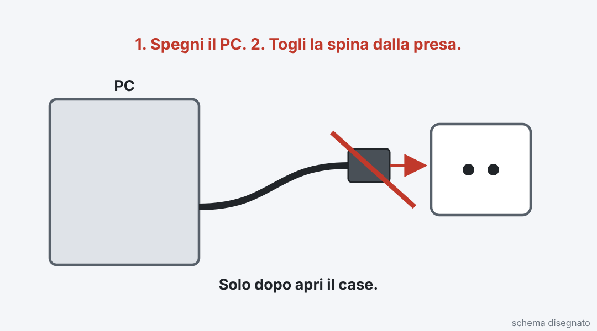

*FOTO-01-01 · schema: verrà sostituito dalla foto del docente*

### 01.02 Togli la spina

Togli la spina dalla presa della corrente. Solo dopo si apre il case.

> [BN] প্লাগ খুলে ফেলো। তারপরই কেস খোলো।

*FOTO-01-02 · schema: verrà sostituito dalla foto del docente*

### 01.03 Scarica l'elettricità statica

Tocca con la mano il metallo del case. Se c'è il braccialetto antistatico, mettilo e attacca la pinza al metallo.

> [BN] কেসের ধাতু হাত দিয়ে ছোঁও, অথবা অ্যান্টিস্ট্যাটিক ব্রেসলেট পরো।

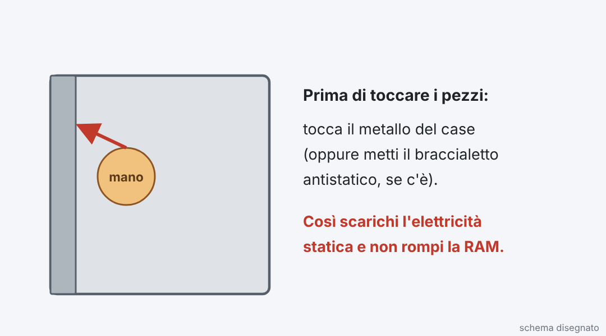

*FOTO-01-03 · schema: verrà sostituito dalla foto del docente*

### 01.04 Prepara il tavolo

Libera il tavolo vicino al PC: qui metterai la RAM quando la togli.

> [BN] PC-র পাশের টেবিল খালি করো: RAM খুলে এখানে রাখবে।

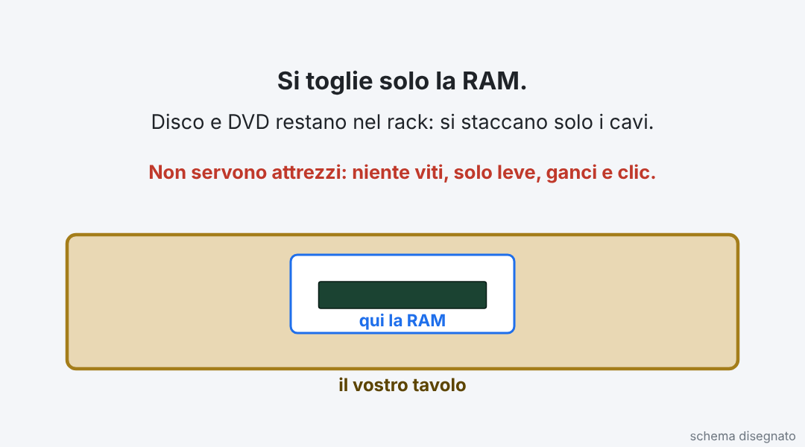

*FOTO-01-04 · schema: verrà sostituito dalla foto del docente*

## 02 Smontare il PC

Oggi si toglie solo la RAM. Del disco e del lettore DVD si staccano solo i cavi SATA: restano nel loro rack. Ordine: cavi del disco, cavi del DVD, RAM.

> [ROSSO] NON SI TOCCA: CPU e ventola (dissipatore). Disco e DVD non escono dal rack. Oggi non si staccano neanche il cavo 24 pin, il cavo CPU 4/8 pin (è vicino alla ventola) e la scheda video.

### 02.01 Apri la leva del pannello

Gira il PC. Dietro, tira la leva (o premi il gancio) del pannello laterale.

> [BN] PC ঘোরাও। পেছনে প্যানেলের লিভার টানো (বা হুক চাপো)।

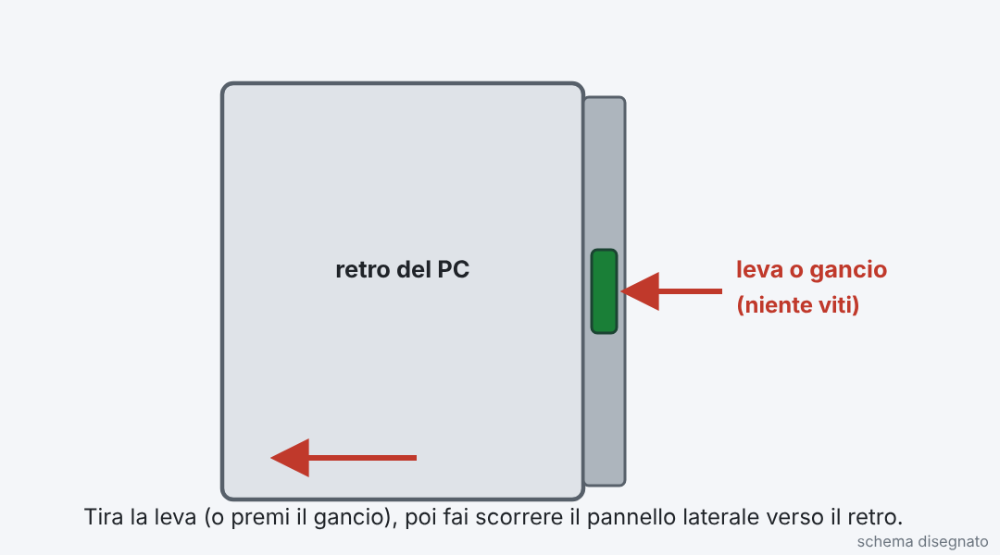

*FOTO-02-01 · schema: verrà sostituito dalla foto del docente*

### 02.02 Togli il pannello

Fai scorrere il pannello verso il retro e appoggialo sul tavolo.

> [BN] প্যানেল পেছনের দিকে সরিয়ে খুলে টেবিলে রাখো।

*FOTO-02-02 · schema: verrà sostituito dalla foto del docente*

### 02.03 Guarda l'ordine

Leggi lo schema: prima i cavi del disco e del DVD, poi la RAM.

> [BN] প্রথমে ডিস্ক আর DVD-র তার, তারপর RAM।

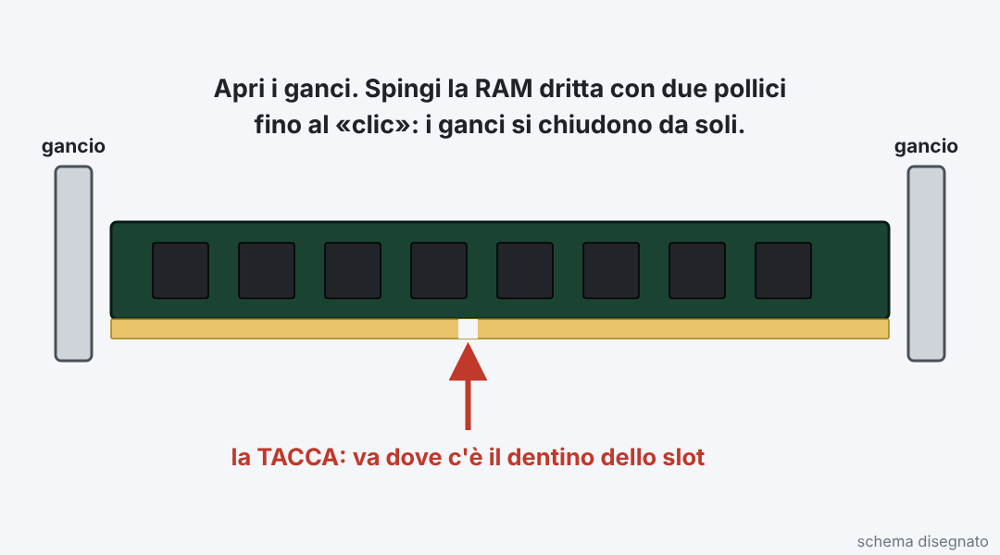

*FOTO-02-03 · schema: verrà sostituito dalla foto del docente*

### 02.04 Riconosci i componenti

Trova nel tuo PC le 8 parti dello schema, da A a H. Indica ogni parte con il dito, senza toccare CPU e ventola.

> [BN] ছবির A থেকে H পর্যন্ত ৮টি অংশ তোমার PC-তে খুঁজে আঙুল দিয়ে দেখাও। CPU আর ফ্যান ছোঁবে না।

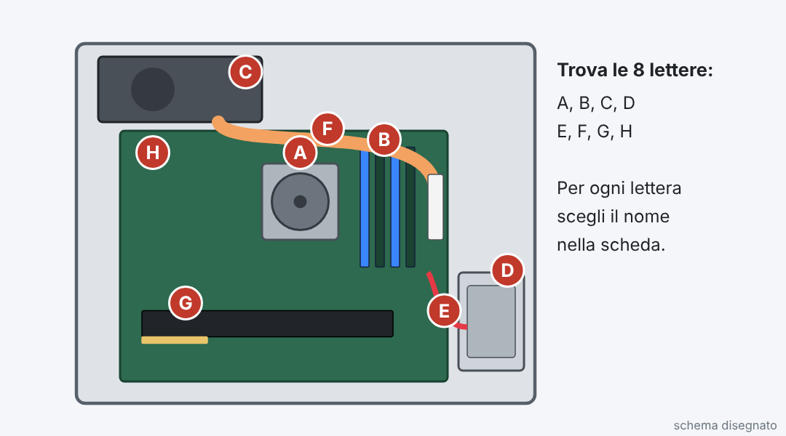

*FOTO-02-04 · schema: verrà sostituito dalla foto del docente*

### 02.05 Guarda il rack del disco e del DVD

Trova il rack di alluminio con il disco e il lettore DVD. Restano lì: si staccano solo i cavi.

> [BN] অ্যালুমিনিয়ামের র‍্যাকে ডিস্ক আর DVD খোঁজো। ওগুলো সেখানেই থাকে: শুধু তার খোলা হয়।

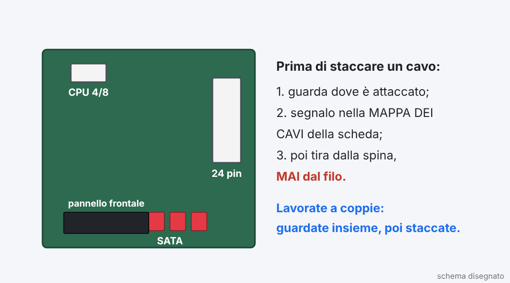

*FOTO-02-05 · schema: verrà sostituito dalla foto del docente*

### 02.06 Guarda dove sono i cavi

Prima di staccare un cavo, guardate insieme dove è attaccato.

> [BN] তার খোলার আগে দুজনে মিলে দেখো কোথায় লাগানো আছে।

*FOTO-02-06 · schema: verrà sostituito dalla foto del docente*

### 02.07 Stacca i cavi del disco

Stacca dal disco il cavo SATA dati (sottile) e il cavo SATA di alimentazione (largo). Tira dalla spina, mai dal filo.

> [BN] ডিস্ক থেকে সরু SATA ডেটা তার আর চওড়া SATA পাওয়ার তার খোলো। তার ধরে টানবে না।

*FOTO-02-07 · schema: verrà sostituito dalla foto del docente*

### 02.08 Stacca i cavi del DVD

Stacca dal lettore DVD il cavo SATA dati e il cavo SATA di alimentazione.

> [BN] DVD থেকে SATA ডেটা আর SATA পাওয়ার তার খোলো।

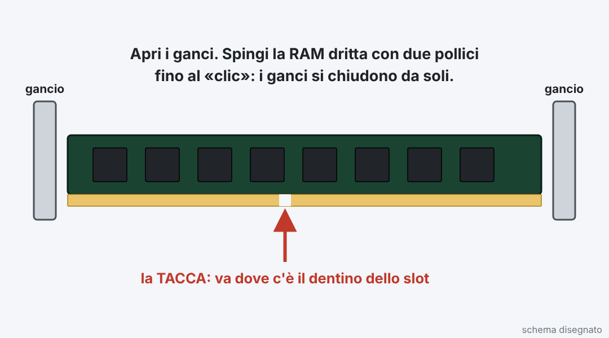

*FOTO-02-08 · schema: verrà sostituito dalla foto del docente*

### 02.09 Apri i ganci della RAM

Spingi in fuori i due ganci ai lati del banco di RAM. Il banco si alza da solo.

> [BN] RAM-এর দুই পাশের হুক বাইরে ঠেলো। RAM নিজেই উঠে আসবে।

*FOTO-02-09 · schema: verrà sostituito dalla foto del docente*

### 02.10 Togli la RAM

Prendi il banco dai bordi e sfilalo. Non toccare i contatti dorati e non toccare la ventola lì vicino.

> [BN] RAM কিনারা ধরে বের করো। সোনালি অংশ আর পাশের ফ্যান ছোঁবে না।

*FOTO-02-10 · schema: verrà sostituito dalla foto del docente*

### 02.11 Metti la RAM sul tavolo

Appoggia la RAM sul tavolo, dalla parte dei bordi. Leggi l'etichetta: per esempio 8GB DDR4.

> [BN] RAM টেবিলে রাখো। লেবেল পড়ো: যেমন 8GB DDR4।

*FOTO-02-11 · schema: verrà sostituito dalla foto del docente*

## 03 Rimontare il PC

Si rimonta al contrario: RAM, cavi del DVD, cavi del disco. Ogni pezzo si spinge finché fa clic.

> [ROSSO] Un controllo è NO? Non accendere: sistema prima.

### 03.01 Guarda l'ordine inverso

Leggi lo schema: si rimonta nell'ordine contrario a quello dello smontaggio.

> [BN] খোলার উল্টো ক্রমে জোড়া দাও।

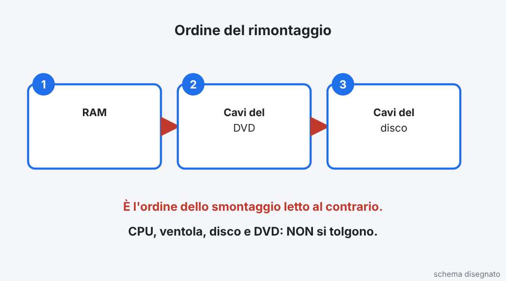

*FOTO-03-01 · schema: verrà sostituito dalla foto del docente*

### 03.02 Rimetti la RAM

Fai combaciare la tacca della RAM con il dentino dello slot. Spingi dritto con due pollici finché fa clic.

> [BN] RAM-এর খাঁজ আর স্লটের দাঁত মেলাও। দুই বুড়ো আঙুলে সোজা চাপো, «ক্লিক» পর্যন্ত।

*FOTO-03-02 · schema: verrà sostituito dalla foto del docente*

### 03.03 Attacca i cavi del DVD

Attacca al lettore DVD il cavo SATA dati e il cavo SATA di alimentazione. Ogni spina entra in un solo verso: non forzare.

> [BN] DVD-তে SATA ডেটা আর পাওয়ার তার লাগাও। জোর করবে না।

*FOTO-03-03 · schema: verrà sostituito dalla foto del docente*

### 03.04 Attacca i cavi del disco

Attacca al disco il cavo SATA dati e il cavo SATA di alimentazione, finché sono ben dentro.

> [BN] ডিস্কে SATA ডেটা আর পাওয়ার তার ভালো করে লাগাও।

*FOTO-03-04 · schema: verrà sostituito dalla foto del docente*

### 03.05 Fai i 5 controlli

Controllate insieme: RAM con i ganci chiusi, disco con 2 cavi, DVD con 2 cavi, 24 pin al suo posto, niente lasciato dentro il case.

> [BN] চালু করার আগে ৫টি জিনিস দেখো। কোনোটা না হলে আগে ঠিক করো।

*FOTO-03-05 · schema: verrà sostituito dalla foto del docente*

### 03.06 Chiudi il case

Rimetti il pannello laterale e fallo scorrere finché fa clic.

> [BN] প্যানেল লাগিয়ে «ক্লিক» পর্যন্ত সরাও।

*FOTO-03-06 · schema: verrà sostituito dalla foto del docente*

### 03.07 Collega i cavi esterni

Collega monitor, tastiera, mouse e cavo di rete. La spina della corrente va per ultima.

> [BN] মনিটর, কীবোর্ড, মাউস আর নেটওয়ার্ক লাগাও। বিদ্যুৎ সবার শেষে।

*FOTO-03-07 · schema: verrà sostituito dalla foto del docente*

## 04 Accensione e BIOS

Il BIOS (Basic Input Output System: il programma che parte per primo, nei PC nuovi si chiama UEFI) dice al PC da dove partire. Oggi si parte dalla chiavetta USB.

### 04.01 Metti la chiavetta

Metti la chiavetta di Windows 10 in una porta USB dietro il PC.

> [BN] Windows 10-এর USB পেছনের একটা USB পোর্টে লাগাও।

*FOTO-04-01 · schema: verrà sostituito dalla foto del docente*

### 04.02 Entra nel BIOS

Premi il tasto di accensione. Subito, più volte, premi Canc (o F2). Lo schermo all'avvio dice il tasto giusto.

> [BN] চালু করে সঙ্গে সঙ্গে বারবার Canc (বা F2) চাপো।

*FOTO-04-02 · schema: verrà sostituito dalla foto del docente*

### 04.03 Leggi CPU, RAM e disco

Nella prima schermata leggi il nome della CPU, quanta RAM c'è e il nome del disco.

> [BN] প্রথম পাতায় CPU-র নাম, RAM কত আর ডিস্কের নাম পড়ো।

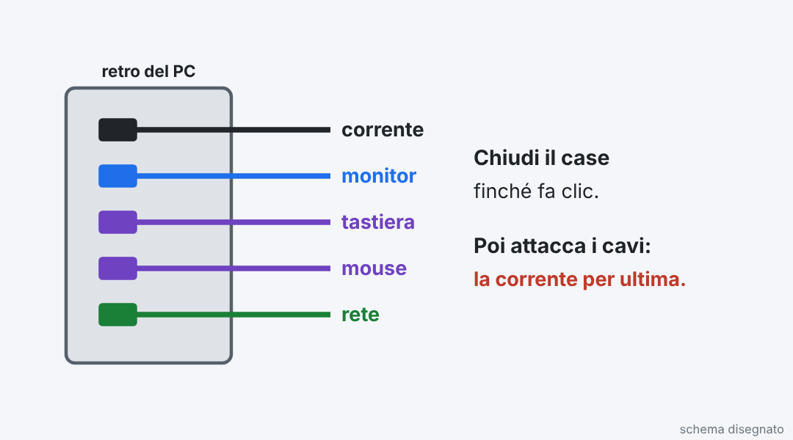

*FOTO-04-03 · schema: verrà sostituito dalla foto del docente*

### 04.04 Vai nella scheda Boot

Con le frecce vai nella scheda Boot (Avvio).

> [BN] তীর চিহ্ন দিয়ে Boot ট্যাবে যাও।

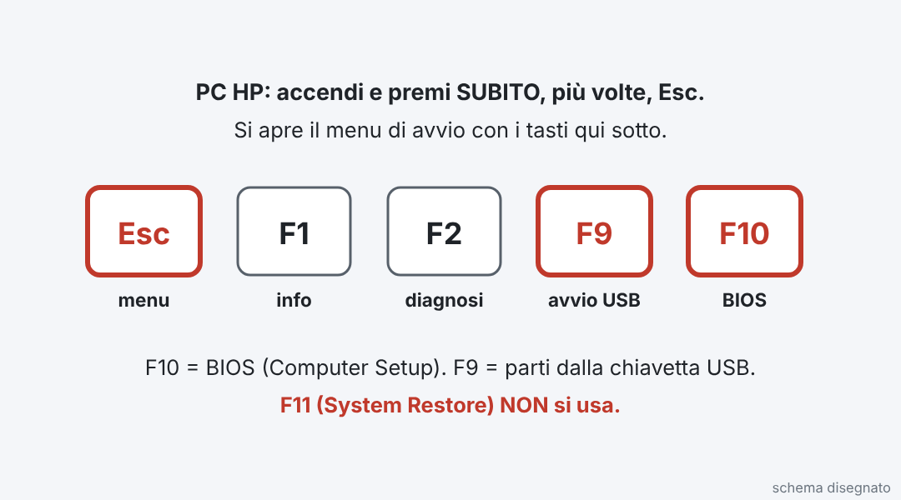

*FOTO-04-04 · schema: verrà sostituito dalla foto del docente*

### 04.05 Metti USB per prima

Porta USB al primo posto nell'ordine di avvio (Boot Option #1).

> [BN] Boot Option #1-এ USB রাখো।

*FOTO-04-05 · schema: verrà sostituito dalla foto del docente*

### 04.06 Salva ed esci

Premi F10 e conferma con Sì (Yes). Il PC riparte dalla chiavetta.

> [BN] F10 চেপে Yes দাও। PC USB থেকে চালু হবে।

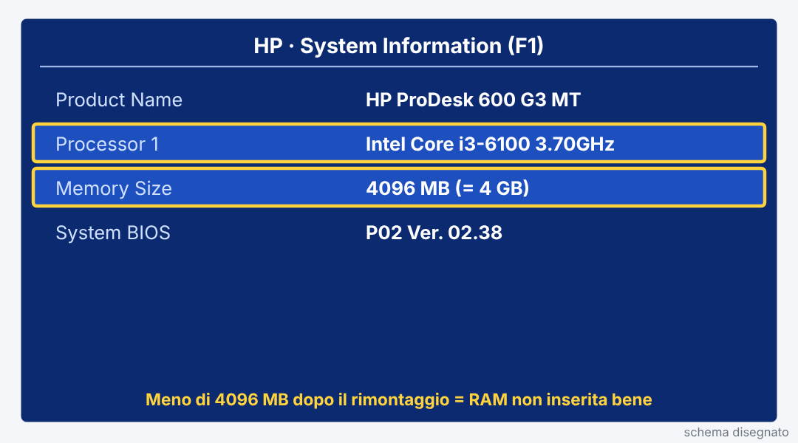

*FOTO-04-06 · schema: verrà sostituito dalla foto del docente*

### 04.07 Piano B: il menu F12

Non trovi l'ordine di avvio? Spegni, accendi e premi F12 (o Esc). Scegli la riga con USB e premi Invio.

> [BN] না পেলে: চালু করে F12 চাপো, USB বেছে Enter চাপো।

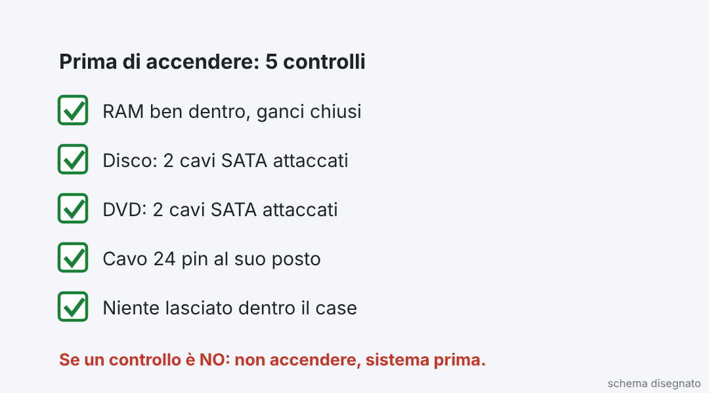

*FOTO-04-07 · schema: verrà sostituito dalla foto del docente*

## 05 Installare Windows 10 da chiavetta

Il PC del banco si può cancellare tutto: è fatto per imparare. Si crea un account locale: nome e password stanno solo su questo PC.

> [GIALLO] Windows 10 Pro a volte chiede «Configura per uso personale», poi «Account offline» e «Esperienza limitata»: sono la stessa strada senza Internet.

> [ROSSO] Si installano solo i PC del banco, mai le postazioni della classe.

### 05.01 Parti dalla chiavetta

Se compare «Premi un tasto per avviare da CD o DVD», premi un tasto qualsiasi.

> [BN] «Premi un tasto…» দেখালে যেকোনো কী চাপো।

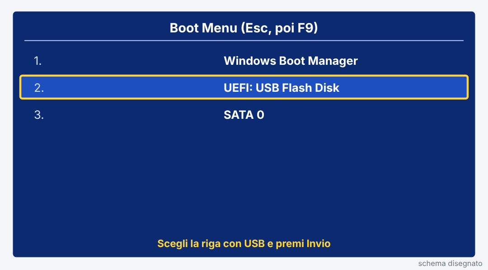

*FOTO-05-01 · schema: verrà sostituito dalla foto del docente*

### 05.02 Lascia la lingua italiana

Lascia Italiano nelle tre caselle e premi Avanti.

> [BN] তিনটি ঘরে Italiano রেখে Avanti চাপো।

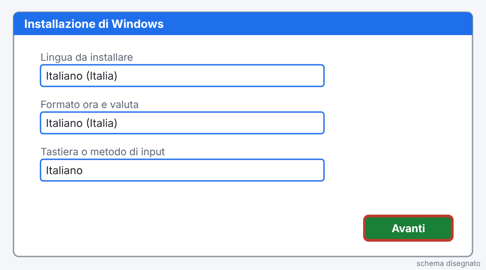

*FOTO-05-02 · schema: verrà sostituito dalla foto del docente*

### 05.03 Premi Installa

Premi il bottone grande Installa.

> [BN] বড় Installa বাটন চাপো।

*FOTO-05-03 · schema: verrà sostituito dalla foto del docente*

### 05.04 Non ho un codice Product Key

In basso clicca la scritta Non ho un codice Product Key.

> [BN] নিচে «Non ho un codice Product Key» চাপো।

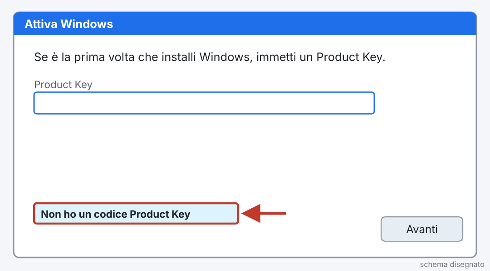

*FOTO-05-04 · schema: verrà sostituito dalla foto del docente*

### 05.05 Scegli l'edizione

Scegli Windows 10 Pro (o quella che dice il Professore) e premi Avanti.

> [BN] Windows 10 Pro বেছে Avanti চাপো।

*FOTO-05-05 · schema: verrà sostituito dalla foto del docente*

### 05.06 Accetta la licenza

Spunta Accetto le condizioni di licenza e premi Avanti.

> [BN] লাইসেন্সে টিক দিয়ে Avanti চাপো।

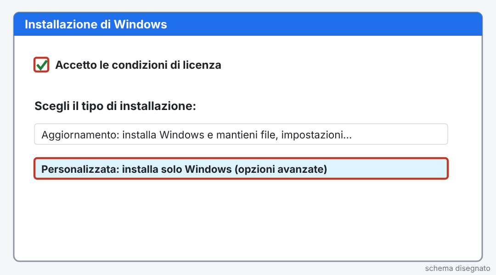

*FOTO-05-06 · schema: verrà sostituito dalla foto del docente*

### 05.07 Scegli Personalizzata

Clicca Personalizzata: installa solo Windows.

> [BN] «Personalizzata» বেছে নাও।

*FOTO-05-07 · schema: verrà sostituito dalla foto del docente*

### 05.08 Elimina le partizioni

Seleziona una partizione e premi Elimina. Rifallo finché resta solo «Spazio non allocato».

> [BN] প্রতিটি পার্টিশন বেছে Elimina চাপো, শুধু «Spazio non allocato» থাকবে।

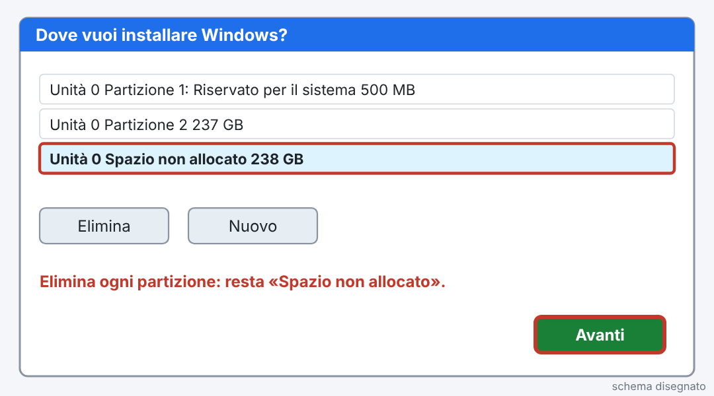

*FOTO-05-08 · schema: verrà sostituito dalla foto del docente*

### 05.09 Scegli lo spazio non allocato

Seleziona Unità 0 Spazio non allocato e premi Avanti.

> [BN] «Unità 0 Spazio non allocato» বেছে Avanti চাপো।

*FOTO-05-09 · schema: verrà sostituito dalla foto del docente*

### 05.10 Aspetta la copia

Windows copia i file e riavvia da solo (15-25 minuti). Non toccare niente.

> [BN] Windows নিজে ফাইল কপি করে রিস্টার্ট হয় (১৫-২৫ মিনিট)। কিছু ছোঁবে না।

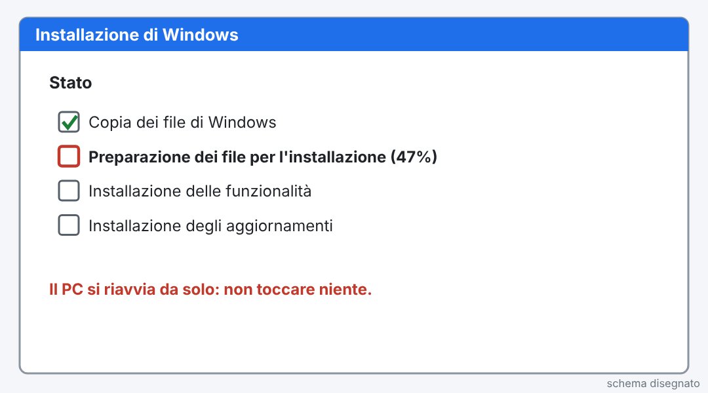

*FOTO-05-10 · schema: verrà sostituito dalla foto del docente*

### 05.11 Scegli Italia

Al primo avvio scegli Italia e premi Sì.

> [BN] Italia বেছে Sì চাপো।

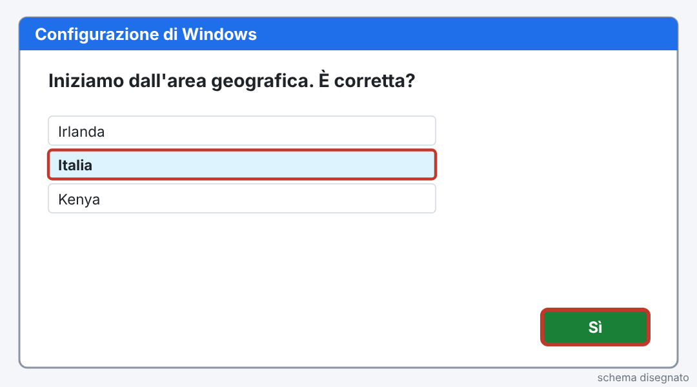

*FOTO-05-11 · schema: verrà sostituito dalla foto del docente*

### 05.12 Scegli la tastiera

Scegli la tastiera Italiano e premi Sì. Alla seconda tastiera premi Ignora.

> [BN] কীবোর্ড Italiano, Sì। দ্বিতীয় কীবোর্ডে Ignora।

*FOTO-05-12 · schema: verrà sostituito dalla foto del docente*

### 05.13 Non ho Internet

In basso a sinistra clicca Non ho Internet.

> [BN] নিচে বাঁয়ে «Non ho Internet» চাপো।

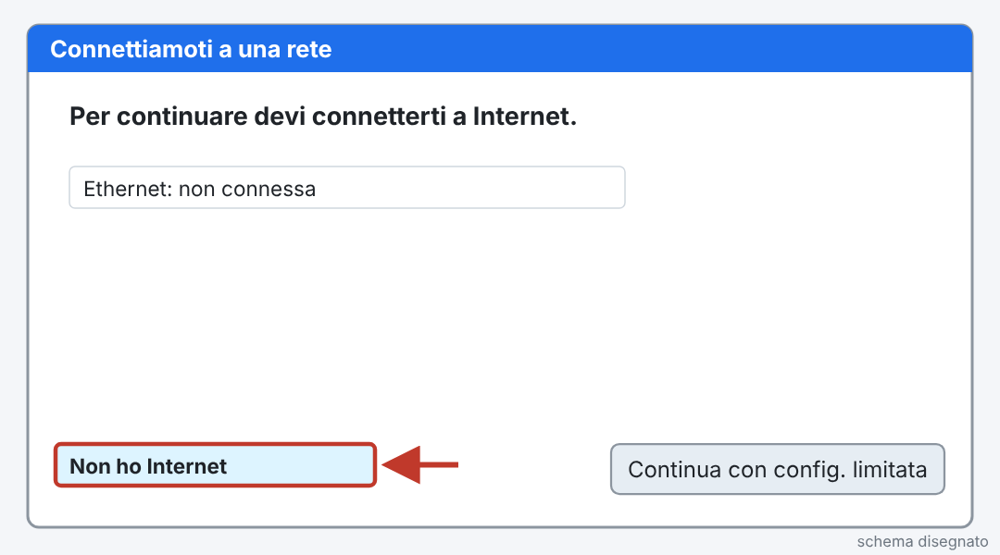

*FOTO-05-13 · schema: verrà sostituito dalla foto del docente*

### 05.14 Configurazione limitata

Clicca Continua con configurazione limitata.

> [BN] «Continua con configurazione limitata» চাপো।

*FOTO-05-14 · schema: verrà sostituito dalla foto del docente*

### 05.15 Scrivi il nome del primo utente

Scrivi tecnico e premi Avanti. Questo primo utente è amministratore.

> [BN] নাম tecnico লিখে Avanti চাপো। এটা অ্যাডমিন।

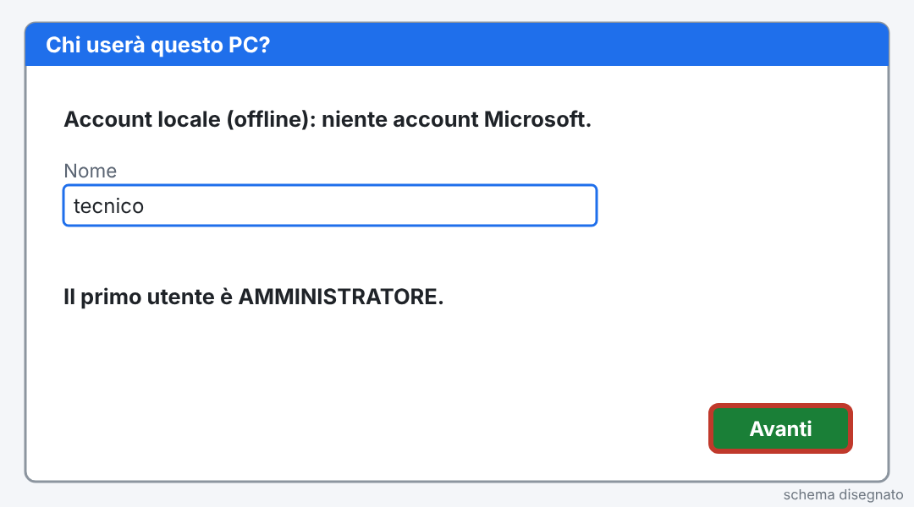

*FOTO-05-15 · schema: verrà sostituito dalla foto del docente*

### 05.16 Scrivi la password

Scrivi la password che dice il Professore, due volte. Poi scegli 3 domande di sicurezza.

> [BN] প্রফেসরের বলা পাসওয়ার্ড দুবার লেখো। তারপর ৩টি নিরাপত্তা প্রশ্ন।

*FOTO-05-16 · schema: verrà sostituito dalla foto del docente*

### 05.17 Privacy: tutto No

Metti No a tutte le voci e premi Accetta. Poi aspetta il desktop.

> [BN] সব No করে Accetta চাপো। ডেস্কটপের জন্য অপেক্ষা করো।

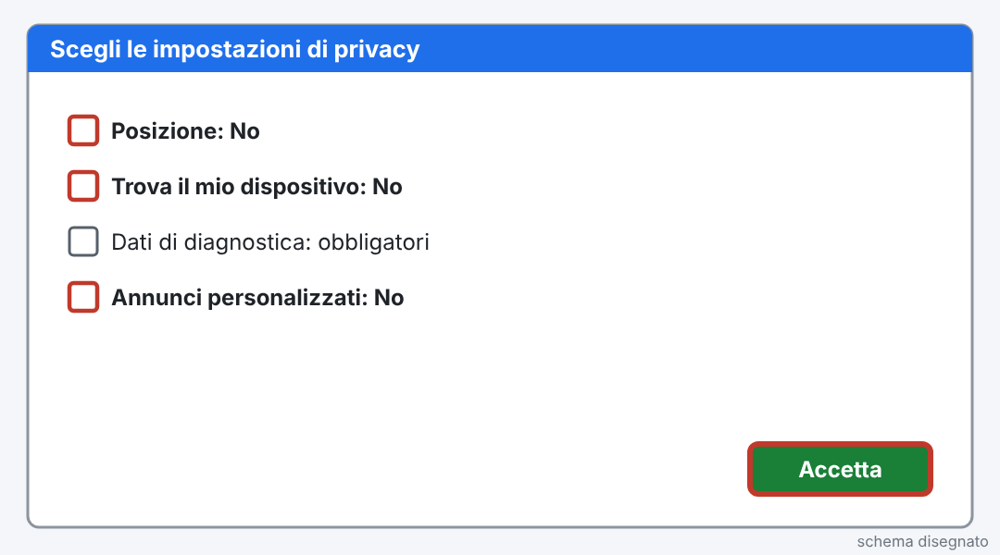

*FOTO-05-17 · schema: verrà sostituito dalla foto del docente*

## 06 Creare gli utenti admin e user1

Due utenti nuovi: admin (amministratore: può cambiare tutto) e user1 (utente standard: usa il PC ma non cambia le cose importanti). Si lavora di solito con l'utente standard: è più sicuro.

> [GIALLO] Nell'edizione Pro la voce a sinistra si può chiamare «Altri utenti»: è lo stesso posto.

### 06.01 Apri Impostazioni

Clicca Start, poi l'ingranaggio Impostazioni.

> [BN] Start, তারপর গিয়ার Impostazioni চাপো।

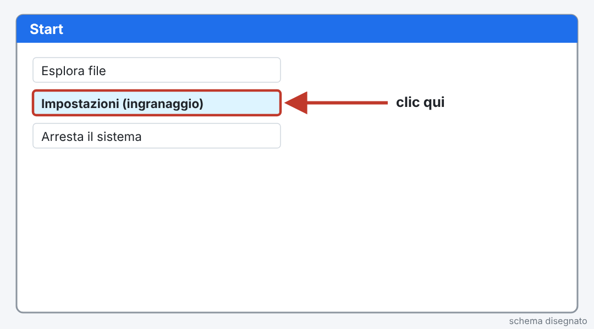

*FOTO-06-01 · schema: verrà sostituito dalla foto del docente*

### 06.02 Apri Account

Clicca Account.

> [BN] Account চাপো।

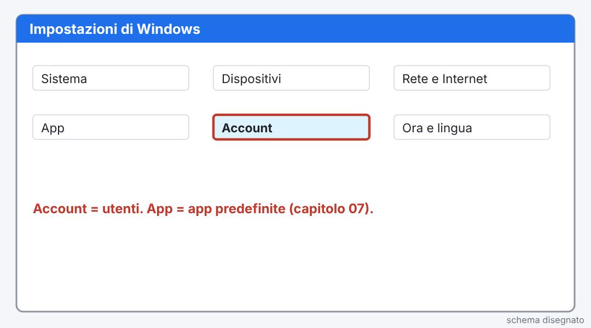

*FOTO-06-02 · schema: verrà sostituito dalla foto del docente*

### 06.03 Apri Famiglia e altri utenti

A sinistra clicca Famiglia e altri utenti.

> [BN] বাঁয়ে «Famiglia e altri utenti» চাপো।

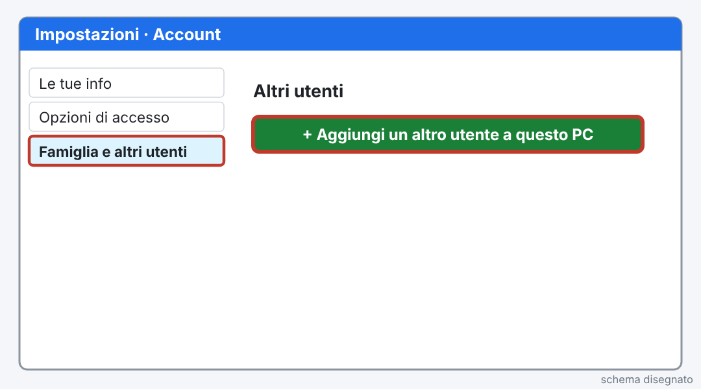

*FOTO-06-03 · schema: verrà sostituito dalla foto del docente*

### 06.04 Aggiungi un altro utente

Clicca Aggiungi un altro utente a questo PC.

> [BN] «Aggiungi un altro utente a questo PC» চাপো।

*FOTO-06-04 · schema: verrà sostituito dalla foto del docente*

### 06.05 Non ho le informazioni di accesso

Clicca Non ho le informazioni di accesso di questa persona.

> [BN] «Non ho le informazioni di accesso di questa persona» চাপো।

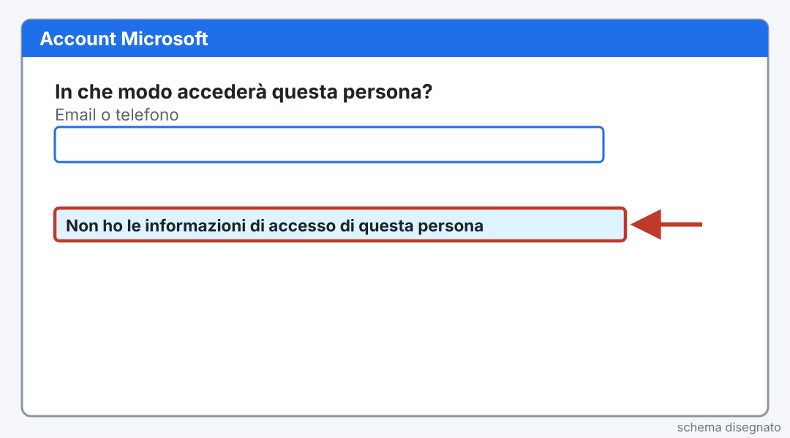

*FOTO-06-05 · schema: verrà sostituito dalla foto del docente*

### 06.06 Utente senza account Microsoft

Clicca Aggiungi un utente senza account Microsoft.

> [BN] «Aggiungi un utente senza account Microsoft» চাপো।

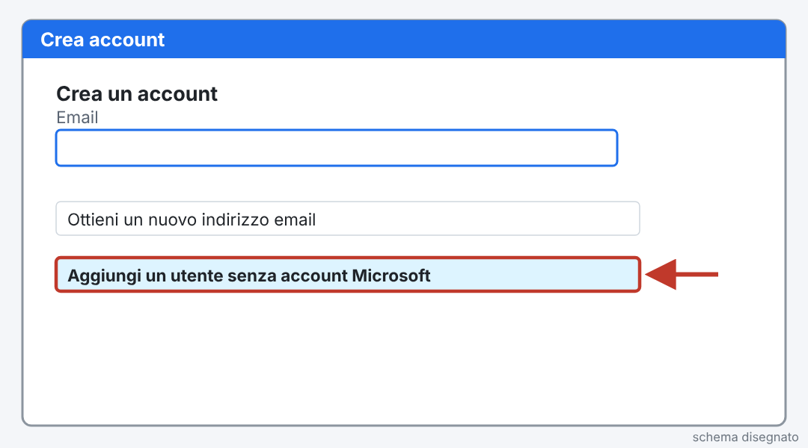

*FOTO-06-06 · schema: verrà sostituito dalla foto del docente*

### 06.07 Crea admin

Scrivi admin come nome. Scrivi la password del Professore due volte, poi le 3 domande. Premi Avanti.

> [BN] নাম admin, পাসওয়ার্ড দুবার, ৩টি প্রশ্ন, তারপর Avanti।

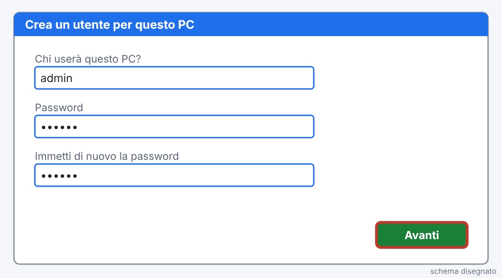

*FOTO-06-07 · schema: verrà sostituito dalla foto del docente*

### 06.08 Crea user1

Rifai i passi 4, 5 e 6. Scrivi user1 come nome, la password e le domande. Premi Avanti.

> [BN] ধাপ ৪, ৫, ৬ আবার করো। নাম user1, পাসওয়ার্ড, প্রশ্ন, Avanti।

*FOTO-06-08 · schema: verrà sostituito dalla foto del docente*

### 06.09 Cambia il tipo di admin

Clicca admin, poi Cambia tipo di account.

> [BN] admin-এ ক্লিক করো, তারপর «Cambia tipo di account»।

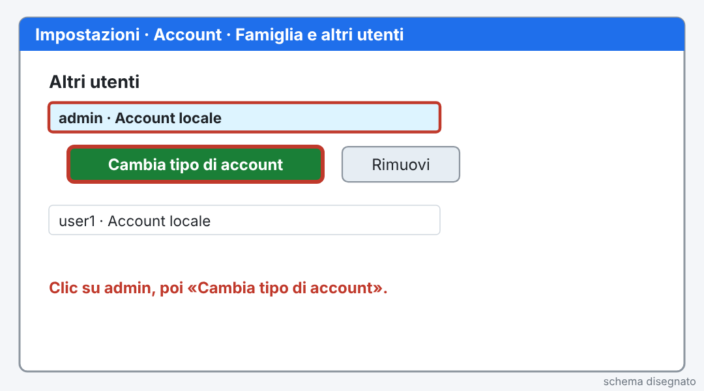

*FOTO-06-09 · schema: verrà sostituito dalla foto del docente*

### 06.10 Scegli Amministratore

Nella casella Tipo di account scegli Amministratore e premi OK.

> [BN] Tipo di account-এ Amministratore বেছে OK চাপো।

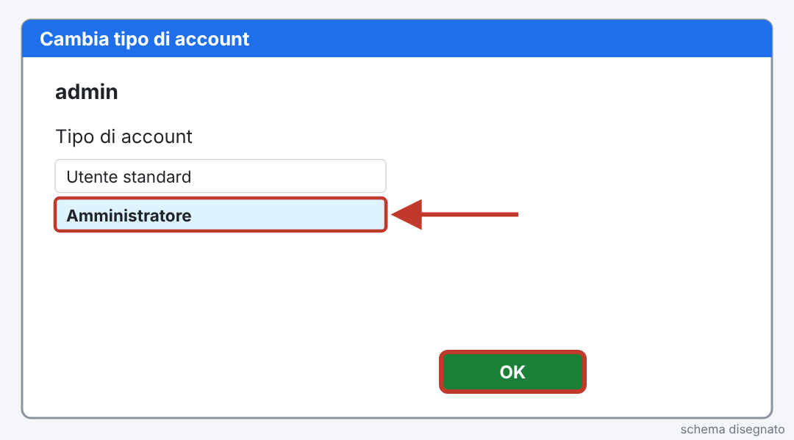

*FOTO-06-10 · schema: verrà sostituito dalla foto del docente*

### 06.11 Controlla i due utenti

Guarda l'elenco: sotto admin c'è scritto Amministratore. user1 resta Utente standard.

> [BN] admin = Amministratore, user1 = Utente standard। মিলিয়ে দেখো।

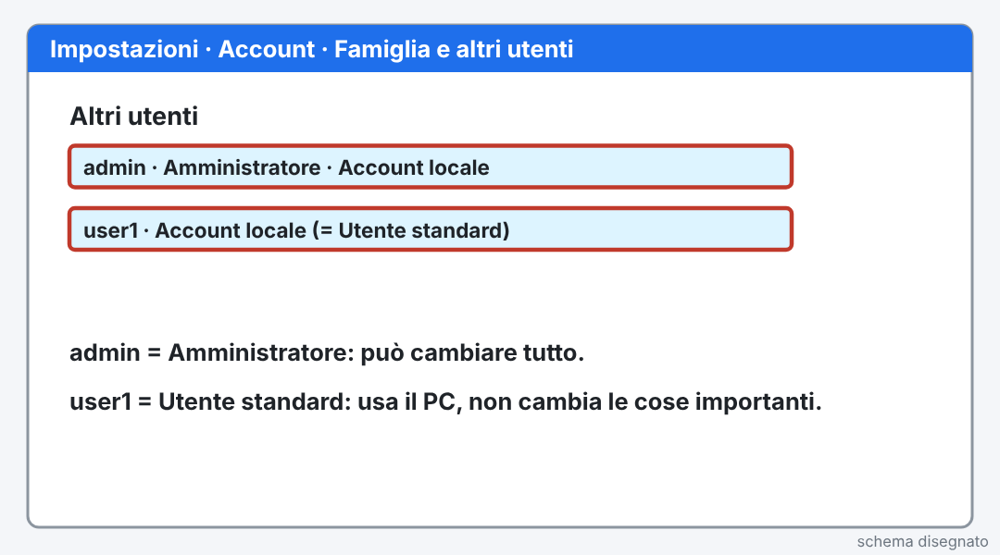

*FOTO-06-11 · schema: verrà sostituito dalla foto del docente*

## 07 Impostazioni di base

Un tecnico sceglie il browser e vede sempre il tipo di ogni file: .txt è testo, .jpg è una foto, .exe è un programma. Un file «foto.jpg.exe» è un programma travestito: attenzione!

### 07.01 Chrome c'è?

Clicca Start e scrivi Chrome. Se non compare, il Professore lo installa quando c'è Internet.

> [BN] Start-এ Chrome লেখো। না থাকলে ইন্টারনেট এলে প্রফেসর ইনস্টল করবেন।

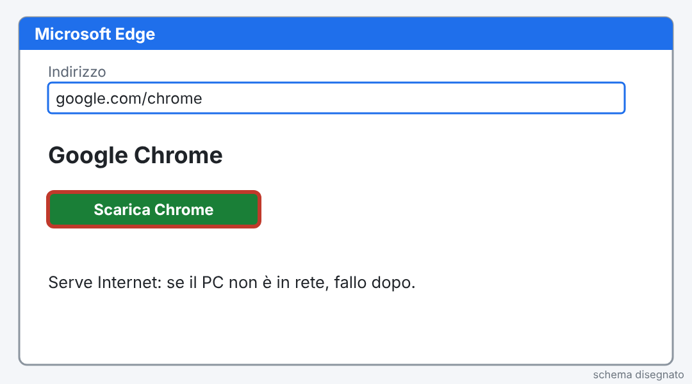

*FOTO-07-01 · schema: verrà sostituito dalla foto del docente*

### 07.02 Apri le app predefinite

Start, Impostazioni, App, poi a sinistra App predefinite.

> [BN] Impostazioni > App > App predefinite।

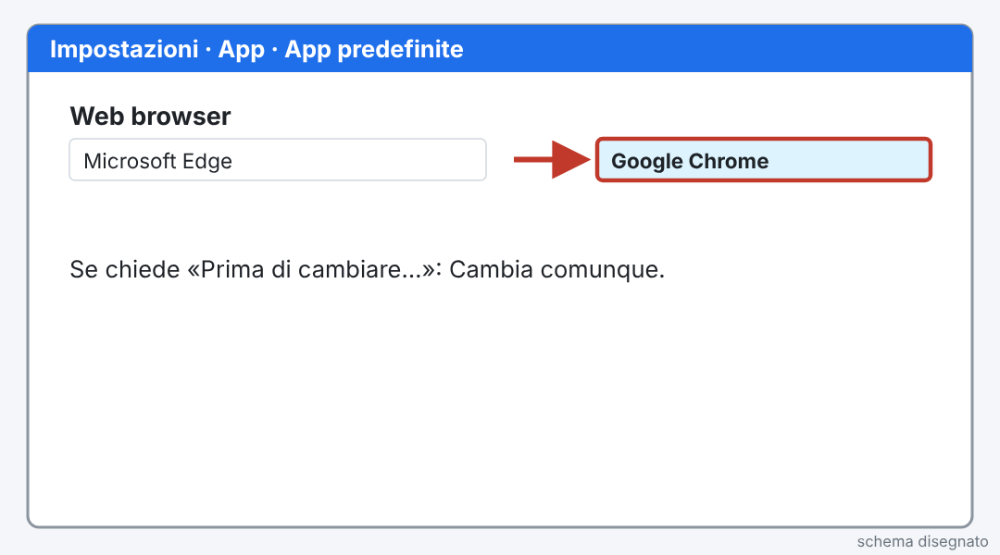

*FOTO-07-02 · schema: verrà sostituito dalla foto del docente*

### 07.03 Scegli Chrome

Sotto Web browser clicca il browser che c'è e scegli Google Chrome. Se chiede conferma: Cambia comunque.

> [BN] Web browser-এ ক্লিক করে Google Chrome বেছে নাও।

*FOTO-07-03 · schema: verrà sostituito dalla foto del docente*

### 07.04 Apri Esplora file

Premi insieme i tasti Windows ed E. In alto clicca la scheda Visualizza.

> [BN] Windows + E চাপো। উপরে Visualizza ট্যাব চাপো।

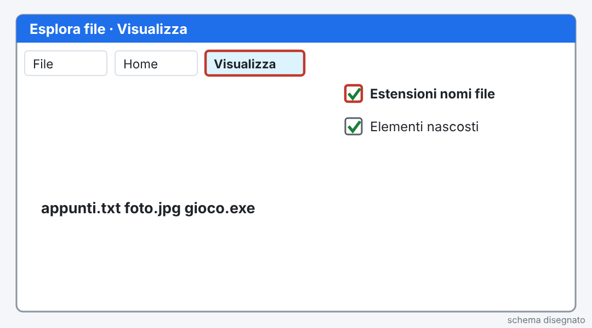

*FOTO-07-04 · schema: verrà sostituito dalla foto del docente*

### 07.05 Mostra le estensioni

Spunta la casella Estensioni nomi file.

> [BN] «Estensioni nomi file»-এ টিক দাও।

*FOTO-07-05 · schema: verrà sostituito dalla foto del docente*

### 07.06 Prova con un file

In Documenti fai tasto destro, Nuovo, Documento di testo. Il nome finisce con .txt? Fatto!

> [BN] Documenti-এ নতুন টেক্সট ফাইল বানাও। শেষে .txt দেখা যায়? হয়ে গেছে!

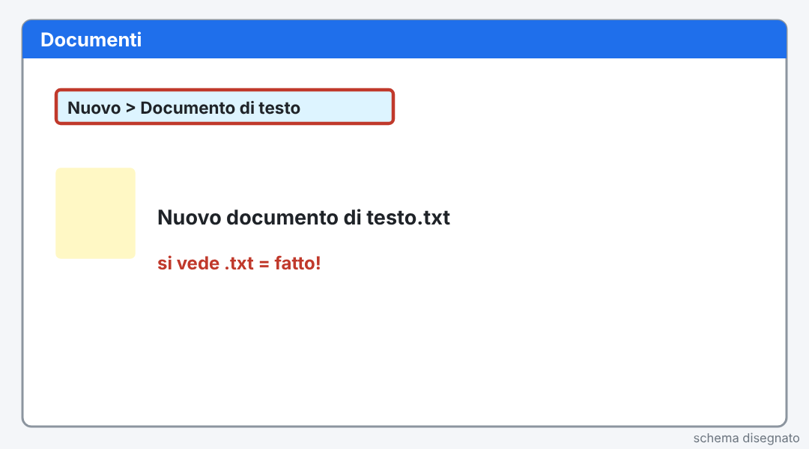

*FOTO-07-06 · schema: verrà sostituito dalla foto del docente*

## 08 IP fisso e prova con il PC accanto

Ogni PC in rete ha un indirizzo IP (Internet Protocol: il «numero civico» del PC). Nella stessa rete le prime 3 parti sono uguali, l'ultima è diversa. Il vostro IP dipende dal numero del banco: guardate la tabella.

| Banco | Indirizzo IP | Subnet mask | Gateway | DNS |
|---|---|---|---|---|
| 1 | `192.168.10.11` | `255.255.255.0` | `192.168.10.1` | `192.168.10.1` |
| 2 | `192.168.10.12` | `255.255.255.0` | `192.168.10.1` | `192.168.10.1` |
| 3 | `192.168.10.13` | `255.255.255.0` | `192.168.10.1` | `192.168.10.1` |
| 4 | `192.168.10.14` | `255.255.255.0` | `192.168.10.1` | `192.168.10.1` |
| 5 | `192.168.10.15` | `255.255.255.0` | `192.168.10.1` | `192.168.10.1` |
| 6 | `192.168.10.16` | `255.255.255.0` | `192.168.10.1` | `192.168.10.1` |
| 7 | `192.168.10.17` | `255.255.255.0` | `192.168.10.1` | `192.168.10.1` |
| 8 | `192.168.10.18` | `255.255.255.0` | `192.168.10.1` | `192.168.10.1` |
| 9 | `192.168.10.19` | `255.255.255.0` | `192.168.10.1` | `192.168.10.1` |

> [GIALLO] «Richiesta scaduta»? Controlla l'IP, il cavo e il firewall, poi riprova.

### 08.01 Trova il tuo IP

Cerca il numero del tuo banco nella tabella qui sopra. Leggi il tuo IP e quello del PC accanto.

> [BN] ওপরের টেবিলে তোমার বেঞ্চ নম্বর খোঁজো। তোমার আর পাশের PC-র IP পড়ো।

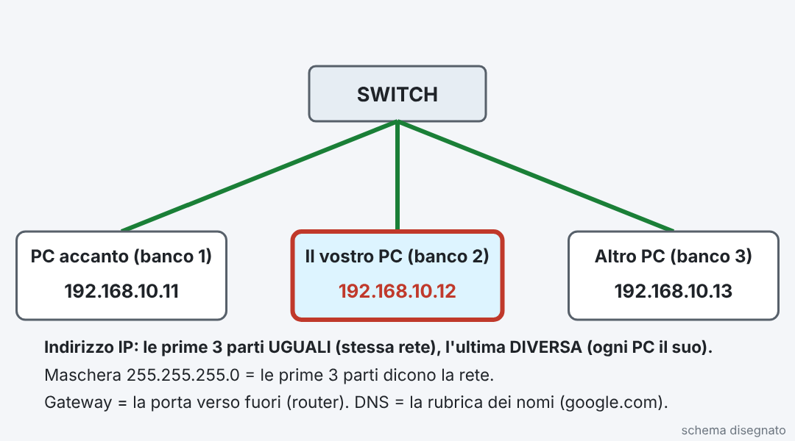

*FOTO-08-01 · schema: verrà sostituito dalla foto del docente*

### 08.02 Apri le connessioni di rete

Premi insieme Windows e R. Scrivi ncpa.cpl e premi Invio.

> [BN] Windows + R চাপো, ncpa.cpl লিখে Enter।

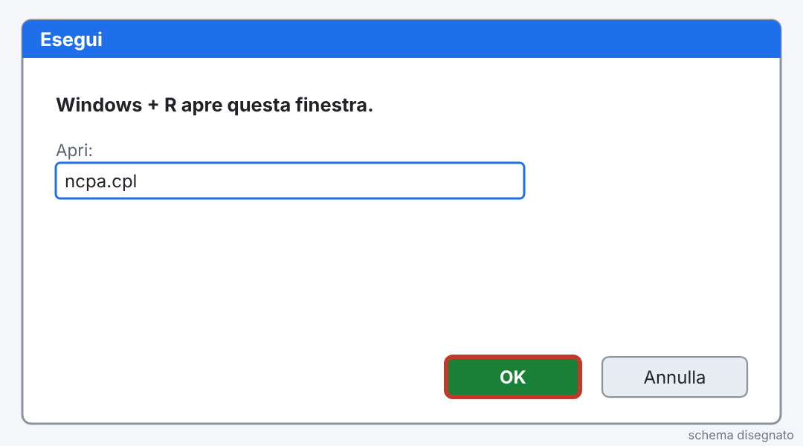

*FOTO-08-02 · schema: verrà sostituito dalla foto del docente*

### 08.03 Apri Ethernet

Tasto destro su Ethernet, poi Proprietà.

> [BN] Ethernet-এ ডান ক্লিক, তারপর Proprietà।

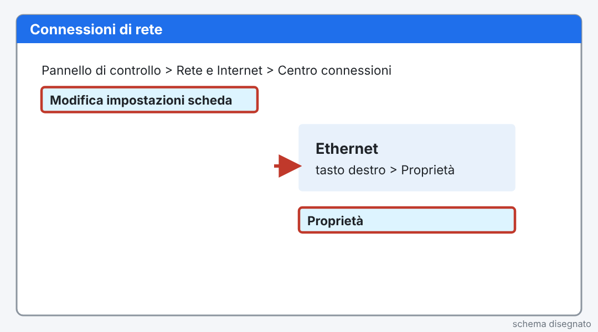

*FOTO-08-03 · schema: verrà sostituito dalla foto del docente*

### 08.04 Apri IPv4

Doppio clic su Protocollo Internet versione 4 (TCP/IPv4).

> [BN] «Protocollo Internet versione 4 (TCP/IPv4)»-এ ডাবল ক্লিক।

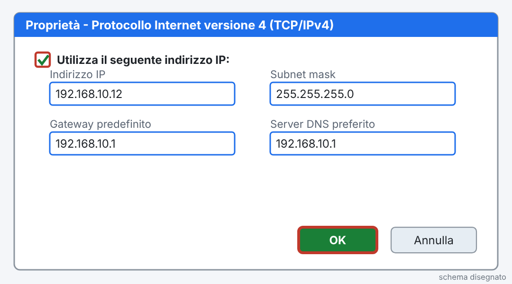

*FOTO-08-04 · schema: verrà sostituito dalla foto del docente*

### 08.05 Scrivi i 4 valori

Scegli Utilizza il seguente indirizzo IP. Scrivi indirizzo IP, subnet mask, gateway e DNS della tabella. Premi OK, poi OK.

> [BN] «Utilizza il seguente indirizzo IP» বেছে টেবিলের ৪টি মান লেখো। OK, OK।

*FOTO-08-05 · schema: verrà sostituito dalla foto del docente*

### 08.06 Lascia passare il ping

Start, scrivi Windows Defender Firewall con sicurezza avanzata. Regole connessioni in entrata: tasto destro su ogni riga «Richiesta echo - ICMPv4 in entrata», Abilita regola.

> [BN] Firewall > Regole in entrata > «Richiesta echo - ICMPv4» > Abilita regola।

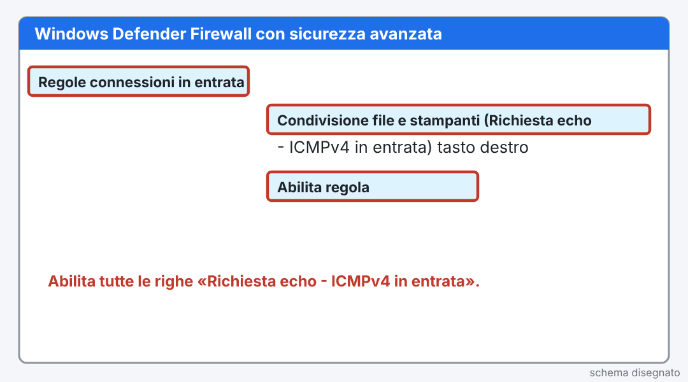

*FOTO-08-06 · schema: verrà sostituito dalla foto del docente*

### 08.07 Collega il cavo allo switch

Quando il Professore lo dice, collega il cavo di rete del PC allo switch.

> [BN] প্রফেসর বললে নেটওয়ার্ক তার সুইচে লাগাও।

*FOTO-08-07 · schema: verrà sostituito dalla foto del docente*

### 08.08 Controlla il tuo IP

Start, scrivi cmd, Invio. Scrivi ipconfig e premi Invio. Leggi Indirizzo IPv4: è il tuo?

> [BN] cmd খোলো, ipconfig লিখে Enter। Indirizzo IPv4 তোমারটা কি না দেখো।

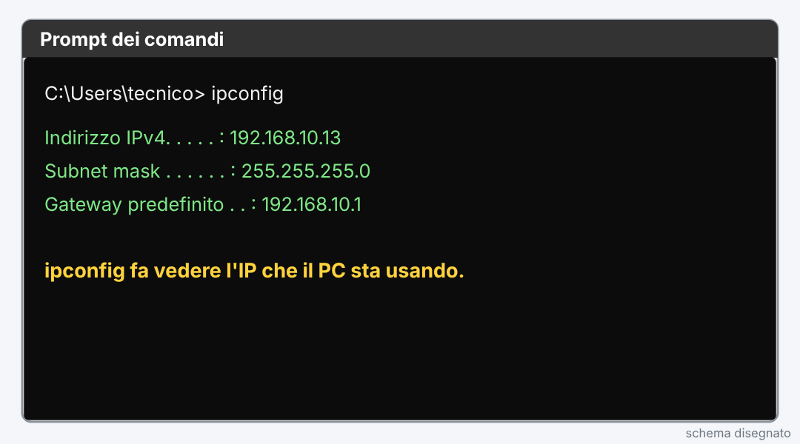

*FOTO-08-08 · schema: verrà sostituito dalla foto del docente*

### 08.09 Mostralo: ping al PC accanto

Scrivi ping, uno spazio e l'IP del PC accanto. Premi Invio. «Risposta da…» vuol dire che la rete funziona!

> [BN] ping আর পাশের PC-র IP লিখে Enter। «Risposta da…» = কাজ করছে!

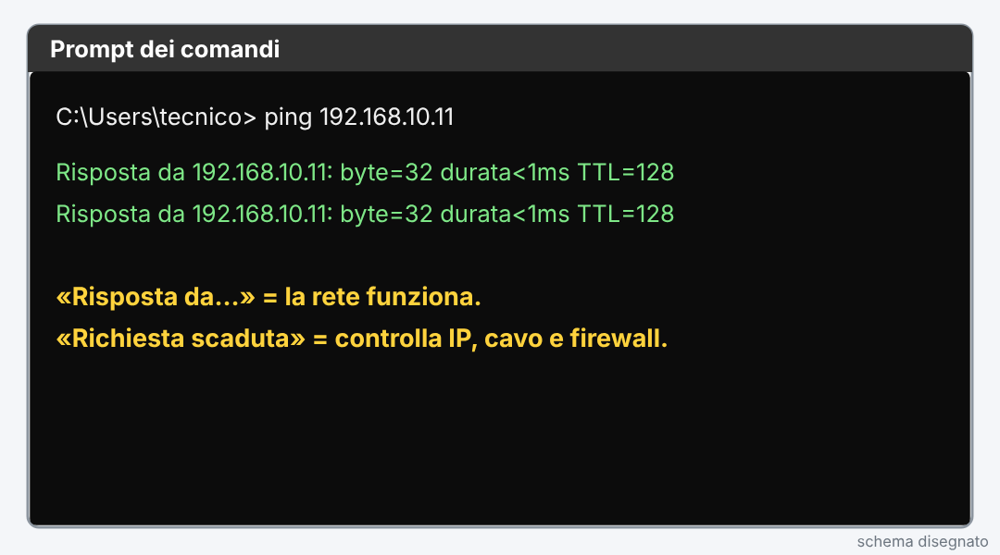

*FOTO-08-09 · schema: verrà sostituito dalla foto del docente*

## 09 Registro delle versioni

1. v1.0 (05/11/2026): prima versione: capitoli 01-08 per i ragazzi, 09 «Creazione guasti» solo docente; schemi al posto delle foto
2. v1.1 (05/11/2026): tolti i ruoli MANI e OCCHI (decisione del docente del 05/11/2026): si lavora a coppie, un PC per coppia; v1.0 dello stesso giorno: solo RAM e disco, CPU e ventola non si toccano
3. v1.2 (05/11/2026): PC senza viti (si apre con leva o gancio, si chiude finché fa clic); si toglie solo la RAM: disco e lettore DVD restano nel rack, si staccano e si riattaccano solo i loro cavi SATA (decisioni del docente del 05/11/2026)
