# Java con Eclipse: la finestra con il bottone Hello World

*Eclipse দিয়ে Java: Hello World বোতামসহ জানালা*

**Versione 1.1** · 28/10/2026 · Classe 3INF · dispensa per gli allievi (italiano con una riga di aiuto in bangla, bengalese, sotto ogni frase)

Pagina con le spunte e il bottone Copia: https://nicolaregge-pulse.github.io/corso-informatica/3inf-eclipse-guida/ (sorgente `docs/3inf-eclipse-guida/index.html`). Generato da `classe-3/eclipse-java/_build/guida.py`.

---

## 01 Prima di cominciare

*শুরু করার আগে*

Oggi fai il tuo primo programma Java con la finestra, in **Eclipse**: un programma vero da programmatori.

*আজ তুমি Eclipse-এ জানালাসহ তোমার প্রথম Java প্রোগ্রাম বানাবে: প্রোগ্রামারদের আসল প্রোগ্রাম।*

La meta: una finestra con il bottone **Premi**. Lo premi e si apre una finestrella con scritto **Hello World** e il bottone **OK**. È come `ShowMessage` di Lazarus.

*লক্ষ্য: Premi বোতামসহ একটি জানালা। চাপলে ছোট জানালা খোলে, তাতে Hello World লেখা আর OK বোতাম। Lazarus-এর ShowMessage-এর মতো।*

Eclipse è **in inglese**: qui trovi il nome inglese esatto di ogni bottone e, tra parentesi, la traduzione italiana.

*Eclipse ইংরেজিতে: এখানে প্রতিটি বোতামের সঠিক ইংরেজি নাম আছে, আর বন্ধনীতে ইতালীয় অনুবাদ।*

Ogni passo è **una sola azione**. Quando l'hai fatta, metti la spunta **Fatto**.

*প্রতিটি ধাপে একটি মাত্র কাজ। করা হলে Fatto (হয়ে গেছে)-তে টিক দাও।*

## 02 Scompattare Eclipse

*Eclipse আনজিপ করা*

Il prof ti dà il file **eclipse-java-2026-09-R-win32-x86_64.zip** (360 MB). È uno ZIP, cioè un pacchetto compresso: Eclipse non si installa, si scompatta e basta.

*প্রফেসর তোমাকে eclipse-java-2026-09-R-win32-x86_64.zip ফাইল (৩৬০ MB) দেবেন। এটি ZIP, মানে সংকুচিত প্যাকেট: Eclipse ইনস্টল করতে হয় না, শুধু আনজিপ করতে হয়।*

1. **Estrai tutto** (Estrai tutto (সব বের করো))

   Fai clic **destro** sul file ZIP e scegli **Estrai tutto…**

   *ZIP ফাইলে ডান ক্লিক করো, Estrai tutto… বেছে নাও।*

2. **Una cartella dal nome corto** (ছোট নামের ফোল্ডার)

   Copia questo percorso con il bottone **Copia**:

   *Copia বোতাম দিয়ে এই পথটি কপি করো:*

   ```
   C:\Users\Public\ec
   ```

   Nella finestra di Estrai tutto clicca nella casella del percorso, premi `Ctrl` + `A` e poi `Ctrl` + `V`.

   *Estrai tutto জানালায় পথের ঘরে ক্লিক করো, Ctrl + A তারপর Ctrl + V চাপো।*

   > [GIALLO] Nota. Il nome deve essere corto (per esempio anche `Documenti\ec`): Eclipse ha file con nomi lunghissimi e con un percorso lungo Windows non li scompatta tutti.
   >
   > *নাম ছোট হতে হবে (যেমন Documenti\ec): Eclipse-এ খুব লম্বা নামের ফাইল আছে, পথ লম্বা হলে Windows সব আনজিপ করতে পারে না।*

3. **Aspetta la fine** (শেষ পর্যন্ত অপেক্ষা করো)

   Clicca **Estrai** in basso a destra e aspetta che la finestra con la barra verde si chiuda **da sola**. Dura qualche minuto: sono migliaia di file.

   *নিচে ডানদিকে Estrai ক্লিক করো, সবুজ বারের জানালা নিজে বন্ধ হওয়া পর্যন্ত অপেক্ষা করো। কয়েক মিনিট লাগে: হাজার হাজার ফাইল।*

4. **Controlla la cartella eclipse** (eclipse ফোল্ডার যাচাই করো)

   Apri la cartella **ec** e poi la cartella **eclipse**. Dentro ci devono essere le cartelle **configuration**, **features** e **plugins**.

   *ec ফোল্ডার খোলো, তারপর eclipse ফোল্ডার। ভিতরে configuration, features আর plugins ফোল্ডার থাকতে হবে।*

   > [ROSSO] Attenzione. Mancano **features** o **plugins**? L'estrazione non è finita. Se fai partire Eclipse così, compare l'errore «unable to locate its companion shared library» (non trova i suoi pezzi). Cancella la cartella **ec** e rifai dal passo 1, aspettando la fine.
   >
   > *features বা plugins নেই? আনজিপ শেষ হয়নি। এভাবে চালালে «unable to locate its companion shared library» ভুল আসে। ec ফোল্ডার মুছে ১ নম্বর ধাপ থেকে আবার করো, শেষ পর্যন্ত অপেক্ষা করে।*

5. **Avvia Eclipse** (Eclipse চালু করো)

   Nella cartella **eclipse** fai doppio clic su **eclipse.exe** (l'icona con il cerchio viola). La prima volta si apre piano: aspetta.

   *eclipse ফোল্ডারে eclipse.exe-তে (বেগুনি বৃত্তের আইকন) দুবার ক্লিক করো। প্রথমবার ধীরে খোলে: অপেক্ষা করো।*

6. **Il workspace: Launch** (workspace: Launch)

   Compare la finestra del **workspace** (la cartella dove Eclipse salva i tuoi progetti). Non cambiare niente e clicca **«Launch»** (Avvia) in basso a destra.

   *workspace জানালা আসবে (যে ফোল্ডারে Eclipse তোমার প্রজেক্ট রাখে)। কিছু বদলিও না, নিচে ডানদিকে Launch (চালু করো) ক্লিক করো।*

## 03 Il primo avvio

*প্রথমবার চালু*

7. **La pagina Sponsor: Later** (Sponsor পাতা: Later)

   Si apre la pagina **«Sponsor the Eclipse IDE»** (Sostieni Eclipse). Clicca il bottone arancione **«Later»** (Più tardi).

   *«Sponsor the Eclipse IDE» পাতা খুলবে। কমলা রঙের Later (পরে) বোতামে ক্লিক করো।*

   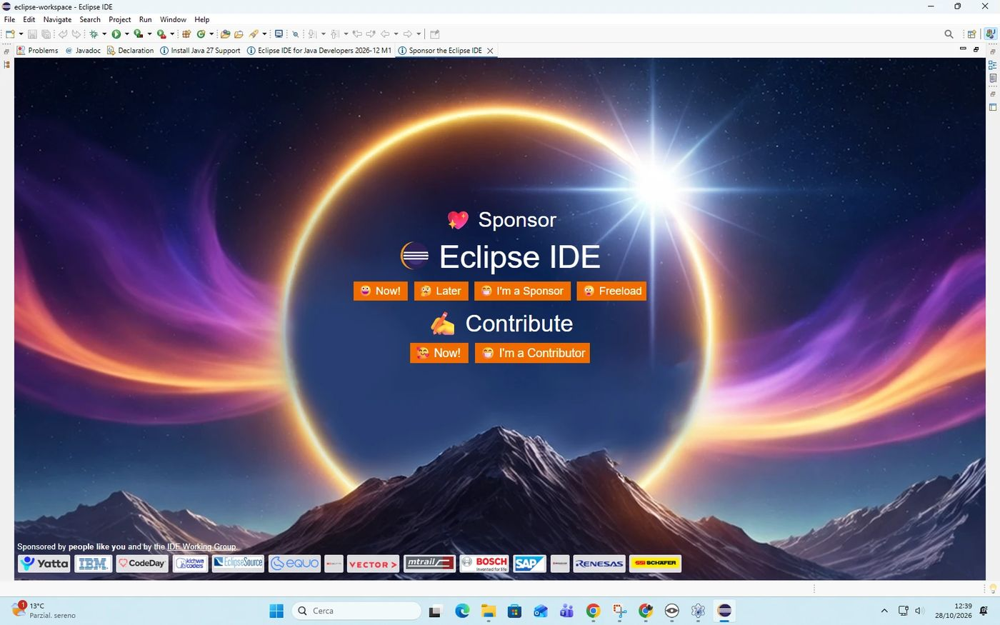

   *La pagina Sponsor: il bottone «Later» è arancione. · Sponsor পাতা: Later বোতামটি কমলা রঙের।*

8. **Chiudi le linguette** (ট্যাবগুলো বন্ধ করো)

   In alto restano delle linguette (schede) aperte. Chiudile una alla volta con la **X** accanto al nome. A sinistra compare il riquadro **«Package Explorer»** (Esplora pacchetti) con la scritta blu **«Create a Java project»**.

   *উপরে কিছু ট্যাব খোলা থাকে। নামের পাশের X দিয়ে একটা একটা করে বন্ধ করো। বামে Package Explorer দেখা যাবে, নীল লেখা Create a Java project সহ।*

   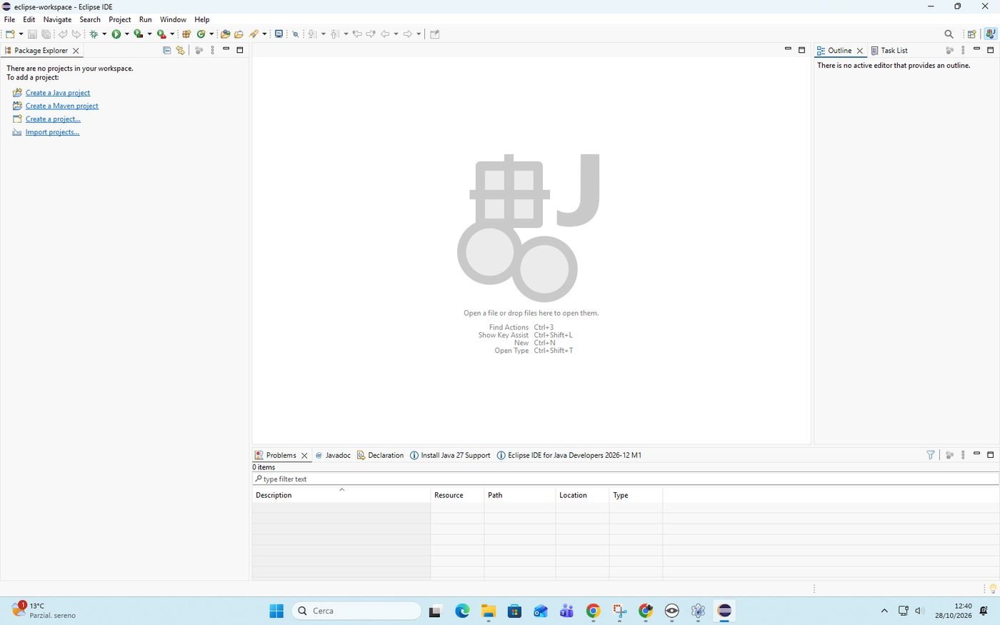

   *A sinistra il Package Explorer con «Create a Java project». · বামে Package Explorer, Create a Java project সহ।*

## 04 Il progetto HelloWorld

*HelloWorld প্রজেক্ট*

Come in Lazarus: **un progetto = una cartella**. Eclipse la crea da solo.

*Lazarus-এর মতো: একটি প্রজেক্ট = একটি ফোল্ডার। Eclipse নিজেই বানায়।*

9. **Create a Java project** (Create a Java project)

   A sinistra clicca la scritta blu **«Create a Java project»** (Crea un progetto Java). Si apre la finestra **«New Java Project»** (Nuovo progetto Java).

   *বামে নীল লেখা Create a Java project-এ ক্লিক করো। New Java Project জানালা খুলবে।*

10. **Il nome del progetto** (প্রজেক্টের নাম)

   Nella casella in alto **«Project name»** (Nome del progetto) scrivi, tutto attaccato:

   *উপরের Project name ঘরে লেখো, একসাথে:*

   ```
   HelloWorld
   ```

   > [GIALLO] Nota. Compare un avviso giallo sul nome del modulo («discouraged module name»): si ignora, sparisce al passo dopo.
   >
   > *মডিউলের নাম নিয়ে হলুদ সতর্কবার্তা আসে: উপেক্ষা করো, পরের ধাপে চলে যায়।*

   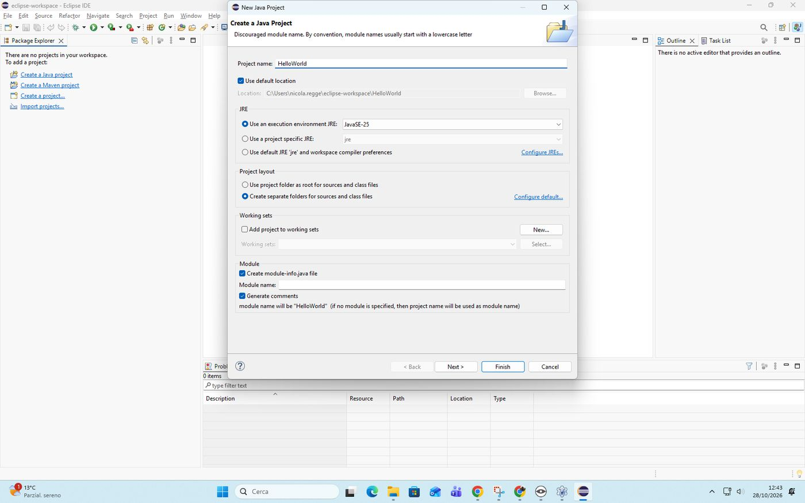

   *New Java Project: Project name HelloWorld; in basso la sezione Module. · New Java Project: Project name HelloWorld; নিচে Module অংশ।*

11. **Togli la spunta module-info** (module-info-র টিক তুলে দাও)

   In fondo alla finestra, nella parte **«Module»** (Modulo), **togli la spunta** a **«Create module-info.java file»** (Crea il file module-info.java). L'avviso giallo sparisce.

   *জানালার নিচে Module অংশে Create module-info.java file-এর টিক তুলে দাও। হলুদ সতর্কবার্তা চলে যায়।*

   > [ROSSO] Attenzione. La spunta **«Create module-info.java file»** va **TOLTA**. Se resta, dopo compaiono gli errori «Unresolved compilation problem» e «A package name must be specified for a module» (vedi gli errori comuni in fondo).
   >
   > *Create module-info.java file-এর টিক অবশ্যই তুলে দিতে হবে। থেকে গেলে পরে «Unresolved compilation problem» আর «A package name must be specified for a module» ভুল আসে (শেষে সাধারণ ভুল দেখো)।*

   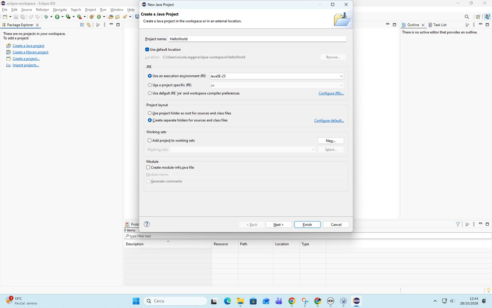

   *Spunta tolta, nessun avviso: ora si può fare Finish. · টিক তোলা, কোনো সতর্কবার্তা নেই: এখন Finish করা যায়।*

12. **Finish** (Finish)

   Clicca **«Finish»** (Fine) in basso a destra. A sinistra compare il progetto **HelloWorld**.

   *নিচে ডানদিকে Finish (শেষ) ক্লিক করো। বামে HelloWorld প্রজেক্ট দেখা যাবে।*

   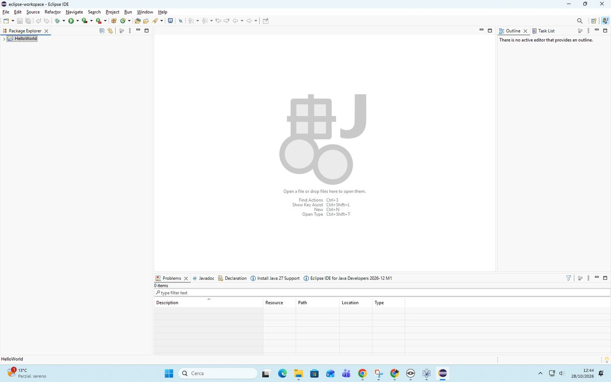

   *Il progetto HelloWorld nel Package Explorer. · Package Explorer-এ HelloWorld প্রজেক্ট।*

   > [GIALLO] FATTO! Il tuo primo progetto Java esiste.
   >
   > *তোমার প্রথম Java প্রজেক্ট তৈরি।*

## 05 La classe Main

*Main ক্লাস*

Il codice Java sta dentro una **classe**: per ora pensala come la unit di Lazarus, un file di codice.

*Java কোড একটি ক্লাসের ভিতরে থাকে: এখন এটাকে Lazarus-এর unit-এর মতো ভাবো, একটি কোডের ফাইল।*

13. **Apri il progetto** (প্রজেক্ট খোলো)

   A sinistra clicca la **freccina** accanto a **HelloWorld**: compare la cartella **src** (da «source», il codice).

   *বামে HelloWorld-এর পাশের ছোট তীরে ক্লিক করো: src ফোল্ডার দেখা যাবে (source = কোড)।*

14. **New Class** (New Class)

   Clic **destro** su **src**, poi **«New»** (Nuovo), poi **«Class»** (Classe). Si apre la finestra **«New Java Class»**.

   *src-এ ডান ক্লিক, তারপর New (নতুন), তারপর Class (ক্লাস)। New Java Class জানালা খুলবে।*

   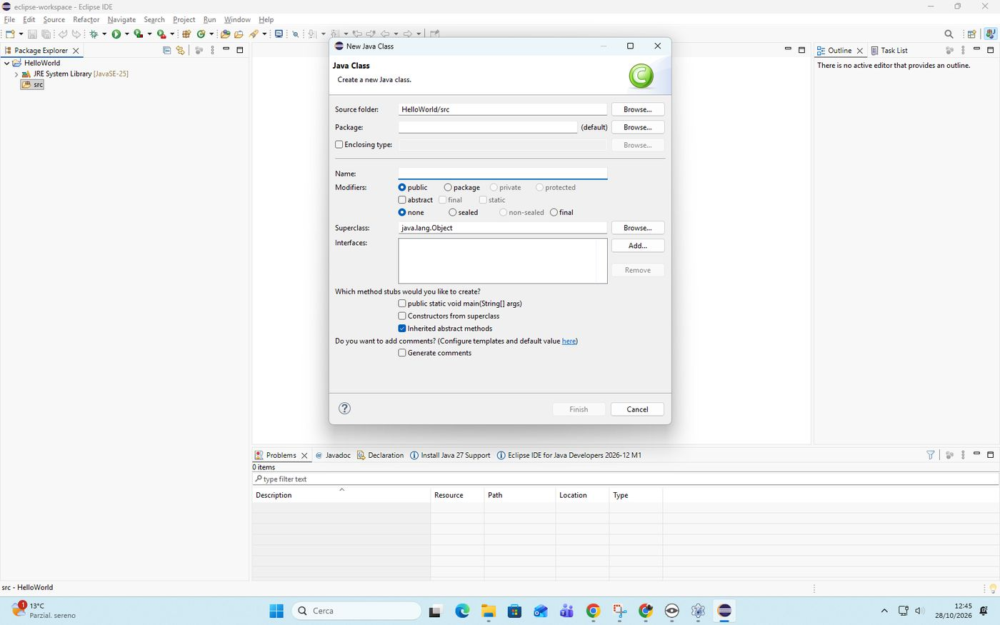

   *La finestra New Java Class. · New Java Class জানালা।*

15. **Il nome: Main** (নাম: Main)

   Clicca nella casella **«Name»** (Nome) e scrivi, con la M maiuscola:

   *Name (নাম) ঘরে ক্লিক করো আর লেখো, বড় হাতের M দিয়ে:*

   ```
   Main
   ```

   > [ROSSO] Attenzione. Errore comune: Main scritto nella casella **«Package»** (Pacchetto) invece che in **«Name»**. Compare «Type name is empty» (il nome è vuoto). La casella **Package resta vuota**.
   >
   > *সাধারণ ভুল: Main লেখা হয়েছে Package ঘরে, Name-এ নয়। «Type name is empty» আসে। Package ঘর খালি থাকবে।*

   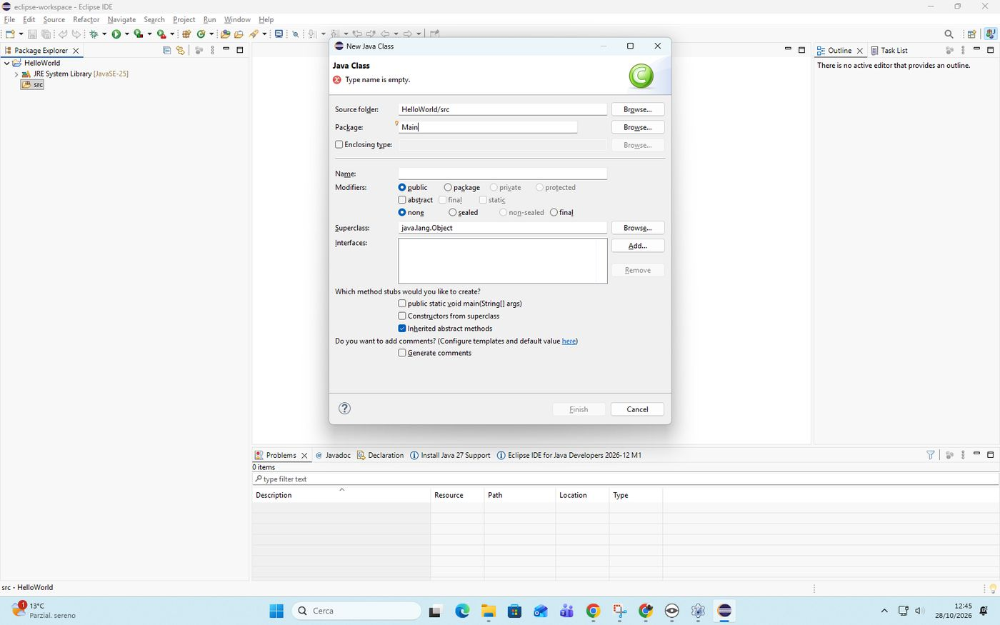

   *ERRORE: Main finito in Package. Va in Name. · ভুল: Main গেছে Package-এ। এটা Name-এ যাবে।*

   > [GIALLO] Nota. Con il nome giusto compare l'avviso giallo «The use of the default package is discouraged» (meglio non usare il pacchetto di base). Si ignora.
   >
   > *সঠিক নাম দিলে হলুদ সতর্কবার্তা আসে «The use of the default package is discouraged»। উপেক্ষা করো।*

   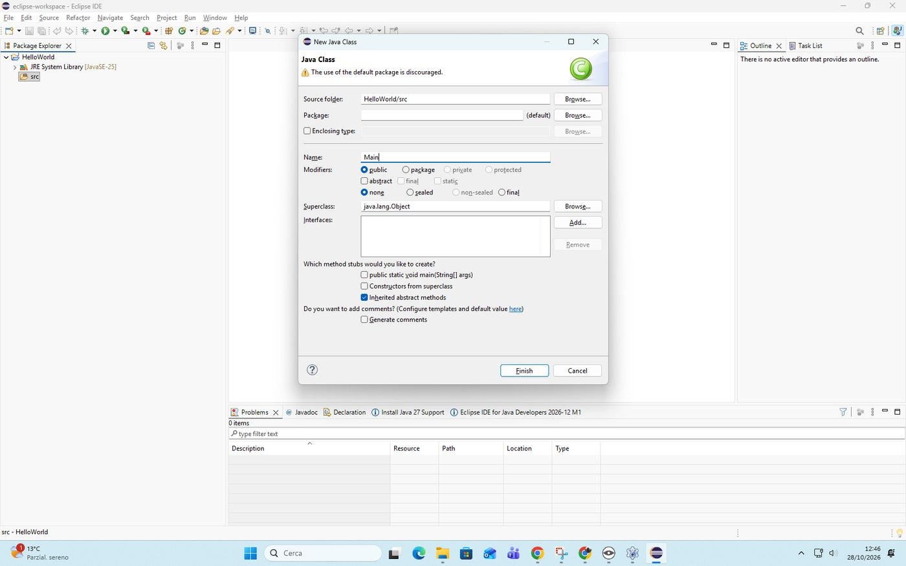

   *Name: Main. L'avviso giallo si ignora. · Name: Main। হলুদ সতর্কবার্তা উপেক্ষা করো।*

16. **La spunta main** (main-এর টিক)

   Più sotto metti la spunta a **«public static void main(String[] args)»**: è il punto di partenza del programma.

   *নিচে public static void main(String[] args)-এ টিক দাও: এটা প্রোগ্রামের শুরুর জায়গা।*

   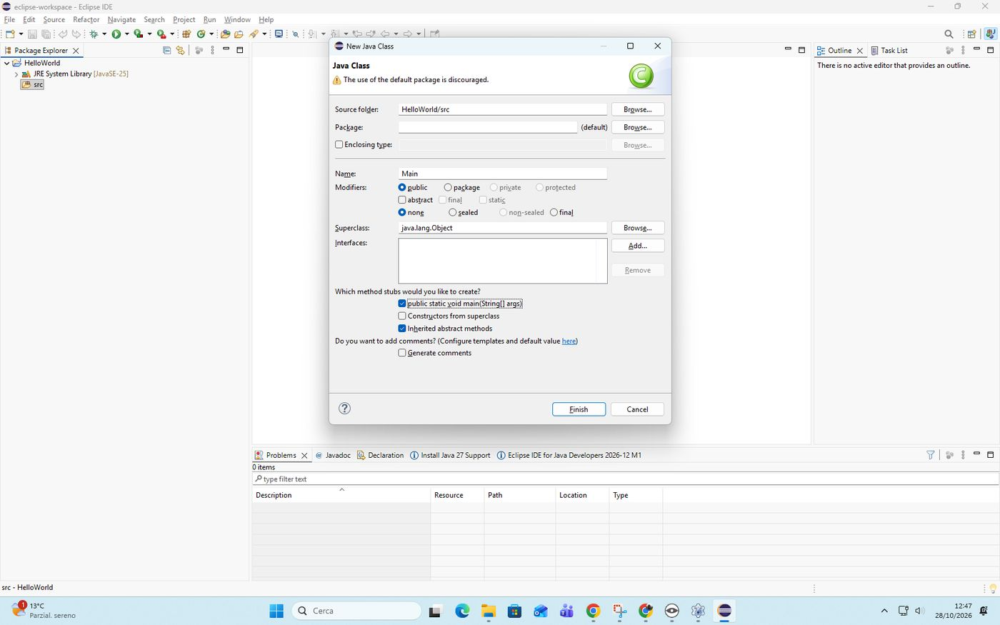

   *Tutto pronto: Name Main e la spunta main. · সব তৈরি: Name Main আর main-এর টিক।*

17. **Finish: si apre Main.java** (Finish: Main.java খোলে)

   Clicca **«Finish»** (Fine). Al centro si apre il file **Main.java** con un po' di codice già scritto da Eclipse.

   *Finish ক্লিক করো। মাঝখানে Main.java খুলবে, Eclipse-এর লেখা কিছু কোডসহ।*

   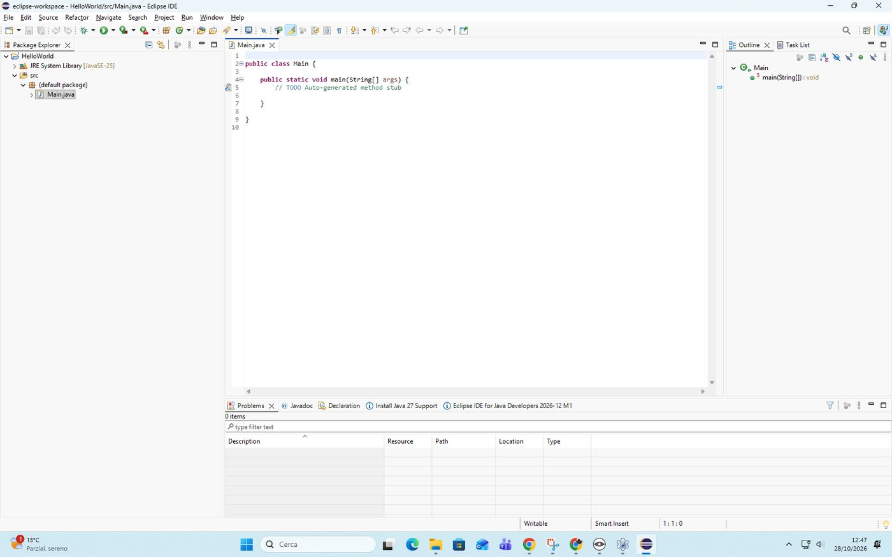

   *Main.java aperto al centro. · মাঝখানে Main.java খোলা।*

## 06 Il codice e il bottone Hello World

*কোড আর Hello World বোতাম*

18. **Copia il codice** (কোড কপি করো)

   Clicca il bottone **Copia** del riquadro qui sotto: copia tutto il programma.

   *নিচের বাক্সের Copia বোতামে ক্লিক করো: পুরো প্রোগ্রাম কপি হবে।*

   ```java
   import javax.swing.*;
   import java.awt.FlowLayout;

   public class Main {

       public static void main(String[] args) {
           JFrame finestra = new JFrame("Il mio primo programma");
           JButton bottone = new JButton("Premi");

           bottone.addActionListener(e -> JOptionPane.showMessageDialog(finestra, "Hello World"));

           finestra.setLayout(new FlowLayout());
           finestra.add(bottone);
           finestra.setSize(300, 150);
           finestra.setDefaultCloseOperation(JFrame.EXIT_ON_CLOSE);
           finestra.setVisible(true);
       }

   }
   ```

19. **Incolla al posto di tutto** (সবকিছুর জায়গায় পেস্ট করো)

   Clicca dentro il codice di **Main.java**, premi `Ctrl` + `A` (seleziona tutto) e poi `Ctrl` + `V` (incolla).

   *Main.java-র কোডের ভিতরে ক্লিক করো, Ctrl + A (সব বাছো) তারপর Ctrl + V (পেস্ট) চাপো।*

   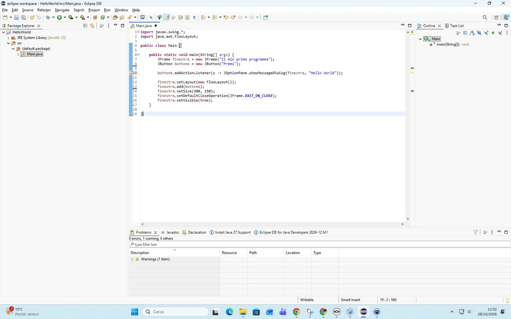

   *Il codice incollato. Il pallino nero sulla linguetta Main.java vuol dire: non ancora salvato. · পেস্ট করা কোড। Main.java ট্যাবে কালো বিন্দু মানে: এখনো সেভ হয়নি।*

   > [ROSSO] Attenzione. Errore comune: righe doppie e una **X rossa** a sinistra. Hai incollato dentro una riga un testo vecchio rimasto negli appunti. Copia di nuovo con il bottone Copia, poi `Ctrl` + `A` e `Ctrl` + `V`.
   >
   > *সাধারণ ভুল: দুবার লাইন আর বামে লাল X। একটি লাইনের ভিতরে পুরনো লেখা পেস্ট হয়েছে। আবার Copia দিয়ে কপি করো, তারপর Ctrl + A আর Ctrl + V।*

   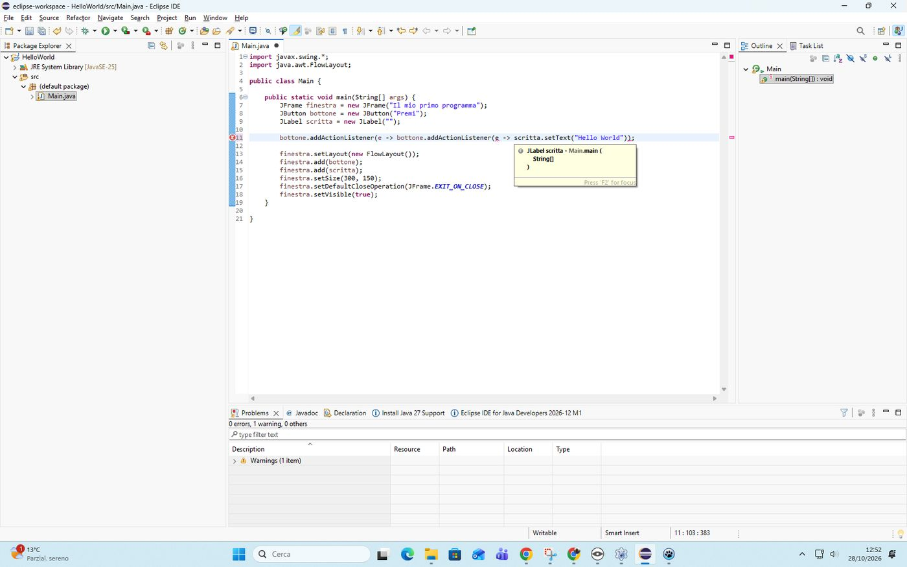

   *ERRORE: testo vecchio incollato dentro una riga. · ভুল: একটি লাইনের ভিতরে পুরনো লেখা পেস্ট হয়েছে।*

20. **Salva** (সেভ করো)

   Premi `Ctrl` + `S` (salva). Il pallino nero sulla linguetta sparisce.

   *Ctrl + S (সেভ) চাপো। ট্যাবের কালো বিন্দু চলে যায়।*

   In basso, nella scheda **«Problems»** (Problemi), conta solo **0 errors** (0 errori). Un **warning** (avviso giallo) non blocca niente.

   *নিচে Problems (সমস্যা) ট্যাবে শুধু 0 errors (০ ভুল) দরকার। warning (হলুদ সতর্কবার্তা) কিছু আটকায় না।*

   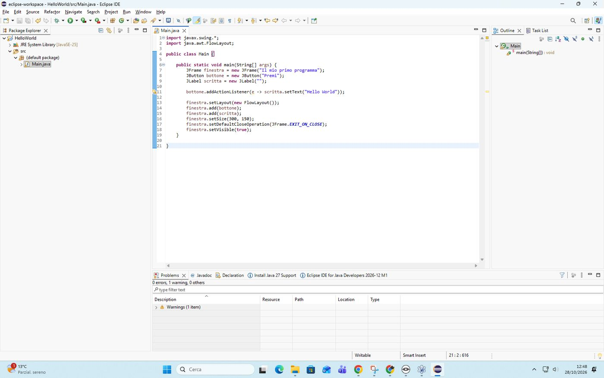

   *Esempio in basso: «0 errors, 1 warning». Va bene. · নিচে উদাহরণ: «0 errors, 1 warning»। ঠিক আছে।*

21. **Run** (Run)

   In alto clicca il **cerchio verde con il triangolo bianco**: è **«Run»** (Esegui), come il triangolo verde di Lazarus.

   *উপরে সবুজ বৃত্তে সাদা ত্রিভুজে ক্লিক করো: এটা Run (চালাও), Lazarus-এর সবুজ ত্রিভুজের মতো।*

   Si apre la finestra **«Il mio primo programma»** con il bottone **Premi**. Se non la vedi, è dietro Eclipse: cercala nella barra in basso dello schermo.

   *«Il mio primo programma» জানালা খুলবে, Premi বোতামসহ। না দেখলে, এটা Eclipse-এর পিছনে: স্ক্রিনের নিচের বারে খোঁজো।*

22. **Premi** (Premi চাপো)

   Clicca **Premi**. Si apre una finestrella con scritto **Hello World** e il bottone **OK**.

   *Premi ক্লিক করো। ছোট জানালা খুলবে, Hello World লেখা আর OK বোতাম।*

   > [ROSSO] Attenzione. Vedi «Hello World» scritto **accanto al bottone**, nella stessa finestra, senza finestrella? Hai ancora il codice vecchio: rifai i passi 18, 19 e 20 (copia, incolla, salva).
   >
   > *বোতামের পাশে, একই জানালায় Hello World দেখছো, ছোট জানালা ছাড়া? পুরনো কোড আছে: ১৮, ১৯, ২০ ধাপ আবার করো (কপি, পেস্ট, সেভ)।*

   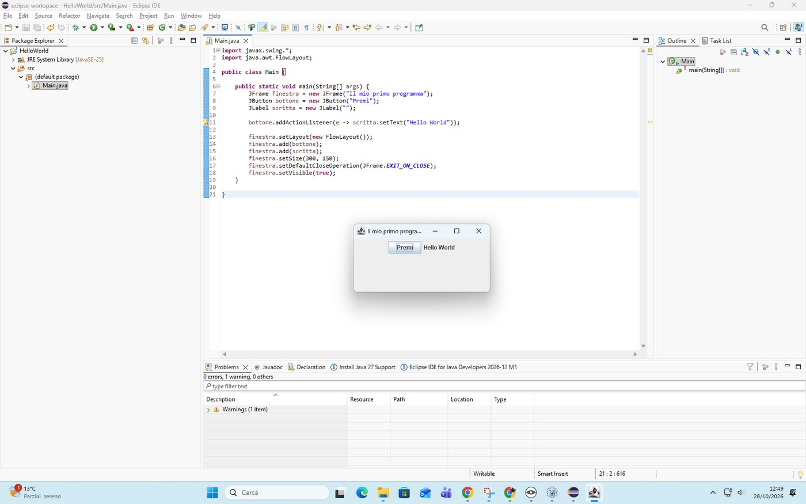

   *Così è il codice VECCHIO: la scritta nella stessa finestra. · এটা পুরনো কোড: একই জানালায় লেখা।*

   > [GIALLO] FATTO! La finestrella **Hello World** con **OK**: il tuo primo programma Java con la finestra! Clicca OK e chiudi con la X.
   >
   > *OK-সহ Hello World ছোট জানালা: জানালাসহ তোমার প্রথম Java প্রোগ্রাম! OK ক্লিক করো, X দিয়ে বন্ধ করো।*

23. **Fallo tuo** (নিজের মতো করো)

   Nel codice cambia **"Hello World"** con una frase tua e **"Premi"** con una parola tua. Lascia le virgolette `"`. Poi `Ctrl` + `S` e Run.

   *কোডে "Hello World"-এর জায়গায় তোমার নিজের বাক্য আর "Premi"-এর জায়গায় তোমার শব্দ লেখো। " চিহ্ন রেখে দাও। তারপর Ctrl + S আর Run।*

   **Mostralo** al compagno: premi il bottone davanti a lui.

   *সহপাঠীকে দেখাও: তার সামনে বোতাম চাপো।*

## 07 Lazarus e Java a confronto

*Lazarus আর Java তুলনা*

Hai già fatto lo stesso programma in Lazarus: cambiano le parole, l'idea è la stessa.

*তুমি একই প্রোগ্রাম Lazarus-এ বানিয়েছো: শব্দ বদলায়, ধারণা একই।*

| Che cosa | Lazarus | Java |
|---|---|---|
| la finestra | `Form1` | `JFrame` |
| il bottone | `TButton` | `JButton` |
| quando premi il bottone | `Button1Click` | `addActionListener` |
| il messaggio | `ShowMessage('Hello World');` | `JOptionPane.showMessageDialog(finestra, "Hello World");` |

*Form1 = JFrame (জানালা)। TButton = JButton (বোতাম)। Button1Click = addActionListener (বোতাম চাপলে)। ShowMessage = JOptionPane.showMessageDialog (বার্তা)।*

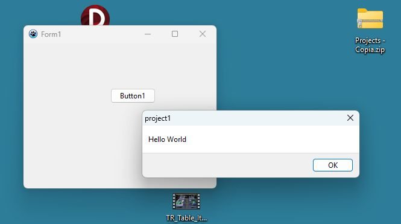

*In Lazarus: Form1, Button1 e la finestrella di ShowMessage con OK.*

## 08 Il codice riga per riga

*লাইন ধরে ধরে কোড*

| Riga | Che cosa vuol dire | বাংলা |
|---|---|---|
| `import javax.swing.*;` | prende i pezzi per fare le finestre (come `uses` in Lazarus) | জানালা বানানোর অংশ আনে (Lazarus-এর uses-এর মতো) |
| `import java.awt.FlowLayout;` | prende il modo di mettere in fila i componenti | অংশগুলো সারিতে রাখার নিয়ম আনে |
| `public class Main {` | la classe: il nome è uguale al file Main.java | ক্লাস: নাম ফাইল Main.java-র মতো |
| `public static void main(String[] args) {` | il punto di partenza: il programma comincia da qui | শুরুর জায়গা: প্রোগ্রাম এখান থেকে শুরু |
| `JFrame finestra = new JFrame("…");` | crea la finestra con il titolo (il Form) | শিরোনামসহ জানালা বানায় (Form) |
| `JButton bottone = new JButton("Premi");` | crea il bottone (TButton) | বোতাম বানায় (TButton) |
| `bottone.addActionListener(e -> …);` | quando premi il bottone, fai questo (Button1Click) | বোতাম চাপলে এটা করো (Button1Click) |
| `JOptionPane.showMessageDialog(finestra, "Hello World")` | apre la finestrella con il messaggio e OK (ShowMessage) | বার্তা আর OK-সহ ছোট জানালা খোলে (ShowMessage) |
| `finestra.setLayout(new FlowLayout());` | i componenti si mettono in fila, uno dopo l'altro | অংশগুলো একটার পর একটা সারিতে বসে |
| `finestra.add(bottone);` | mette il bottone nella finestra | বোতামটি জানালায় রাখে |
| `finestra.setSize(300, 150);` | larghezza e altezza (Width e Height) | প্রস্থ আর উচ্চতা (Width, Height) |
| `setDefaultCloseOperation(JFrame.EXIT_ON_CLOSE)` | con la X il programma si chiude davvero | X চাপলে প্রোগ্রাম সত্যিই বন্ধ হয় |
| `finestra.setVisible(true);` | mostra la finestra | জানালা দেখায় |
| `;` e `{ }` | fine istruzione; inizio e fine di un blocco (`begin … end`) | নির্দেশের শেষ; ব্লকের শুরু আর শেষ (begin … end) |

> [GIALLO] Prova del nove: spiega al compagno, in 30 secondi e con parole tue, che cosa succede quando premi il bottone.
>
> *নিজে যাচাই: ৩০ সেকেন্ডে, নিজের ভাষায়, সহপাঠীকে বলো বোতাম চাপলে কী হয়।*

## 09 Errori comuni: succede a tutti

*সাধারণ ভুল: সবার হয়*

Sbagliare è normale, anche per i programmatori professionisti. Con `Ctrl` + `Z` annulli l'ultima modifica.

*ভুল হওয়া স্বাভাবিক, পেশাদার প্রোগ্রামারদেরও। Ctrl + Z দিয়ে শেষ পরিবর্তন বাতিল করো।*

| Che cosa vedi | Perché | Come si sistema | বাংলা |
|---|---|---|---|
| «unable to locate its companion shared library» | lo ZIP non è stato scompattato tutto | cancella la cartella ec e rifai dal passo 1, aspettando la fine | ZIP পুরো আনজিপ হয়নি: ec মুছে ১ নম্বর ধাপ থেকে আবার করো |
| «Unresolved compilation problem», X rossa sulla riga `import javax.swing` | il progetto ha il file module-info.java | cancella module-info.java, poi Ctrl + S e Run | প্রজেক্টে module-info.java আছে: সেটি মুছে দাও, তারপর Ctrl + S আর Run |
| «A package name must be specified for a module» | il progetto ha il file module-info.java | cancella module-info.java, poi rifai la classe | প্রজেক্টে module-info.java আছে: সেটি মুছে দাও, তারপর ক্লাস আবার বানাও |
| «Type name is empty» | Main scritto in Package | Package vuoto, Main in Name | Main Package-এ লেখা: Package খালি, Main যাবে Name-এ |
| righe doppie e X rossa | incollato dentro una riga un testo vecchio | copia di nuovo, poi Ctrl + A e Ctrl + V | লাইনের ভিতরে পুরনো লেখা: আবার কপি, তারপর Ctrl + A আর Ctrl + V |
| pallino nero sulla linguetta | il file non è salvato | Ctrl + S | ফাইল সেভ হয়নি: Ctrl + S |
| Hello World accanto al bottone | codice vecchio | rifai i passi 18, 19 e 20 | পুরনো কোড: ১৮, ১৯, ২০ ধাপ আবার করো |
| premi Run e non si vede niente | la finestra è dietro Eclipse | cercala nella barra in basso dello schermo | জানালা Eclipse-এর পিছনে: নিচের বারে খোঁজো |

### «Unresolved compilation problem» e la X rossa su import javax.swing

*«Unresolved compilation problem» আর import javax.swing-এ লাল X*

Premi Run e in basso, nella scheda **«Console»**, compare in rosso **«Unresolved compilation problem»** (problema di compilazione non risolto). Sulla riga `import javax.swing.*;` c'è una **X rossa**.

*Run চাপলে নিচে Console ট্যাবে লাল রঙে «Unresolved compilation problem» আসে। import javax.swing.*; লাইনে লাল X থাকে।*

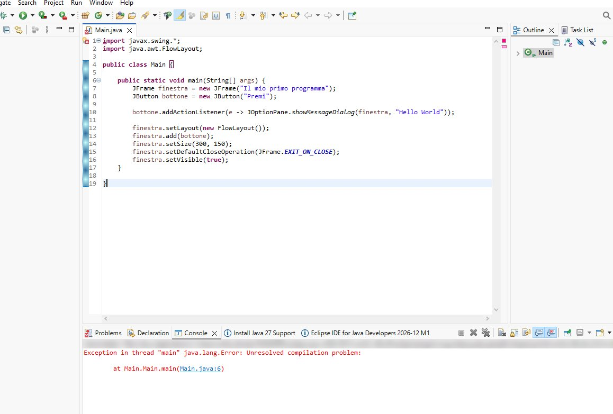

*ERRORE: X rossa sulla riga 1 e «Unresolved compilation problem» nella Console. · ভুল: ১ নম্বর লাইনে লাল X আর Console-এ «Unresolved compilation problem»।*

Perché: il progetto è stato creato **con** il file **module-info.java** (la spunta non è stata tolta). Questo file non lascia usare le finestre di `javax.swing`.

*কারণ: প্রজেক্ট module-info.java ফাইলসহ বানানো হয়েছে (টিক তোলা হয়নি)। এই ফাইল javax.swing-এর জানালা ব্যবহার করতে দেয় না।*

Soluzione 1: a sinistra, nel **Package Explorer**, apri **HelloWorld** e poi **src**.

*সমাধান ১: বামে Package Explorer-এ HelloWorld খোলো, তারপর src।*

Soluzione 2: fai clic **destro** su **module-info.java** e scegli **«Delete»** (Elimina).

*সমাধান ২: module-info.java-তে ডান ক্লিক করো, Delete (মুছে ফেলো) বেছে নাও।*

Soluzione 3: nella finestrella clicca **«OK»**.

*সমাধান ৩: ছোট জানালায় OK ক্লিক করো।*

Soluzione 4: clicca dentro Main.java, premi `Ctrl` + `S` e poi **Run**.

*সমাধান ৪: Main.java-র ভিতরে ক্লিক করো, Ctrl + S চাপো, তারপর Run।*

> [GIALLO] Nota. Se nella Console leggi **Main.Main.main**, la classe è finita nel pacchetto «Main»: rifai la classe lasciando vuota la casella **Package** (passo 15).
>
> *Console-এ Main.Main.main লেখা থাকলে ক্লাসটি «Main» প্যাকেজে চলে গেছে: Package ঘর খালি রেখে ক্লাস আবার বানাও (১৫ নম্বর ধাপ)।*

### «A package name must be specified for a module»

*«A package name must be specified for a module»*

Nella finestra **«New Java Class»** compare in alto, con la X rossa, **«A package name must be specified for a module»** (per un modulo serve il nome del pacchetto) e **Finish** è grigio.

*New Java Class জানালায় উপরে লাল X-সহ «A package name must be specified for a module» আসে, আর Finish ধূসর থাকে।*

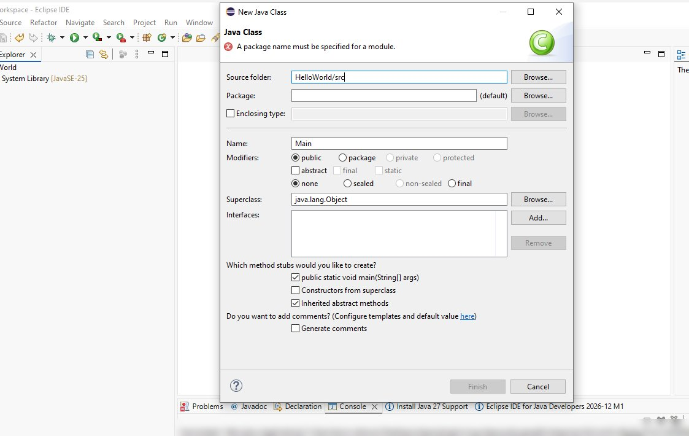

*ERRORE: la X rossa in alto e Finish grigio. · ভুল: উপরে লাল X আর Finish ধূসর।*

Perché: è la stessa causa, il progetto ha il file **module-info.java**.

*কারণ: একই কারণ, প্রজেক্টে module-info.java ফাইল আছে।*

Soluzione 1: clicca **«Cancel»** (Annulla) in basso a destra.

*সমাধান ১: নিচে ডানদিকে Cancel (বাতিল) ক্লিক করো।*

Soluzione 2: cancella **module-info.java** come sopra: **Package Explorer**, **src**, clic destro, **«Delete»**, **«OK»**.

*সমাধান ২: উপরের মতো module-info.java মুছে দাও: Package Explorer, src, ডান ক্লিক, Delete, OK।*

Soluzione 3: rifai la classe dal passo 14 (clic destro su **src**, New, Class).

*সমাধান ৩: ১৪ নম্বর ধাপ থেকে ক্লাস আবার বানাও (src-এ ডান ক্লিক, New, Class)।*

## 10 Changelog

1. Versione 1.0 (28/10/2026): prima versione, con le schermate reali di Eclipse 2026-09 prese dal docente.
2. Versione 1.1 (28/10/2026): due errori comuni con la schermata e la soluzione («Unresolved compilation problem» con la X rossa su import javax.swing; «A package name must be specified for a module»): si cancella module-info.java; riquadro rosso al passo della spunta module-info.
