# 04/11/2026, 3INF: Il protocollo del Mastermind: la UnitRete e il linguaggio tra client e server

**BOZZA NON PUBBLICATA.** Da analizzare con il docente (regole 7 e 17). Sorgenti: `lezione.html` (ora 1, con ora 2 bloccata) e `ora2.html`. I disegni sono schemi, non schermate.

## 1 Voce dell'Allegato A

Allegato A, 3INF (Classe 3 2026/27), Competenza 16 "Eseguire la manutenzione ordinaria e straordinaria di sistemi, reti, dispositivi e terminali", III Anno: voci "Protocolli di rete" e "TCP/IP porte". Collegata a Competenza 8, II Anno: "Master Mind".

Controllo fatto su `MIE-PARTI-ALLEGATO-A.md`: le voci ci sono, la lezione NON è scoperta. Non ho riletto i file Word originali in `programmi-ufficiali/2026-27/`.

## 2 Organizzazione delle due ore

1. Ora 1 (12:00-13:00): animazione alla lavagna (`animazione-protocollo.html`, 25 passi), poi i 6 schemi di teoria, poi "Il Prof finto" (missioni: scoprire le 5 risposte e spiegare una riga a voce).
2. Ora 2 (13:00-14:00, bloccata fino allo sblocco, flag `ORE_SBLOCCATE`): client v4 in Lazarus (Progetto, Apri progetto, F9), collegamento al server del Prof, partita, ricerca di PORTA_SERVER ed Elabora in UnitRete.pas, titolo con il proprio nome, commit su GitHub, quiz di 12 domande su Moduli.
3. Quaderno (regola 23, solo 1INF): non applicabile. Carta e penna: sospese per i compiti, tutto al PC.

## 3 KPI proposti (voto 40-80)

1. Client collegato al server (il server registra il nome): +15.
2. Commit chiaro su GitHub (messaggio che dice cosa è stato fatto): +15.
3. Quiz rete 8 su 12 o più: +10.
4. Il voto parte da 40; i tre KPI portano a 80. Il cruscotto mostra per primi questi tre, una spunta per ragazzo.

## 4 Teoria (schede con disegno)

### 4.1 Due programmi che si parlano

Il Mastermind in rete ha DUE programmi. Il CLIENT è quello di ogni ragazzo. Il SERVER è quello del Prof. In mezzo c'è la rete, come un tubo. Il server ascolta a una "porta": un numero. La nostra porta è la 5050.

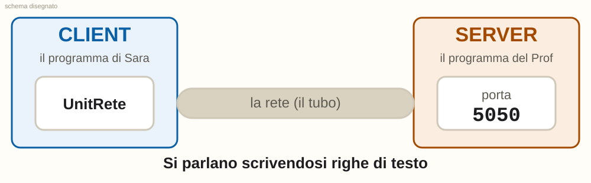

Un indirizzo IP dice QUALE computer. La porta dice QUALE programma dentro quel computer.

> Aiuto in bangla (solo PC 14, blocco opzionale): ক্লায়েন্ট হলো প্রত্যেকের প্রোগ্রাম, সার্ভার হলো স্যারের প্রোগ্রাম। সার্ভার ৫০৫০ নম্বর পোর্টে শোনে।

### 4.2 Una riga che va, una riga che torna

Per parlare, il client scrive UNA riga di testo e la manda. Il server legge, pensa e risponde con UNA riga. Poi la conversazione è finita. Il programma di Sara si collega, scrive, legge e chiude, ogni volta.

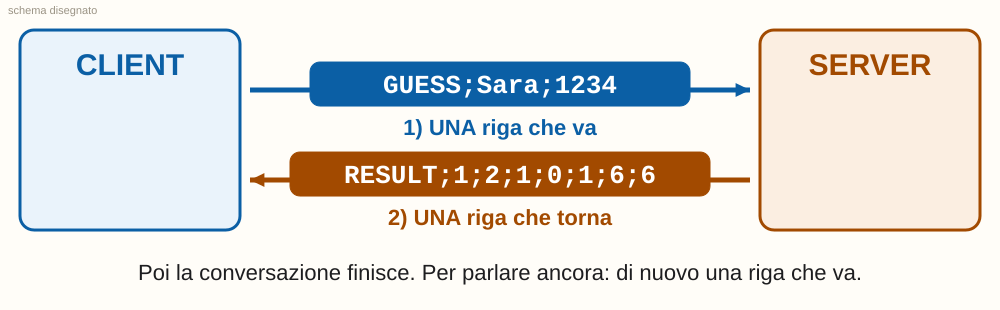

Per questo il client chiede lo STATO ogni 3 secondi: ogni volta è una conversazione nuova.

> Aiuto in bangla (solo PC 14, blocco opzionale): ক্লায়েন্ট একটি লাইন পাঠায়, সার্ভার একটি লাইন ফেরত দেয়।

### 4.3 Come è fatta una riga

Una riga è fatta di CAMPI separati da un punto e virgola ( ; ). Il primo campo dice che cosa è la riga. Gli altri campi sono i dati. Chi legge conta i campi: il primo è il numero 0.

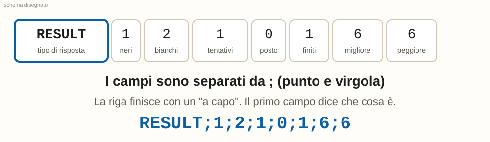

Nel codice, la funzione Campo(Riga, 2) prende il campo numero 2. In RESULT;1;2;1;0;1;6;6 il campo 2 è il 2 (i bianchi).

> Aiuto in bangla (solo PC 14, blocco opzionale): লাইনের অংশগুলো সেমিকোলন (;) দিয়ে আলাদা করা থাকে। প্রথম অংশ বলে লাইনটা কী।

### 4.4 Le due domande e le cinque risposte

Il client sa fare DUE domande: STATO (come va la partita?) e GUESS (ecco il mio tentativo). Il server sa dare CINQUE risposte: STATO, WAIT, RESULT, WIN, ERR. Questo piccolo elenco è il PROTOCOLLO: il linguaggio che i due programmi hanno deciso insieme.

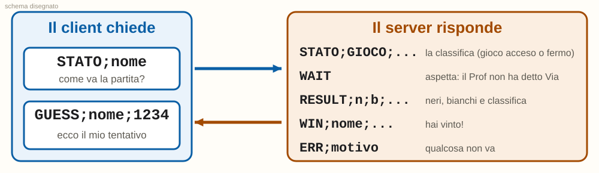

I colori nei tentativi sono numeri: 1 rosso, 2 giallo, 3 verde, 4 blu, 5 arancio, 6 porpora. Il codice 1234 è rosso, giallo, verde, blu.

> Aiuto in bangla (solo PC 14, blocco opzionale): STATO মানে: খেলা কেমন চলছে? GUESS মানে: আমার অনুমান এই। সার্ভার পাঁচ রকম উত্তর দিতে পারে: STATO, WAIT, RESULT, WIN, ERR।

### 4.5 Una partita passo per passo

Guarda i cinque scambi. Sara si collega (1), prova troppo presto e riceve WAIT (2), il Prof preme Via e Sara riceve il suo primo risultato (3), sbaglia a scrivere un colore e riceve ERR (4), poi indovina e riceve WIN (5).

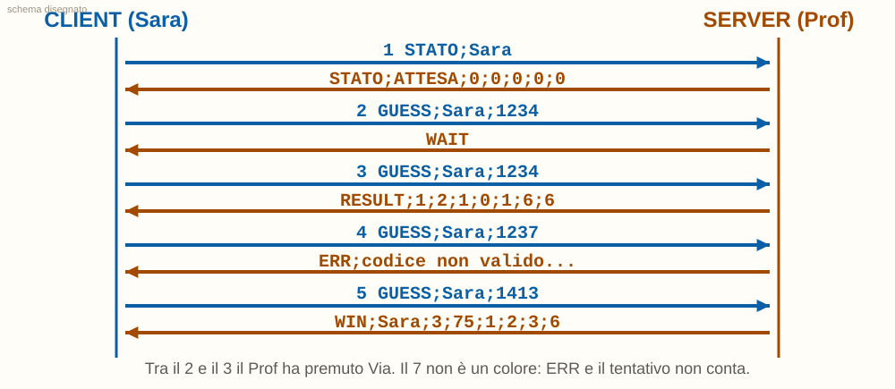

Neri = colore giusto al posto giusto. Bianchi = colore giusto al posto sbagliato. Con segreto 1413 e tentativo 1234: 1 nero e 2 bianchi.

> Aiuto in bangla (solo PC 14, blocco opzionale): WAIT মানে: স্যার এখনো "ভিয়া" বলেননি, অপেক্ষা করো। RESULT-এ কালো গুটি = সঠিক রঙ সঠিক জায়গায়; সাদা গুটি = সঠিক রঙ ভুল জায়গায়। WIN মানে: তুমি জিতেছ! ERR মানে: ভুল হয়েছে।

### 4.6 Come è fatta la UnitRete

Nella versione 4 il client è diviso in DUE pezzi (due "unit"). UnitInterfaccia = la finestra: disegni, bottoni, pioli. UnitRete = la rete: collegarsi, scrivere una riga, leggere una riga e capire il protocollo. La UnitRete NON conosce la finestra. Quando arriva una risposta, avvisa la finestra con un EVENTO: come l'evento click di un bottone in Lazarus, ma lo lancia la rete.

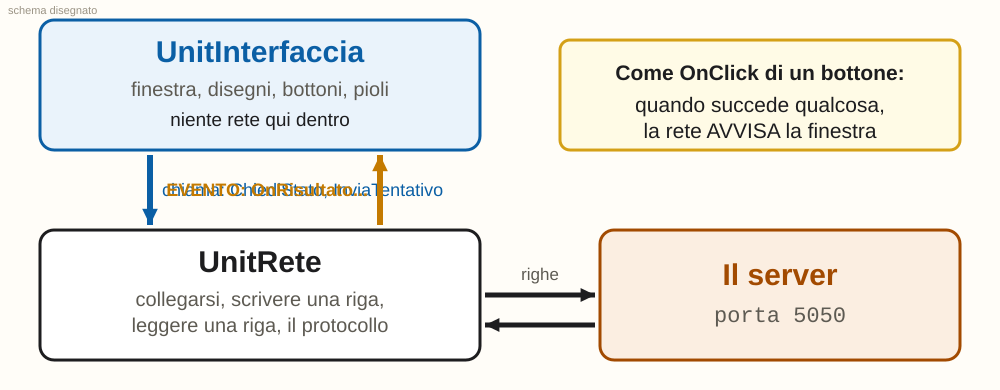

Perché dividere? 1) la rete si può provare da sola, 2) chi disegna non tocca la rete, 3) niente giri in tondo: la finestra conosce la rete, la rete non conosce la finestra.

> Aiuto in bangla (solo PC 14, blocco opzionale): UnitRete শুধু নেটওয়ার্কের কাজ করে; UnitInterfaccia শুধু জানালা ও ছবি। ইভেন্ট হলো বোতামের OnClick-এর মতো: কিছু ঘটলে প্রোগ্রাম জানিয়ে দেয়।

### 4.7 Quale riga fa partire quale evento

Ogni risposta del server ha il suo evento. La UnitRete guarda il primo campo della riga e sceglie l'evento giusto. La finestra ha già scritto cosa fare per ciascuno.

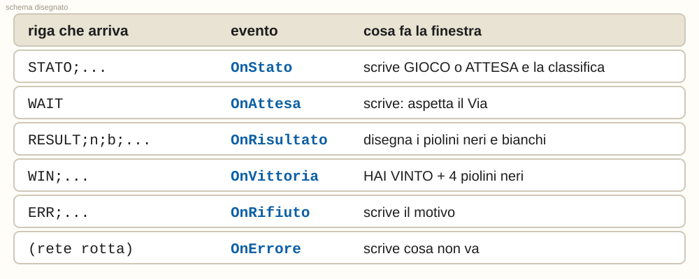

Nel codice: Rete.OnRisultato := @ReteRisultato; vuol dire "quando arriva RESULT, chiama la mia procedura ReteRisultato".

> Aiuto in bangla (solo PC 14, blocco opzionale): প্রতিটি উত্তরের নিজস্ব ইভেন্ট আছে। প্রথম অংশ দেখে UnitRete ঠিক ইভেন্টটি চালু করে।

## 5 Esercizio ora 1: il Prof finto

Pagina `lezione.html`. Un server finto in JavaScript (stesse regole di UnitServer) risponde a STATO e GUESS. Il ragazzo scrive il suo nome (fallo tuo), fa comparire le 5 risposte STATO, WAIT, RESULT, WIN, ERR (un segno verde per ogni risposta scoperta, "FATTO!" a 5 su 5) e poi spiega a voce una riga a un compagno (prova del nove). Tutto al PC, niente carta e telefono.

## 6 Ora 2: i passi (ognuno con il suo schema)

1. **Apri il client versione 4.** In Lazarus apri il menu Progetto in alto e scegli Apri progetto.... Cerca la cartella del Mastermind v4, apri Client e scegli ClientMastermind.lpi.

   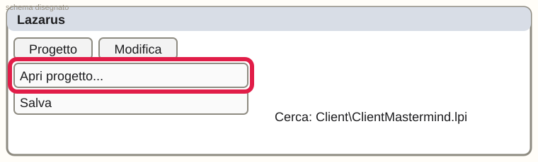

2. **Premi F9: vinci subito.** Premi il tasto F9 sulla tastiera. La prima volta Lazarus impiega un po'. Poi compare il client con la tavola di legno. Premi Gioca da solo e prova un tentativo: funziona anche senza rete.

   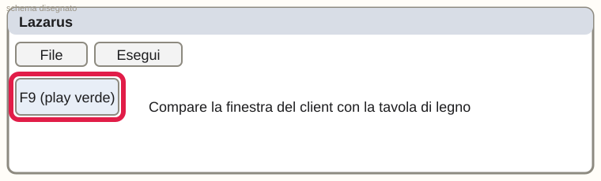

3. **Fallo tuo: collegati al Prof.** Nella casella IP del server scrivi l'indirizzo che il Prof ha scritto alla lavagna. Nella casella del nome scrivi il TUO nome. Premi Connetti.

   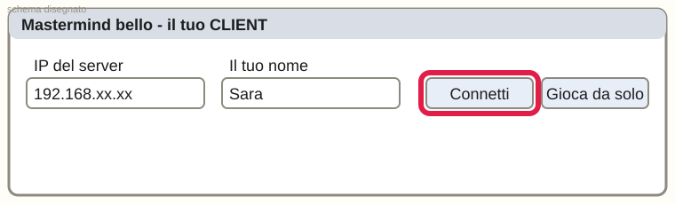

   Nota: Se compare un errore rosso, leggi le parole: dicono cosa controllare (IP, server acceso). Puoi giocare con "Gioca da solo" e chiedere all'assistente.

4. **FATTO: sei collegato.** In basso compare Collegato! Ciao e il tuo nome. Dietro le quinte il tuo programma ha mandato STATO;il tuo nome e il server ha risposto. Questo è il momento che conta per il voto: client collegato.

   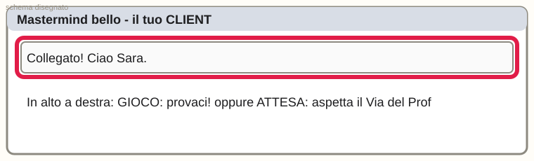

5. **Gioca e guarda le righe.** Quando il Prof preme Via, clicca 4 colori e premi Prova. Ogni volta il tuo programma manda GUESS;nome;codice e il server risponde RESULT. I piolini neri e bianchi sono quelli del RESULT.

   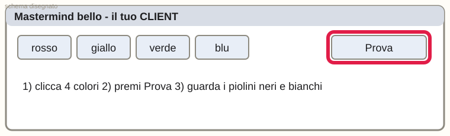

6. **Trova la porta nel codice.** Premi Ctrl + F in Lazarus. Scrivi PORTA_SERVER e premi Trova. Sei dentro UnitRete.pas: il valore è 5050. Per aprire UnitRete.pas: tasto Ctrl + F12, doppio clic su UnitRete.

   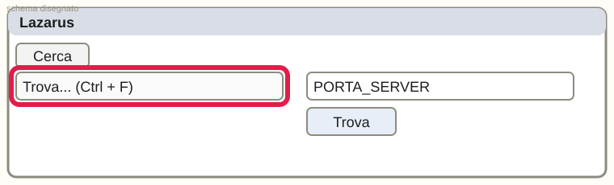

7. **Trova dove si legge una riga.** Sempre in UnitRete.pas cerca la parola Elabora. Qui la rete legge il primo campo e decide quale evento lanciare. Cerca anche GUESS: è la riga che il client scrive.

   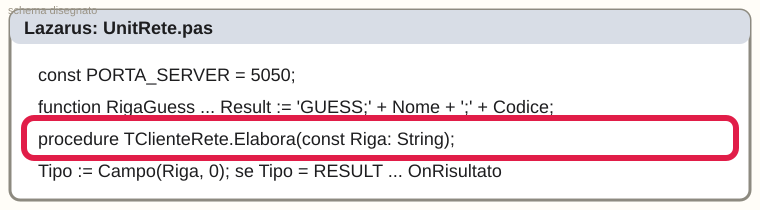

   Nota: Spiega a un compagno, con parole tue: perché UnitRete non ha bisogno di nessuna finestra?

8. **Fallo tuo: il titolo con il tuo nome.** Apri UnitInterfaccia.pas (Ctrl + F12) e cerca TITOLO_FORM. Cambia il testo tra gli apici con il tuo nome, per esempio come nello schema. Premi F9: il titolo della finestra è cambiato.

   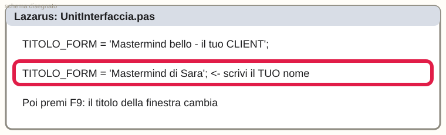

9. **Mettilo su GitHub (browser).** Apri github.com nel browser, entra nel tuo repository, premi Add file (in alto a destra) e poi Upload files (Carica file). Trascina nella pagina la cartella Client con il tuo titolo.

   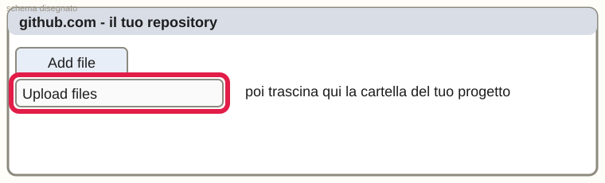

10. **Il commit chiaro.** In basso scrivi nel riquadro il messaggio, una frase che dice COSA hai fatto. Poi premi il bottone verde Commit changes (Salva le modifiche).

   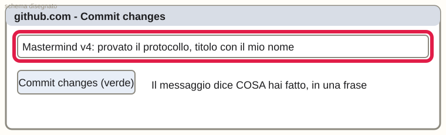

   Nota: Un buon messaggio dice cosa e perché: questo si vede nella storia del progetto.

   Messaggio di commit da copiare:

```
Mastermind v4: provato il protocollo, titolo con il mio nome
```

## 7 Quiz sulla rete (12 domande, da trasformare in Modulo con il ponte, NON ancora creato)

File pronto: `quiz-rete-12.json` (formato forms.crea_quiz) e `quiz-rete-12.md`. Soglia per il KPI: 8 su 12. Regola 33: il quiz vale come prova solo se è il Modulo allegato al compito su Classroom.

## 8 Controlli prima di pubblicare

1. Il docente guarda animazione, teoria e compito (regola 7).
2. Si decide chi vede il blocco in bangla (solo PC 14) e lo si fa controllare da chi lo legge: l'ho scritto io.
3. Gli schemi vanno sostituiti con screenshot veri di Lazarus e GitHub se disponibili (regola 32).
4. Il server del Prof deve essere acceso e l'IP scritto alla lavagna prima dell'ora 2.
5. Prima di pubblicare su Classroom: `bash strumenti/prima_di_pubblicare.sh "<titolo>"` (regola 34). Una ora per volta (regola 31).
