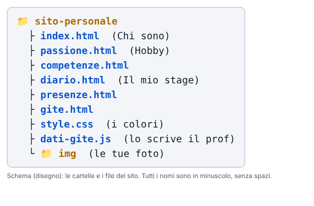
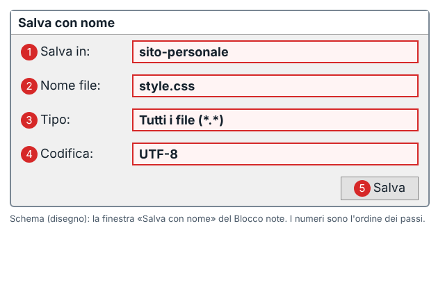
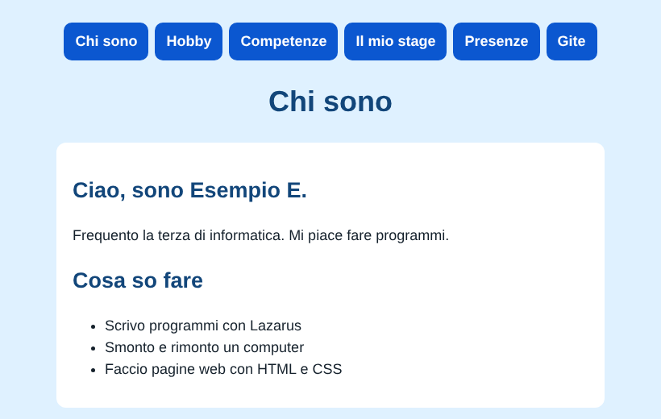
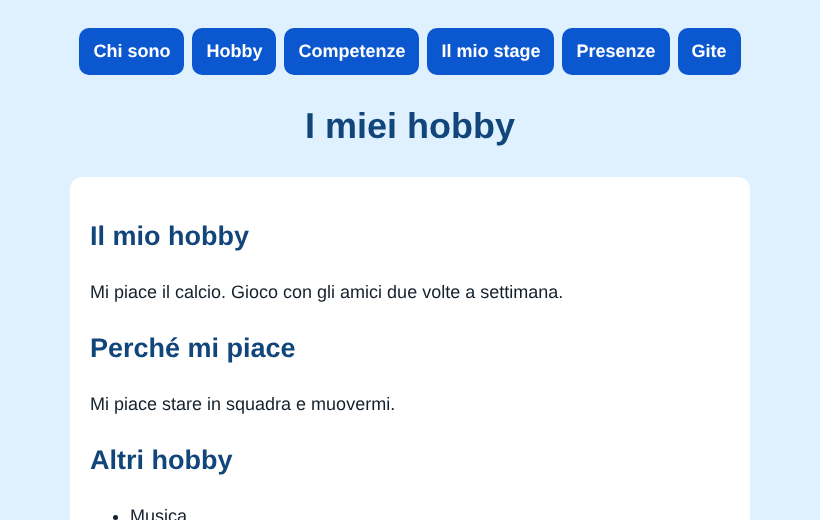
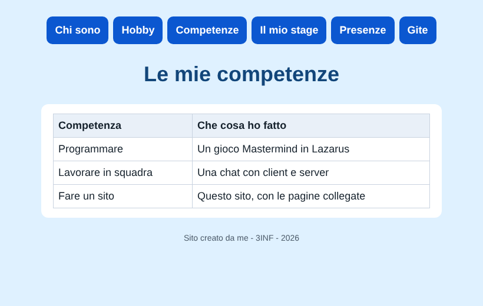
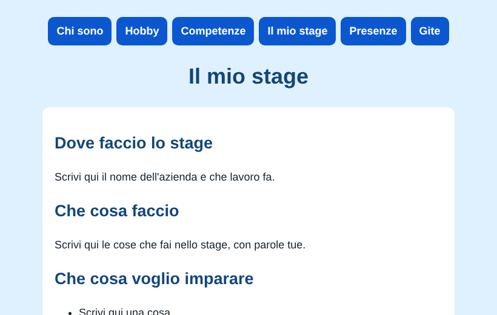
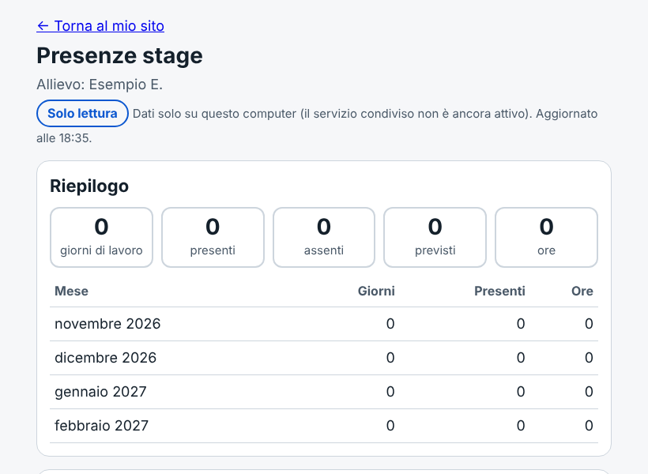
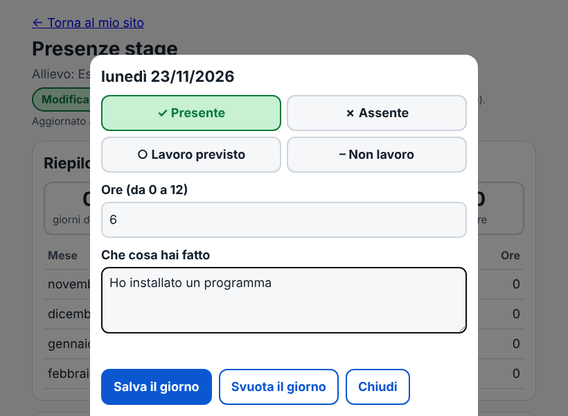
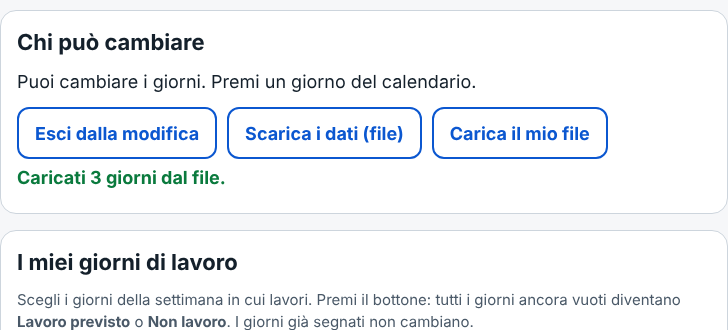
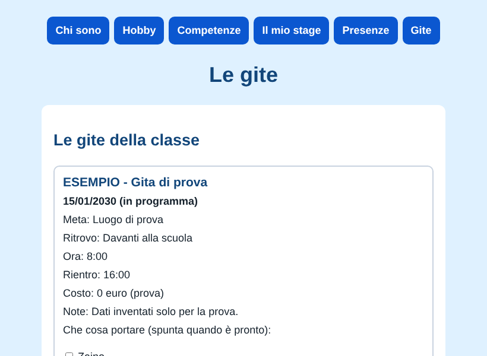

# Tutorial 3INF — Il mio sito: Gite e Presenze stage

**Versione 1.0** — 17/11/2026 · Classe 3 · Laboratorio · italiano

Alla fine hai un sito uguale a quello dei compagni: Chi sono, Hobby, Competenze, Il mio stage, Presenze e Gite.

Lavori con due programmi: il Blocco note e il browser. Non installi niente.

> **Nota:** in ogni passo fai UNA cosa. Quando hai fatto, vai al passo dopo.

<<PAGINA>>

## Passo 1 di 17: Il tuo sito è una cartella

1. Il tuo sito è una cartella sul PC.

2. Dentro ci sono dei file: pagine, colori e foto.

3. Li apri con il browser. Per guardare le pagine non serve internet.

4. Tutti i siti hanno gli stessi nomi: così il prof trova subito ogni cosa.



<<PAGINA>>

## Passo 2 di 17: Crea la cartella

1. Apri Esplora file. Vai nella cartella dove salvi i tuoi lavori (il prof ti dice quale).

2. Fai clic destro su un punto vuoto, poi Nuovo, poi Cartella.

3. Scrivi questo nome (tutto minuscolo, senza spazi) e premi Invio.

**NOME 1 — la cartella del sito**

```
sito-personale
```

4. Apri la cartella sito-personale. Dentro crea un'altra cartella con questo nome.

**NOME 2 — la cartella delle foto**

```
img
```

<<PAGINA>>

## Passo 3 di 17: Il file style.css (i colori)

1. Apri il Blocco note: premi il tasto Windows, scrivi Blocco note e premi Invio.

2. Premi Copia sul riquadro qui sotto. Nel Blocco note premi Ctrl + V.

3. Premi File, poi Salva con nome.

4. Compila la finestra come nel disegno. Poi premi Salva.

**RIQUADRO — file style.css**

```
/* style.css - uguale per tutti - Versione 1.0 */
/* FALLO TUO: cambia solo questi tre colori */
:root {
  --sfondo: #dff1ff;
  --titolo: #12467a;
  --bottone: #0b57d0;
}

body {
  background: var(--sfondo);
  font-family: Arial, sans-serif;
  margin: 0;
  padding: 16px;
  color: #14202b;
  line-height: 1.5;
  font-size: 18px;
}

h1 { color: var(--titolo); text-align: center; }
h2 { color: var(--titolo); }

.menu {
  display: flex;
  flex-wrap: wrap;
  gap: 8px;
  justify-content: center;
  margin: 12px 0 20px;
}
.menu a {
  background: var(--bottone);
  color: white;
  text-decoration: none;
  padding: 10px 14px;
  border-radius: 10px;
  font-weight: bold;
}
.menu a:hover { opacity: 0.85; }

.scheda {
  background: white;
  max-width: 640px;
  margin: 16px auto;
  padding: 16px 20px;
  border-radius: 12px;
}

.scheda img { max-width: 100%; border-radius: 8px; }

table { border-collapse: collapse; width: 100%; }
th, td { border: 1px solid #c9d3e0; padding: 6px 8px; text-align: left; }
th { background: #e9f0f8; }

.piede { text-align: center; font-size: 14px; color: #4a5968; margin-top: 24px; }

/* pagina Gite */
.gita { border: 2px solid #c9d3e0; border-radius: 10px; padding: 10px 14px; margin: 12px 0; }
.gita p { margin: 4px 0; }
.gita h3 { margin: 0 0 4px; color: var(--titolo); }
.gita .quando { font-weight: bold; }
.gita ul { list-style: none; padding-left: 0; }
.vuoto { background: #fff8e1; border: 1px solid #e6c96a; border-radius: 8px; padding: 10px 12px; }
```



<<PAGINA>>

## Passo 4 di 17: La pagina Chi sono (index.html)

1. Nel Blocco note premi Ctrl + N: si apre un foglio vuoto.

2. Premi Copia sul riquadro. Nel foglio vuoto premi Ctrl + V.

3. Salva con nome: cartella sito-personale, nome index.html, tipo Tutti i file, codifica UTF-8. Premi Salva.

4. Apri la cartella sito-personale. Fai doppio clic su index.html: si apre nel browser.

**RIQUADRO — file index.html**

```
<!DOCTYPE html>
<html lang="it">
<head>
  <meta charset="utf-8">
  <meta name="viewport" content="width=device-width, initial-scale=1">
  <title>Chi sono</title>
  <link rel="stylesheet" href="style.css">
</head>
<body>
  <nav class="menu">
    <a href="index.html">Chi sono</a>
    <a href="passione.html">Hobby</a>
    <a href="competenze.html">Competenze</a>
    <a href="diario.html">Il mio stage</a>
    <a href="presenze.html">Presenze</a>
    <a href="gite.html">Gite</a>
  </nav>
  <h1>Chi sono</h1>
  <div class="scheda">
    <h2>Ciao, sono Esempio E.</h2>
    <p>Frequento la terza di informatica. Mi piace fare programmi.</p>
    <h2>Cosa so fare</h2>
    <ul>
      <li>Scrivo programmi con Lazarus</li>
      <li>Smonto e rimonto un computer</li>
      <li>Faccio pagine web con HTML e CSS</li>
    </ul>
  </div>
  <p class="piede">Sito creato da me - 3INF - 2026</p>
</body>
</html>
```



> **Fallo tuo:** Nel Blocco note cambia Esempio E. con il tuo nome e le frasi con le tue. Premi Ctrl + S. Nel browser premi F5.
>
> **Fallo tuo:** Vuoi altri colori? Apri style.css e cambia i tre colori in cima, dopo i due punti.
>

<<PAGINA>>

## Passo 5 di 17: La pagina Hobby (passione.html)

1. Premi Ctrl + N nel Blocco note. Premi Copia sul riquadro e poi Ctrl + V.

2. Salva con nome: cartella sito-personale, nome passione.html, tipo Tutti i file, codifica UTF-8. Premi Salva.

3. Apri passione.html con doppio clic.

**RIQUADRO — file passione.html**

```
<!DOCTYPE html>
<html lang="it">
<head>
  <meta charset="utf-8">
  <meta name="viewport" content="width=device-width, initial-scale=1">
  <title>I miei hobby</title>
  <link rel="stylesheet" href="style.css">
</head>
<body>
  <nav class="menu">
    <a href="index.html">Chi sono</a>
    <a href="passione.html">Hobby</a>
    <a href="competenze.html">Competenze</a>
    <a href="diario.html">Il mio stage</a>
    <a href="presenze.html">Presenze</a>
    <a href="gite.html">Gite</a>
  </nav>
  <h1>I miei hobby</h1>
  <div class="scheda">
    <h2>Il mio hobby</h2>
    <p>Mi piace il calcio. Gioco con gli amici due volte a settimana.</p>
    <h2>Perché mi piace</h2>
    <p>Mi piace stare in squadra e muovermi.</p>
    <h2>Altri hobby</h2>
    <ul>
      <li>Musica</li>
      <li>Videogiochi</li>
    </ul>
  </div>
  <p class="piede">Sito creato da me - 3INF - 2026</p>
</body>
</html>
```



> **Fallo tuo:** Scrivi il tuo hobby vero e perché ti piace.
>

<<PAGINA>>

## Passo 6 di 17: La pagina Competenze (competenze.html)

1. Premi Ctrl + N nel Blocco note. Premi Copia sul riquadro e poi Ctrl + V.

2. Salva con nome: cartella sito-personale, nome competenze.html, tipo Tutti i file, codifica UTF-8. Premi Salva.

3. Apri competenze.html con doppio clic.

**RIQUADRO — file competenze.html**

```
<!DOCTYPE html>
<html lang="it">
<head>
  <meta charset="utf-8">
  <meta name="viewport" content="width=device-width, initial-scale=1">
  <title>Le mie competenze</title>
  <link rel="stylesheet" href="style.css">
</head>
<body>
  <nav class="menu">
    <a href="index.html">Chi sono</a>
    <a href="passione.html">Hobby</a>
    <a href="competenze.html">Competenze</a>
    <a href="diario.html">Il mio stage</a>
    <a href="presenze.html">Presenze</a>
    <a href="gite.html">Gite</a>
  </nav>
  <h1>Le mie competenze</h1>
  <div class="scheda">
    <table>
      <tr><th>Competenza</th><th>Che cosa ho fatto</th></tr>
      <tr><td>Programmare</td><td>Un gioco Mastermind in Lazarus</td></tr>
      <tr><td>Lavorare in squadra</td><td>Una chat con client e server</td></tr>
      <tr><td>Fare un sito</td><td>Questo sito, con le pagine collegate</td></tr>
    </table>
  </div>
  <p class="piede">Sito creato da me - 3INF - 2026</p>
</body>
</html>
```



> **Fallo tuo:** Nella tabella scrivi tre cose che sai fare davvero e cosa hai fatto.
>

<<PAGINA>>

## Passo 7 di 17: La pagina Il mio stage (diario.html)

1. Premi Ctrl + N nel Blocco note. Premi Copia sul riquadro e poi Ctrl + V.

2. Salva con nome: cartella sito-personale, nome diario.html, tipo Tutti i file, codifica UTF-8. Premi Salva.

3. Apri diario.html con doppio clic.

**RIQUADRO — file diario.html**

```
<!DOCTYPE html>
<html lang="it">
<head>
  <meta charset="utf-8">
  <meta name="viewport" content="width=device-width, initial-scale=1">
  <title>Il mio stage</title>
  <link rel="stylesheet" href="style.css">
</head>
<body>
  <nav class="menu">
    <a href="index.html">Chi sono</a>
    <a href="passione.html">Hobby</a>
    <a href="competenze.html">Competenze</a>
    <a href="diario.html">Il mio stage</a>
    <a href="presenze.html">Presenze</a>
    <a href="gite.html">Gite</a>
  </nav>
  <h1>Il mio stage</h1>
  <div class="scheda">
    <h2>Dove faccio lo stage</h2>
    <p>Scrivi qui il nome dell&#39;azienda e che lavoro fa.</p>
    <h2>Che cosa faccio</h2>
    <p>Scrivi qui le cose che fai nello stage, con parole tue.</p>
    <h2>Che cosa voglio imparare</h2>
    <ul>
      <li>Scrivi qui una cosa</li>
      <li>Scrivi qui un&#39;altra cosa</li>
    </ul>
    <p><a href="presenze.html">Vai alle mie presenze, giorno per giorno</a></p>
  </div>
  <p class="piede">Sito creato da me - 3INF - 2026</p>
</body>
</html>
```



> **Fallo tuo:** Scrivi dove fai lo stage, che cosa fai e che cosa vuoi imparare.
>
> **Fallo tuo:** Se non lo sai ancora, scrivi «da definire» e torna a cambiarlo dopo.
>

<<PAGINA>>

## Passo 8 di 17: Prova il menu

1. Apri index.html. In alto ci sono sei bottoni blu.

2. Premi Hobby, Competenze, Il mio stage e poi Chi sono: passi da una pagina all'altra.

3. Presenze e Gite ancora non funzionano: le facciamo nei prossimi passi.

<<PAGINA>>

## Passo 9 di 17: Presenze stage: prendi la pagina

1. Apri la pagina «Copia la pagina Presenze stage».

2. Scegli il tuo nome nell'elenco.

3. Premi il bottone blu «2. Scarica il file presenze.html».

4. Apri la cartella Download. Taglia il file presenze.html con Ctrl + X.

5. Apri la cartella sito-personale e incolla il file con Ctrl + V.

**Indirizzo della pagina «Copia la pagina Presenze stage»** (scrivilo nella barra del browser)

```
https://nicolaregge-pulse.github.io/corso-informatica/stage/copia.html
```

<<PAGINA>>

## Passo 10 di 17: Presenze stage: la tua password

1. Fai doppio clic su presenze.html. Premi il bottone «Modifica (solo io)».

2. Scegli una password di almeno 8 caratteri e scrivila due volte. Ricordala: la dimentichi, la azzera solo il prof.

3. Premi «Entra». In alto leggi «Modifica».



<<PAGINA>>

## Passo 11 di 17: Presenze stage: segna un giorno

1. Premi il numero del giorno nel calendario. Lo stage va dal 23/11/2026 al 18/02/2027, da lunedì a sabato.

2. Premi «Presente». Scrivi le ore.

3. In «Che cosa hai fatto» scrivi poche parole: ogni giorno di presenza ha la sua nota.

4. Premi «Salva il giorno». Il giorno diventa verde.





<<PAGINA>>

## Passo 12 di 17: Presenze stage: la copia di sicurezza

1. I giorni restano nel browser di questo PC. Per non perderli salva un file.

2. Premi «Scarica i dati (file)». Metti il file presenze-stage.json nella cartella sito-personale.

3. Se cambi PC o browser: apri presenze.html, premi «Modifica (solo io)» e poi «Carica il mio file».

4. Quando il prof attiva il servizio condiviso, ogni «Salva il giorno» arriva anche a lui. Il prof ti dice quando.

<<PAGINA>>

## Passo 13 di 17: Gite: il file del prof

1. Le gite le scrive il prof in un file. Tu non lo cambi.

2. Premi il bottone per scaricare dati-gite.js e mettilo nella cartella sito-personale.

3. Quando il prof dice che ci sono gite nuove, scaricalo di nuovo e sostituisci il file.

**Indirizzo del file dati-gite.js** (scrivilo nella barra del browser, poi salva il file nella cartella sito-personale)

```
https://nicolaregge-pulse.github.io/corso-informatica/3inf/sito-gite-stage/modello/dati-gite.js
```

**RIQUADRO — file dati-gite.js**

```
/* dati-gite.js - lo scrive il prof, uguale per tutti - Versione 1.0 */
/* Il prof aggiunge una gita per volta, dentro le parentesi quadre, separate da una virgola. Esempio da copiare:
   { titolo: "", data: "AAAA-MM-GG", meta: "", ritrovo: "", ora: "", rientro: "", costo: "", portare: ["", ""], note: "" }
*/
var GITE = [
];
```

<<PAGINA>>

## Passo 14 di 17: Gite: la pagina gite.html

1. Premi Ctrl + N nel Blocco note. Premi Copia sul riquadro e poi Ctrl + V.

2. Salva con nome: cartella sito-personale, nome gite.html, tipo Tutti i file, codifica UTF-8. Premi Salva.

3. Apri gite.html con doppio clic. Se il prof non ha ancora scritto le gite, vedi un avviso giallo: va bene.

**RIQUADRO — file gite.html**

```
<!DOCTYPE html>
<html lang="it">
<head>
  <meta charset="utf-8">
  <meta name="viewport" content="width=device-width, initial-scale=1">
  <title>Le gite</title>
  <link rel="stylesheet" href="style.css">
  <script src="dati-gite.js"></script>
</head>
<body>
  <nav class="menu">
    <a href="index.html">Chi sono</a>
    <a href="passione.html">Hobby</a>
    <a href="competenze.html">Competenze</a>
    <a href="diario.html">Il mio stage</a>
    <a href="presenze.html">Presenze</a>
    <a href="gite.html">Gite</a>
  </nav>
  <h1>Le gite</h1>

  <div class="scheda">
    <h2>Le gite della classe</h2>
    <div id="elenco"></div>
  </div>

  <div class="scheda">
    <h2>La mia gita</h2>
    <p><b>Dove siamo andati:</b> Scrivi qui il posto.</p>
    <p><b>Che cosa ho visto:</b> Scrivi qui due o tre cose.</p>
    <p><b>Che cosa ho imparato:</b> Scrivi qui una cosa.</p>
  </div>

  <p class="piede">Sito creato da me - 3INF - 2026</p>

  <script>
    var elenco = document.getElementById("elenco");
    var oggi = new Date().toISOString().slice(0, 10);
    var lista = (typeof GITE !== "undefined") ? GITE : [];

    function riga(testo, valore) {
      if (!valore) return null;
      var p = document.createElement("p");
      p.textContent = testo + ": " + valore;
      return p;
    }
    function salvata(chiave) {
      try { return localStorage.getItem(chiave) === "1"; } catch (e) { return false; }
    }
    function salva(chiave, valore) {
      try { localStorage.setItem(chiave, valore ? "1" : "0"); } catch (e) {}
    }

    if (lista.length === 0) {
      var v = document.createElement("p");
      v.className = "vuoto";
      v.textContent = "Il prof non ha ancora scritto le gite. Torna a vedere più avanti.";
      elenco.appendChild(v);
    }

    lista.forEach(function (g, n) {
      var box = document.createElement("div");
      box.className = "gita";
      var h = document.createElement("h3");
      h.textContent = g.titolo || "Gita";
      box.appendChild(h);
      var q = document.createElement("p");
      q.className = "quando";
      q.textContent = g.data ? (g.data.split("-").reverse().join("/") + (g.data >= oggi ? "  (in programma)" : "  (già fatta)")) : "data da definire";
      box.appendChild(q);
      [["Meta", g.meta], ["Ritrovo", g.ritrovo], ["Ora", g.ora], ["Rientro", g.rientro], ["Costo", g.costo], ["Note", g.note]].forEach(function (c) {
        var r = riga(c[0], c[1]);
        if (r) box.appendChild(r);
      });
      if (g.portare && g.portare.length) {
        var t = document.createElement("p");
        t.textContent = "Che cosa portare (spunta quando è pronto):";
        box.appendChild(t);
        var ul = document.createElement("ul");
        g.portare.forEach(function (cosa, k) {
          var chiave = "gita-" + n + "-" + k;
          var li = document.createElement("li");
          var lab = document.createElement("label");
          var cb = document.createElement("input");
          cb.type = "checkbox";
          cb.checked = salvata(chiave);
          cb.addEventListener("change", function () { salva(chiave, cb.checked); });
          lab.appendChild(cb);
          lab.appendChild(document.createTextNode(" " + cosa));
          li.appendChild(lab);
          ul.appendChild(li);
        });
        box.appendChild(ul);
      }
      elenco.appendChild(box);
    });
  </script>
</body>
</html>
```



> **Fallo tuo:** Nel riquadro «La mia gita» scrivi dove siamo andati, che cosa hai visto e che cosa hai imparato.
>
> **Fallo tuo:** Nelle gite del prof spunta le cose da portare: la spunta resta salvata.
>

<<PAGINA>>

## Passo 15 di 17: Una tua foto (se vuoi)

1. Metti una tua foto nella cartella img. Chiamala foto.jpg. Usa solo foto che vuoi far vedere.

2. In index.html, sotto la riga con Ciao, sono, aggiungi questa riga. Premi Ctrl + S.

**RIGA — la tua foto in index.html**

```

```

<<PAGINA>>

## Passo 16 di 17: Controlla la tua cartella

1. Premi il bottone «Scegli la cartella sito-personale» e scegli la tua cartella.

2. Ogni riga ha una spunta verde o una croce rossa. Sotto la croce c'è come si sistema.

3. Il controllo legge la cartella solo sul tuo PC e non manda niente a nessuno.

> **Nota:** il controllo è nella pagina del tutorial (bottone «Scegli la cartella sito-personale»). Senza la pagina, controlla a mano: nella cartella devono esserci i 6 file .html, style.css e dati-gite.js, tutti in minuscolo, senza spazi.

<<PAGINA>>

## Passo 17 di 17: Consegna il sito

1. Fai clic destro sulla cartella sito-personale. Premi Invia a, poi Cartella compressa.

2. Si crea il file sito-personale.zip accanto alla cartella.

3. Apri Classroom e il compito di consegna che ti indica il prof. Premi Aggiungi o crea, poi File.

4. Scegli sito-personale.zip e premi Consegna.

<<PAGINA>>

## Se qualcosa non va

| Problema | Come si sistema |
|---|---|
| Il file si chiama style.css.txt | Nel Salva con nome il Tipo deve essere «Tutti i file». Riapri il Salva con nome e correggi il nome. |
| La pagina è senza colori | Manca il file style.css nella cartella, oppure ha un nome diverso. Premi F5 nel browser. |
| Le lettere strane (è diventa è) | Nel Salva con nome la Codifica deve essere UTF-8. |
| Un bottone del menu dà «file non trovato» | Quel file non c'è ancora nella cartella o ha un nome diverso. I nomi sono tutti minuscoli, senza spazi. |
| Presenze: «Modifica (solo io)» non entra | La password è sbagliata. Riprova. Se l'hai dimenticata, la azzera solo il prof. |
| Presenze: ho cambiato PC e i giorni non ci sono | Apri presenze.html, «Modifica (solo io)», poi «Carica il mio file» e scegli presenze-stage.json. |

> **Limite:** il sito è una cartella sul tuo PC: non lo vede nessun altro finché non lo consegni. I giorni delle presenze restano nel browser di questo PC finché il prof non attiva il servizio condiviso: per questo c'è il file di sicurezza.

<!-- Versione 1.0 (17/11/2026): prima versione. Generato da strumenti/genera_tutorial_sito_3inf.py: non modificare a mano. -->
