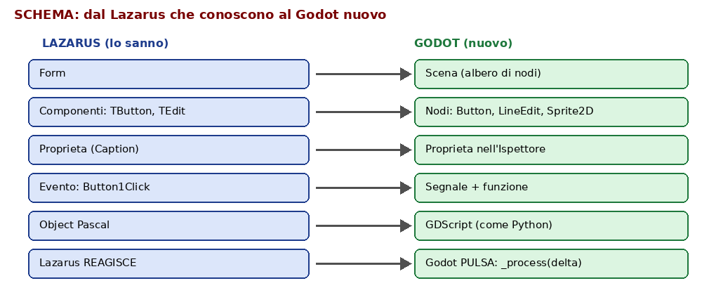
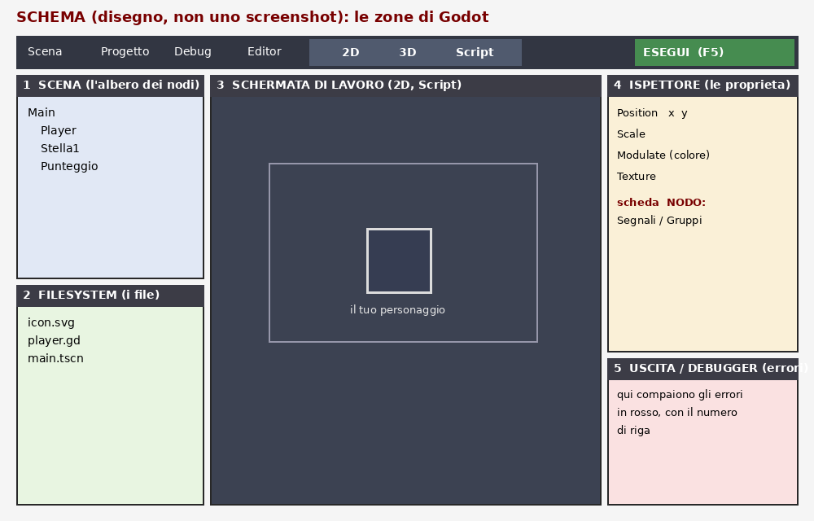
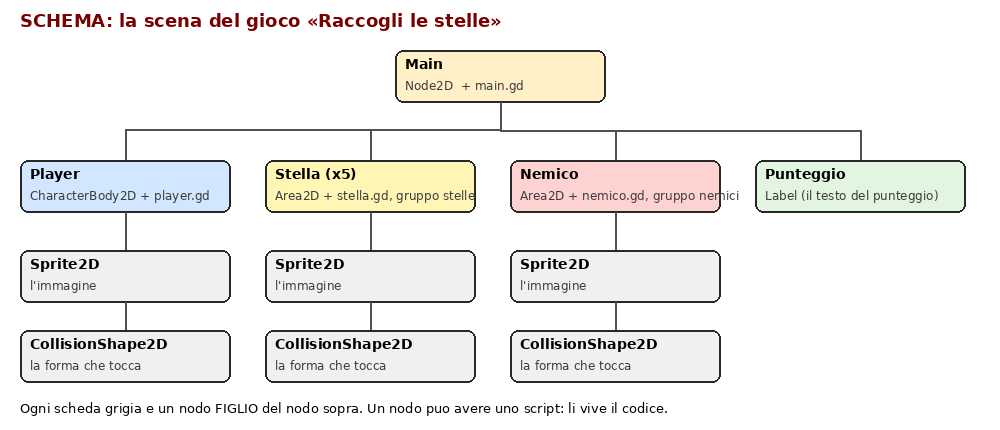

# Guida Godot per il docente

**Versione 1.0** — 02/11/2026

Corso di Informatica — prof. Nicola Regge. Documento interno per il docente (non è per i ragazzi).

Per chi sa Lazarus e non ha mai usato Godot. Si legge dall'inizio alla fine in circa 40 minuti, poi si usa come promemoria durante le lezioni.

## 00 Come si usa questa guida

1. Quando si usa: **2INF giovedì 05/11, ore 8–11** (Laboratorio professionale, 3 ore) e **3INF lunedì 09/11, ore 8–11** (orario di lunedì presunto uguale a quello del 02/11). Le altre classi non fanno Godot ora: 1INF: Godot previsto più avanti, nessuna lezione adesso.
2. Come è fatta: prima si capisce che cos'è Godot (sezioni 01 e 02), poi si prepara il PC (03), si impara a muoversi (04 e 05), si prova «il primo risultato» in 10 minuti (06) e si fa la lezione intera passo per passo (07). Dopo ci sono le lezioni successive, gli errori più comuni, la consegna su GitHub, il progetto dell'anno, le voci dell'Allegato A, le frasi da dire ai ragazzi e il glossario.
3. Il progetto di esempio, già pronto e provato, è nella cartella `godot/guida-docente/RaccogliLeStelle/`: si apre con Godot (Importa → quella cartella) e si può usare come soluzione per controllare il lavoro dei ragazzi.
4. Cosa è stato verificato e cosa no: tutti gli script GDScript di questa guida sono stati controllati con Godot 4.4.1 (versione senza finestra) e il gioco «Raccogli le stelle» è stato provato in modo automatico (stelle, punteggio, vittoria, nemico, riavvio, salvataggio del record). **Non** è stato provato l'editor con le finestre: i nomi dei menu e dei bottoni sono quelli della versione 4.x, in italiano e in inglese tra parentesi, e possono differire di poco. Gli schemi sono disegni: gli screenshot veri li aggiungeremo appena li mandi.

## 01 Che cos'è Godot e perché lo usiamo

1. Godot è un programma **gratuito e libero** per costruire videogiochi. Con lo stesso programma si disegnano le scene, si scrive il codice e si prova il gioco premendo un bottone.
2. È molto leggero: è **un solo file .exe**. Non si installa e non chiede l'amministratore. È perfetto per la scuola.
3. Il linguaggio si chiama **GDScript** ed è molto simile a Python: poche parole, niente punto e virgola, si scrive con il rientro (come in Python).
4. Perché serve a noi, secondo l'Allegato A:
   1. **2INF** (Comp. 15): «Sviluppo di videogiochi con Godot Engine: scene, nodi, segnali, GDScript, game loop».
   2. **3INF** (Comp. 13 e 15): Godot, «GDScript, game loop, collisioni, dati in JSON».
   3. 1INF: previsto più avanti.
5. Perché motiva i ragazzi: il primo risultato (un personaggio che si muove con le frecce) arriva in **10 minuti** ed è un gioco vero, che possono mostrare ai compagni. Questo è esattamente il motore del corso: «Vinci subito, Fallo tuo, Mostralo».

## 02 Il ponte da Lazarus

I ragazzi, e tu, conoscete già l'idea: una finestra, dei componenti, delle proprietà, degli eventi. In Godot cambiano i nomi, non l'idea.



| Lazarus (lo sanno) | Godot (nuovo) | Che cosa vuol dire |
|---|---|---|
| Form | **Scena** (albero di nodi) | Una scena è una «schermata» o un pezzo di gioco (il giocatore, una stella, il livello). |
| Componenti (TButton, TEdit) | **Nodi** (Button, LineEdit, Sprite2D) | Ogni oggetto del gioco è un nodo. I nodi si mettono uno dentro l'altro, come in un albero. |
| Proprietà (Caption) nell'Object Inspector | Proprietà nell'**Ispettore** | Posizione, colore, immagine, scala: si cambiano a destra. |
| Gestore di evento (Button1Click) | **Segnale** + funzione | Un nodo «avvisa» che è successo qualcosa (toccato, cliccato) e parte una funzione tua. |
| Object Pascal | **GDScript** (stile Python) | Il codice di ogni nodo sta in un file `.gd`. |
| Il programma aspetta un evento | **Il gioco pulsa**: `_process(delta)` gira circa 60 volte al secondo | Lazarus reagisce, Godot pulsa. |

La frase da ricordare ai ragazzi: **«Lazarus reagisce, Godot pulsa».** In Lazarus non succede niente finché non clicchi. In Godot il codice parte da solo 60 volte al secondo, e per questo un personaggio si può muovere.

## 03 Averlo senza installare e senza amministratore

Perché: a scuola installare programmi richiede l'amministratore. Godot non si installa.

1. Sul PC (casa o scuola) apri il browser e vai su `godotengine.org`, sezione **Download**, scheda **Windows**.
2. Scarica la versione **«Godot Engine»** (la standard). **Non** scaricare la versione «.NET»: serve il linguaggio C#, noi usiamo GDScript.
3. Prendi una versione **4.x stabile recente**. Gli script di questa guida sono stati provati con la **4.4.1**: va bene anche una più nuova.
4. Il file è uno ZIP (circa 60 MB): clic destro, «Estrai tutto». Dentro c'è un solo file `.exe` (con il nome tipo `Godot_v4.4.1-stable_win64.exe`). Il file con `_console` nel nome non serve.
5. Copia quel `.exe` in una cartella tua, per esempio `Documenti\Godot\` (non serve altro). Si avvia con doppio clic.
6. Per la classe: scaricalo **una volta sola** tu e metti il file su Classroom o sul Drive della classe: i ragazzi lo copiano nella loro cartella `Documenti\Godot\`. Non serve Internet per usarlo.
7. Se Windows dice «Windows ha protetto il PC» (SmartScreen): clic su **Ulteriori informazioni → Esegui comunque**.
8. Se un criterio della scuola (AppLocker) blocca l'`.exe`: serve uno sblocco **una volta sola** dall'amministratore per quella cartella. Nel frattempo si può lavorare dalla **chiavetta USB** oppure dal piano B qui sotto.
9. **Piano B nel browser:** `editor.godotengine.org` apre l'editor di Godot dentro il browser, senza scaricare nulla. È più limitato e a volte lento: si usa solo se l'`.exe` è bloccato.

## 04 Il giro dell'interfaccia

Quando apri Godot vedi prima il **Gestore progetti** (Project Manager): l'elenco dei progetti e il bottone **Crea** (Create). Dopo aver creato un progetto si apre l'**editor**, fatto di 5 zone.



1. **Scena (Scene)**, in alto a sinistra: l'albero dei nodi del gioco. È il tuo «Form».
2. **FileSystem**, in basso a sinistra: i file del progetto (immagini, script, scene).
3. **Schermata di lavoro**, al centro: in alto ci sono le schede **2D**, **3D** e **Script**. Con **2D** vedi e muovi gli oggetti; con **Script** scrivi il codice.
4. **Ispettore (Inspector)**, a destra: le proprietà del nodo scelto. Accanto c'è la scheda **Nodo (Node)** con **Segnali (Signals)** e **Gruppi (Groups)**.
5. **Uscita e Debugger**, in basso: qui compaiono i messaggi e gli **errori in rosso** con il numero di riga.
6. In alto a destra, il bottone **Esegui (Play, tasto F5)**: lancia il gioco. **F6** lancia solo la scena aperta. **F8** ferma il gioco.

Con **Ctrl+S** si salva. In Godot si salvano due cose: la **scena** (file `.tscn`) e gli **script** (file `.gd`).

## 05 Il vocabolario minimo, in parole da dodicenni

1. **Scena**: un pezzo di gioco salvato in un file (il giocatore, una stella, il livello).
2. **Nodo**: un oggetto del gioco. Ha un tipo (cosa sa fare) e un nome.
3. **Sprite2D**: il nodo che mostra un'immagine.
4. **CharacterBody2D**: il nodo di un personaggio che si muove e si ferma contro i muri. Usa `velocity` e `move_and_slide()`.
5. **Area2D**: una zona che «sente» quando qualcuno ci entra (le stelle, i nemici).
6. **CollisionShape2D**: la forma invisibile con cui un oggetto «tocca» gli altri.
7. **Segnale**: un nodo che dice «è successo qualcosa» (per esempio `body_entered`: qualcuno è entrato). Noi scriviamo la funzione che parte.
8. **GDScript**: il linguaggio del codice in Godot.
9. **`_process(delta)`**: la funzione che Godot chiama a ogni «battito» (circa 60 volte al secondo).
10. **`_physics_process(delta)`**: come sopra, ma per le cose che toccano e si muovono con la fisica (il personaggio).
11. **`delta`**: il tempo passato dall'ultimo battito. Moltiplicare per `delta` fa muovere tutti alla stessa velocità, anche con PC lenti.
12. **Input**: i tasti premuti (le frecce, la barra spaziatrice, Invio).
13. **Collisione**: quando due oggetti si toccano.
14. **Gruppo**: un'etichetta (per esempio «stelle») che si mette a più nodi, per trovarli tutti insieme.



## 06 I primi 10 minuti: «Vinci subito»

Obiettivo: un personaggio sullo schermo che si muove con le frecce. È il risultato che ferma la fuga dei ragazzi.

**Per il docente (e poi per i ragazzi):**

1. Avvia Godot (doppio clic sull'`.exe`). Si apre il Gestore progetti.
2. Clic su **Crea (Create)**. Si apre una finestra.
3. Scrivi come nome del progetto: `PrimoGioco`.
4. Nella casella del percorso scegli (con il bottone cartella) `Documenti\Godot\Progetti`. Clic su **Crea cartella (Create Folder)** se serve.
5. In **Renderer** scegli **Compatibilità (Compatibility)**: va bene anche sui PC vecchi della scuola.
6. Clic su **Crea (Create)**. Si apre l'editor con una scena vuota.
7. A sinistra, nella zona **Scena**, clic su **Altro nodo (Other Node)**. Cerca `Sprite2D`, scegli quello, clic su **Crea (Create)**. Ora c'è un nodo «Sprite2D».
8. In basso a sinistra, in **FileSystem**, c'è `icon.svg`. **Trascinalo** nel campo **Texture** dell'Ispettore (a destra). Compare l'icona di Godot nella schermata.
9. Con il nodo Sprite2D scelto, in **Ispettore → Position** (posizione) scrivi X = 576 e Y = 324: l'icona va al centro.
10. Clic destro sul nodo Sprite2D → **Allega script (Attach Script)**. Nella finestra clic su **Crea (Create)**. Si apre la scheda **Script**.
11. Seleziona tutto il testo dello script (**Ctrl+A**) e incolla questo (**Ctrl+V**):

```gdscript
extends Sprite2D

func _process(delta):
	var direzione = Input.get_vector("ui_left", "ui_right", "ui_up", "ui_down")
	position += direzione * 300 * delta
```

12. Premi **Ctrl+S**. Godot chiede il nome della scena: scrivi `primo` e conferma.
13. Premi **F5**. La prima volta Godot chiede quale scena avviare: clic su **Seleziona attuale (Select Current)**.
14. Si apre la finestra del gioco. **Premi le frecce**: l'icona si muove. Per chiudere premi F8 o chiudi la finestra.

**FATTO!** Questo è il primo gioco. Dillo ai ragazzi: «Avete appena programmato un videogioco».

Come si legge il codice, riga per riga (da dire a voce):

1. `extends Sprite2D`: questo script appartiene a un nodo Sprite2D.
2. `func _process(delta):` : questa funzione parte da sola a ogni battito.
3. `Input.get_vector(...)`: legge le 4 frecce e dà una direzione (sinistra, destra, su, giù).
4. `position += direzione * 300 * delta`: sposta il nodo. 300 è la velocità: si può cambiare.

## 07 Lezione 1 ora per ora (3 ore)

Titolo per i ragazzi: **«Il mio primo videogioco: Raccogli le stelle»**. Una sola ora per volta: si sblocca la successiva solo quando finisci (regola 31 del corso).

**Ora 1: «Il mio personaggio» (Vinci subito, Fallo tuo)**

1. 10 minuti: tutti fanno la sezione 06 (primi 10 minuti). Chi finisce aiuta il vicino.
2. **Fallo tuo**, a scelta del ragazzo (10 minuti). Ogni modifica si prova con F5:
   1. Cambiare la velocità: `300` diventa `600` (più veloce) o `150` (più lenta).
   2. Cambiare il colore: nell'Ispettore, **Modulate** (sotto Canvas Item → Visibility): scegli un colore.
   3. Cambiare la grandezza: **Scale** (per esempio 0.5 o 2).
   4. Cambiare l'immagine: trascinare nel campo Texture un'altra immagine (una foto, un meme, un disegno) messa nella cartella del progetto.
3. **Mostralo**: il ragazzo fa vedere il suo gioco a un compagno e dice a voce, con parole sue, che cosa fa `position += direzione * velocità * delta`. Questa è la prova del nove.
4. Quaderno (regola 23 solo per la 1INF): non si applica qui. Chiedi invece uno **screenshot del gioco in esecuzione** (tasto Stamp o Windows+Maiusc+S) da consegnare.

**Ora 2: «Le stelle» (segnali e collisioni)**

Qui si passa da un'immagine che si muove a un gioco vero. Usiamo un personaggio con la fisica e delle stelle che si raccolgono.

1. Nuova scena: **Scena → Nuova scena (New Scene)**. Nodo radice: **Altro nodo → CharacterBody2D**. Rinominalo `Player` (clic sul nome, F2).
2. Clic destro su `Player` → **Aggiungi nodo figlio (Add Child Node)** → `Sprite2D`. Trascina `icon.svg` nella Texture.
3. Clic destro su `Player` → Aggiungi nodo figlio → `CollisionShape2D`. Nell'Ispettore, campo **Shape**: clic e scegli **RectangleShape2D** (Nuovo rettangolo). Trascina i quadratini nella schermata 2D per coprire l'immagine (circa 120 per 120).
4. Allega uno script a `Player` e incolla:

```gdscript
extends CharacterBody2D

const VELOCITA = 300.0

func _physics_process(_delta):
	var direzione = Input.get_vector("ui_left", "ui_right", "ui_up", "ui_down")
	velocity = direzione * VELOCITA
	move_and_slide()
```

5. Salva la scena (Ctrl+S) con il nome `player`.
6. **La stella.** Nuova scena, nodo radice **Area2D**, rinominato `Stella`. Aggiungi due figli: `Sprite2D` (immagine `icon.svg`, **Scale** 0.5, **Modulate** giallo) e `CollisionShape2D` (forma **CircleShape2D**, raggio circa 40).
7. Il **segnale**, passo per passo (è l'evento di Lazarus):
   1. Seleziona il nodo `Stella`.
   2. Nella zona a destra clic sulla scheda **Nodo (Node)** accanto a Ispettore.
   3. Sotto **Segnali (Signals)** fai **doppio clic** su `body_entered(body: Node2D)`.
   4. Nella finestra clic su **Connetti (Connect)**. Godot apre lo script e crea la funzione `_on_body_entered`.
8. Gruppo: sempre nella scheda **Nodo**, sezione **Gruppi (Groups)**: scrivi `stelle` e clic su **Aggiungi (Add)**.
9. Seleziona tutto lo script della stella (Ctrl+A) e incolla:

```gdscript
extends Area2D

signal raccolta

func _on_body_entered(body):
	if body.name == "Player":
		raccolta.emit()
		queue_free()
```

10. Salva la scena con il nome `stella`. Spiegazione a voce: «Quando qualcuno entra nella stella, se è il Player la stella manda un avviso `raccolta` e sparisce».
11. **La scena principale.** Nuova scena, nodo radice **Node2D** rinominato `Main`. Trascina `player.tscn` e poi `stella.tscn` (da FileSystem) dentro la scena: appaiono come figli. Duplica la stella con **Ctrl+D** e mettine 5 in posti diversi. Il Player a sinistra.
12. Salva come `main` e premi **F5**: Godot chiede la scena principale, scegli `main.tscn`. Muovi il Player contro le stelle: spariscono.

**Fallo tuo:** il colore delle stelle, dove le metto, quante sono (3, 5, 10), un'immagine mia per le stelle. **Mostralo:** fai provare il tuo livello a un compagno.

**Ora 3: «Il punteggio» (script che parla con gli altri nodi)**

1. Nella scena `main`: clic destro su `Main` → Aggiungi nodo figlio → **Label**. Rinominalo `Punteggio`. Nell'Ispettore, **Text**: scrivi `Stelle: 0`. Spostalo in alto a sinistra (Position 20, 20).
2. Allega uno script a `Main`. Incolla questo (versione senza nemici):

```gdscript
extends Node2D

var punti = 0
const STELLE_PER_VINCERE = 5

func _ready():
	for stella in get_tree().get_nodes_in_group("stelle"):
		stella.raccolta.connect(_on_stella_raccolta)
	aggiorna_testo()

func _on_stella_raccolta():
	punti += 1
	aggiorna_testo()
	if punti == STELLE_PER_VINCERE:
		$Punteggio.text = "HAI VINTO! Premi Invio per ricominciare"

func aggiorna_testo():
	$Punteggio.text = "Stelle: " + str(punti)

func _input(event):
	if event.is_action_pressed("ui_accept"):
		get_tree().reload_current_scene()
```

3. Cambia `STELLE_PER_VINCERE` in modo che sia uguale al numero di stelle che hai messo.
4. F5: ogni stella raccolta fa salire il punteggio; alla fine compare «HAI VINTO!». Con Invio si ricomincia.
5. Come si spiega: `_ready` parte una volta all'inizio e collega tutte le stelle; `$Punteggio` è il nodo Label figlio; `str(punti)` trasforma il numero in testo (come IntToStr in Lazarus).
6. **Consegna** (sezione 09): cartella del progetto su GitHub, con un messaggio chiaro.

**Voto della lezione 1 (KPI, da confermare):** parte da 40 e arriva a 80.

| Che cosa si misura | Punti |
|---|---|
| Il personaggio si muove con le frecce (screenshot) | +10 |
| Fallo tuo: almeno una modifica che si vede | +5 |
| Le stelle si raccolgono e spariscono | +10 |
| Il punteggio e la scritta HAI VINTO funzionano | +10 |
| Progetto su GitHub con messaggio chiaro | +5 |
| Totale massimo | 80 |

**Per il docente, durante il lavoro:** controlla a colpo d'occhio che ognuno abbia (1) il gioco che parte con F5, (2) l'Uscita senza righe rosse, (3) lo script allegato al nodo giusto. Se uno è bloccato, vai alla sezione 08.

**Per la 3INF (lunedì 09/11)** la lezione è la stessa, più veloce, e in più si fa questo (competenza 13: GDScript, game loop, collisioni, dati in JSON): vedi la sezione 08, lezioni 2 e 3.

## 08 Lezioni 2 e 3 in breve, errori comuni e aiuto

**Lezione 2: il nemico e il riavvio**

1. Nuova scena: nodo radice **Area2D** chiamato `Nemico`, con `Sprite2D` (immagine con **Modulate** rosso) e `CollisionShape2D` (RectangleShape2D). Nel gruppo **nemici** (scheda Nodo → Gruppi). Connetti il segnale `body_entered` come per la stella.
2. Script del nemico (va avanti e indietro, e avvisa se tocca il Player):

```gdscript
extends Area2D

signal toccato

var velocita = 150.0
var direzione = 1

func _process(delta):
	position.x += velocita * direzione * delta
	if position.x > 1000 or position.x < 100:
		direzione = -direzione

func _on_body_entered(body):
	if body.name == "Player":
		toccato.emit()
```

3. Mettilo nella scena `main`. Poi sostituisci lo script di `Main` con questo (ora conosce stelle e nemici):

```gdscript
extends Node2D

var punti = 0
const STELLE_PER_VINCERE = 5

func _ready():
	for stella in get_tree().get_nodes_in_group("stelle"):
		stella.raccolta.connect(_on_stella_raccolta)
	for nemico in get_tree().get_nodes_in_group("nemici"):
		nemico.toccato.connect(_on_nemico_toccato)
	aggiorna_testo()

func _on_stella_raccolta():
	punti += 1
	aggiorna_testo()
	if punti == STELLE_PER_VINCERE:
		$Punteggio.text = "HAI VINTO! Premi Invio per ricominciare"

func _on_nemico_toccato():
	get_tree().call_deferred("reload_current_scene")

func aggiorna_testo():
	$Punteggio.text = "Stelle: " + str(punti)

func _input(event):
	if event.is_action_pressed("ui_accept"):
		get_tree().reload_current_scene()
```

4. La riga `get_tree().call_deferred("reload_current_scene")` evita un errore di Godot (vedi la tabella sotto): si ricarica la scena «dopo», non nel mezzo di una collisione.

**Lezione 3: il menu, i suoni e il record (3INF: dati in JSON)**

1. **Menu:** nuova scena con nodo radice **Control** (`Menu`) e un figlio **Button** con testo «GIOCA». Connetti il segnale `pressed` del bottone al nodo `Menu` e usa:

```gdscript
extends Control

func _on_gioca_pressed():
	get_tree().change_scene_to_file("res://main.tscn")
```

2. **Suono:** aggiungi a `Main` un nodo **AudioStreamPlayer** chiamato `Suono`. Nell'Ispettore, campo **Stream**, carica un file `.wav` o `.ogg` (suoni gratuiti, per esempio con licenza CC0). Poi in `_on_stella_raccolta` aggiungi la riga `$Suono.play()`.
3. **Record salvato (3INF, dati in JSON):** il punteggio migliore si salva in un file e si rilegge alla partita dopo.

```gdscript
extends Node

const FILE_RECORD = "user://record.json"

func carica_record():
	if not FileAccess.file_exists(FILE_RECORD):
		return 0
	var f = FileAccess.open(FILE_RECORD, FileAccess.READ)
	var dati = JSON.parse_string(f.get_as_text())
	if dati == null:
		return 0
	return int(dati["record"])

func salva_record(valore):
	var f = FileAccess.open(FILE_RECORD, FileAccess.WRITE)
	f.store_string(JSON.stringify({"record": valore}))
```

4. **Come si spiega JSON** ai ragazzi: è un modo di scrivere i dati come un'etichetta e un valore (`"record": 7`). Lo stesso file lo può leggere qualsiasi programma. `user://` è una cartella che Godot sceglie per salvare i dati dell'utente.

**Gli errori più comuni dei principianti**

| Che cosa succede | Perché | Come si risolve |
|---|---|---|
| Messaggio rosso «Mixed use of tabs and spaces» (tab e spazi mischiati) | Nello script ci sono righe rientrate con Tab e altre con spazi | Menu **Modifica (Edit) → Converti rientro in Tab (Convert Indent to Tabs)**. Poi usa sempre il tasto Tab. |
| «Parser Error» o una riga rossa nell'Uscita con un numero di riga | Un errore di battitura (due punti `:` dimenticati, parola scritta male, rientro sbagliato) | Clic sulla riga rossa nell'Uscita: Godot ti porta alla riga. Controlla i due punti e le maiuscole. |
| F5 non parte, o chiede la scena principale | Non è stata scelta la scena da avviare | **Progetto → Impostazioni progetto → Applicazione → Esegui → Scena principale** e scegli `main.tscn`. Oppure F6 per la scena aperta. |
| Premo le frecce e non si muove | Lo script non è allegato al nodo giusto, oppure non è stato salvato | Seleziona il nodo: nell'albero deve esserci l'icona del foglio con lo script. Se manca: clic destro sul nodo → Allega script. Poi Ctrl+S. |
| «Invalid access to property or key» o «Node not found» con `$Punteggio` | Il nodo ha un nome diverso da quello nel codice (maiuscole comprese) | Controlla il nome del nodo nell'albero: deve essere esattamente `Punteggio`. |
| La stella non sparisce | Il segnale non è collegato, oppure il giocatore non si chiama `Player` | Nella scheda Nodo della stella cerca la freccia verde accanto a `body_entered`. Controlla che il nodo si chiami `Player`. |
| «Removing a CollisionObject node during a physics callback is not allowed» | Si ricarica la scena nel mezzo di una collisione | Usa `get_tree().call_deferred("reload_current_scene")`, come nella lezione 2. |
| Il personaggio attraversa i muri o le stelle | Manca il nodo `CollisionShape2D`, oppure la sua forma è vuota | Il nodo di collisione deve avere un campo **Shape** compilato (se c'è un triangolo giallo di avviso, manca la forma). |
| La finestra del gioco non si apre o si chiude subito | Errore nello script | Guarda l'Uscita (in basso) per la riga rossa. |
| Windows blocca l'`.exe` | Criterio della scuola | Sezione 03, punti 7 e 8. |

Dove guardare sempre: **in basso, la scheda Uscita (Output) e Debugger**: l'errore è in rosso, con il file e il numero di riga. Un clic sul messaggio porta alla riga.

## 09 Come consegnano: GitHub dal browser, zero riga di comando

Regola del corso: niente riga di comando, si clicca. Ogni ragazzo ha un account GitHub (la 2INF ha anche l'autenticazione a due fattori: accedono con il numero del generatore).

1. **Chiudi Godot** (così il progetto è tutto salvato).
2. Nella cartella del progetto (per esempio `Documenti\Godot\Progetti\PrimoGioco`) c'è una cartella chiamata **`.godot`**. **Non si carica su GitHub** (è piena di file di servizio e Godot la ricrea da solo). Si può **cancellare** prima di caricare: alla riapertura Godot la rifà.
3. Apri `github.com`, accedi, clic su **New (Nuovo) repository**. Nome: per esempio `raccogli-le-stelle-COGNOME` (senza spazi). Clic su **Create repository**.
4. Nella pagina del nuovo repository clic sul link **uploading an existing file (carica un file esistente)**, oppure **Add file → Upload files**.
5. **Trascina dentro la finestra** tutti i file e le cartelle del progetto (tranne `.godot`): `project.godot`, `icon.svg`, i file `.gd`, i file `.tscn`, le eventuali immagini e suoni.
6. In basso, nella casella **Commit changes**, scrivi un messaggio **chiaro**, per esempio:

```
Aggiungo le stelle e il punteggio
```

7. Clic sul bottone verde **Commit changes**. Fatto: il gioco è su GitHub.
8. **Per ogni lezione** si aggiunge un nuovo commit con un messaggio che dice cosa è cambiato. Esempi buoni: «Personaggio che si muove con le frecce», «Aggiungo il nemico e il riavvio». Esempi da evitare: «ok», «prova», «aaa».
9. **Release v1.0** (quando il gioco è finito): nel repository, a destra, clic su **Releases → Create a new release**. In **Choose a tag** scrivi `v1.0`, titolo «Raccogli le stelle v1.0», clic su **Publish release**. È la versione «congelata» da mostrare.
10. Si può anche far aprire il progetto direttamente: chi ha Godot sul PC clicca **Code → Download ZIP**, estrae e usa **Importa (Import)** nel Gestore progetti.

## 10 Il progetto per tutto l'anno: «Raccogli le stelle» che cresce

L'idea: un solo gioco che si arricchisce lezione dopo lezione, invece di tanti esercizi staccati. Così ogni ragazzo ha alla fine **un gioco suo**, con la storia dei commit su GitHub e le versioni (release), una cosa da mostrare a un colloquio.

| Versione | Che cosa c'è | Lezione |
|---|---|---|
| v0.1 | Il personaggio si muove con le frecce | 1, ora 1 |
| v0.2 | Le stelle si raccolgono | 1, ora 2 |
| **v1.0** | Punteggio e scritta HAI VINTO, riavvio con Invio | 1, ora 3 |
| v1.1 | Un nemico che pattuglia, riavvio se lo tocchi | 2 |
| v1.2 | Menu iniziale, suoni, record salvato (JSON) | 3 |
| v1.3 | Più livelli, immagini personali, musica | successive |
| v2.0 | Progetto a gruppi: livello, interfaccia, movimenti, integrati insieme | fase a gruppi |

**Fase a gruppi (2–4 ragazzi):** i ruoli si dividono e **ruotano**, così nessuno resta indietro o si nasconde:

1. **Scena**: costruisce il livello (dove stanno le cose).
2. **Nodi**: crea gli oggetti (stelle, nemici, ostacoli) e le collisioni.
3. **GUI**: punteggio, menu, schermate (Label, Button).
4. **Movimenti**: il codice del personaggio e dei nemici.

Ognuno lavora sul suo pezzo, poi si **uniscono** i contributi con GitHub (per la 3INF: «Sviluppo collaborativo»: fork, branch, Pull Request, merge, release). Ogni gruppo arriva a una **piccola vittoria mostrabile** (una release v1.0 giocabile).

**Il voto di ogni lezione** parte da 40 e arriva a 80, con il conto scritto (tabella nella sezione 07 per la lezione 1). Per le lezioni 2 e 3:

| Lezione | Che cosa si misura | Punti |
|---|---|---|
| 2 | Il nemico si muove, tocco = riavvio | +15 |
| 2 | Fallo tuo: nemico personalizzato (colore, velocità) | +5 |
| 2 | Commit chiaro su GitHub | +10 |
| 2 | Spiego a voce come funziona il segnale `toccato` | +10 |
| 3 | Menu GIOCA che funziona | +10 |
| 3 | Suono alla stella raccolta | +10 |
| 3 (3INF) | Record salvato e riletto (JSON) | +15 |
| 3 | Release con tag | +5 |

## 11 La mappa sull'Allegato A e come scrivere il registro

Regola: ogni testo del registro è una voce dell'Allegato A della classe, con competenza e anno (regola 36).

| Classe | Voce dell'Allegato A | Competenza |
|---|---|---|
| 2INF (II anno) | «Sviluppo di videogiochi con Godot Engine: scene, nodi, segnali, GDScript, game loop» | Comp. 15 |
| 3INF (III anno) | «Sviluppo di videogiochi con Godot Engine: GDScript, game loop, collisioni, dati in JSON (migrazione dal progetto HTML)» | Comp. 13 e 15 |
| 1INF | Godot previsto più avanti, nessuna lezione ora | Comp. 15 |

**Testi corti per il registro (massimo 40 caratteri), uno per ora, da copiare:**

2INF, giovedì 05/11:

```
Godot: primo gioco 2D, scene e nodi
```

```
Godot: segnali, stelle e collisioni
```

```
Godot: punteggio e consegna su GitHub
```

3INF, lunedì 09/11:

```
Godot: GDScript e game loop
```

```
Godot: collisioni e segnali
```

```
Godot: dati in JSON e consegna
```

**Riga per `ARGOMENTI-SVOLTI-2026-27.md`** (esempio, senza nomi): `| 05/11/2026 | 2INF Laboratorio 3 ore: Godot, primo videogioco 2D «Raccogli le stelle»: scene, nodi, segnali, GDScript, punteggio; consegna su GitHub | docs/ pagina della lezione, guida Godot | Sviluppo di videogiochi con Godot Engine (Comp. 15) |`

## 12 Cosa dire ai ragazzi (frasi pronte)

1. All'inizio: «Oggi facciamo un videogioco vero. Fra 10 minuti avrete un personaggio che si muove con le frecce. Non serve sapere niente: si parte da zero e vi guido io.»
2. Il ponte con Lazarus: «Ricordate Lazarus: la finestra, i bottoni, il clic? In Godot è lo stesso, solo con nomi nuovi: la finestra è la scena, i bottoni sono i nodi, il clic è un segnale.»
3. «Lazarus reagisce, Godot pulsa: il codice parte da solo 60 volte al secondo.»
4. Per chi si sente in difficoltà: «Sbagliare qui è normale. Anche i programmatori professionisti passano la giornata a leggere gli errori rossi. L'errore vi dice in che riga guardare.»
5. «Se si rompe, premi Ctrl+Z: annulla.»
6. Fallo tuo: «Cambiate una cosa che sia vostra: il colore, l'immagine, la velocità. Quello che finisce sullo schermo è vostro.»
7. Mostralo: «Fate provare il vostro gioco a un compagno e ditegli con parole vostre che cosa fa il codice. Se lo sapete spiegare, lo avete capito davvero.»
8. L'AI: «Potete farvi aiutare dalla vostra AI per capire, non per saltare il pensiero. Prima provate voi, poi chiedete.»
9. Consegna: «Chiudete Godot, caricate i file su GitHub e scrivete un messaggio che dica cosa avete fatto, non solo "ok".»
10. A fine lezione: «Chi ha un gioco che parte alzi il pollice. Bravi: oggi avete costruito un videogioco.»

## 13 Glossario

| Termine | Significato in parole semplici |
|---|---|
| Godot | Il programma gratuito per fare videogiochi. |
| GDScript | Il linguaggio di Godot, stile Python. |
| Scena | Un pezzo di gioco salvato in un file `.tscn`. |
| Nodo | Un oggetto del gioco; ha un tipo e un nome. |
| Ispettore | Il pannello a destra con le proprietà del nodo. |
| Segnale | Un avviso che un nodo manda quando succede qualcosa. |
| Area2D | Una zona che sente quando qualcuno entra. |
| CharacterBody2D | Un personaggio che si muove e si ferma contro gli ostacoli. |
| CollisionShape2D | La forma invisibile con cui un oggetto tocca gli altri. |
| `_process(delta)` | La funzione che parte da sola ogni battito. |
| `delta` | Il tempo dall'ultimo battito. |
| Gruppo | Un'etichetta data a più nodi. |
| JSON | Un modo di scrivere i dati con etichetta e valore. |
| Commit | Il salvataggio di una modifica su GitHub, con un messaggio. |
| Release | Una versione «congelata» del progetto, con un numero (v1.0). |

## 14 Elenco dei file del progetto di esempio

La cartella `RaccogliLeStelle/` contiene il progetto completo e provato:

1. `project.godot`, `icon.svg`: il progetto e l'icona.
2. `primo.tscn` + `sprite_muovi.gd`: i primi 10 minuti (il personaggio che si muove).
3. `main.tscn` + `main.gd` (con `main_v1.gd` senza nemici), `player.tscn` + `player.gd`, `stella.tscn` + `stella.gd`, `nemico.tscn` + `nemico.gd`: il gioco.
4. `menu.tscn` + `menu.gd`: il menu iniziale.
5. `record_prova.gd` e `main_audio.gd`: gli esempi del record in JSON e del suono.
6. `.gitignore`: per chi usa Git, esclude la cartella `.godot`.

Si apre con Godot: **Importa (Import)** nel Gestore progetti, scegli `project.godot` della cartella.

**Prove fatte per questa guida:** controllo della sintassi di tutti gli script, avvio del gioco senza finestra, simulazione di 5 stelle raccolte, vittoria, tocco del nemico e riavvio, salvataggio e rilettura del record in JSON, movimento con le frecce. Eseguite con Godot 4.4.1.
