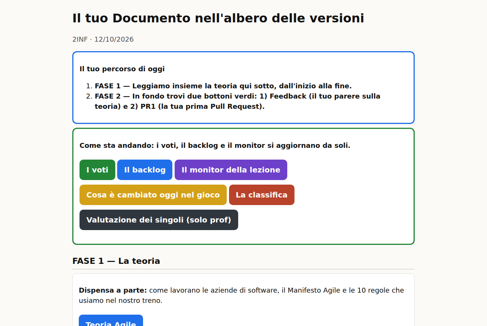
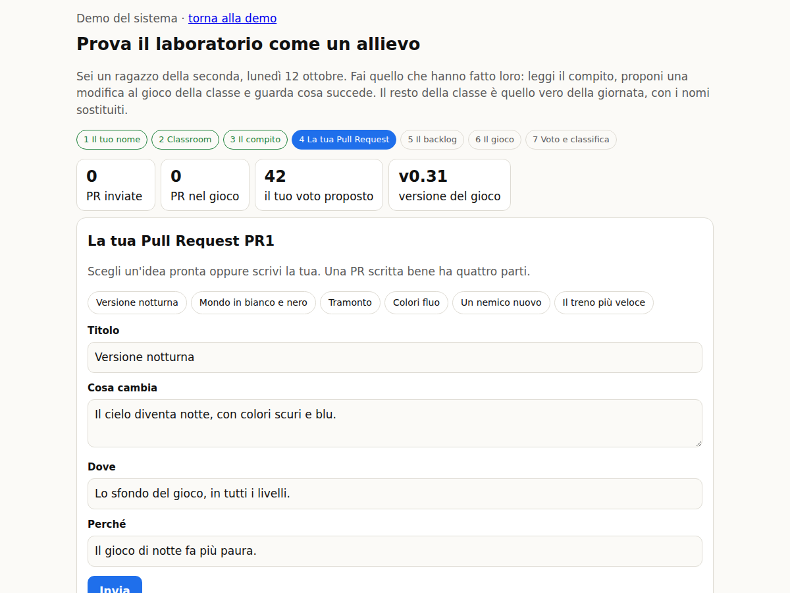
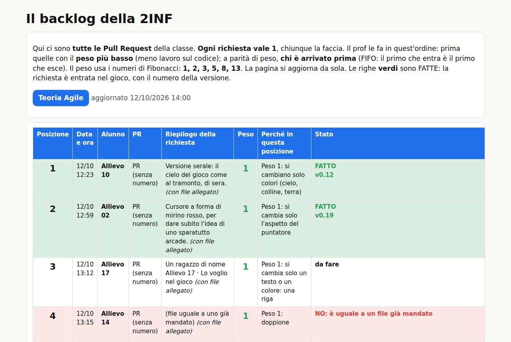
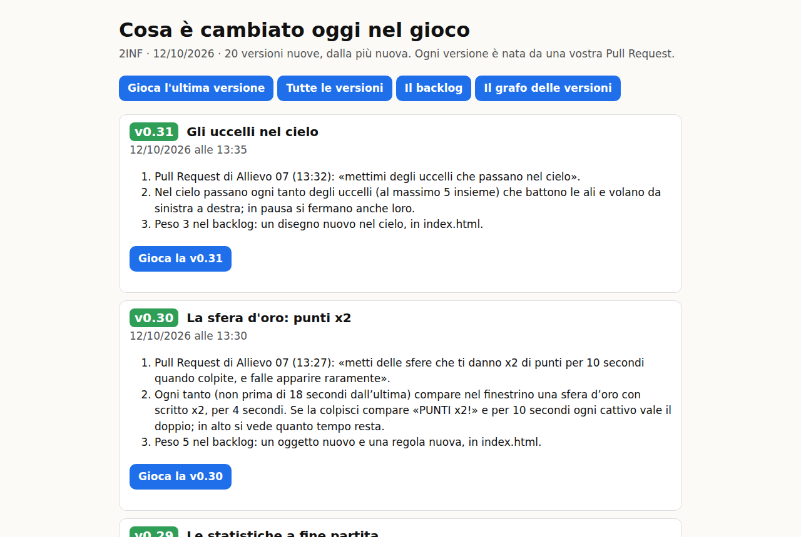
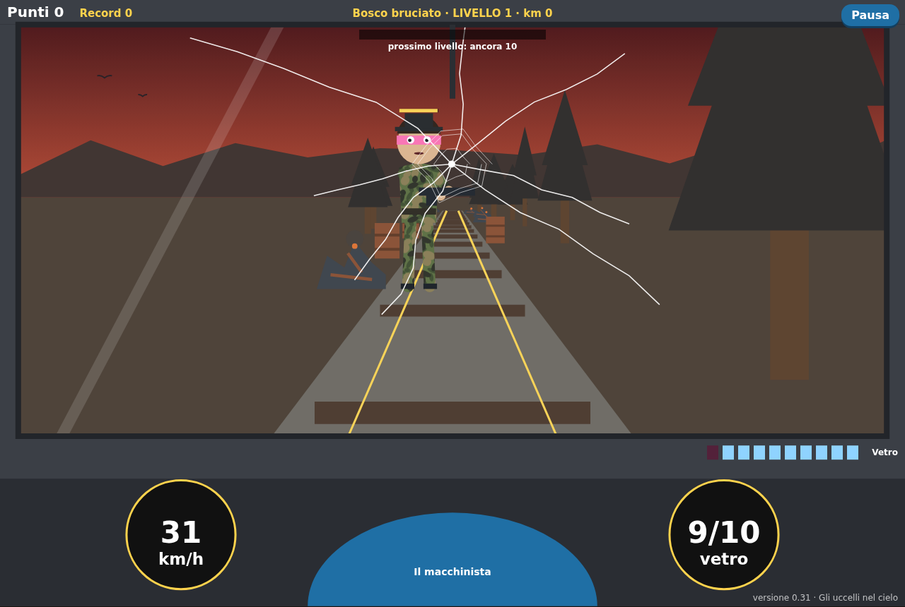
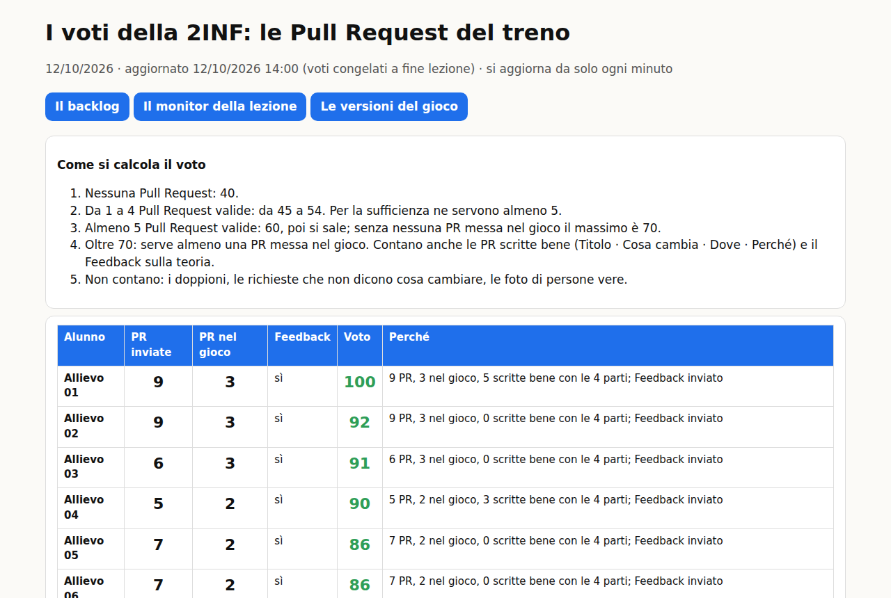
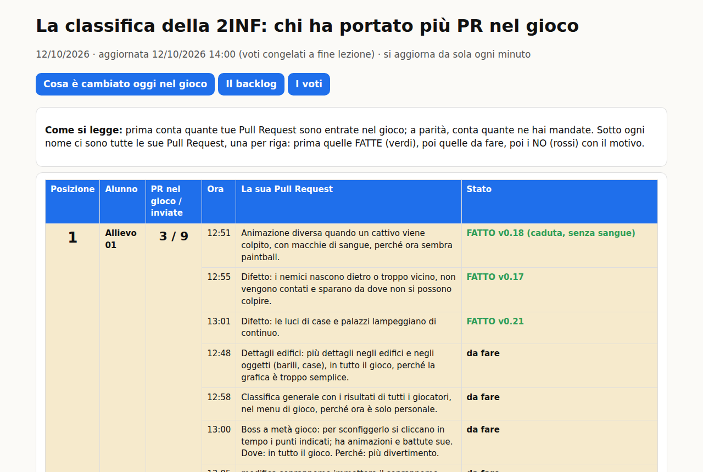
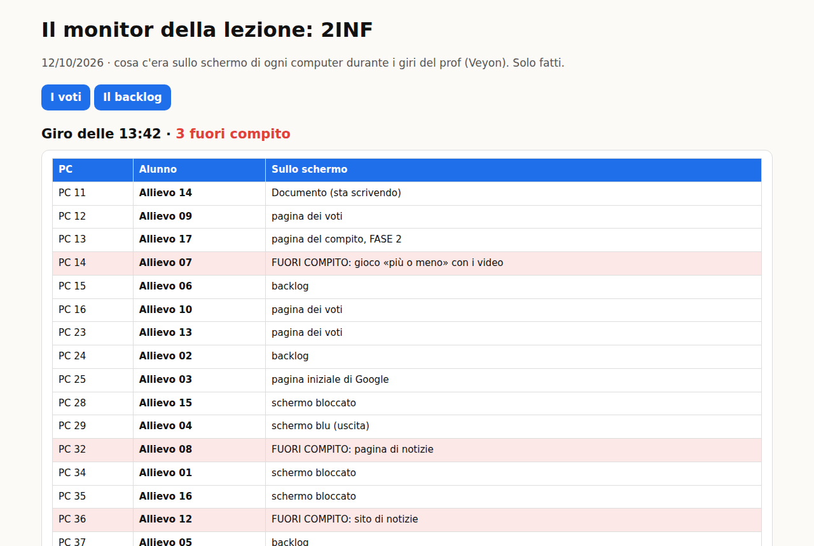
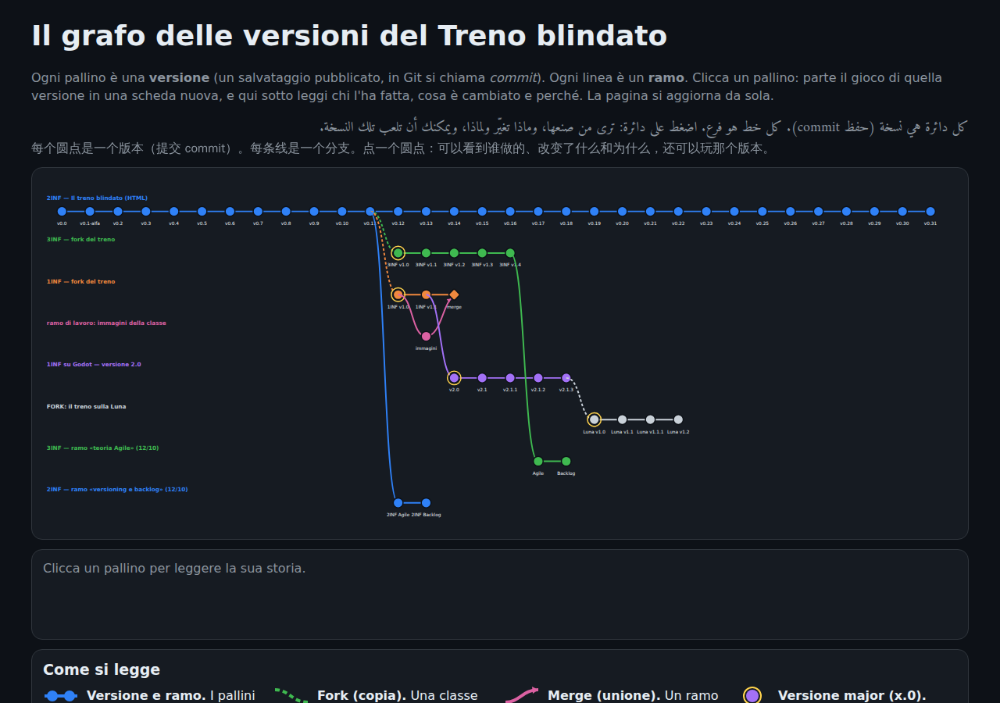

# Una scuola che lavora come un'azienda di software

**Versione 1.2** — 12/10/2026 — Prof. Nicola Regge, Laboratorio di Informatica. Brochure del metodo.

Il laboratorio di informatica che trasforma la classe in un team di sviluppo.

## 01 Il problema

1. **Si arrendono prima di provarci.** Molti ragazzi arrivano da percorsi difficili e hanno imparato che provarci vuol dire sbagliare davanti a tutti. Si difendono mollando.
2. **Il risultato arriva tardi.** Il voto arriva giorni dopo, quando il lavoro è già dimenticato. Nessuno vede subito che il suo impegno conta.
3. **Il docente non vede tutto.** In una classe di venti ragazzi, con lingue diverse, è difficile sapere chi sta lavorando, su cosa e quanto.
4. **Esercizi lontani dal lavoro vero.** Gli esercizi di scuola non somigliano a quello che chiedono le aziende.

## 02 La soluzione

1. **Vinci subito.** Il primo passo è facile per tutti: nei primi dieci minuti ognuno vede qualcosa di suo funzionare.
2. **Fallo tuo.** Ogni ragazzo propone le sue modifiche al gioco della classe: il nome, il colore, il nemico nuovo sono suoi.
3. **Mostralo.** Ogni richiesta accettata diventa una versione nuova del gioco, giocabile subito, con il nome di chi l'ha chiesta.
4. **Tutto si aggiorna da solo.** Backlog, voti, classifica e monitor della lezione si aggiornano ogni minuto, senza lavoro in più per il docente.

## 03 Come funziona una lezione

1. **1. Un solo link su Classroom.** La pagina della lezione: il percorso della giornata, la teoria breve, poi i bottoni verdi del lavoro. 
2. **2. La Pull Request.** Il ragazzo propone una modifica al gioco con quattro parti: titolo, cosa cambia, dove, perché. È la stessa richiesta di modifica che si fa nelle aziende di software. 
3. **3. Il backlog.** Ogni richiesta entra nella coda di lavoro con un peso (quanto lavoro chiede). Si fanno prima le più leggere; ogni richiesta finisce FATTO con la sua versione, oppure NO con il motivo. 
4. **4. Una versione nuova.** Ogni richiesta accettata è una versione del gioco con il suo registro delle modifiche: chi l'ha chiesta, cosa cambia, dove nel codice. 
5. **5. Il gioco della classe.** Il gioco cresce davanti ai loro occhi: 20 versioni in tre ore, tutte nate da proposte dei ragazzi. 

## 04 Cosa vede il docente

1. **I voti, con il perché.** Il voto proposto si calcola da solo: richieste inviate, richieste entrate nel gioco, come sono scritte, feedback sulla teoria. Il voto finale lo decide il docente. 
2. **La classifica.** Chi ha portato più modifiche dentro il gioco. È pubblica durante la lezione: chi è indietro vede subito come recuperare. 
3. **Il monitor della lezione.** Durante i giri il docente guarda gli schermi; resta scritto cosa c'era su ogni computer. Solo fatti, senza giudizi. 
4. **L'albero delle versioni.** La storia del progetto come la disegna Git: rami, copie delle altre classi, unioni, versioni maggiori. 

## 05 I risultati di una lezione vera (2INF, 12/10/2026)

1. 3 ore, 17 ragazzi presenti, 129 Pull Request, 20 versioni nuove del gioco.
2. 17 ragazzi su 17 hanno mandato almeno una richiesta.
3. Pull Request per quarto d'ora: 12:15 3, 12:30 4, 12:45 22, 13:00 49, 13:15 23, 13:30 21, 13:45 7.
4. Un allievo era a 40; alle 13:22 i voti sono stati pubblicati, ha chiesto aiuto e in pochi minuti ha mandato quattro richieste nuove: ha chiuso a 62.

## 06 Le competenze che restano

1. Versionare il software: versioni, rami, copie (fork), unioni (merge), release
2. Chiedere una modifica come in azienda: la Pull Request con titolo, cosa, dove, perché
3. Lavorare con il metodo Agile: backlog, pesi, piccoli passi, sbagliare presto e correggere presto
4. Lavorare in team su un prodotto unico, con regole chiare e il proprio contributo visibile
5. Scrivere in modo preciso e verificabile: la richiesta si capisce o viene rimandata indietro

## 07 Cosa serve

1. Un browser: niente da installare sui computer della scuola
2. Google Classroom e Google Moduli, già in uso in tanti istituti
3. Un repository Git (GitHub) per il gioco e le pagine della lezione
4. Pagine in più lingue per le classi con ragazzi stranieri (italiano, arabo, cinese, bengalese)
5. Uno script che porta le consegne dai Moduli a Git entro un minuto

## 08 Per chi

1. **Scuole e centri di formazione professionale:** un laboratorio di informatica che tiene agganciati anche i ragazzi più difficili.
2. **Docenti:** un metodo pronto, con pagine, regole del voto e strumenti già provati in classe.
3. **Aziende ed enti di formazione:** un percorso che allena le competenze che si usano davvero nei team di sviluppo.

## 09 Provalo

1. La demo del sistema: fai l'allievo, scrivi la tua Pull Request e guardala diventare una versione del gioco.

```
https://script.google.com/macros/s/AKfycbyhkWr44IWarPFRvcyP0Ku1pI-XbFaeBVJA4I0iEITq_4U4XvD5rqiPci77-p2FLory/exec
```

2. Il gioco della classe.

```
https://nicolaregge-pulse.github.io/corso-informatica/giochi/treno-blindato/
```

Contatti: prof. Nicola Regge, nicola.regge@gmail.com
