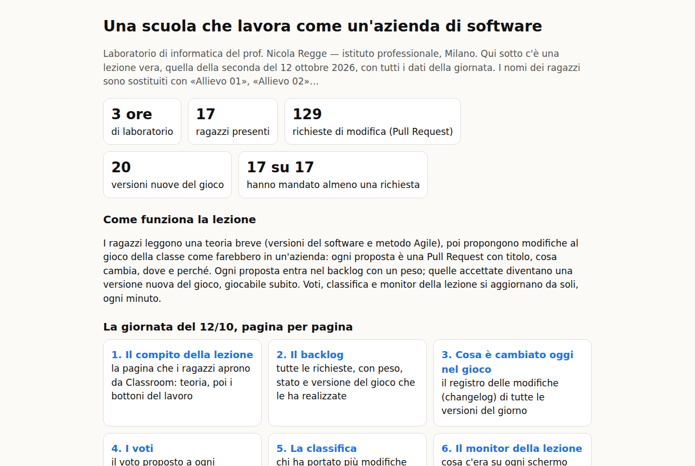
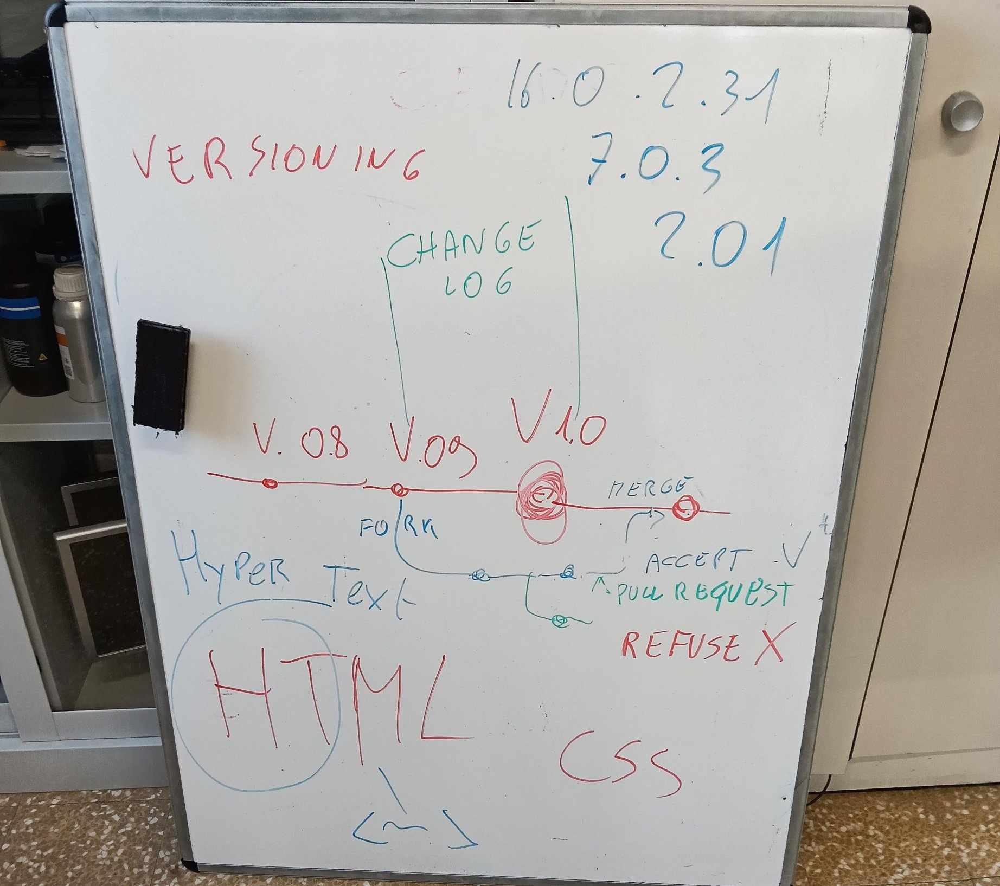

# Una scuola che lavora come un'azienda di software

**Versione 1.1** — 12/10/2026 — Prof. Nicola Regge. Presentazione della demo (lezione della 2INF, senza nomi).

Il laboratorio di informatica secondo le idee di Nicola Regge. Molti ragazzi hanno alle spalle percorsi scolastici difficili; qui lavorano come in un'azienda vera, con gli strumenti dei programmatori.
Questa è la lezione di una seconda del 12 ottobre 2026: tre ore di laboratorio. I nomi dei ragazzi sono sostituiti con «Allievo 01», «Allievo 02»…

## 00 I numeri della giornata

1. **3 ore** di laboratorio
2. **17** ragazzi presenti
3. **129** richieste di modifica
4. **20** versioni nuove del gioco
5. **17 su 17** hanno mandato almeno una richiesta

## 01 La demo



La pagina d'ingresso della demo: si entra con la propria email e un codice, l'accesso vale 24 ore.

## 02 La lavagna



Si parte dalla lavagna: versioni, registro delle modifiche (changelog), copia del progetto (fork), richiesta di modifica (Pull Request), accettata o rifiutata, unione (merge).

## 03 Il compito della lezione


Un solo link fisso su Classroom. In alto il percorso della giornata, poi la teoria da leggere (versioni del software e metodo Agile), poi i bottoni verdi del lavoro.

## 04 Il backlog


Ogni richiesta dei ragazzi entra qui con un riassunto e un peso (quanto lavoro chiede, con i numeri di Fibonacci). Si fanno prima le più leggere; ognuna diventa FATTO con la versione del gioco, oppure NO con il motivo.

## 05 Cosa è cambiato oggi nel gioco


Il registro delle modifiche della giornata: ogni richiesta accettata è una versione nuova del gioco, con chi l'ha chiesta, cosa cambia e dove nel codice.

## 06 Il gioco della classe


«Il treno blindato»: è cresciuto di 20 versioni in tre ore, tutte proposte dai ragazzi. Ogni versione resta giocabile.

## 07 I voti


Il voto proposto si calcola da solo dalle richieste inviate, da quelle entrate nel gioco, da come sono scritte e dal feedback sulla teoria. Il voto finale lo decide il docente.

## 08 La classifica


Chi ha portato più modifiche dentro il gioco. Un allievo è passato da 40 a 62 dopo aver visto i voti pubblicati e aver chiesto aiuto: in pochi minuti ha mandato quattro richieste nuove.

## 09 Il monitor della lezione


Durante i giri il docente guarda gli schermi della classe; qui resta scritto cosa c'era su ogni computer. Solo fatti, senza giudizi.

## 10 L'albero delle versioni


La storia del gioco come la disegna Git: il ramo principale, le copie delle altre classi, i rami di lavoro, le unioni e le versioni maggiori.

## 11 Prova la demo

Apri l'indirizzo, scrivi la tua email, inserisci il codice che arriva per email e clicca «Apri la demo».

```
https://script.google.com/macros/s/AKfycbyhkWr44IWarPFRvcyP0Ku1pI-XbFaeBVJA4I0iEITq_4U4XvD5rqiPci77-p2FLory/exec
```
